<!-- GENERATED FILE: edit data/ and run scripts/refresh, not this file -->
# Awesome Decomp Games 

  

> A rated, auto-refreshed list of **decompiled, recompiled and reverse-engineered games**: matching decompilations, static recompilations, source ports, engine remakes, disassemblies and browser ports.

**2046 projects** covering **1817 games** · updated 2026-10-13 · browse and filter on the **[website](https://submitgame.github.io/awesome-decomp-games/)** · data in [`data/games.json`](data/games.json)

> [!IMPORTANT]
> This list only links to source code and project pages. It does **not** host or link to ROMs, ISOs, game assets or other copyrighted material. Most projects need files from a copy of the game you own. See the [disclaimer](#disclaimer).

## Contents

- [Play in your browser](#play-in-your-browser) (41)
- [Top playable picks](#top-playable-picks)
- [Static recompilations](#static-recompilations) (464)
- [Source ports](#source-ports) (191)
- [Engine remakes & reimplementations](#engine-remakes--reimplementations) (189)
- [Browser ports](#browser-ports) (53)
- [Decompilations](#decompilations) (698)
- [Disassemblies](#disassemblies) (108)
- [Tools & launchers](#tools--launchers) (8)
- [Mods & mashups](#mods--mashups) (17)
- [Inactive / unmaintained](#inactive--unmaintained) (335)
- [How entries are rated](#how-entries-are-rated)
- [Sources](#sources)
- [Contributing](#contributing)
- [Disclaimer](#disclaimer)
- [License](#license)

## Play in your browser

41 games you can launch straight from a browser tab (WebAssembly/JS ports and recompilations). Links are re-checked daily in a real browser; ones that are taken down or broken are hidden. Some ask for files from your own copy of the game. Never install a launcher or extension a site pushes on you.

<table>
<tr><td align="center" valign="top" width="33%"><a href="https://vel.gg/bo1z">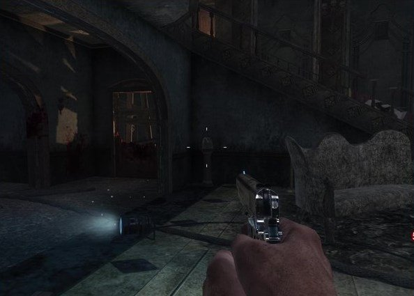</a> <b>Call of Duty: Black Ops Zombies</b> <a href="https://vel.gg/bo1z"><b>▶ Play in browser</b></a> PC · plays instantly</td><td align="center" valign="top" width="33%"><a href="https://ovz-game-production.up.railway.app">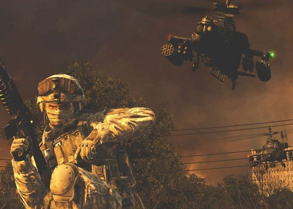</a> <b>Call of Duty: Modern Warfare 2</b> <a href="https://ovz-game-production.up.railway.app"><b>▶ Play in browser</b></a> PC</td><td align="center" valign="top" width="33%"><a href="https://generals.wasm.ltd">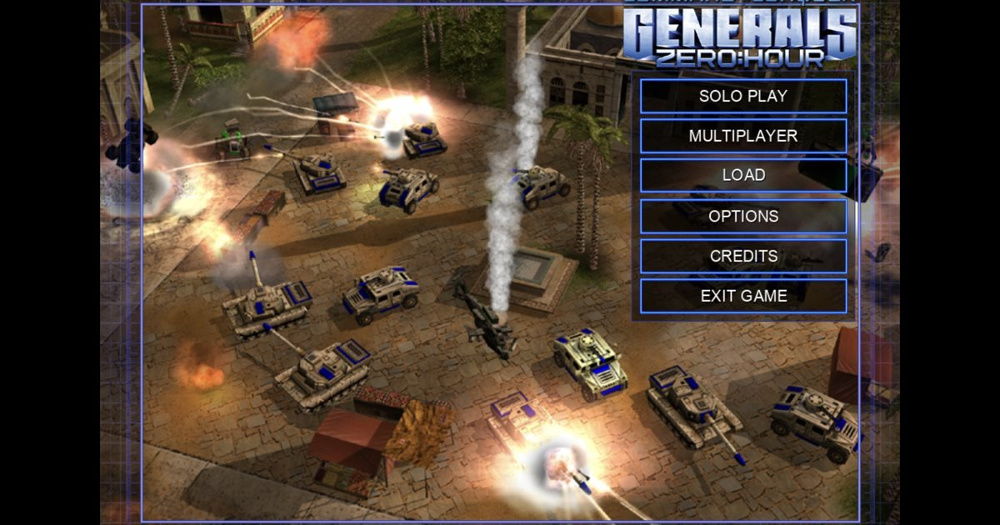</a> <b>Command & Conquer: Generals Zero Hour</b> <a href="https://generals.wasm.ltd"><b>▶ Play in browser</b></a> PC · needs your game files · multiplayer</td></tr>
<tr><td align="center" valign="top" width="33%"><a href="https://chronodivide.com/">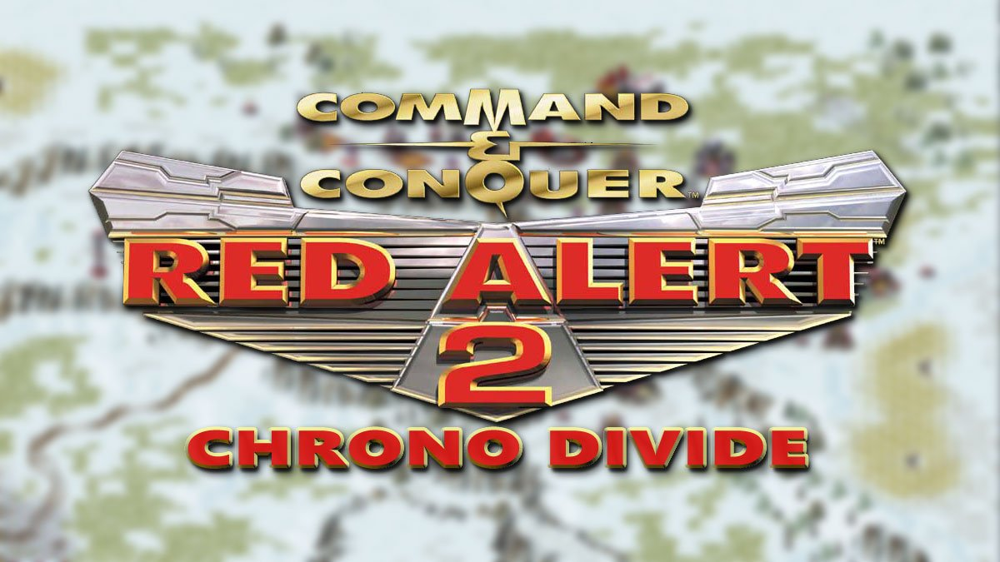</a> <b>Command & Conquer: Red Alert 2</b> <a href="https://chronodivide.com/"><b>▶ Play in browser</b></a> PC · multiplayer</td><td align="center" valign="top" width="33%"> <b>Counter-Strike 1.6</b> <a href="https://csjs.live"><b>▶ Play in browser</b></a> PC · multiplayer</td><td align="center" valign="top" width="33%"> <b>Counter-Strike: Source Bunnyhop (bunnyhop.lol)</b> <a href="https://bunnyhop.lol"><b>▶ Play in browser</b></a> PC · plays instantly · multiplayer</td></tr>
<tr><td align="center" valign="top" width="33%"><a href="https://surfd.net">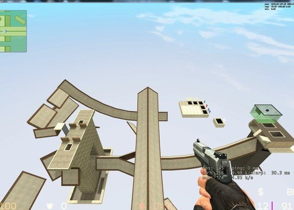</a> <b>Counter-Strike: Source Surf (Surfd)</b> <a href="https://surfd.net"><b>▶ Play in browser</b></a> PC · plays instantly · multiplayer</td><td align="center" valign="top" width="33%"> <b>Crash Bash Online</b> <a href="https://crashbash.app/"><b>▶ Play in browser</b></a> PS1 · plays instantly · multiplayer</td><td align="center" valign="top" width="33%"><a href="https://johnimril.github.io/diablo_web/">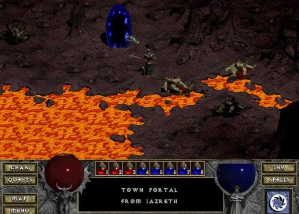</a> <b>Diablo (diablo_web)</b> <a href="https://johnimril.github.io/diablo_web/"><b>▶ Play in browser</b></a> PC · free demo, no game files needed</td></tr>
<tr><td align="center" valign="top" width="33%"><a href="https://silentspacemarine.com/">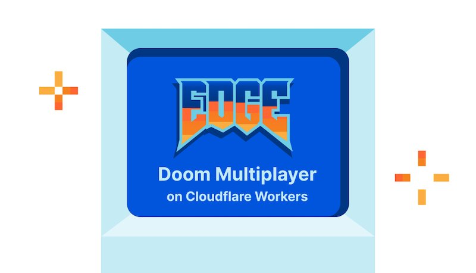</a> <b>Doom Multiplayer (Silent Space Marine)</b> <a href="https://silentspacemarine.com/"><b>▶ Play in browser</b></a> PC · plays instantly · multiplayer</td><td align="center" valign="top" width="33%"><a href="https://wasmarcade.com/gta3">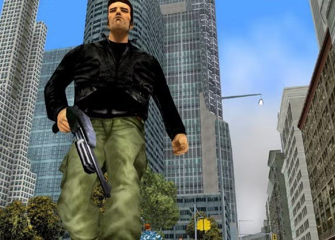</a> <b>Grand Theft Auto III</b> <a href="https://wasmarcade.com/gta3"><b>▶ Play in browser</b></a> PC</td><td align="center" valign="top" width="33%"><a href="https://joncodeofficial.github.io/gta-vice-city-wasm/">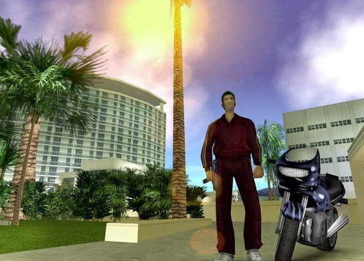</a> <b>Grand Theft Auto: Vice City</b> <a href="https://joncodeofficial.github.io/gta-vice-city-wasm/"><b>▶ Play in browser</b></a> PC · needs your game files</td></tr>
<tr><td align="center" valign="top" width="33%"><a href="https://pixelsuft.github.io/hl/">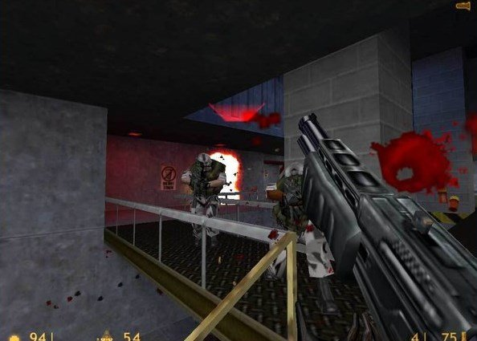</a> <b>Half-Life (pixelsuft)</b> <a href="https://pixelsuft.github.io/hl/"><b>▶ Play in browser</b></a> PC</td><td align="center" valign="top" width="33%"><a href="https://x8bitrain.github.io/webXash/">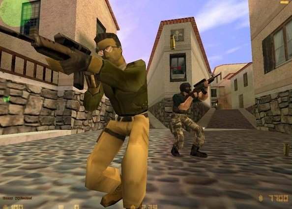</a> <b>Half-Life and Counter-Strike 1.6 (WebXash)</b> <a href="https://x8bitrain.github.io/webXash/"><b>▶ Play in browser</b></a> PC · free demo, no game files needed</td><td align="center" valign="top" width="33%"><a href="https://mitchellhynes.com/halo/halo.html">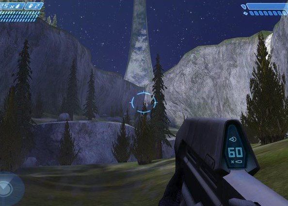</a> <b>Halo: Combat Evolved</b> <a href="https://mitchellhynes.com/halo/halo.html"><b>▶ Play in browser</b></a> Xbox · needs your game files · multiplayer</td></tr>
<tr><td align="center" valign="top" width="33%"><a href="https://hcemobile.com/">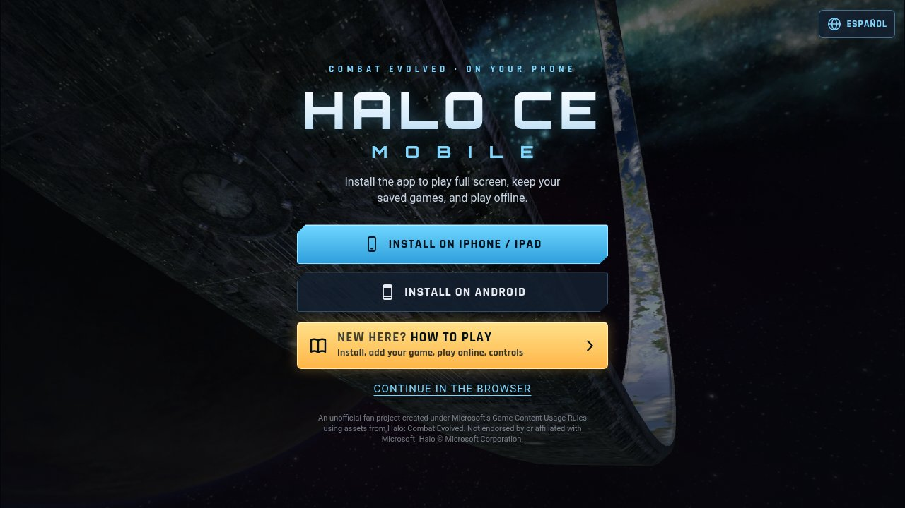</a> <b>Halo: Combat Evolved Mobile (HCEMobile)</b> <a href="https://hcemobile.com/"><b>▶ Play in browser</b></a> Xbox · needs your game files</td><td align="center" valign="top" width="33%"><a href="https://isle.pizza/">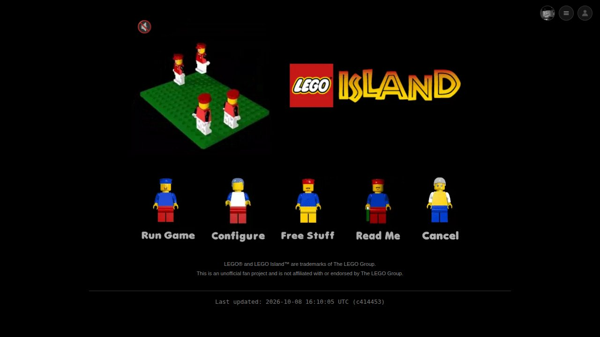</a> <b>LEGO Island</b> <a href="https://isle.pizza/"><b>▶ Play in browser</b></a> PC</td><td align="center" valign="top" width="33%"><a href="https://wasmarcade.com/minecraft">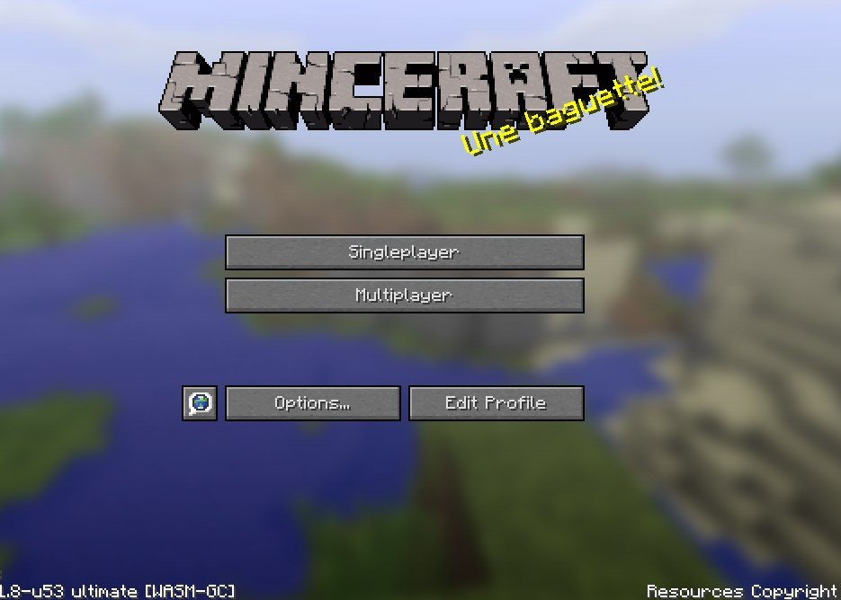</a> <b>Minecraft 1.8.8 (EaglercraftX)</b> <a href="https://wasmarcade.com/minecraft"><b>▶ Play in browser</b></a> PC · plays instantly</td></tr>
<tr><td align="center" valign="top" width="33%"> <b>Moon (Black Ops Zombies, vel.gg)</b> <a href="https://vel.gg/bo1z/moon"><b>▶ Play in browser</b></a> PC · plays instantly</td><td align="center" valign="top" width="33%"><a href="https://zombies.bitcoinsapi.com/">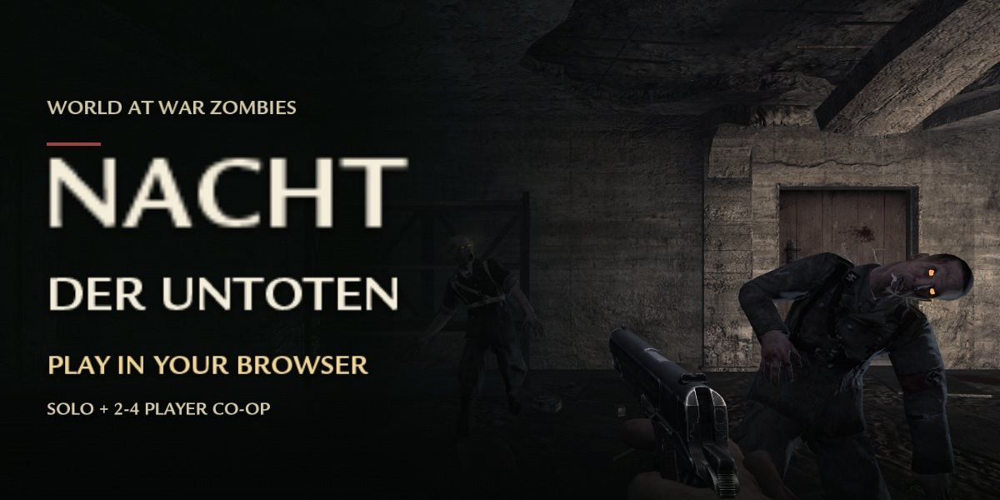</a> <b>Nacht der Untoten</b> <a href="https://zombies.bitcoinsapi.com/"><b>▶ Play in browser</b></a> PC · plays instantly · multiplayer</td><td align="center" valign="top" width="33%"> <b>NetQuake.io</b> <a href="https://www.netquake.io/"><b>▶ Play in browser</b></a> PC · free demo, no game files needed</td></tr>
<tr><td align="center" valign="top" width="33%"><a href="https://pes6.optijuegos.net">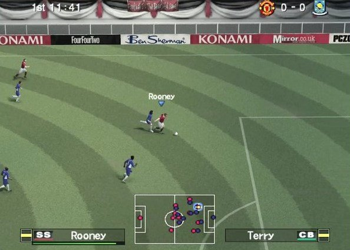</a> <b>Pro Evolution Soccer 6</b> <a href="https://pes6.optijuegos.net"><b>▶ Play in browser</b></a> PC · multiplayer</td><td align="center" valign="top" width="33%"><a href="https://q2.pieter.com">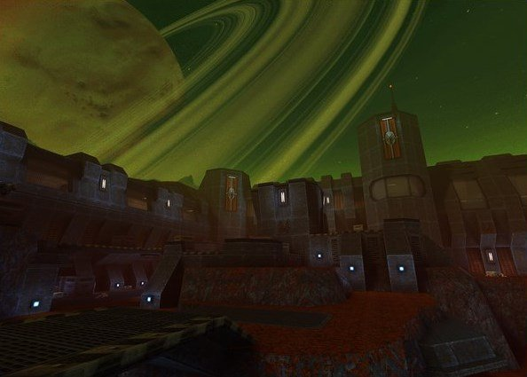</a> <b>Quake II (q2.pieter.com)</b> <a href="https://q2.pieter.com"><b>▶ Play in browser</b></a> PC · multiplayer</td><td align="center" valign="top" width="33%"><a href="https://q3.pieter.com">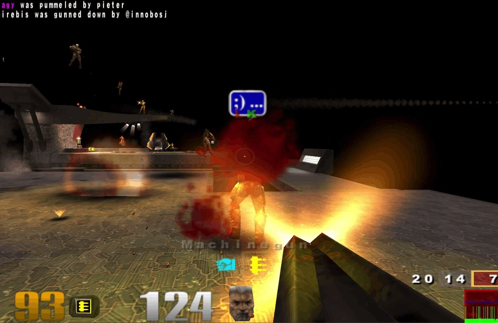</a> <b>Quake III Arena (q3.pieter.com)</b> <a href="https://q3.pieter.com"><b>▶ Play in browser</b></a> PC</td></tr>
<tr><td align="center" valign="top" width="33%"><a href="https://q3js.com/">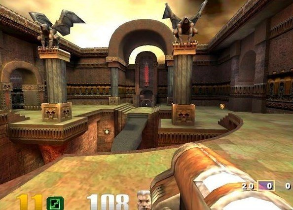</a> <b>Quake III Arena (q3js)</b> <a href="https://q3js.com/"><b>▶ Play in browser</b></a> PC · plays instantly · multiplayer</td><td align="center" valign="top" width="33%"><a href="https://q1.pieter.com">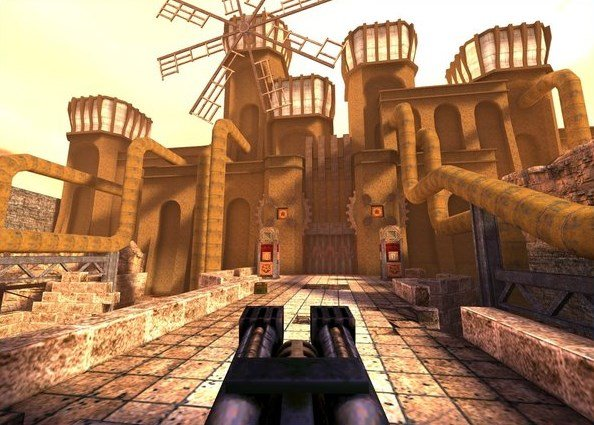</a> <b>QuakeWorld (q1.pieter.com)</b> <a href="https://q1.pieter.com"><b>▶ Play in browser</b></a> PC · multiplayer</td><td align="center" valign="top" width="33%"><a href="https://rtcw.pieter.com">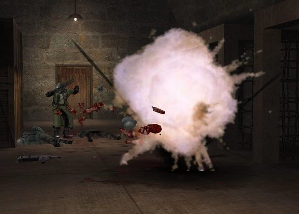</a> <b>Return to Castle Wolfenstein (rtcw.pieter.com)</b> <a href="https://rtcw.pieter.com"><b>▶ Play in browser</b></a> PC · plays instantly · multiplayer</td></tr>
<tr><td align="center" valign="top" width="33%"><a href="https://runescapeclassic.gold/">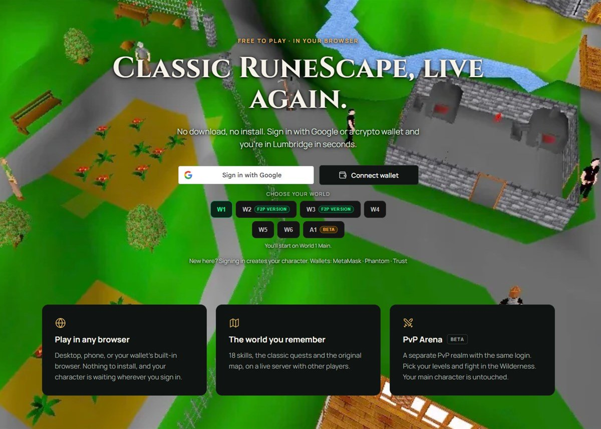</a> <b>RuneScape Classic</b> <a href="https://runescapeclassic.gold/"><b>▶ Play in browser</b></a> PC · plays instantly · multiplayer</td><td align="center" valign="top" width="33%"><a href="https://skate.aaddpp.lol">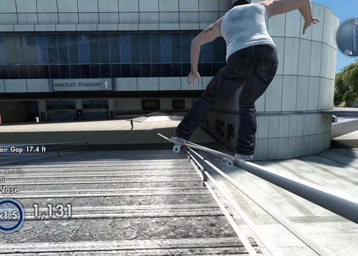</a> <b>Skate 3 (fan browser game)</b> <a href="https://skate.aaddpp.lol"><b>▶ Play in browser</b></a> Xbox 360 · needs your game files</td><td align="center" valign="top" width="33%"> <b>Star Wars Jedi Knight: Jedi Academy</b> <a href="https://jk.q3js.com"><b>▶ Play in browser</b></a> PC · needs your game files · multiplayer</td></tr>
<tr><td align="center" valign="top" width="33%"><a href="https://olivers.tools/play/">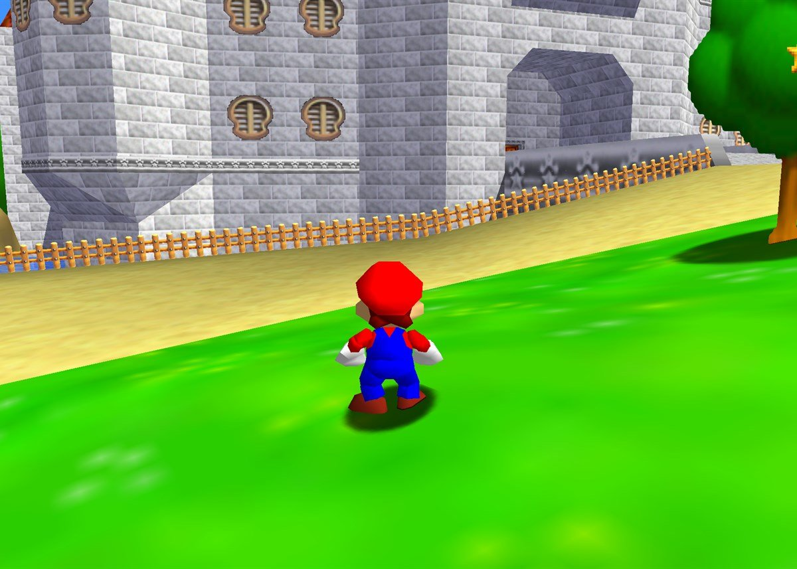</a> <b>Super Mario 64 Multiplayer</b> <a href="https://olivers.tools/play/"><b>▶ Play in browser</b></a> N64 · multiplayer</td><td align="center" valign="top" width="33%"><a href="https://smz.fun/">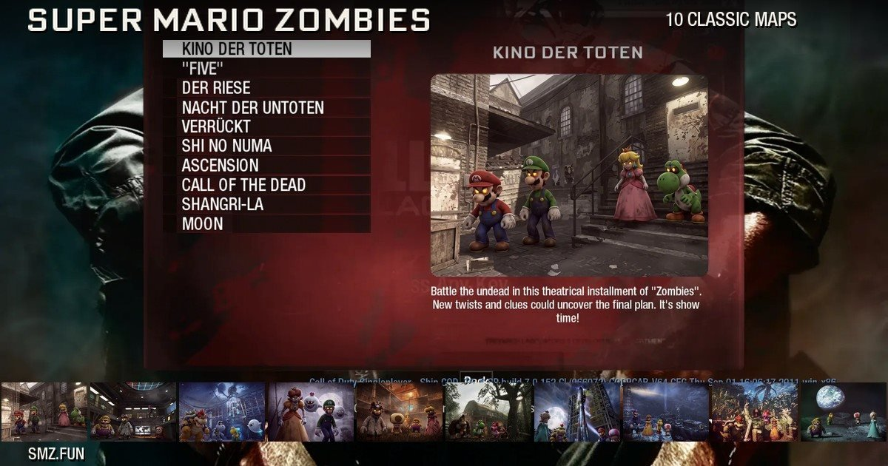</a> <b>Super Mario Zombies</b> <a href="https://smz.fun/"><b>▶ Play in browser</b></a> PC · plays instantly</td><td align="center" valign="top" width="33%"><a href="https://shar-wasm.cjoseph.workers.dev/?skipmovie">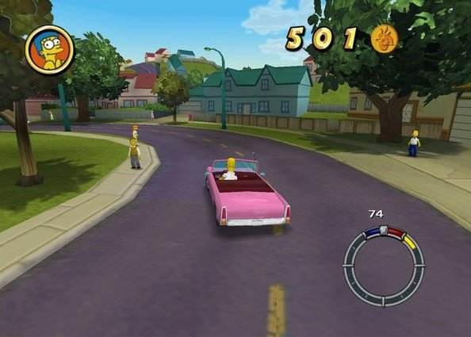</a> <b>The Simpsons: Hit & Run</b> <a href="https://shar-wasm.cjoseph.workers.dev/?skipmovie"><b>▶ Play in browser</b></a> PC</td></tr>
<tr><td align="center" valign="top" width="33%"><a href="https://ut.pieter.com">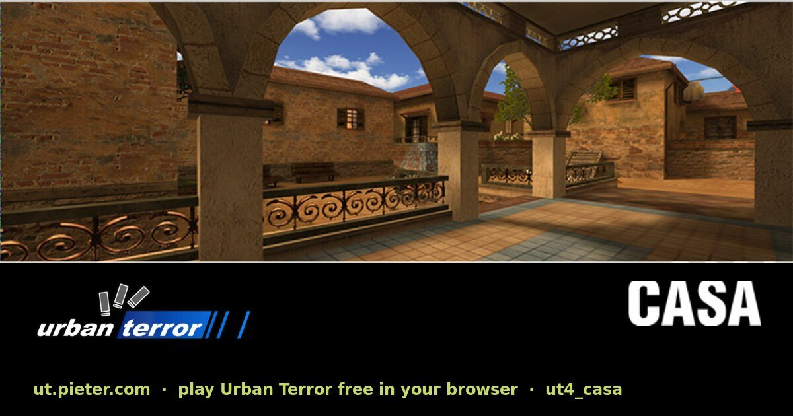</a> <b>Urban Terror (ut.pieter.com)</b> <a href="https://ut.pieter.com"><b>▶ Play in browser</b></a> PC</td><td align="center" valign="top" width="33%"><a href="https://wadcmd.com/">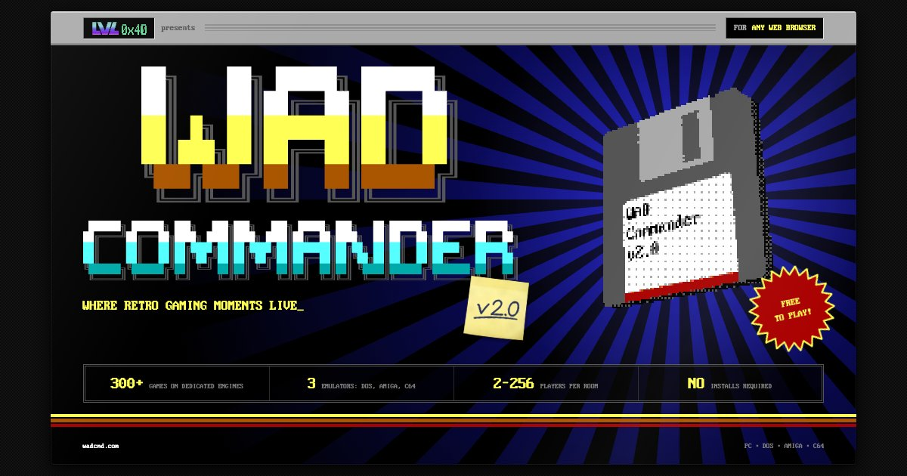</a> <b>WadCMD (Doom in the browser)</b> <a href="https://wadcmd.com/"><b>▶ Play in browser</b></a> PC · needs your game files</td><td align="center" valign="top" width="33%"> <b>Zelda II: The Adventure of Link (z2rs)</b> <a href="https://z2rs.com/"><b>▶ Play in browser</b></a> NES · needs your game files</td></tr>
<tr><td align="center" valign="top" width="33%"> <b>Claude of Duty: Vibe Slops II (froydinger mirror)</b> <a href="https://froydinger.github.io/claude-of-duty/"><b>▶ Play in browser</b></a> PC</td><td align="center" valign="top" width="33%"> <b>Claude of Duty: Vibe Slops II (GoofyAhhBro69420 mirror)</b> <a href="https://goofyahhbro69420.github.io/Black-Ops-2/"><b>▶ Play in browser</b></a> PC</td><td align="center" valign="top" width="33%"> <b>Kino der Toten (GoofyAhhBro69420 mirror)</b> <a href="https://goofyahhbro69420.github.io/COD-ZOMBIES/"><b>▶ Play in browser</b></a> PC</td></tr>
<tr><td align="center" valign="top" width="33%"> <b>Kino der Toten (theeagler1234 mirror)</b> <a href="https://theeagler1234-alt.github.io/kino-der-toten/"><b>▶ Play in browser</b></a> PC</td><td align="center" valign="top" width="33%"><b>Diablo (diabloweb)</b> <a href="https://d07riv.github.io/diabloweb/"><b>▶ Play in browser</b></a> PC</td></tr>
</table>

## Top playable picks

Projects with the best mix of playability, completeness, activity and popularity that you can actually play today (bring your own game files where needed).

### 1. The Legend of Zelda: Ocarina of Time (Ship of Harkinian)
**Decompilation** · N64 / GameCube · ⭐ 5.6k · score **4.2/5**  
The definitive way to play Ocarina of Time on PC, Switch, Wii U and Android: 60fps, widescreen, randomizer, mods. Bring your own ROM.  
[project](https://github.com/HarbourMasters/Shipwright) · [release](https://github.com/HarbourMasters/Shipwright/releases/tag/9.3.0) · [video](https://www.youtube.com/watch?v=u-EhRErOpHE)

<a href="https://github.com/HarbourMasters/Shipwright">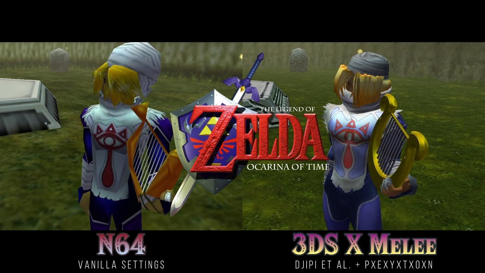</a>

### 2. The Legend of Zelda: Majora's Mask (Zelda64Recomp)
**Static recompilation** · N64 · ⭐ 7.4k · score **4.8/5**  
N64: Recompiled port of Majora's Mask with ultrawide, high framerate, gyro and a mod loader. Needs your US ROM.  
[project](https://github.com/Zelda64Recomp/Zelda64Recomp) · [release](https://github.com/Zelda64Recomp/Zelda64Recomp/releases/tag/v1.2.2) · [video](https://www.youtube.com/watch?v=GIp7C2ro2T8)

<a href="https://github.com/Zelda64Recomp/Zelda64Recomp">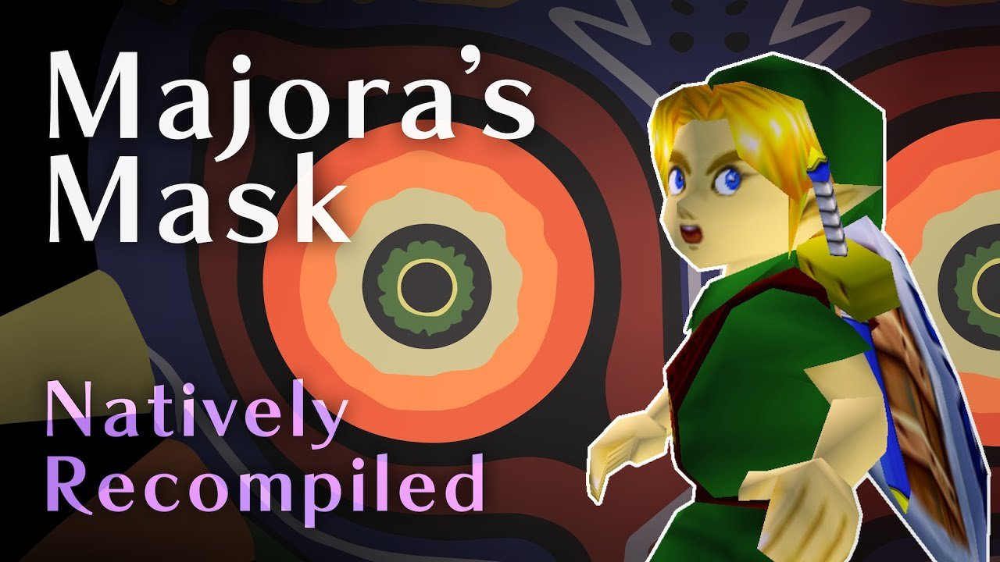</a>

### 3. Sonic Unleashed (Unleashed Recompiled)
**Static recompilation** · Xbox 360 · ⭐ 5.2k · score **4.5/5**  
XenonRecomp port of the Xbox 360 Sonic Unleashed: high framerate, ultrawide, mod support. Needs your own dump.  
[project](https://github.com/hedge-dev/UnleashedRecomp) · [release](https://github.com/hedge-dev/UnleashedRecomp/releases/tag/v1.0.3) · [video](https://www.youtube.com/watch?v=yDlVr1Jv-WU)

<a href="https://github.com/hedge-dev/UnleashedRecomp">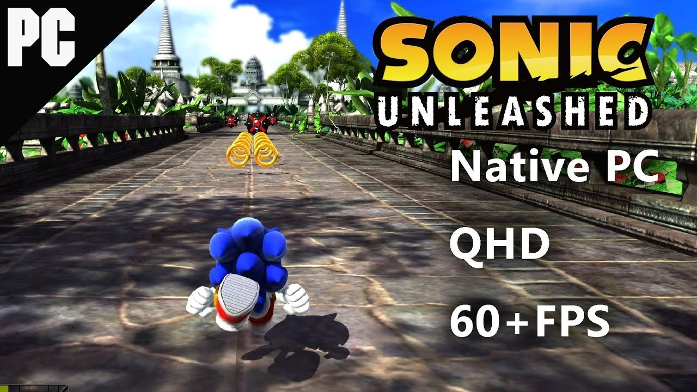</a>

### 4. Super Mario 64 (sm64coopdx)
**Decompilation** · N64 · ⭐ 1.4k · score **4.0/5**  
Super Mario 64 PC port with online co-op for up to 16 players, Lua mods and DynOS. Built from the SM64 decomp.  
[project](https://github.com/coop-deluxe/sm64coopdx) · [release](https://github.com/coop-deluxe/sm64coopdx/releases/tag/v1.5.1) · [video](https://www.youtube.com/watch?v=hmqbLyszoYY)

### 5. Star Fox 64 (Starship)
**Decompilation** · N64 · ⭐ 2.1k · score **4.2/5**  
Native Star Fox 64 port (from the SF64 decomp) with widescreen, 60fps and enhancements.  
[project](https://github.com/HarbourMasters/Starship) · [release](https://github.com/HarbourMasters/Starship/releases/tag/v2.0.0) · [video](https://www.youtube.com/watch?v=FZ3o09an9_k)

<a href="https://github.com/HarbourMasters/Starship">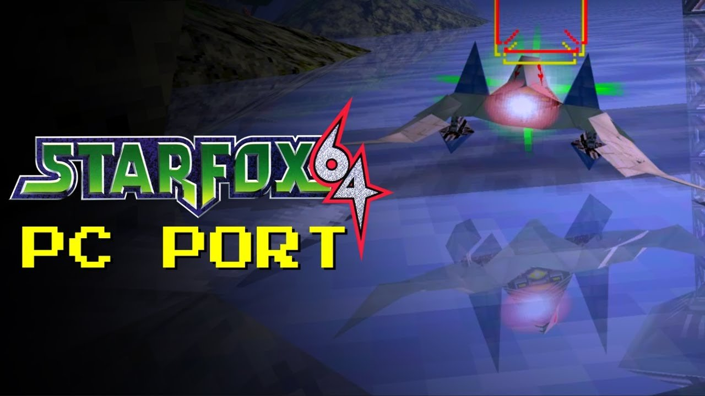</a>

### 6. The Legend of Zelda: Twilight Princess (Dusklight)
**Source port** · GameCube · ⭐ 5.8k · score **4.8/5**  
PC/mobile port of Twilight Princess built on the zeldaret/tp decompilation, with fixes and enhancements.  
[project](https://github.com/TwilitRealm/dusklight) · [release](https://github.com/TwilitRealm/dusklight/releases/tag/v2.0.3) · [video](https://www.youtube.com/watch?v=9ivusJVCtFk)

<a href="https://github.com/TwilitRealm/dusklight">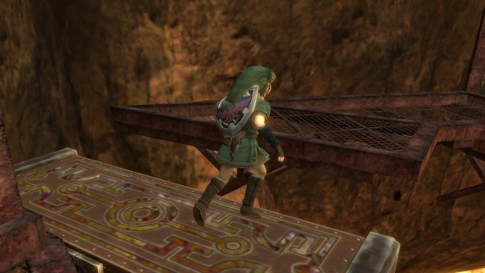</a>

### 7. Banjo-Kazooie (BanjoRecomp)
**Static recompilation** · N64 · ⭐ 2.0k · score **4.5/5**  
N64: Recompiled Banjo-Kazooie for Windows/Linux/Mac with widescreen, high framerate and Thunderstore mods.  
[project](https://github.com/BanjoRecomp/BanjoRecomp) · [release](https://github.com/BanjoRecomp/BanjoRecomp/releases/tag/v1.0.2) · [video](https://www.youtube.com/watch?v=0906Cz-59eU)

### 8. Mario Kart 64 (SpaghettiKart)
**Source port** · N64 · ⭐ 2.4k · score **4.3/5**  
Mario Kart 64 PC port from the MK64 decomp: HD, custom tracks, extra players and modding.  
[project](https://github.com/HarbourMasters/SpaghettiKart) · [release](https://github.com/HarbourMasters/SpaghettiKart/releases/tag/1.0.0) · [video](https://www.youtube.com/watch?v=EOWOtd8sZTQ)

### 9. Diablo (DevilutionX)
**Engine remake** · PC · ⭐ 9.8k · score **4.8/5**  
Diablo and Hellfire for modern systems (PC, consoles, handhelds), based on the reverse-engineered Devilution source.  
[project](https://github.com/diasurgical/DevilutionX) · [release](https://github.com/diasurgical/DevilutionX/releases/tag/1.5.5) · [video](https://www.youtube.com/watch?v=4fxOMpYWBGg)

<a href="https://github.com/diasurgical/DevilutionX">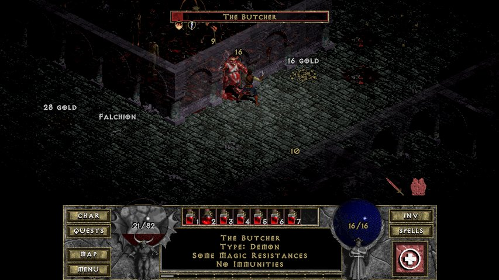</a>

### 10. RollerCoaster Tycoon 2 (OpenRCT2)
**Engine remake** · PC · ⭐ 16.4k · score **4.8/5**  
Full reimplementation of RollerCoaster Tycoon 2 with multiplayer, higher resolutions and quality-of-life fixes.  
[project](https://github.com/OpenRCT2/OpenRCT2) · [release](https://github.com/OpenRCT2/OpenRCT2/releases/tag/v0.5.6) · [video](https://www.youtube.com/watch?v=8dXoNlAR0X4)

<a href="https://github.com/OpenRCT2/OpenRCT2">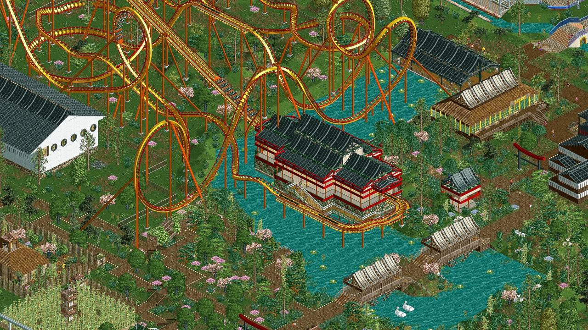</a>

### 11. The Legend of Zelda: A Link to the Past (zelda3)
**Engine remake** · SNES · ⭐ 4.8k · score **4.5/5**  
Reverse-engineered C reimplementation of A Link to the Past: widescreen, pixel shaders, MSU-1. Needs the ROM for assets.  
[project](https://github.com/snesrev/zelda3) · [release](https://github.com/snesrev/zelda3/releases/tag/v0.3) · [video](https://www.youtube.com/watch?v=xctizwBntag)

<a href="https://github.com/snesrev/zelda3">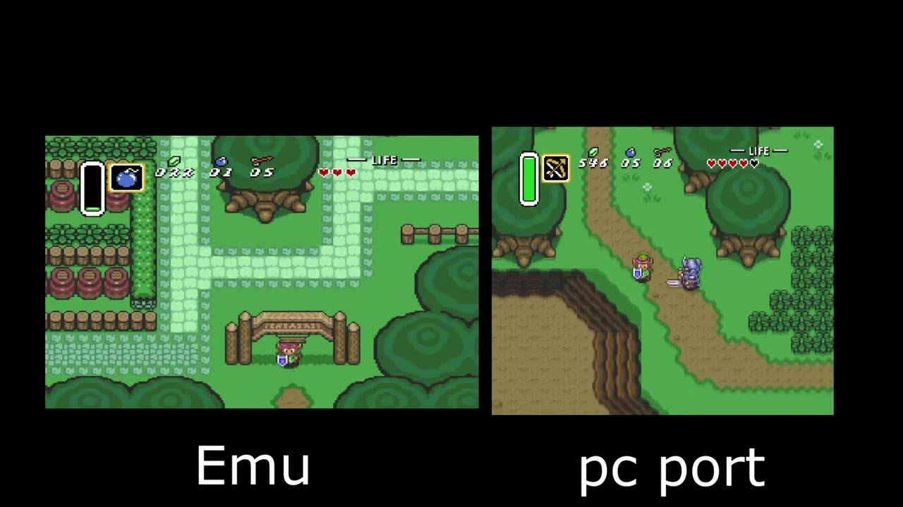</a>

### 12. The Elder Scrolls III: Morrowind (OpenMW)
**Engine remake** · PC · ⭐ 6.6k · score **4.8/5**  
Open-source Morrowind engine: better performance, Lua modding, runs on Linux/macOS/Android.  
[project](https://github.com/OpenMW/openmw) · [release](https://github.com/OpenMW/openmw/releases/tag/openmw-0.51.0) · [video](https://www.youtube.com/watch?v=bR-WZ8NOG_k)

<a href="https://github.com/OpenMW/openmw">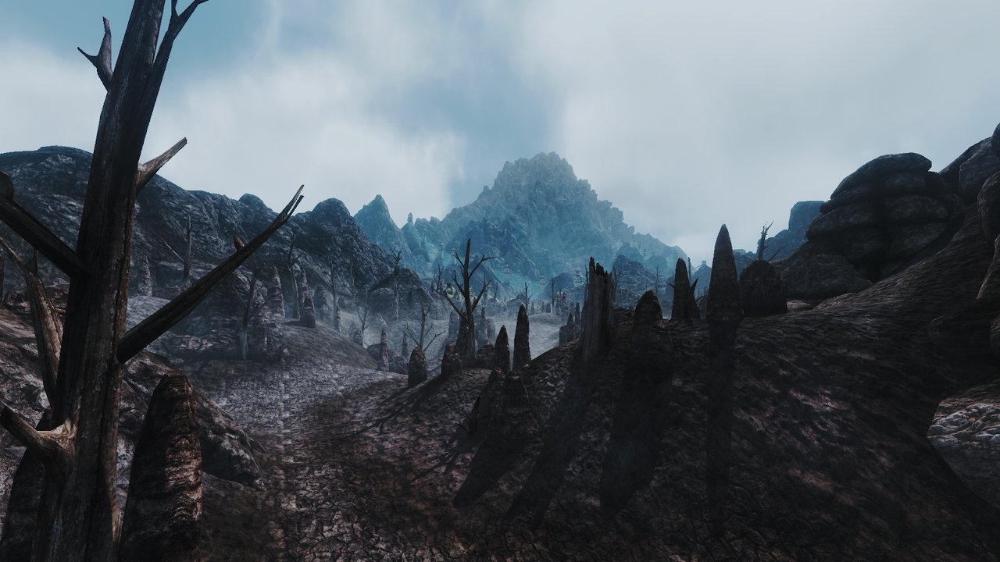</a>

### 13. Sonic Mania
**Decompilation** · PC · ⭐ 815 · score **4.0/5**  
Complete decompilation of Sonic Mania that builds native ports for PC, Switch, Android and more.  
[project](https://github.com/RSDKModding/Sonic-Mania-Decompilation) · [release](https://github.com/RSDKModding/Sonic-Mania-Decompilation/releases/tag/v1.1.1) · [video](https://www.youtube.com/watch?v=CSPhyjHt79Y)

<a href="https://github.com/RSDKModding/Sonic-Mania-Decompilation">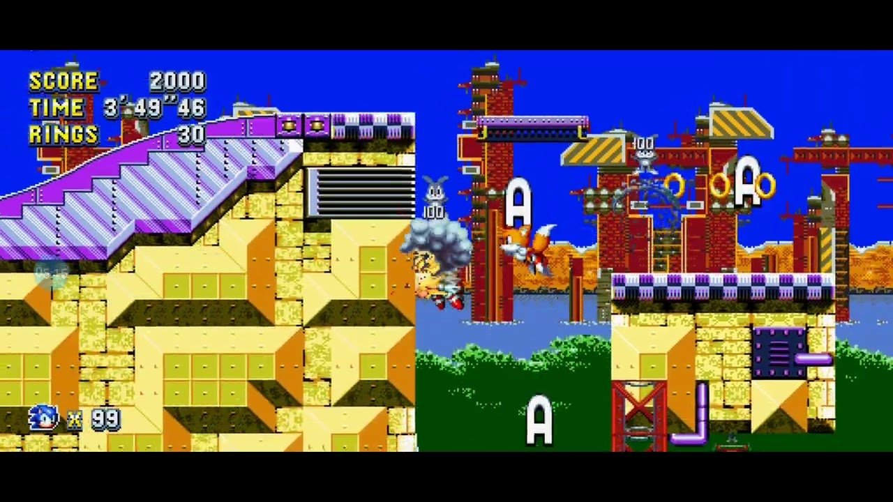</a>

### 14. Transport Tycoon Deluxe (OpenTTD)
**Engine remake** · PC · ⭐ 8.4k · score **4.8/5**  
The long-running, still active reimplementation of Transport Tycoon Deluxe; free graphics sets mean no original files are needed.  
[project](https://github.com/OpenTTD/OpenTTD) · [release](https://github.com/OpenTTD/OpenTTD/releases/tag/15.3) · [video](https://www.youtube.com/watch?v=ZBzRh6lD9J8)

<a href="https://github.com/OpenTTD/OpenTTD">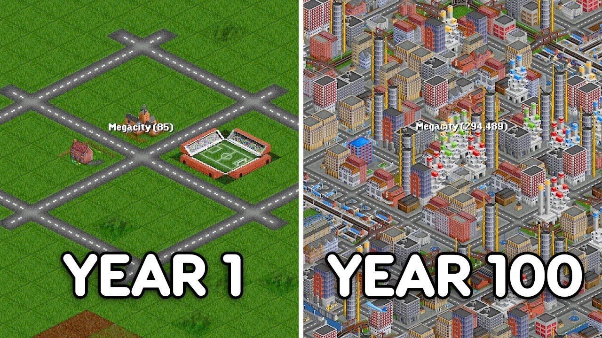</a>

### 15. Sonic the Hedgehog 2006 (Marathon Recompiled)
**Static recompilation** · Xbox 360 · ⭐ 663 · score **3.4/5**  
XenonRecomp port of Sonic the Hedgehog (2006), fixing much of its performance and loading.  
[project](https://github.com/sonicnext-dev/MarathonRecomp) · [video](https://www.youtube.com/watch?v=kQVbKhjSBmk)

<a href="https://github.com/sonicnext-dev/MarathonRecomp">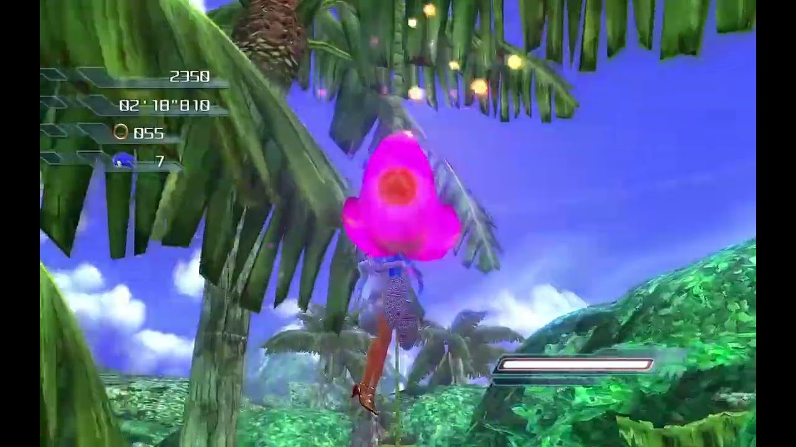</a>

### 16. LEGO Island (isle-portable)
**Source port** · PC · ⭐ 1.1k · score **4.3/5**  
Cross-platform LEGO Island built on the full isledecomp decompilation (Windows, Linux, macOS, web, consoles).  
[project](https://github.com/isledecomp/isle-portable) · [release](https://github.com/isledecomp/isle-portable/releases/tag/continuous) · [video](https://www.youtube.com/watch?v=JUNdWnI5BTk)

<a href="https://github.com/isledecomp/isle-portable">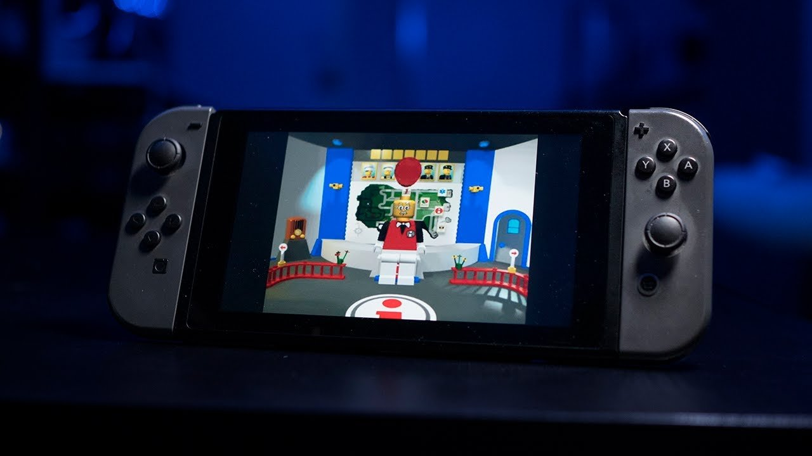</a>

### 17. Heroes of Might and Magic III (VCMI)
**Engine remake** · PC · ⭐ 5.9k · score **4.5/5**  
Heroes of Might and Magic III engine rewrite with HD, mods, multiplayer and Android support.  
[project](https://github.com/vcmi/vcmi) · [release](https://github.com/vcmi/vcmi/releases/tag/1.7.5) · [video](https://www.youtube.com/watch?v=zxC7wLITNpg)

<a href="https://github.com/vcmi/vcmi">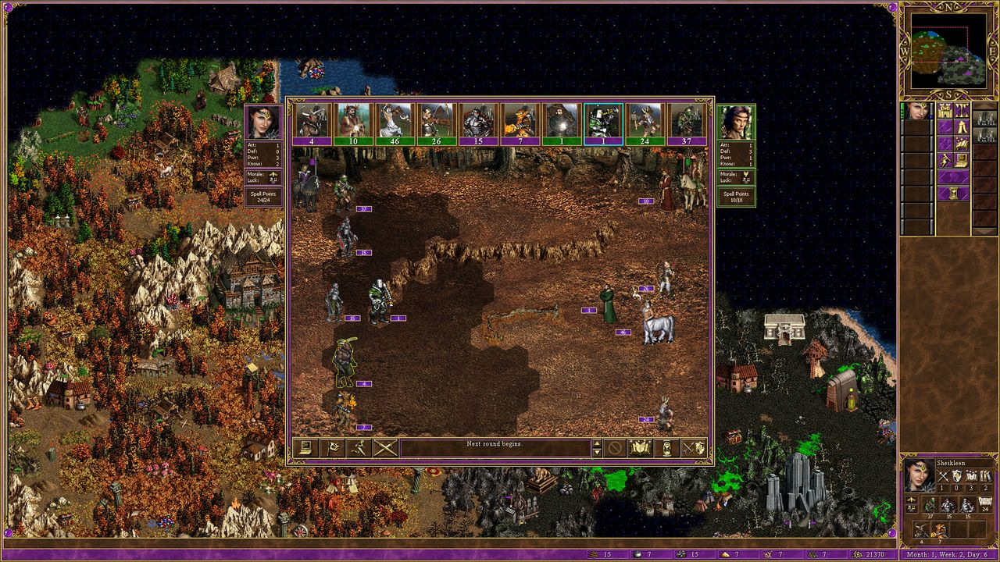</a>

### 18. Carmageddon (dethrace)
**Engine remake** · PC · ⭐ 1.2k · score **4.5/5**  
Reverse-engineered Carmageddon that runs natively on modern Windows, Linux and macOS.  
[project](https://github.com/dethrace-labs/dethrace) · [release](https://github.com/dethrace-labs/dethrace/releases/tag/v0.10.1) · [video](https://www.youtube.com/watch?v=MMI45O0RKq0)

<a href="https://github.com/dethrace-labs/dethrace">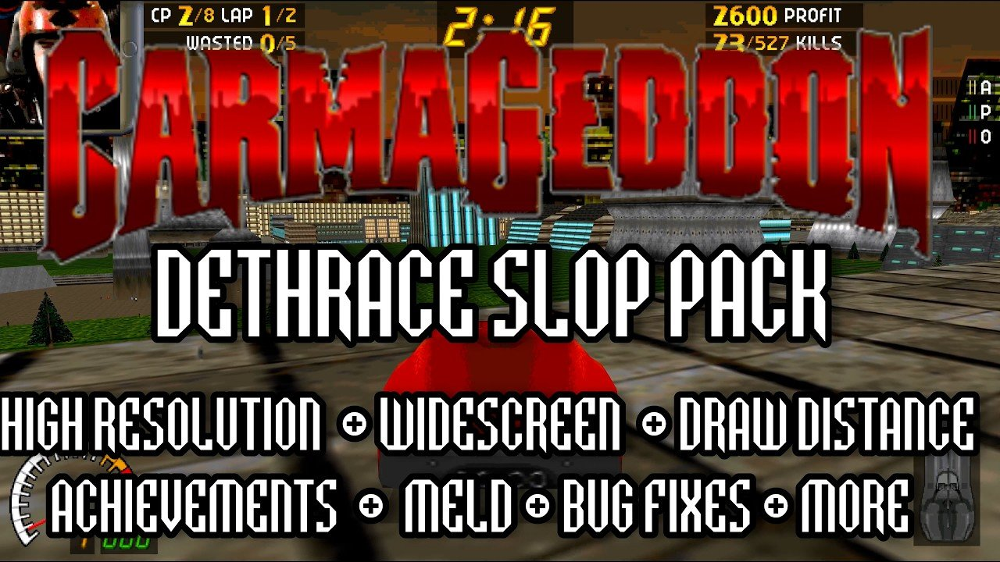</a>

### 19. 3D Pinball Space Cadet
**Decompilation** · PC · ⭐ 4.7k · score **3.6/5**  
Decompilation of Windows' 3D Pinball Space Cadet, ported to modern platforms.  
[project](https://github.com/k4zmu2a/SpaceCadetPinball) · [release](https://github.com/k4zmu2a/SpaceCadetPinball/releases/tag/Release_2.1.0) · [video](https://www.youtube.com/watch?v=smiCSU2sje8)

<a href="https://github.com/k4zmu2a/SpaceCadetPinball">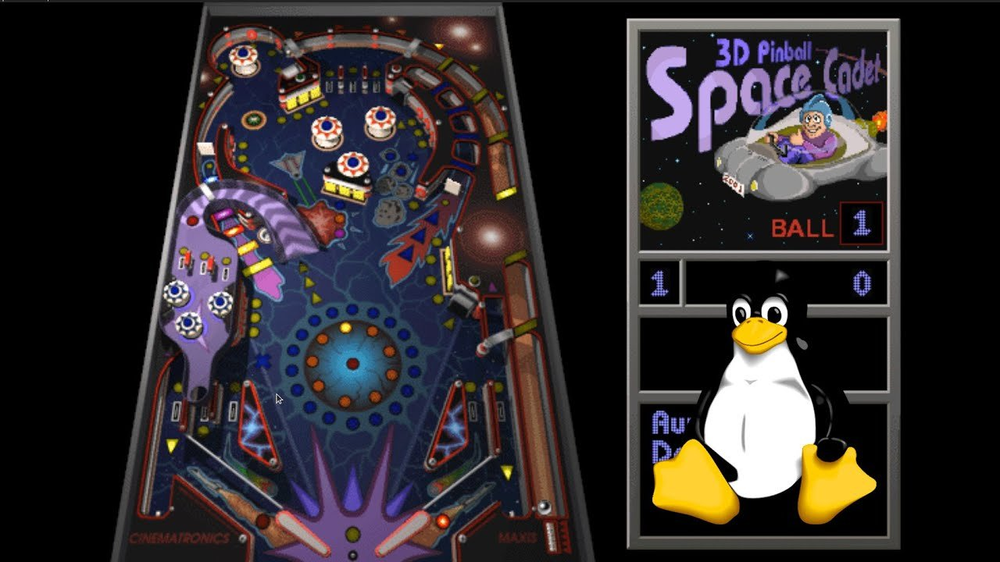</a>

### 20. Theme Hospital (CorsixTH)
**Engine remake** · PC · ⭐ 4.6k · score **4.3/5**  
Open reimplementation of Theme Hospital with high resolutions and campaign editor.  
[project](https://github.com/CorsixTH/CorsixTH) · [release](https://github.com/CorsixTH/CorsixTH/releases/tag/v0.70.1) · [video](https://www.youtube.com/watch?v=fKq04q6a53s)

<a href="https://github.com/CorsixTH/CorsixTH">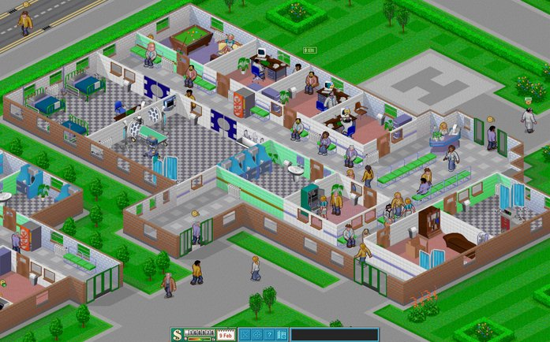</a>

### 21. Caesar III (Julius)
**Engine remake** · PC · ⭐ 3.4k · score **4.5/5**  
Faithful reimplementation of Caesar III that fixes bugs and runs on modern systems; Augustus adds gameplay changes.  
[project](https://github.com/bvschaik/julius) · [release](https://github.com/bvschaik/julius/releases/tag/v1.8.0) · [video](https://www.youtube.com/watch?v=OXONBt5U-U0)

<a href="https://github.com/bvschaik/julius">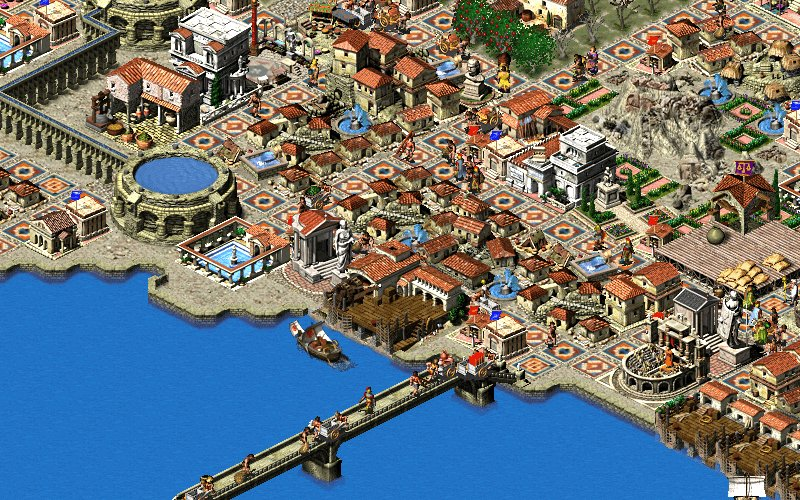</a>

### 22. Quake III Arena (q3js)
**Browser port** · PC · ⭐ n/a · score **4.0/5**  
Quake III Arena in the browser (WebAssembly ioquake3): click and play instantly, demo data included.  
[project](https://q3js.com) · [play](https://q3js.com/) · [video](https://www.youtube.com/watch?v=de7PNFRHNts)

## Static recompilations

Console/PC binaries statically recompiled to native code (N64Recomp, XenonRecomp, ReXGlue, ps1/ps2 recomp, ...).

| Game | Platform | Score | ⭐ | Last commit | Progress | Links |
|---|---|---|---|---|---|---|
| [The Legend of Zelda: Majora's Mask (Zelda64Recomp)](https://github.com/Zelda64Recomp/Zelda64Recomp) | N64 | 4.8 | 7.4k | 2026-09-25 |  | [release](https://github.com/Zelda64Recomp/Zelda64Recomp/releases/tag/v1.2.2) · [video](https://www.youtube.com/watch?v=GIp7C2ro2T8) |
| [Banjo-Kazooie (BanjoRecomp)](https://github.com/BanjoRecomp/BanjoRecomp) | N64 | 4.5 | 2.0k | 2026-09-25 |  | [release](https://github.com/BanjoRecomp/BanjoRecomp/releases/tag/v1.0.2) · [video](https://www.youtube.com/watch?v=0906Cz-59eU) |
| [BloodBorne for Windows](https://github.com/Supermedo/bloodborne_pc) | PlayStation 4 | 4.5 | 2.3k | 2026-10-13 |  | [release](https://github.com/Supermedo/bloodborne_pc/releases/tag/windows-v1.7.2) |
| [Skate 3](https://github.com/mchughalex/skate3recomp) | Xbox 360 | 4.5 | 1.6k | 2026-07-24 |  | [release](https://github.com/mchughalex/skate3recomp/releases/tag/v2.0.2) · [video](https://youtu.be/ETXCOsip1Uo) |
| [Sonic Unleashed (Unleashed Recompiled)](https://github.com/hedge-dev/UnleashedRecomp) | Xbox 360 | 4.5 | 5.2k | 2026-06-29 |  | [release](https://github.com/hedge-dev/UnleashedRecomp/releases/tag/v1.0.3) · [video](https://www.youtube.com/watch?v=yDlVr1Jv-WU) |
| [Ace Combat 6: Fires of Liberation](https://github.com/sal063/AC6_recomp) | Xbox 360 | 4.3 | 511 | 2026-08-22 |  |  |
| [Blue Dragon](https://github.com/zolaware/reblue) | Xbox 360 | 4.3 | 777 | 2026-10-05 |  | [release](https://github.com/zolaware/reblue/releases/tag/v1.3.1) |
| [Castlevania: Symphony of the Night](https://github.com/BlackLabelHQ/SymphonyRecomp) | PS1 | 4.3 | 867 | 2026-09-27 |  | [release](https://github.com/BlackLabelHQ/SymphonyRecomp/releases/tag/v0.5.1b) |
| [Castlevania: Symphony of the Night (NocturneRecomp)](https://github.com/birabittoh/NocturneRecomp) | Xbox 360 | 4.3 | 362 | 2026-08-27 |  | [release](https://github.com/birabittoh/NocturneRecomp/releases/tag/v1.4.5) |
| [Dinosaur Planet](https://github.com/DinosaurPlanetRecomp/dino-recomp) | N64 | 4.3 | 324 | 2026-09-25 |  | [release](https://github.com/DinosaurPlanetRecomp/dino-recomp/releases/tag/v0.3.0) |
| [Donkey Kong 64](https://github.com/Rainchus/Donkey-Kong-64-Recompiled) | N64 | 4.3 | 500 | 2026-09-30 |  | [release](https://github.com/Rainchus/Donkey-Kong-64-Recompiled/releases/tag/v1.0.3) |
| [Forza Horizon](https://github.com/arcanite24/pinyon-shift) | Xbox 360 | 4.3 | 462 | 2026-10-12 |  | [release](https://github.com/arcanite24/pinyon-shift/releases/tag/v0.5.1) |
| [Mystical Ninja Starring Goemon](https://github.com/klorfmorf/Goemon64Recomp) | N64 | 4.3 | 311 | 2026-09-19 |  | [release](https://github.com/klorfmorf/Goemon64Recomp/releases/tag/v0.2.0-dev) |
| [OpenCE](https://github.com/OpenCommunityEdition/OpenCE) ⚠️ | og xbox | 4.3 | 1.5k | 2026-10-12 |  | [release](https://github.com/OpenCommunityEdition/OpenCE/releases/tag/build-201) |
| [OpenTIE](https://github.com/elyosh/OpenTIE) | DOS | 4.3 | 328 | 2026-10-04 |  | [release](https://github.com/elyosh/OpenTIE/releases/tag/v0.0.7) |
| [Pokemon Gold / Silver / Crystal (Gen2Recomped)](https://github.com/UNDERdecoded/Gen2Recomped) | Game Boy Color | 4.3 | 384 | 2026-10-13 |  | [release](https://github.com/UNDERdecoded/Gen2Recomped/releases/tag/v0.8.23) · [reddit](https://www.reddit.com/r/decomps/comments/1vjmmj4/ "u/thc_delta_9 · 376 upvotes · 100 comments") |
| [Pokemon RBY / GSC / FRLF / RSE (G1R Deluxe)](https://github.com/bryanthaboi/gen1recomp) ⚠️ | Game Boy | 4.3 | 3.9k | 2026-10-12 |  | [release](https://github.com/bryanthaboi/gen1recomp/releases/tag/v0.3.85) |
| [SpeedBreaker](https://github.com/SpeedBreakerProject/speedbreaker) | PC | 4.3 | 234 | 2026-10-13 |  | [release](https://github.com/SpeedBreakerProject/speedbreaker/releases/tag/v0.1.4) |
| [The Darkness](https://github.com/portingpete/The-Darkness-Recomp) | Xbox 360 | 4.3 | 248 | 2026-10-12 |  |  |
| [Viva Pinata: Trouble In Paradise](https://github.com/SolarCookies/TiP-Recomp) | Xbox 360 | 4.3 | 208 | 2026-10-03 |  | [release](https://github.com/SolarCookies/TiP-Recomp/releases/tag/1.13.0) |
| [ACE COMBAT X](https://github.com/sal063/Ace-Combat-X-Recompilation) | PSP | 4.2 | 75 | 2026-08-28 |  | [release](https://github.com/sal063/Ace-Combat-X-Recompilation/releases/tag/V1.5-release) |
| [Alone in the Dark (AloneInTheDarkReHaunted)](https://github.com/spacefarergames/AloneInTheDarkReHaunted) | DOS | 4.2 | 117 | 2026-08-10 |  | [release](https://github.com/spacefarergames/AloneInTheDarkReHaunted/releases/tag/2.4.0.1008) |
| [Banjo-Kazooie Nuts and Bolts](https://github.com/masterspike52/reNut) | Xbox 360 | 4.2 | 153 | 2026-09-14 |  | [release](https://github.com/masterspike52/reNut/releases/tag/texturereplacements) |
| [Bloody Roar 2](https://github.com/novapowers0/BloodyRoar2Recomp) | PS1 | 4.2 | 60 | 2026-10-13 |  | [release](https://github.com/novapowers0/BloodyRoar2Recomp/releases/tag/v0.7.1) |
| [Burnout Revenge](https://github.com/shipa-2/Xerenge) | Xbox 360 | 4.2 | 38 | 2026-10-13 |  | [release](https://github.com/shipa-2/Xerenge/releases/tag/v0.4.6) |
| [Call of Duty 3](https://github.com/FrankHUN88453/CoD3Recomp) | Xbox 360 | 4.2 | 104 | 2026-10-13 |  |  |
| [Call of Duty: Modern Warfare 2](https://github.com/PaulCombal/mw2-recompiled) | Xbox 360 | 4.2 | 69 | 2026-10-11 |  | [release](https://github.com/PaulCombal/mw2-recompiled/releases/tag/v0.4.1) |
| [Conker's Bad Fur Day](https://github.com/sciaschi/CBFD-Recompiled) ⚠️ | N64 | 4.2 | 254 | 2026-10-01 |  | [release](https://github.com/sciaschi/CBFD-Recompiled/releases/tag/V0.1.5) |
| [Dante's Inferno](https://github.com/florinp93/hells-gate-recomp) ⚠️ | Xbox 360 | 4.2 | 453 | 2026-10-12 |  | [release](https://github.com/florinp93/hells-gate-recomp/releases/tag/v0.8.3-beta-hotfix2) |
| [Def Jam: Fight for NY (DefJamFFNY-recomp)](https://github.com/vyanhursky/DefJamFFNY-recomp) | PS2 | 4.2 | 35 | 2026-10-13 |  | [release](https://github.com/vyanhursky/DefJamFFNY-recomp/releases/tag/v0.8.0) |
| [Destroy All Humans: Path of the Furon](https://github.com/masterspike52/reDAHM) | Xbox 360 | 4.2 | 41 | 2026-09-21 |  | [release](https://github.com/masterspike52/reDAHM/releases/tag/new) |
| [Diddy Kong Racing](https://github.com/ThatGuyMcd/DKR-R) ⚠️ | N64 | 4.2 | 214 | 2026-10-12 |  | [release](https://github.com/ThatGuyMcd/DKR-R/releases/tag/Version1.0.6) |
| [DoDonPachi Saidaioujou](https://github.com/eandis/SDOJ-Recomp) | Xbox 360 | 4.2 | 150 | 2026-08-11 |  | [release](https://github.com/eandis/SDOJ-Recomp/releases/tag/release) |
| [Donkey Kong Country](https://github.com/elliotttate/DKC1Recomp) ⚠️ | SNES | 4.2 | 234 | 2026-09-15 |  | [release](https://github.com/elliotttate/DKC1Recomp/releases/tag/v0.0.17) |
| [DQ8 Recompiled](https://github.com/Sinan-Karakaya/DQ8-Recompiled) | PS2 | 4.2 | 52 | 2026-10-11 |  | [release](https://github.com/Sinan-Karakaya/DQ8-Recompiled/releases/tag/3e74da6) |
| [Eternal Sonata](https://github.com/birabittoh/EternalSonataReprise) | Xbox 360 | 4.2 | 131 | 2026-10-01 |  | [release](https://github.com/birabittoh/EternalSonataReprise/releases/tag/v1.2.5) |
| [Fable 2](https://github.com/himdo/Fable-2-Recomp) ⚠️ | Xbox 360 | 4.2 | 414 | 2026-10-13 |  | [release](https://github.com/himdo/Fable-2-Recomp/releases/tag/1.5.0) |
| [Golden Sun (GSRecomp (Golden Sun Recompiled))](https://github.com/Shmargus/GSRecomp) | GBA | 4.2 | 37 | 2026-10-10 |  |  |
| [GoldenEye 007 (goldeneye-metal)](https://github.com/ysrdevs/goldeneye-metal) | N64 | 4.2 | 84 | 2026-10-09 |  | [release](https://github.com/ysrdevs/goldeneye-metal/releases/tag/v0.5.1) |
| [Grand Theft Auto IV](https://github.com/KoreanSeats1/Theft4) | Xbox 360 | 4.2 | 77 | 2026-10-09 |  | [release](https://github.com/KoreanSeats1/Theft4/releases/tag/v0.3.1) |
| [Halo: Combat Evolved (projectreach)](https://github.com/chrissotraidis/projectreach) | Xbox | 4.2 | 117 | 2026-10-10 |  | [release](https://github.com/chrissotraidis/projectreach/releases/tag/v0.3.9) |
| [Harvest Moon 64](https://github.com/HarvestMoon64Recomp/HarvestMoon64Recomp) | N64 | 4.2 | 158 | 2026-09-25 |  | [release](https://github.com/HarvestMoon64Recomp/HarvestMoon64Recomp/releases/tag/v1.2.2) |
| [Ico-PC](https://github.com/nathanialf/ico-pc) ⚠️ | PS2 | 4.2 | 290 | 2026-10-13 |  | [release](https://github.com/nathanialf/ico-pc/releases/tag/v0.7.1) |
| [LCS Recomp](https://github.com/elmasas/lcs-recomp) ⚠️ | PSP | 4.2 | 215 | 2026-10-09 |  | [release](https://github.com/elmasas/lcs-recomp/releases/tag/v0.1.6) |
| [Lost Odyssey](https://github.com/freefrank/LostOdysseyRecomp) ⚠️ | Xbox 360 | 4.2 | 563 | 2026-10-13 |  | [release](https://github.com/freefrank/LostOdysseyRecomp/releases/tag/v0.9.32) |
| [MeleePC](https://github.com/999sian/melee-pc) ⚠️ | GameCube | 4.2 | 449 | 2026-10-12 |  |  |
| [Metroid Prime Hunters](https://github.com/mstan/MetroidPrimeHuntersRecomp) ⚠️ | DS | 4.2 | 260 | 2026-10-04 |  | [release](https://github.com/mstan/MetroidPrimeHuntersRecomp/releases/tag/v0.7.3-alpha) |
| [Metroid Prime Hunters (HuntersRecomp (AYN Thor))](https://github.com/aabrole/HuntersRecomp) | DS | 4.2 | 32 | 2026-09-06 |  | [release](https://github.com/aabrole/HuntersRecomp/releases/tag/v0.2.5) |
| [N64 Classic: Rush 2](https://github.com/bryantmh/rush2recompiled) | N64 | 4.2 | 38 | 2026-10-13 |  | [release](https://github.com/bryantmh/rush2recompiled/releases/tag/v1.0.14) |
| [Need for Speed: Carbon](https://github.com/Sampreeth004/nfs-carbon-recomp) | Xbox 360 | 4.2 | 33 | 2026-10-07 |  | [release](https://github.com/Sampreeth004/nfs-carbon-recomp/releases/tag/v0.3.12) |
| [Need for Speed: Most Wanted (nfs-most-wanted-mac)](https://github.com/elforeign/nfs-most-wanted-mac) | PC | 4.2 | 74 | 2026-10-12 |  | [release](https://github.com/elforeign/nfs-most-wanted-mac/releases/tag/v2.0.4) |
| [Need for Speed: Underground 2 (nfsu2-recompiled)](https://github.com/codepdbh/nfsu2-recompiled) | PC | 4.2 | 75 | 2026-10-13 |  | [release](https://github.com/codepdbh/nfsu2-recompiled/releases/tag/v0.14.2) |
| [NHL: Legacy Edition](https://github.com/puckhead73/nhl-legacy-recomp) | Xbox 360 | 4.2 | 46 | 2026-07-22 |  | [release](https://github.com/puckhead73/nhl-legacy-recomp/releases/tag/v0.6.0) |
| [Ocarina of Time 3D (TriAevum Recomp)](https://github.com/coccofresco/TriAevum) ⚠️ | 3DS | 4.2 | 481 | 2026-10-13 |  |  |
| [Open Annihilation](https://github.com/open-annihilation/open-annihilation) | PC | 4.2 | 52 | 2026-10-10 |  | [release](https://github.com/open-annihilation/open-annihilation/releases/tag/v0.7.4) |
| [OpenXvT](https://github.com/elyosh/OpenXvT) | PC | 4.2 | 48 | 2026-10-10 |  | [release](https://github.com/elyosh/OpenXvT/releases/tag/v0.0.5) |
| [OpenXWA](https://github.com/elyosh/OpenXWA) | PC | 4.2 | 152 | 2026-10-12 |  | [release](https://github.com/elyosh/OpenXWA/releases/tag/v0.0.17) |
| [Project Gotham Racing 4](https://github.com/beatrixzy/PGR4-Recomp) | Xbox 360 | 4.2 | 173 | 2026-10-12 |  | [release](https://github.com/beatrixzy/PGR4-Recomp/releases/tag/v1.2.1) |
| [Ridge Racer 6](https://github.com/Sirhalo23/RidgeRacer6-Recompilation) | Xbox 360 | 4.2 | 74 | 2026-10-11 |  | [release](https://github.com/Sirhalo23/RidgeRacer6-Recompilation/releases/tag/v0.1.5) |
| [Roller](https://github.com/FatalDecomp/ROLLER) | DOS | 4.2 | 88 | 2026-09-30 |  |  |
| [Silent Hill: Downpour](https://github.com/LittleBitUA/DownpourRecomp) ⚠️ | Xbox 360 | 4.2 | 275 | 2026-09-02 |  | [release](https://github.com/LittleBitUA/DownpourRecomp/releases/tag/v1.1.8) |
| [Syphon Filter (PC Recomp)](https://github.com/Madxbio97/SF-pc-port) | PS1 | 4.2 | 110 | 2026-08-13 |  | [release](https://github.com/Madxbio97/SF-pc-port/releases/tag/0.2.0-beta.2) |
| [Tekken 3](https://github.com/FishB0nes98/Tekken3Recompiled) | PS1 | 4.2 | 44 | 2026-09-23 |  |  |
| [The Darkness](https://github.com/invinceble55-wq/Estacado-The-Darkness-Recomp) | Xbox 360 | 4.2 | 54 | 2026-10-12 |  |  |
| [The Legend of Zelda: Majora's Mask (MMRecompRando)](https://github.com/RecompRando/MMRecompRando) | N64 | 4.2 | 46 | 2026-08-04 |  | [release](https://github.com/RecompRando/MMRecompRando/releases/tag/v0.9.5a) |
| [The Legend of Zelda: The Wind Waker (BlueWake)](https://github.com/chrissotraidis/bluewake) ⚠️ | GameCube | 4.2 | 346 | 2026-10-13 |  | [release](https://github.com/chrissotraidis/bluewake/releases/tag/v0.7.0) |
| [Underworld Exhumed](https://github.com/abedegno/underworld-exhumed) | DOS | 4.2 | 52 | 2026-10-10 |  | [release](https://github.com/abedegno/underworld-exhumed/releases/tag/uw1-v1.0.1) |
| [wc1-re](https://github.com/neuromancer/wc1-re) | DOS | 4.2 | 53 | 2026-10-13 |  | [release](https://github.com/neuromancer/wc1-re/releases/tag/v0.0.13) |
| [WWE '13 (wwe13-recomp)](https://github.com/PromethenDev/wwe13-recomp) | Xbox 360 | 4.2 | 60 | 2026-10-13 |  | [release](https://github.com/PromethenDev/wwe13-recomp/releases/tag/v1.5) |
| [WWE SmackDown vs. Raw 2011 (wwe-svr2011-pc)](https://github.com/KaikoClanworth1/wwe-svr2011-pc) | Xbox 360 | 4.2 | 60 | 2026-10-08 |  | [release](https://github.com/KaikoClanworth1/wwe-svr2011-pc/releases/tag/v2.0.6) |
| [Xenogears](https://github.com/OpokXeno/xenogears-recomp) | PS1 | 4.2 | 54 | 2026-10-13 |  |  |
| [Yu-Gi-Oh! Forbidden Memories](https://github.com/Unchiga/YuGiOhForbiddenMemoriesRecomp) | PS1 | 4.2 | 133 | 2026-09-26 |  | [release](https://github.com/Unchiga/YuGiOhForbiddenMemoriesRecomp/releases/tag/v0.6.2) |
| [ZeldaWWHDRecomp](https://github.com/ZeldaWWHDRecomp/ZeldaWWHDRecomp) ⚠️ | Wii U | 4.2 | 569 | 2026-10-11 |  | [release](https://github.com/ZeldaWWHDRecomp/ZeldaWWHDRecomp/releases/tag/v0.2.13) |
| [Condemned 2: Bloodshot](https://github.com/psxrestore/Condemned2Recomp) | Xbox 360 | 4.1 | 214 | 2026-10-13 |  | [release](https://github.com/psxrestore/Condemned2Recomp/releases/tag/0.2.1) |
| [Star Fox 64](https://github.com/sonicdcer/Starfox64Recomp) | N64 | 4.1 | 381 | 2026-08-11 |  | [release](https://github.com/sonicdcer/Starfox64Recomp/releases/tag/1.0.3) |
| [The Simpsons Game](https://github.com/YesterMester/TheSimpsonsGameRecomp) | Xbox 360 | 4.1 | 332 | 2026-10-11 |  | [release](https://github.com/YesterMester/TheSimpsonsGameRecomp/releases/tag/v0.0.6.5) |
| [Mario Kart 64](https://github.com/sonicdcer/MarioKart64Recomp) | N64 | 4.0 | 610 | 2026-08-11 |  | [release](https://github.com/sonicdcer/MarioKart64Recomp/releases/tag/v0.9.2) |
| [AeroGauge](https://github.com/alondero/aerogauge-recomp) ⚠️ | N64 | 4.0 | 38 | 2026-10-13 |  | [release](https://github.com/alondero/aerogauge-recomp/releases/tag/v0.6.2) |
| [Ape Escape](https://github.com/mstan/ApeEscapeRecomp) ⚠️ | PS1 | 4.0 | 86 | 2026-10-03 |  | [release](https://github.com/mstan/ApeEscapeRecomp/releases/tag/v0.5.2) |
| [Automobili Lamborghini](https://github.com/alondero/automobililamborghini-recomp) ⚠️ | N64 | 4.0 | 41 | 2026-10-13 |  | [release](https://github.com/alondero/automobililamborghini-recomp/releases/tag/v0.8.0) |
| [Beetle Adventure Racing!](https://github.com/danielgomesvieira2000/beetle-adventure-racing-recomp) ⚠️ | N64 | 4.0 | 62 | 2026-09-20 |  | [release](https://github.com/danielgomesvieira2000/beetle-adventure-racing-recomp/releases/tag/v0.4.2-alpha) |
| [Bomberman Hero](https://github.com/RevoSucks/BMHeroRecomp) | N64 | 4.0 | 125 | 2026-05-12 |  |  |
| [Castlevania: Legacy of Darkness](https://github.com/fliperama86/cvlod_recomp) ⚠️ | N64 | 4.0 | 133 | 2026-09-28 |  | [release](https://github.com/fliperama86/cvlod_recomp/releases/tag/v0.2.27) |
| [Conker's Bad Fur Day Reloaded](https://github.com/DahSidiAbdallah/ConkerBFDReloaded) ⚠️ | N64 | 4.0 | 79 | 2026-10-10 |  | [release](https://github.com/DahSidiAbdallah/ConkerBFDReloaded/releases/tag/v1.3.6) |
| [Crash Bandicoot 2](https://github.com/Zumbo06/Crash2Recomp) ⚠️ | PS1 | 4.0 | 86 | 2026-10-08 |  | [release](https://github.com/Zumbo06/Crash2Recomp/releases/tag/v0.9.6) |
| [Dark Cloud 2 (DC2-PS2RECOMP)](https://github.com/Red-tv141/DC2-PS2RECOMP) | PS2 | 4.0 | 26 | 2026-10-10 |  | [release](https://github.com/Red-tv141/DC2-PS2RECOMP/releases/tag/0.9.5) |
| [Dead or Alive Xtreme Beach Volleyball](https://github.com/NoRain211/doaxvb-re) ⚠️ | Xbox | 4.0 | 153 | 2026-10-13 |  | [release](https://github.com/NoRain211/doaxvb-re/releases/tag/v0.5.3) |
| [Dead Rising 2: Case Zero](https://github.com/wivi514/Dead_Rising_2_Case_Zero_Xenon_Recomp) ⚠️ | Xbox 360 | 4.0 | 74 | 2026-10-10 |  | [release](https://github.com/wivi514/Dead_Rising_2_Case_Zero_Xenon_Recomp/releases/tag/v1.1.2) |
| [Deadly Premonition](https://github.com/LittleBitUA/DPRecomp) ⚠️ | Xbox 360 | 4.0 | 159 | 2026-10-03 |  | [release](https://github.com/LittleBitUA/DPRecomp/releases/tag/v2.0.14) |
| [Def Jam Vendetta](https://github.com/jcsix694/def-jam-vendetta-recomp) | PS2 | 4.0 | 12 | 2026-10-13 |  | [release](https://github.com/jcsix694/def-jam-vendetta-recomp/releases/tag/v0.3.0) |
| [Die Hard Trilogy](https://github.com/alexbeavs-ps1-ports/die-hard-trilogy-recomp) | PS1 | 4.0 | 14 | 2026-09-30 |  | [release](https://github.com/alexbeavs-ps1-ports/die-hard-trilogy-recomp/releases/tag/v0.3.6) |
| [Donkey Kong Country 2: Diddy's Kong Quest](https://github.com/elliotttate/DKC2Recomp) ⚠️ | SNES | 4.0 | 159 | 2026-09-13 |  | [release](https://github.com/elliotttate/DKC2Recomp/releases/tag/v0.0.8) |
| [Donkey Kong Country 3](https://github.com/elliotttate/DKC3Recomp) ⚠️ | SNES | 4.0 | 120 | 2026-09-13 |  | [release](https://github.com/elliotttate/DKC3Recomp/releases/tag/v0.0.6) |
| [Dragon Ball Z: Budokai 3 HD (Budokai 3 HD Recompiled)](https://github.com/novapowers0/DBZ-Budokai-3-HD-Collection) ⚠️ | Xbox 360 | 4.0 | 154 | 2026-10-12 |  | [release](https://github.com/novapowers0/DBZ-Budokai-3-HD-Collection/releases/tag/v1.4.4.5) |
| [Dragon Ball Z: Burst Limit](https://github.com/iExplosiveRage/DBZ-Burst-Limit-Recompiled) ⚠️ | Xbox 360 | 4.0 | 53 | 2026-10-12 |  | [release](https://github.com/iExplosiveRage/DBZ-Burst-Limit-Recompiled/releases/tag/v0.5.2-alpha) |
| [Earthworm Jim HD Recompiled](https://github.com/TekRantGaming/earthworm-jim-hd-recompiled) ⚠️ | Xbox | 4.0 | 59 | 2026-10-07 |  | [release](https://github.com/TekRantGaming/earthworm-jim-hd-recompiled/releases/tag/v0.9.5) |
| [F-Zero](https://github.com/mstan/FZeroSNESRecomp) ⚠️ | SNES | 4.0 | 75 | 2026-09-22 |  | [release](https://github.com/mstan/FZeroSNESRecomp/releases/tag/v1.8.3) |
| [Fate/unlimited codes](https://github.com/elprogramadorloco-arch/fuc-recomp) | PSP | 4.0 | 26 | 2026-09-16 |  | [release](https://github.com/elprogramadorloco-arch/fuc-recomp/releases/tag/v0.0.5) |
| [Faxanadu](https://github.com/mstan/FaxanaduRecomp) | NES | 4.0 | 10 | 2026-10-05 |  | [release](https://github.com/mstan/FaxanaduRecomp/releases/tag/v2.3.0) |
| [Final Fantasy XI](https://github.com/rubymatrix/xi-on-anything) | PC | 4.0 | 10 | 2026-10-13 |  | [release](https://github.com/rubymatrix/xi-on-anything/releases/tag/v0.2.4) |
| [Flame](https://github.com/DiaLight/Flame) | PC | 4.0 | 124 | 2026-02-28 |  | [release](https://github.com/DiaLight/Flame/releases/tag/v260206) |
| [GoldenEye 007 (XBLA Remaster)](https://github.com/SunJaycy/GoldenEye-Recomp) ⚠️ | Xbox 360 | 4.0 | 888 | 2026-06-18 |  | [release](https://github.com/SunJaycy/GoldenEye-Recomp/releases/tag/Goldeneye1.2.4) |
| [King Kong Recompiled](https://github.com/TekRantGaming/king-kong-recompiled) ⚠️ | Xbox 360 | 4.0 | 151 | 2026-10-11 |  | [release](https://github.com/TekRantGaming/king-kong-recompiled/releases/tag/v1.9.11) |
| [King's Field](https://github.com/Voicedrew11/verdite2) ⚠️ | PS1 | 4.0 | 41 | 2026-10-12 |  | [release](https://github.com/Voicedrew11/verdite2/releases/tag/v0.4.0) |
| [Knuckles' Chaotix](https://github.com/YuutaTsubasa/ChaotixRecompiled) ⚠️ | 32X | 4.0 | 32 | 2026-10-12 |  | [release](https://github.com/YuutaTsubasa/ChaotixRecompiled/releases/tag/v0.4.0) |
| [LEGO Dimensions (DimensionsRecomp)](https://github.com/NeverCookFirst/DimensionsRecomp) ⚠️ | Xbox 360 | 4.0 | 190 | 2026-10-09 |  |  |
| [Link's Awakening](https://github.com/peiikai/LASRecomp) ⚠️ | Switch | 4.0 | 34 | 2026-10-12 |  | [release](https://github.com/peiikai/LASRecomp/releases/tag/beta_2) |
| [Mario Kart: Super Circuit](https://github.com/mstan/MarioKartSuperCircuitRecomp) ⚠️ | GBA | 4.0 | 67 | 2026-10-04 |  | [release](https://github.com/mstan/MarioKartSuperCircuitRecomp/releases/tag/v0.1.4) |
| [Mass Effect (masseffect-nx)](https://github.com/nebadasSwifty/masseffect-nx) | Xbox 360 | 4.0 | 29 | 2026-10-09 |  | [release](https://github.com/nebadasSwifty/masseffect-nx/releases/tag/v0.2.1) |
| [Mega Man X](https://github.com/mstan/MegaManXSNESRecomp) ⚠️ | SNES | 4.0 | 178 | 2026-10-12 |  | [release](https://github.com/mstan/MegaManXSNESRecomp/releases/tag/v2.2.1-alpha) |
| [Mega Man X2](https://github.com/mstan/MegaManX2Recomp) ⚠️ | SNES | 4.0 | 41 | 2026-10-09 |  | [release](https://github.com/mstan/MegaManX2Recomp/releases/tag/v0.1.3) |
| [Mega Man X4](https://github.com/mstan/MegaManX4Recomp) ⚠️ | PS1 | 4.0 | 88 | 2026-10-13 |  | [release](https://github.com/mstan/MegaManX4Recomp/releases/tag/v0.1.0-alpha) |
| [Mega Man X5](https://github.com/mstan/MegaManX5Recomp) ⚠️ | PS1 | 4.0 | 52 | 2026-09-12 |  | [release](https://github.com/mstan/MegaManX5Recomp/releases/tag/v0.1.0-alpha) |
| [Mega Man X6](https://github.com/mstan/MegaManX6Recomp) ⚠️ | PS1 | 4.0 | 73 | 2026-10-09 |  | [release](https://github.com/mstan/MegaManX6Recomp/releases/tag/v1.2.0) |
| [Mischief Makers](https://github.com/ThiagoLira/trouble-makers-pc-recomp) ⚠️ | N64 | 4.0 | 91 | 2026-10-05 |  |  |
| [NBA Street V3](https://github.com/recomp-code/street-recomp-v3) | GameCube | 4.0 | 8 | 2026-10-13 |  | [release](https://github.com/recomp-code/street-recomp-v3/releases/tag/v1.3.1) |
| [Need for Speed: Carbon (nfs-carbon-mac)](https://github.com/vasist15-source/nfs-carbon-mac) | PC | 4.0 | 27 | 2026-10-11 |  | [release](https://github.com/vasist15-source/nfs-carbon-mac/releases/tag/v0.1.10) |
| [Ogre Battle 64: Person of Lordly Caliber](https://github.com/lfarroco/ogre-battle-64-recomp) ⚠️ | N64 | 4.0 | 75 | 2026-10-12 |  | [release](https://github.com/lfarroco/ogre-battle-64-recomp/releases/tag/v0.8.2) |
| [OpenSpideyPS1](https://github.com/GTTeancum/SpideyPS1recomp) | PS1 | 4.0 | 18 | 2026-09-14 |  | [release](https://github.com/GTTeancum/SpideyPS1recomp/releases/tag/sm2-v1.1) |
| [Perfect Dark (Dab's Mod)](https://github.com/DabDavis/perfect-dark-dabs-mod) ⚠️ | N64 | 4.0 | 173 | 2026-10-13 |  | [release](https://github.com/DabDavis/perfect-dark-dabs-mod/releases/tag/v3.14.0) |
| [Perfect Dark Zero](https://github.com/nikolaygorb/PerfectDarkZeroRecomp) | Xbox 360 | 4.0 | 16 | 2026-10-12 |  | [release](https://github.com/nikolaygorb/PerfectDarkZeroRecomp/releases/tag/1.5) |
| [Pokémon Emerald](https://github.com/mstan/EmeraldRecomp) ⚠️ | GBA | 4.0 | 30 | 2026-09-27 |  | [release](https://github.com/mstan/EmeraldRecomp/releases/tag/v0.1.1) |
| [Pokémon Snap](https://github.com/JackandBeans/Snap64Recomp) ⚠️ | N64 | 4.0 | 101 | 2026-10-11 |  | [release](https://github.com/JackandBeans/Snap64Recomp/releases/tag/v1.1.4) |
| [Quest 64 (Quest 64 Tale: Recompiled)](https://github.com/boricuapab/quest64tale-recompiled) | N64 | 4.0 | 11 | 2026-10-06 |  | [release](https://github.com/boricuapab/quest64tale-recompiled/releases/tag/v1.1.1) |
| [Resident Evil Gaiden](https://github.com/sergiomanzur/regaiden-recomp) ⚠️ | Game Boy Color | 4.0 | 48 | 2026-09-16 |  | [release](https://github.com/sergiomanzur/regaiden-recomp/releases/tag/v0.4.1) |
| [Road Rash 64](https://github.com/linkssy2/RoadRash64Recompiled) ⚠️ | N64 | 4.0 | 60 | 2026-10-13 |  | [release](https://github.com/linkssy2/RoadRash64Recompiled/releases/tag/v1.4.5) |
| [Road Trip](https://github.com/silentsudin/RoadTripAdventure-recomp) | PS2 | 4.0 | 12 | 2026-10-11 |  | [release](https://github.com/silentsudin/RoadTripAdventure-recomp/releases/tag/v0.2.3) |
| [Silent Hill 2 (sh2-nx)](https://github.com/cutarev/sh2-nx) | PS2 | 4.0 | 16 | 2026-10-11 |  | [release](https://github.com/cutarev/sh2-nx/releases/tag/v0.64) |
| [Sonic 3 & Knuckles](https://github.com/mstan/Sonic3AndKnucklesRecomp) | Genesis | 4.0 | 11 | 2026-10-03 |  | [release](https://github.com/mstan/Sonic3AndKnucklesRecomp/releases/tag/v0.5.2) |
| [Sonic Free Riders](https://github.com/YuutaTsubasa/Free-Riders-Recompiled) ⚠️ | Xbox 360 | 4.0 | 72 | 2026-10-13 |  | [release](https://github.com/YuutaTsubasa/Free-Riders-Recompiled/releases/tag/v0.7.3) |
| [Sonic the Hedgehog](https://github.com/mstan/SonicTheHedgehogRecomp) | Genesis | 4.0 | 14 | 2026-10-07 |  | [release](https://github.com/mstan/SonicTheHedgehogRecomp/releases/tag/v0.7.0) |
| [Soulcalibur II](https://github.com/jackpoison-prog/RingOut) ⚠️ | GameCube | 4.0 | 158 | 2026-10-08 |  | [release](https://github.com/jackpoison-prog/RingOut/releases/tag/v1.6.7) |
| [Space Station Silicon Valley](https://github.com/Cellenseres/SSSV_Recomp) | N64 | 4.0 | 100 | 2026-04-26 |  | [release](https://github.com/Cellenseres/SSSV_Recomp/releases/tag/v0.2.0) |
| [Spider-Man: Edge of Time](https://github.com/GenryTheFox0/Project-2099) ⚠️ | Xbox 360 | 4.0 | 54 | 2026-09-24 |  | [release](https://github.com/GenryTheFox0/Project-2099/releases/tag/v2.0.0-beta.5) |
| [Starfox Recomp](https://github.com/mstan/StarFoxSNESRecomp) | SNES | 4.0 | 21 | 2026-09-22 |  | [release](https://github.com/mstan/StarFoxSNESRecomp/releases/tag/v0.3.1) |
| [Street Fighter Alpha 3](https://github.com/TechnicallyComputers/Street-Fighter-Alpha-3-Recomp) ⚠️ | PS1 | 4.0 | 76 | 2026-10-10 |  | [release](https://github.com/TechnicallyComputers/Street-Fighter-Alpha-3-Recomp/releases/tag/v0.2.16) |
| [Super Mario Bros.](https://github.com/mstan/SuperMarioBrosNESRecomp) | NES | 4.0 | 29 | 2026-10-07 |  | [release](https://github.com/mstan/SuperMarioBrosNESRecomp/releases/tag/v1.12.0) |
| [Super Mario World](https://github.com/mstan/SuperMarioWorldRecomp) ⚠️ | SNES | 4.0 | 109 | 2026-09-28 |  | [release](https://github.com/mstan/SuperMarioWorldRecomp/releases/tag/v0.14.2) |
| [Super Metroid](https://github.com/mstan/SuperMetroidRecomp) ⚠️ | SNES | 4.0 | 107 | 2026-10-07 |  | [release](https://github.com/mstan/SuperMetroidRecomp/releases/tag/v0.3.9) |
| [Super Robot Wars 64](https://github.com/dyzz/srw64-recomp) | N64 | 4.0 | 20 | 2026-10-13 |  | [release](https://github.com/dyzz/srw64-recomp/releases/tag/v0.4.7) |
| [Super Smash Bros. Melee (Melee Unlocked)](https://github.com/Hero88go/melee-unlocked) ⚠️ | GameCube | 4.0 | 105 | 2026-10-11 |  | [release](https://github.com/Hero88go/melee-unlocked/releases/tag/v0.8.95) |
| [Syphon Filter 2](https://github.com/alexbeavs-ps1-ports/syphon-filter-2-recomp) ⚠️ | PS1 | 4.0 | 35 | 2026-09-30 |  | [release](https://github.com/alexbeavs-ps1-ports/syphon-filter-2-recomp/releases/tag/v0.2.0) |
| [The Legend of Zelda: A Link to the Past](https://github.com/mstan/ZeldaAlttPSNESRecomp) ⚠️ | SNES | 4.0 | 47 | 2026-10-06 |  | [release](https://github.com/mstan/ZeldaAlttPSNESRecomp/releases/tag/v0.6.4) |
| [The Legend of Zelda: Oracle of Ages / Oracle of Seasons](https://github.com/ZakyPew/epoch-equinox) | Game Boy Color | 4.0 | 15 | 2026-09-27 |  | [release](https://github.com/ZakyPew/epoch-equinox/releases/tag/v0.7.3) |
| [The Legend of Zelda: The Minish Cap](https://github.com/mstan/MinishCapRecomp) | GBA | 4.0 | 17 | 2026-09-27 |  | [release](https://github.com/mstan/MinishCapRecomp/releases/tag/v0.0.5) |
| [The Legend of Zelda: The Wind Waker HD](https://github.com/centollOS/SwitchWakerHD) ⚠️ | Wii U | 4.0 | 106 | 2026-10-13 |  | [release](https://github.com/centollOS/SwitchWakerHD/releases/tag/v0.4.6) · [reddit](https://www.reddit.com/r/decomps/comments/1x07qo0/ "u/ShallotImpressive158 · 351 upvotes · 152 comments") |
| [The Legend of Zelda: The Wind Waker HD (TLoZ:TWW HD Recompiled — Android)](https://github.com/GreenNaugahyde/ZeldaWWHDRecompAndroid) ⚠️ | Wii U | 4.0 | 139 | 2026-10-12 |  | [release](https://github.com/GreenNaugahyde/ZeldaWWHDRecompAndroid/releases/tag/v0.9.3) |
| [The Lord of the Rings: The Two Towers](https://github.com/Gumpolas/TooTawersRecomp) | Xbox | 4.0 | 16 | 2026-10-13 |  | [release](https://github.com/Gumpolas/TooTawersRecomp/releases/tag/1.7) |
| [Tomba!](https://github.com/mstan/TombaRecomp) ⚠️ | PS1 | 4.0 | 65 | 2026-10-09 |  | [release](https://github.com/mstan/TombaRecomp/releases/tag/v0.20.0-alpha) |
| [Wave Race 64](https://github.com/danielgomesvieira2000/wave-race-64-recomp) ⚠️ | N64 | 4.0 | 78 | 2026-09-23 |  | [release](https://github.com/danielgomesvieira2000/wave-race-64-recomp/releases/tag/v1.0.2) |
| [wc2-re](https://github.com/neuromancer/wc2-re) | DOS | 4.0 | 26 | 2026-09-29 |  | [release](https://github.com/neuromancer/wc2-re/releases/tag/v0.0.14) |
| [Wii Party](https://github.com/arelkair/wiiparty-recomp) | Wii | 4.0 | 11 | 2026-10-13 |  | [release](https://github.com/arelkair/wiiparty-recomp/releases/tag/v0.1.11-alpha) |
| [WWE SmackDown vs. Raw 2007](https://github.com/HollywoodAkeem/SVR07-Recomp) | Xbox 360 | 4.0 | 148 | 2026-05-27 |  | [release](https://github.com/HollywoodAkeem/SVR07-Recomp/releases/tag/v1.0) |
| [WWE SmackDown vs. Raw 2008](https://github.com/nefariousjosiah/WWE-SVR2008-RECOMP) | Xbox 360 | 4.0 | 12 | 2026-10-12 |  | [release](https://github.com/nefariousjosiah/WWE-SVR2008-RECOMP/releases/tag/v1.0.2) |
| [WWE SmackDown vs. Raw 2009](https://github.com/nefariousjosiah/WWE-SVR2009-RECOMP) | Xbox 360 | 4.0 | 12 | 2026-10-12 |  | [release](https://github.com/nefariousjosiah/WWE-SVR2009-RECOMP/releases/tag/v0.6.3) |
| [WWE SmackDown vs. Raw 2010](https://github.com/nefariousjosiah/WWE-SVR2010-RECOMP) | Xbox 360 | 4.0 | 11 | 2026-10-12 |  | [release](https://github.com/nefariousjosiah/WWE-SVR2010-RECOMP/releases/tag/v0.6.3) |
| [WWE SmackDown vs. Raw 2011 (SVR2011-Recomp)](https://github.com/shaneomac1337/SVR2011-Recomp) | Xbox 360 | 4.0 | 13 | 2026-10-02 |  | [release](https://github.com/shaneomac1337/SVR2011-Recomp/releases/tag/v0.5.0) |
| [Yu-Gi-Oh! Forbidden Memories](https://github.com/Unchiga/Yu-Gi-Oh-Forbidden-Memories-Recompiled) ⚠️ | PS1 | 4.0 | 159 | 2026-10-13 |  | [release](https://github.com/Unchiga/Yu-Gi-Oh-Forbidden-Memories-Recompiled/releases/tag/v0.3.0) |
| [ZeldaWWHDRecompAndroid](https://github.com/SSunnKing/ZeldaWWHDRecompAndroid---ENHANCED) ⚠️ | Wii U | 4.0 | 56 | 2026-10-11 |  | [release](https://github.com/SSunnKing/ZeldaWWHDRecompAndroid---ENHANCED/releases/tag/1.5) |
| [Alexbeav's PS1 recomps (psxrecomp-ports)](https://github.com/alexbeavs-ps1-ports/psxrecomp-ports) | PS1 | 3.9 | 102 | 2026-10-07 |  | [release](https://github.com/alexbeavs-ps1-ports/psxrecomp-ports/releases/tag/v0.3.4) · [reddit](https://www.reddit.com/r/decomps/comments/1vxga5x/ "u/Alexbeav · 126 upvotes · 126 comments") |
| [Army of Two](https://github.com/nikolaygorb/ArmyOfTwoRecomp) | Xbox 360 | 3.9 | 65 | 2026-10-11 |  | [release](https://github.com/nikolaygorb/ArmyOfTwoRecomp/releases/tag/1.2) |
| [F-15 II](https://github.com/neuviemeporte/f15se2-re) | DOS | 3.9 | 144 | 2026-09-06 |  | [release](https://github.com/neuviemeporte/f15se2-re/releases/tag/v0.9.3) |
| [Gears of War: Judgment (gears-judgement-recomp)](https://github.com/OverkillLabs3/gears-judgement-recomp) | Xbox 360 | 3.9 | 46 | 2026-10-11 |  | [release](https://github.com/OverkillLabs3/gears-judgement-recomp/releases/tag/v0.2.1) |
| [Initial D Arcade Stage Ver.3](https://github.com/distilledorion-sketch/Initial-D-Arcade-Stage-3-Native-SH-4-Recompilation-WIP-) | Arcade | 3.9 | 145 | 2026-09-21 |  | [release](https://github.com/distilledorion-sketch/Initial-D-Arcade-Stage-3-Native-SH-4-Recompilation-WIP-/releases/tag/v2489-verified-vulkan-checkpoint) |
| [Mega Man 64](https://github.com/MegaMan64Recomp/MegaMan64Recompiled) | N64 | 3.9 | 265 | 2026-04-30 |  | [release](https://github.com/MegaMan64Recomp/MegaMan64Recompiled/releases/tag/v0.9.1) |
| [Midnight Club: Los Angeles](https://github.com/holdmysocks/mcla-recomp) | Xbox 360 | 3.9 | 37 | 2026-10-13 |  | [release](https://github.com/holdmysocks/mcla-recomp/releases/tag/v1.0.2) |
| [Naruto: Rise of a Ninja (naruto-rise-recomp)](https://github.com/jorjbarbosa/naruto-rise-recomp) | Xbox 360 | 3.9 | 52 | 2026-10-11 |  | [release](https://github.com/jorjbarbosa/naruto-rise-recomp/releases/tag/v0.1.0-beta.3) |
| [Need for Speed Carbon](https://github.com/codepdbh/NFS-CARBON-360-ANDROID-RECOMP) | Xbox 360 | 3.9 | 48 | 2026-10-12 |  | [release](https://github.com/codepdbh/NFS-CARBON-360-ANDROID-RECOMP/releases/tag/v0.3.3) |
| [OpenXW](https://github.com/elyosh/OpenXW) | DOS | 3.9 | 109 | 2026-10-06 |  | [release](https://github.com/elyosh/OpenXW/releases/tag/v0.0.3) |
| [Snowboard Kids 2](https://github.com/cdlewis/snowboardkids2-recomp) | N64 | 3.9 | 106 | 2026-09-27 |  | [release](https://github.com/cdlewis/snowboardkids2-recomp/releases/tag/v1.0.5) |
| [SSX Tricky](https://github.com/GiZcesi/OpenTricky) | Xbox | 3.9 | 44 | 2026-10-13 |  |  |
| [WCW vs. nWo: World Tour](https://github.com/jessetbh/WCWvsNWOWorldTourRecomp) | N64 | 3.9 | 39 | 2026-10-11 |  |  |
| [Sonic Adventure](https://github.com/sonicfreak1337/SARecomp) ⚠️ | Dreamcast | 3.9 | 78 | 2026-09-23 |  | [release](https://github.com/sonicfreak1337/SARecomp/releases/tag/v0.50.0-beta.1) |
| [ActRaiser](https://github.com/DerrickGold/ar-recomp) ⚠️ | SNES | 3.8 | 20 | 2026-10-10 |  |  |
| [Blast Corps (Power Dozer)](https://github.com/djultra64/Power-Dozer) ⚠️ | N64 | 3.8 | 4 | 2026-10-12 |  | [release](https://github.com/djultra64/Power-Dozer/releases/tag/v0.84) |
| [Bomberman Party Edition (Bomberman Party Edition Recomp)](https://github.com/TechnicallyComputers/BombermanPartyEditionRecomp) ⚠️ | PS1 | 3.8 | 4 | 2026-10-10 |  | [release](https://github.com/TechnicallyComputers/BombermanPartyEditionRecomp/releases/tag/v0.3.18) |
| [Bomberman World (Bomberman World Recompiled)](https://github.com/TechnicallyComputers/Bomberman-World-Recomp) ⚠️ | PS1 | 3.8 | 6 | 2026-10-10 |  | [release](https://github.com/TechnicallyComputers/Bomberman-World-Recomp/releases/tag/v0.1.21) |
| [Dr. Mario](https://github.com/mstan/DrMarioNesRecomp) ⚠️ | NES | 3.8 | 10 | 2026-10-05 |  | [release](https://github.com/mstan/DrMarioNesRecomp/releases/tag/v1.3.0) |
| [Earthbound Companion](https://github.com/rages4calm/earthbound-companion) ⚠️ | SNES | 3.8 | 16 | 2026-10-13 |  | [release](https://github.com/rages4calm/earthbound-companion/releases/tag/v0.5.0-redux-dev.38) |
| [Edge Of Time Recomp](https://github.com/goliathret/EdgeOfTimeRecomp) | Xbox 360 | 3.8 | 324 | 2026-10-08 |  | [release](https://github.com/goliathret/EdgeOfTimeRecomp/releases/tag/v1.0.0) |
| [F-Zero](https://github.com/craigshaw/FZeroRecomp) ⚠️ | SNES | 3.8 | 29 | 2026-09-27 |  | [release](https://github.com/craigshaw/FZeroRecomp/releases/tag/v0.5.0) |
| [Hard Corps: Uprising](https://github.com/saulob/hard-corps-uprising-recompiled) ⚠️ | Xbox 360 | 3.8 | 12 | 2026-10-13 |  | [release](https://github.com/saulob/hard-corps-uprising-recompiled/releases/tag/v0.4.0) |
| [International Superstar Soccer Deluxe](https://github.com/sergiomanzur/issd-native) ⚠️ | SNES | 3.8 | 24 | 2026-10-12 |  |  |
| [Legend of Legaia](https://github.com/SamSteProjects/legend-of-legaia-recomp) ⚠️ | PS1 | 3.8 | 11 | 2026-08-27 |  |  |
| [Marvel vs. Capcom: Clash of Super Heroes (Marvel vs. Capcom: Clash of Super Heroes Recompiled)](https://github.com/TechnicallyComputers/Marvel-vs.-Capcom-Clash-of-Super-Heroes-Recomp) ⚠️ | PS1 | 3.8 | 5 | 2026-10-10 |  | [release](https://github.com/TechnicallyComputers/Marvel-vs.-Capcom-Clash-of-Super-Heroes-Recomp/releases/tag/v0.3.19) |
| [Mega Man Zero](https://github.com/mstan/MegaManZeroRecomp) ⚠️ | GBA | 3.8 | 12 | 2026-09-27 |  | [release](https://github.com/mstan/MegaManZeroRecomp/releases/tag/v0.0.6) |
| [Metal Slug X (Metal Slug X Recompiled)](https://github.com/TechnicallyComputers/Metal-Slug-X-Recomp) ⚠️ | PS1 | 3.8 | 4 | 2026-10-10 |  | [release](https://github.com/TechnicallyComputers/Metal-Slug-X-Recomp/releases/tag/v0.1.21) |
| [New Super Mario Bros. Wii (NSMB Wii Multiplayer Decompilation)](https://github.com/WitherBlitz/NSMB-Wii-Multiplayer-Recompilation) ⚠️ | Wii | 3.8 | 22 | 2026-10-13 |  | [release](https://github.com/WitherBlitz/NSMB-Wii-Multiplayer-Recompilation/releases/tag/v0.0.13) |
| [Quest 64](https://github.com/Rainchus/Quest64-Recomp) | N64 | 3.8 | 278 | 2026-09-29 |  | [release](https://github.com/Rainchus/Quest64-Recomp/releases/tag/v0.1) |
| [Rampage Through Time (Rampage Through Time Recompiled)](https://github.com/TechnicallyComputers/Rampage---Through-Time-Recomp) ⚠️ | PS1 | 3.8 | 8 | 2026-10-10 |  | [release](https://github.com/TechnicallyComputers/Rampage---Through-Time-Recomp/releases/tag/v0.1.23) |
| [Shantae](https://github.com/vibecodekun/shantaerecomp) ⚠️ | Game Boy Color | 3.8 | 4 | 2026-10-10 |  | [release](https://github.com/vibecodekun/shantaerecomp/releases/tag/v0.1.14) |
| [Sonic the Hedgehog 2](https://github.com/mstan/SonicTheHedgehog2Recomp) ⚠️ | Genesis | 3.8 | 15 | 2026-10-08 |  | [release](https://github.com/mstan/SonicTheHedgehog2Recomp/releases/tag/v0.8.2) |
| [Star Wars: Masters of Teräs Käsi (MastersOfTerasKasiRecomp)](https://github.com/TechnicallyComputers/MastersOfTerasKasiRecomp) ⚠️ | PS1 | 3.8 | 4 | 2026-10-10 |  | [release](https://github.com/TechnicallyComputers/MastersOfTerasKasiRecomp/releases/tag/v0.3.17) |
| [The Legend of Zelda](https://github.com/mstan/LegendOfZeldaNESRecomp) ⚠️ | NES | 3.8 | 28 | 2026-10-07 |  | [release](https://github.com/mstan/LegendOfZeldaNESRecomp/releases/tag/v1.9.1) |
| [Tomba! 2: The Evil Swine Return](https://github.com/mstan/Tomba2Recomp) ⚠️ | PS1 | 3.8 | 14 | 2026-10-13 |  | [release](https://github.com/mstan/Tomba2Recomp/releases/tag/v0.2.0) |
| [Twisted Metal 4 (TwistedMetal4 Recompiled)](https://github.com/TechnicallyComputers/TwistedMetal4Recomp) ⚠️ | PS1 | 3.8 | 25 | 2026-10-11 |  | [release](https://github.com/TechnicallyComputers/TwistedMetal4Recomp/releases/tag/v0.3.37) |
| [Wet](https://github.com/Supermedo/wet-recomp) ⚠️ | Xbox 360 | 3.8 | 26 | 2026-10-11 |  | [release](https://github.com/Supermedo/wet-recomp/releases/tag/v0.6.0) |
| [Ace Combat 3: Electrosphere](https://github.com/alexbeavs-ps1-ports/ace-combat-3-electrosphere-usa-recomp) | PS1 | 3.7 | 15 | 2026-09-30 |  | [release](https://github.com/alexbeavs-ps1-ports/ace-combat-3-electrosphere-usa-recomp/releases/tag/v0.3.6) |
| [Ace Combat 5: The Unsung War](https://github.com/sal063/Ace-Combat-5-Static-recompilation) ⚠️ | PS2 | 3.7 | 79 | 2026-09-19 |  | [release](https://github.com/sal063/Ace-Combat-5-Static-recompilation/releases/tag/v2.1) |
| [Alien Resurrection](https://github.com/Heromachine/AlienResurrection-Recompilation) | PS1 | 3.7 | 19 | 2026-10-13 |  | [release](https://github.com/Heromachine/AlienResurrection-Recompilation/releases/tag/v0.3.0) |
| [Asura's Wrath](https://github.com/PauloUbirajara/asuras-wrath-recomp) | Xbox 360 | 3.7 | 24 | 2026-09-11 |  |  |
| [Call of Duty 3](https://github.com/zenit2893-cmyk/project-1944) | Xbox 360 | 3.7 | 13 | 2026-09-25 |  | [release](https://github.com/zenit2893-cmyk/project-1944/releases/tag/v2.0) |
| [Call of Duty: Future Warfare](https://github.com/goshavindtburg/NX1recomp) | Xbox 360 | 3.7 | 11 | 2026-07-13 |  |  |
| [CTW-Native](https://github.com/official-kryo-to/ctw-native) | DS | 3.7 | 26 | 2026-10-02 |  | [release](https://github.com/official-kryo-to/ctw-native/releases/tag/v0.2.0) |
| [Dance Dance Revolution 1st Mix](https://github.com/bmbelo87/ddr-1st-recomp) | PS1 | 3.7 | 14 | 2026-09-15 |  | [release](https://github.com/bmbelo87/ddr-1st-recomp/releases/tag/ddr-1st-recomp-0.4.0) |
| [Dead Rising 2: Case West](https://github.com/wivi514/Dead_Rising_2_Case_West_Xenon_Recomp) ⚠️ | Xbox 360 | 3.7 | 49 | 2026-09-17 |  | [release](https://github.com/wivi514/Dead_Rising_2_Case_West_Xenon_Recomp/releases/tag/v1.1.1) |
| [Digimon World 2003](https://github.com/gascarcella/dw2003recomp) | PS1 | 3.7 | 15 | 2026-10-08 |  | [release](https://github.com/gascarcella/dw2003recomp/releases/tag/v0.4.0) |
| [Digimon World 2003](https://github.com/alexbeavs-ps1-ports/digimon-world-2003-recomp) | PS1 | 3.7 | 15 | 2026-09-30 |  | [release](https://github.com/alexbeavs-ps1-ports/digimon-world-2003-recomp/releases/tag/v0.3.6) |
| [Duke Nukem Zero Hour](https://github.com/sonicdcer/DNZHRecomp) | N64 | 3.7 | 190 | 2025-11-03 |  | [release](https://github.com/sonicdcer/DNZHRecomp/releases/tag/0.0.3) |
| [Final Fantasy XIV (1.0)](https://github.com/swstegall/meteor-decomp) | PC | 3.7 | 10 | 2026-09-16 |  | [release](https://github.com/swstegall/meteor-decomp/releases/tag/v0.1.4) |
| [Geometry Wars: Retro Evolved 2](https://github.com/saulob/geometry-wars-retro-evolved-2-recompiled) | Xbox 360 | 3.7 | 26 | 2026-10-12 |  | [release](https://github.com/saulob/geometry-wars-retro-evolved-2-recompiled/releases/tag/v0.2.2) |
| [Grand Theft Auto: Vice City Stories (PSPRecomp-VCS-Android)](https://github.com/codepdbh/PSPRecomp-VCS-Android) | PSP | 3.7 | 28 | 2026-09-28 |  |  |
| [Klonoa: Door to Phantomile](https://github.com/TechnicallyComputers/Klonoa-Door-to-Phantomile) ⚠️ | PS1 | 3.7 | 38 | 2026-10-10 |  | [release](https://github.com/TechnicallyComputers/Klonoa-Door-to-Phantomile/releases/tag/v0.1.4) |
| [Metroid](https://github.com/mstan/MetroidNESRecomp) | NES | 3.7 | 15 | 2026-10-05 |  | [release](https://github.com/mstan/MetroidNESRecomp/releases/tag/v0.2.0) |
| [MOTHER 3](https://github.com/josiahg2502-glitch/Mother3Recomp) | GBA | 3.7 | 11 | 2026-10-12 |  | [release](https://github.com/josiahg2502-glitch/Mother3Recomp/releases/tag/v1.0.3) |
| [Need for Speed: Most Wanted](https://github.com/madelrandel-blip/NFSMW-Recompiled) ⚠️ | Xbox 360 | 3.7 | 113 | 2026-10-08 |  | [release](https://github.com/madelrandel-blip/NFSMW-Recompiled/releases/tag/latest) |
| [Parasite Eve](https://github.com/alexbeavs-ps1-ports/parasite-eve-recomp) | PS1 | 3.7 | 12 | 2026-09-30 |  | [release](https://github.com/alexbeavs-ps1-ports/parasite-eve-recomp/releases/tag/v0.4.0) |
| [Perfect Dark Remaster](https://github.com/nikolaygorb/PerfectDarkRemasterRecomp) | Xbox 360 | 3.7 | 22 | 2026-10-11 |  | [release](https://github.com/nikolaygorb/PerfectDarkRemasterRecomp/releases/tag/1.3) |
| [Pokémon Stadium](https://github.com/chrissotraidis/annepad) | N64 | 3.7 | 25 | 2026-10-04 |  | [release](https://github.com/chrissotraidis/annepad/releases/tag/v0.2.2) |
| [Resident Evil 3: Nemesis (Project RE: Visited)](https://github.com/BrazilianHobbyist/Project-RE-Visited-RE3) | PS1 | 3.7 | 13 | 2026-10-13 |  | [release](https://github.com/BrazilianHobbyist/Project-RE-Visited-RE3/releases/tag/v1.2.1) |
| [Rocket: Robot on Wheels](https://github.com/ThatGuyMcd/Rocket-R) ⚠️ | N64 | 3.7 | 37 | 2026-10-06 |  | [release](https://github.com/ThatGuyMcd/Rocket-R/releases/tag/v.1.0.1) |
| [Sega Superstars Tennis](https://github.com/m1ndcrap/Sega-Superstars-Tennis-ReMatch) | Xbox 360 | 3.7 | 10 | 2026-10-13 |  | [release](https://github.com/m1ndcrap/Sega-Superstars-Tennis-ReMatch/releases/tag/v0.3) |
| [Tekken 3](https://github.com/fabioap-cpu/Tekken3Recomp) ⚠️ | PS1 | 3.7 | 137 | 2026-08-27 |  | [release](https://github.com/fabioap-cpu/Tekken3Recomp/releases/tag/v2.1) |
| [Tony Hawk's Project 8](https://github.com/theokyr/Project8Recomp) ⚠️ | Xbox 360 | 3.7 | 36 | 2026-08-24 |  | [release](https://github.com/theokyr/Project8Recomp/releases/tag/v0.3.0) |
| [UFC Undisputed 3](https://github.com/paulogaab21/ufc3recomp) | Xbox 360 | 3.7 | 22 | 2026-09-03 |  | [release](https://github.com/paulogaab21/ufc3recomp/releases/tag/v1.0.2) |
| [Ultima 7 Decomp](https://github.com/Kitrinx/Ultima7_Decomp) ⚠️ | DOS | 3.7 | 74 | 2026-10-12 |  | [release](https://github.com/Kitrinx/Ultima7_Decomp/releases/tag/v0.4.0) |
| [Urban Reign](https://github.com/thiagordsfx/urban-reign-recomp) | PS2 | 3.7 | 14 | 2026-10-13 |  | [release](https://github.com/thiagordsfx/urban-reign-recomp/releases/tag/v1.1.2) |
| [Wave Race 64](https://github.com/elliotttate/wave-race-64-recomp) ⚠️ | N64 | 3.7 | 160 | 2026-09-07 |  | [release](https://github.com/elliotttate/wave-race-64-recomp/releases/tag/v0.4.0-macos.3) |
| [Wet](https://github.com/nikolaygorb/WetRecomp) | Xbox 360 | 3.7 | 13 | 2026-10-11 |  | [release](https://github.com/nikolaygorb/WetRecomp/releases/tag/1.3) |
| [Yoshi's Story (dinotale)](https://github.com/wootbeer/dinotale) | N64 | 3.7 | 16 | 2026-10-12 |  | [release](https://github.com/wootbeer/dinotale/releases/tag/0.1.2) |
| [Bomberman 64](https://github.com/RevoSucks/BM64Recomp) | N64 | 3.5 | 294 | 2026-03-24 |  | [release](https://github.com/RevoSucks/BM64Recomp/releases/tag/v1.0.0) |
| [Crash of the Titans (MojoRecomp)](https://github.com/OAleex/MojoRecomp) | Xbox 360 | 3.5 | 40 | 2026-10-06 |  | [release](https://github.com/OAleex/MojoRecomp/releases/tag/v1.1.0) |
| [Final Fantasy Tactics Advance (FFTARecomp)](https://github.com/Jorge262007/FFTARecomp) | GBA | 3.5 | 37 | 2026-10-13 |  | [release](https://github.com/Jorge262007/FFTARecomp/releases/tag/v2.0) |
| [Kirby's Return to Dream Land (Kirby Wii Recomp)](https://github.com/ExpansionPak/ModernGekko) | Wii | 3.5 | 167 | 2026-09-17 |  | [release](https://github.com/ExpansionPak/ModernGekko/releases/tag/kirby) |
| [Lost (iPodClickWheelRecomps)](https://github.com/DogParty/iPodClickWheelRecomps) | Other | 3.5 | 55 | 2026-09-06 |  | [release](https://github.com/DogParty/iPodClickWheelRecomps/releases/tag/v1.0.1) |
| [Lost Odyssey](https://github.com/faligame/lost-odyssey-hd-remaster) | Xbox 360 | 3.5 | 65 | 2026-10-12 |  |  |
| [Mario Kart Wii (mkwii-ps5)](https://github.com/Phi1ow/mkwii-ps5) | Wii | 3.5 | 56 | 2026-09-22 |  |  |
| [Mortal Kombat vs. DC Universe](https://github.com/KawaiiBunga/MKVDCU-Recomp) | Xbox 360 | 3.5 | 35 | 2026-09-30 |  | [release](https://github.com/KawaiiBunga/MKVDCU-Recomp/releases/tag/v0.2.1) |
| [Need for Speed III: Hot Pursuit (nfs3recompiled-android)](https://github.com/ZloiKILLER/nfs3recompiled-android) | PC | 3.5 | 42 | 2026-10-13 |  | [release](https://github.com/ZloiKILLER/nfs3recompiled-android/releases/tag/release) |
| [PSX USA MediEvil](https://github.com/BlackLabelHQ/MediEvilRecomp) | PS1 | 3.5 | 169 | 2026-10-03 |  | [release](https://github.com/BlackLabelHQ/MediEvilRecomp/releases/tag/v0.2b) |
| [Ridge Racer](https://github.com/kazuyette/rr-decomp) | PS1 | 3.5 | 40 | 2026-10-10 |  | [release](https://github.com/kazuyette/rr-decomp/releases/tag/v0.1.0) |
| [Ridge Racer V](https://github.com/danisandoval/fukami) | PS2 | 3.5 | 47 | 2026-10-10 |  | [release](https://github.com/danisandoval/fukami/releases/tag/v1.0.0) |
| [Street Fighter EX Plus Alpha](https://github.com/guimaraf/plusalpha-recomp) | PS1 | 3.5 | 37 | 2026-09-30 |  | [release](https://github.com/guimaraf/plusalpha-recomp/releases/tag/v0.2.3-alpha) |
| [Super Mario Sunshine](https://github.com/chrissotraidis/sunpad) | GameCube | 3.5 | 179 | 2026-10-13 |  | [release](https://github.com/chrissotraidis/sunpad/releases/tag/v0.2.1) |
| [The Legend of Zelda: The Wind Waker HD (WindWakerHD-Android-Plus)](https://github.com/Nycolazs/WindWakerHD-Android-Plus) | Wii U | 3.5 | 32 | 2026-10-10 |  | [release](https://github.com/Nycolazs/WindWakerHD-Android-Plus/releases/tag/v1.6) |
| [Tom Clancy's Splinter Cell: Double Agent (Xbox recomp)](https://github.com/TGP482/SCDA-XBERecomp) | Xbox | 3.5 | 157 | 2026-10-13 |  | [release](https://github.com/TGP482/SCDA-XBERecomp/releases/tag/V1) |
| [Alien Resurrection](https://github.com/alexbeavs-ps1-ports/alien-resurrection-recomp) ⚠️ | PS1 | 3.5 | 1 | 2026-10-02 |  | [release](https://github.com/alexbeavs-ps1-ports/alien-resurrection-recomp/releases/tag/v0.1.4) |
| [Alone in the Dark: The New Nightmare](https://github.com/alexbeavs-ps1-ports/alone-in-the-dark-the-new-nightmare-recomp) ⚠️ | PS1 | 3.5 | 5 | 2026-09-30 |  | [release](https://github.com/alexbeavs-ps1-ports/alone-in-the-dark-the-new-nightmare-recomp/releases/tag/v0.3.6) |
| [Alundra](https://github.com/alexbeavs-ps1-ports/alundra-recomp) ⚠️ | PS1 | 3.5 | 6 | 2026-09-30 |  | [release](https://github.com/alexbeavs-ps1-ports/alundra-recomp/releases/tag/v0.3.6) |
| [Battle Arena Toshinden (Battle Arena Toshinden Recompiled)](https://github.com/mstan/BattleArenaToshindenRecomp) ⚠️ | PS1 | 3.5 | 11 | 2026-10-07 |  | [release](https://github.com/mstan/BattleArenaToshindenRecomp/releases/tag/v0.1.3) |
| [Bomberman Fantasy Race (Bomberman Fantasy Race Recompiled)](https://github.com/TechnicallyComputers/Bomberman-Fantasy-Race-Recomp) ⚠️ | PS1 | 3.5 | 9 | 2026-10-11 |  | [release](https://github.com/TechnicallyComputers/Bomberman-Fantasy-Race-Recomp/releases/tag/v0.1.3) |
| [Diablo](https://github.com/alexbeavs-ps1-ports/diablo-recomp) ⚠️ | PS1 | 3.5 | 2 | 2026-10-02 |  | [release](https://github.com/alexbeavs-ps1-ports/diablo-recomp/releases/tag/v0.1.4) |
| [Dragon Ball Z: Buu's Fury](https://github.com/mstan/DragonBallZBuusFuryRecomp) ⚠️ | GBA | 3.5 | 24 | 2026-09-12 |  | [release](https://github.com/mstan/DragonBallZBuusFuryRecomp/releases/tag/v0.0.3) |
| [Glover](https://github.com/ThatGuyMcd/Glover-R) ⚠️ | N64 | 3.5 | 12 | 2026-10-06 |  | [release](https://github.com/ThatGuyMcd/Glover-R/releases/tag/v1.0.1) |
| [Kameo: Elements of Power](https://github.com/birabittoh/KameoRePowered) ⚠️ | Xbox 360 | 3.5 | 57 | 2026-06-28 |  | [release](https://github.com/birabittoh/KameoRePowered/releases/tag/v0.2.1) |
| [Mario's Tennis](https://github.com/mstan/MarioTennisVirtualBoyRecomp) ⚠️ | Virtual Boy | 3.5 | 14 | 2026-09-09 |  | [release](https://github.com/mstan/MarioTennisVirtualBoyRecomp/releases/tag/v0.2.2) |
| [Outpost Kaloki X](https://github.com/TekRantGaming/outpost-kaloki-x-recompiled) ⚠️ | Xbox 360 | 3.5 | 5 | 2026-10-07 |  | [release](https://github.com/TekRantGaming/outpost-kaloki-x-recompiled/releases/tag/v1.1.0) |
| [Pokémon FireRed and Pokémon LeafGreen](https://github.com/mstan/FireRedLeafGreenRecomp) ⚠️ | GBA | 3.5 | 20 | 2026-09-09 |  | [release](https://github.com/mstan/FireRedLeafGreenRecomp/releases/tag/v0.0.3) |
| [Pokémon Ruby and Pokémon Sapphire](https://github.com/mstan/RubySapphireRecomp) ⚠️ | GBA | 3.5 | 15 | 2026-09-09 |  | [release](https://github.com/mstan/RubySapphireRecomp/releases/tag/v0.0.4) |
| [Samurai Vs Zombies](https://github.com/Decomp-And-Recomp/Samurai-Vs-Zombies) | Mobile | 3.5 | 25 | 2025-12-04 |  | [release](https://github.com/Decomp-And-Recomp/Samurai-Vs-Zombies/releases/tag/1.2) |
| [Star wars - Episode I - Jedi Power Battles](https://github.com/TechnicallyComputers/Star-wars---Episode-I---Jedi-Power-Battles-Recomp) ⚠️ | PS1 | 3.5 | 4 | 2026-10-10 |  | [release](https://github.com/TechnicallyComputers/Star-wars---Episode-I---Jedi-Power-Battles-Recomp/releases/tag/v0.1.3) |
| [Super Mario Advance 2: Super Mario World](https://github.com/mstan/SuperMarioAdvance2Recomp) ⚠️ | GBA | 3.5 | 10 | 2026-09-25 |  |  |
| [Wario Land: Super Mario Land 3](https://github.com/GABRIELNNK/Bigodao) ⚠️ | Game Boy | 3.5 | 8 | 2026-10-12 |  | [release](https://github.com/GABRIELNNK/Bigodao/releases/tag/0.1.1) |
| [X-Men: Destiny](https://github.com/florinp93/xmd-recompiled) ⚠️ | Xbox 360 | 3.5 | 25 | 2026-09-02 |  | [release](https://github.com/florinp93/xmd-recompiled/releases/tag/v0.1.0-alpha.3) |
| [Fable II](https://github.com/Fable2Recomp/Fable2Recomp) | Xbox 360 | 3.4 | 364 | 2026-09-12 |  |  |
| [Sonic the Hedgehog 2006 (Marathon Recompiled)](https://github.com/sonicnext-dev/MarathonRecomp) | Xbox 360 | 3.4 | 663 | 2026-10-13 |  | [video](https://www.youtube.com/watch?v=kQVbKhjSBmk) |
| [The Legend of Zelda: The Wind Waker](https://github.com/elliotttate/Wind-Waker-Recomp) | GameCube | 3.4 | 529 | 2026-10-04 |  |  |
| [Ace Combat 3](https://github.com/sal063/Ace-Combat-3-static-recompilation) | PS1 | 3.4 | 11 | 2026-10-02 |  | [release](https://github.com/sal063/Ace-Combat-3-static-recompilation/releases/tag/V0.5-BETA) |
| [Adventure Island II](https://github.com/Junior-Jones/Adventure-Island-II-NES-Static-Recomp) | NES | 3.4 | 0 | 2026-10-07 |  | [release](https://github.com/Junior-Jones/Adventure-Island-II-NES-Static-Recomp/releases/tag/v1.0.0) |
| [Armored Core](https://github.com/omegakatana92/Armored-Core-Recomp) | PS1 | 3.4 | 13 | 2026-09-13 |  | [release](https://github.com/omegakatana92/Armored-Core-Recomp/releases/tag/v1.0.0) |
| [Army of Two](https://github.com/Genesis5500/ArmyOfTwo-Recomp) | Xbox 360 | 3.4 | 18 | 2026-09-10 |  | [release](https://github.com/Genesis5500/ArmyOfTwo-Recomp/releases/tag/v0.1.0) |
| [Backstab HD (BackStabRecomp (AndroidRecomp))](https://github.com/jessicanataliagta/BackStabRecomp) | Mobile | 3.4 | 10 | 2026-07-31 |  | [release](https://github.com/jessicanataliagta/BackStabRecomp/releases/tag/0.1) |
| [Banjo-Kazooie (Banjo: Recompiled [Android Port])](https://github.com/AurelioB/BanjoRecomp-Android) | N64 | 3.4 | 108 | 2026-07-13 |  | [release](https://github.com/AurelioB/BanjoRecomp-Android/releases/tag/android-v0.1.1) |
| [Battle Arena Toshinden](https://github.com/omegakatana92/Battle-Arena-Toshinden-GB-Recomp) | Game Boy | 3.4 | 2 | 2026-08-30 |  | [release](https://github.com/omegakatana92/Battle-Arena-Toshinden-GB-Recomp/releases/tag/Battle_Arena_Toshiden_G_B) |
| [Betrayal at Krondor](https://github.com/canassa/betrayal-at-krondor) | DOS | 3.4 | 28 | 2026-08-02 |  | [release](https://github.com/canassa/betrayal-at-krondor/releases/tag/toolchain-v1) |
| [Body Harvest](https://github.com/danielgomesvieira2000/body-harvest-recomp) | N64 | 3.4 | 17 | 2026-09-17 |  | [release](https://github.com/danielgomesvieira2000/body-harvest-recomp/releases/tag/v0.1.0) |
| [Castlevania 64](https://github.com/RevoSucks/CV64Recomp) | N64 | 3.4 | 12 | 2026-10-06 |  | [release](https://github.com/RevoSucks/CV64Recomp/releases/tag/v0.5.0) |
| [Castlevania Chronicles](https://github.com/Spicywonda/castlevania-chronicles-recomp) | PS1 | 3.4 | 22 | 2026-10-12 |  | [release](https://github.com/Spicywonda/castlevania-chronicles-recomp/releases/tag/v0.3.10) |
| [Conker's Bad Fur Day](https://github.com/Conker64Recomp/conker64-recompiled) | N64 | 3.4 | 27 | 2026-09-02 |  |  |
| [Crackdown (Unowa001 recomp)](https://github.com/Unowa001/crackdown-recomp) | Xbox 360 | 3.4 | 8 | 2026-10-13 |  | [release](https://github.com/Unowa001/crackdown-recomp/releases/tag/v0.2.0) |
| [Crash: Mind over Mutant](https://github.com/Maxilure/MindOver-Recomp) | Xbox 360 | 3.4 | 11 | 2026-10-11 |  | [release](https://github.com/Maxilure/MindOver-Recomp/releases/tag/v0.1.0-alpha) |
| [Dead or Alive ++ (Jiggle-or-Physics)](https://github.com/3dge7161/Jiggle-or-Physics) | Arcade | 3.4 | 15 | 2026-10-02 |  |  |
| [Dead or Alive 3](https://github.com/parkerallan/doa3-recomp) | Xbox | 3.4 | 13 | 2026-10-12 |  | [release](https://github.com/parkerallan/doa3-recomp/releases/tag/v1.0.2) |
| [Def Jam: Fight for NY](https://github.com/comoria08/defjam_recomp) | Xbox | 3.4 | 13 | 2026-10-09 |  | [release](https://github.com/comoria08/defjam_recomp/releases/tag/v1.0.0-msvc-dlss) |
| [Dr. Mario 64](https://github.com/theboy181/drmario64_recomp_plus) | N64 | 3.4 | 151 | 2025-12-18 |  | [release](https://github.com/theboy181/drmario64_recomp_plus/releases/tag/1.0.0) |
| [Dragon Ball GT: Final Bout](https://github.com/novapowers0/DB-Final-Bout-Recomp) | PS1 | 3.4 | 26 | 2026-09-26 |  | [release](https://github.com/novapowers0/DB-Final-Bout-Recomp/releases/tag/v0.1.1) |
| [Dragon Ball Z: Budokai HD Collection](https://github.com/WistfulHopes/DBZ1) | Xbox 360 | 3.4 | 128 | 2026-02-20 |  | [release](https://github.com/WistfulHopes/DBZ1/releases/tag/v0.0.2) |
| [Dragon Quest IV: Chapters of the Chosen (DQIV-Recompiled)](https://github.com/GoldieLeGenie/DQIV-Recompiled) | DS | 3.4 | 27 | 2026-10-12 |  | [release](https://github.com/GoldieLeGenie/DQIV-Recompiled/releases/tag/1.2) |
| [Ecstatica (EcstaticaRecompiled)](https://github.com/spacefarergames/EcstaticaRecompiled) | DOS | 3.4 | 33 | 2026-05-20 |  |  |
| [Einhänder](https://github.com/strider973/Einhander-Recompiled) ⚠️ | PS1 | 3.4 | 90 | 2026-08-29 |  | [release](https://github.com/strider973/Einhander-Recompiled/releases/tag/v0.1.3) |
| [Fight Night Champion](https://github.com/whompay/FNCReborn) | Xbox 360 | 3.4 | 19 | 2026-10-07 |  | [release](https://github.com/whompay/FNCReborn/releases/tag/v1.0) |
| [Final Fantasy Tactics Advance](https://github.com/james2doyle/ffta-recomp) | GBA | 3.4 | 16 | 2026-10-13 |  | [release](https://github.com/james2doyle/ffta-recomp/releases/tag/v1.6) |
| [Forza Motorsport 4](https://github.com/Alexbeav/fm4-recomp) ⚠️ | Xbox 360 | 3.4 | 40 | 2026-09-23 |  | [release](https://github.com/Alexbeav/fm4-recomp/releases/tag/v0.1.0-alpha.1) |
| [God of War II HD](https://github.com/andrebrumdev/gow2-recomp) | PS3 | 3.4 | 19 | 2026-10-04 |  | [release](https://github.com/andrebrumdev/gow2-recomp/releases/tag/kit-macos-20260930) |
| [GoldenEye 007](https://github.com/cblock85/GoldenEye64Recomp) | N64 | 3.4 | 16 | 2026-08-20 |  | [release](https://github.com/cblock85/GoldenEye64Recomp/releases/tag/v1.0.0) |
| [Gran Turismo 2 (gt2-multiplayer)](https://github.com/ianitsky/gt2-multiplayer) | PS1 | 3.4 | 23 | 2026-09-13 |  | [release](https://github.com/ianitsky/gt2-multiplayer/releases/tag/1.0.1) |
| [Guitar Hero III: Legends of Rock](https://github.com/luisxl15/Guitar-Hero-3-Recomp-) | Xbox 360 | 3.4 | 13 | 2026-08-31 |  | [release](https://github.com/luisxl15/Guitar-Hero-3-Recomp-/releases/tag/1.0) |
| [Guitar Hero: Warriors of Rock](https://github.com/ronniecloud/re-wor) | Xbox 360 | 3.4 | 39 | 2026-03-06 |  | [release](https://github.com/ronniecloud/re-wor/releases/tag/v1.1.0) |
| [Gundam SEED: Battle Assault](https://github.com/omegakatana92/Gundam-Seed-Battle-Assault-Recomp) | GBA | 3.4 | 5 | 2026-08-29 |  |  |
| [Halo 3: Mythic](https://github.com/GTTeancum/OpenH3M) | Xbox 360 | 3.4 | 17 | 2026-08-22 |  | [release](https://github.com/GTTeancum/OpenH3M/releases/tag/beta-0.8) |
| [Infinite Undiscovery](https://github.com/doc-haz/infinite-undiscovery-recomp) ⚠️ | Xbox 360 | 3.4 | 31 | 2026-10-07 |  |  |
| [Jungle Strike](https://github.com/Junior-Jones/Jungle-Strike-SNES-Static-Recomp) | SNES | 3.4 | 4 | 2026-10-07 |  | [release](https://github.com/Junior-Jones/Jungle-Strike-SNES-Static-Recomp/releases/tag/v1.0.0) |
| [Kirby's Dream Land](https://github.com/omegakatana92/Kirby-Dream-Land-Recomp) | Game Boy | 3.4 | 11 | 2026-08-30 |  | [release](https://github.com/omegakatana92/Kirby-Dream-Land-Recomp/releases/tag/recomp) |
| [Kirby's Pinball Land](https://github.com/omegakatana92/Kirby-Pinball-Land-Recomp) | Game Boy | 3.4 | 0 | 2026-08-30 |  | [release](https://github.com/omegakatana92/Kirby-Pinball-Land-Recomp/releases/tag/recomp) |
| [Lollipop Chainsaw](https://github.com/MaxDeadBear/Re-Cherry) | Xbox 360 | 3.4 | 41 | 2026-04-01 |  | [release](https://github.com/MaxDeadBear/Re-Cherry/releases/tag/release) |
| [Mario Kart 64 (MK64Recomp)](https://github.com/arefdsg/MK64Recomp) | N64 | 3.4 | 17 | 2026-09-24 |  | [release](https://github.com/arefdsg/MK64Recomp/releases/tag/1.0.0) |
| [Mercenaries: Playground of Destruction](https://github.com/KraftMacAndChee/Mercenaries-Recompiled) ⚠️ | Xbox | 3.4 | 110 | 2026-10-06 |  | [release](https://github.com/KraftMacAndChee/Mercenaries-Recompiled/releases/tag/v1.1.1) |
| [Minecraft: Xbox 360 Edition](https://github.com/DevZer0D4Y/MCX360-EDITION) | Xbox 360 | 3.4 | 20 | 2026-09-27 |  | [release](https://github.com/DevZer0D4Y/MCX360-EDITION/releases/tag/R2) |
| [NBA JAM: On Fire Edition](https://github.com/GTTeancum/OpenJam) | Xbox 360 | 3.4 | 21 | 2026-09-26 |  | [release](https://github.com/GTTeancum/OpenJam/releases/tag/v1.0) |
| [Need for Speed II: Special Edition / Need for Speed III: Hot Pursuit](https://github.com/motor-dev/nfs-recompiled) | PC | 3.4 | 71 | 2026-03-04 |  | [release](https://github.com/motor-dev/nfs-recompiled/releases/tag/v1.0.1) |
| [Need for Speed: Most Wanted (nfsmw-ios)](https://github.com/bep1s69/nfsmw-ios) | PC | 3.4 | 23 | 2026-10-13 |  | [release](https://github.com/bep1s69/nfsmw-ios/releases/tag/v0.2.0) |
| [Nightmare Creatures II](https://github.com/alexbeavs-ps1-ports/nightmare-creatures-ii-recomp) | PS1 | 3.4 | 11 | 2026-09-30 |  | [release](https://github.com/alexbeavs-ps1-ports/nightmare-creatures-ii-recomp/releases/tag/v0.1.0) |
| [Pilotwings 64](https://github.com/danielgomesvieira2000/pilotwings-64-recomp) ⚠️ | N64 | 3.4 | 74 | 2026-09-17 |  | [release](https://github.com/danielgomesvieira2000/pilotwings-64-recomp/releases/tag/v0.1.1) |
| [Prince of Persia 2](https://github.com/Supermedo/prince-of-persia-2-windows) | DOS | 3.4 | 15 | 2026-09-23 |  | [release](https://github.com/Supermedo/prince-of-persia-2-windows/releases/tag/v1.0) |
| [Project Gotham Racing 4 (MTR-PGR4)](https://github.com/MissingThePixel/MTR-PGR4) | Xbox 360 | 3.4 | 24 | 2026-10-11 |  | [release](https://github.com/MissingThePixel/MTR-PGR4/releases/tag/v0.1.1) |
| [Puyo Puyo BOX](https://github.com/kirby1237/PuyoPuyoBoxRecomp) | PS1 | 3.4 | 9 | 2026-09-07 |  | [release](https://github.com/kirby1237/PuyoPuyoBoxRecomp/releases/tag/v.0.1.1) |
| [re-stunts](https://github.com/CommonLoon102/restunts-bb11) | DOS | 3.4 | 13 | 2026-10-06 |  | [release](https://github.com/CommonLoon102/restunts-bb11/releases/tag/v1.2.0) |
| [Samurai Shodown: Warriors Rage](https://github.com/omegakatana92/Samuai-Shodown-Warriors-Rage-Recomp) | PS1 | 3.4 | 5 | 2026-09-09 |  | [release](https://github.com/omegakatana92/Samuai-Shodown-Warriors-Rage-Recomp/releases/tag/v1.0.0) |
| [Shadow Tower (reshadowtower)](https://github.com/JFryy/reshadowtower) | PS1 | 3.4 | 19 | 2026-10-06 |  | [release](https://github.com/JFryy/reshadowtower/releases/tag/v0.2.0) |
| [Skate 2 (PC port, christianortel)](https://github.com/christianortel/skate2-recompile-pc) | Xbox 360 | 3.4 | 25 | 2026-10-12 |  | [release](https://github.com/christianortel/skate2-recompile-pc/releases/tag/v0.1.1) |
| [Snowboard Kids (Snowboard Kids: Recompiled)](https://github.com/cdlewis/snowboardkids-recomp) | N64 | 3.4 | 20 | 2026-10-13 |  | [release](https://github.com/cdlewis/snowboardkids-recomp/releases/tag/v1.0.6) |
| [Sonic Advance](https://github.com/smiluredev/SonicAdvanceRecomp) | GBA | 3.4 | 15 | 2026-08-24 |  | [release](https://github.com/smiluredev/SonicAdvanceRecomp/releases/tag/V1) |
| [Soul Blade](https://github.com/fabioap-cpu/SoulBlade_Recomp) | PS1 | 3.4 | 27 | 2026-08-26 |  | [release](https://github.com/fabioap-cpu/SoulBlade_Recomp/releases/tag/v1.1) |
| [Space Channel 5](https://github.com/ZoomiesZaggy/Space-Channel-5) | Dreamcast | 3.4 | 20 | 2026-09-17 |  | [release](https://github.com/ZoomiesZaggy/Space-Channel-5/releases/tag/v0.1.0-preview.2) |
| [Star Wars: Shadows of the Empire](https://github.com/GTTeancum/SotE-Recomp) ⚠️ | N64 | 3.4 | 32 | 2026-09-10 |  | [release](https://github.com/GTTeancum/SotE-Recomp/releases/tag/0.9.2) |
| [Strider 2](https://github.com/strider973/STRIDER-2-Recompiled) ⚠️ | PS1 | 3.4 | 37 | 2026-08-29 |  | [release](https://github.com/strider973/STRIDER-2-Recompiled/releases/tag/v0.1.2) |
| [Super Bomberman](https://github.com/elliotttate/BombermanRecomp) | SNES | 3.4 | 9 | 2026-08-26 |  | [release](https://github.com/elliotttate/BombermanRecomp/releases/tag/v0.1.1) |
| [Super Mario Land 3: Wario Land](https://github.com/omegakatana92/Super-Mario-Land-3-Wario-Land-Recomp-) | Game Boy | 3.4 | 2 | 2026-08-30 |  | [release](https://github.com/omegakatana92/Super-Mario-Land-3-Wario-Land-Recomp-/releases/tag/recomp) |
| [The Binding of Isaac: Repentance](https://github.com/0xl0cal/repentogxm) | PC | 3.4 | 24 | 2026-10-09 |  | [release](https://github.com/0xl0cal/repentogxm/releases/tag/v0.1.1-alpha) |
| [The Simpsons Game (the-simpsons-game-nx)](https://github.com/R-drg/the-simpsons-game-nx) | Xbox 360 | 3.4 | 16 | 2026-10-06 |  | [release](https://github.com/R-drg/the-simpsons-game-nx/releases/tag/v1.0.1) |
| [The World Is Not Enough (I Could Have Given You the World)](https://github.com/riseio/TWIPE_00Sheven) ⚠️ | N64 | 3.4 | 55 | 2026-10-09 |  | [release](https://github.com/riseio/TWIPE_00Sheven/releases/tag/ICHGYTW_0.1.82) |
| [Valkyrie Profile](https://github.com/Ed1z19/ValkyrieRecomp) ⚠️ | PS1 | 3.4 | 111 | 2026-09-06 |  | [release](https://github.com/Ed1z19/ValkyrieRecomp/releases/tag/v1.0.1) |
| [Virtual Pro Wrestling 2](https://github.com/jessetbh/VPW2Recomp) | N64 | 3.4 | 6 | 2026-10-11 |  |  |
| [Virtual Pro Wrestling 64](https://github.com/jessetbh/VPW64Recomp) | N64 | 3.4 | 8 | 2026-10-11 |  |  |
| [Wave Race 64](https://github.com/DomazinUS/RaceWave46) ⚠️ | N64 | 3.4 | 118 | 2026-09-20 |  | [release](https://github.com/DomazinUS/RaceWave46/releases/tag/v1.0.0) |
| [WCW/nWo Revenge](https://github.com/jessetbh/WCWnWoRevengeRecomp) | N64 | 3.4 | 25 | 2026-10-11 |  |  |
| [Wipeout XL (Wipeout XL Recompiled)](https://github.com/NJH-1001/Wipeout2K97XL) ⚠️ | PS1 | 3.4 | 39 | 2026-09-08 |  | [release](https://github.com/NJH-1001/Wipeout2K97XL/releases/tag/v0.1.0) |
| [WWE All Stars (WWE-AllStars-Recomp)](https://github.com/shaneomac1337/WWE-AllStars-Recomp) | Xbox 360 | 3.4 | 18 | 2026-10-11 |  | [release](https://github.com/shaneomac1337/WWE-AllStars-Recomp/releases/tag/v1.1.0) |
| [WWF No Mercy](https://github.com/jessetbh/WWFNoMercyRecomp) | N64 | 3.4 | 28 | 2026-10-12 |  |  |
| [WWF WrestleMania 2000](https://github.com/jessetbh/WWFWrestleMania2000Recomp) | N64 | 3.4 | 13 | 2026-10-11 |  |  |
| [X-Men Legends](https://github.com/GTTeancum/OpenXML1xbox) | Xbox | 3.4 | 6 | 2026-10-11 |  | [release](https://github.com/GTTeancum/OpenXML1xbox/releases/tag/0.9b) |
| [Yoshi's Island: Super Mario Advance 3 (SMA3 Recomp Android – Yoshi's Island: Super Mario Advance 3 PC port)](https://github.com/Edwin2929/sma3-recomp-android.) | GBA | 3.4 | 12 | 2026-10-09 |  | [release](https://github.com/Edwin2929/sma3-recomp-android./releases/tag/Descarga) |
| [Daytona USA](https://github.com/Subarasheese/daytona-xbla-recomp) | Xbox 360 | 3.2 | 212 | 2026-07-08 |  |  |
| [GoldenEye 007](https://github.com/kholdfuzion/GoldenRecomp) | N64 | 3.2 | 213 | 2026-07-05 |  |  |
| [Apocalypse](https://github.com/alexbeavs-ps1-ports/apocalypse-recomp) ⚠️ | PS1 | 3.1 | 4 | 2026-09-30 |  | [release](https://github.com/alexbeavs-ps1-ports/apocalypse-recomp/releases/tag/v0.1.1) |
| [Banjo-Tooie (Banjo-Tooie: Recompiled)](https://github.com/Vidanox/BanjoTooieRecompiled) ⚠️ | N64 | 3.1 | 10 | 2026-09-17 |  | [release](https://github.com/Vidanox/BanjoTooieRecompiled/releases/tag/v1.0.0-build.7) |
| [Breakdown](https://github.com/Heromachine/Breakdown-Recompilation) ⚠️ | Xbox | 3.1 | 2 | 2026-10-08 |  | [release](https://github.com/Heromachine/Breakdown-Recompilation/releases/tag/v0.2.2) |
| [Burnout 3](https://github.com/mxmstr/Burnout3Recomp) | Xbox | 3.1 | 16 | 2026-05-23 |  | [release](https://github.com/mxmstr/Burnout3Recomp/releases/tag/poc) |
| [Castlevania 64 (CV64-Recomp)](https://github.com/spacefarergames/CV64-Recomp) | N64 | 3.1 | 28 | 2026-02-15 |  | [release](https://github.com/spacefarergames/CV64-Recomp/releases/tag/Releases) |
| [Chameleon Twist](https://github.com/Rainchus/ChameleonTwist1-JP-Recomp) | N64 | 3.1 | 60 | 2025-03-11 |  | [release](https://github.com/Rainchus/ChameleonTwist1-JP-Recomp/releases/tag/v0.1) |
| [Crash Bandicoot 3: Warped](https://github.com/alexbeavs-ps1-ports/crash-bandicoot-3-warped-recomp) ⚠️ | PS1 | 3.1 | 10 | 2026-09-30 |  | [release](https://github.com/alexbeavs-ps1-ports/crash-bandicoot-3-warped-recomp/releases/tag/v0.1.1) |
| [Dino Crisis](https://github.com/alexbeavs-ps1-ports/dino-crisis-recomp) ⚠️ | PS1 | 3.1 | 7 | 2026-09-30 |  | [release](https://github.com/alexbeavs-ps1-ports/dino-crisis-recomp/releases/tag/v0.1.1) |
| [Dino Crisis 2](https://github.com/alexbeavs-ps1-ports/dino-crisis-2-recomp) ⚠️ | PS1 | 3.1 | 6 | 2026-09-30 |  | [release](https://github.com/alexbeavs-ps1-ports/dino-crisis-2-recomp/releases/tag/v0.1.1) |
| [Doraemon: Nobita to Mittsu no Seireiseki](https://github.com/citrongames/Dora64) ⚠️ | N64 | 3.1 | 4 | 2026-09-26 |  | [release](https://github.com/citrongames/Dora64/releases/tag/v1.0.4) |
| [Dragon Ball Z: The Legacy of Goku II](https://github.com/mstan/DragonBallZLegacyofGokuIIRecomp) ⚠️ | GBA | 3.1 | 5 | 2026-09-09 |  | [release](https://github.com/mstan/DragonBallZLegacyofGokuIIRecomp/releases/tag/v0.0.2) |
| [Earthworm Jim 2 (Earthworm Jim 2 Recompiled)](https://github.com/elprogramadorloco-arch/jim2-recomp) ⚠️ | PS1 | 3.1 | 12 | 2026-10-03 |  | [release](https://github.com/elprogramadorloco-arch/jim2-recomp/releases/tag/v0.2) |
| [Exit / Exit 2](https://github.com/FluffyQuack/ReXGlue-EXIT) | Xbox 360 | 3.1 | 12 | 2026-07-07 |  | [release](https://github.com/FluffyQuack/ReXGlue-EXIT/releases/tag/v0.9.1) |
| [Final Fantasy IX](https://github.com/alexbeavs-ps1-ports/final-fantasy-ix-recomp) ⚠️ | PS1 | 3.1 | 6 | 2026-09-30 |  | [release](https://github.com/alexbeavs-ps1-ports/final-fantasy-ix-recomp/releases/tag/v0.1.1) |
| [Final Fantasy Tactics](https://github.com/NJH-1001/FinFanTacRecomp) ⚠️ | PS1 | 3.1 | 17 | 2026-09-03 |  | [release](https://github.com/NJH-1001/FinFanTacRecomp/releases/tag/v0.1.0) |
| [Final Fantasy VIII](https://github.com/alexbeavs-ps1-ports/final-fantasy-viii-recomp) ⚠️ | PS1 | 3.1 | 6 | 2026-09-30 |  | [release](https://github.com/alexbeavs-ps1-ports/final-fantasy-viii-recomp/releases/tag/v0.1.1) |
| [GoldenEye 007 (GoldenEye-Recomp-Server (online play for GoldenEye recomp))](https://github.com/SunJaycy/GoldenEye-Recomp-Server) | N64 | 3.1 | 17 | 2026-06-12 |  | [release](https://github.com/SunJaycy/GoldenEye-Recomp-Server/releases/tag/GEserver1.0) |
| [Metal Gear Solid](https://github.com/alexbeavs-ps1-ports/metal-gear-solid-recomp) ⚠️ | PS1 | 3.1 | 18 | 2026-09-30 |  | [release](https://github.com/alexbeavs-ps1-ports/metal-gear-solid-recomp/releases/tag/v0.1.1) |
| [PaRappaTheRapper](https://github.com/kirby1237/PaRappaTheRapperRecomp) ⚠️ | PS1 | 3.1 | 2 | 2026-10-08 |  | [release](https://github.com/kirby1237/PaRappaTheRapperRecomp/releases/tag/v0.1.1) |
| [Resident Evil 3: Nemesis](https://github.com/alexbeavs-ps1-ports/resident-evil-3-recomp) ⚠️ | PS1 | 3.1 | 5 | 2026-09-30 |  | [release](https://github.com/alexbeavs-ps1-ports/resident-evil-3-recomp/releases/tag/v0.1.1) |
| [Sexy Parodius](https://github.com/NJH-1001/SexyParoRecomp) ⚠️ | PS1 | 3.1 | 6 | 2026-09-04 |  | [release](https://github.com/NJH-1001/SexyParoRecomp/releases/tag/v0.2.0) |
| [Silent Hill 3 (sh3-nx, Switch)](https://github.com/cutarev/sh3-nx) ⚠️ | PC | 3.1 | 15 | 2026-10-12 |  | [release](https://github.com/cutarev/sh3-nx/releases/tag/v0.02) · [reddit](https://www.reddit.com/r/decomps/comments/1x18i88/ "u/DiscordFul · 308 upvotes · 31 comments") |
| [Simpsons Wrestling Recompiled](https://github.com/TekRantGaming/simpsons-wrestling-recompiled) ⚠️ | PS1 | 3.1 | 20 | 2026-10-07 |  | [release](https://github.com/TekRantGaming/simpsons-wrestling-recompiled/releases/tag/v1.0.0) |
| [Sonic 06 Demo](https://github.com/PranchaD/re-Sonic06Demo) | Xbox 360 | 3.1 | 15 | 2026-02-26 |  | [release](https://github.com/PranchaD/re-Sonic06Demo/releases/tag/v0.1) |
| [Soulcalibur IV](https://github.com/FluffyQuack/rexglue-SoulCaliburIV) | Xbox 360 | 3.1 | 17 | 2026-07-07 |  | [release](https://github.com/FluffyQuack/rexglue-SoulCaliburIV/releases/tag/v0.9.1) |
| [Street Fighter EX 2 Plus](https://github.com/strider973/Street-Fighter-EX2-Plus-Recompiled) ⚠️ | PS1 | 3.1 | 24 | 2026-08-29 |  | [release](https://github.com/strider973/Street-Fighter-EX2-Plus-Recompiled/releases/tag/v0.1.0) |
| [Suikoden](https://github.com/alexbeavs-ps1-ports/suikoden-recomp) ⚠️ | PS1 | 3.1 | 1 | 2026-09-30 |  | [release](https://github.com/alexbeavs-ps1-ports/suikoden-recomp/releases/tag/v0.1.1) |
| [Suikoden II](https://github.com/alexbeavs-ps1-ports/suikoden-ii-recomp) ⚠️ | PS1 | 3.1 | 2 | 2026-09-30 |  | [release](https://github.com/alexbeavs-ps1-ports/suikoden-ii-recomp/releases/tag/v0.1.0) |
| [Super Mario Advance 4: Super Mario Bros. 3](https://github.com/mstan/SuperMarioAdvance4Recomp) ⚠️ | GBA | 3.1 | 7 | 2026-09-09 |  |  |
| [Tenchu: Stealth Assassins](https://github.com/Heromachine/Tenchu-SA-Recomp) ⚠️ | PS1 | 3.1 | 18 | 2026-08-24 |  | [release](https://github.com/Heromachine/Tenchu-SA-Recomp/releases/tag/v0.1.0) |
| [Tetrisphere](https://github.com/djultra64/Blocksphere) ⚠️ | N64 | 3.1 | 6 | 2026-10-12 |  | [release](https://github.com/djultra64/Blocksphere/releases/tag/v1.1.0) |
| [Virtua Fighter 2 (arcade recompilation)](https://github.com/mr-finster/vf2-recomp) ⚠️ | Arcade | 3.1 | 13 | 2026-10-13 |  | [release](https://github.com/mr-finster/vf2-recomp/releases/tag/v0.1.1) |
| [WarioWare: Twisted!](https://github.com/mstan/WarioWareTwistedRecomp) ⚠️ | GBA | 3.1 | 8 | 2026-09-24 |  |  |
| [X-Men Mutant Academy 2](https://github.com/GTTeancum/xmen-mutant-academy-2-pc) ⚠️ | PS1 | 3.1 | 13 | 2026-09-08 |  | [release](https://github.com/GTTeancum/xmen-mutant-academy-2-pc/releases/tag/v1.1) |
| [Zero Racers](https://github.com/mstan/ZeroRacersVirtualBoyRecomp) ⚠️ | Virtual Boy | 3.1 | 0 | 2026-09-11 |  | [release](https://github.com/mstan/ZeroRacersVirtualBoyRecomp/releases/tag/v0.0.3) |
| [Burnout 3: Takedown](https://github.com/sp00nznet/burnout3) | Xbox | 3.0 | 102 | 2026-09-30 |  |  |
| [Daytona Arcade Recomp](https://github.com/alphanu1/daytona-arcade-recomp) | Arcade | 3.0 | 191 | 2026-10-08 |  |  |
| [Flappy Bird (reFlappy)](https://github.com/THEN00P/reFlappy) | Mobile | 3.0 | 17 | 2025-09-04 |  | [release](https://github.com/THEN00P/reFlappy/releases/tag/v1.4.0) |
| [Parasite Eve HD Remaster](https://github.com/faligame/Parasite-Eve-HD-Remaster) | PS1 | 3.0 | 153 | 2026-09-23 |  |  |
| [Parasite Eve II (Parasite-Eve-2-HD-Remaster)](https://github.com/faligame/Parasite-Eve-2-HD-Remaster) | PS1 | 3.0 | 190 | 2026-09-17 |  |  |
| [Ultimate MK3 iOS](https://github.com/MaryNCRT/Ultimate-Mortal-Kombat-3-iOS-Recomp) | Mobile | 2.9 | 34 | 2026-10-10 |  |  |
| [.hack//Infection (Recompilation)](https://github.com/dothacktranslate/dothack-recompilation) | PS2 | 2.6 | 36 | 2026-09-14 |  |  |
| [BLACK](https://github.com/portingpete/Black-2006-Recomp) | Xbox | 2.6 | 47 | 2026-10-13 |  |  |
| [Buck Bumble ( project-bumble)](https://github.com/riseio/project-bumble) | N64 | 2.6 | 35 | 2026-09-29 |  |  |
| [Colin McRae Rally 2.0](https://github.com/CMR2Decomp/CMR2Decomp) | PC | 2.6 | 40 | 2026-09-15 |  |  |
| [Dragon Ball Z: Budokai Tenkaichi 3](https://github.com/z3xox/BT3-Recomp) | PS2 | 2.6 | 70 | 2026-10-01 |  |  |
| [God of War](https://github.com/KIexster/god-of-war-recomp) | PS2 | 2.6 | 49 | 2026-10-13 |  |  |
| [Grand Theft Auto IV](https://github.com/luisxl15/GTA-IV-RECOMP-XBOX-360) | Xbox 360 | 2.6 | 34 | 2026-08-08 |  |  |
| [Kirby and the Crystal Shards](https://github.com/Kirby64Ret/Kirby64Recomp) | N64 | 2.6 | 46 | 2026-09-18 |  |  |
| [Mario Kart 8 Deluxe](https://github.com/dougchansan/mk8-recomp) | Switch | 2.6 | 57 | 2026-09-25 |  |  |
| [Metal Slug XX](https://github.com/FluffyQuack/rexglue-MetalSlugXX) | Xbox 360 | 2.6 | 33 | 2026-09-11 |  |  |
| [Midnight Club: Los Angeles](https://github.com/mzzvxm/LARecomp) | Xbox 360 | 2.6 | 87 | 2026-10-05 |  |  |
| [PlayStunts](https://github.com/ACatWithEbola/playstunts) | DOS | 2.6 | 38 | 2026-10-08 |  |  |
| [Rock Band 3 (Xbox 360)](https://github.com/ihatecompvir/band3_recomp) | Xbox 360 | 2.6 | 52 | 2026-10-02 |  |  |
| [Spider-Man 2](https://github.com/SirSymo/SM2-Recomp) | Xbox | 2.6 | 33 | 2026-10-08 |  |  |
| [Super Mario Galaxy ( PS4 recomp)](https://github.com/chrissotraidis/galaxypad) | Wii | 2.6 | 53 | 2026-10-12 |  |  |
| [Super Smash Bros. Ultimate](https://github.com/Denkishi/ssbu-recomp) | Switch | 2.6 | 76 | 2026-10-12 |  |  |
| [Yakuza: Dead Souls](https://github.com/canersaka/Yakuza-Dead-Souls-EX) | PS3 | 2.6 | 31 | 2026-10-11 |  |  |
| [GoldenEye 007 (XBLA Remaster)](https://github.com/Fable2Recomp/beanRecomp) | Xbox 360 | 2.5 | 109 | 2025-03-19 |  |  |
| [50 Cent: Blood on the Sand (skullburglar)](https://github.com/nlwstein/skullburglar) | Xbox 360 | 2.4 | 13 | 2026-10-13 |  |  |
| [Black & White](https://github.com/sp00nznet/bw) | PC | 2.4 | 11 | 2026-10-10 |  |  |
| [Breath of Fire III](https://github.com/kerokline/BreathOfFire3Recomp) | PS1 | 2.4 | 14 | 2026-09-19 |  |  |
| [Command & Conquer: Red Alert 2 (redalert2-recomp)](https://github.com/sp00nznet/redalert2-recomp) | PC | 2.4 | 28 | 2026-10-11 |  |  |
| [Crackdown 2](https://github.com/matty45/Crackdown2-Recomp) | Xbox 360 | 2.4 | 27 | 2026-08-07 |  |  |
| [Digimon World 3 (D-W-3-Recomp)](https://github.com/Xive080/D-W-3-Recomp) | PS1 | 2.4 | 11 | 2026-09-14 |  |  |
| [Dragon Ball: Raging Blast 2](https://github.com/WistfulHopes/RB2) | Xbox 360 | 2.4 | 37 | 2026-02-21 |  |  |
| [Forza Horizon 1](https://github.com/Dyotson/ForzaHorizon1-ReImagined) | Xbox 360 | 2.4 | 26 | 2026-10-13 |  |  |
| [Forza Horizon 1](https://github.com/NerunSmarts/ForzaRecomp) | Xbox 360 | 2.4 | 24 | 2026-10-05 |  |  |
| [Gran Turismo 2](https://github.com/GTTeancum/OpenGTPS1) | PS1 | 2.4 | 12 | 2026-09-10 |  |  |
| [Grand Theft Auto V](https://github.com/OZORDI/SanRecomp) | Xbox 360 | 2.4 | 30 | 2026-01-05 |  |  |
| [Halo 3 Delta](https://github.com/twist84/halo3_cache_release_recomp) | Xbox 360 | 2.4 | 40 | 2026-06-22 |  |  |
| [heavymetal](https://github.com/sp00nznet/heavymetal) | PC | 2.4 | 6 | 2026-09-27 |  |  |
| [Jet Set Radio Future](https://github.com/andeecollard/jsrf-recomp) | Xbox | 2.4 | 9 | 2026-09-26 |  |  |
| [Komputerowa Gratka 3D - Magiczna Kula Papatki](https://github.com/regratka/mkp) | PC | 2.4 | 4 | 2026-10-04 | 19.0% | [progress](https://decomp.dev/regratka/mkp) |
| [Metal Gear Solid: The Twin Snakes](https://github.com/alphanu1/msg-twinsnakes-recomp) | GameCube | 2.4 | 11 | 2026-09-26 |  |  |
| [Midnight Club: Los Angeles](https://github.com/zarif98/midnightclub) | Xbox 360 | 2.4 | 20 | 2026-08-17 |  |  |
| [Midtown Madness 3](https://github.com/MattSG/mm3-recomp) | Xbox | 2.4 | 10 | 2026-10-13 |  |  |
| [Modern Combat 2: Black Pegasus ( BackStabRecomp)](https://github.com/jessicanataliagta/AndroidRecomp) | Mobile | 2.4 | 18 | 2026-07-31 |  |  |
| [Mother 3](https://github.com/agray0425/Mother3Recomp) | GBA | 2.4 | 24 | 2026-09-24 |  |  |
| [Need for Speed: Most Wanted](https://github.com/veritr1x/nfsmw-recomp) | PC | 2.4 | 12 | 2026-09-21 |  |  |
| [NXE Dashboard 9199](https://github.com/MVEALNG/NXE-Dashboard-Recomp) | Xbox 360 | 2.4 | 10 | 2026-09-03 |  |  |
| [Pilotwings 64](https://github.com/gcsmith/Pilotwings64Recomp) | N64 | 2.4 | 46 | 2026-05-27 |  |  |
| [Pokemon Emerald 3D (pokeemerald-3d)](https://github.com/tripplyons/pokeemerald-3d) ⚠️ | GBA | 2.4 | 44 | 2026-09-25 |  | [reddit](https://www.reddit.com/r/recomps/comments/1vleadn/ "u/skewbed · 299 upvotes · 90 comments") |
| [Pokemon Snap](https://github.com/dreamsailing59-ops/Snapshot) | N64 | 2.4 | 6 | 2026-09-08 |  |  |
| [Pokémon Snap](https://github.com/chrissotraidis/snappad) | N64 | 2.4 | 10 | 2026-10-04 |  |  |
| [Saw II: Flesh & Blood](https://github.com/ant0-blase/Saw2-X360-ReXGlue) | Xbox 360 | 2.4 | 3 | 2026-08-25 |  |  |
| [SEGA Rally Championship 96](https://github.com/xandoxan65/segarally95-recomp) | Arcade | 2.4 | 12 | 2026-10-12 |  |  |
| [SOCOM II: U.S. Navy SEALs](https://github.com/Scotho/socom-unzipped) | PS2 | 2.4 | 15 | 2026-10-12 |  |  |
| [StarCraft 64](https://github.com/n0madic/StarCraft64-recomp) | N64 | 2.4 | 11 | 2026-10-13 |  |  |
| [Streets of Rage](https://github.com/RuiNelson/StreetsOfRageProject) | Genesis | 2.4 | 12 | 2026-10-08 |  |  |
| [Super Mario Bros.](https://github.com/nathsou/smb) | NES | 2.4 | 12 | 2026-09-27 |  |  |
| [The Binding of Isaac: Rebirth (The Browsing of Isaac (tboi.online))](https://github.com/chiikabu/the-browsing-of-isaac) | PC | 2.4 | 27 | 2026-10-13 |  |  |
| [The Legend of Zelda: Breath of the Wild (CafeRecomp)](https://github.com/hardkiller2565123123/CafeRecomp) | Switch | 2.4 | 18 | 2026-09-28 |  |  |
| [The Legend of Zelda: The Wind Waker](https://github.com/sp00nznet/ww) | GameCube | 2.4 | 15 | 2026-08-23 |  |  |
| [Thrill Drive 2 (konami-viper-recomp)](https://github.com/spita90/konami-viper-recomp) | Arcade | 2.4 | 11 | 2026-10-10 |  |  |
| [Tomodachi Life: Living the Dream (Tomodachi LTD Recomp)](https://github.com/RussoPhone/tomodachi-ltd-recomp) | Switch | 2.4 | 23 | 2026-10-10 |  |  |
| [Ace Combat 6: Fires of Liberation](https://github.com/rapidsamphire/AC6Recomp) | Xbox 360 | 2.2 | 13 | 2026-03-28 |  |  |
| [Blue Dragon (reblue)](https://github.com/WeiGustavo/reblue) | Xbox 360 | 2.2 | 11 | 2026-02-19 |  |  |
| [Crackdown](https://github.com/SkiddyToast/Crackdown) | Xbox 360 | 2.2 | 29 | 2026-03-04 |  |  |
| [Crash Twinsanity](https://github.com/menaman123/Ps2Recomp) | PS2 | 2.2 | 13 | 2026-03-08 |  |  |
| [Dead or Alive Extreme 2](https://github.com/Revan67/DOAX2-Recomp) ⚠️ | Xbox 360 | 2.2 | 5 | 2026-10-09 |  |  |
| [flOw](https://github.com/sp00nznet/flow) | PS3 | 2.2 | 13 | 2026-06-20 |  |  |
| [Goldeneye 007](https://github.com/kholdfuzion/beanRecomp) | Xbox 360 | 2.2 | 31 | 2025-03-16 |  |  |
| [GoldenEye 007 (XBLA remaster) (GoldenEye-Recomp-rexglue)](https://github.com/SunJaycy/GoldenEye-Recomp-rexglue) | Xbox 360 | 2.2 | 12 | 2026-06-18 |  |  |
| [Guitar Hero 2](https://github.com/YoshiCrystal9/re-gh2) | Xbox 360 | 2.2 | 28 | 2026-02-22 |  |  |
| [Lord of the Rings; The Third Age](https://github.com/Revan67/ThirdAge-Recomp) ⚠️ | Xbox | 2.2 | 1 | 2026-10-10 |  |  |
| [Mario Golf](https://github.com/Rainchus/MarioGolf64) | N64 | 2.2 | 3 | 2026-06-20 |  |  |
| [Resident Evil Outbreak](https://github.com/sp00nznet/reo) | PS2 | 2.2 | 24 | 2026-04-10 |  |  |
| [Rumble Roses XX](https://github.com/Revan67/RumbleRosesXX-Recomp) ⚠️ | Xbox 360 | 2.2 | 2 | 2026-09-27 |  |  |
| [Saints Row](https://github.com/sp00nznet/saintsrow) | Xbox 360 | 2.2 | 12 | 2026-05-31 |  |  |
| [Super Mario Bros.](https://github.com/oliveryasuna/smb-recomp) | NES | 2.2 | 2 | 2026-04-12 |  |  |
| [Super Smash Bros](https://github.com/zestydevy/smash64r) | N64 | 2.2 | 63 | 2025-05-05 |  |  |
| [Superman 64](https://github.com/gcsmith/Superman64Recomp) | N64 | 2.2 | 22 | 2026-05-27 |  |  |
| [Test Drive Unlimited](https://github.com/testdriveupgrade/TDURE) | Xbox 360 | 2.2 | 18 | 2026-04-17 |  |  |
| [Vigilante 8 Arcade](https://github.com/sp00nznet/vig8) | Xbox 360 | 2.2 | 11 | 2026-03-04 |  |  |
| [Mario Party 3](https://github.com/Rainchus/MarioParty3-Recomp) | N64 | 2.0 | 18 | 2025-03-17 |  |  |
| [Paper Mario](https://github.com/lucyawrey/Paper_Mario_64_Recomp) | N64 | 2.0 | 12 | 2025-08-08 |  |  |
| [Golden Sun (recompilation)](https://shmargus.github.io/GSRecomp) | GBA | 1.8 |  |  |  | [release](https://github.com/Shmargus/GSRecomp/releases) |
| [Halo 3 (Project Reclaimer)](https://recompiledgames.com/halo-3-project-reclaimer-recompiled) | Xbox 360 | 1.8 |  |  |  |  |
| [Virtua Fighter (arcade recompilation)](https://vf1-recomp.pages.dev) | Arcade | 1.8 |  |  |  | [release](https://github.com/mr-finster/vf1-recomp/releases) |

## Source ports

Native PC/handheld ports built on top of a decompilation or released source code.

| Game | Platform | Score | ⭐ | Last commit | Progress | Links |
|---|---|---|---|---|---|---|
| [Warzone 2100](https://github.com/Warzone2100/warzone2100) | PC | 4.8 | 4.0k | 2026-10-11 |  | [release](https://github.com/Warzone2100/warzone2100/releases/tag/4.7.0) |
| [The Legend of Zelda: Twilight Princess (Dusklight)](https://github.com/TwilitRealm/dusklight) | GameCube | 4.8 | 5.8k | 2026-10-10 |  | [release](https://github.com/TwilitRealm/dusklight/releases/tag/v2.0.3) · [video](https://www.youtube.com/watch?v=9ivusJVCtFk) |
| [VVVVV](https://github.com/TerryCavanagh/VVVVVV) | PC | 4.8 | 8.0k | 2026-10-08 |  | [release](https://github.com/TerryCavanagh/VVVVVV/releases/tag/2.4.4) |
| [Beats of Rage (OpenBOR)](https://github.com/DCurrent/openbor) | PC | 4.5 | 1.3k | 2026-09-22 |  | [release](https://github.com/DCurrent/openbor/releases/tag/v7533) |
| [Chocolate Doom](https://github.com/chocolate-doom/chocolate-doom) | DOS | 4.5 | 2.4k | 2026-10-12 |  | [release](https://github.com/chocolate-doom/chocolate-doom/releases/tag/chocolate-doom-3.1.1) |
| [GeneralsGameCode](https://github.com/TheSuperHackers/GeneralsGameCode) |  | 4.5 | 1.4k | 2026-10-12 |  | [release](https://github.com/TheSuperHackers/GeneralsGameCode/releases/tag/weekly-2026-10-09) |
| [God of War III Remastered (PC port)](https://github.com/FelipePrado0/gow3_pc) | PS4 | 4.5 | 1.3k | 2026-10-13 |  | [release](https://github.com/FelipePrado0/gow3_pc/releases/tag/windows-v2.1.7) |
| [OpenJK](https://github.com/JACoders/OpenJK) | PC | 4.5 | 2.3k | 2026-09-29 |  | [release](https://github.com/JACoders/OpenJK/releases/tag/latest) |
| [Quake II (Batocera port package 'vkquake2')](https://github.com/kondrak/vkQuake2) | PC | 4.5 | 1.0k | 2026-08-04 |  | [release](https://github.com/kondrak/vkQuake2/releases/tag/1.5.10) |
| [Quake3e](https://github.com/ec-/Quake3e) | PC | 4.5 | 1.5k | 2026-10-13 |  | [release](https://github.com/ec-/Quake3e/releases/tag/latest) |
| [vkQuake](https://github.com/Novum/vkQuake) | DOS | 4.5 | 2.3k | 2026-10-13 |  | [release](https://github.com/Novum/vkQuake/releases/tag/1.37.0) |
| [Animal Crossing (Animal Crossing PC Port)](https://github.com/flyngmt/ACGC-PC-Port) ⚠️ | GameCube | 4.3 | 1.5k | 2026-08-01 |  |  |
| [Chocolate Quake](https://github.com/Henrique194/chocolate-quake) | DOS | 4.3 | 224 | 2026-09-07 |  | [release](https://github.com/Henrique194/chocolate-quake/releases/tag/chocolate-quake-2.1.0) |
| [Crispy Doom](https://github.com/fabiangreffrath/crispy-doom) |  | 4.3 | 957 | 2026-10-12 |  | [release](https://github.com/fabiangreffrath/crispy-doom/releases/tag/crispy-doom-7.2) |
| [dhewm3](https://github.com/dhewm/dhewm3) | PC | 4.3 | 2.2k | 2026-06-08 |  | [release](https://github.com/dhewm/dhewm3/releases/tag/1.5.5) |
| [Doom (dsda-doom)](https://github.com/dsda-org/dsda-doom) | DOS | 4.3 | 508 | 2026-10-09 |  | [release](https://github.com/dsda-org/dsda-doom/releases/tag/v0.30.1) |
| [Doom (Woof)](https://github.com/fabiangreffrath/woof) | DOS | 4.3 | 330 | 2026-10-13 |  | [release](https://github.com/fabiangreffrath/woof/releases/tag/woof_16.0.0) |
| [DoomRetro](https://github.com/bradharding/doomretro) | DOS | 4.3 | 776 | 2026-10-13 |  | [release](https://github.com/bradharding/doomretro/releases/tag/v6.3) |
| [FS2Open](https://github.com/scp-fs2open/fs2open.github.com) | PC | 4.3 | 490 | 2026-10-13 |  | [release](https://github.com/scp-fs2open/fs2open.github.com/releases/tag/release_26_2_0-RC1) |
| [Half-Life (Lambda1VR (Xash3D VR port))](https://github.com/Team-Beef-Studios/Lambda1VR) | PC | 4.3 | 244 | 2026-09-02 |  | [release](https://github.com/Team-Beef-Studios/Lambda1VR/releases/tag/v1.7.4) |
| [idTech4A++ (Harmattan Edition)](https://github.com/glKarin/com.n0n3m4.diii4a) | PC | 4.3 | 626 | 2026-09-30 |  | [release](https://github.com/glKarin/com.n0n3m4.diii4a/releases/tag/v1.1.0harmattan73) |
| [LEGO Island (isle-portable)](https://github.com/isledecomp/isle-portable) ⚠️ | PC | 4.3 | 1.1k | 2026-10-08 |  | [release](https://github.com/isledecomp/isle-portable/releases/tag/continuous) · [video](https://www.youtube.com/watch?v=JUNdWnI5BTk) |
| [MadnessPatch](https://github.com/Wemino/MadnessPatch) | PC | 4.3 | 441 | 2026-09-25 |  | [release](https://github.com/Wemino/MadnessPatch/releases/tag/3.3.3) |
| [Marble Blast Gold (MBHaxe)](https://github.com/RandomityGuy/MBHaxe) | PC | 4.3 | 216 | 2026-09-28 |  | [release](https://github.com/RandomityGuy/MBHaxe/releases/tag/1.3.1-mbu) |
| [Mario Kart 64 (SpaghettiKart)](https://github.com/HarbourMasters/SpaghettiKart) ⚠️ | N64 | 4.3 | 2.4k | 2026-10-11 |  | [release](https://github.com/HarbourMasters/SpaghettiKart/releases/tag/1.0.0) · [video](https://www.youtube.com/watch?v=EOWOtd8sZTQ) |
| [Mario Kart Wii](https://github.com/patchzyy/Wiicompiled) ⚠️ | Wii | 4.3 | 1.1k | 2026-10-09 |  | [release](https://github.com/patchzyy/Wiicompiled/releases/tag/v0.2.34) |
| [NBlood](https://github.com/NBlood/NBlood) |  | 4.3 | 809 | 2026-09-14 |  | [release](https://github.com/NBlood/NBlood/releases/tag/r14388) |
| [Odamex](https://github.com/odamex/odamex) | DOS | 4.3 | 302 | 2026-10-12 |  | [release](https://github.com/odamex/odamex/releases/tag/12.3.0) |
| [Pokémon Emerald (pokeemerald-3Ds-dualscreen)](https://github.com/ZallaxDev/pokeemerald-3Ds-dualscreen) | GBA | 4.3 | 398 | 2026-10-10 |  | [release](https://github.com/ZallaxDev/pokeemerald-3Ds-dualscreen/releases/tag/v0.3.1) |
| [Spelunky (ported build from released source))](https://github.com/yancharkin/SpelunkyClassicHD) | PC | 4.3 | 223 | 2026-08-25 |  | [release](https://github.com/yancharkin/SpelunkyClassicHD/releases/tag/1.2.2) |
| [Super Mario 64 (Ghostship)](https://github.com/HarbourMasters/Ghostship) | N64 | 4.3 | 819 | 2026-09-11 |  | [release](https://github.com/HarbourMasters/Ghostship/releases/tag/3.0.0) |
| [Super Mario Bros. X (TheXTech)](https://github.com/TheXTech/TheXTech) | PC | 4.3 | 418 | 2026-10-13 |  | [release](https://github.com/TheXTech/TheXTech/releases/tag/v1.7.4) |
| [The Eternity Engine](https://github.com/team-eternity/eternity) | DOS | 4.3 | 271 | 2026-10-04 |  | [release](https://github.com/team-eternity/eternity/releases/tag/4.06.00) |
| [The Legend of Zelda: A Link to the Past (3DS port)](https://github.com/EstebanPdN/zelda-alttp-3ds) | SNES | 4.3 | 710 | 2026-10-09 |  | [release](https://github.com/EstebanPdN/zelda-alttp-3ds/releases/tag/v3.2) · [reddit](https://www.reddit.com/r/recomps/comments/1vmo3yj/ "u/ericarrache · 207 upvotes · 21 comments") |
| [The Legend of Zelda: The Minish Cap (zelda-tmc-3ds)](https://github.com/EstebanPdN/zelda-tmc-3ds) | GBA | 4.3 | 747 | 2026-10-09 |  | [release](https://github.com/EstebanPdN/zelda-tmc-3ds/releases/tag/v2.1) |
| [Zero Hour Reforged](https://github.com/olcayseygan/CnCGeneralsZH-Reforged) | PC | 4.3 | 221 | 2026-10-12 |  | [release](https://github.com/olcayseygan/CnCGeneralsZH-Reforged/releases/tag/v2.8.0) |
| [Perfect Dark](https://github.com/perfect-dark-pc-port/perfect_dark) | N64 | 4.3 | 2.0k | 2026-08-13 |  | [release](https://github.com/perfect-dark-pc-port/perfect_dark/releases/tag/ci-dev-build) |
| [ioquake3](https://github.com/ioquake/ioq3) |  | 4.2 | 2.8k | 2026-10-12 |  |  |
| [Yamagi Quake II](https://github.com/yquake2/yquake2) | PC | 4.2 | 1.0k | 2026-10-10 |  |  |
| [BStone](https://github.com/bibendovsky/bstone) | DOS | 4.2 | 368 | 2026-05-27 |  | [release](https://github.com/bibendovsky/bstone/releases/tag/v1.3.4) |
| [CatacombGL](https://github.com/ArnoAnsems/CatacombGL) | DOS | 4.2 | 192 | 2026-10-12 |  |  |
| [Crash Team Racing (High Octane)](https://github.com/Rinnegatamante/Crash-Team-Racing-High-Octane) | PS1 | 4.2 | 188 | 2026-10-12 |  | [release](https://github.com/Rinnegatamante/Crash-Team-Racing-High-Octane/releases/tag/v.1.5) |
| [Descent 3 (Piccu Engine)](https://github.com/InsanityBringer/PiccuEngine) | PC | 4.2 | 161 | 2026-08-27 |  | [release](https://github.com/InsanityBringer/PiccuEngine/releases/tag/v1.2.2) |
| [dxx-redux](https://github.com/dxx-redux/dxx-redux) | DOS | 4.2 | 75 | 2026-09-15 |  | [release](https://github.com/dxx-redux/dxx-redux/releases/tag/v1.1) |
| [EarthBound (Phase Distorter)](https://github.com/TheRunaway5/Phase-Distorter) | SNES | 4.2 | 102 | 2026-10-10 |  | [release](https://github.com/TheRunaway5/Phase-Distorter/releases/tag/0.4) |
| [EDGE-classic](https://github.com/edge-classic/EDGE-classic) | DOS | 4.2 | 103 | 2026-09-01 |  | [release](https://github.com/edge-classic/EDGE-classic/releases/tag/1.53) |
| [GoldenEye PC Port](https://github.com/jkdansereau/goldeneye-pc-port) ⚠️ | N64 | 4.2 | 240 | 2026-10-07 |  | [release](https://github.com/jkdansereau/goldeneye-pc-port/releases/tag/v0.5.0) |
| [Gran Turismo 2 (gt-2-pc)](https://github.com/dubrovskiy-yevhen-stakelogic/gt-2-pc) | PS1 | 4.2 | 111 | 2026-09-30 |  | [release](https://github.com/dubrovskiy-yevhen-stakelogic/gt-2-pc/releases/tag/v0.8.1) |
| [Hollow Knight: Silksong (Silksong Android)](https://github.com/jakobkhansen/SilksongAndroid) | Mobile | 4.2 | 79 | 2026-09-25 |  | [release](https://github.com/jakobkhansen/SilksongAndroid/releases/tag/v2.0.0) |
| [Mario Kart Wii (KartPad)](https://github.com/chrissotraidis/kartpad) ⚠️ | Wii | 4.2 | 658 | 2026-10-13 |  | [release](https://github.com/chrissotraidis/kartpad/releases/tag/v0.8.1) |
| [Mario Kart Wii (MKW-3DS)](https://github.com/MiniBandit/MKW-3DS) | Wii | 4.2 | 122 | 2026-10-13 |  | [release](https://github.com/MiniBandit/MKW-3DS/releases/tag/v0.5.2) |
| [Mario Party 4 (Marioparty4 (zeranemesis))](https://github.com/zeranemesis/Marioparty4) | GameCube | 4.2 | 43 | 2026-10-13 |  |  |
| [Mario Strikers Charged (mscharged-port)](https://github.com/yannicksuter/mscharged-port) | Wii | 4.2 | 31 | 2026-10-11 |  | [release](https://github.com/yannicksuter/mscharged-port/releases/tag/v1.0.7) · [reddit](https://www.reddit.com/r/decomps/comments/1x2o470/ "u/Maleficent_Bit5503 · 59 upvotes · 21 comments") |
| [Metroid Prime Port](https://github.com/Odrannnn/MetroidPrimePort) ⚠️ | GameCube | 4.2 | 387 | 2026-10-13 |  | [release](https://github.com/Odrannnn/MetroidPrimePort/releases/tag/v0.25.0) |
| [Minecraft: Java Edition (Minecraft PSP)](https://github.com/Pencea-Flavius/Minecraft-PE-PSP) | PC | 4.2 | 184 | 2026-09-25 |  | [release](https://github.com/Pencea-Flavius/Minecraft-PE-PSP/releases/tag/v1.9.9) |
| [Naughty Bear](https://github.com/MaxDeadBear/NaughtyBear_ReStuff) | Xbox 360 | 4.2 | 55 | 2026-09-10 |  | [release](https://github.com/MaxDeadBear/NaughtyBear_ReStuff/releases/tag/release_v1.5.1) |
| [openQ4](https://github.com/themuffinator/openQ4) | PC | 4.2 | 149 | 2026-10-12 |  | [release](https://github.com/themuffinator/openQ4/releases/tag/v0.14.000) |
| [Pikmin (Open Nectar PC Port)](https://github.com/SSunnKing/Open-Nectar---Pikmin-Native-PC-Mobile-Port) ⚠️ | GameCube | 4.2 | 222 | 2026-10-11 |  | [release](https://github.com/SSunnKing/Open-Nectar---Pikmin-Native-PC-Mobile-Port/releases/tag/0.9.2) |
| [Raze](https://github.com/ZDoom/Raze) |  | 4.2 | 886 | 2025-11-19 |  | [release](https://github.com/ZDoom/Raze/releases/tag/1.11.0) |
| [Shin Megami Tensei: Persona 3 Portable (P3P3DS)](https://github.com/endercodezz/P3P3DS) | PSP | 4.2 | 50 | 2026-10-11 |  | [release](https://github.com/endercodezz/P3P3DS/releases/tag/v0.3.1) |
| [Star Fox Adventures (Foxhollow)](https://github.com/JackPriceBurns/foxhollow) | GameCube | 4.2 | 64 | 2026-10-09 |  | [release](https://github.com/JackPriceBurns/foxhollow/releases) |
| [Star Wars: Episode III - Revenge of the Sith (SWROTS-PC)](https://github.com/jedijosh920/SWROTS-PC) | Xbox | 4.2 | 43 | 2026-10-10 |  |  |
| [Starbound (OpenStarbound Mobile)](https://github.com/RohanBhattacharyya/oSBM) | PC | 4.2 | 94 | 2026-09-23 |  | [release](https://github.com/RohanBhattacharyya/oSBM/releases/tag/v1.1) |
| [Super Mario 64 (libsm64-godot)](https://github.com/Brawmario/libsm64-godot) | N64 | 4.2 | 217 | 2026-04-04 |  | [release](https://github.com/Brawmario/libsm64-godot/releases/tag/v2.7.2) |
| [Super Mario Strikers (PC Port)](https://github.com/new-coke/strikers) ⚠️ | GameCube | 4.2 | 314 | 2026-10-04 |  | [release](https://github.com/new-coke/strikers/releases/tag/v1.3.0) |
| [The Legend of Zelda: The Wind Waker (SwitchWaker)](https://github.com/centollOS/SwitchWaker) | GameCube | 4.2 | 48 | 2026-10-13 |  | [release](https://github.com/centollOS/SwitchWaker/releases/tag/v0.4.1) |
| [Tribal Trouble](https://github.com/Tribal-Trouble/tribaltrouble) |  | 4.2 | 46 | 2026-10-11 |  | [release](https://github.com/Tribal-Trouble/tribaltrouble/releases/tag/v2.0.324-103.1) |
| [Wolfenstein 3D (ReflectionHLE (Reflection Keen))](https://github.com/ReflectionHLE/ReflectionHLE) | DOS | 4.2 | 138 | 2026-07-17 |  | [release](https://github.com/ReflectionHLE/ReflectionHLE/releases/tag/release-20260606) |
| [Habitat (NeoHabitat)](https://github.com/frandallfarmer/neohabitat) | Commodore 64/8-bit | 4.1 | 250 | 2026-10-09 |  | [release](https://github.com/frandallfarmer/neohabitat/releases/tag/Stable-2020-09-08) |
| [DXX-Rebirth](https://github.com/dxx-rebirth/dxx-rebirth) | DOS | 4.0 | 639 | 2026-10-11 |  |  |
| [Vangers](https://github.com/KranX/Vangers) | PC | 4.0 | 737 | 2026-09-28 |  | [release](https://github.com/KranX/Vangers/releases/tag/2.0) |
| [Barrett](https://github.com/lunarmeadow/barrett) | DOS | 4.0 | 33 | 2026-06-07 |  | [release](https://github.com/lunarmeadow/barrett/releases/tag/v1.3-beta) |
| [Buffy the Vampire Slayer: Chaos Bleeds (buffy-chaos-bleeds-pc)](https://github.com/KaikoClanworth1/buffy-chaos-bleeds-pc) | Xbox | 4.0 | 14 | 2026-10-02 |  | [release](https://github.com/KaikoClanworth1/buffy-chaos-bleeds-pc/releases/tag/v1.0.2) |
| [Bugdom](https://github.com/jorio/Bugdom) | Mac | 4.0 | 510 | 2025-03-08 |  | [release](https://github.com/jorio/Bugdom/releases/tag/1.3.4) |
| [Crash Team Racing (CTR-PC-Port)](https://github.com/NyperYuhgard/CTR-PC-Port) | PS1 | 4.0 | 13 | 2026-08-03 |  |  |
| [Dune II: The Building of a Dynasty (Dune Dynasty)](https://github.com/gameflorist/dunedynasty) | DOS | 4.0 | 160 | 2026-01-02 |  | [release](https://github.com/gameflorist/dunedynasty/releases/tag/v1.6.4) |
| [Mario Kart Wii - Service Pack (mkw-sp)](https://github.com/mkw-sp/mkw-sp) | Wii | 4.0 | 100 | 2025-12-11 |  | [release](https://github.com/mkw-sp/mkw-sp/releases/tag/v0.1.12) |
| [Need for Speed: Underground 2 (Switch port)](https://github.com/antoxa2584x/nfsu2-sw) ⚠️ | Xbox | 4.0 | 114 | 2026-10-13 |  | [release](https://github.com/antoxa2584x/nfsu2-sw/releases/tag/v0.5.6) |
| [NetHack (NetHack (Android))](https://github.com/gurrhack/NetHack-Android) | PC | 4.0 | 156 | 2025-12-01 |  | [release](https://github.com/gurrhack/NetHack-Android/releases/tag/v3.6.6-1) |
| [Saints Row](https://github.com/whompay/SaintsReborn) ⚠️ | Xbox 360 | 4.0 | 111 | 2026-10-10 |  | [release](https://github.com/whompay/SaintsReborn/releases/tag/V1.2.2) |
| [Serious Sam: The First Encounter (SeriousSamClassic (tx00100xt) + CecilBotMod)](https://github.com/tx00100xt/SeriousSamClassic) | PC | 4.0 | 187 | 2026-01-13 |  | [release](https://github.com/tx00100xt/SeriousSamClassic/releases/tag/1.10.7) |
| [Speed-Academy](https://github.com/kugelrund/Speed-Academy) | PC | 4.0 | 20 | 2026-07-26 |  | [release](https://github.com/kugelrund/Speed-Academy/releases/tag/v1.10) |
| [Star Trek: Voyager - Elite Force (Star Trek: Voyager - Elite Force (Android))](https://github.com/imjustadudegamer/VoyagerSP-Android) | PC | 4.0 | 16 | 2026-07-18 |  | [release](https://github.com/imjustadudegamer/VoyagerSP-Android/releases/tag/v1.2.0) |
| [Super Mario Sunshine](https://github.com/TekRantGaming/sms-pc-port) ⚠️ | GameCube | 4.0 | 178 | 2026-10-11 |  | [release](https://github.com/TekRantGaming/sms-pc-port/releases/tag/v2.1.0) · [reddit](https://www.reddit.com/r/decomps/comments/1wybm9x/ "u/musicbabygirl · 568 upvotes · 177 comments") |
| [Super Smash Bros. Melee (web ports (Melee-X Xbox, Melee360, Vita, webmelee.gg))](https://github.com/TechProGabe/Melee-X) | GameCube | 4.0 | 28 | 2026-10-06 |  | [release](https://github.com/TechProGabe/Melee-X/releases/tag/v4.1) |
| [Taradino](https://github.com/fabiangreffrath/taradino) | DOS | 4.0 | 58 | 2026-03-20 |  | [release](https://github.com/fabiangreffrath/taradino/releases/tag/20251222) |
| [Tetris (Kirpich)](https://github.com/etroimcasso/Kirpich) | Game Boy | 4.0 | 13 | 2026-10-06 |  | [release](https://github.com/etroimcasso/Kirpich/releases/tag/v0.10.1) |
| [Vandal Hearts](https://github.com/HalmyLyseas/VandalHearts-PcPort) ⚠️ | PS1 | 4.0 | 48 | 2026-08-31 |  | [release](https://github.com/HalmyLyseas/VandalHearts-PcPort/releases/tag/v2.1.0) |
| [Wipeout (wipeout-dc)](https://github.com/jnmartin84/wipeout-dc) | PS1 | 4.0 | 177 | 2026-04-01 |  | [release](https://github.com/jnmartin84/wipeout-dc/releases/tag/v2-rescuebugfix) |
| [Banjo-Tooie](https://github.com/some-scurvy-dog/banjo-tooie-scurvy-dog-port) | N64 | 3.9 | 83 | 2026-10-02 |  |  |
| [GoldenEye 007 ( goldeneye-vr (Quest))](https://github.com/chrissotraidis/goldenpad) | N64 | 3.9 | 184 | 2026-10-04 |  | [release](https://github.com/chrissotraidis/goldenpad/releases/tag/v0.2.2) |
| [Hollow Knight (HK: Dual Souls)](https://github.com/igawa6/dualsouls) | Mobile | 3.9 | 34 | 2026-08-23 |  | [release](https://github.com/igawa6/dualsouls/releases/tag/1.0.3) |
| [Mighty Mike](https://github.com/jorio/MightyMike) | Mac | 3.9 | 211 | 2025-12-07 |  | [release](https://github.com/jorio/MightyMike/releases/tag/v3.0.2) |
| [Raptor: Call of the Shadows (skynettx raptor)](https://github.com/skynettx/raptor) | DOS | 3.9 | 130 | 2026-09-28 |  | [release](https://github.com/skynettx/raptor/releases/tag/v0.8.2) |
| [The Terminator: SkyNET (skynet-godot)](https://github.com/nemo22/skynet-godot) | DOS | 3.9 | 34 | 2026-10-13 |  | [release](https://github.com/nemo22/skynet-godot/releases/tag/v0.5.0) |
| [Super Mario 64](https://github.com/sm64pc/sm64ex) | N64 | 3.8 | 1.9k | 2024-12-17 |  |  |
| [Brave Fencer Musashi](https://github.com/Blizz127/brave-fencer-musashi-decomp-port) ⚠️ | PS1 | 3.8 | 3 | 2026-10-05 |  | [release](https://github.com/Blizz127/brave-fencer-musashi-decomp-port/releases/tag/bfm-r38-61c60516d) |
| [Prehistorik 2 (missingno7 pre2_port (dos_re))](https://github.com/missingno7/pre2_port) ⚠️ | DOS | 3.8 | 12 | 2026-07-16 |  | [release](https://github.com/missingno7/pre2_port/releases/tag/v0.4.0) |
| [Quake (DarkPlaces)](https://github.com/DarkPlacesEngine/DarkPlaces) | DOS | 3.8 | 447 | 2026-09-01 |  | [release](https://github.com/DarkPlacesEngine/DarkPlaces/releases/tag/v20140513) |
| [Race into Space](https://github.com/raceintospace/raceintospace) |  | 3.8 | 230 | 2026-10-09 |  | [release](https://github.com/raceintospace/raceintospace/releases/tag/v2.0.0) |
| [Speed-Outcast](https://github.com/kugelrund/Speed-Outcast) | PC | 3.8 | 17 | 2026-06-02 |  | [release](https://github.com/kugelrund/Speed-Outcast/releases/tag/v1.3-1) |
| [Star Trek: Voyager - Elite Force (Star Trek: Voyager - Elite Force Holomatch)](https://github.com/imjustadudegamer/VoyagerHM-Android) | PC | 3.8 | 10 | 2026-07-11 |  | [release](https://github.com/imjustadudegamer/VoyagerHM-Android/releases/tag/v0.9.8) |
| [VanillaConquer](https://github.com/TheAssemblyArmada/Vanilla-Conquer) | DOS | 3.8 | 464 | 2026-07-16 |  |  |
| [Animal Crossing (ACGC-Android-Port)](https://github.com/zwaetschge/ACGC-Android-Port) | GameCube | 3.7 | 24 | 2026-10-06 |  | [release](https://github.com/zwaetschge/ACGC-Android-Port/releases/tag/v0.5.0) |
| [Diablo III](https://github.com/Boron853/Souls-of-the-Reaper) | Xbox 360 | 3.7 | 26 | 2026-07-25 |  | [release](https://github.com/Boron853/Souls-of-the-Reaper/releases/tag/beta-1.3) |
| [Super Mario 64 (SM64-PC-Port-WebGL)](https://github.com/NotAn127/SM64-PC-Port-WebGL) | N64 | 3.7 | 27 | 2026-10-09 |  | [release](https://github.com/NotAn127/SM64-PC-Port-WebGL/releases/tag/Improved_Website) |
| [Area 51 (Area 51 (Source Restoration))](https://github.com/ProjectDreamland/area51) | PC | 3.6 | 578 | 2025-08-02 |  | [release](https://github.com/ProjectDreamland/area51/releases/tag/2005-03-31) |
| [Animal Crossing ( animalcrossing-visionos)](https://github.com/chrissotraidis/bellpad) | GameCube | 3.5 | 34 | 2026-10-04 |  | [release](https://github.com/chrissotraidis/bellpad/releases/tag/v0.2.1) |
| [Gish (freegish)](https://github.com/freegish/freegish) | PC | 3.5 | 88 | 2026-08-13 |  | [release](https://github.com/freegish/freegish/releases/tag/v2.0.0) |
| [Mario Party 4 (Party Board)](https://github.com/mariopartyrd/partyboard) | GameCube | 3.5 | 46 | 2026-09-29 |  |  |
| [Quake (q1.pieter.com (FTE QuakeWorld))](https://github.com/fte-team/fteqw) | DOS | 3.5 | 350 | 2026-06-04 |  | [release](https://github.com/fte-team/fteqw/releases/tag/2025-09-27) |
| [Sensible World of Soccer 96/97 (swos-port)](https://github.com/zlatkok/swos-port) | Amiga | 3.5 | 32 | 2026-09-19 |  | [release](https://github.com/zlatkok/swos-port/releases/tag/swpe-0.99.2026) |
| [The Legend of Zelda: Majora's Mask (MaskPad)](https://github.com/chrissotraidis/maskpad) | N64 | 3.5 | 50 | 2026-10-04 |  | [release](https://github.com/chrissotraidis/maskpad/releases/tag/v0.2.1) |
| [The Legend of Zelda: Ocarina of Time (oot-PSP)](https://github.com/z2442/oot-PSP) | N64 | 3.5 | 86 | 2026-10-10 |  | [release](https://github.com/z2442/oot-PSP/releases/tag/1.0) |
| [King's Field II](https://github.com/Voicedrew11/verdite3) ⚠️ | PS1 | 3.5 | 18 | 2026-10-10 |  | [release](https://github.com/Voicedrew11/verdite3/releases/tag/v0.1.2) |
| [Doom (DOOM 32X: Resurrection)](https://github.com/viciious/d32xr) | DOS | 3.4 | 220 | 2026-10-05 |  |  |
| [Meridian 59](https://github.com/Meridian59/Meridian59) | PC | 3.4 | 518 | 2026-10-13 |  |  |
| [Plants vs. Zombies 2 (pvzge_web)](https://github.com/Gzh0821/pvzge_web) | Mobile | 3.4 | 225 | 2026-09-29 |  |  |
| [Quake (quakespasm)](https://github.com/sezero/quakespasm) | DOS | 3.4 | 400 | 2026-10-03 |  |  |
| [Silent Hill (SilentEngine)](https://github.com/Sezzary/SilentEngine) | PS1 | 3.4 | 212 | 2026-10-09 |  |  |
| [Anodyne ( AnodyneFNA)](https://github.com/PixieCatSupreme/AnodyneSharp) | PC | 3.4 | 55 | 2026-02-04 |  |  |
| [Billy Frontier](https://github.com/jorio/BillyFrontier) | Mac | 3.4 | 38 | 2025-12-07 |  | [release](https://github.com/jorio/BillyFrontier/releases/tag/v1.1.1) |
| [Daikatana (Daikatana Restoration Project)](https://github.com/atsb/daikatana-restoration-project) | PC | 3.4 | 17 | 2026-09-25 |  |  |
| [Legend of Doom (legend-of-doom-3ds)](https://github.com/EstebanPdN/legend-of-doom-3ds) | Others | 3.4 | 29 | 2026-10-09 |  | [release](https://github.com/EstebanPdN/legend-of-doom-3ds/releases/tag/v1.0) |
| [Mario Kart 64 (SpaghettiKart [Android Port])](https://github.com/izzy2lost/SpaghettiKart) ⚠️ | N64 | 3.4 | 108 | 2026-08-03 |  | [release](https://github.com/izzy2lost/SpaghettiKart/releases/tag/2.0.0) |
| [Metal Gear Solid (mgs-reintegral)](https://github.com/Drommedhar/mgs-reintegral) | PS1 | 3.4 | 25 | 2026-10-10 |  |  |
| [Nanosaur 2: Hatchling (Nanosaur 2 (jorio))](https://github.com/jorio/Nanosaur2) | Mac | 3.4 | 104 | 2025-12-07 |  | [release](https://github.com/jorio/Nanosaur2/releases/tag/v2.1.0) |
| [Paper Mario](https://github.com/SMCGames/Paper-Mario-ReCut) ⚠️ | N64 | 3.4 | 306 | 2026-06-01 |  |  |
| [Quake III Arena (Batocera port package 'vkquake3')](https://github.com/suijingfeng/vkQuake3) | PC | 3.4 | 112 | 2026-06-14 |  |  |
| [Rockman EXE Phantom of Network (PoN PC)](https://github.com/StraDaMa/PoN_PC) | Mobile | 3.4 | 84 | 2026-02-17 |  | [release](https://github.com/StraDaMa/PoN_PC/releases/tag/v1.0.1) |
| [Star Fox 64 (Starship [Android Port])](https://github.com/izzy2lost/Starship) | N64 | 3.4 | 104 | 2025-11-16 |  | [release](https://github.com/izzy2lost/Starship/releases/tag/v2.0.0) |
| [Super Mario Bros. (UEFI_SuperMario)](https://github.com/MikeWuPing/UEFI_SuperMario) | NES | 3.4 | 34 | 2026-05-03 |  | [release](https://github.com/MikeWuPing/UEFI_SuperMario/releases/tag/0.5) |
| [Super Mario Strikers (BallPad)](https://github.com/chrissotraidis/ballpad) | GameCube | 3.4 | 24 | 2026-10-04 |  | [release](https://github.com/chrissotraidis/ballpad/releases/tag/v1.1.1) |
| [Tiny Toon Adventures: Buster Busts Loose! (PC port)](https://github.com/Darhkfox/BusterBustsLoose) | SNES | 3.4 | 16 | 2026-10-07 |  | [release](https://github.com/Darhkfox/BusterBustsLoose/releases/tag/v1.0) · [reddit](https://www.reddit.com/r/decomps/comments/1wsn52s/ "u/Darhkwing · 283 upvotes · 50 comments") |
| [Bugdom 2](https://github.com/jorio/Bugdom2) | Mac | 3.1 | 71 | 2025-03-08 |  | [release](https://github.com/jorio/Bugdom2/releases/tag/v4.0.0) |
| [Cro-Mag Rally](https://github.com/jorio/CroMagRally) | Mac | 3.1 | 172 | 2025-08-26 |  | [release](https://github.com/jorio/CroMagRally/releases/tag/3.0.1) |
| [Otto Matic](https://github.com/jorio/OttoMatic) | Mac | 3.1 | 181 | 2025-09-28 |  | [release](https://github.com/jorio/OttoMatic/releases/tag/4.0.1) |
| [Perfect Dark (Perfect Dark Port [Android])](https://github.com/izzy2lost/perfect_dark) | N64 | 3.1 | 100 | 2025-08-20 |  | [release](https://github.com/izzy2lost/perfect_dark/releases/tag/2.0.0) |
| [Resident Evil 4 (Dreamcast port, re4dc)](https://github.com/lamb2k/re4dc) ⚠️ | Dreamcast | 3.1 | 26 | 2026-10-13 |  | [reddit](https://www.reddit.com/r/decomps/comments/1wyk8x1/ "u/lamb2k · 478 upvotes · 78 comments") |
| [Sonic the Hedgehog](https://github.com/foreverWIP/s1-port) | Genesis | 3.1 | 31 | 2025-06-23 |  |  |
| [The Legend of Zelda: The Wind Waker (WindowWaker)](https://github.com/MaskeZenY/WindowWaker) ⚠️ | GameCube | 3.1 | 21 | 2026-10-10 |  | [release](https://github.com/MaskeZenY/WindowWaker/releases/tag/v1.0.0-win) · [reddit](https://www.reddit.com/r/decomps/comments/1x2r5fj/ "u/Mundane-Finding5637 · 347 upvotes · 36 comments") |
| [Tony Hawk's Pro Skater (Tony Was A Pro Skater)](https://github.com/LANCommander/TonyWasAProSkater) ⚠️ | PS1 | 3.1 | 10 | 2026-10-13 |  | [release](https://github.com/LANCommander/TonyWasAProSkater/releases/tag/v1.0.0) |
| [Zombies Ate My Neighbors (Zombies Ate My Neighbors PC Port)](https://github.com/moshferatu/zombies-ate-my-neighbors-pc-port) ⚠️ | SNES | 3.1 | 16 | 2026-10-13 |  | [release](https://github.com/moshferatu/zombies-ate-my-neighbors-pc-port/releases/tag/20260929) |
| [SimCity (micropolisJS)](https://github.com/graememcc/micropolisJS) | Mac | 3.0 | 729 | 2025-07-13 |  |  |
| [Hexen II (uHexen2 (Hammer of Thyrion))](https://github.com/sezero/uhexen2) | PC | 3.0 | 117 | 2026-09-04 |  |  |
| [Super Smash Bros. Melee (OpenSmash (Melee engine: opensmash-melee-pc))](https://github.com/turtlesoupy/opensmash) | GameCube | 3.0 | 149 | 2026-10-11 |  |  |
| [Duke Nukem 3D (JFDuke3D)](https://github.com/jonof/jfduke3d) | DOS | 2.8 | 140 | 2026-01-02 |  |  |
| [Half-Life (webXash))](https://github.com/x8BitRain/webXash) | PC | 2.8 | 162 | 2026-01-28 |  |  |
| [jfsw](https://github.com/jonof/jfsw) | DOS | 2.8 | 100 | 2026-01-02 |  |  |
| [Call of Duty 4: Modern Warfare (kisakcod-port (web))](https://github.com/slqntdevss/kisakcod-port) | PC | 2.6 | 37 | 2026-10-07 |  |  |
| [Diablo (diablo_web))](https://github.com/JohnImril/diablo_web) | PC | 2.6 | 54 | 2026-10-11 |  |  |
| [Kingdom Hearts 358/2 Days](https://github.com/Yokimitsuro/khdays-port) | DS | 2.6 | 64 | 2026-10-11 |  |  |
| [NearChuckle](https://github.com/rohit-n/NearChuckle) | PC | 2.6 | 59 | 2026-08-04 |  |  |
| [Plants vs. Zombies (pvz-ps2-wii)](https://github.com/OptiJuegos/pvz-ps2-wii) | PC | 2.6 | 53 | 2026-09-01 |  |  |
| [Tyrquake](https://github.com/libretro/tyrquake) | DOS | 2.6 | 47 | 2026-10-12 |  |  |
| [Wolfenstein 3D (Iron Wolf)](https://github.com/Ragnaroek/iron-wolf) | DOS | 2.6 | 86 | 2026-09-19 |  |  |
| [Homeworld (HomeworldSDL)](https://github.com/HomeworldSDL/HomeworldSDL) | PC | 2.5 | 146 | 2024-10-13 |  |  |
| [Animal Crossing (forest (ACreTeam official PC port))](https://github.com/ACreTeam/forest) | GameCube | 2.4 | 91 | 2026-04-15 |  |  |
| [Castlevania (castlevania-snes)](https://github.com/rumbleminze/castlevania-snes) | NES | 2.4 | 24 | 2026-09-15 |  |  |
| [Command & Conquer: Generals Zero Hour (NewShoes)](https://github.com/Agusx1211/NewShoes) | PC | 2.4 | 24 | 2026-09-23 |  |  |
| [Doom (Silent Space Marine)](https://github.com/GMH-Code/Dwasm) | DOS | 2.4 | 38 | 2026-04-14 |  |  |
| [Double Dragon (double-dragon-snes)](https://github.com/rumbleminze/double-dragon-snes) | Arcade | 2.4 | 11 | 2026-10-08 |  |  |
| [Quake II (Qwasm2)](https://github.com/GMH-Code/Qwasm2) | PC | 2.4 | 58 | 2026-04-18 |  |  |
| [Rayman (Rayverse)](https://github.com/Falcury/rayverse) | Atari Jaguar | 2.4 | 34 | 2026-02-12 |  |  |
| [Ridge Racer](https://github.com/kazuyette/rr-pc-port) | PS1 | 2.4 | 11 | 2026-08-15 |  |  |
| [Sonic CD (SonicCD-DC)](https://github.com/DCRSDK/SonicCD-DC) | PC | 2.4 | 14 | 2026-09-16 |  |  |
| [Super Mario 64 (libsm64-rust)](https://github.com/nickmass/libsm64-rust) | N64 | 2.4 | 44 | 2025-11-16 |  |  |
| [Super Mario World (Hummer Team NES port)](https://github.com/palaceswitcher/SMW-NES-Disassembly) | NES | 2.4 | 18 | 2026-10-09 |  |  |
| [Super Smash Bros.](https://github.com/rockenrooster/Smash64DS_Port) | N64 | 2.4 | 26 | 2026-10-13 |  |  |
| [Super Smash Bros. (ssb64-dc)](https://github.com/beigeceleron/ssb64-dc) | N64 | 2.4 | 11 | 2026-10-10 |  |  |
| [Twisted Metal](https://github.com/franklincg/twisted-metal-2012-ps3-native-port) | PS3 | 2.4 | 17 | 2026-09-15 |  |  |
| [Wolfenstein 3D (ECWolf)](https://github.com/ECWolfEngine/ECWolf) | DOS | 2.4 | 54 | 2026-02-23 |  |  |
| [Wolfenstein 3D (Wolf4SDL)](https://github.com/fabiangreffrath/wolf4sdl) | DOS | 2.4 | 42 | 2026-05-04 |  |  |
| [Xevious (xevious (arcade -> 68k transcode))](https://github.com/jotd666/xevious) | Arcade | 2.4 | 11 | 2026-08-22 |  |  |
| [Doom 64 (doom64-dc)](https://github.com/jnmartin84/doom64-dc) | N64 | 2.2 | 29 | 2026-05-21 |  |  |
| [Duke Nukem: Zero Hour (DukeNukemZeroHourPort (Gillou68310))](https://github.com/Gillou68310/DukeNukemZeroHourPort) | N64 | 2.2 | 11 | 2025-11-06 |  |  |
| [EarthBound (earthbound (D port))](https://github.com/Herringway/earthbound) | SNES | 2.2 | 37 | 2025-08-08 |  |  |
| [Eastern Front (1941) (eastern-front-1941 (TypeScript port))](https://github.com/patricksurry/eastern-front-1941) | Atari 8-bit | 2.2 | 16 | 2026-01-25 |  |  |
| [jftekwar](https://github.com/jonof/jftekwar) | DOS | 2.2 | 28 | 2026-06-01 |  |  |
| [jfwhaven](https://github.com/jonof/jfwhaven) | DOS | 2.2 | 28 | 2025-12-27 |  |  |
| [Paper Mario ( pmvita)](https://github.com/versacepapermario/papermario-pc-upload) | N64 | 2.2 | 12 | 2026-03-30 |  |  |
| [Quake (Qwasm)](https://github.com/GMH-Code/Qwasm) | DOS | 2.2 | 55 | 2024-12-09 |  |  |
| [Return to Castle Wolfenstein (rtcw.pieter.com (iortcw + Wwasm))](https://github.com/GMH-Code/Wwasm) | PC | 2.2 | 14 | 2025-12-30 |  |  |
| [Super Metroid (sm-3ds)](https://github.com/CharlesAverill/sm-3ds) | SNES | 2.2 | 11 | 2026-01-14 |  |  |
| [The Legend of Zelda: Twilight Princess (tp-port (mbayonal))](https://github.com/mbayonal/tp-port) | GameCube | 2.2 | 16 | 2026-01-21 |  |  |
| [Salamander (lifeforce-snes)](https://github.com/rumbleminze/lifeforce-snes) | Arcade | 2.0 | 23 | 2025-06-22 |  |  |
| [SkyRoads (skyroads-port (1:1 C11))](https://github.com/ammaarreshi/skyroads-port) ⚠️ | DOS | 2.0 | 24 | 2026-06-11 |  |  |
| [Super Dodge Ball (super-super-dodgeball)](https://github.com/rumbleminze/super-super-dodgeball) | NES | 2.0 | 16 | 2025-07-02 |  |  |
| [Super Mario 64 (libsm64-sharp)](https://github.com/MeltyPlayer/libsm64-sharp) | N64 | 2.0 | 12 | 2025-09-17 |  |  |
| [Crash Team Racing Turbocharged](https://ctr.cmzi.uk) | PS1 | 1.8 |  |  |  | [release](https://ctr.cmzi.uk/#downloads) |
| [Ratchet & Clank (PC port)](https://re-rac.github.io) | PS2 | 1.8 |  |  |  | [release](https://github.com/re-rac/rerac-launcher/releases) |

## Engine remakes & reimplementations

Clean-room or reverse-engineered reimplementations of a game's engine; usually need the original assets.

| Game | Platform | Score | ⭐ | Last commit | Progress | Links |
|---|---|---|---|---|---|---|
| [Diablo (DevilutionX)](https://github.com/diasurgical/DevilutionX) | PC | 4.8 | 9.8k | 2026-10-11 |  | [release](https://github.com/diasurgical/DevilutionX/releases/tag/1.5.5) · [video](https://www.youtube.com/watch?v=4fxOMpYWBGg) |
| [openage](https://github.com/SFTtech/openage) |  | 4.8 | 14.5k | 2026-10-03 |  | [release](https://github.com/SFTtech/openage/releases/tag/v0.6.0) · [video](https://www.youtube.com/watch?v=fQGbXmkSArs) |
| [RollerCoaster Tycoon 2 (OpenRCT2)](https://github.com/OpenRCT2/OpenRCT2) | PC | 4.8 | 16.4k | 2026-10-12 |  | [release](https://github.com/OpenRCT2/OpenRCT2/releases/tag/v0.5.6) · [video](https://www.youtube.com/watch?v=8dXoNlAR0X4) |
| [The Elder Scrolls III: Morrowind (OpenMW)](https://github.com/OpenMW/openmw) | PC | 4.8 | 6.6k | 2026-10-13 |  | [release](https://github.com/OpenMW/openmw/releases/tag/openmw-0.51.0) · [video](https://www.youtube.com/watch?v=bR-WZ8NOG_k) |
| [Transport Tycoon Deluxe (OpenTTD)](https://github.com/OpenTTD/OpenTTD) | PC | 4.8 | 8.4k | 2026-10-12 |  | [release](https://github.com/OpenTTD/OpenTTD/releases/tag/15.3) · [video](https://www.youtube.com/watch?v=ZBzRh6lD9J8) |
| [C-Dogs SDL](https://github.com/cxong/cdogs-sdl) |  | 4.5 | 1.1k | 2026-10-11 |  | [release](https://github.com/cxong/cdogs-sdl/releases/tag/2.4.0) |
| [Caesar III (Augustus)](https://github.com/Keriew/augustus) | PC | 4.5 | 2.1k | 2026-10-13 |  | [release](https://github.com/Keriew/augustus/releases/tag/v4.0.0) |
| [Caesar III (Julius)](https://github.com/bvschaik/julius) | PC | 4.5 | 3.4k | 2026-09-12 |  | [release](https://github.com/bvschaik/julius/releases/tag/v1.8.0) · [video](https://www.youtube.com/watch?v=OXONBt5U-U0) |
| [Call of Duty: Modern Warfare 2 (IW4L)](https://github.com/vladtrc/iw4L) | PC | 4.5 | 1.0k | 2026-10-13 |  |  |
| [Carmageddon (dethrace)](https://github.com/dethrace-labs/dethrace) | PC | 4.5 | 1.2k | 2026-10-13 |  | [release](https://github.com/dethrace-labs/dethrace/releases/tag/v0.10.1) · [video](https://www.youtube.com/watch?v=MMI45O0RKq0) |
| [Cave Story (doukutsu-rs)](https://github.com/doukutsu-rs/doukutsu-rs) | PC | 4.5 | 1.3k | 2026-10-13 |  | [release](https://github.com/doukutsu-rs/doukutsu-rs/releases/tag/1.0.0) |
| [Celeste 64: Fragments of the Mountain](https://github.com/EXOK/Celeste64) | PC | 4.5 | 2.1k | 2026-09-07 |  | [release](https://github.com/EXOK/Celeste64/releases/tag/v1.1.1) |
| [Daggerfall Unity](https://github.com/Interkarma/daggerfall-unity) | PC | 4.5 | 3.5k | 2026-09-14 |  | [release](https://github.com/Interkarma/daggerfall-unity/releases/tag/v1.1.1-cve-2025) |
| [fheroes2](https://github.com/ihhub/fheroes2) |  | 4.5 | 3.5k | 2026-10-12 |  | [release](https://github.com/ihhub/fheroes2/releases/tag/1.1.17) |
| [Freedoom](https://github.com/freedoom/freedoom) |  | 4.5 | 1.4k | 2026-10-02 |  | [release](https://github.com/freedoom/freedoom/releases/tag/v0.13.0) |
| [GemRB](https://github.com/gemrb/gemrb) |  | 4.5 | 1.3k | 2026-10-12 |  | [release](https://github.com/gemrb/gemrb/releases/tag/v0.9.5) |
| [Heroes of Might and Magic III (VCMI)](https://github.com/vcmi/vcmi) ⚠️ | PC | 4.5 | 5.9k | 2026-10-13 |  | [release](https://github.com/vcmi/vcmi/releases/tag/1.7.5) · [video](https://www.youtube.com/watch?v=zxC7wLITNpg) |
| [ironwail](https://github.com/andrei-drexler/ironwail) |  | 4.5 | 1.1k | 2026-09-09 |  | [release](https://github.com/andrei-drexler/ironwail/releases/tag/v0.8.2) |
| [KeeperFX](https://github.com/dkfans/keeperfx) | PC | 4.5 | 1.0k | 2026-10-13 |  | [release](https://github.com/dkfans/keeperfx/releases/tag/v1.4.0) |
| [Legend of Sword and Fairy (SDLPal)](https://github.com/sdlpal/sdlpal) | PC | 4.5 | 2.0k | 2026-10-05 |  | [release](https://github.com/sdlpal/sdlpal/releases/tag/v3.0.2025.0616) |
| [openblack](https://github.com/openblack/openblack) |  | 4.5 | 1.6k | 2026-10-04 |  | [release](https://github.com/openblack/openblack/releases/tag/v0.1.0) |
| [OpenDUNE](https://github.com/OpenDUNE/OpenDUNE) |  | 4.5 | 1.7k | 2026-09-30 |  | [release](https://github.com/OpenDUNE/OpenDUNE/releases/tag/0.9) |
| [OpenGothic](https://github.com/Try/OpenGothic) |  | 4.5 | 1.6k | 2026-10-13 |  |  |
| [OpenLoco](https://github.com/OpenLoco/OpenLoco) | PC | 4.5 | 1.9k | 2026-10-06 |  | [release](https://github.com/OpenLoco/OpenLoco/releases/tag/v26.09) |
| [OpenSC2K](https://github.com/nicholas-ochoa/OpenSC2K) ⚠️ | PC | 4.5 | 5.3k | 2026-10-13 |  | [release](https://github.com/nicholas-ochoa/OpenSC2K/releases/tag/v0.3.0) |
| [OpenTESArena](https://github.com/afritz1/OpenTESArena) |  | 4.5 | 1.4k | 2026-10-08 |  | [release](https://github.com/afritz1/OpenTESArena/releases/tag/opentesarena-0.18.0) |
| [RBDOOM-3-BFG](https://github.com/RobertBeckebans/RBDOOM-3-BFG) |  | 4.5 | 1.9k | 2026-08-07 |  | [release](https://github.com/RobertBeckebans/RBDOOM-3-BFG/releases/tag/v1.6.0) |
| [Rigel Engine](https://github.com/lethal-guitar/RigelEngine) | PC | 4.5 | 1.0k | 2026-09-28 |  | [release](https://github.com/lethal-guitar/RigelEngine/releases/tag/v0.9.1) |
| [ScummVM](https://github.com/scummvm/scummvm) |  | 4.5 | 2.8k | 2026-10-13 |  | [release](https://github.com/scummvm/scummvm/releases/tag/v2026.4.0) |
| [Space Station 14](https://github.com/space-wizards/space-station-14) |  | 4.5 | 3.9k | 2026-10-13 |  | [release](https://github.com/space-wizards/space-station-14/releases/tag/v2026.07.27.1) |
| [Super Mario Bros. [Remastered]](https://github.com/JHDev2006/Super-Mario-Bros.-Remastered-Public) | NES | 4.5 | 3.2k | 2026-09-27 |  | [release](https://github.com/JHDev2006/Super-Mario-Bros.-Remastered-Public/releases/tag/1.1-stable) |
| [SurrealEngine](https://github.com/dpjudas/SurrealEngine) |  | 4.5 | 1.1k | 2026-10-13 |  | [release](https://github.com/dpjudas/SurrealEngine/releases/tag/nightly) |
| [The Force Engine](https://github.com/TheForceEngine/TheForceEngine) |  | 4.5 | 1.2k | 2026-10-06 |  | [release](https://github.com/TheForceEngine/TheForceEngine/releases/tag/v1.22.420) |
| [The Legend of Zelda: A Link to the Past (zelda3)](https://github.com/snesrev/zelda3) | SNES | 4.5 | 4.8k | 2026-10-02 |  | [release](https://github.com/snesrev/zelda3/releases/tag/v0.3) · [video](https://www.youtube.com/watch?v=xctizwBntag) |
| [Tomb Raider I & II](https://github.com/LostArtefacts/TRX) | PC | 4.5 | 1.0k | 2026-10-12 |  | [release](https://github.com/LostArtefacts/TRX/releases/tag/trx-1.11.1) |
| [triplea](https://github.com/triplea-game/triplea) |  | 4.5 | 1.6k | 2026-10-12 |  | [release](https://github.com/triplea-game/triplea/releases/tag/2026-10.16.15815) |
| [Unvanquished](https://github.com/Unvanquished/Unvanquished) |  | 4.5 | 1.1k | 2026-10-11 |  | [release](https://github.com/Unvanquished/Unvanquished/releases/tag/v0.56.2) |
| [xash3d-fwgs](https://github.com/FWGS/xash3d-fwgs) | PC | 4.5 | 2.8k | 2026-10-13 |  |  |
| [xoreos](https://github.com/xoreos/xoreos) |  | 4.5 | 1.2k | 2026-09-04 |  | [release](https://github.com/xoreos/xoreos/releases/tag/v0.0.6) |
| [OpenRA](https://github.com/OpenRA/OpenRA) | PC | 4.5 | 17.6k | 2026-10-11 |  | [release](https://github.com/OpenRA/OpenRA/releases/tag/release-20250330) |
| [Aleph One](https://github.com/Aleph-One-Marathon/alephone) | Mac | 4.3 | 813 | 2026-10-11 |  | [release](https://github.com/Aleph-One-Marathon/alephone/releases/tag/release-20260930) |
| [Ambermoon](https://github.com/Pyrdacor/Ambermoon.net) |  | 4.3 | 540 | 2026-10-13 |  | [release](https://github.com/Pyrdacor/Ambermoon.net/releases/tag/v1.13.7) |
| [Carnage3D](https://github.com/codenamecpp/carnage3d) |  | 4.3 | 568 | 2026-08-09 |  |  |
| [Diablo](https://github.com/diasurgical/devilution) | PC | 4.3 | 9.0k | 2025-09-15 |  |  |
| [Dune-II---The-Maker](https://github.com/stefanhendriks/Dune-II---The-Maker) |  | 4.3 | 368 | 2026-10-13 |  | [release](https://github.com/stefanhendriks/Dune-II---The-Maker/releases/tag/v0.8.5) |
| [Exult](https://github.com/exult/exult) | PC | 4.3 | 692 | 2026-10-12 |  | [release](https://github.com/exult/exult/releases/tag/v1.12.1) |
| [ezQuake](https://github.com/QW-Group/ezquake-source) |  | 4.3 | 417 | 2026-10-06 |  | [release](https://github.com/QW-Group/ezquake-source/releases/tag/3.6.9) |
| [GLSMAC](https://github.com/afwbkbc/glsmac) |  | 4.3 | 638 | 2026-10-01 |  | [release](https://github.com/afwbkbc/glsmac/releases/tag/v0.3-db4dbc9) |
| [Heretic2R](https://github.com/m-x-d/Heretic2R) | PC | 4.3 | 267 | 2026-08-21 |  | [release](https://github.com/m-x-d/Heretic2R/releases/tag/R6) |
| [Jagged Alliance Stracciatella](https://github.com/ja2-stracciatella/ja2-stracciatella) | PC | 4.3 | 540 | 2026-10-12 |  | [release](https://github.com/ja2-stracciatella/ja2-stracciatella/releases/tag/v0.22.1) |
| [Jazz² Resurrection](https://github.com/deathkiller/jazz2) | Mobile | 4.3 | 575 | 2026-08-22 |  | [release](https://github.com/deathkiller/jazz2/releases/tag/3.8.0) |
| [KeeperRL](https://github.com/miki151/keeperrl) |  | 4.3 | 1.0k | 2025-10-27 |  | [release](https://github.com/miki151/keeperrl/releases/tag/1_0_hotfix_19) |
| [Oddworld 1-2](https://github.com/AliveTeam/alive_reversing) | PC | 4.3 | 441 | 2026-09-01 |  | [release](https://github.com/AliveTeam/alive_reversing/releases/tag/github-v1.0.9) |
| [OpenApocalypse](https://github.com/OpenApoc/OpenApoc) | PC | 4.3 | 597 | 2026-09-16 |  | [release](https://github.com/OpenApoc/OpenApoc/releases/tag/20260408) |
| [OpenCiv3](https://github.com/C7-Game/OpenCiv3) | PC | 4.3 | 665 | 2026-10-11 |  | [release](https://github.com/C7-Game/OpenCiv3/releases/tag/v0.3-dutch-preview-1) |
| [OpenJazz](https://github.com/AlisterT/openjazz) | PC | 4.3 | 409 | 2026-09-01 |  | [release](https://github.com/AlisterT/openjazz/releases/tag/20260301) |
| [openomf](https://github.com/omf2097/openomf) | PC | 4.3 | 484 | 2026-10-04 |  | [release](https://github.com/omf2097/openomf/releases/tag/0.8.6) |
| [OpenSAGE](https://github.com/OpenSAGE/OpenSAGE) |  | 4.3 | 1.6k | 2025-12-16 |  |  |
| [OpenTTD (OpenTTD-patches)](https://github.com/JGRennison/OpenTTD-patches) | PC | 4.3 | 802 | 2026-10-12 |  | [release](https://github.com/JGRennison/OpenTTD-patches/releases/tag/jgrpp-0.73.4) |
| [OpenTyrian](https://github.com/opentyrian/opentyrian) | PC | 4.3 | 582 | 2026-10-10 |  | [release](https://github.com/opentyrian/opentyrian/releases/tag/v2.1.20260913) |
| [Return To The Roots](https://github.com/Return-To-The-Roots/s25client) |  | 4.3 | 596 | 2026-10-06 |  | [release](https://github.com/Return-To-The-Roots/s25client/releases/tag/v0.9.5) |
| [sfall](https://github.com/sfall-team/sfall) |  | 4.3 | 440 | 2026-10-03 |  | [release](https://github.com/sfall-team/sfall/releases/tag/v4.5.1) |
| [Shockolate](https://github.com/Interrupt/systemshock) | DOS | 4.3 | 904 | 2026-09-08 |  | [release](https://github.com/Interrupt/systemshock/releases/tag/v0.7.7) |
| [Sonic 3 & Knuckles (Sonic 3 A.I.R.)](https://github.com/Eukaryot/sonic3air) | Genesis | 4.3 | 653 | 2026-09-20 |  | [release](https://github.com/Eukaryot/sonic3air/releases/tag/v26.03.28.0-stable) |
| [Sonic and the Secret Rings (Project Reignition)](https://github.com/kumapauz/project-reignition) | Wii | 4.3 | 297 | 2026-09-25 |  | [release](https://github.com/kumapauz/project-reignition/releases/tag/v0.4.2) |
| [Syndicate Wars](https://github.com/swfans/syndwarsfx) |  | 4.3 | 261 | 2026-10-13 |  | [release](https://github.com/swfans/syndwarsfx/releases/tag/0.3.8.3283) |
| [The Settlers I](https://github.com/freeserf/freeserf) |  | 4.3 | 339 | 2026-10-06 |  | [release](https://github.com/freeserf/freeserf/releases/tag/v0.5) |
| [Theme Hospital (CorsixTH)](https://github.com/CorsixTH/CorsixTH) ⚠️ | PC | 4.3 | 4.6k | 2026-10-13 |  | [release](https://github.com/CorsixTH/CorsixTH/releases/tag/v0.70.1) · [video](https://www.youtube.com/watch?v=fKq04q6a53s) |
| [Vange-rs](https://github.com/kvark/vange-rs) |  | 4.3 | 488 | 2026-09-15 |  | [release](https://github.com/kvark/vange-rs/releases/tag/terrain-paper) |
| [Wargus](https://github.com/Wargus/wargus) | PC | 4.3 | 441 | 2026-10-10 |  | [release](https://github.com/Wargus/wargus/releases/tag/v3.3.2) |
| [World of Warcraft 1.12 (benilla)](https://github.com/samwhosung/benilla) | PC | 4.2 | 706 | 2026-10-13 |  | [release](https://github.com/samwhosung/benilla/releases/tag/v0.2.0) |
| [Awesome Open Source Games](https://github.com/michelpereira/awesome-open-source-games) |  | 4.2 | 3.2k | 2026-10-07 |  |  |
| [freeciv](https://github.com/freeciv/freeciv) |  | 4.2 | 1.6k | 2026-10-13 |  |  |
| [Grand Theft Auto: San Andreas](https://github.com/gta-reversed/gta-reversed) | PC | 4.2 | 1.0k | 2026-10-12 |  |  |
| [OpenXcom](https://github.com/OpenXcom/OpenXcom) |  | 4.2 | 2.2k | 2026-09-28 |  |  |
| [permafrost-engine](https://github.com/eduard-permyakov/permafrost-engine) |  | 4.2 | 2.8k | 2026-10-06 |  |  |
| [Underworld Revisited](https://github.com/PQMarine/UnderworldRevisited) | DOS | 4.2 | 16 | 2026-10-11 |  | [release](https://github.com/PQMarine/UnderworldRevisited/releases/tag/v0.7.0) |
| [Wipeout](https://github.com/phoboslab/wipeout-rewrite) | PS1 | 4.2 | 3.0k | 2026-09-27 |  |  |
| [1oom](https://github.com/1oom-fork/1oom) |  | 4.2 | 110 | 2026-09-02 |  | [release](https://github.com/1oom-fork/1oom/releases/tag/v1.11.9) |
| [AM2R: Another Metroid 2 Remake (AM2R (Android))](https://github.com/am2r-android/AM2R-Autopatcher-Android) | PC | 4.2 | 53 | 2026-10-10 |  | [release](https://github.com/am2r-android/AM2R-Autopatcher-Android/releases/tag/v1.5.5.10-hotfix-1) |
| [Barony](https://github.com/TurningWheel/Barony) |  | 4.2 | 714 | 2026-02-21 |  | [release](https://github.com/TurningWheel/Barony/releases/tag/v5.0.2) |
| [Club Penguin (Waddle Forever)](https://github.com/nhaar/Waddle-Forever) | PC | 4.2 | 184 | 2026-09-07 |  | [release](https://github.com/nhaar/Waddle-Forever/releases/tag/v1.5.1) |
| [freeserf.net](https://github.com/Pyrdacor/freeserf.net) |  | 4.2 | 173 | 2026-10-12 |  | [release](https://github.com/Pyrdacor/freeserf.net/releases/tag/android-2.2.7) |
| [heretic2](https://github.com/0lvin/heretic2) |  | 4.2 | 31 | 2026-10-11 |  | [release](https://github.com/0lvin/heretic2/releases/tag/8.71H15) |
| [lba2-classic-community](https://github.com/LBALab/lba2-classic-community) |  | 4.2 | 111 | 2026-10-13 |  | [release](https://github.com/LBALab/lba2-classic-community/releases/tag/v0.12.0) |
| [machines](https://github.com/WiredForWar/machines) | PC | 4.2 | 46 | 2026-10-03 |  | [release](https://github.com/WiredForWar/machines/releases/tag/v1.7.5) |
| [maxr](https://github.com/maxr-dot-org/maxr) |  | 4.2 | 47 | 2026-09-24 |  | [release](https://github.com/maxr-dot-org/maxr/releases/tag/release-0.2.17) |
| [MegaGlest](https://github.com/MegaGlest/megaglest-source) | PC | 4.2 | 419 | 2026-05-31 |  | [release](https://github.com/MegaGlest/megaglest-source/releases/tag/3.13.0) |
| [Mr.Boom](https://github.com/Javanaise/mrboom-libretro) |  | 4.2 | 228 | 2026-03-31 |  | [release](https://github.com/Javanaise/mrboom-libretro/releases/tag/5.5) |
| [Need For Speed 1-6](https://github.com/OpenNFS/OpenNFS) |  | 4.2 | 845 | 2026-06-21 |  |  |
| [NXEngine-evo](https://github.com/nxengine/nxengine-evo) |  | 4.2 | 549 | 2026-03-04 |  | [release](https://github.com/nxengine/nxengine-evo/releases/tag/v2.6.5-1) |
| [OmegA-engine](https://github.com/Bishop-333/OmegA-engine) |  | 4.2 | 35 | 2026-10-11 |  | [release](https://github.com/Bishop-333/OmegA-engine/releases/tag/v3.4.1) |
| [Open Fodder](https://github.com/OpenFodder/openfodder) | DOS | 4.2 | 605 | 2026-06-20 |  | [release](https://github.com/OpenFodder/openfodder/releases/tag/2.0.0) |
| [OpenCrystalCaves](https://github.com/OpenCrystalCaves/OpenCrystalCaves) | DOS | 4.2 | 91 | 2026-10-04 |  | [release](https://github.com/OpenCrystalCaves/OpenCrystalCaves/releases/tag/0.7.0) |
| [OpenMoHAA](https://github.com/openmoh/openmohaa) |  | 4.2 | 829 | 2026-04-23 |  | [release](https://github.com/openmoh/openmohaa/releases/tag/v0.82.1) |
| [OPHD](https://github.com/OutpostUniverse/OPHD) |  | 4.2 | 145 | 2026-08-10 |  | [release](https://github.com/OutpostUniverse/OPHD/releases/tag/v0.8.10) |
| [OutRun](https://github.com/ZgzInfinity/OutRun) | PC | 4.2 | 92 | 2026-10-11 |  | [release](https://github.com/ZgzInfinity/OutRun/releases/tag/v5.0-Windows) |
| [remc2](https://github.com/turican0/remc2) | DOS | 4.2 | 151 | 2026-10-11 |  | [release](https://github.com/turican0/remc2/releases/tag/0.99) |
| [Riiablo](https://github.com/collinsmith/riiablo) | Mobile | 4.2 | 1.1k | 2025-01-13 |  |  |
| [Rotp-Fusion](https://github.com/BrokenRegistry/Rotp-Fusion) |  | 4.2 | 70 | 2026-10-12 |  | [release](https://github.com/BrokenRegistry/Rotp-Fusion/releases/tag/2026/10/12/2137) |
| [simutrans](https://github.com/simutrans/simutrans) |  | 4.2 | 101 | 2026-10-13 |  | [release](https://github.com/simutrans/simutrans/releases/tag/Nightly) |
| [spearmint](https://github.com/clover-moe/spearmint) |  | 4.2 | 279 | 2026-05-25 |  | [release](https://github.com/clover-moe/spearmint/releases/tag/release-1.0.3) |
| [Star Wars Episode I: The Phantom Menace (OpenPhantom)](https://github.com/OpenPhantom/OpenPhantom) | PC | 4.2 | 55 | 2026-10-05 |  | [release](https://github.com/OpenPhantom/OpenPhantom/releases/tag/i2.0.1) |
| [Tails Adventure (Tails Adventure Remake)](https://github.com/mechakotik/tails-adventure) | Game Gear | 4.2 | 152 | 2026-08-26 |  | [release](https://github.com/mechakotik/tails-adventure/releases/tag/v0.3.2-1) |
| [VorpalFix](https://github.com/Wemino/VorpalFix) |  | 4.2 | 329 | 2026-07-05 |  | [release](https://github.com/Wemino/VorpalFix/releases/tag/4.1.0) |
| [Metroid Prime](https://github.com/AxioDL/metaforce) | GameCube | 4.0 | 797 | 2026-10-10 |  |  |
| [OpenEnroth](https://github.com/OpenEnroth/OpenEnroth) | PC | 4.0 | 871 | 2026-10-11 |  |  |
| [OpenKeeper](https://github.com/tonihele/OpenKeeper) |  | 4.0 | 506 | 2026-09-30 |  |  |
| [SDLPoP](https://github.com/NagyD/SDLPoP) | Apple II | 4.0 | 1.3k | 2025-12-24 |  |  |
| [Skate 3 (Skate 3 Rust Engine)](https://github.com/SK8-ENGINE/skate-3-rust-engine) | Xbox 360 | 4.0 | 736 | 2026-10-09 |  |  |
| [BetterSpades](https://github.com/xtreme8000/BetterSpades) | PC | 4.0 | 285 | 2025-07-30 |  | [release](https://github.com/xtreme8000/BetterSpades/releases/tag/v0.1.5) |
| [Chasm-Reverse](https://github.com/Panzerschrek/Chasm-Reverse) |  | 4.0 | 179 | 2025-12-09 |  | [release](https://github.com/Panzerschrek/Chasm-Reverse/releases/tag/0.3) |
| [DGEngine](https://github.com/dgcor/DGEngine) |  | 4.0 | 270 | 2025-07-21 |  | [release](https://github.com/dgcor/DGEngine/releases/tag/v1.2) |
| [FreeSO](https://github.com/riperiperi/FreeSO) | Mobile | 4.0 | 983 | 2025-08-22 |  | [release](https://github.com/riperiperi/FreeSO/releases/tag/beta-update-91a) |
| [OpenKrush](https://github.com/IceReaper/OpenKrush) |  | 4.0 | 127 | 2025-11-17 |  | [release](https://github.com/IceReaper/OpenKrush/releases/tag/playtest-20220222-3) |
| [OpenReliant](https://github.com/OpenReliant/openreliant) |  | 4.0 | 27 | 2026-10-13 |  | [release](https://github.com/OpenReliant/openreliant/releases/tag/v0.13.0) |
| [OutRun (CannonBall DX)](https://github.com/Endprodukt/cannonball-dx) ⚠️ | Arcade | 4.0 | 109 | 2026-10-07 |  | [release](https://github.com/Endprodukt/cannonball-dx/releases/tag/1.04) |
| [Romanov's Vengeance](https://github.com/MustaphaTR/Romanovs-Vengeance) |  | 4.0 | 344 | 2025-07-26 |  | [release](https://github.com/MustaphaTR/Romanovs-Vengeance/releases/tag/playtest-20241215) |
| [SeriousSamClassic-VK](https://github.com/tx00100xt/SeriousSamClassic-VK) | PC | 4.0 | 160 | 2026-01-14 |  | [release](https://github.com/tx00100xt/SeriousSamClassic-VK/releases/tag/1.10.7) |
| [Sopwith (SDL Sopwith)](https://github.com/fragglet/sdl-sopwith) | PC | 4.0 | 119 | 2026-04-15 |  | [release](https://github.com/fragglet/sdl-sopwith/releases/tag/sdl-sopwith-2.9.0) |
| [Urban Chaos (OpenChaos)](https://github.com/UltimaBeaR/OpenChaos) | PC | 4.0 | 10 | 2026-07-24 |  | [release](https://github.com/UltimaBeaR/OpenChaos/releases/tag/v1.0.2) |
| [Warcraft: Orcs & Humans (War1gus)](https://github.com/Wargus/war1gus) | PC | 4.0 | 134 | 2026-06-22 |  | [release](https://github.com/Wargus/war1gus/releases/tag/v3.3.2) |
| [Zelda II: The Adventure of Link (z2rs)](https://github.com/troyedwardsjr/z2rs) ⚠️ | NES | 4.0 | 175 | 2026-10-10 |  | [play](https://z2rs.com/) · [release](https://github.com/troyedwardsjr/z2rs/releases/tag/v0.5.2) · [reddit](https://www.reddit.com/r/decomps/comments/1woyfph/ "u/RouXanthica · 13 upvotes · 142 comments") |
| [Crimsonland](https://github.com/banteg/crimson) | PC | 3.9 | 186 | 2026-10-13 | 64.1% | [release](https://github.com/banteg/crimson/releases/tag/v0.15.2) · [progress](https://decomp.dev/banteg/crimson) |
| [DOOM64-EX-Plus-Enhanced](https://github.com/Styd051/DOOM64-EX-Plus-Enhanced) | N64 | 3.9 | 44 | 2026-08-27 |  | [release](https://github.com/Styd051/DOOM64-EX-Plus-Enhanced/releases/tag/V1.0.0.1) |
| [GLKeeper](https://github.com/codenamecpp/GLKeeper) |  | 3.9 | 43 | 2026-10-06 |  |  |
| [Jackie Chan Stuntmaster (ReChan)](https://github.com/SilverwireGames/ReChan) | PS1 | 3.9 | 48 | 2026-10-13 |  | [release](https://github.com/SilverwireGames/ReChan/releases/tag/v1.0.1) |
| [mc2](https://github.com/alariq/mc2) | PC | 3.9 | 159 | 2026-08-30 |  | [release](https://github.com/alariq/mc2/releases/tag/v0.1.3) |
| [MDK Sdl](https://github.com/nemo22/mdk-sdl) | PC | 3.9 | 32 | 2026-10-13 |  | [release](https://github.com/nemo22/mdk-sdl/releases/tag/v1.0.1) |
| [Omnispeak](https://github.com/sulix/omnispeak) |  | 3.9 | 316 | 2026-07-11 |  | [release](https://github.com/sulix/omnispeak/releases/tag/v1.1) |
| [OpenE2140](https://github.com/OpenE2140/OpenE2140) |  | 3.9 | 72 | 2026-10-09 |  | [release](https://github.com/OpenE2140/OpenE2140/releases/tag/release-20260920) |
| [Shortline railroad](https://github.com/konovalov-aleks/reSL) | DOS | 3.9 | 39 | 2026-08-08 |  | [release](https://github.com/konovalov-aleks/reSL/releases/tag/release-1.1.3) |
| [EmperorReborn](https://github.com/azmawee/EmperorReborn) | PC | 3.8 | 22 | 2026-06-30 |  | [release](https://github.com/azmawee/EmperorReborn/releases/tag/v2.5) |
| [Q2RTXPerimental](https://github.com/PolyhedronStudio/Q2RTXPerimental) |  | 3.8 | 20 | 2026-04-22 |  | [release](https://github.com/PolyhedronStudio/Q2RTXPerimental/releases/tag/v0.0.5) |
| [Resident Evil 2](https://github.com/OpenBiohazard2/OpenBiohazard2) |  | 3.8 | 292 | 2026-08-17 |  |  |
| [Shattered Paradise](https://github.com/ABrandau/Shattered-Paradise-SDK) |  | 3.8 | 82 | 2025-09-27 |  | [release](https://github.com/ABrandau/Shattered-Paradise-SDK/releases/tag/playtest-20241231) |
| [Sheep Dog n Wolf: Rewooled](https://github.com/SDW-Community/Sheep-Dog-n-Wolf-Rewooled) ⚠️ | PC | 3.8 | 10 | 2026-10-12 |  | [release](https://github.com/SDW-Community/Sheep-Dog-n-Wolf-Rewooled/releases/tag/v1.1.1) |
| [Street Fighter III: 3rd Strike [3SX]](https://github.com/crowded-street/3sx) | PS2 | 3.8 | 349 | 2026-10-13 |  |  |
| [Super Mario 64 [Infinite Mario 64 Ever]](https://github.com/Brawmario/infinite-mario-64-ever) | N64 | 3.8 | 9 | 2026-01-18 |  | [release](https://github.com/Brawmario/infinite-mario-64-ever/releases/tag/v0.1.5) |
| [UnderworldGodot](https://github.com/hankmorgan/UnderworldGodot) |  | 3.8 | 328 | 2026-09-30 |  |  |
| [Woody Woodpecker: Escape from Buzz Buzzard Park](https://github.com/jjmhalew/WoodyRE) ⚠️ | PC | 3.8 | 17 | 2026-10-12 |  | [release](https://github.com/jjmhalew/WoodyRE/releases/tag/v1.0.10) |
| [Lionheart Remake](https://github.com/b3dgs/lionheart-remake) | Mobile | 3.7 | 86 | 2026-05-24 |  | [release](https://github.com/b3dgs/lionheart-remake/releases/tag/v1.3.0) |
| [q2tools-220](https://github.com/qbism/q2tools-220) |  | 3.7 | 81 | 2026-06-14 |  | [release](https://github.com/qbism/q2tools-220/releases/tag/v05-30-26) |
| [Test Drive III Enhanced](https://github.com/kylofon/testdrive3-enhanced) | DOS | 3.7 | 16 | 2026-09-30 |  | [release](https://github.com/kylofon/testdrive3-enhanced/releases/tag/v0.2.0) |
| [Thirdeye](https://github.com/psi29a/thirdeye) |  | 3.7 | 25 | 2026-08-11 |  | [release](https://github.com/psi29a/thirdeye/releases/tag/thirdeye-0.89.0) |
| [O21](https://github.com/ForNeVeR/O21) |  | 3.5 | 30 | 2026-10-09 |  | [release](https://github.com/ForNeVeR/O21/releases/tag/v0.1.0) |
| [OpenMB](https://github.com/cookgreen/OpenMB) |  | 3.5 | 142 | 2026-07-21 |  | [release](https://github.com/cookgreen/OpenMB/releases/tag/googletransapi-2.2.1) |
| [Prince-Monogame](https://github.com/salvadorc17/Prince-Monogame) |  | 3.5 | 53 | 2026-10-09 |  | [release](https://github.com/salvadorc17/Prince-Monogame/releases/tag/1.2) |
| [Runescape (2003)](https://github.com/2003scape/rsc-c) | Wii | 3.5 | 134 | 2026-07-16 |  | [release](https://github.com/2003scape/rsc-c/releases/tag/mudclient177-rev1) |
| [Street Fighter III: 3rd Strike [3SXW]](https://github.com/guimaraf/3sxw) | PS2 | 3.5 | 60 | 2026-08-20 |  | [release](https://github.com/guimaraf/3sxw/releases/tag/rolling-pre-release) |
| [Stronghold Crusader (OpenSHC)](https://github.com/sourcehold/OpenSHC) | PC | 3.5 | 40 | 2026-10-11 |  | [release](https://github.com/sourcehold/OpenSHC/releases/tag/latest-sarif) |
| [The Great Escape in C](https://github.com/dpt/The-Great-Escape-in-C) | PC | 3.5 | 132 | 2026-08-09 |  | [release](https://github.com/dpt/The-Great-Escape-in-C/releases/tag/risc-os-0.95) |
| [thinker](https://github.com/induktio/thinker) | PC | 3.5 | 153 | 2026-10-11 |  | [release](https://github.com/induktio/thinker/releases/tag/v5.5) |
| [Doom RPG (Mobile RPG Pack)](https://github.com/andreyvelsk/com.mobilerpgpack.phone) | Mobile | 3.5 | 14 | 2026-06-10 |  | [release](https://github.com/andreyvelsk/com.mobilerpgpack.phone/releases/tag/2.9.1-ds.1.0.2) |
| [SeriousSamAlphaRemake](https://github.com/tx00100xt/SeriousSamAlphaRemake) |  | 3.5 | 31 | 2025-02-05 |  | [release](https://github.com/tx00100xt/SeriousSamAlphaRemake/releases/tag/v1.5.3) |
| [Zelda Classic](https://github.com/ArmageddonGames/ZeldaClassic) |  | 3.5 | 46 | 2024-11-15 |  | [release](https://github.com/ArmageddonGames/ZeldaClassic/releases/tag/2.53.1) |
| [Call of Duty: Black Ops (WebGPU))](https://github.com/SwagSoftware/KisakBlack) | Xbox 360 | 3.4 | 232 | 2026-10-02 |  |  |
| [Ryzom Core](https://github.com/ryzom/ryzomcore) |  | 3.4 | 468 | 2026-10-11 |  |  |
| [Zero-K](https://github.com/ZeroK-RTS/Zero-K) |  | 3.4 | 867 | 2026-10-13 |  |  |
| [FreeFT](https://github.com/nadult/FreeFT) |  | 3.4 | 193 | 2025-11-29 |  | [release](https://github.com/nadult/FreeFT/releases/tag/linux-deps-1) |
| [lilium-voyager](https://github.com/clover-moe/lilium-voyager) |  | 3.4 | 58 | 2026-05-20 |  | [release](https://github.com/clover-moe/lilium-voyager/releases/tag/v1.40) |
| [Unity Underground](https://github.com/Kweepa/OpenUnderground) |  | 3.4 | 27 | 2026-10-12 |  | [release](https://github.com/Kweepa/OpenUnderground/releases/tag/UUBuild29Sep2026b) |
| [Link's Awakening (Switch)](https://github.com/Owen-Splat/las-decomp) | Switch | 3.1 | 9 | 2026-03-21 |  | [release](https://github.com/Owen-Splat/las-decomp/releases/tag/v0.4) |
| [Sonic R (sonic-r (jnmartin84))](https://github.com/jnmartin84/sonic-r) ⚠️ | Saturn | 3.1 | 27 | 2026-09-19 |  | [release](https://github.com/jnmartin84/sonic-r/releases/tag/v1.0-bugfix1) |
| [Ratchet & Clank (PAL)](https://github.com/OpenRAC/rac1-decomp) | PS2 | 3.1 | 42 | 2026-10-13 | 80.3% | [progress](https://decomp.dev/OpenRAC/rac1-decomp) |
| [Star Wars: Knights of the Old Republic (reone)](https://github.com/seedhartha/reone) | Xbox | 3.0 | 315 | 2025-04-06 |  |  |
| [Diablo II (D2MOO)](https://github.com/ThePhrozenKeep/D2MOO) | PC | 3.0 | 181 | 2026-10-13 |  |  |
| [Grand Theft Auto 2](https://github.com/CriminalRETeam/gta2_re) | PC | 3.0 | 115 | 2026-10-13 |  |  |
| [OpenTPW](https://github.com/OpenTPW/OpenTPW) |  | 3.0 | 160 | 2026-09-07 |  |  |
| [war1](https://github.com/acoto87/war1) |  | 3.0 | 152 | 2026-08-09 |  |  |
| [Raiders of the Lost Ark (Raiders2600 (fully co…)](https://github.com/halkuncode/Raiders2600) | Atari 2600 | 2.8 | 174 | 2026-03-03 |  |  |
| [UAlbion](https://github.com/csinkers/ualbion) |  | 2.8 | 168 | 2026-05-04 |  |  |
| [qfusion](https://github.com/Warsow/qfusion) |  | 2.6 | 79 | 2026-10-11 |  |  |
| [quakeforge](https://github.com/quakeforge/quakeforge) |  | 2.6 | 71 | 2026-10-10 |  |  |
| [vera20k](https://github.com/YuriPlanet/vera20k) |  | 2.6 | 84 | 2026-10-13 |  |  |
| [Antares](https://github.com/arescentral/antares) |  | 2.5 | 111 | 2025-08-26 |  |  |
| [BtBuilder](https://github.com/dulsi/btbuilder) |  | 2.4 | 50 | 2026-06-05 |  |  |
| [Dungeon Keeper Remake](https://github.com/Themperror/Dungeon-Keeper-Remake) |  | 2.4 | 36 | 2026-03-29 |  |  |
| [F-15 II Enhanced](https://github.com/neuviemeporte/f15se2-ex) | DOS | 2.4 | 22 | 2026-09-10 |  |  |
| [mint-arena](https://github.com/clover-moe/mint-arena) |  | 2.4 | 42 | 2026-04-07 |  |  |
| [Ms. Pac-Man (mspacman500 (arcade -> 68k transcode))](https://github.com/jotd666/mspacman500) | Arcade | 2.4 | 10 | 2026-08-05 |  |  |
| [parabellum](https://github.com/andreapavoni/parabellum) |  | 2.4 | 27 | 2026-09-25 |  |  |
| [rebellion2](https://github.com/davidadas/rebellion2) | PC | 2.4 | 28 | 2026-10-13 |  |  |
| [The Legend of Zelda: Oracle of Ages (ooa-godot)](https://github.com/SHOEGAZEssb/ooa-godot) | Game Boy Color | 2.4 | 12 | 2026-10-12 |  |  |
| [Bagman (bagman (arcade -> 68k transcode))](https://github.com/jotd666/bagman) | Arcade | 2.2 | 22 | 2026-02-28 |  |  |
| [Hopmon](https://github.com/Teofil98/OpenHopmon) |  | 2.2 | 2 | 2025-11-04 |  |  |
| [Realms of Arkania: Blade of Destiny ( Bright-Eyes)](https://github.com/Henne/BrightEyes) | DOS | 2.2 | 18 | 2025-12-19 |  |  |
| [twin-e](https://github.com/LBALab/twin-e) |  | 2.2 | 91 | 2025-08-31 |  |  |
| [Final Fantasy IV (3D Remake)](https://github.com/GlitchedDeveloper/Babil-Decompilation-Project) |  | 2.0 | 5 | 2025-08-10 |  |  |

## Browser ports

Games that run in a browser tab (WebAssembly / JS ports).

| Game | Platform | Score | ⭐ | Last commit | Progress | Links |
|---|---|---|---|---|---|---|
| [Pokémon Emerald (pokeemerald-wasm)](https://github.com/tripplyons/pokeemerald-wasm) | GBA | 4.3 | 310 | 2026-09-20 |  |  |
| [Grand Theft Auto: Vice City (reVCDOS (DOS.Zone WASM port))](https://github.com/Lolendor/reVCDOS) | PS2 | 4.2 | 402 | 2026-05-29 |  |  |
| [lba2remake](https://github.com/LBALab/lba2remake) | DOS | 4.2 | 286 | 2026-04-17 |  |  |
| [LEGO Island (isle.pizza (Emscripten build of isle-portable))](https://github.com/isledecomp/isle.pizza) | PC | 4.2 | 55 | 2026-10-03 |  |  |
| [The Simpsons: Hit & Run (Web Port)](https://github.com/Vheissu/hit-and-run-web) |  | 4.2 | 157 | 2026-09-10 |  |  |
| [Call of Duty: Black Ops Zombies](https://vel.gg/bo1z) | PC | 4.0 |  |  |  | [play](https://vel.gg/bo1z) |
| [Call of Duty: Modern Warfare 2](https://ovz-game-production.up.railway.app) | PC | 4.0 |  |  |  | [play](https://ovz-game-production.up.railway.app) |
| [Command & Conquer: Generals Zero Hour](https://generals.wasm.ltd) | PC | 4.0 |  |  |  | [play](https://generals.wasm.ltd) |
| [Command & Conquer: Red Alert 2](https://chronodivide.com) | PC | 4.0 |  |  |  | [play](https://chronodivide.com/) |
| [Counter-Strike 1.6](https://csjs.live) | PC | 4.0 |  |  |  | [play](https://csjs.live) |
| [Counter-Strike: Source Bunnyhop (bunnyhop.lol)](https://bunnyhop.lol) | PC | 4.0 |  |  |  | [play](https://bunnyhop.lol) |
| [Counter-Strike: Source Surf (Surfd)](https://surfd.net) | PC | 4.0 |  |  |  | [play](https://surfd.net) |
| [Crash Bash Online](https://crashbash.app) | PS1 | 4.0 |  |  |  | [play](https://crashbash.app/) |
| [Diablo (diablo_web)](https://johnimril.github.io/diablo_web) | PC | 4.0 |  |  |  | [play](https://johnimril.github.io/diablo_web/) |
| [Doom 3 (D3Wasm)](https://recompiledgames.com/doom-3-recompiled) | PC | 4.0 |  |  |  |  |
| [Doom Multiplayer (Silent Space Marine)](https://silentspacemarine.com) | PC | 4.0 |  |  |  | [play](https://silentspacemarine.com/) |
| [Grand Theft Auto III](https://wasmarcade.com/gta3) | PC | 4.0 |  |  |  | [play](https://wasmarcade.com/gta3) |
| [Grand Theft Auto V](https://web.archive.org/web/20261006055917/https://playgta5.com) | PC | 4.0 |  |  |  | [play](https://web.archive.org/web/20261006055917/https://playgta5.com/) |
| [Grand Theft Auto: Vice City](https://joncodeofficial.github.io/gta-vice-city-wasm) | PC | 4.0 |  |  |  | [play](https://joncodeofficial.github.io/gta-vice-city-wasm/) |
| [Half-Life (pixelsuft)](https://pixelsuft.github.io/hl) | PC | 4.0 |  |  |  | [play](https://pixelsuft.github.io/hl/) |
| [Half-Life and Counter-Strike 1.6 (WebXash)](https://x8bitrain.github.io/webXash) | PC | 4.0 |  |  |  | [play](https://x8bitrain.github.io/webXash/) |
| [Halo: Combat Evolved](https://mitchellhynes.com/halo/halo.html) | Xbox | 4.0 |  |  |  | [play](https://mitchellhynes.com/halo/halo.html) |
| [Halo: Combat Evolved Mobile (HCEMobile)](https://hcemobile.com) | Xbox | 4.0 |  |  |  | [play](https://hcemobile.com/) |
| [LEGO Island](https://isle.pizza) | PC | 4.0 |  |  |  | [play](https://isle.pizza/) |
| [Minecraft 1.8.8 (EaglercraftX)](https://wasmarcade.com/minecraft) | PC | 4.0 |  |  |  | [play](https://wasmarcade.com/minecraft) |
| [Moon (Black Ops Zombies, vel.gg)](https://vel.gg/bo1z/moon) | PC | 4.0 |  |  |  | [play](https://vel.gg/bo1z/moon) |
| [Nacht der Untoten](https://zombies.bitcoinsapi.com) | PC | 4.0 |  |  |  | [play](https://zombies.bitcoinsapi.com/) |
| [NetQuake.io](https://www.netquake.io) | PC | 4.0 |  |  |  | [play](https://www.netquake.io/) |
| [Phantasy Star Online (PSO Reborn)](https://recompiledgames.com/phantasy-star-online-recompiled) | Dreamcast | 4.0 |  |  |  |  |
| [Pro Evolution Soccer 6](https://pes6.optijuegos.net) | PC | 4.0 |  |  |  | [play](https://pes6.optijuegos.net) |
| [Quake II (q2.pieter.com)](https://q2.pieter.com) | PC | 4.0 |  |  |  | [play](https://q2.pieter.com) |
| [Quake III Arena (q3.pieter.com)](https://q3.pieter.com) | PC | 4.0 |  |  |  | [play](https://q3.pieter.com) |
| [Quake III Arena (q3js)](https://q3js.com) | PC | 4.0 |  |  |  | [play](https://q3js.com/) · [video](https://www.youtube.com/watch?v=de7PNFRHNts) |
| [QuakeWorld (q1.pieter.com)](https://q1.pieter.com) | PC | 4.0 |  |  |  | [play](https://q1.pieter.com) |
| [Return to Castle Wolfenstein (rtcw.pieter.com)](https://rtcw.pieter.com) | PC | 4.0 |  |  |  | [play](https://rtcw.pieter.com) |
| [RuneScape Classic](https://runescapeclassic.gold) | PC | 4.0 |  |  |  | [play](https://runescapeclassic.gold/) |
| [Skate 3 (fan browser game)](https://skate.aaddpp.lol) | Xbox 360 | 4.0 |  |  |  | [play](https://skate.aaddpp.lol) |
| [Star Wars Jedi Knight: Jedi Academy](https://jk.q3js.com) | PC | 4.0 |  |  |  | [play](https://jk.q3js.com) |
| [Super Mario 64](https://recompiledgames.com/super-mario-64-recompiled) | N64 | 4.0 |  |  |  |  |
| [Super Mario 64 Multiplayer](https://olivers.tools/play) | N64 | 4.0 |  |  |  | [play](https://olivers.tools/play/) |
| [Super Mario Zombies](https://smz.fun) | PC | 4.0 |  |  |  | [play](https://smz.fun/) |
| [The Simpsons: Hit & Run](https://shar-wasm.cjoseph.workers.dev/?skipmovie) | PC | 4.0 |  |  |  | [play](https://shar-wasm.cjoseph.workers.dev/?skipmovie) |
| [Urban Terror (ut.pieter.com)](https://ut.pieter.com) | PC | 4.0 |  |  |  | [play](https://ut.pieter.com) |
| [WadCMD (Doom in the browser)](https://wadcmd.com) | PC | 4.0 |  |  |  | [play](https://wadcmd.com/) |
| [Claude of Duty: Vibe Slops II (froydinger mirror)](https://froydinger.github.io/claude-of-duty) ⚠️ | PC | 3.8 |  |  |  | [play](https://froydinger.github.io/claude-of-duty/) |
| [Claude of Duty: Vibe Slops II (GoofyAhhBro69420 mirror)](https://goofyahhbro69420.github.io/Black-Ops-2) ⚠️ | PC | 3.8 |  |  |  | [play](https://goofyahhbro69420.github.io/Black-Ops-2/) |
| [Diablo (diabloweb)](https://github.com/d07RiV/diabloweb) 🕰️ | PC | 3.8 | 2.9k | 2022-05-17 |  | [play](https://d07riv.github.io/diabloweb/) |
| [Kino der Toten (GoofyAhhBro69420 mirror)](https://goofyahhbro69420.github.io/COD-ZOMBIES) ⚠️ | PC | 3.8 |  |  |  | [play](https://goofyahhbro69420.github.io/COD-ZOMBIES/) |
| [Kino der Toten (theeagler1234 mirror)](https://theeagler1234-alt.github.io/kino-der-toten) ⚠️ | PC | 3.8 |  |  |  | [play](https://theeagler1234-alt.github.io/kino-der-toten/) |
| [Grand Theft Auto: Vice City (revcDOS (DOS.Zone reVC browser project))](https://github.com/Carter54git/revcdos) | PS2 | 3.7 | 131 | 2026-01-04 |  | [release](https://github.com/Carter54git/revcdos/releases/tag/v9) |
| [Battle City (Browser reimplementation)](https://github.com/vgrichina/battlecity) ⚠️ | NES | 3.5 | 10 | 2026-05-07 |  |  |
| [Weltendämmerung (weltendaemmerung (spec-driven RE + web port))](https://github.com/s-macke/weltendaemmerung) ⚠️ | Commodore 64/8-bit | 3.5 | 17 | 2026-01-05 |  |  |
| [Doom (doom.wasm)](https://github.com/jacobenget/doom.wasm) | DOS | 3.3 | 11 | 2024-12-10 |  | [release](https://github.com/jacobenget/doom.wasm/releases/tag/v0.1.0) |

## Decompilations

Source-code reconstructions (matching or functional) of the original game binary.

| Game | Platform | Score | ⭐ | Last commit | Progress | Links |
|---|---|---|---|---|---|---|
| [Sonic the Hedgehog / Sonic the Hedgehog 2](https://github.com/RSDKModding/RSDKv4-Decompilation) | Android / iOS | 4.5 | 1.1k | 2026-09-06 |  | [release](https://github.com/RSDKModding/RSDKv4-Decompilation/releases/tag/1.3.3) |
| [Resident Evil - Code: Veronica X](https://github.com/AshfordFamily/recvx-decomp) | PS2 | 4.2 | 273 | 2026-10-12 |  | [release](https://github.com/AshfordFamily/recvx-decomp/releases/tag/dependency) |
| [Sonic Mania (RSDKv5-Decompilation)](https://github.com/RSDKModding/RSDKv5-Decompilation) | PC | 4.2 | 565 | 2026-10-03 |  | [release](https://github.com/RSDKModding/RSDKv5-Decompilation/releases/tag/v1.1.1) |
| [Jak & Daxter](https://github.com/open-goal/jak-project) | PS2 | 4.2 | 3.6k | 2026-10-13 |  | [release](https://github.com/open-goal/jak-project/releases/tag/v0.3.8) · [video](https://youtu.be/K84UUMnkJc4) |
| [Lego Island](https://github.com/isledecomp/isle) | PC | 4.2 | 3.5k | 2026-09-18 |  | [release](https://github.com/isledecomp/isle/releases/tag/continuous) |
| [Pokémon Gold and Silver (Pokémon Polished Crystal)](https://github.com/Rangi42/polishedcrystal) | Game Boy Color | 4.2 | 1.7k | 2026-10-09 |  | [release](https://github.com/Rangi42/polishedcrystal/releases/tag/v3.2.3) |
| [Star Fox 64 (Starship)](https://github.com/HarbourMasters/Starship) | N64 | 4.2 | 2.1k | 2026-09-15 |  | [release](https://github.com/HarbourMasters/Starship/releases/tag/v2.0.0) · [video](https://www.youtube.com/watch?v=FZ3o09an9_k) |
| [The Legend of Zelda: Majora's Mask (2 Ship 2 Harkinian)](https://github.com/2ship2harkinian/2ship2harkinian) | N64 / GameCube | 4.2 | 2.3k | 2026-10-12 |  | [release](https://github.com/2ship2harkinian/2ship2harkinian/releases/tag/5.0.1) |
| [The Legend of Zelda: Ocarina of Time (Ship of Harkinian)](https://github.com/HarbourMasters/Shipwright) ⚠️ | N64 / GameCube | 4.2 | 5.6k | 2026-10-13 |  | [release](https://github.com/HarbourMasters/Shipwright/releases/tag/9.3.0) · [video](https://www.youtube.com/watch?v=u-EhRErOpHE) |
| [Animal Crossing](https://github.com/ACreTeam/ac-decomp) | GameCube | 4.1 | 1.4k | 2026-07-18 | 100.0% | [progress](https://decomp.dev/ACreTeam/ac-decomp) |
| [Super Mario Galaxy 1](https://github.com/SMGCommunity/Petari) | Wii | 4.1 | 1.2k | 2026-10-12 | 100.0% | [progress](https://decomp.dev/SMGCommunity/Petari) |
| [Sonic Mania](https://github.com/RSDKModding/Sonic-Mania-Decompilation) | PC | 4.0 | 815 | 2026-05-12 |  | [release](https://github.com/RSDKModding/Sonic-Mania-Decompilation/releases/tag/v1.1.1) · [video](https://www.youtube.com/watch?v=CSPhyjHt79Y) |
| [The Legend of Zelda: Ocarina of Time](https://github.com/zeldaret/oot) | N64 | 4.0 | 5.6k | 2026-10-13 |  |  |
| [Banjo-Kazooie](https://github.com/HarbourMasters/Lighthouse) | N64 | 4.0 | 494 | 2026-10-12 |  | [release](https://github.com/HarbourMasters/Lighthouse/releases/tag/1.1.0) |
| [Command & Conquer: Red Alert 2 (Phobos)](https://github.com/Phobos-developers/Phobos) | PC | 4.0 | 462 | 2026-10-13 |  | [release](https://github.com/Phobos-developers/Phobos/releases/tag/v0.4.0.2) |
| [Counter-Strike (ReGameDLL_CS)](https://github.com/rehlds/ReGameDLL_CS) | PC | 4.0 | 798 | 2026-09-17 |  | [release](https://github.com/rehlds/ReGameDLL_CS/releases/tag/5.30.0.814) |
| [Crash Team Racing](https://github.com/CTR-tools/ctr-native) | PS1 | 4.0 | 394 | 2026-10-05 |  |  |
| [Half-Life (ReHLDS)](https://github.com/rehlds/ReHLDS) | PC | 4.0 | 863 | 2026-09-20 |  | [release](https://github.com/rehlds/ReHLDS/releases/tag/3.15.0.896) |
| [Legend of Dragoon](https://github.com/Legend-of-Dragoon-Modding/Severed-Chains) | PC | 4.0 | 549 | 2026-10-13 |  | [release](https://github.com/Legend-of-Dragoon-Modding/Severed-Chains/releases/tag/devbuild) |
| [SimCity 2000 (sc2kfix)](https://github.com/sc2kfix/sc2kfix) | DOS | 4.0 | 210 | 2026-10-07 |  | [release](https://github.com/sc2kfix/sc2kfix/releases/tag/r11b) |
| [Sonic CD](https://github.com/RSDKModding/RSDKv3-Decompilation) | Mobile | 4.0 | 709 | 2026-10-10 |  | [release](https://github.com/RSDKModding/RSDKv3-Decompilation/releases/tag/1.3.3) |
| [Super Mario 64 (sm64coopdx)](https://github.com/coop-deluxe/sm64coopdx) | N64 | 4.0 | 1.4k | 2026-06-01 |  | [release](https://github.com/coop-deluxe/sm64coopdx/releases/tag/v1.5.1) · [video](https://www.youtube.com/watch?v=hmqbLyszoYY) |
| [Pikmin 1](https://github.com/projectPiki/pikmin) | GameCube | 3.9 | 315 | 2026-10-06 | 100.0% | [progress](https://decomp.dev/projectPiki/pikmin) |
| [Pikmin 2](https://github.com/projectPiki/pikmin2) | GameCube | 3.9 | 376 | 2026-10-13 | 99.6% | [progress](https://decomp.dev/projectPiki/pikmin2) |
| [Resident Evil 4](https://github.com/adonis-singh/re4) | GameCube | 3.9 | 343 | 2026-10-02 |  |  |
| [Super Smash Bros.](https://github.com/VetriTheRetri/ssb-decomp-re) | N64 | 3.9 | 266 | 2026-09-08 | 100.0% | [progress](https://decomp.dev/VetriTheRetri/ssb-decomp-re) |
| [Super Smash Bros. Melee](https://github.com/doldecomp/melee) ⚠️ | GameCube | 3.9 | 2.4k | 2026-10-13 | 100.0% | [progress](https://decomp.dev/doldecomp/melee) |
| [The Legend of Zelda: Twilight Princess](https://github.com/zeldaret/tp) | GameCube | 3.9 | 2.1k | 2026-06-23 | 100.0% | [progress](https://decomp.dev/zeldaret/tp) |
| [Mario Kart 64](https://github.com/n64decomp/mk64) | N64 | 3.9 | 1.3k | 2026-08-12 |  |  |
| [Paper Mario](https://github.com/pmret/papermario) | N64 | 3.9 | 1.6k | 2026-09-26 |  |  |
| [Pokemon Emerald](https://github.com/pret/pokeemerald) | GBA | 3.9 | 3.6k | 2026-10-01 |  |  |
| [Pokemon FireRed](https://github.com/pret/pokefirered) | GBA | 3.9 | 1.7k | 2026-09-26 |  |  |
| [Pokemon Ruby](https://github.com/pret/pokeruby) | GBA | 3.9 | 1.0k | 2026-09-29 |  |  |
| [The Legend of Zelda: Breath of the Wild](https://github.com/zeldaret/botw) | Switch | 3.9 | 2.2k | 2026-10-13 |  |  |
| [The Legend of Zelda: Majora's Mask](https://github.com/zeldaret/mm) | N64 | 3.9 | 1.7k | 2026-10-11 |  |  |
| [Crash Team Racing](https://github.com/CTR-tools/CTR-ModSDK) | PS1 | 3.8 | 451 | 2026-07-05 |  | [release](https://github.com/CTR-tools/CTR-ModSDK/releases/tag/r11) |
| [Dragon Ball Z: Budokai Tenkaichi 3](https://github.com/z3xox/Tenkaichi3Decomp) ⚠️ | PS2 | 3.8 | 265 | 2026-10-13 |  | [release](https://github.com/z3xox/Tenkaichi3Decomp/releases/tag/v0.1.34) |
| [F-Zero X (G-Diffuser)](https://github.com/Zorkats/G-Diffuser) ⚠️ | N64 | 3.8 | 281 | 2026-10-12 |  | [release](https://github.com/Zorkats/G-Diffuser/releases/tag/v1.1.0) |
| [Fallout (Fallout Community Edition)](https://github.com/alexbatalov/fallout1-ce) | DOS | 3.8 | 2.9k | 2025-01-15 |  | [release](https://github.com/alexbatalov/fallout1-ce/releases/tag/v1.1.0) |
| [Need for Speed II: Special Edition (NFSIISE)](https://github.com/zaps166/NFSIISE) | PC | 3.8 | 769 | 2026-05-01 |  | [release](https://github.com/zaps166/NFSIISE/releases/tag/v1.4.0) |
| [Silent Hill](https://github.com/SlickAmogus/silent-hill-decomp) ⚠️ | PS1 | 3.8 | 670 | 2026-10-13 |  | [release](https://github.com/SlickAmogus/silent-hill-decomp/releases/tag/crossplatform-beta) |
| [Supaplex (OpenSupaplex)](https://github.com/sergiou87/open-supaplex) | DOS | 3.8 | 304 | 2026-03-30 |  | [release](https://github.com/sergiou87/open-supaplex/releases/tag/v7.2.2) |
| [Super Smash Bros. (BattleShip)](https://github.com/JRickey/BattleShip) ⚠️ | N64 | 3.8 | 477 | 2026-10-13 |  | [release](https://github.com/JRickey/BattleShip/releases/tag/v1.6) |
| [Touhou PC-98](https://github.com/nmlgc/ReC98) | DOS | 3.8 | 875 | 2026-03-16 |  | [release](https://github.com/nmlgc/ReC98/releases/tag/P0335) |
| [Counter-Strike (bunnyhop.lol)](https://github.com/Velaron/cs16-client) | PC | 3.8 | 453 | 2026-10-12 |  |  |
| [Mario Kart 64](https://github.com/EstebanPdN/mario-kart-64-3ds) | N64 | 3.8 | 208 | 2026-10-09 |  | [release](https://github.com/EstebanPdN/mario-kart-64-3ds/releases/tag/v1.5) |
| [Paper Mario 64 (PaperBoat)](https://github.com/HarbourMasters/PaperBoat) | N64 | 3.8 | 460 | 2026-10-11 |  | [release](https://github.com/HarbourMasters/PaperBoat/releases/tag/1.0.3) |
| [Sly Cooper and the Thievius Raccoonus (ProjectCane)](https://github.com/theclub654/ProjectCane) | PS2 | 3.8 | 246 | 2026-10-10 |  | [release](https://github.com/theclub654/ProjectCane/releases/tag/v0.4.0-beta.1) |
| [Brave Fencer Musashi](https://github.com/Druthulu/BFM-decomp) | ps | 3.7 | 61 | 2026-10-03 | 100.0% | [progress](https://decomp.dev/Druthulu/BFM-decomp) |
| [Digimon World](https://github.com/jype0/dw_decomp) | ps | 3.7 | 75 | 2026-10-10 | 100.0% | [progress](https://decomp.dev/jype0/dw_decomp) |
| [Dr. Mario 64](https://github.com/AngheloAlf/drmario64) | N64 | 3.7 | 80 | 2026-08-13 | 100.0% | [progress](https://decomp.dev/AngheloAlf/drmario64) |
| [Kingdom Hearts 358/2 Days](https://github.com/Yokimitsuro/khdays-decomp) | DS | 3.7 | 85 | 2026-10-11 | 100.0% | [progress](https://decomp.dev/Yokimitsuro/khdays-decomp) |
| [Kingdom Hearts: Chain of Memories](https://github.com/Pheenoh/khcom) | GBA | 3.7 | 52 | 2026-10-12 | 100.0% | [progress](https://decomp.dev/Pheenoh/khcom) |
| [Legend of Mana](https://github.com/celophi/lom-decomp) | ps | 3.7 | 37 | 2026-10-13 | 100.0% | [progress](https://decomp.dev/celophi/lom-decomp) |
| [Mario Party 4](https://github.com/mariopartyrd/marioparty4) | GameCube | 3.7 | 864 | 2026-06-04 | 100.0% | [progress](https://decomp.dev/mariopartyrd/marioparty4) |
| [Mario Strikers Charged](https://github.com/yannicksuter/mscharged-decomp) | Wii | 3.7 | 32 | 2026-10-13 | 100.0% | [progress](https://decomp.dev/yannicksuter/mscharged-decomp) |
| [Need for Speed: High Stakes (PS1)](https://github.com/Caesar0007/NFSHS-PSX-decomp) | ps | 3.7 | 47 | 2026-10-13 | 100.0% | [progress](https://decomp.dev/Caesar0007/NFSHS-PSX-decomp) |
| [Parasite Eve II](https://github.com/GabeRealB/parasite-eve-2-decomp) | ps | 3.7 | 60 | 2026-10-13 | 100.0% | [progress](https://decomp.dev/GabeRealB/parasite-eve-2-decomp) |
| [Pilotwings 64](https://github.com/gcsmith/Pilotwings64Decomp) | N64 | 3.7 | 79 | 2026-10-12 | 100.0% | [progress](https://decomp.dev/gcsmith/Pilotwings64Decomp) |
| [Serial Experiments Lain](https://github.com/Y0oshi/lain-psx-decompiled) | ps | 3.7 | 119 | 2026-10-03 | 100.0% | [release](https://github.com/Y0oshi/lain-psx-decompiled/releases/tag/v0.2.0) · [progress](https://decomp.dev/Y0oshi/lain-psx-decompiled) |
| [Snowboard Kids](https://github.com/cdlewis/snowboardkids-decomp) | N64 | 3.7 | 49 | 2026-10-10 | 100.0% | [progress](https://decomp.dev/cdlewis/snowboardkids-decomp) |
| [Snowboard Kids 2](https://github.com/cdlewis/snowboardkids2-decomp) | N64 | 3.7 | 192 | 2026-09-27 | 100.0% | [progress](https://decomp.dev/cdlewis/snowboardkids2-decomp) |
| [Space Rangers HD: A War Apart](https://github.com/pakompom/SpaceRangersHD_decomp) | PC | 3.7 | 48 | 2026-10-13 | 100.0% | [progress](https://decomp.dev/pakompom/SpaceRangersHD_decomp) |
| [Super Mario Galaxy (GalaxyQuest (Meta Quest 3 VR))](https://github.com/bigmak94/GalaxyQuest) | Wii | 3.7 | 73 | 2026-10-03 |  | [release](https://github.com/bigmak94/GalaxyQuest/releases/tag/v0.1.8) |
| [Super Mario Strikers](https://github.com/yannicksuter/smstrikers-decomp) | GameCube | 3.7 | 101 | 2026-09-17 | 100.0% | [progress](https://decomp.dev/yannicksuter/smstrikers-decomp) |
| [3D Pinball Space Cadet](https://github.com/k4zmu2a/SpaceCadetPinball) 🕰️ | PC | 3.6 | 4.7k | 2024-08-21 |  | [release](https://github.com/k4zmu2a/SpaceCadetPinball/releases/tag/Release_2.1.0) · [video](https://www.youtube.com/watch?v=smiCSU2sje8) |
| [Harvest Moon 64](https://github.com/harvestwhisperer/hm64-decomp) | N64 | 3.5 | 222 | 2026-07-02 |  | [release](https://github.com/harvestwhisperer/hm64-decomp/releases/tag/sprite-editor-v0.1.0) |
| [The Legend of Zelda: The Minish Cap (Project Picori)](https://github.com/999sian/tmc) ⚠️ | GBA | 3.5 | 461 | 2026-09-28 |  | [release](https://github.com/999sian/tmc/releases/tag/v0.9.5) |
| [Advance Wars: Dual Strike](https://github.com/sturmds/advance-wars-dual-strike-decomp) | DS | 3.5 | 1 | 2026-10-13 | 100.0% | [progress](https://decomp.dev/sturmds/advance-wars-dual-strike-decomp) |
| [BattleTanx: Global Assault](https://github.com/TheGh0stShip/BattleTanx-Global-Assault) | N64 | 3.5 | 4 | 2026-10-12 | 100.0% | [progress](https://decomp.dev/TheGh0stShip/BattleTanx-Global-Assault) |
| [Beyblade VForce: Ultimate Blader Jam](https://github.com/marijnvdwerf/gba-beyblade-vforce) | GBA | 3.5 | 7 | 2026-09-24 | 100.0% | [progress](https://decomp.dev/marijnvdwerf/gba-beyblade-vforce) |
| [Dark Cloud 2](https://github.com/TheMoonPeople/ChronicleTwo) | PS2 | 3.5 | 26 | 2026-10-13 | 100.0% | [progress](https://decomp.dev/TheMoonPeople/ChronicleTwo) |
| [Digimon World 3(2003)](https://github.com/ReGame-Labs/dw3_decomp) | ps | 3.5 | 8 | 2026-10-10 | 100.0% | [progress](https://decomp.dev/ReGame-Labs/dw3_decomp) |
| [Digimon: Digital Card Battle](https://github.com/ReGame-Labs/dcb_decomp) | ps | 3.5 | 3 | 2026-10-11 | 100.0% | [progress](https://decomp.dev/ReGame-Labs/dcb_decomp) |
| [Dragon Quest IV](https://github.com/GoldieLeGenie/DQIV-DECOMP) | DS | 3.5 | 11 | 2026-10-08 | 100.0% | [progress](https://decomp.dev/GoldieLeGenie/DQIV-DECOMP) |
| [GT Advance 3: Pro Concept Racing](https://github.com/722rsr/gtadv3-decomp) | GBA | 3.5 | 0 | 2026-10-13 | 99.7% | [progress](https://decomp.dev/722rsr/gtadv3-decomp) |
| [Harvest Moon: Back to the Nature](https://github.com/coalslav/hmbtn-decomp) | ps | 3.5 | 3 | 2026-10-13 | 100.0% | [progress](https://decomp.dev/coalslav/hmbtn-decomp) |
| [Kaze no Notam](https://github.com/aaaaaaaaaaway/kaze-no-notam-decomp) | ps | 3.5 | 1 | 2026-09-29 | 100.0% | [progress](https://decomp.dev/aaaaaaaaaaway/kaze-no-notam-decomp) |
| [King's Field: The Ancient City](https://github.com/Voicedrew11/kfiv-decomp) | PS2 | 3.5 | 3 | 2026-10-13 | 99.4% | [progress](https://decomp.dev/Voicedrew11/kfiv-decomp) |
| [Kirby: Nightmare in Dream Land](https://github.com/overjt/knidl) | GBA | 3.5 | 17 | 2026-10-05 | 100.0% | [progress](https://decomp.dev/overjt/knidl) |
| [Klonoa: Empire of Dreams](https://github.com/testyourmine/kleod) | GBA | 3.5 | 18 | 2026-10-13 | 100.0% | [progress](https://decomp.dev/testyourmine/kleod) |
| [LSD: Dream Emulator](https://github.com/brian-oblivion/lsddecomp) | ps | 3.5 | 15 | 2026-10-05 | 100.0% | [progress](https://decomp.dev/brian-oblivion/lsddecomp) |
| [NASCAR Heat 2002](https://github.com/shohamc1/heat2002) | GBA | 3.5 | 0 | 2026-10-02 | 100.0% | [progress](https://decomp.dev/shohamc1/heat2002) |
| [Rage Racer](https://github.com/khasinski/rage-racer-decomp) | ps | 3.5 | 29 | 2026-09-05 | 100.0% | [progress](https://decomp.dev/khasinski/rage-racer-decomp) |
| [Space Rangers](https://github.com/pakompom/SpaceRangers1_decomp) | PC | 3.5 | 13 | 2026-09-29 | 100.0% | [progress](https://decomp.dev/pakompom/SpaceRangers1_decomp) |
| [Star Fox Adventures (Retail)](https://github.com/zcanann/SFA-Decomp) ⚠️ | GameCube | 3.5 | 73 | 2026-10-07 | 100.0% | [progress](https://decomp.dev/zcanann/SFA-Decomp) |
| [The Legend of Zelda: The Wind Waker](https://github.com/zeldaret/tww) | GameCube | 3.5 | 1.1k | 2026-10-13 | 79.6% | [progress](https://decomp.dev/zeldaret/tww) |
| [Tiger Woods PGA Tour 2004](https://github.com/mitsevox/tw2004) | GameCube | 3.5 | 15 | 2026-10-10 | 100.0% | [progress](https://decomp.dev/mitsevox/tw2004) |
| [Wario Land 4](https://github.com/TsilaAllaoui/warioland4) | GBA | 3.5 | 16 | 2026-10-10 | 100.0% | [progress](https://decomp.dev/TsilaAllaoui/warioland4) |
| [Yu-Gi-Oh! The Eternal Duelist Soul](https://github.com/CosmicScribe64/eds-decomp) | GBA | 3.5 | 8 | 2026-10-04 | 100.0% | [progress](https://decomp.dev/CosmicScribe64/eds-decomp) |
| [Baldur's Gate: Enhanced Edition (EEex)](https://github.com/Bubb13/EEex) | PC | 3.5 | 97 | 2026-10-07 |  | [release](https://github.com/Bubb13/EEex/releases/tag/v1.3.1) |
| [Cut the Rope (Cut the Rope: DX)](https://github.com/yell0wsuit/cuttherope-dx) | Mobile | 3.5 | 123 | 2026-10-09 |  | [release](https://github.com/yell0wsuit/cuttherope-dx/releases/tag/v2.50.1) |
| [Digger (Digger Remastered (sobomax fork))](https://github.com/sobomax/digger) | DOS | 3.5 | 57 | 2026-10-07 |  |  |
| [Halo: Combat Evolved (ChupathingyCE (OpenCE community build))](https://github.com/ChupathingyCE/chupathingyce) | Xbox | 3.5 | 61 | 2026-10-11 |  | [release](https://github.com/ChupathingyCE/chupathingyce/releases/tag/v0.7.3e) |
| [Halo: Combat Evolved (halo-ce-universal (bnunu fork, 128 players))](https://github.com/bnunu/halo-ce-universal) | Xbox | 3.5 | 121 | 2026-10-10 |  | [release](https://github.com/bnunu/halo-ce-universal/releases/tag/launcher-v1.8) |
| [Halo: Combat Evolved (Mac, Quest…)](https://github.com/BirchWoodGod/halo-ce-vita) | Xbox | 3.5 | 62 | 2026-10-12 |  | [release](https://github.com/BirchWoodGod/halo-ce-vita/releases/tag/v1.1.0-beta.3) |
| [LEGO Star Wars: The Complete Saga](https://github.com/opensagadev/saga) | Xbox 360 | 3.5 | 63 | 2026-10-13 |  |  |
| [Medieval II: Total War (M2TWEOP)](https://github.com/EOP-Labs/M2TWEOP-library) | PC | 3.5 | 95 | 2026-10-13 |  | [release](https://github.com/EOP-Labs/M2TWEOP-library/releases/tag/M2TWEOP-3.3.1) |
| [Neverwinter Nights: Enhanced Edition (NWNX:EE unified)](https://github.com/nwnxee/unified) | PC | 3.5 | 148 | 2026-10-10 |  | [release](https://github.com/nwnxee/unified/releases/tag/latest) |
| [Pokemon Platinum (pokeplatinum)](https://github.com/cybervisi0n/pokeplatinum) | DS | 3.5 | 110 | 2026-10-10 |  | [release](https://github.com/cybervisi0n/pokeplatinum/releases/tag/v0.1.12) |
| [Pokémon Emerald](https://github.com/Pokabbie/pokeemerald-rogue) | GBA | 3.5 | 138 | 2026-09-08 |  | [release](https://github.com/Pokabbie/pokeemerald-rogue/releases/tag/EX-v2.1) |
| [Pokémon Mystery Dungeon: Explorers of Sky (pmdsky-debug (symbol database))](https://github.com/UsernameFodder/pmdsky-debug) | DS | 3.5 | 54 | 2026-10-10 |  | [release](https://github.com/UsernameFodder/pmdsky-debug/releases/tag/v0.10.7%2Bc72fe67591) |
| [Resident Evil (resident-evil-pc-decomp)](https://github.com/ecruells/resident-evil-pc-decomp) | PS1 | 3.5 | 132 | 2026-09-27 |  | [release](https://github.com/ecruells/resident-evil-pc-decomp/releases/tag/residentevil-v1.3.0) |
| [Star Wars Episode 1: Racer](https://github.com/tim-tim707/SW_RACER_RE) | PC | 3.5 | 71 | 2026-10-05 |  | [release](https://github.com/tim-tim707/SW_RACER_RE/releases/tag/v0.17) |
| [Stronghold Crusader (Unofficial Crusader Patch)](https://github.com/UnofficialCrusaderPatch/UnofficialCrusaderPatch) | PC | 3.5 | 84 | 2026-09-11 |  | [release](https://github.com/UnofficialCrusaderPatch/UnofficialCrusaderPatch/releases/tag/alpha-v1.0.14) |
| [Test Drive Unlimited](https://github.com/opentestdriveunlimited/OpenTestDriveUnlimited) |  | 3.5 | 133 | 2026-10-11 |  | [release](https://github.com/opentestdriveunlimited/OpenTestDriveUnlimited/releases/tag/nightly_ce46a4d) |
| [3D Maze](https://github.com/x86matthew/Playable3DMaze) | PC | 3.4 | 210 | 2025-02-17 |  | [release](https://github.com/x86matthew/Playable3DMaze/releases/tag/release_v1.0) |
| [Gamecube Nintendo 64 Emulator](https://github.com/zeldaret/oot-gc) | GameCube | 3.3 | 149 | 2025-05-24 | 100.0% | [progress](https://decomp.dev/zeldaret/oot-gc) |
| [Metroid Prime 1](https://github.com/PrimeDecomp/prime) | GameCube | 3.3 | 361 | 2026-10-13 | 92.3% | [progress](https://decomp.dev/PrimeDecomp/prime) |
| [Animal Crossing](https://github.com/TechProGabe/OpenCrossing-Xbox) | GameCube | 3.2 | 29 | 2026-10-05 |  | [release](https://github.com/TechProGabe/OpenCrossing-Xbox/releases/tag/v1.1) |
| [Castlevania: Symphony of the Night](https://github.com/Xeeynamo/sotn-decomp) | ps | 3.2 | 1.1k | 2026-10-13 | 70.0% | [release](https://github.com/Xeeynamo/sotn-decomp/releases/tag/cc1-psx-26) · [progress](https://decomp.dev/Xeeynamo/sotn-decomp) |
| [Diddy Kong Racing](https://github.com/akratch/goldenballoon) ⚠️ | N64 | 3.2 | 176 | 2026-09-11 |  | [release](https://github.com/akratch/goldenballoon/releases/tag/v1.7.0) |
| [Digimon World 2](https://github.com/Wyrelade/DW2-PC) | PS1 | 3.2 | 14 | 2026-10-13 |  | [release](https://github.com/Wyrelade/DW2-PC/releases/tag/v0.2.0) |
| [Duck Game](https://github.com/TheFlyingFoool/DuckGameRebuilt) | PC | 3.2 | 195 | 2026-06-26 |  | [release](https://github.com/TheFlyingFoool/DuckGameRebuilt/releases/tag/v1.4.7) |
| [Halo: Combat Evolved (halo-ce-anbernic-rg35xx)](https://github.com/kirklandsig/halo-ce-anbernic-rg35xx) | Xbox | 3.2 | 25 | 2026-10-11 |  | [release](https://github.com/kirklandsig/halo-ce-anbernic-rg35xx/releases/tag/v2026.10.11) |
| [Master of Magic (ReMoM)](https://github.com/jbalcomb/ReMoM) | DOS | 3.2 | 27 | 2026-08-31 |  | [release](https://github.com/jbalcomb/ReMoM/releases/tag/v0.0.8) |
| [Pizza Tower](https://github.com/setupwitch/Pizza-Tower-EXtracted) | PC | 3.2 | 26 | 2026-09-20 |  | [release](https://github.com/setupwitch/Pizza-Tower-EXtracted/releases/tag/0.9.8) |
| [Rage Racer (Rage Racer PC)](https://github.com/khasinski/rage-racer-pc) ⚠️ | PS1 | 3.2 | 122 | 2026-10-05 |  | [release](https://github.com/khasinski/rage-racer-pc/releases/tag/0.6.5-alpha) |
| [Silent Hill (silent-hill-pc-nightly)](https://github.com/SlickAmogus/silent-hill-pc-nightly) | PS1 | 3.2 | 101 | 2026-05-18 |  | [release](https://github.com/SlickAmogus/silent-hill-pc-nightly/releases/tag/beta-2026.10.13.1) |
| [Space Rangers HD: A War Apart (SpaceRangersHD_FPC)](https://github.com/pakompom/SpaceRangersHD_FPC) | PC | 3.2 | 29 | 2026-10-13 |  | [release](https://github.com/pakompom/SpaceRangersHD_FPC/releases/tag/build-20261013-132119-73208d22d2d1) |
| [Stunt Car Racer (Vesuri stuntcarracer (Framerate Unleashed))](https://github.com/Vesuri/stuntcarracer) | Amiga | 3.2 | 44 | 2026-06-01 |  | [release](https://github.com/Vesuri/stuntcarracer/releases/tag/1.1) |
| [The Legend of Zelda: Twilight Princess (dusklight (HayatoG Switch fork))](https://github.com/HayatoG/dusklight) | GameCube | 3.2 | 63 | 2026-07-03 |  | [release](https://github.com/HayatoG/dusklight/releases/tag/switch-v1.4.3-20260702) |
| [The Temple of Elemental Evil (TemplePlus)](https://github.com/GrognardsFromHell/TemplePlus) | PC | 3.2 | 104 | 2026-02-23 |  | [release](https://github.com/GrognardsFromHell/TemplePlus/releases/tag/v1.0.98) |
| [Time Crisis II (namco22-decompile)](https://github.com/spacestate1/namco22-decompile) ⚠️ | Arcade | 3.2 | 173 | 2026-10-12 |  | [release](https://github.com/spacestate1/namco22-decompile/releases/tag/0.7.0) · [reddit](https://www.reddit.com/r/decomps/comments/1x2eo9v/ "u/soundastound · 43 upvotes · 18 comments") |
| [Parasite Eve](https://github.com/khasinski/parasite-eve-decomp) | ps | 3.2 | 59 | 2026-10-13 | 100.0% | [progress](https://decomp.dev/khasinski/parasite-eve-decomp) |
| [Animal Forest e+](https://github.com/ACreTeam/afe-decomp) | GameCube | 3.1 | 50 | 2026-09-16 | 93.0% | [progress](https://decomp.dev/ACreTeam/afe-decomp) |
| [F-Zero X](https://github.com/inspectredc/fzerox) | N64 | 3.1 | 106 | 2026-09-17 | 97.7% | [progress](https://decomp.dev/inspectredc/fzerox) |
| [Final Fantasy Crystal Chronicles](https://github.com/zcanann/FFCC-Decomp) | GameCube | 3.1 | 40 | 2026-10-10 | 75.7% | [progress](https://decomp.dev/zcanann/FFCC-Decomp) |
| [Golden Sun](https://github.com/PascalPixel/alchemy) | GBA | 3.1 | 144 | 2026-10-05 | 89.9% | [release](https://github.com/PascalPixel/alchemy/releases/tag/decomp-reports) · [progress](https://decomp.dev/PascalPixel/alchemy) |
| [Pokemon Snap](https://github.com/ethteck/pokemonsnap) | N64 | 3.1 | 107 | 2026-10-13 | 97.3% | [progress](https://decomp.dev/ethteck/pokemonsnap) |
| [Ratchet & Clank (USA)](https://github.com/lombyte-project/Lombyte) | PS2 | 3.1 | 36 | 2026-10-13 | 86.7% | [progress](https://decomp.dev/lombyte-project/Lombyte) |
| [Shin Megami Tensei: Persona 4](https://github.com/Raikaru/Persona4-Decompilation) | PS2 | 3.1 | 36 | 2026-10-13 | 76.1% | [progress](https://decomp.dev/Raikaru/Persona4-Decompilation) |
| [Banjo-Kazooie](https://github.com/n64decomp/banjo-kazooie) | N64 | 3.0 | 650 | 2026-09-28 |  |  |
| [Call of Duty: Black Ops (bo1-zombies-decompiled)](https://github.com/MisaDev4/bo1-zombies-decompiled) | Xbox 360 | 3.0 | 210 | 2026-10-04 |  |  |
| [Diddy Kong Racing](https://github.com/DavidSM64/Diddy-Kong-Racing) | N64 | 3.0 | 422 | 2026-10-01 |  |  |
| [Dinosaur Planet](https://github.com/zestydevy/dinosaur-planet) | N64 | 3.0 | 216 | 2026-10-13 |  |  |
| [Elite (elite-source-code-commodore-64 (Mark Moxon))](https://github.com/markmoxon/elite-source-code-commodore-64) | BBC Micro/Acorn | 3.0 | 471 | 2026-10-08 |  |  |
| [Elite (elite-source-code-nes)](https://github.com/markmoxon/elite-source-code-nes) | BBC Micro/Acorn | 3.0 | 406 | 2026-10-01 |  |  |
| [GoldenEye 007](https://github.com/n64decomp/007) | N64 | 3.0 | 798 | 2026-08-17 |  |  |
| [Grand Theft Auto: Vice City (reVC (mrxenginner mirror))](https://github.com/mrxenginner/reVC) | PS2 | 3.0 | 419 | 2026-10-02 |  |  |
| [Guitar Hero: Warriors of Rock](https://github.com/kernaltrap8/WoR-Plus) | Xbox 360 | 3.0 | 54 | 2024-12-05 |  | [release](https://github.com/kernaltrap8/WoR-Plus/releases/tag/v0.8b) |
| [Kirby 64: The Crystal Shards](https://github.com/Kirby64Ret/kirby64) | N64 | 3.0 | 233 | 2026-09-13 |  |  |
| [Metal Gear Solid 1](https://github.com/FoxdieTeam/mgs_reversing) | PS1 | 3.0 | 804 | 2026-10-08 |  |  |
| [PaRappa the Rapper 2](https://github.com/parappadev/parappa2) | PS2 | 3.0 | 202 | 2026-09-17 | 63.3% | [progress](https://decomp.dev/parappadev/parappa2) |
| [Pilotwings 64 (Birdman64)](https://github.com/NoahVl/Birdman64) ⚠️ | N64 | 3.0 | 20 | 2026-10-13 |  | [release](https://github.com/NoahVl/Birdman64/releases/tag/v1.1.0) |
| [Pokemon Diamond](https://github.com/pret/pokediamond) | DS | 3.0 | 537 | 2026-10-11 |  |  |
| [Pokemon HeartGold](https://github.com/pret/pokeheartgold) | DS | 3.0 | 616 | 2026-10-13 |  |  |
| [Pokemon MD Red](https://github.com/pret/pmd-red) | GBA | 3.0 | 284 | 2026-10-09 |  |  |
| [Pokemon Platinum](https://github.com/pret/pokeplatinum) | DS | 3.0 | 559 | 2026-10-12 |  |  |
| [Silent Hill](https://github.com/shdecompilations/silent-hill-decomp) | PS1 | 3.0 | 899 | 2026-10-09 |  |  |
| [Sonic Advance 2](https://github.com/SAT-R/sa2) | GBA | 3.0 | 675 | 2026-07-21 |  |  |
| [Sonic R (Sonic R Android)](https://github.com/ZinexDa/sonic-r-android) ⚠️ | PC | 3.0 | 20 | 2026-10-11 |  | [release](https://github.com/ZinexDa/sonic-r-android/releases/tag/v1.2.7) |
| [Star Fox 64](https://github.com/sonicdcer/sf64) | N64 | 3.0 | 350 | 2026-09-28 |  |  |
| [The Legend of Zelda: The Minish Cap](https://github.com/zeldaret/tmc) | GBA | 3.0 | 914 | 2026-09-27 |  |  |
| [Tomb Raider: The Last Revelation (TombEngine (TEN))](https://github.com/TombEngine/TombEngine) | PC | 3.0 | 343 | 2026-07-26 |  |  |
| [Touhou Koumakyou ~ The Embodiment of Scarlet Devil](https://github.com/GensokyoClub/th06) | PC | 3.0 | 613 | 2026-10-12 |  |  |
| [Ultima IV: Quest of the Avatar (u4remasteredA2)](https://github.com/sean-gugler/u4remasteredA2) | Apple II | 3.0 | 76 | 2025-01-25 |  | [release](https://github.com/sean-gugler/u4remasteredA2/releases/tag/v1.2.12) |
| [Urban Assault (UA_source)](https://github.com/Marisa-Chan/UA_source) | PC | 3.0 | 138 | 2025-03-11 |  | [release](https://github.com/Marisa-Chan/UA_source/releases/tag/2023-02-14) |
| [Wii Menu](https://github.com/koopthekoopa/wii-ipl) | Wii | 3.0 | 214 | 2026-10-09 | 58.3% | [progress](https://decomp.dev/koopthekoopa/wii-ipl) |
| [Digimon World 2](https://github.com/Wyrelade/Digimon-World-2-Decomp) | ps | 3.0 | 14 | 2026-10-08 | 100.0% | [progress](https://decomp.dev/Wyrelade/Digimon-World-2-Decomp) |
| [Battle for Bikini Bottom (Fork: AI)](https://github.com/zcanann/bfbb) | GameCube | 2.9 | 5 | 2026-10-10 | 93.9% | [progress](https://decomp.dev/zcanann/bfbb) |
| [Fushigi no Dungeon: Fūrai no Shiren 2 — Oni Shūrai! Shiren-jō!](https://github.com/mschienbein/shiren2-decomp) | N64 | 2.9 | 0 | 2026-10-13 | 91.4% | [progress](https://decomp.dev/mschienbein/shiren2-decomp) |
| [Kingdom Hearts Re:coded](https://github.com/kh-recoded-decomp/kh-recoded-decomp) | DS | 2.9 | 9 | 2026-10-13 | 83.0% | [progress](https://decomp.dev/kh-recoded-decomp/kh-recoded-decomp) |
| [Megami Ibunroku Persona](https://github.com/daanhenke/persona-psx) | ps | 2.9 | 11 | 2026-10-03 | 80.4% | [progress](https://decomp.dev/daanhenke/persona-psx) |
| [Pokémon Black 2 and White 2](https://github.com/fuddlesworth/pokebw2) | DS | 2.9 | 12 | 2026-10-13 | 75.1% | [progress](https://decomp.dev/fuddlesworth/pokebw2) |
| [Shin Megami Tensei: Digital Devil Saga](https://github.com/Megami-Decomps/dds-decomp) | PS2 | 2.9 | 24 | 2026-10-13 | 82.4% | [progress](https://decomp.dev/Megami-Decomps/dds-decomp) |
| [Tombi!](https://github.com/afsenovilla/Tombi-Decomp) | ps | 2.9 | 0 | 2026-10-13 | 95.4% | [progress](https://decomp.dev/afsenovilla/Tombi-Decomp) |
| [Ballance (Ballanced)](https://github.com/doyaGu/Ballanced) | PC | 2.9 | 45 | 2026-10-11 |  | [release](https://github.com/doyaGu/Ballanced/releases/tag/v0.1.0) |
| [Command & Conquer: Tiberian Sun (ts-patches)](https://github.com/CnCNet/ts-patches) | PC | 2.9 | 49 | 2026-08-20 |  | [release](https://github.com/CnCNet/ts-patches/releases/tag/latest) |
| [Command & Conquer: Tiberian Sun (Vinifera)](https://github.com/Vinifera-Developers/Vinifera) | PC | 2.9 | 95 | 2026-10-09 |  | [release](https://github.com/Vinifera-Developers/Vinifera/releases/tag/v1.0.0.1) |
| [Dance Central 3](https://github.com/rjkiv/dc3-decomp) | Xbox 360 | 2.9 | 40 | 2026-10-13 | 51.9% | [progress](https://decomp.dev/rjkiv/dc3-decomp) |
| [Deus Ex: Human Revolution](https://github.com/rrika/cdcEngineDXHR) | PC | 2.9 | 323 | 2026-06-24 |  |  |
| [Duke Nukem: Zero Hour](https://github.com/Gillou68310/DukeNukemZeroHour) | N64 | 2.9 | 275 | 2025-11-06 |  |  |
| [Fallout (F1DP)](https://github.com/Edw590/F1DP) | DOS | 2.9 | 22 | 2025-08-10 |  | [release](https://github.com/Edw590/F1DP/releases/tag/v1.3) |
| [Fatal Frame (MikuPan)](https://github.com/Mikompilation/MikuPan) | PS2 | 2.9 | 118 | 2026-10-02 |  |  |
| [Fatal Frame 1](https://github.com/Mikompilation/Himuro) | PS2 | 2.9 | 127 | 2026-10-12 | 71.4% | [release](https://github.com/Mikompilation/Himuro/releases/tag/FullMatch) · [progress](https://decomp.dev/Mikompilation/Himuro) |
| [Final Fantasy VII](https://github.com/Xeeynamo/ff7-decomp) | PS1 | 2.9 | 168 | 2026-10-13 | 55.6% | [release](https://github.com/Xeeynamo/ff7-decomp/releases/tag/init) · [progress](https://decomp.dev/Xeeynamo/ff7-decomp) |
| [Final Fantasy VIII](https://github.com/roengstrom/ff8-decomp) | ps | 2.9 | 54 | 2026-10-12 | 64.3% | [progress](https://decomp.dev/roengstrom/ff8-decomp) |
| [Geometry Dash](https://github.com/aloaf812/GD) | Mobile | 2.9 | 35 | 2026-10-12 |  |  |
| [Half-Life (halflife_dc)](https://github.com/maximqaxd/halflife_dc) | PC | 2.9 | 45 | 2026-09-16 |  | [release](https://github.com/maximqaxd/halflife_dc/releases/tag/HLDC_MP) |
| [Ico](https://github.com/nathanialf/ico) | PS2 | 2.9 | 36 | 2026-10-09 |  | [release](https://github.com/nathanialf/ico/releases/tag/v1.0.1) |
| [Lego Racers](https://github.com/isledecomp/racers) | PC | 2.9 | 92 | 2026-10-03 |  | [release](https://github.com/isledecomp/racers/releases/tag/continuous) |
| [Mega Man X4](https://github.com/sozud/mmx4) | ps | 2.9 | 34 | 2026-10-13 | 60.9% | [progress](https://decomp.dev/sozud/mmx4) |
| [Mischief Makers](https://github.com/Drahsid/mischief-makers) | N64 | 2.9 | 71 | 2026-10-09 | 53.5% | [progress](https://decomp.dev/Drahsid/mischief-makers) |
| [OutRun 2006: Coast 2 Coast (outrun2-decomp)](https://github.com/r4dius/outrun2-decomp) | PC | 2.9 | 31 | 2026-10-07 |  |  |
| [Peggle Deluxe](https://github.com/teampopwork/Thunderball) | PC | 2.9 | 51 | 2026-10-05 |  | [release](https://github.com/teampopwork/Thunderball/releases/tag/continuous) |
| [Plants vs Zombies GOTY](https://github.com/Patoke/re-plants-vs-zombies) | PC | 2.9 | 233 | 2026-07-11 |  |  |
| [Pokemon Puzzle League](https://github.com/AngheloAlf/puzzleleague64) | Game Boy Color | 2.9 | 40 | 2026-10-13 | 57.1% | [progress](https://decomp.dev/AngheloAlf/puzzleleague64) |
| [Rock Band 3](https://github.com/DarkRTA/rb3) | Wii | 2.9 | 121 | 2026-10-07 | 54.3% | [progress](https://decomp.dev/DarkRTA/rb3) |
| [Soul Blazer](https://github.com/hellow554/RustyBlazer) |  | 2.9 | 4 | 2025-04-01 |  |  |
| [Starflight](https://github.com/s-macke/starflight-reverse) | DOS | 2.9 | 236 | 2026-03-09 |  |  |
| [Street Fighter III: 3rd Strike](https://github.com/crowded-street/3s-decomp) | Arcade | 2.9 | 279 | 2026-04-03 |  |  |
| [Super Mario Bros. / Super Mario Bros.: The Lost Levels](https://github.com/nukep/SMB-Vanilla) | NES | 2.9 | 59 | 2026-10-07 |  | [release](https://github.com/nukep/SMB-Vanilla/releases/tag/v0.1.0) |
| [The Legend of Zelda: Ocarina of Time (Wii Virtual Console)](https://github.com/zeldaret/oot-vc) | Wii | 2.9 | 93 | 2026-09-06 | 66.7% | [progress](https://decomp.dev/zeldaret/oot-vc) |
| [Touhou 8: Imperishable Night (th08-web)](https://github.com/N0zoM1z0/th08-web) | PC | 2.9 | 57 | 2026-09-11 |  | [release](https://github.com/N0zoM1z0/th08-web/releases/tag/v0.1.0) |
| [Vagrant Story](https://github.com/ser-pounce/rood-reverse) | ps | 2.9 | 166 | 2026-10-12 | 50.1% | [progress](https://decomp.dev/ser-pounce/rood-reverse) |
| [F-Zero X Expansion Kit](https://github.com/inspectredc/fzerox-expansion-kit) | N64 | 2.7 | 29 | 2026-01-06 | 97.1% | [progress](https://decomp.dev/inspectredc/fzerox-expansion-kit) |
| [Super Mario Sunshine](https://github.com/doldecomp/sms) | GameCube | 2.7 | 345 | 2026-10-13 | 48.9% | [progress](https://decomp.dev/doldecomp/sms) |
| [Alien vs. Predator 2](https://github.com/lemiur/AVP2-Reconstructed) | PC | 2.6 | 13 | 2026-10-10 | 74.9% | [progress](https://decomp.dev/lemiur/AVP2-Reconstructed) |
| [Another Mind](https://github.com/halkuncode/anothermind-decomp) | PS1 | 2.6 | 10 | 2026-10-09 |  | [release](https://github.com/halkuncode/anothermind-decomp/releases/tag/init) |
| [Boss Rally](https://github.com/jeff-strutb/brally) | PC | 2.6 | 5 | 2026-10-12 |  | [release](https://github.com/jeff-strutb/brally/releases/tag/v0.88) |
| [Bumpy's Arcade Fantasy](https://github.com/GeReV/bumpy-reverse) | DOS | 2.6 | 0 | 2026-10-07 |  | [release](https://github.com/GeReV/bumpy-reverse/releases/tag/latest) |
| [Chameleon Twist](https://github.com/chameleonTwistRet/chameleonTwistv1.0-JP) | N64 | 2.6 | 11 | 2026-09-26 | 51.2% | [progress](https://decomp.dev/chameleonTwistRet/chameleonTwistv1.0-JP) |
| [Colin McRae Rally 2.0](https://github.com/pablocpas/CMR2Decomp) | PC | 2.6 | 14 | 2026-10-12 | 56.4% | [progress](https://decomp.dev/pablocpas/CMR2Decomp) |
| [Doom 64](https://github.com/Erick194/DOOM64-RE) | N64 | 2.6 | 235 | 2025-05-30 |  |  |
| [Duke Nukem II](https://github.com/lethal-guitar/Duke2Reconstructed) | DOS | 2.6 | 370 | 2025-04-13 |  |  |
| [Dungeon Master II: Skullkeep (skproject)](https://github.com/gbsphenx/skproject) | DOS | 2.6 | 25 | 2026-08-29 |  |  |
| [F-Zero X (gdx-3ds)](https://github.com/cruxxxxxx/gdx-3ds) | N64 | 2.6 | 19 | 2026-09-04 |  | [release](https://github.com/cruxxxxxx/gdx-3ds/releases/tag/v0.9.0) |
| [Forecast Channel](https://github.com/GuestDreemurr/forecast) | Wii | 2.6 | 18 | 2026-10-13 | 52.6% | [progress](https://decomp.dev/GuestDreemurr/forecast) |
| [Gauntlet Dark Legacy](https://github.com/sabishii-bit/Gauntlet-Dark-Legacy-Decompilation) | GameCube | 2.6 | 23 | 2026-09-25 | 64.0% | [progress](https://decomp.dev/sabishii-bit/Gauntlet-Dark-Legacy-Decompilation) |
| [Harry Potter and the Prisoner of Azkaban](https://github.com/holly-hacker/hp3-gba-decomp) | GBA | 2.6 | 3 | 2026-10-13 | 53.4% | [progress](https://decomp.dev/holly-hacker/hp3-gba-decomp) |
| [Heroes of Might and Magic III](https://github.com/sushi-shi/homm3-decomp) | PC | 2.6 | 17 | 2026-10-12 |  | [release](https://github.com/sushi-shi/homm3-decomp/releases/tag/toolchain-vc6-sp3) |
| [Hitman: Codename 47 (ReHitman)](https://github.com/ReGlacier/ReHitman) | PC | 2.6 | 72 | 2026-05-23 |  | [release](https://github.com/ReGlacier/ReHitman/releases/tag/1.0.35) |
| [Jackal (UEFI_Jackal)](https://github.com/MikeWuPing/UEFI_Jackal) | Arcade | 2.6 | 12 | 2026-07-22 |  | [release](https://github.com/MikeWuPing/UEFI_Jackal/releases/tag/0.6) |
| [Klonoa: Empire of Dreams](https://github.com/Dream-Atelier/kl-eod-decomp) | GBA | 2.6 | 15 | 2026-10-05 | 51.3% | [release](https://github.com/Dream-Atelier/kl-eod-decomp/releases/tag/mizuchi-run-VoiceLookupAndApply) · [progress](https://decomp.dev/Dream-Atelier/kl-eod-decomp) |
| [Legoland](https://github.com/marijnvdwerf/legoland) | PC | 2.6 | 10 | 2026-09-26 | 62.8% | [progress](https://decomp.dev/marijnvdwerf/legoland) |
| [Mario Kart Wii](https://github.com/snailspeed3/mkw) | Wii | 2.6 | 466 | 2025-09-16 |  |  |
| [Mario Superstar Baseball](https://github.com/nlopez99/mssb-decomp) | GameCube | 2.6 | 0 | 2026-10-10 | 65.4% | [progress](https://decomp.dev/nlopez99/mssb-decomp) |
| [Metrowerks CodeWarrior for GameCube](https://github.com/rayanht/mwcc) | PC | 2.6 | 7 | 2026-10-08 | 50.0% | [progress](https://decomp.dev/rayanht/mwcc) |
| [Mortal Kombat: Deception](https://github.com/ShulkMaster/mk-deception) | GameCube | 2.6 | 10 | 2026-10-13 | 71.2% | [progress](https://decomp.dev/ShulkMaster/mk-deception) |
| [New Play Control! Pikmin](https://github.com/projectPiki/pik1wii) | Wii | 2.6 | 13 | 2026-09-04 | 54.2% | [progress](https://decomp.dev/projectPiki/pik1wii) |
| [New Play Control! Pikmin 2](https://github.com/projectPiki/pik2wii) | Wii | 2.6 | 21 | 2026-10-12 | 56.9% | [progress](https://decomp.dev/projectPiki/pik2wii) |
| [Nocturne](https://github.com/NearlyTRex/NocturneDecomp) | PC | 2.6 | 7 | 2026-10-10 |  | [release](https://github.com/NearlyTRex/NocturneDecomp/releases/tag/v0.1.3) |
| [Perfect Dark](https://github.com/n64decomp/perfect_dark) | N64 | 2.6 | 869 | 2025-03-14 |  |  |
| [Shaun Palmer's Pro Snowboarder](https://github.com/Daniel-McCarthy/SPPS) | PS2 | 2.6 | 6 | 2026-10-12 | 58.3% | [progress](https://decomp.dev/Daniel-McCarthy/SPPS) |
| [Sheep, Dog 'n' Wolf](https://github.com/SDW-Community/sdw-decomp) | PC | 2.6 | 16 | 2026-09-27 |  | [release](https://github.com/SDW-Community/sdw-decomp/releases/tag/v0.1) |
| [Sonic Battle](https://github.com/cypressru/SonicBattleDecomp) | GBA | 2.6 | 9 | 2026-09-16 | 55.1% | [progress](https://decomp.dev/cypressru/SonicBattleDecomp) |
| [Sonic Nexus (RSDKv2-Decompilation)](https://github.com/RSDKModding/RSDKv2-Decompilation) | PC | 2.6 | 55 | 2026-07-01 |  | [release](https://github.com/RSDKModding/RSDKv2-Decompilation/releases/tag/v1.0.2) |
| [Splatterhouse](https://github.com/0c0de/splatterhouse-decomp) | Xbox 360 | 2.6 | 21 | 2026-10-13 |  | [release](https://github.com/0c0de/splatterhouse-decomp/releases/tag/v0.2) |
| [Star Fox](https://github.com/kandowontu2/starfox-enhanced) ⚠️ | SNES | 2.6 | 78 | 2026-10-13 |  | [release](https://github.com/kandowontu2/starfox-enhanced/releases/tag/v0.0.8.6) |
| [Super Mario 3D World + Bowser's Fury](https://github.com/shibbo/3DWDecomp) | Switch | 2.6 | 18 | 2026-10-13 | 63.2% | [progress](https://decomp.dev/shibbo/3DWDecomp) |
| [Syphon Filter: The Omega Strain](https://github.com/zm2283145/syphon-filter-omega-strain-decomp) | PS2 | 2.6 | 3 | 2026-10-13 | 62.4% | [progress](https://decomp.dev/zm2283145/syphon-filter-omega-strain-decomp) |
| [Terraria](https://github.com/PPrism/TerrariaOGC) | PC | 2.6 | 65 | 2026-05-27 |  | [release](https://github.com/PPrism/TerrariaOGC/releases/tag/1.03) |
| [The Legend of Zelda: Oracle of Ages / Oracle of Seasons (Oracles Decomp)](https://github.com/kirby-letsgo/oracles-decomp) ⚠️ | Game Boy Color | 2.6 | 72 | 2026-10-13 |  | [reddit](https://www.reddit.com/r/decomps/comments/1wzutsd/ "u/Specialist-Onion1998 · 240 upvotes · 109 comments") |
| [The Oregon Trail (Windows 95)](https://github.com/emoluvjd2/oregontrail-win32-decomp) | PC | 2.6 | 2 | 2026-09-03 | 55.7% | [progress](https://decomp.dev/emoluvjd2/oregontrail-win32-decomp) |
| [Tomba!](https://github.com/hansbonini/psx_tomba) | ps | 2.6 | 28 | 2026-10-12 | 75.7% | [progress](https://decomp.dev/hansbonini/psx_tomba) |
| [Tony Hawk's Pro Skater 2 Demo](https://github.com/emoluvjd2/thps2-demo-decomp) | ps | 2.6 | 5 | 2026-10-12 | 97.6% | [progress](https://decomp.dev/emoluvjd2/thps2-demo-decomp) |
| [Touhou 6: The Embodiment of Scarlet Devil (th06-sdl2)](https://github.com/CNTianQi233/th06-sdl2) | PC | 2.6 | 47 | 2026-05-13 |  | [release](https://github.com/CNTianQi233/th06-sdl2/releases/tag/Archived-fix1.1.0) |
| [Touhou 8: Imperishable Night (th08)](https://github.com/N0zoM1z0/th08) ⚠️ | PC | 2.6 | 111 | 2026-10-13 |  | [release](https://github.com/N0zoM1z0/th08/releases/tag/v0.2.1-linux-64bit) |
| [Xenosaga Episode I: Der Wille zur Macht](https://github.com/OpokXeno/xsg-i-decomp) | PS2 | 2.6 | 10 | 2026-10-12 | 52.5% | [progress](https://decomp.dev/OpokXeno/xsg-i-decomp) |
| [Aidyn Chronicles: The First Mage](https://github.com/blackgamma7/Aidyn) | N64 | 2.6 | 41 | 2026-09-22 |  |  |
| [Aviator (aviator-source-code-bbc-micro (Mark Moxon))](https://github.com/markmoxon/aviator-source-code-bbc-micro) | BBC Micro/Acorn | 2.6 | 58 | 2026-10-01 |  |  |
| [Banjo-Kazooie: Grunty's Revenge](https://github.com/jellees/bkgr) | GBA | 2.6 | 43 | 2026-10-08 |  |  |
| [Battlefield 2](https://github.com/kiwidoggie/breadflowerdos) | PC | 2.6 | 44 | 2026-10-01 |  |  |
| [Black](https://github.com/squiddonaut/pokeblack) | DS | 2.6 | 58 | 2026-10-11 |  |  |
| [Chibi-Robo!](https://github.com/eavpsp/cbr_decomp) | GameCube | 2.6 | 39 | 2026-08-12 |  |  |
| [Crash Twinsanity (twinsanity-reversed)](https://github.com/Smartkin/twinsanity-reversed) | PS2 | 2.6 | 35 | 2026-10-05 |  |  |
| [Dark Cloud](https://github.com/TheMoonPeople/Chronicle) | PS2 | 2.6 | 87 | 2026-10-13 |  |  |
| [Dragon Quest IX](https://github.com/DQIX/dqix-decomp) | DS | 2.6 | 45 | 2026-10-09 |  |  |
| [EarthBound / Mother 2](https://github.com/Herringway/ebsrc) | SNES | 2.6 | 183 | 2026-10-12 |  |  |
| [Elite (c64-elite-flicker-free (Mark Moxon))](https://github.com/markmoxon/c64-elite-flicker-free) | BBC Micro/Acorn | 2.6 | 95 | 2026-10-01 |  |  |
| [Elite (elite-a-source-code-bbc-micro (Mark Moxon))](https://github.com/markmoxon/elite-a-source-code-bbc-micro) | BBC Micro/Acorn | 2.6 | 59 | 2026-10-08 |  |  |
| [Elite (elite-source-code-6502-second-processor (Mark Moxon))](https://github.com/markmoxon/elite-source-code-6502-second-processor) | BBC Micro/Acorn | 2.6 | 40 | 2026-10-10 |  |  |
| [Elite (elite-source-code-acorn-electron (Mark Moxon))](https://github.com/markmoxon/elite-source-code-acorn-electron) | BBC Micro/Acorn | 2.6 | 33 | 2026-10-08 |  |  |
| [Elite (elite-source-code-apple-ii (Mark Moxon))](https://github.com/markmoxon/elite-source-code-apple-ii) | BBC Micro/Acorn | 2.6 | 42 | 2026-10-08 |  |  |
| [Elite (elite-source-code-bbc-master (Mark Moxon))](https://github.com/markmoxon/elite-source-code-bbc-master) | BBC Micro/Acorn | 2.6 | 32 | 2026-10-08 |  |  |
| [Elite (elite-source-code-bbc-micro-disc (Mark Moxon))](https://github.com/markmoxon/elite-source-code-bbc-micro-disc) | BBC Micro/Acorn | 2.6 | 52 | 2026-10-08 |  |  |
| [Fire Emblem: The Blazing Blade](https://github.com/MokhaLeee/FireEmblem7J) | GBA | 2.6 | 36 | 2026-09-29 |  |  |
| [Half-Life (half-life1_win32_722)](https://github.com/ScriptedSnark/half-life1_win32_722) | PC | 2.6 | 59 | 2026-08-02 |  |  |
| [Halo 2](https://github.com/kirklandsig/halo2-decompiled) | Xbox | 2.6 | 64 | 2026-10-13 |  |  |
| [Halo: Combat Evolved Anniversary (halocea)](https://github.com/surreptitiousresearch/halocea) | Xbox 360 | 2.6 | 33 | 2026-08-20 |  |  |
| [Kingdom Hearts](https://github.com/ethteck/kh1) | PS2 | 2.6 | 104 | 2026-08-17 |  |  |
| [Kirby & The Amazing Mirror](https://github.com/jiangzhengwenjz/katam) | GBA | 2.6 | 157 | 2026-09-17 |  |  |
| [Lander (lander-source-code-acorn-archimedes (Mark Moxon))](https://github.com/markmoxon/lander-source-code-acorn-archimedes) | BBC Micro/Acorn | 2.6 | 110 | 2026-10-12 |  |  |
| [Legacy of Kain: Soul Reaver](https://github.com/fmil95/soul-re) | PS1 | 2.6 | 82 | 2026-09-21 |  |  |
| [Mario & Luigi: Superstar Saga](https://github.com/jellees/mlss) | GBA | 2.6 | 37 | 2026-08-19 |  |  |
| [Mario Kart 64](https://github.com/jnmartin84/mk64-dc) | N64 | 2.6 | 70 | 2026-08-24 |  |  |
| [Mario Party 3](https://github.com/mariopartyrd/marioparty3) | N64 | 2.6 | 69 | 2026-10-12 |  |  |
| [Metroid Fusion](https://github.com/metroidret/mf) | GBA | 2.6 | 67 | 2026-10-12 |  |  |
| [Metroid: Zero Mission](https://github.com/metroidret/mzm) | GBA | 2.6 | 147 | 2026-10-13 |  |  |
| [Mother 3](https://github.com/Kurausukun/mother3) | GBA | 2.6 | 87 | 2026-09-14 |  |  |
| [New Super Mario Bros. U](https://github.com/aboood40091/red-pro2) | Wii U | 2.6 | 43 | 2026-10-06 |  |  |
| [Panzer Dragoon Saga](https://github.com/yaz0r/Azel) | Saturn | 2.6 | 173 | 2026-09-07 |  |  |
| [Paper Mario (papermario-dx (engine fork))](https://github.com/bates64/papermario-dx) | N64 | 2.6 | 124 | 2026-10-13 |  |  |
| [Phoenix Wright: Ace Attorney](https://github.com/atasro2/pwaa1) | GBA | 2.6 | 52 | 2026-09-12 |  |  |
| [Plants vs. Zombies](https://github.com/ruslan831/PlantsVsZombies-decompilation) | PC | 2.6 | 117 | 2026-09-19 |  |  |
| [Pokemon MD Sky](https://github.com/pret/pmd-sky) | DS | 2.6 | 141 | 2026-10-02 |  |  |
| [Pokemon Pinball Ruby & Sapphire](https://github.com/pret/pokepinballrs) | GBA | 2.6 | 147 | 2026-10-11 |  |  |
| [Ratatouille](https://github.com/ZounaModding/RatDecomp) | GameCube | 2.6 | 36 | 2026-09-10 |  |  |
| [Resident Evil – Code: Veronica X](https://github.com/fmil95/recvx-gc-decomp) | GameCube | 2.6 | 36 | 2026-08-05 |  |  |
| [Revs (revs-source-code-bbc-micro (Mark Moxon))](https://github.com/markmoxon/revs-source-code-bbc-micro) | BBC Micro/Acorn | 2.6 | 41 | 2026-10-01 |  |  |
| [San Andreas Multiplayer (SA-MP)](https://github.com/dashr9230/SA-MP) | PC | 2.6 | 147 | 2026-10-10 |  |  |
| [Shin Megami Tensei: Persona 3 FES (Persona3-FES-Decompilation)](https://github.com/snaku/Persona3-FES-Decompilation) | PS2 | 2.6 | 65 | 2026-09-04 |  |  |
| [Sonic Advance 3](https://github.com/SAT-R/sa3) | GBA | 2.6 | 85 | 2026-10-13 |  |  |
| [Sonic CD (RSDKv3-Script-Decompilation)](https://github.com/RSDKModding/RSDKv3-Script-Decompilation) | PC | 2.6 | 138 | 2026-08-13 |  |  |
| [Sonic Rush Adventure](https://github.com/RushRE/SonicRushAdventure-Decomp) | DS | 2.6 | 44 | 2026-09-23 |  |  |
| [Sonic the Hedgehog (2013) (RSDKv4-Script-Decompilation)](https://github.com/RSDKModding/RSDKv4-Script-Decompilation) | Mobile | 2.6 | 141 | 2026-09-06 |  |  |
| [Space Station Silicon Valley](https://github.com/mkst/sssv) | N64 | 2.6 | 65 | 2026-08-10 |  |  |
| [Spider-Man](https://github.com/krystalgamer/spidey-decomp) | PS1 | 2.6 | 136 | 2026-10-07 |  |  |
| [Spyro the Dragon](https://github.com/TheMobyCollective/spyro-1) | PS1 | 2.6 | 175 | 2026-10-03 |  |  |
| [Star Fox 64](https://github.com/jnmartin84/sf64-dc) | N64 | 2.6 | 47 | 2026-08-24 |  |  |
| [Super Mario 64 DS](https://github.com/tangosdev/sm64ds-decomp) | DS | 2.6 | 194 | 2026-10-13 |  |  |
| [The Legend of Zelda: Ocarina of Time 3D](https://github.com/zeldaret/oot3d) | 3DS | 2.6 | 88 | 2026-09-04 |  |  |
| [The Sentinel (the-sentinel-source-code-bbc-micro (Mark Moxon))](https://github.com/markmoxon/the-sentinel-source-code-bbc-micro) | BBC Micro/Acorn | 2.6 | 57 | 2026-10-01 |  |  |
| [Tokyo Bus Guide](https://github.com/lhsazevedo/tbg-decomp) | Dreamcast | 2.6 | 35 | 2026-10-02 |  |  |
| [Total Annihilation (TA: Byte Tactics)](https://github.com/HectorBailey/byte-tactics) | PC | 2.6 | 35 | 2026-10-13 |  |  |
| [Touhou Youyoumu ~ Perfect Cherry Blossom](https://github.com/some100/th07) | PC | 2.6 | 58 | 2026-10-07 |  |  |
| [Ultima Online (OUO)](https://github.com/draxinar/ouo) | PC | 2.6 | 170 | 2026-09-05 |  |  |
| [Yakuza](https://github.com/Hamzaxx370/Ogre-Decomp) | PS2 | 2.6 | 30 | 2026-07-15 |  |  |
| [God Hand](https://github.com/LucasPicoli/god-hand-decomp) | PS2 | 2.5 | 53 | 2026-10-03 | 43.5% | [progress](https://decomp.dev/LucasPicoli/god-hand-decomp) |
| [Mario Kart: Double Dash!!](https://github.com/doldecomp/mkdd) | GameCube | 2.5 | 198 | 2026-10-05 | 47.1% | [progress](https://decomp.dev/doldecomp/mkdd) |
| [Animal Forest](https://github.com/zeldaret/af) | N64 | 2.5 | 300 | 2026-08-16 | 18.5% | [progress](https://decomp.dev/zeldaret/af) |
| [DOMA Days](https://github.com/iestyn129/DOMADays) |  | 2.5 | 2 | 2025-11-07 |  | [release](https://github.com/iestyn129/DOMADays/releases/tag/1.02) |
| [Doom II RPG (DoomIIRPG-RE)](https://github.com/Erick194/DoomIIRPG-RE) | Mobile | 2.5 | 98 | 2025-07-09 |  | [release](https://github.com/Erick194/DoomIIRPG-RE/releases/tag/v.0.1) |
| [Evo's Space Adventures](https://github.com/mkst/esa) | PS1 | 2.5 | 13 | 2026-05-10 |  | [release](https://github.com/mkst/esa/releases/tag/psyq-binaries) |
| [Fallout Tactics: Brotherhood of Steel (FTSE)](https://github.com/melindil/FTSE) | PC | 2.5 | 18 | 2026-03-27 |  | [release](https://github.com/melindil/FTSE/releases/tag/0.60a) |
| [Frontier: Elite II (fe2-intro)](https://github.com/watsonmw/fe2-intro) | Amiga | 2.5 | 50 | 2025-01-05 |  | [release](https://github.com/watsonmw/fe2-intro/releases/tag/0.4) |
| [Ghosts And Graves](https://github.com/AnthonyBongers/GhostsAndGraves) | NES | 2.5 | 20 | 2025-11-22 |  | [release](https://github.com/AnthonyBongers/GhostsAndGraves/releases/tag/release_1.0.3) |
| [Indiana Jones and the Infernal Machine (OpenJones3D)](https://github.com/smlu/OpenJones3D) | PC | 2.5 | 64 | 2025-07-08 |  | [release](https://github.com/smlu/OpenJones3D/releases/tag/v0.3.0) |
| [Lemmings Paintball](https://github.com/vonhoff/lemball-decomp) ⚠️ | PC | 2.5 | 5 | 2026-10-13 | 53.2% | [progress](https://decomp.dev/vonhoff/lemball-decomp) |
| [Need for Speed: Most Wanted](https://github.com/dbalatoni13/nfsmw) | PC | 2.5 | 219 | 2026-10-10 | 13.9% | [release](https://github.com/dbalatoni13/nfsmw/releases/tag/extension_0.1.0) · [progress](https://decomp.dev/dbalatoni13/nfsmw) |
| [Super Mario Odyssey](https://github.com/MonsterDruide1/OdysseyDecomp) | Switch | 2.5 | 454 | 2026-09-29 | 15.8% | [progress](https://decomp.dev/MonsterDruide1/OdysseyDecomp) |
| [Super ZZT (Reconstruction of Super ZZT)](https://github.com/asiekierka/reconstruction-of-super-zzt) | DOS | 2.5 | 44 | 2025-06-30 |  | [release](https://github.com/asiekierka/reconstruction-of-super-zzt/releases/tag/v1.0) |
| [Ultima Online (uo-client)](https://github.com/xrip/uo-client) | PC | 2.5 | 18 | 2026-06-01 |  | [release](https://github.com/xrip/uo-client/releases/tag/1.1.0) |
| [Wolfenstein RPG (WolfensteinRPG-RE)](https://github.com/Erick194/WolfensteinRPG-RE) | Mobile | 2.5 | 56 | 2025-02-24 |  | [release](https://github.com/Erick194/WolfensteinRPG-RE/releases/tag/WolfensteinRPG-v.0.1) |
| [1080° Snowboarding](https://github.com/bigyoshi51/1080-decomp) | N64 | 2.4 | 16 | 2026-09-12 |  |  |
| [AeroGauge](https://github.com/LLONSIT/AeroGauge) | N64 | 2.4 | 31 | 2026-01-23 |  |  |
| [Arcanum: Of Steamworks and Magick Obscura (Arcanum Community Edition)](https://github.com/alexbatalov/arcanum-ce) | PC | 2.4 | 167 | 2026-05-13 |  |  |
| [Banjo-Tooie](https://github.com/Mr-Wiseguy/banjo-tooie) | N64 | 2.4 | 147 | 2025-11-29 |  |  |
| [Blast Corps](https://github.com/SlaveOfIDO/blastcorps) | N64 | 2.4 | 10 | 2026-10-12 |  |  |
| [Body Harvest](https://github.com/jaytheham/body-harvest-decompilation) ⚠️ | N64 | 2.4 | 45 | 2026-10-13 |  |  |
| [Bomberman 64](https://github.com/Bomberhackers/bm64) | N64 | 2.4 | 34 | 2026-03-08 |  |  |
| [Bomberman Hero](https://github.com/Bomberhackers/bmhero) | N64 | 2.4 | 61 | 2026-04-24 |  |  |
| [Carmageddon (dethrace-ported-to-web)](https://github.com/Carter54git/dethrace-ported-to-web) | DOS | 2.4 | 36 | 2026-07-05 |  |  |
| [Carmageddon II: Carpocalypse Now (rec2 (Carmageddon 2, revisited))](https://github.com/madebr/rec2) | PC | 2.4 | 46 | 2026-06-25 |  |  |
| [Castlevania: Aria of Sorrow](https://github.com/testyourmine/cvaos) | GBA | 2.4 | 25 | 2026-08-02 |  |  |
| [Cave Story](https://github.com/gameblabla/CSE2) | PC | 2.4 | 198 | 2026-03-12 |  |  |
| [Chameleon Twist 2](https://github.com/chameleonTwistRet/chameleonTwist2v1.0-JP) |  | 2.4 | 5 | 2026-09-13 |  |  |
| [Crash Bandicoot: XS (The Huge Adventure)](https://github.com/Almamu/CrashBandicootXS-decomp) | GBA | 2.4 | 12 | 2026-10-13 |  |  |
| [Creatures 2](https://github.com/adamcolquhoun/Creatures-2-Decompilation) |  | 2.4 | 1 | 2026-10-07 |  |  |
| [Cut The Rope](https://github.com/Bingies24/cuttherope-dx) |  | 2.4 | 7 | 2026-08-23 |  |  |
| [de Blob](https://github.com/AdventureT/OpenToshi) | Wii | 2.4 | 47 | 2025-12-31 |  |  |
| [Diamond Rush](https://github.com/palaceswitcher/Diamond-Rush-Decomp) | Switch | 2.4 | 8 | 2026-07-14 |  |  |
| [Digimon World 3](https://github.com/markisha64/ddw3) | PS1 | 2.4 | 43 | 2026-04-06 |  |  |
| [Doraemon: Nobita to Mittsu no Seireiseki](https://github.com/adipocira/doraemon1) |  | 2.4 | 8 | 2026-10-04 |  |  |
| [Dragon Ball Z: Budokai Tenkaichi 3](https://github.com/z3xox/BT3-Decompiled) | PS2 | 2.4 | 20 | 2026-10-08 |  |  |
| [DX-Ball (dx-ball (REA showcase))](https://github.com/N0zoM1z0/dx-ball) ⚠️ | PC | 2.4 | 47 | 2026-10-13 |  |  |
| [Eternal Darkness: Sanity's Requiem](https://github.com/psdwizzard/Eternal-Darkness---Decompile) | GameCube | 2.4 | 19 | 2026-10-13 |  |  |
| [Fable: The Lost Chapters](https://github.com/BuffJesus/FableDecomp) | PC | 2.4 | 10 | 2026-10-10 |  |  |
| [Final Fantasy Tactics](https://github.com/adamrt/fft_decomp) | PS1 | 2.4 | 23 | 2026-10-13 |  |  |
| [Final Fantasy VII (q-gears_reverse)](https://github.com/Akari1982/q-gears_reverse) | PS1 | 2.4 | 27 | 2026-07-24 |  |  |
| [Fire Emblem: The Binding Blade](https://github.com/StanHash/fe6) | GBA | 2.4 | 45 | 2026-07-11 |  |  |
| [FlatOut 2](https://github.com/ZackWilde27/FlatOut-2-decomp) | PC | 2.4 | 43 | 2025-10-16 |  |  |
| [Ford Racing](https://github.com/dashr9230/Gt2) |  | 2.4 | 2 | 2026-07-30 |  |  |
| [Harvest Moon: Friends Of Mineral Town](https://github.com/StanHash/fomt) |  | 2.4 | 41 | 2026-02-08 |  |  |
| [Ico](https://github.com/RossyDoubleUnderscore/ICO-decomp) | PS2 | 2.4 | 32 | 2026-01-08 |  |  |
| [Inazuma Eleven 3 - Sekai e no Chousen: The Ogre!!](https://github.com/CacaBueno64/ie3ogres) | DS | 2.4 | 13 | 2026-10-08 |  |  |
| [Insaniquarium Deluxe](https://github.com/Vindirect/WinFish) | PC | 2.4 | 23 | 2026-10-08 |  |  |
| [Jumping Flash](https://github.com/NotExactlySiev/aloha) | PS1 | 2.4 | 21 | 2026-10-11 |  |  |
| [Jurassic Park: Operation Genesis](https://github.com/AdventureT/OpenJPOG) | PC | 2.4 | 40 | 2026-01-20 |  |  |
| [KKND: Krush Kill 'n Destroy](https://github.com/Wyrelade/KKND-Decomp) | DOS | 2.4 | 5 | 2026-09-24 |  |  |
| [LEGO Racers (racers-portable)](https://github.com/isledecomp/racers-portable) | PC | 2.4 | 29 | 2026-09-12 |  |  |
| [Lode Runner (lode_runner_reveng (literate programming))](https://github.com/XekriRedmane/lode_runner_reveng) | Apple II | 2.4 | 96 | 2026-07-09 |  |  |
| [Mafia: The City of Lost Heaven](https://github.com/Marvisak/mafia-re) | PC | 2.4 | 11 | 2026-10-13 |  |  |
| [Magic: The Gathering (microprose-shandalar-source)](https://github.com/benprew/microprose-shandalar-source) | PC | 2.4 | 14 | 2026-09-01 |  |  |
| [Maniac Mansion](https://github.com/pditincho/mm-explained) | Commodore 64/8-bit | 2.4 | 49 | 2025-12-11 |  |  |
| [Mario & Luigi - Partners in Time](https://github.com/Rainchus/PartnersInTime-Decomp) | DS | 2.4 | 12 | 2026-09-29 |  |  |
| [Mario & Luigi: Dream Team (MILLI4C)](https://github.com/Mario-and-Luigi-3Ds-R-D/MILLI4C) | 3DS | 2.4 | 11 | 2026-08-12 |  |  |
| [Mario Kart Wii (mkw)](https://github.com/vabold/mkw) | Wii | 2.4 | 10 | 2026-09-19 |  |  |
| [Mario Party 1](https://github.com/mariopartyrd/marioparty) | N64 | 2.4 | 81 | 2026-06-28 |  |  |
| [Mario Party 2](https://github.com/mariopartyrd/marioparty2) | N64 | 2.4 | 51 | 2026-04-26 |  |  |
| [Mario Party 6](https://github.com/mariopartyrd/marioparty6) | GameCube | 2.4 | 21 | 2026-07-23 |  |  |
| [MediEvil](https://github.com/MediEvilDecompilation/medievil-decomp) | PS1 | 2.4 | 70 | 2026-02-23 |  |  |
| [Metal Gear Solid 3](https://github.com/GirianSeed/mgs3) | PS2 | 2.4 | 25 | 2026-09-20 |  |  |
| [Mother 1+2 (Japan)](https://github.com/Normmatt/m12) | GBA | 2.4 | 29 | 2026-09-24 |  |  |
| [Need for Speed: Underground](https://github.com/dbalatoni13/nfsug) | GameCube | 2.4 | 35 | 2026-02-04 |  |  |
| [Phoenix Wright: Ace Attorney – Justice for All](https://github.com/atasro2/pwaa2) | GBA | 2.4 | 16 | 2026-09-12 |  |  |
| [Pizza Tower](https://github.com/femloy/OpenTower) |  | 2.4 | 88 | 2026-01-24 |  |  |
| [Pokémon Moon](https://github.com/gradenGnostic/pokemoon) | 3DS | 2.4 | 20 | 2026-09-16 |  |  |
| [Pokémon Red and Blue (pokemon-claude-red)](https://github.com/levy-street/pokemon-claude-red) ⚠️ | Game Boy | 2.4 | 66 | 2026-09-30 |  |  |
| [Pokémon Red and Blue (pokered-gbc)](https://github.com/dannye/pokered-gbc) | Game Boy | 2.4 | 180 | 2026-01-25 |  |  |
| [Psychonauts (psychonauts-decomp)](https://github.com/DrDecki/psychonauts-decomp) | PC | 2.4 | 16 | 2026-10-11 |  | [reddit](https://www.reddit.com/r/decomps/comments/1x2ronl/ "u/RelativeCycle5287 · 79 upvotes · 33 comments") |
| [Resident Evil - Code: Veronica](https://github.com/fmil95/recv-dc-decomp) | Dreamcast | 2.4 | 36 | 2026-01-20 |  |  |
| [Resident Evil: Dead Aim](https://github.com/cakehonolulu/Bullseye) | PS2 | 2.4 | 16 | 2026-08-01 |  |  |
| [Severance: Blade of Darkness (BldMystery)](https://github.com/smartblade/BldMystery) | PC | 2.4 | 56 | 2025-12-27 |  |  |
| [Shadow of the Colossus](https://github.com/Fantaskink/SOTC) | PS2 | 2.4 | 118 | 2026-02-15 |  |  |
| [Sinistar](https://github.com/synamaxmusic/sinistar) | Arcade | 2.4 | 43 | 2025-11-16 |  |  |
| [Sonic Mania (Sonic-Mania-25MB)](https://github.com/ThisKwasior/Sonic-Mania-25MB) | PC | 2.4 | 12 | 2026-08-23 |  |  |
| [SpongeBob Moves In!](https://github.com/Juanen100/SBMI-Decomp) | Mobile | 2.4 | 13 | 2026-09-01 |  |  |
| [Spyro: Year of the Dragon](https://github.com/TheMobyCollective/spyro-3) | PS1 | 2.4 | 25 | 2026-10-13 |  |  |
| [SSX](https://github.com/ssxdecomp/ssx) | PS2 | 2.4 | 16 | 2026-10-06 |  |  |
| [SSX 3](https://github.com/ssxdecomp/ssx3) | PS2 | 2.4 | 29 | 2026-10-05 |  |  |
| [SSX Tricky](https://github.com/ssxdecomp/ssxtricky) |  | 2.4 | 9 | 2026-10-05 |  |  |
| [Star Wars: Rogue Squadron](https://github.com/Tmcg2/rogue_squadron64) | N64 | 2.4 | 19 | 2026-10-11 |  |  |
| [Stunts (Restunts)](https://github.com/4d-stunts/restunts) | DOS | 2.4 | 18 | 2026-08-13 |  |  |
| [Team Buddies](https://github.com/hcbt/tbuddies-decomp) | PS1 | 2.4 | 6 | 2026-09-15 |  |  |
| [The Italian Job](https://github.com/dashr9230/Caper) |  | 2.4 | 4 | 2026-08-28 |  |  |
| [The Legend of Zelda: Ocarina of Time (oot-dc)](https://github.com/jnmartin84/oot-dc) | N64 | 2.4 | 25 | 2026-09-11 |  |  |
| [The Legend of Zelda: Spirit Tracks](https://github.com/Yanis002/st) | DS | 2.4 | 10 | 2026-10-13 |  |  |
| [The Operative: No One Lives Forever (nolfsrc)](https://github.com/nolffan/nolfsrc) ⚠️ | PC | 2.4 | 41 | 2026-10-13 |  | [reddit](https://www.reddit.com/r/decomps/comments/1x2ey3u/ "u/nolffan · 72 upvotes · 30 comments") |
| [Touhou 08: Imperishable Night](https://github.com/GensokyoClub/th08) | PC | 2.4 | 21 | 2026-10-06 |  |  |
| [Touhou 10.5: Scarlet Weather Rhapsody (th105)](https://github.com/N0zoM1z0/th105) ⚠️ | PC | 2.4 | 57 | 2026-10-02 |  |  |
| [Touhou 4: Lotus Land Story (th04 (REA showcase))](https://github.com/N0zoM1z0/th04) ⚠️ | PC-98/PC-88 | 2.4 | 30 | 2026-10-12 |  |  |
| [Turok 2: Seeds of Evil](https://github.com/mgrz18/turok2-decomp) | N64 | 2.4 | 11 | 2026-10-13 |  |  |
| [Twisted Metal: Harbor City](https://github.com/jacobleeharris/tmhc) | PS2 | 2.4 | 17 | 2026-08-30 |  |  |
| [Uridium (uridium (+ UridiumFraktion))](https://github.com/mwenge/uridium) | Commodore 64/8-bit | 2.4 | 25 | 2026-10-03 |  |  |
| [Wario Land 4](https://github.com/lilDavid/warioland4) | GBA | 2.4 | 11 | 2026-07-17 |  |  |
| [Xenogears (non-matching)](https://github.com/yaz0r/Noah) | PS1 | 2.4 | 77 | 2026-04-22 |  |  |
| [Yoshi's Story](https://github.com/decompals/yoshis-story) | N64 | 2.4 | 80 | 2026-04-19 |  |  |
| [Yu-Gi-Oh! Forbidden Memories (memories-decomp)](https://github.com/krystalgamer/memories-decomp) | PS1 | 2.4 | 10 | 2026-10-13 |  |  |
| [Zoids Legacy](https://github.com/jmacato/ZoidsLegacyDecomp) | GBA | 2.4 | 21 | 2026-10-11 |  |  |
| [Zone of the Enders 3 (Guy Savage from Metal Gear Solid 3)](https://github.com/GirianSeed/zoe3) |  | 2.4 | 3 | 2026-09-20 |  |  |
| [Zuma Deluxe](https://github.com/alula/CircleShootApp) | PC | 2.4 | 98 | 2025-12-06 |  |  |
| [Chulip](https://github.com/aaaaaaaaaaway/chulip-decomp) | PS2 | 2.3 | 1 | 2026-09-29 | 41.1% | [progress](https://decomp.dev/aaaaaaaaaaway/chulip-decomp) |
| [Crash Bandicoot: The Wrath of Cortex (PS2)](https://github.com/denzi-gh/crashwoc-decomp-ps2) | PS2 | 2.3 | 12 | 2026-10-13 | 43.3% | [progress](https://decomp.dev/denzi-gh/crashwoc-decomp-ps2) |
| [Digimon Rumble Arena](https://github.com/ReGame-Labs/dtbe_decomp) | ps | 2.3 | 2 | 2026-10-13 | 43.6% | [progress](https://decomp.dev/ReGame-Labs/dtbe_decomp) |
| [Frogger's Adventures: Temple of the Frog](https://github.com/JRickey/frog-adv-temple-decomp) | GBA | 2.3 | 5 | 2026-09-08 | 42.5% | [progress](https://decomp.dev/JRickey/frog-adv-temple-decomp) |
| [Gran Turismo 4](https://github.com/gustavocanepa/gt4-decomp) | PS2 | 2.3 | 23 | 2026-10-13 | 48.4% | [progress](https://decomp.dev/gustavocanepa/gt4-decomp) |
| [Harvest: Massive Encounter](https://github.com/banteg/harvest) | PC | 2.3 | 3 | 2026-10-13 | 45.5% | [progress](https://decomp.dev/banteg/harvest) |
| [Mario Party 6](https://github.com/iirg4x/marioparty6) | GameCube | 2.3 | 3 | 2026-10-13 | 43.0% | [progress](https://decomp.dev/iirg4x/marioparty6) |
| [Medal of Honor: Frontline](https://github.com/kyleckroeger/moh-frontline-decomp) | GameCube | 2.3 | 4 | 2026-10-12 | 43.4% | [progress](https://decomp.dev/kyleckroeger/moh-frontline-decomp) |
| [Mega Man X6](https://github.com/anzaldoivan/mmx6) | ps | 2.3 | 0 | 2026-10-13 | 42.3% | [progress](https://decomp.dev/anzaldoivan/mmx6) |
| [Pokemon Colosseum](https://github.com/dougchansan/pkmn-colosseum) | GameCube | 2.3 | 24 | 2026-10-12 | 43.5% | [progress](https://decomp.dev/dougchansan/pkmn-colosseum) |
| [Silent Hill 2](https://github.com/dreamingmoths/mirror-of-alessa) | PS2 | 2.3 | 14 | 2026-10-13 | 47.7% | [progress](https://decomp.dev/dreamingmoths/mirror-of-alessa) |
| [Tokimeki Memorial: Forever with You](https://github.com/CosmicScribe64/tokimemo-ps1-decomp) | ps | 2.3 | 1 | 2026-10-13 | 49.2% | [progress](https://decomp.dev/CosmicScribe64/tokimemo-ps1-decomp) |
| [Wonder Project J2: Josette of the Corlo Forest](https://github.com/LLONSIT-glitch/wonder) | N64 | 2.3 | 6 | 2026-09-03 | 43.0% | [progress](https://decomp.dev/LLONSIT-glitch/wonder) |
| [Black and White](https://github.com/openblack/bw1-decomp) | PC | 2.2 | 92 | 2026-10-13 | 27.8% | [progress](https://decomp.dev/openblack/bw1-decomp) |
| [Chernobyl Neighbor. Clown Gang](https://github.com/smolkrieger/nuclear-neighbor) | PC | 2.2 | 0 | 2025-06-25 |  | [release](https://github.com/smolkrieger/nuclear-neighbor/releases/tag/AlternativeVersion) |
| [Halo: Combat Evolved](https://github.com/punpckhdq/halo) | Xbox | 2.2 | 184 | 2026-10-13 | 28.3% | [progress](https://decomp.dev/punpckhdq/halo) |
| [Jet Force Gemini](https://github.com/Ryan-Myers/Jet-Force-Gemini) | N64 | 2.2 | 53 | 2026-09-02 | 14.5% | [progress](https://decomp.dev/Ryan-Myers/Jet-Force-Gemini) |
| [Paper Mario: The Thousand-Year Door](https://github.com/doldecomp/ttyd) | GameCube | 2.2 | 141 | 2026-09-27 | 12.1% | [progress](https://decomp.dev/doldecomp/ttyd) |
| [Sonic Mania (Sonic-Mania-Decompilation)](https://github.com/DropSonic0/Sonic-Mania-Decompilation) | PC | 2.2 | 10 | 2025-06-23 |  | [release](https://github.com/DropSonic0/Sonic-Mania-Decompilation/releases/tag/99.99) |
| [SpongeBob SquarePants: Battle for Bikini Bottom](https://github.com/bfbbdecomp/bfbb) | GameCube | 2.2 | 191 | 2026-08-29 | 38.1% | [progress](https://decomp.dev/bfbbdecomp/bfbb) |
| [Super Mario Galaxy 2](https://github.com/SMGCommunity/Garigari) | Wii | 2.2 | 69 | 2026-10-12 | 16.1% | [progress](https://decomp.dev/SMGCommunity/Garigari) |
| [The Legend of Zelda: Skyward Sword](https://github.com/zeldaret/ss) | Wii | 2.2 | 189 | 2026-10-13 | 26.8% | [progress](https://decomp.dev/zeldaret/ss) |
| [The Legend of Zelda: Spirit Tracks](https://github.com/zeldaret/st) | DS | 2.2 | 65 | 2026-10-13 | 10.3% | [progress](https://decomp.dev/zeldaret/st) |
| [The World Ends with You](https://github.com/Yotona/twewy) | DS | 2.2 | 31 | 2026-10-12 | 35.9% | [progress](https://decomp.dev/Yotona/twewy) |
| [Ty the Tasmanian Tiger](https://github.com/1superchip/ty-decomp) | GameCube | 2.2 | 36 | 2026-10-08 | 27.6% | [progress](https://decomp.dev/1superchip/ty-decomp) |
| [Wave Race 64](https://github.com/LLONSIT/Wave-Race-64) | N64 | 2.2 | 110 | 2026-09-26 | 33.7% | [progress](https://decomp.dev/LLONSIT/Wave-Race-64) |
| [Wii Sports](https://github.com/doldecomp/ogws) | Wii | 2.2 | 172 | 2026-09-19 | 35.0% | [progress](https://decomp.dev/doldecomp/ogws) |
| [XD: Gale of Darkness](https://github.com/TeamOrre/xd-decomp) | GameCube | 2.2 | 35 | 2026-09-11 | 11.2% | [progress](https://decomp.dev/TeamOrre/xd-decomp) |
| [Xenogears](https://github.com/ladysilverberg/xenogears-decomp) | ps | 2.2 | 121 | 2026-10-10 | 37.7% | [progress](https://decomp.dev/ladysilverberg/xenogears-decomp) |
| [Air Traffic Chaos](https://github.com/sasja-san/atc) | DS | 2.2 | 2 | 2025-12-12 |  |  |
| [Banjo-Kazooie (X360)](https://github.com/banjo360/bk360) | Xbox 360 | 2.2 | 21 | 2026-03-07 |  |  |
| [Bomberman 64: The Second Attack!](https://github.com/Bomberhackers/bm64tsa) | N64 | 2.2 | 13 | 2026-04-04 |  |  |
| [Buckshot Roulette](https://github.com/uncreativeCultist/buckshot-decomp-public) | PC | 2.2 | 51 | 2025-05-12 |  |  |
| [Burnout Paradise (b5-decomp)](https://github.com/BurnoutDecomp/b5-decomp) ⚠️ | PC | 2.2 | 14 | 2026-10-11 |  | [reddit](https://www.reddit.com/r/recomps/comments/1wl9zis/ "u/Wise-Difficulty8221 · 86 upvotes · 43 comments") |
| [Castlevania](https://github.com/k64ret/cv64) | N64 | 2.2 | 64 | 2025-09-08 |  |  |
| [Choplifter (ChoplifterReverse (Blondihacks))](https://github.com/blondie7575/ChoplifterReverse) | Apple II | 2.2 | 99 | 2024-10-24 |  |  |
| [Cobra (Paul Hughes ZXSpectrumCobra)](https://github.com/Paulie68000/ZXSpectrumCobra) | ZX Spectrum | 2.2 | 46 | 2024-11-17 |  |  |
| [Cosmo's Cosmic Adventure](https://github.com/smitelli/cosmore) | DOS | 2.2 | 145 | 2024-10-23 |  |  |
| [Dark Rift](https://github.com/Unnunu/darkrift) |  | 2.2 | 3 | 2026-06-23 |  |  |
| [Deltarune](https://github.com/TeamBlossomDevs/DeltaruneDecomp_beta) |  | 2.2 | 26 | 2025-10-17 |  |  |
| [DOOM PSX](https://github.com/Erick194/PSXDOOM-RE) | PS1 | 2.2 | 161 | 2025-05-30 |  |  |
| [Doshin the Giant](https://github.com/break-core/doshin-gc) | GameCube | 2.2 | 12 | 2025-12-02 |  |  |
| [Dragon Warrior Monsters](https://github.com/NiyaDev/DWM) |  | 2.2 | 8 | 2026-02-02 |  |  |
| [DS Protect](https://github.com/taxicat1/dsprot) | DS | 2.2 | 28 | 2026-01-22 |  |  |
| [Final Doom (PSXFINALDOOM-RE)](https://github.com/Erick194/PSXFINALDOOM-RE) | DOS | 2.2 | 40 | 2025-05-30 |  |  |
| [Five Nights At Freddy's](https://github.com/fr3dsp/FNaF-Decomp) | PC | 2.2 | 1 | 2025-10-28 |  |  |
| [Five Nights At Freddy's 2](https://github.com/fr3dsp/FNaF-2-Decomp) | PC | 2.2 | 1 | 2025-10-28 |  |  |
| [Flappy Bird](https://github.com/fr3dsp/FlappyBird-Decomp) | Mobile | 2.2 | 3 | 2025-10-28 |  |  |
| [FlatOut: Ultimate Carnage](https://github.com/ZackWilde27/FlatOut-UC-Decomp) | PC | 2.2 | 13 | 2025-10-22 |  |  |
| [Fortnite (OT6-Reconstruction)](https://github.com/ApfelTeeSaft/OT6-Reconstruction) | PC | 2.2 | 21 | 2026-01-08 |  |  |
| [Freedom Fighters](https://github.com/andresj-sanchez/frfi-decomp) |  | 2.2 | 2 | 2025-11-12 |  |  |
| [Frogger: He's Back!](https://github.com/HighwayFrogs/frogger-psx) | PS1 | 2.2 | 59 | 2025-06-17 |  |  |
| [FUEL](https://github.com/widberg/FUELDecompilation) | PC | 2.2 | 27 | 2026-03-14 |  |  |
| [Gauntlet Legends](https://github.com/Drahsid/gauntlet-legends) | N64 | 2.2 | 27 | 2026-04-30 |  |  |
| [Geometry Dash (gdp)](https://github.com/camila314/gdp) | Mobile | 2.2 | 72 | 2025-09-24 |  |  |
| [Grand Theft Auto (gta1_re)](https://github.com/CriminalRETeam/gta1_re) | DOS | 2.2 | 10 | 2026-07-04 |  |  |
| [Kirby Air Ride](https://github.com/doldecomp/kar) | GameCube | 2.2 | 88 | 2025-02-26 |  |  |
| [Klonoa 2: Lunatea's Veil](https://github.com/entriphy/kl2_lv_decomp) | PS2 | 2.2 | 44 | 2025-03-07 |  |  |
| [Legends of Future Past (lofp)](https://github.com/jonradoff/lofp) ⚠️ | Other | 2.2 | 180 | 2026-05-17 |  |  |
| [Lego Battles](https://github.com/LiruJ/Lego-Battles-Decomp) |  | 2.2 | 8 | 2025-10-20 |  |  |
| [Lego Creator Knights Kingdom](https://github.com/DavidGrice/knightskingdom) |  | 2.2 | 6 | 2026-07-05 |  |  |
| [LEGO Rock Raiders](https://github.com/ProjectReversio/LegoRockRaiders) | PC | 2.2 | 14 | 2026-02-23 |  |  |
| [LEGO Star Wars: The Video Game (lsw1-decomp)](https://github.com/ellierocks/lsw1-decomp) | GameCube | 2.2 | 12 | 2026-06-23 |  |  |
| [LEGO Stunt Rally (OpenLSR)](https://github.com/OpenLSR/OpenLSR) | PC | 2.2 | 13 | 2026-05-10 |  |  |
| [MapleStory (shroom95-decomp)](https://github.com/jon-zu/shroom95-decomp) | PC | 2.2 | 36 | 2025-07-11 |  |  |
| [Mario Golf](https://github.com/monde-lointain/mariogolf64) | N64 | 2.2 | 23 | 2026-06-29 |  |  |
| [Mario Kart DS](https://github.com/XorTroll/mkds-re) | DS | 2.2 | 62 | 2025-01-24 |  |  |
| [Mario Kart: Super Circuit](https://github.com/jellees/mksc) | GBA | 2.2 | 34 | 2024-10-30 |  |  |
| [Mario Party 7](https://github.com/mariopartyrd/marioparty7) | GameCube | 2.2 | 28 | 2026-06-03 |  |  |
| [Mario Party 8](https://github.com/mariopartyrd/marioparty8) | Wii | 2.2 | 23 | 2026-05-01 |  |  |
| [Mario Teaches Typing 3](https://github.com/EliasFever/MarioTeachesTyping3Decomp) |  | 2.2 | 2 | 2025-10-29 |  |  |
| [Metal Gear Solid: The Twin Snakes](https://github.com/GirianSeed/mgstts) | GameCube | 2.2 | 22 | 2026-06-29 |  |  |
| [Minecraft: Nintendo Switch Edition](https://github.com/GRAnimated/MinecraftLCE) | Switch | 2.2 | 617 | 2026-10-03 | 9.4% | [progress](https://decomp.dev/GRAnimated/MinecraftLCE) |
| [Minecraft: Pocket Edition](https://github.com/BrentDaMage/mcpe-engine) | Mobile | 2.2 | 15 | 2026-02-11 |  |  |
| [Minecraft: Xbox 360 Edition](https://github.com/LCERD/Minecraft-Xbox-360-Decompilation) | Xbox 360 | 2.2 | 68 | 2025-09-27 |  |  |
| [Mystical Ninja Starring Goemon](https://github.com/klorfmorf/mnsg) | N64 | 2.2 | 10 | 2026-04-09 |  |  |
| [Neon Genesis Evangelion 64](https://github.com/farisawan-2000/evangelion) | N64 | 2.2 | 36 | 2025-07-13 |  |  |
| [Onegai Monsters](https://github.com/Ryan-Myers/onegaimonsters) |  | 2.2 | 2 | 2025-11-20 |  |  |
| [Plants vs Zombies GOTY](https://github.com/Bamcane/re-plants-vs-zombies) | PC | 2.2 | 11 | 2025-11-21 |  |  |
| [Pokémon Battle Revolution (pokerevo)](https://github.com/pret/pokerevo) | Wii | 2.2 | 76 | 2024-10-26 |  |  |
| [Pop'N Music](https://github.com/Erizur/slpm86183) | PS1 | 2.2 | 6 | 2026-02-08 |  |  |
| [Princess Maker 4](https://github.com/Yanis002/pm4) |  | 2.2 | 3 | 2026-01-30 |  |  |
| [Quest 64](https://github.com/Rainchus/Quest64-Decomp) | N64 | 2.2 | 17 | 2026-02-03 |  |  |
| [Rayman (rayman-ps1-decomp)](https://github.com/fuerchter/rayman-ps1-decomp) | Atari Jaguar | 2.2 | 18 | 2026-01-21 |  |  |
| [Resident Evil Outbreak File #2 (REOF2)](https://github.com/caprado/REOF2) | PS2 | 2.2 | 22 | 2026-05-26 |  |  |
| [Robot Poncots (Robopon) Sun / Star](https://github.com/PikalaxALT/robopon) | Game Boy Color | 2.2 | 13 | 2026-03-01 |  |  |
| [Rockstar Games Presents Table Tennis](https://github.com/OZORDI/tt-decomp) | Xbox 360 | 2.2 | 12 | 2026-04-22 |  |  |
| [Rumble](https://github.com/KooShnoo/pokemon-rumble) | Wii | 2.2 | 12 | 2026-04-24 |  |  |
| [Sheep Dog n' Wolf / Sheep Raider](https://github.com/lace22l/sheep-dog-n-wolf-decomp) | PS1 | 2.2 | 13 | 2026-05-21 |  |  |
| [SkyRoads (SkyRoads-Codex)](https://github.com/ammaarreshi/SkyRoads-Codex) ⚠️ | DOS | 2.2 | 192 | 2026-03-08 |  |  |
| [Sly Cooper and the Thievius Raccoonus](https://github.com/TheOnlyZac/sly1) | PS2 | 2.2 | 272 | 2026-10-11 | 8.4% | [progress](https://decomp.dev/TheOnlyZac/sly1) |
| [SOCOM: U.S. Navy SEALs (reCOM)](https://github.com/NotEnoughPhotons/reCOM) | PS2 | 2.2 | 19 | 2026-06-30 |  |  |
| [Sonic Generations](https://github.com/Luigi587/GenerationsDecomp) | PC | 2.2 | 4 | 2025-11-17 |  |  |
| [Sonic The Fighters](https://github.com/biggestsonicfan/stfdecomp) | Arcade | 2.2 | 109 | 2025-06-07 |  |  |
| [Sonic the Hedgehog 4 (Ep 1)](https://github.com/fr3dsp/Sonic4Ep1-Decomp) | Mobile | 2.2 | 3 | 2025-10-28 |  |  |
| [Soulcalibur II](https://github.com/Soulcalibur-II-Research-Group/scII_re) |  | 2.2 | 8 | 2025-11-08 |  |  |
| [Star Fox Adventures](https://github.com/RenaKunisaki/sfadebug) | GameCube | 2.2 | 25 | 2026-04-13 |  |  |
| [Super Mario 3D Land](https://github.com/3dsdecomp/RedPepper) | 3DS | 2.2 | 110 | 2025-05-22 |  |  |
| [Super Smash Bros. Ultimate](https://github.com/sbergeron42/ssbu-decomp) | Switch | 2.2 | 16 | 2026-04-13 |  |  |
| [The Journeyman Project Turbo!](https://github.com/disinvite/jman-decomp) |  | 2.2 | 1 | 2026-07-04 |  |  |
| [Touhou 9.5: Shoot the Bullet (th095)](https://github.com/N0zoM1z0/th095) ⚠️ | PC | 2.2 | 23 | 2026-09-20 |  |  |
| [Transformers: Mystery Of Convoy](https://github.com/Fixatron/TFRom-Recreation) |  | 2.2 | 3 | 2025-11-02 |  |  |
| [Twisted Metal: Black](https://github.com/abelbriggs1/tmb_decomp) | PS2 | 2.2 | 18 | 2026-03-01 |  |  |
| [UNDERTALE (Xbox One)](https://github.com/kittibyte/UndertaleDecomp) | Xbox | 2.2 | 126 | 2025-07-18 |  |  |
| [VIB Ribbon](https://github.com/open-ribbon/open-ribbon) | PS1 | 2.2 | 188 | 2025-02-28 |  |  |
| [Virtua Cop 2 (re-virtua-cop-2)](https://github.com/jevarg/re-virtua-cop-2) | Arcade | 2.2 | 12 | 2026-05-19 |  |  |
| [Virtual Pro Wrestling 2: Ōdō Keishō](https://github.com/AKI-Club/vpw2) | N64 | 2.2 | 27 | 2026-03-26 |  |  |
| [Wario Land: Shake It!](https://github.com/Swiftshine/wlsi) | Wii | 2.2 | 0 | 2025-12-01 |  |  |
| [Zone of the Enders 1](https://github.com/GirianSeed/zoe1) |  | 2.2 | 4 | 2026-05-13 |  |  |
| [Zone of the Enders 2](https://github.com/GirianSeed/zoe2) |  | 2.2 | 3 | 2026-06-04 |  |  |
| [Beetle Adventure Racing!](https://github.com/synamaxmusic/bar-decomp) | N64 | 2.0 | 17 | 2026-10-11 | 34.4% | [progress](https://decomp.dev/synamaxmusic/bar-decomp) |
| [Chrono Cross](https://github.com/jdperos/chrono-cross-decomp) | ps | 2.0 | 72 | 2026-04-14 | 12.5% | [progress](https://decomp.dev/jdperos/chrono-cross-decomp) |
| [Conker's Bad Fur Day (DevOldSchool)](https://github.com/DevOldSchool/conkers-bfd-decomp) | N64 | 2.0 | 27 | 2026-10-13 | 25.1% | [progress](https://decomp.dev/DevOldSchool/conkers-bfd-decomp) |
| [Crash Bandicoot: The Wrath of Cortex](https://github.com/denzi-gh/crashwoc-decomp-gc) | GameCube | 2.0 | 13 | 2026-10-12 | 36.9% | [progress](https://decomp.dev/denzi-gh/crashwoc-decomp-gc) |
| [Digimon World DS](https://github.com/ReGame-Labs/dwds_decomp) | DS | 2.0 | 0 | 2026-10-10 | 14.4% | [progress](https://decomp.dev/ReGame-Labs/dwds_decomp) |
| [Disney Piglet's Big Game](https://github.com/tgsm/pbg) | GameCube | 2.0 | 16 | 2026-10-07 | 29.1% | [progress](https://decomp.dev/tgsm/pbg) |
| [Eternal Darkness: Sanity's Requiem](https://github.com/PattyTrish/unending-occlusion) | GameCube | 2.0 | 6 | 2026-10-06 | 20.2% | [progress](https://decomp.dev/PattyTrish/unending-occlusion) |
| [F-Zero GX (rayanht)](https://github.com/rayanht/fzgx) | GameCube | 2.0 | 9 | 2026-09-16 | 30.6% | [progress](https://decomp.dev/rayanht/fzgx) |
| [Gex 64: Enter the Gecko](https://github.com/MatBourgon/Gex64Decomp) | N64 | 2.0 | 27 | 2026-09-03 | 33.5% | [progress](https://decomp.dev/MatBourgon/Gex64Decomp) |
| [Golden Sun: The Broken Seal](https://github.com/Coaltergeist/goldensun-decomp) | GBA | 2.0 | 28 | 2026-10-12 | 27.6% | [progress](https://decomp.dev/Coaltergeist/goldensun-decomp) |
| [Hazard 1998](https://github.com/EuclidVsGauss/HazardRevenge) | PC | 2.0 | 1 | 2026-10-12 | 18.3% | [progress](https://decomp.dev/EuclidVsGauss/HazardRevenge) |
| [Hybrid Heaven](https://github.com/southcitycapture/hybridheaven-decomp) | N64 | 2.0 | 2 | 2026-10-13 | 31.9% | [progress](https://decomp.dev/southcitycapture/hybridheaven-decomp) |
| [Kirby's Return to Dream Land](https://github.com/Etrainquandt17/Whippy) | Wii | 2.0 | 0 | 2026-10-13 | 38.8% | [progress](https://decomp.dev/Etrainquandt17/Whippy) |
| [Luigi's Mansion](https://github.com/SomeJakeGuy/lm-decomp) | GameCube | 2.0 | 8 | 2026-10-12 | 18.2% | [progress](https://decomp.dev/SomeJakeGuy/lm-decomp) |
| [Mario Party 5](https://github.com/mariopartyrd/marioparty5) | GameCube | 2.0 | 38 | 2026-05-30 | 22.7% | [progress](https://decomp.dev/mariopartyrd/marioparty5) |
| [Marvel vs. Capcom 2](https://github.com/g-guthrie/mvc2-ps2-decomp) | PS2 | 2.0 | 11 | 2026-10-07 | 16.1% | [progress](https://decomp.dev/g-guthrie/mvc2-ps2-decomp) |
| [Medal of Honor: Rising Sun](https://github.com/lifewillbeokay/moh-rising-sun) | GameCube | 2.0 | 4 | 2026-10-11 | 25.8% | [progress](https://decomp.dev/lifewillbeokay/moh-rising-sun) |
| [Monster Hunter 4 Ultimate](https://github.com/mhvuze/mh4u-decomp) | 3DS | 2.0 | 8 | 2026-10-13 | 13.2% | [progress](https://decomp.dev/mhvuze/mh4u-decomp) |
| [Mortal Kombat: Deadly Alliance](https://github.com/ShulkMaster/mk-da) | GameCube | 2.0 | 1 | 2026-10-04 | 24.3% | [progress](https://decomp.dev/ShulkMaster/mk-da) |
| [NavyField 2000 PC](https://github.com/rbxrootx/MissionFleet) | PC | 2.0 | 2 | 2026-10-08 | 27.8% | [progress](https://decomp.dev/rbxrootx/MissionFleet) |
| [New Super Mario Bros. 2](https://github.com/T3CHNOLOG1C/BigRed) | 3DS | 2.0 | 1 | 2026-10-10 | 10.0% | [progress](https://decomp.dev/T3CHNOLOG1C/BigRed) |
| [NFL Street 2](https://github.com/mitsevox/nflstreet2) | GameCube | 2.0 | 3 | 2026-10-13 | 38.8% | [progress](https://decomp.dev/mitsevox/nflstreet2) |
| [Nintendo Puzzle Collection: Dr. Mario 64](https://github.com/NewGBAXL/drmario64-gc) | GameCube | 2.0 | 5 | 2026-08-10 | 32.8% | [progress](https://decomp.dev/NewGBAXL/drmario64-gc) |
| [Paperboy](https://github.com/marijnvdwerf/paperboy-n64) | N64 | 2.0 | 5 | 2026-09-27 | 17.5% | [progress](https://decomp.dev/marijnvdwerf/paperboy-n64) |
| [Scott Pilgrim vs. The World™: The Game – Complete Edition](https://github.com/jwfeniello/scott-pilgrim-switch-decomp) | Switch | 2.0 | 1 | 2026-10-13 | 15.0% | [progress](https://decomp.dev/jwfeniello/scott-pilgrim-switch-decomp) |
| [Shadow the Hedgehog](https://github.com/dev-camo/shadow-decomp) | GameCube | 2.0 | 2 | 2026-10-13 | 10.6% | [progress](https://decomp.dev/dev-camo/shadow-decomp) |
| [Shin Bokura no Taiyou: Gyakushuu no Sabata](https://github.com/moozilla/boktai3-decomp) | GBA | 2.0 | 0 | 2026-10-13 | 21.5% | [progress](https://decomp.dev/moozilla/boktai3-decomp) |
| [Snail Mail](https://github.com/banteg/snail) | PC | 2.0 | 4 | 2026-10-09 | 37.4% | [release](https://github.com/banteg/snail/releases/tag/v0.2.0) · [progress](https://decomp.dev/banteg/snail) |
| [Sonic Heroes](https://github.com/Jovinull/sonicheroes) | GameCube | 2.0 | 26 | 2026-10-13 | 24.7% | [progress](https://decomp.dev/Jovinull/sonicheroes) |
| [Thief: Deadly Shadows](https://github.com/Veradictus/Thief3-Decomp) | PC | 2.0 | 6 | 2026-10-13 | 11.2% | [release](https://github.com/Veradictus/Thief3-Decomp/releases/tag/v0.2.1) · [progress](https://decomp.dev/Veradictus/Thief3-Decomp) |
| [Tourist Trophy](https://github.com/gustavocanepa/tt-decomp) | PS2 | 2.0 | 1 | 2026-10-12 | 25.3% | [progress](https://decomp.dev/gustavocanepa/tt-decomp) |
| [Twisted Metal](https://github.com/abelbriggs1/tm1_decomp) | ps | 2.0 | 22 | 2026-10-13 | 23.6% | [progress](https://decomp.dev/abelbriggs1/tm1_decomp) |
| [Wii Play](https://github.com/akiramusic000/Rhae) | Wii | 2.0 | 15 | 2026-10-03 | 36.0% | [progress](https://decomp.dev/akiramusic000/Rhae) |
| [Xenoblade](https://github.com/xbret/xenoblade) | Wii | 2.0 | 141 | 2026-06-28 | 10.8% | [progress](https://decomp.dev/xbret/xenoblade) |
| [Advance Wars 2: Black Hole Rising](https://github.com/Eebit/aw2bhr) | GBA | 2.0 | 12 | 2025-06-11 |  |  |
| [Age of Speed 2](https://github.com/Llamaware/age-of-speed2) |  | 2.0 | 0 | 2025-07-11 |  |  |
| [Amazing Island](https://github.com/EltaleLibrarian/Amazing) |  | 2.0 | 0 | 2025-07-15 |  |  |
| [Amplitude](https://github.com/ieee802dot11ac/amp) | PS2 | 2.0 | 4 | 2025-02-19 |  |  |
| [Ancient Empires](https://github.com/Atomk/ancient-empires-1-decompilation) | Mobile | 2.0 | 1 | 2024-12-05 |  |  |
| [Are You Smarter Than a 5th Grader: Make the Grade](https://github.com/Gmon20/makethedecomp) | PS2 | 2.0 | 1 | 2025-08-26 |  |  |
| [Azure Dreams](https://github.com/forestbelton/azure) |  | 2.0 | 7 | 2025-07-08 |  |  |
| [Big Brain Academy: Wii Degree](https://github.com/vabold/bba-wd) | Wii | 2.0 | 6 | 2025-06-01 |  |  |
| [Bio Menace](https://github.com/lethal-guitar/BioMenaceDecomp) | DOS | 2.0 | 15 | 2024-12-27 |  |  |
| [Blasterball Revolution 2](https://github.com/KoboDev/BBR2Decompile) |  | 2.0 | 3 | 2024-10-16 |  |  |
| [Bloons TD 5](https://github.com/NKHook/BTD5-Decomp) | Web/Flash | 2.0 | 13 | 2024-11-04 |  |  |
| [Bounce](https://github.com/misterjdrg/Bouncer) |  | 2.0 | 2 | 2025-09-22 |  |  |
| [Brave Frontier](https://github.com/decompfrontier/client) | Mobile | 2.0 | 13 | 2025-05-30 |  |  |
| [Burnout Paradise](https://github.com/BurnoutHints/b5-decomp) | Xbox 360 | 2.0 | 22 | 2025-06-12 |  |  |
| [Chiki's Chase](https://github.com/gays-studio/ChikisChaseAPK) |  | 2.0 | 0 | 2025-07-03 |  |  |
| [Chuckie Egg (Paul Hughes ZXSpectrumChuckieEgg)](https://github.com/Paulie68000/ZXSpectrumChuckieEgg) | ZX Spectrum | 2.0 | 18 | 2024-11-16 |  |  |
| [Costume Quest](https://github.com/Costume-Quest-Modding/CostumeQuest-Decomp) | PC | 2.0 | 4 | 2025-06-18 |  |  |
| [Crash Bandicoot: The Wrath of Cortex](https://github.com/calmsacibis995/crash-ps2) | PS2 | 2.0 | 14 | 2025-10-05 |  |  |
| [Custom Robo GX](https://github.com/pizdex/robogx) |  | 2.0 | 8 | 2025-06-01 |  |  |
| [Defenders & Dragons](https://github.com/Lindarychwalski/Defenders-Dragons) |  | 2.0 | 1 | 2025-08-04 |  |  |
| [Diamond Rush (DiamondRushSource)](https://github.com/kubikaugustyn/DiamondRushSource) | Mobile | 2.0 | 21 | 2025-06-07 |  |  |
| [Donkey Kong Country Returns](https://github.com/Wexos/DKCR-Decompilation) | Wii | 2.0 | 5 | 2025-07-15 |  |  |
| [Dr. Brain Action Reaction](https://github.com/SirHenricus/DrBrainActionReaction_PackageDecomp) |  | 2.0 | 0 | 2025-04-02 |  |  |
| [Dragon Ball Z: Budokai 2](https://github.com/TotallyNotMichael-GH/dbz2) |  | 2.0 | 4 | 2025-01-08 |  |  |
| [Drakan: The Ancients' Gates](https://github.com/cScarletter/Drakan-The-Ancient-Gates-Decompilation-) | PS2 | 2.0 | 2 | 2025-05-25 |  |  |
| [Duke Nukem 64](https://github.com/NBlood/Duke64-RE) | N64 | 2.0 | 18 | 2025-08-04 |  |  |
| [Earthbound Beginnings](https://github.com/GrasonHumphrey/Earthbound-Zero-Decomp) | NES | 2.0 | 7 | 2025-09-24 |  |  |
| [Fallout: New Vegas](https://github.com/ieee802dot11ac/fnv) | xbox360 | 2.0 | 32 | 2026-08-30 | 1.4% | [progress](https://decomp.dev/ieee802dot11ac/fnv) |
| [Fate EXTELLA](https://github.com/bIue9076r/fate-extella-decompilation) |  | 2.0 | 2 | 2025-07-02 |  |  |
| [Fortune Street](https://github.com/FortuneStreetModding/boom-street-decomp) | Wii | 2.0 | 2 | 2025-09-17 |  |  |
| [Green Beret (Paul Hughes ZXSpectrumGreenBeret)](https://github.com/Paulie68000/ZXSpectrumGreenBeret) | Arcade | 2.0 | 11 | 2025-01-03 |  |  |
| [Green Farm 3](https://github.com/SmithGoll/Greenier-Farm-3-Decomp) |  | 2.0 | 1 | 2025-05-01 |  |  |
| [Guilty Gear X Plus](https://github.com/WistfulHopes/ggx) | PS2 | 2.0 | 10 | 2025-07-27 |  |  |
| [Halo Reach](https://github.com/ChimpsAtSea/Reach) | Xbox 360 | 2.0 | 68 | 2026-07-31 | 0.9% | [progress](https://decomp.dev/ChimpsAtSea/Reach) |
| [Happy Wheels](https://github.com/Afterflash/HappyWheels) | Web/Flash | 2.0 | 10 | 2025-07-27 |  |  |
| [Hyper Active (Paul Hughes ZXSpectrumHyperActive)](https://github.com/Paulie68000/ZXSpectrumHyperActive) | ZX Spectrum | 2.0 | 23 | 2024-11-03 |  |  |
| [Jazz Jackrabbit 2](https://github.com/Mustafa1177/jazzjackrabbit2-decompiled) |  | 2.0 | 2 | 2025-05-09 |  |  |
| [Kirby's Epic Yarn](https://github.com/Swiftshine/key) | Wii | 2.0 | 51 | 2026-10-05 | 2.2% | [progress](https://decomp.dev/Swiftshine/key) |
| [LEGO Batman: The Videogame](https://github.com/mariopossamato/LEGO-Batman) | PC | 2.0 | 11 | 2025-02-08 |  |  |
| [Lego Racers](https://github.com/marijnvdwerf/lego-racers) |  | 2.0 | 7 | 2025-01-05 |  |  |
| [Mario Kart Wii](https://github.com/doldecomp/mkw) | Wii | 2.0 | 53 | 2026-10-05 | 5.8% | [progress](https://decomp.dev/doldecomp/mkw) |
| [Mario Party 9](https://github.com/mariopartyrd/marioparty9) | Wii | 2.0 | 20 | 2025-04-01 |  |  |
| [Mario Party DS](https://github.com/mariopartyrd/mariopartyDS) | DS | 2.0 | 23 | 2025-04-17 |  |  |
| [Mario Sport Mix](https://github.com/EltyDev/MSM-decomp) |  | 2.0 | 2 | 2025-09-07 |  |  |
| [Mixels Rush](https://github.com/Nugetinc/MixelsRushDecompilation) |  | 2.0 | 1 | 2025-09-07 |  |  |
| [Monster Hunter](https://github.com/2Tie/mh1j) | PS2 | 2.0 | 41 | 2026-10-12 | 0.7% | [progress](https://decomp.dev/2Tie/mh1j) |
| [Monster Hunter Portable 2nd G](https://github.com/tclamb/mhp2g-decomp) | PSP | 2.0 | 30 | 2026-10-08 | 2.9% | [progress](https://decomp.dev/tclamb/mhp2g-decomp) |
| [Mortal Kombat: Deadly Alliance](https://github.com/cScarletter/MK-3D-Era-Decompilation) |  | 2.0 | 7 | 2025-06-10 |  |  |
| [New Super Mario Bros.](https://github.com/NSMB-Decomp/nsmb) | DS | 2.0 | 64 | 2026-09-03 | 2.8% | [progress](https://decomp.dev/NSMB-Decomp/nsmb) |
| [New Super Mario Bros. Wii](https://github.com/NSMBW-Community/NSMBW-Decomp) | Wii | 2.0 | 139 | 2026-09-24 | 9.0% | [progress](https://decomp.dev/NSMBW-Community/NSMBW-Decomp) |
| [Okami HD](https://github.com/Shintensu/OkamiHD-Decomp) | PS3 | 2.0 | 11 | 2024-12-27 |  |  |
| [Oregon Trail II](https://github.com/katstasaph/otii) | PC | 2.0 | 21 | 2025-08-01 |  |  |
| [Radio Helicopter](https://github.com/Bsquo/pcopter_wii) | Wii | 2.0 | 1 | 2025-05-12 |  |  |
| [Ridge Racer 64](https://github.com/jvicu2001/rr64-decomp) | N64 | 2.0 | 4 | 2025-07-26 |  |  |
| [Silent Hill 3](https://github.com/dreamingmoths/memory-of-alessa) | PS2 | 2.0 | 141 | 2026-10-13 | 6.6% | [progress](https://decomp.dev/dreamingmoths/memory-of-alessa) |
| [Skies of Arcadia Legends](https://github.com/Rainchus/SkiesOfArcadiaLegends) | GameCube | 2.0 | 15 | 2025-05-07 |  |  |
| [Snowboard Kids](https://github.com/sonicdcer/sk) | N64 | 2.0 | 4 | 2024-10-20 |  |  |
| [Sonic the Hedgehog (sonic-j2me-decompilation)](https://github.com/yowari/sonic-j2me-decompilation) | Genesis | 2.0 | 11 | 2025-03-07 |  |  |
| [Splatoon](https://github.com/Dexx-io/Splatoon-Decomp) | Wii U | 2.0 | 14 | 2024-12-18 |  |  |
| [Star Ocean: Blue Sphere](https://github.com/animaone/star-ocean-blue-sphere-source-code) | Game Boy Color | 2.0 | 17 | 2025-10-08 |  |  |
| [Star Wars: Shadows of the Empire](https://github.com/EltaleLibrarian/SotE) | N64 | 2.0 | 20 | 2025-02-10 |  |  |
| [Super Mario 3D World + Bowser's Fury (RedCarpet-S)](https://github.com/fruityloops1/RedCarpet-S) | Switch | 2.0 | 28 | 2024-10-15 |  |  |
| [Super Paper Mario](https://github.com/SeekyCt/spm-decomp) | Wii | 2.0 | 99 | 2026-10-04 | 2.4% | [progress](https://decomp.dev/SeekyCt/spm-decomp) |
| [Super Smash Bros. Brawl](https://github.com/doldecomp/brawl) | Wii | 2.0 | 97 | 2026-10-10 | 1.3% | [progress](https://decomp.dev/doldecomp/brawl) |
| [Taiko No Tatsujin Wii Ketteiban](https://github.com/CalebPancake/Taiko-No-Tatsujin-Wii-Ketteiban) | Wii | 2.0 | 0 | 2025-02-01 |  |  |
| [The Legend of Zelda: Phantom Hourglass](https://github.com/zeldaret/ph) | DS | 2.0 | 110 | 2026-10-09 | 2.8% | [progress](https://decomp.dev/zeldaret/ph) |
| [The Lord of the Rings: Return of the King](https://github.com/crimsonmagick/lotr-rotk) |  | 2.0 | 4 | 2025-01-11 |  |  |
| [The Sims 2](https://github.com/natebag/Sims2DECOMP) ⚠️ | GameCube | 2.0 | 21 | 2026-06-10 |  |  |
| [Tomb Raider: Legend](https://github.com/TheIndra55/cdcEngine) | PC | 2.0 | 23 | 2024-12-24 |  |  |
| [TwinBee PARADISE in Donburi Shima](https://github.com/Jhuyghue/donburi-decomp) |  | 2.0 | 0 | 2025-08-28 |  |  |
| [UnderTale Yellow](https://github.com/burnedpopcorn/UnderTale-Yellow-Decompilation) |  | 2.0 | 10 | 2025-08-27 |  |  |
| [Wario World](https://github.com/sabishii-bit/wwdcmp) | GameCube | 2.0 | 5 | 2025-08-28 |  |  |
| [WCW Nitro](https://github.com/martinbean/nitro) | PS1 | 2.0 | 3 | 2025-04-09 |  |  |
| [WCW/nWo Thunder](https://github.com/martinbean/thunder) | PS1 | 2.0 | 7 | 2025-04-07 |  |  |
| [World of Goo](https://github.com/Fancy2209/wog-wiiware) | Wii | 2.0 | 1 | 2025-01-21 |  |  |
| [Yoshi's Woolly World](https://github.com/Swiftshine/yww) | Wii U | 2.0 | 7 | 2025-01-04 |  |  |
| [Ys VI](https://github.com/GrantBenR/YsViDecomp) | PC | 2.0 | 12 | 2025-08-28 |  |  |
| [LEGO Batman: The Videogame](https://github.com/wasdhjklxyz/lbtvg) ⚠️ | PC | 1.9 | 0 | 2026-10-11 | 18.5% | [progress](https://decomp.dev/wasdhjklxyz/lbtvg) |
| [Mario Superstar Baseball](https://github.com/roeming/mssb-dtk) | GameCube | 1.9 | 15 | 2026-07-12 | 10.9% | [progress](https://decomp.dev/roeming/mssb-dtk) |
| [Rhythm Heaven Fever](https://github.com/conhlee/rhf) | Wii | 1.9 | 27 | 2026-06-09 | 13.3% | [progress](https://decomp.dev/conhlee/rhf) |
| [Summoner: A Goddess Reborn](https://github.com/Charlese2/sgr) | GameCube | 1.9 | 7 | 2025-12-09 | 10.2% | [progress](https://decomp.dev/Charlese2/sgr) |
| [Alice in Wonderland](https://github.com/Alice-2010/Decomp) | Wii | 1.8 | 12 | 2026-09-10 | 0.8% | [progress](https://decomp.dev/Alice-2010/Decomp) |
| [Animal Crossing New Leaf - Welcome Amiibo](https://github.com/RedShyGuy/acnl-decomp) | 3DS | 1.8 | 4 | 2026-10-13 | 4.0% | [progress](https://decomp.dev/RedShyGuy/acnl-decomp) |
| [Ar tonelico II: Melody of Metafalica](https://github.com/USED255/artonelico2-decomp) | PS2 | 1.8 | 1 | 2026-10-13 | 7.8% | [progress](https://decomp.dev/USED255/artonelico2-decomp) |
| [Armored Core](https://github.com/Wyrelade/Armored-Core-Decomp) | ps | 1.8 | 4 | 2026-10-13 | 4.1% | [progress](https://decomp.dev/Wyrelade/Armored-Core-Decomp) |
| [Banjo-Kazooie](https://gitlab.com/banjo.decomp/banjo-kazooie) | N64 | 1.8 |  |  |  |  |
| [BattleTanx](https://github.com/AbuN64/battletanx-decomp) | N64 | 1.8 | 4 | 2026-10-12 | 6.7% | [progress](https://decomp.dev/AbuN64/battletanx-decomp) |
| [Bomberman Land Touch 2](https://github.com/gamemasterplc/bltouch2) | DS | 1.8 | 6 | 2026-10-07 | 2.0% | [progress](https://decomp.dev/gamemasterplc/bltouch2) |
| [Bubsy 3D - Furbitten Planet](https://github.com/EiscremeWaffle/bubsy3d-decomp) | ps | 1.8 | 2 | 2026-10-13 | 0.7% | [progress](https://decomp.dev/EiscremeWaffle/bubsy3d-decomp) |
| [Digimon World 4](https://github.com/ivanno4317/dw4-gc) | GameCube | 1.8 | 8 | 2026-09-16 | 8.6% | [progress](https://decomp.dev/ivanno4317/dw4-gc) |
| [Dino Crisis 2](https://github.com/anzaldoivan/dino-crisis-2-decomp) | ps | 1.8 | 0 | 2026-10-11 | 9.9% | [progress](https://decomp.dev/anzaldoivan/dino-crisis-2-decomp) |
| [Dog's Life](https://github.com/IWILLCRAFT-M0d/dogcomp) | PS2 | 1.8 | 13 | 2026-09-25 | 0.8% | [progress](https://decomp.dev/IWILLCRAFT-M0d/dogcomp) |
| [Donkey Kong 64](https://gitlab.com/dk64_decomp/dk64) | N64 | 1.8 |  |  |  |  |
| [Exodus](https://aliveteam.github.io) |  | 1.8 |  |  |  |  |
| [F-Zero GX (karamzov123)](https://github.com/karamzov123/fzero-gx-decomp) | GameCube | 1.8 | 10 | 2026-09-09 | 2.7% | [progress](https://decomp.dev/karamzov123/fzero-gx-decomp) |
| [Final Fantasy V](https://www.ff6hacking.com/ff5wiki/images/0/00/Ff5j_asm_Squall.txt) |  | 1.8 |  |  |  |  |
| [Fire Emblem: Shadow Dragon](https://github.com/Eebit/fe11-us) | DS | 1.8 | 16 | 2026-09-08 | 7.3% | [progress](https://decomp.dev/Eebit/fe11-us) |
| [George of the Jungle and the Search for the Secret](https://github.com/2gifts/george-decomp) | PS2 | 1.8 | 1 | 2026-10-09 | 0.8% | [release](https://github.com/2gifts/george-decomp/releases/tag/gcc29-windows-v1) · [progress](https://decomp.dev/2gifts/george-decomp) |
| [GoldenEye 007](https://gitlab.com/kholdfuzion/goldeneye_src) | N64 | 1.8 |  |  |  |  |
| [Harry Potter And The Half Blood Prince](https://github.com/MidacoYT/HarryPotterAndTheHalfBloodPrince-Decompilation) | PC | 1.8 | 1 | 2026-10-13 | 1.2% | [progress](https://decomp.dev/MidacoYT/HarryPotterAndTheHalfBloodPrince-Decompilation) |
| [Jet Set Radio Future](https://codeberg.org/KeybadeBlox/JSRF-Decompilation) |  | 1.8 |  |  |  |  |
| [Kinect Sports](https://github.com/SebaaMG/Kinect-Sports-Decomp) | xbox360 | 1.8 | 3 | 2026-09-30 | 1.5% | [progress](https://decomp.dev/SebaaMG/Kinect-Sports-Decomp) |
| [Kirby Air Ride](https://github.com/wowjinxy/KAR) | GameCube | 1.8 | 7 | 2026-08-16 | 9.0% | [progress](https://decomp.dev/wowjinxy/KAR) |
| [Kirby's Dream Collection - Special Edition](https://github.com/Swiftshine/kdc) | Wii | 1.8 | 13 | 2026-10-11 | 3.4% | [progress](https://decomp.dev/Swiftshine/kdc) |
| [Kuon (Mulberry)](https://github.com/weirdbeardgame/Mulberry) | PS2 | 1.8 | 14 | 2026-09-26 | 1.5% | [progress](https://decomp.dev/weirdbeardgame/Mulberry) |
| [Lego City Undercover](https://github.com/Nintendocustom/Lego-City-Undercover-Decompilation) | Switch | 1.8 | 28 | 2026-10-13 | 1.5% | [progress](https://decomp.dev/Nintendocustom/Lego-City-Undercover-Decompilation) |
| [Lego Star Wars III: The Clone Wars](https://decomp.dev/ThePlayerRolo/LegoCloneWarsWii) |  | 1.8 |  |  |  |  |
| [Mario & Luigi: Bowser's Inside Story](https://github.com/istornz/bowsers-inside-story-decomp) | DS | 1.8 | 0 | 2026-10-11 | 0.7% | [progress](https://decomp.dev/istornz/bowsers-inside-story-decomp) |
| [Mario Party 9](https://github.com/ricky074game/marioparty9) | Wii | 1.8 | 2 | 2026-10-05 | 2.4% | [progress](https://decomp.dev/ricky074game/marioparty9) |
| [Mega Man X5](https://github.com/anzaldoivan/mmx5) | ps | 1.8 | 0 | 2026-10-10 | 4.1% | [progress](https://decomp.dev/anzaldoivan/mmx5) |
| [Metroid](https://metroiddatabase.com/source-code) |  | 1.8 |  |  |  |  |
| [MVP Baseball 2005](https://github.com/mitsevox/mvp2005) | GameCube | 1.8 | 2 | 2026-09-30 | 4.3% | [progress](https://decomp.dev/mitsevox/mvp2005) |
| [Perfect Dark](https://gitlab.com/ryandwyer/perfect-dark) | N64 | 1.8 |  |  |  |  |
| [Plants vs. Zombies (0.9.9)](https://github.com/bluisblu/pvz) | PC | 1.8 | 21 | 2026-07-29 | 1.0% | [progress](https://decomp.dev/bluisblu/pvz) |
| [Pokemon Battle Revolution](https://github.com/bgsamm/pbr-dtk) | Wii | 1.8 | 19 | 2026-10-09 | 2.4% | [progress](https://decomp.dev/bgsamm/pbr-dtk) |
| [Pokepark Wii: Pikachu's Adventure](https://github.com/SephDB/pokepark-wii-decomp) | Wii | 1.8 | 15 | 2026-10-03 | 1.5% | [progress](https://decomp.dev/SephDB/pokepark-wii-decomp) |
| [Pokémon Sword](https://github.com/charlieduzstuf/pokesword) | Switch | 1.8 | 4 | 2026-10-13 | 0.9% | [progress](https://decomp.dev/charlieduzstuf/pokesword) |
| [PS1 Psy-Q SDK Libraries](https://github.com/sozud/psy-q-decomp) | ps | 1.8 | 29 | 2026-09-03 | 1.1% | [progress](https://decomp.dev/sozud/psy-q-decomp) |
| [Ratchet & Clank: Going Commando (USA v1.01)](https://github.com/OpenRAC/rac2-gc-decomp) | PS2 | 1.8 | 16 | 2026-10-13 | 5.6% | [progress](https://decomp.dev/OpenRAC/rac2-gc-decomp) |
| [Ratchet & Clank: Up Your Arsenal](https://github.com/OpenRAC/rac3-uya-decomp) | PS2 | 1.8 | 24 | 2026-10-12 | 7.0% | [progress](https://decomp.dev/OpenRAC/rac3-uya-decomp) |
| [Ratchet: Deadlocked](https://github.com/OpenRAC/rac-deadlocked-decomp) | PS2 | 1.8 | 11 | 2026-10-12 | 0.5% | [progress](https://decomp.dev/OpenRAC/rac-deadlocked-decomp) |
| [Shadow Hearts](https://git.sr.ht/~benoitren/shadowheartsdecompilation) |  | 1.8 |  |  |  |  |
| [Shin Megami Tensei](https://codeberg.org/Chickenzes/smt-decomp) |  | 1.8 |  |  |  |  |
| [Sonic & Knuckles Collection (1997)](https://git.sr.ht/~benoitren/skccport) |  | 1.8 |  |  |  |  |
| [Sonic Adventure 2: Battle](https://github.com/roeming/SA2B) | GameCube | 1.8 | 12 | 2026-10-07 | 4.8% | [progress](https://decomp.dev/roeming/SA2B) |
| [Sonic Riders: Zero Gravity (PS2 Prototype)](https://github.com/KidWizardOfTheWeb/SR2) | PS2 | 1.8 | 7 | 2026-09-05 | 1.5% | [progress](https://decomp.dev/KidWizardOfTheWeb/SR2) |
| [Sonic the Hedgehog (2006)](https://github.com/rjkiv/sonic06) | xbox360 | 1.8 | 14 | 2026-08-30 | 0.6% | [progress](https://decomp.dev/rjkiv/sonic06) |
| [Sonic the Hedgehog CD (Sonic Gems Collection version)](https://git.sr.ht/~benoitren/soniccddecompilation) |  | 1.8 |  |  |  |  |
| [Star Ocean: Till the End of Time](https://github.com/celophi/so3-decomp) | PS2 | 1.8 | 11 | 2026-10-12 | 8.8% | [progress](https://decomp.dev/celophi/so3-decomp) |
| [Streets Of Rage 2](https://www.sor2newera.com) |  | 1.8 |  |  |  |  |
| [Stretch Panic](https://github.com/Harskov/stretch-panic-usa) | PS2 | 1.8 | 1 | 2026-09-30 | 1.9% | [progress](https://decomp.dev/Harskov/stretch-panic-usa) |
| [Summoner](https://github.com/AARosson48/SummonerDecomp) | PC | 1.8 | 3 | 2026-10-03 | 0.5% | [progress](https://decomp.dev/AARosson48/SummonerDecomp) |
| [Summoner 2](https://github.com/mikegoforth/summoner-2-decomp) | PS2 | 1.8 | 1 | 2026-10-12 | 3.1% | [progress](https://decomp.dev/mikegoforth/summoner-2-decomp) |
| [Super Cat Tales: PAWS](https://codeberg.org/heathercat123/PAWS-Decomp) |  | 1.8 |  |  |  |  |
| [Super Mario Bros.](https://gist.github.com/1wErt3r/4048722) |  | 1.8 |  |  |  |  |
| [The Spongebob Squarepants Movie](https://decomp.dev/bfbbdecomp/tssm) |  | 1.8 |  |  |  |  |
| [WarioWare, Inc.: Mega Microgames!](https://github.com/ShaffySwitcher/wariowareinc) | GBA | 1.8 | 13 | 2026-10-12 | 3.2% | [progress](https://decomp.dev/ShaffySwitcher/wariowareinc) |
| [Wii Fit Plus](https://github.com/Tanline666/veryfat-dungeon) | Wii | 1.8 | 2 | 2026-10-10 | 3.8% | [progress](https://decomp.dev/Tanline666/veryfat-dungeon) |
| [Wild 9](https://github.com/plinkr/Wild9-Decompilation) | ps | 1.8 | 4 | 2026-10-10 | 2.7% | [progress](https://decomp.dev/plinkr/Wild9-Decompilation) |
| [Xbox 360 Kernel](https://github.com/AleBello7276/xkrnl-decomp) | xbox360 | 1.8 | 24 | 2026-09-30 | 0.5% | [progress](https://decomp.dev/AleBello7276/xkrnl-decomp) |
| [Ōkamiden](https://github.com/dothacktranslate/okamiden-decomp) | DS | 1.8 | 0 | 2026-10-13 | 3.7% | [progress](https://decomp.dev/dothacktranslate/okamiden-decomp) |
| [Castlevania: Order of Ecclesia](https://github.com/LagoLunatic/ooe) | DS | 1.6 | 31 | 2025-05-04 | 0.8% | [progress](https://decomp.dev/LagoLunatic/ooe) |
| [Crash Tag Team Racing](https://github.com/bluisblu/cttr) | GameCube | 1.6 | 11 | 2026-06-24 | 6.4% | [progress](https://decomp.dev/bluisblu/cttr) |
| [Glover](https://github.com/bigyoshi51/glover-decomp) | N64 | 1.6 | 2 | 2026-03-24 | 1.0% | [release](https://github.com/bigyoshi51/glover-decomp/releases/tag/toolchain) · [progress](https://decomp.dev/bigyoshi51/glover-decomp) |
| [Hagi (GameCube & Wii emulator from Super Mario 3D All-Stars)](https://github.com/GRAnimated/Hagi) | Switch | 1.6 | 16 | 2026-05-10 | 5.8% | [progress](https://decomp.dev/GRAnimated/Hagi) |
| [Homeworld 2](https://github.com/HaydnTrigg/Homeworld2Classic) | PC | 1.6 | 6 | 2026-06-15 | 4.1% | [progress](https://decomp.dev/HaydnTrigg/Homeworld2Classic) |
| [Lego Star Wars III: The Clone Wars](https://github.com/ThePlayerRolo/LegoCloneWarsWii) | Wii | 1.6 | 19 | 2025-12-07 | 0.5% | [progress](https://decomp.dev/ThePlayerRolo/LegoCloneWarsWii) |
| [Super Mario All-Stars 25th Anniversary Edition](https://github.com/ThePlayerRolo/Super-Mario-All-Star-Decomp) | Wii | 1.6 | 1 | 2026-07-01 | 0.5% | [progress](https://decomp.dev/ThePlayerRolo/Super-Mario-All-Star-Decomp) |
| [The Sims 2: Castaway](https://github.com/HaydnTrigg/Castaway) | Wii | 1.6 | 17 | 2026-01-21 | 4.9% | [progress](https://decomp.dev/HaydnTrigg/Castaway) |
| [The SpongeBob SquarePants Movie](https://github.com/bfbbdecomp/tssm) | GameCube | 1.6 | 23 | 2026-06-15 | 6.1% | [progress](https://decomp.dev/bfbbdecomp/tssm) |
| [Excite Truck](https://github.com/orangedude27/excite-truck) | Wii | 1.4 | 1 | 2025-06-10 | 2.7% | [progress](https://decomp.dev/orangedude27/excite-truck) |

## Disassemblies

Annotated assembly that rebuilds the original ROM, mostly 8/16-bit games.

| Game | Platform | Score | ⭐ | Last commit | Progress | Links |
|---|---|---|---|---|---|---|
| [Pokemon Crystal](https://github.com/pret/pokecrystal) | Game Boy Color | 3.9 | 2.5k | 2026-10-06 |  |  |
| [Pokemon Red](https://github.com/pret/pokered) | Game Boy | 3.9 | 5.0k | 2026-10-06 |  |  |
| [Driver 2](https://github.com/OpenDriver2/REDRIVER2) | PS1 | 3.6 | 1.4k | 2026-06-26 |  | [release](https://github.com/OpenDriver2/REDRIVER2/releases/tag/7.4-rc2) |
| [Fire Emblem: Seima no Kouseki](https://github.com/laqieer/fireemblem8j) | GBA | 3.5 | 23 | 2026-10-02 | 100.0% | [progress](https://decomp.dev/laqieer/fireemblem8j) |
| [Fire Emblem: The Sacred Stones](https://github.com/laqieer/fireemblem8u) | GBA | 3.5 | 20 | 2026-10-12 | 100.0% | [progress](https://decomp.dev/laqieer/fireemblem8u) |
| [Medarot 3](https://github.com/Medabots/medarot3) | Game Boy Color | 3.5 | 48 | 2026-10-12 |  | [release](https://github.com/Medabots/medarot3/releases/tag/tr_EN-US%2Bnightly.20261012) |
| [Battle City](https://github.com/cyneprepou4uk/NES-Games-Disassembly/tree/main/Battle%20City) | NES | 3.4 | 292 | 2026-08-12 |  |  |
| [Danny Sullivan's Indy heat](https://github.com/cyneprepou4uk/NES-Games-Disassembly/tree/main/Danny%20Sullivan's%20Indy%20Heat) | NES | 3.4 | 292 | 2026-08-12 |  |  |
| [Double Dragon II: The Revenge](https://github.com/cyneprepou4uk/NES-Games-Disassembly/tree/main/Double%20Dragon%20II) | NES | 3.4 | 292 | 2026-08-12 |  |  |
| [ExciteBike](https://github.com/cyneprepou4uk/NES-Games-Disassembly/tree/main/Excitebike) | NES | 3.4 | 292 | 2026-08-12 |  |  |
| [FIre Emblem: The Sacred Stones](https://github.com/FireEmblemUniverse/fireemblem8u) | GBA | 3.4 | 225 | 2026-10-12 |  |  |
| [Ice Climber](https://github.com/cyneprepou4uk/NES-Games-Disassembly/tree/main/Ice%20Climber) | NES | 3.4 | 292 | 2026-08-12 |  |  |
| [Kunio-kun no Nekketsu Soccer League](https://github.com/cyneprepou4uk/NES-Games-Disassembly/tree/main/Kunio-kun%20no%20Nekketsu%20Soccer%20League) | NES | 3.4 | 292 | 2026-08-12 |  |  |
| [Mappy](https://github.com/cyneprepou4uk/NES-Games-Disassembly/tree/main/Mappy) | NES | 3.4 | 292 | 2026-08-12 |  |  |
| [Nuts & Milk](https://github.com/cyneprepou4uk/NES-Games-Disassembly/tree/main/Nuts%20%26%20Milk) | NES | 3.4 | 292 | 2026-08-12 |  |  |
| [Oracle of Ages and Seasons](https://github.com/Stewmath/oracles-disasm) | Game Boy Color | 3.4 | 220 | 2026-10-02 |  |  |
| [Pac Man](https://github.com/cyneprepou4uk/NES-Games-Disassembly/tree/main/Pac-Man) | NES | 3.4 | 292 | 2026-08-12 |  |  |
| [Pokemon Gold](https://github.com/pret/pokegold) | Game Boy Color | 3.4 | 726 | 2026-10-06 |  |  |
| [Pokemon Gold SpaceWorld Demo](https://github.com/pret/pokegold-spaceworld) | Game Boy | 3.4 | 402 | 2026-10-11 |  |  |
| [Pokemon Pinball](https://github.com/pret/pokepinball) | Game Boy Color | 3.4 | 200 | 2026-10-12 |  |  |
| [Pokemon Stadium 1](https://github.com/pret/pokestadium) | N64 | 3.4 | 210 | 2026-10-03 |  |  |
| [Pokemon TCG 1](https://github.com/pret/poketcg) | Game Boy Color | 3.4 | 329 | 2026-10-06 |  |  |
| [Pokemon Yellow](https://github.com/pret/pokeyellow) | Game Boy | 3.4 | 888 | 2026-09-02 |  |  |
| [Solstice: The Quest for the Staff of Demnos](https://github.com/cyneprepou4uk/NES-Games-Disassembly/tree/main/Solstice) | NES | 3.4 | 292 | 2026-08-12 |  |  |
| [Sonic & Knuckles](https://github.com/sonicretro/skdisasm) | Genesis | 3.4 | 263 | 2026-10-11 |  |  |
| [Sonic the Hedgehog](https://github.com/sonicretro/s1disasm) | Genesis | 3.4 | 449 | 2026-10-11 |  | [release](https://github.com/sonicretro/s1disasm/releases/tag/v26.08) |
| [Sonic the Hedgehog 2](https://github.com/sonicretro/s2disasm) | Genesis | 3.4 | 315 | 2026-10-11 |  |  |
| [SonSon](https://github.com/cyneprepou4uk/NES-Games-Disassembly/tree/main/Son%20Son) | NES | 3.4 | 292 | 2026-08-12 |  |  |
| [Tecmo World Cup Soccer](https://github.com/cyneprepou4uk/NES-Games-Disassembly/tree/main/Tecmo%20World%20Cup%20Soccer) | NES | 3.4 | 292 | 2026-08-12 |  |  |
| [The Bugs Bunny Crazy Castle](https://github.com/cyneprepou4uk/NES-Games-Disassembly/tree/main/Bugs%20Bunny%20Crazy%20Castle) | NES | 3.4 | 292 | 2026-08-12 |  |  |
| [The Legend of Zelda: Link's Awakening DX](https://github.com/zladx/LADX-Disassembly) | Game Boy Color | 3.4 | 912 | 2026-09-25 |  |  |
| [Yie Ar Kung Fu](https://github.com/cyneprepou4uk/NES-Games-Disassembly/tree/main/Yie%20Ar%20Kung-Fu) | NES | 3.4 | 292 | 2026-08-12 |  |  |
| [Keitai Denjuu Telefang](https://github.com/telefang/telefang) | Game Boy Color | 3.2 | 102 | 2025-10-19 |  | [release](https://github.com/telefang/telefang/releases/tag/patch-v162) |
| [Barnyard](https://github.com/InfiniteC0re/OpenBarnyard) | PC | 3.2 | 89 | 2026-10-13 |  | [release](https://github.com/InfiniteC0re/OpenBarnyard/releases/tag/speedrunhelper) |
| [Contra](https://github.com/vermiceli/nes-contra-us) | NES | 3.2 | 231 | 2026-06-07 |  |  |
| [Sonic 3 & Knuckles (Sonic Clean Engine (S.C.E.))](https://github.com/TheBlad768/Sonic-Clean-Engine-S.C.E.-) | Genesis | 3.2 | 61 | 2026-10-12 |  | [release](https://github.com/TheBlad768/Sonic-Clean-Engine-S.C.E.-/releases/tag/v1.3) |
| [Alien Breed](https://github.com/hitchhikr/alienbreed) | Amiga | 3.0 | 20 | 2025-10-28 |  |  |
| [Super Bomberman](https://github.com/LIJI32/superbomberman) | SNES | 3.0 | 109 | 2026-07-05 |  | [release](https://github.com/LIJI32/superbomberman/releases/tag/shbm_build1) |
| [Super Mario Bros. 3](https://github.com/captainsouthbird/smb3) | NES | 3.0 | 247 | 2025-05-01 |  |  |
| [Virtua Racing](https://github.com/matiaszanolli/sega-vr-disasm) | 32X | 3.0 | 182 | 2026-06-15 |  |  |
| [Final Fantasy VI](https://github.com/everything8215/ff6) | SNES | 3.0 | 87 | 2026-09-14 |  |  |
| [Mega Man Battle Network 6](https://github.com/dism-exe/bn6f) | GBA | 3.0 | 43 | 2026-08-10 |  |  |
| [Metroid II: Return of Samus](https://github.com/metroidret/M2RoS) | Game Boy | 3.0 | 30 | 2026-08-25 |  |  |
| [Pokemon Puzzle Challenge](https://github.com/pret/pokepuzzle) | Game Boy Color | 3.0 | 80 | 2026-09-22 |  |  |
| [Pokemon TCG 2](https://github.com/pret/poketcg2) | Game Boy Color | 3.0 | 94 | 2026-10-06 |  |  |
| [Shining Force II](https://github.com/ShiningForceCentral/SF2DISASM) | Genesis | 3.0 | 54 | 2026-10-10 |  |  |
| [Super Mario Land 3: Wario Land](https://github.com/Kak2X/wl) | Game Boy | 3.0 | 46 | 2026-07-19 |  |  |
| [Super Mario World](https://github.com/IsoFrieze/SMWDisX) | SNES | 3.0 | 179 | 2026-08-20 |  |  |
| [Super Mario World 2](https://github.com/brunovalads/yoshisisland-disassembly) | SNES | 3.0 | 161 | 2026-08-15 |  |  |
| [Zelda no Densetsu: Kamigami no Triforce](https://github.com/spannerisms/jpdasm) | SNES | 3.0 | 37 | 2026-09-15 |  |  |
| [Medarot 4](https://github.com/Medabots/medarot4) | Game Boy Color | 2.9 | 15 | 2025-02-05 |  | [release](https://github.com/Medabots/medarot4/releases/tag/tr_EN%2Bnightly.20250205) |
| [Prince of Persia (SDLPoP-Dreamcast)](https://github.com/Memorix101/SDLPoP-Dreamcast) | Apple II | 2.9 | 26 | 2025-01-22 |  | [release](https://github.com/Memorix101/SDLPoP-Dreamcast/releases/tag/alpha-6.2.1) |
| [Syndicate (SyndicatFX)](https://github.com/swfans/syndicatfx) | DOS | 2.8 | 16 | 2025-12-17 |  | [release](https://github.com/swfans/syndicatfx/releases/tag/0.0.6.1022) |
| [Batman: The Movie (MarkyTurtle Batman---Amiga)](https://github.com/MarkyTurtle/Batman---Amiga) | Amiga | 2.8 | 10 | 2026-09-18 |  |  |
| [Crossroads II: Pandemonium (crossroads-2-disassembly)](https://github.com/MarkRdgOx/crossroads-2-disassembly) | Commodore 64/8-bit | 2.8 | 13 | 2026-08-21 |  |  |
| [Final Fantasy](https://github.com/Entroper/FF1Disassembly) | NES | 2.8 | 106 | 2026-06-06 |  |  |
| [Final Fantasy Adventure (FFA-Disassembly)](https://github.com/daid/FFA-Disassembly) | Game Boy | 2.8 | 20 | 2026-10-13 |  |  |
| [Final Fantasy V](https://github.com/everything8215/ff5) |  | 2.8 | 19 | 2026-09-21 |  |  |
| [Green Beret (cadaver greenberet-disassembly)](https://github.com/cadaver/greenberet-disassembly) | Arcade | 2.8 | 10 | 2026-10-11 |  |  |
| [Jet Set Willy (jetsetwilly (skoolkit.ca))](https://github.com/skoolkid/jetsetwilly) | ZX Spectrum | 2.8 | 19 | 2026-10-07 |  |  |
| [Jetpac](https://github.com/mrcook/jetpac-disassembly) | ZX Spectrum | 2.8 | 75 | 2026-04-14 |  |  |
| [JPN Pokémon Blue](https://github.com/Narishma-gb/pokeblue) | Game Boy | 2.8 | 13 | 2026-08-16 |  |  |
| [JPN Pokémon Red/Green](https://github.com/Narishma-gb/pokegreen) | Game Boy | 2.8 | 27 | 2026-08-16 |  |  |
| [Kid Chameleon](https://github.com/sonicretro/kid-chameleon-disasm) | Genesis | 2.8 | 41 | 2026-07-02 |  |  |
| [Knuckles Chaotix](https://github.com/sonicretro/chaotix) | 32X | 2.8 | 40 | 2026-02-27 |  |  |
| [Manic Miner](https://github.com/skoolkid/manicminer) | ZX Spectrum | 2.8 | 24 | 2026-10-07 |  |  |
| [Mario Bros.](https://github.com/RussianManSMWC/Mario-Bros.-Dis) | NES | 2.8 | 31 | 2026-06-17 |  |  |
| [Mega Man II (rw2)](https://github.com/Kak2X/rw2) | Game Boy | 2.8 | 10 | 2026-10-09 |  |  |
| [Megaman Zero 3](https://github.com/mmzret/rmz3) | GBA | 2.8 | 45 | 2026-07-07 |  |  |
| [Pokemon Stadium 2](https://github.com/pret/pokestadiumgs) | N64 | 2.8 | 57 | 2026-07-10 |  |  |
| [Pokémon Red and Blue (Pokered-Pro)](https://github.com/Kamy41/Pokered-Pro) | Game Boy | 2.8 | 13 | 2026-09-08 |  |  |
| [Pokéwalker (firmware/minigames) (pw)](https://github.com/lumirth/pw) | Other | 2.8 | 24 | 2026-09-14 |  |  |
| [Sonic the Hedgehog (s1-proto-disasm)](https://github.com/Filter011/s1-proto-disasm) | Genesis | 2.8 | 16 | 2026-10-11 |  |  |
| [Super Ghouls ‘n Ghosts](https://github.com/FredYeye/Super-Ghouls-n-Ghosts-Disassembly) | SNES | 2.8 | 14 | 2026-09-29 |  |  |
| [Super Metroid](https://github.com/InsaneFirebat/sm_disassembly) | SNES | 2.8 | 22 | 2026-10-02 |  |  |
| [Thrust (kieranhj thrust-disassembly)](https://github.com/kieranhj/thrust-disassembly) | BBC Micro/Acorn | 2.8 | 26 | 2026-08-04 |  |  |
| [Wario Land 3](https://github.com/ElectroDeoxys/warioland3) | Game Boy Color | 2.8 | 14 | 2026-08-16 |  |  |
| [Iridis Alpha (iridisalpha (Llamasoft Source Code Project))](https://github.com/mwenge/iridisalpha) | Commodore 64/8-bit | 2.6 | 28 | 2025-03-03 |  | [release](https://github.com/mwenge/iridisalpha/releases/tag/v0.4) |
| [Alex Kidd in Miracle World](https://github.com/lhsazevedo/akmw) | Master System | 2.5 | 26 | 2026-06-05 |  |  |
| [Arkanoid](https://github.com/mcolom/arkanoid_msx_disasm) | MSX | 2.5 | 21 | 2026-03-23 |  |  |
| [Armored Unit](https://github.com/Normmatt/unarmoredunit) |  | 2.5 | 2 | 2026-07-06 |  |  |
| [Captain Tsubasa Vol. II: Super Striker (Captain-Tsubasa-2-English-Translation)](https://github.com/cyneprepou4uk/Captain-Tsubasa-2-English-Translation) | NES | 2.5 | 12 | 2026-04-15 |  |  |
| [Golden Sun](https://github.com/gsret/goldensun) | GBA | 2.5 | 34 | 2025-06-05 |  |  |
| [JPN Pokémon Gold/Silver](https://github.com/Narishma-gb/pokesilver) | Game Boy | 2.5 | 10 | 2026-06-13 |  |  |
| [Looney Tunes: Carrot Crazy](https://github.com/huderlem/carrotcrazy) | Game Boy Color | 2.5 | 14 | 2026-05-29 |  |  |
| [Mega Man (mm1dasm)](https://github.com/TheRealQuantam/mm1dasm) | NES | 2.5 | 13 | 2026-01-04 |  |  |
| [Mercenary (mikedailly MercenaryDisassembly)](https://github.com/mikedailly/MercenaryDisassembly) | Atari 8-bit | 2.5 | 14 | 2026-03-13 |  |  |
| [Metroid (metroid-disassembly)](https://github.com/nmikstas/metroid-disassembly) | NES | 2.5 | 32 | 2025-02-04 |  |  |
| [Milon's Secret Castle](https://github.com/jasonmray/MilonsSecretCastle) | NES | 2.5 | 11 | 2026-05-05 |  |  |
| [Mother/Earthbound Zero/Earthbound Beginnings](https://github.com/Nathan-R-Og/mother) | NES | 2.5 | 19 | 2026-07-01 |  |  |
| [Puyo Puyo (puyodisasm)](https://github.com/Nasina7/puyodisasm) | Genesis | 2.5 | 15 | 2025-11-16 |  |  |
| [River Raid (river-raid-disasm (Sergei Morozov))](https://github.com/river-raid/river-raid-disasm) | Atari 2600 | 2.5 | 14 | 2026-04-05 |  |  |
| [Sonic the Hedgehog 2 (Sonic-2-Nick-Arcade-Disassembly)](https://github.com/AlexField442/Sonic-2-Nick-Arcade-Disassembly) | Genesis | 2.5 | 11 | 2026-06-05 |  |  |
| [Super C](https://github.com/vermiceli/nes-super-c) | NES | 2.5 | 26 | 2026-07-04 |  |  |
| [Tecmo Super Bowl (Tecmo_Super_Bowl_NES_Disassembly)](https://github.com/bruddog/Tecmo_Super_Bowl_NES_Disassembly) | NES | 2.5 | 62 | 2025-10-09 |  |  |
| [Rhythm Heaven](https://github.com/patataofcourse/rhgold) | DS | 2.5 | 48 | 2026-06-21 | 1.3% | [progress](https://decomp.dev/patataofcourse/rhgold) |
| [Dr. Mario](https://github.com/brianhuffman/drmario) | NES | 2.4 | 12 | 2025-03-02 |  |  |
| [Fred (kmatveev zx-fred-reveng)](https://github.com/kmatveev/zx-fred-reveng) | ZX Spectrum | 2.4 | 11 | 2025-07-27 |  |  |
| [Harry Potter and the Sorcerer's Stone (HPSS-Disassembly)](https://github.com/terinjokes/HPSS-Disassembly) | Game Boy Color | 2.4 | 20 | 2024-10-24 |  |  |
| [Idle Office Tycoon](https://github.com/Avenze/ios_reverse_engineering) | Mobile | 2.4 | 4 | 2025-06-01 |  |  |
| [Shining Force](https://github.com/ShiningForceCentral/SF1DISASM) | Genesis | 2.4 | 22 | 2025-09-11 |  |  |
| [Sonic CD (scddisasm)](https://github.com/sonicretro/scddisasm) | Sega CD/32X | 2.4 | 20 | 2025-07-28 |  |  |
| [Super Mario Advance 4: Super Mario Bros. 3](https://github.com/KarisaAdvynia/sma4-disasm) | GBA | 2.4 | 13 | 2025-05-23 |  |  |
| [Super Mario Bros. 2: The Lost Levels](https://github.com/threecreepio/smb2j-disassembly) | NES | 2.4 | 15 | 2025-01-09 |  |  |
| [Tetris (TengenTetrisDisasm)](https://github.com/zohassadar/TengenTetrisDisasm) | NES | 2.4 | 16 | 2024-12-16 |  |  |
| [The Sims 2 (GBA)](https://github.com/SimsAdvanceRet/S2GBADecomp) | GBA | 2.4 | 5 | 2025-06-12 |  |  |
| [The Sims: Bustin' Out](https://github.com/SimsAdvanceRet/BustinOutGBADecomp) |  | 2.4 | 5 | 2025-06-12 |  |  |
| [The Urbz: Sims in the City](https://github.com/SimsAdvanceRet/UrbzGBADecomp) |  | 2.4 | 8 | 2025-06-12 |  |  |

## Tools & launchers

Recompilers, launchers and helpers around these projects.

| Game | Platform | Score | ⭐ | Last commit | Progress | Links |
|---|---|---|---|---|---|---|
| [PS2Recomp](https://github.com/ran-j/PS2Recomp) | PS2 | 3.1 | 3.4k | 2026-10-05 |  | [reddit](https://www.reddit.com/r/decomps/comments/1x37frv/ "u/TrashCollector1337 · 2 upvotes · 0 comments") |
| [Quiver Launcher](https://github.com/tgeorgiadis/quiver-launcher) | PC | 3.1 | 1.8k | 2026-10-13 |  | [release](https://github.com/tgeorgiadis/quiver-launcher/releases/tag/v3.5.0) |
| [RecompOne](https://github.com/BlackLabelHQ/RecompOne) | PS1 | 2.7 | 564 | 2026-10-08 |  | [reddit](https://www.reddit.com/r/recomps/comments/1x1g9ae/ "u/voicedrew · 16 upvotes · 4 comments") |
| [xboxrecomp](https://github.com/sp00nznet/xboxrecomp) ⚠️ | Xbox | 2.5 | 193 | 2026-10-07 |  | [release](https://github.com/sp00nznet/xboxrecomp/releases/tag/v0.13.1) · [reddit](https://www.reddit.com/r/recomps/comments/1wynho8/ "u/DiscordFul · 102 upvotes · 4 comments") |
| [libsm64](https://github.com/libsm64/libsm64) | N64 | 2.5 | 967 | 2026-02-13 |  |  |
| [Ports Launcher](https://github.com/Nyaldee/Ports-Launcher) | PC | 2.5 | 66 | 2026-10-12 |  | [release](https://github.com/Nyaldee/Ports-Launcher/releases/tag/09/26/26) · [reddit](https://www.reddit.com/r/decomps/comments/1wed854/ "u/Nyaldi · 371 upvotes · 81 comments") |
| [3dsrecomp](https://github.com/fearkov/3dsrecomp) | 3DS | 2.2 | 34 | 2026-10-09 |  | [reddit](https://www.reddit.com/r/decomps/comments/1wvclpc/ "u/fearkov_ · 324 upvotes · 77 comments") |
| [ps3recomp](https://recompiledgames.com/ps3-recompiled-ps3recomp) | PS3 | 1.4 |  |  |  |  |

## Mods & mashups

17 released mods and crossovers built on decomps, libsm64 and reverse-engineered rewrites (25+ stars, playable now). They're separate from the topic lists above and from Top picks. Curated from [awesome-game-mashups](https://github.com/bailo167/awesome-game-mashups) (CC0). All need your own copies of the games involved.

### libsm64 / SM64 decomp

| Mod | Runs in | Brings in | ⭐ | Last commit | Links |
|---|---|---|---|---|---|
| [ER Mario](https://github.com/deltarooo/er-mario) Play Elden Ring as Super Mario 64's Mario (libsm64 + me3), work in progress | Elden Ring | Super Mario 64 | 183 | 2026-10-09 | [release](https://github.com/deltarooo/er-mario/releases/tag/v0.4.2) |
| [Retro64](https://github.com/Retro64Mod/Retro64Mod) MC side of the Retro64 mod | Minecraft: Java Edition (Forge 1.20.1 and below; NeoForge 1. | Super Mario 64 | 167 | 2026-09-27 | [release](https://github.com/Retro64Mod/Retro64Mod/releases/tag/1.2.5) |
| [G64](https://github.com/ckosmic/g64) Garry's Mod addon that uses libsm64 to put Mario in the game | Garry's Mod | Super Mario 64 | 127 | 2023-03-07 | [release](https://github.com/ckosmic/g64/releases/tag/v1.0.1) |
| [sm64-san-andreas (Super Mario 64 in GTA San Andreas)](https://github.com/headshot2017/sm64-san-andreas) Super Mario 64 in GTA San Andreas | Grand Theft Auto: San Andreas (PC v1.0) | Super Mario 64 | 115 | 2025-05-05 |  |
| [SMC64 — Mario in Halo: CE](https://github.com/KodyJKing/smc64) LibSM64 mod for Halo CE (Steam MCC) | Halo: Combat Evolved (Steam MCC) | Super Mario 64 (Mario via libsm64) | 49 | 2026-10-11 |  |
| [gzdoom-sm64 — Mario in Doom](https://github.com/headshot2017/gzdoom-sm64) Mario from SM64 in GZDoom | DOOM (GZDoom 3.2.0) | Super Mario 64 | 29 | 2023-12-09 |  |

### Doom ports

| Mod | Runs in | Brings in | ⭐ | Last commit | Links |
|---|---|---|---|---|---|
| [Doom-in-Doom](https://github.com/kgsws/doom-in-doom) Doom 2 code execution. With a Doom port. | DOOM II (DOS DOOM2.EXE v1.9) | DOOM (Chocolate Doom port), Heretic (also demonstrated) | 223 | 2022-08-06 | [release](https://github.com/kgsws/doom-in-doom/releases/tag/v1) |
| [UltraDoom / UltrakillDoom](https://github.com/Squaresweets/UltrakillDoom) Doom in the ULTRAKILL terminals | ULTRAKILL | DOOM (1993) | 27 | 2026-02-09 |  |

### Rust rewrites

| Mod | Runs in | Brings in | ⭐ | Last commit | Links |
|---|---|---|---|---|---|
| [2010 Rust Rewrite Mashup](https://github.com/chasmlol/2010-rust-rewrite-mashup) MW2, Skate 3 and Minecraft in one Rust game: IW4L's MW2 rewrite with Skate 3 mode and a real Minecraft world map | Call of Duty: Modern Warfare 2 via IW4L | Skate 3, Minecraft | 877 | 2026-10-02 | [release](https://github.com/chasmlol/2010-rust-rewrite-mashup/releases/tag/v0.4.0) |
| [SkateGM](https://github.com/the-schwilliam/SkateGM) Skate 3 in Garry's Mod | Garry's Mod | Skate 3 | 41 | 2026-10-13 | [release](https://github.com/the-schwilliam/SkateGM/releases/tag/9.0) |

### Other mods & mashups

| Mod | Runs in | Brings in | ⭐ | Last commit | Links |
|---|---|---|---|---|---|
| [SkyCraft](https://github.com/chasmlol/SkyCraft) Play Skyrim as a Minecraft player: Minecraft physics, inventory, blocks and combat inside Skyrim's world (SKSE plugin + Fabric mod). | The Elder Scrolls V: Skyrim Special Edition | Minecraft: Java Edition | 1.2k | 2026-10-01 | [release](https://github.com/chasmlol/SkyCraft/releases/tag/v0.1.2) |
| [VM Computers](https://github.com/delta2force/MCVmComputers) 🗄️ Order computer parts from a satellite orbiting around your minecraft world and build actual working computers with them! | Minecraft: Java Edition (Fabric 1.15–1.16) | x86 operating systems and their games (e.g. DOS Doom) via Vi | 529 | 2024-07-10 | [release](https://github.com/delta2force/MCVmComputers/releases/tag/1.4.15fix) |
| [Ultracraft](https://github.com/alfr0762/ultracraft) The real ULTRAKILL inside real Minecraft 1.21.11 (Fabric mod + BepInEx bridge) | Minecraft: Java Edition | ULTRAKILL | 63 | 2026-10-06 | [release](https://github.com/alfr0762/ultracraft/releases/tag/v1.0.4) |
| [hytale2mc](https://github.com/alskea/hytale2mc) Framework for writing cross-platform minigames for Hytale and Minecraft | Synchronized Minecraft (Minestom) and Hytale servers | Minecraft: Java Edition 1.21.11, Hytale | 60 | 2026-02-03 |  |
| [CrossplayProject — Minecraft ↔ Roblox](https://github.com/Atmerek/CrossplayProject) 🗄️ The source of both the Minecraft and Roblox sides of the crossplay. | Linked Minecraft server and Roblox experience | Minecraft, Roblox | 37 | 2024-11-30 | [release](https://github.com/Atmerek/CrossplayProject/releases/tag/v1.3) |
| [HyCraft](https://github.com/EdwardBelt/HyCraft) Let Minecraft 1.21.11 players join your Hytale server! | Hytale server | Minecraft: Java Edition 1.21.11 | 32 | 2026-05-28 | [release](https://github.com/EdwardBelt/HyCraft/releases/tag/v1.1.4) |

### Emulator mods

| Mod | Runs in | Brings in | ⭐ | Last commit | Links |
|---|---|---|---|---|---|
| [DekUI (Majora's Mask 3D)](https://github.com/tgacquin/mm3d-dekui) Single screen and frame interpolation for Majora's Mask 3D | Majora's Mask 3D (emulated) | DekUI | 93 | 2026-10-12 | [release](https://github.com/tgacquin/mm3d-dekui/releases/tag/v1.0.0-beta.2) |

## Inactive / unmaintained

335 projects that are archived or have had no commits since 2024-10-13 (2 years). They may still work, but don't expect fixes. Browser-playable games and hand-picked top picks stay in the main lists, marked 🕰️.

<b>Static recompilations</b> (5)

| Game | Platform | Score | ⭐ | Last commit | Progress | Links |
|---|---|---|---|---|---|---|
| [Pokémon Stadium](https://github.com/mstan/PokemonStadiumRecomp) ⚠️ 🗄️ | N64 | 3.1 | 121 | 2026-08-15 |  | [release](https://github.com/mstan/PokemonStadiumRecomp/releases/tag/v0.4.7-beta) |
| [Shadow of the Colossus](https://github.com/InconspicuousCactus/SotCStaticRecompilation) | PS2 | 1.8 | 12 | 2024-06-08 |  |  |
| [Skate 2](https://github.com/Skate-2-Team/sk82-recomp) 🗄️ | Xbox 360 | 1.8 | 61 | 2026-07-29 |  |  |
| [Super Smash Bros. Melee (FRAY)](https://github.com/PsiLupan/FRAY) | GameCube | 1.8 | 94 | 2020-07-19 |  |  |
| [Super Mario Kart](https://github.com/jvipond/super_mario_kart_recompilation) | SNES | 1.6 | 12 | 2020-03-26 |  |  |

<b>Source ports</b> (30)

| Game | Platform | Score | ⭐ | Last commit | Progress | Links |
|---|---|---|---|---|---|---|
| [Arx Libertatis](https://github.com/arx/ArxLibertatis) | PC | 4.0 | 1.1k | 2024-08-22 |  | [release](https://github.com/arx/ArxLibertatis/releases/tag/1.2.1) |
| [iortcw](https://github.com/iortcw/iortcw) | PC | 3.8 | 758 | 2024-05-26 |  | [release](https://github.com/iortcw/iortcw/releases/tag/1.51c) |
| [Cortex Command Community Project Source](https://github.com/cortex-command-community/Cortex-Command-Community-Project-Source) 🗄️ |  | 3.5 | 202 | 2024-01-05 |  |  |
| [Super Mario World (SMAS_Launcher)](https://github.com/stephini/SMAS_Launcher) | SNES | 3.5 | 61 | 2023-07-20 |  |  |
| [Doomsday Engine](https://github.com/skyjake/Doomsday-Engine) | DOS | 3.5 | 305 | 2024-01-23 |  | [release](https://github.com/skyjake/Doomsday-Engine/releases/tag/v2.3.0) |
| [The Legend of Zelda: A Link to the Past (zelda3-android)](https://github.com/Waterdish/zelda3-android) | SNES | 3.5 | 202 | 2024-06-03 |  | [release](https://github.com/Waterdish/zelda3-android/releases/tag/v1.0.1) |
| [Cube 2: Sauerbraten (BananaBread)](https://github.com/kripken/BananaBread) | PC | 3.4 | 1.5k | 2021-10-29 |  |  |
| [Quake III Arena (quakejs)](https://github.com/inolen/quakejs) | PC | 3.4 | 1.6k | 2019-03-26 |  |  |
| [Commander Keen in Goodbye, Galaxy! (keensource456tandy)](https://github.com/FrenkelS/keensource456tandy) | DOS | 3.4 | 24 | 2024-01-14 |  |  |
| [Marble Blast Gold (OpenMBG)](https://github.com/The-New-Platinum-Team/OpenMBG) | PC | 3.4 | 18 | 2024-08-25 |  | [release](https://github.com/The-New-Platinum-Team/OpenMBG/releases/tag/2.2.1) |
| [Doom (64doom)](https://github.com/jnmartin84/64doom) | DOS | 3.3 | 98 | 2024-03-17 |  | [release](https://github.com/jnmartin84/64doom/releases/tag/v2.0) |
| [Signus: The Artefact Wars](https://github.com/signus-game/signus) | DOS | 3.3 | 70 | 2023-12-23 |  | [release](https://github.com/signus-game/signus/releases/tag/v1.96.1) |
| [Gish (Gish (Android))](https://github.com/EXL/Gish) | PC | 3.1 | 55 | 2022-08-12 |  | [release](https://github.com/EXL/Gish/releases/tag/v1.2) |
| [Marathon (Marathon (Android))](https://github.com/daniele-rapagnani/alephone-android) | Mac | 3.1 | 67 | 2021-05-21 |  | [release](https://github.com/daniele-rapagnani/alephone-android/releases/tag/v0.2.0) |
| [Doom (Calico (Jaguar Doom backport))](https://github.com/team-eternity/calico-doom) | DOS | 3.0 | 56 | 2024-01-10 |  | [release](https://github.com/team-eternity/calico-doom/releases/tag/v2.0) |
| [Crash Bandicoot](https://github.com/wurlyfox/c1) | PS1 | 2.8 | 248 | 2024-01-22 |  |  |
| [The Legend of Zelda: Ocarina of Time (Open Ocarina - The Master Port (ooot))](https://github.com/blawar/ooot) | N64 | 2.8 | 703 | 2023-04-22 |  |  |
| [Abuse (Abuse 1996 20th anniversary port)](https://github.com/antrad/Abuse_1996) | DOS | 2.8 | 155 | 2016-05-08 |  | [release](https://github.com/antrad/Abuse_1996/releases/tag/0.9) |
| [In Pursuit of Greed (xGreed)](https://github.com/jval1972/xGreed) | DOS | 2.8 | 37 | 2022-03-19 |  | [release](https://github.com/jval1972/xGreed/releases/tag/1.1.12.55) |
| [Rise of the Triad (rottexpr)](https://github.com/LTCHIPS/rottexpr) | DOS | 2.8 | 109 | 2021-01-04 |  | [release](https://github.com/LTCHIPS/rottexpr/releases/tag/v0.01) |
| [Gish (gish (blinry fork))](https://github.com/blinry/gish) | PC | 2.6 | 355 | 2017-01-12 |  |  |
| [Balloon Fight (Balloon-fight-VS-for-NES)](https://github.com/tvoybro/Balloon-fight-VS-for-NES) | NES | 2.5 | 12 | 2021-04-05 |  | [release](https://github.com/tvoybro/Balloon-fight-VS-for-NES/releases/tag/1.0) |
| [Duke Nukem 3D: 20th Anniversary World Tour (EDuke32 (AWO wrapper))](https://github.com/Hendricks266/e32wt) | PC | 1.8 | 36 | 2021-01-16 |  |  |
| [Knightmare (KnightmareAmiga (h0ffman))](https://github.com/djh0ffman/KnightmareAmiga) | Amiga | 1.8 | 39 | 2022-05-05 |  |  |
| [SimCity (micropolis-java)](https://github.com/jason17055/micropolis-java) | Mac | 1.8 | 38 | 2015-01-25 |  |  |
| [Super Mario 64 (libsm64-unity)](https://github.com/libsm64/libsm64-unity) | N64 | 1.8 | 64 | 2022-04-15 |  |  |
| [Super Mario 64 (SMUE5)](https://github.com/TheEnbyWitch/SMUE5) | N64 | 1.8 | 27 | 2022-12-20 |  |  |
| [Dungeons of Daggorath (Dungeons of Daggorath PC-Port)](https://github.com/gondur/dungeons-of-daggorath) | Other | 1.6 | 17 | 2016-04-15 |  |  |
| [Heavy Metal: F.A.K.K. 2 (fakk2-rework)](https://github.com/Sporesirius/fakk2-rework) | PC | 1.6 | 15 | 2020-11-12 |  |  |
| [Manic Miner (mrcook manic-miner (Manic Miner: Retro!))](https://github.com/mrcook/manic-miner) | ZX Spectrum | 1.6 | 18 | 2021-03-01 |  |  |

<b>Engine remakes & reimplementations</b> (32)

| Game | Platform | Score | ⭐ | Last commit | Progress | Links |
|---|---|---|---|---|---|---|
| [Freeablo](https://github.com/wheybags/freeablo) |  | 4.0 | 2.2k | 2023-04-13 |  | [release](https://github.com/wheybags/freeablo/releases/tag/v0.4) |
| [OpenSpades](https://github.com/yvt/openspades) |  | 4.0 | 1.2k | 2024-06-02 |  | [release](https://github.com/yvt/openspades/releases/tag/v0.1.3) |
| [San Andreas Unity](https://github.com/in0finite/SanAndreasUnity) |  | 3.8 | 2.6k | 2022-09-30 |  | [release](https://github.com/in0finite/SanAndreasUnity/releases/tag/v4.0) |
| [Librelancer](https://github.com/Librelancer/Librelancer) 🗄️ |  | 3.5 | 612 | 2026-10-10 |  | [release](https://github.com/Librelancer/Librelancer/releases/tag/2025.11) |
| [OpenSA](https://github.com/Dzierzan/OpenSA) |  | 3.5 | 124 | 2023-09-29 |  | [release](https://github.com/Dzierzan/OpenSA/releases/tag/20230905) |
| [Out Run (Cannonball)](https://github.com/djyt/cannonball) | Arcade | 3.5 | 880 | 2022-01-30 |  | [release](https://github.com/djyt/cannonball/releases/tag/v0.34) |
| [Tomb Raider: Chronicles](https://github.com/TOMB5/TOMB5) | PC | 3.5 | 520 | 2021-03-07 |  |  |
| [Evolution-RTS](https://github.com/EvolutionRTS/Evolution-RTS) |  | 3.4 | 152 | 2022-03-07 |  | [release](https://github.com/EvolutionRTS/Evolution-RTS/releases/tag/v17.07) |
| [Open Kick-Off](https://github.com/ssenegas/kickoff) |  | 3.3 | 61 | 2024-08-01 |  |  |
| [Falltergeist](https://github.com/falltergeist/falltergeist) |  | 3.2 | 887 | 2022-07-15 |  | [release](https://github.com/falltergeist/falltergeist/releases/tag/0.4.0) |
| [dRally](https://github.com/urxp/dRally) | DOS | 3.0 | 74 | 2023-07-26 |  | [release](https://github.com/urxp/dRally/releases/tag/v0.2) |
| [Fatal Frame II: Crimson Butterfly (Mikompilation (FF2 engine))](https://github.com/Mikompilation/Mikompilation) | PS2 | 3.0 | 57 | 2024-02-06 |  | [release](https://github.com/Mikompilation/Mikompilation/releases/tag/v0.0.1) |
| [ForsakenX](https://github.com/ForsakenX/forsaken) | PC | 3.0 | 180 | 2024-07-16 |  | [release](https://github.com/ForsakenX/forsaken/releases/tag/v.1.18.2547) |
| [Midnight Club II (OpenMC2)](https://github.com/OpenMC2/OpenMC2) | PS2 | 3.0 | 173 | 2023-06-16 |  | [release](https://github.com/OpenMC2/OpenMC2/releases/tag/v0.0.2) |
| [Reburn 3](https://github.com/reburndev/reburn3) |  | 3.0 | 189 | 2023-12-07 |  | [release](https://github.com/reburndev/reburn3/releases/tag/proof-of-concept) |
| [Super Mario World (Super Mario World Remastered)](https://github.com/JHDev2006/Super-Mario-World-Remastered-Public) 🗄️ | SNES | 3.0 | 280 | 2025-05-14 |  | [release](https://github.com/JHDev2006/Super-Mario-World-Remastered-Public/releases/tag/v1.0.1) |
| [Abyss Engine](https://github.com/AbyssEngine/AbyssEngine) |  | 2.8 | 310 | 2024-04-20 |  |  |
| [Sourcehold](https://github.com/sourcehold/Sourcehold) |  | 2.8 | 279 | 2024-07-08 |  |  |
| [DreeRally](https://github.com/enriquesomolinos/DreeRally) |  | 2.8 | 101 | 2021-09-10 |  |  |
| [CivOne](https://github.com/Solen1985/CivOne) |  | 2.6 | 262 | 2020-03-14 |  |  |
| [donut](https://github.com/plowteam/donut) |  | 2.6 | 485 | 2021-05-11 |  |  |
| [KaM Remake](https://github.com/Kromster80/kam_remake) 🗄️ |  | 2.6 | 377 | 2022-06-01 |  |  |
| [OpenVIII](https://github.com/MaKiPL/OpenVIII-monogame) 🗄️ | Mobile | 2.6 | 673 | 2024-10-15 |  |  |
| [REGoth](https://github.com/REGoth-project/REGoth-bs) |  | 2.6 | 499 | 2020-05-29 |  |  |
| [Space Invaders](https://github.com/loadzero/si78c) | Arcade | 2.6 | 798 | 2019-12-06 |  |  |
| [Bloodborne PSX (BBPSX-Decompilation)](https://github.com/SonyEntertainmentNetwork/BBPSX-Decompilation) | PC | 2.5 | 10 | 2022-04-22 |  | [release](https://github.com/SonyEntertainmentNetwork/BBPSX-Decompilation/releases/tag/1.05v) |
| [Open Panzer](https://github.com/nicupavel/openpanzer) |  | 2.1 | 187 | 2021-02-27 |  |  |
| [Magic Carpet (remc1)](https://github.com/turican0/remc1) | DOS | 1.8 | 12 | 2023-03-21 |  |  |
| [OpenChasm](https://github.com/alexey-lysiuk/OpenChasm) 🗄️ |  | 1.6 | 21 | 2014-01-13 |  |  |
| [OpenNox](https://github.com/noxworld-dev/opennox) 🗄️ |  | 1.6 | 23 | 2024-11-23 |  |  |
| [Tetris (agbtetris)](https://github.com/Normmatt/agbtetris) | Game Boy | 1.6 | 18 | 2018-02-16 |  |  |
| [Tube](https://github.com/rep-stosw/tube64) | DOS | 1.6 | 26 | 2021-08-28 |  |  |

<b>Browser ports</b> (4)

| Game | Platform | Score | ⭐ | Last commit | Progress | Links |
|---|---|---|---|---|---|---|
| [Doom (doom-wasm)](https://github.com/cloudflare/doom-wasm) | DOS | 3.8 | 417 | 2024-09-20 |  |  |
| [Urban Terror (ut.pieter.com (ioUrbanTerror -> WebAssembly))](https://github.com/FrozenSand/ioq3-for-UrbanTerror-4) | PC | 3.5 | 152 | 2023-02-03 |  | [release](https://github.com/FrozenSand/ioq3-for-UrbanTerror-4/releases/tag/release-4.3.4) |
| [Half-Life (hl (Xash3D FWGS Emscripten port))](https://github.com/Pixelsuft/hl) | PC | 3.4 | 117 | 2021-06-22 |  |  |
| [Half-Life (Xash3D-Emscripten)](https://github.com/btarg/Xash3D-Emscripten) | PC | 3.4 | 145 | 2019-10-23 |  |  |

<b>Decompilations</b> (138)

| Game | Platform | Score | ⭐ | Last commit | Progress | Links |
|---|---|---|---|---|---|---|
| [Super Mario 64](https://github.com/n64decomp/sm64) | N64 | 3.8 | 8.9k | 2023-08-17 |  | [release](https://github.com/n64decomp/sm64/releases/tag/irix2) |
| [Doom (PsyDoom)](https://github.com/BodbDearg/PsyDoom) | PS1 | 3.4 | 545 | 2023-06-13 |  | [release](https://github.com/BodbDearg/PsyDoom/releases/tag/releases/1.1.1) |
| [Super Mario World](https://github.com/snesrev/smw) | SNES | 3.4 | 639 | 2023-08-16 |  | [release](https://github.com/snesrev/smw/releases/tag/v0.1) |
| [Wipeout (Phantom Edition)](https://github.com/wipeout-phantom-edition/wipeout-phantom-edition) | PS1 | 3.4 | 972 | 2024-08-21 |  | [release](https://github.com/wipeout-phantom-edition/wipeout-phantom-edition/releases/tag/v1.2.256) |
| [The Legend of Zelda: Majora's Mask 3D (Project Restoration)](https://github.com/leoetlino/project-restoration) | 3DS | 3.2 | 805 | 2022-01-02 |  | [release](https://github.com/leoetlino/project-restoration/releases/tag/v1.5.9) |
| [Fallout 2](https://github.com/alexbatalov/fallout2-re) | PC | 3.1 | 409 | 2023-01-20 |  |  |
| [Legacy of Kain: Soul Reaver (Legacy of Kain: Soul Reaver Decompile)](https://github.com/Gh0stBlade/KAIN2) | PS1 | 2.9 | 174 | 2024-04-24 |  |  |
| [Tomb Raider Chronicles (TOMB5)](https://github.com/Trxyebeep/TOMB5) | PC | 2.9 | 94 | 2023-09-03 |  | [release](https://github.com/Trxyebeep/TOMB5/releases/tag/V3.2.0) |
| [Tomb Raider III (tomb3)](https://github.com/Trxyebeep/tomb3) | PC | 2.9 | 118 | 2023-09-03 |  | [release](https://github.com/Trxyebeep/tomb3/releases/tag/V2.0.2) |
| [Tomb Raider: The Last Revelation (TOMB4)](https://github.com/Trxyebeep/TOMB4) | PC | 2.9 | 95 | 2023-09-03 |  | [release](https://github.com/Trxyebeep/TOMB4/releases/tag/V2.2.1) |
| [Bedlam 2: Absolute Bedlam](https://github.com/8street/Bedlam2) | DOS | 2.6 | 23 | 2023-02-18 |  | [release](https://github.com/8street/Bedlam2/releases/tag/2.23) |
| [Halo: Combat Evolved](https://github.com/halo-re/halo) | Xbox | 2.5 | 447 | 2023-07-07 |  |  |
| [Lunar 2: Eternal Blue](https://github.com/Zackmon/lunar2-psx-decomp) | PS1 | 2.5 | 15 | 2022-04-14 |  |  |
| [Sonic Runners](https://github.com/itsmattkc/RunnersDecomp) | Mobile | 2.5 | 243 | 2023-09-06 |  |  |
| [Super Metroid](https://github.com/snesrev/sm) | SNES | 2.5 | 556 | 2023-04-17 |  |  |
| [Age of Wonders (aow-patch)](https://github.com/int19h/aow-patch) | PC | 2.2 | 45 | 2022-12-14 |  | [release](https://github.com/int19h/aow-patch/releases/tag/v3) |
| [Angry Birds](https://github.com/jooapa/Angry_Birds_Decompilation) | Mobile | 2.2 | 50 | 2024-07-05 |  | [release](https://github.com/jooapa/Angry_Birds_Decompilation/releases/tag/1.0.2) |
| [Conker's Bad Fur Day](https://github.com/mkst/conker) 🗄️ | N64 | 2.2 | 238 | 2026-05-10 |  |  |
| [Doom RPG (DoomRPG-RE)](https://github.com/Erick194/DoomRPG-RE) | Mobile | 2.2 | 159 | 2024-04-23 |  | [release](https://github.com/Erick194/DoomRPG-RE/releases/tag/v.0.2.2) |
| [Dragon Ball Legends](https://github.com/GodkuHacking/Dragon-Ball-Legends) | Mobile | 2.0 | 16 | 2024-05-09 |  | [release](https://github.com/GodkuHacking/Dragon-Ball-Legends/releases/tag/apk5.1.0) |
| [Lotus Esprit Turbo Challenge (lotus-ste)](https://github.com/jonathanopalise/lotus-ste) | Atari ST | 2.0 | 42 | 2021-04-10 |  | [release](https://github.com/jonathanopalise/lotus-ste/releases/tag/v1.0) |
| [Skylanders Cloud Patrol](https://github.com/spyrosadventure/cloud-patrol-decomp) |  | 2.0 | 4 | 2024-07-22 |  |  |
| [Sonic Advance (Sonic GBA (sonicgba))](https://github.com/ImmutableOctet/sonicgba) | GBA | 2.0 | 19 | 2023-04-01 |  |  |
| [Bounce Tales](https://github.com/HelloOO7/BounceTales) | Mobile | 2.0 | 52 | 2023-02-07 |  |  |
| [Croc: Legend of the Gobbos](https://github.com/Xeeynamo/croc) | PS1 | 2.0 | 38 | 2024-03-31 |  |  |
| [Curse of the Azure Bonds (coab)](https://github.com/simeonpilgrim/coab) | DOS | 2.0 | 70 | 2024-02-09 |  |  |
| [F-Zero X](https://github.com/BttrDrgn/f-zerox) | N64 | 2.0 | 40 | 2023-05-23 |  |  |
| [Fallout (fallout1-re)](https://github.com/alexbatalov/fallout1-re) | DOS | 2.0 | 177 | 2023-01-30 |  |  |
| [Gran Turismo 2](https://github.com/ginryuoku/gt2-reversing) | PS1 | 2.0 | 40 | 2024-09-14 |  |  |
| [Lode Runner (Piddewitt Loderunner)](https://github.com/Piddewitt/Loderunner) | Apple II | 2.0 | 67 | 2024-04-14 |  |  |
| [Luigi's Mansion](https://github.com/Sage-of-Mirrors/zmansion) | GameCube | 2.0 | 34 | 2023-11-09 |  |  |
| [Mario Kart Wii (mkw-structures)](https://github.com/SeekyCt/mkw-structures) | Wii | 2.0 | 46 | 2024-08-13 |  |  |
| [Mega Man Legends (mml1)](https://github.com/ChrisNonyminus/mml1) | PS1 | 2.0 | 85 | 2023-07-23 |  |  |
| [Pokémon Colosseum (colosseum-mb)](https://github.com/pret/colosseum-mb) | GameCube | 2.0 | 34 | 2024-03-29 |  |  |
| [Quest 64](https://github.com/Mallos31/Quest) | N64 | 2.0 | 39 | 2023-11-22 |  |  |
| [Rocket: Robot on Wheels](https://github.com/RocketRet/Rocket-Robot-On-Wheels) | N64 | 2.0 | 47 | 2023-01-15 |  |  |
| [SkiFree](https://github.com/yuv422/skifree_decomp) | PC | 2.0 | 70 | 2022-12-08 |  |  |
| [Sonic Adventure DX](https://github.com/doldecomp/sadx) | GameCube | 2.0 | 48 | 2024-08-01 |  |  |
| [Super Mario Bros. 2 (smb2)](https://github.com/Xkeeper0/smb2) | NES | 2.0 | 102 | 2023-02-21 |  |  |
| [Super Monkey Ball](https://github.com/camthesaxman/smb-decomp) | GameCube | 2.0 | 64 | 2023-01-06 |  |  |
| [Total Overdose (TOD_tools)](https://github.com/Michael0ne/TOD_tools) | PC | 2.0 | 56 | 2024-08-14 |  |  |
| [Touhou 6: The Embodiment of Scarlet Devil (EoSDecomp)](https://github.com/wearrrrr/EoSDecomp) | PC | 2.0 | 42 | 2023-11-10 |  |  |
| [Ultima IV: Quest of the Avatar (u4-decompiled)](https://github.com/ergonomy-joe/u4-decompiled) | Apple II | 2.0 | 81 | 2023-10-05 |  |  |
| [Ultima VII: The Black Gate (UltimaHacks)](https://github.com/JohnGlassmyer/UltimaHacks) | DOS | 2.0 | 165 | 2023-03-09 |  |  |
| [Vandal Hearts](https://github.com/shao113/vh) | PS1 | 2.0 | 31 | 2024-09-17 |  |  |
| [QuackShot Starring Donald Duck (quackshot_src)](https://github.com/lab313ru/quackshot_src) | Genesis | 1.9 | 14 | 2019-01-28 |  | [release](https://github.com/lab313ru/quackshot_src/releases/tag/v1.1) |
| [Transport Tycoon Deluxe (TTDPatch)](https://github.com/ttdpatch/ttdpatch) | DOS | 1.9 | 11 | 2013-10-10 |  |  |
| [Aironauts](https://github.com/bismurphy/Aironauts-decomp) | PS1 | 1.8 | 6 | 2024-09-12 |  |  |
| [Alphabet Park Adventure](https://github.com/unspDecomp/abcParkDecomp) |  | 1.8 | 6 | 2024-06-22 |  |  |
| [Bakugan: Defenders of the Core](https://github.com/Vawlpe/BakuganDotC-decomp) | PSP | 1.8 | 10 | 2024-03-09 |  |  |
| [Berry Fix Program included in Pokémon Emerald and FireRed/LeafGreen](https://github.com/pret/berry-fix) | GBA | 1.8 | 39 | 2022-01-15 |  |  |
| [Blast Corps](https://github.com/retroplastic/blastcorps) | N64 | 1.8 | 43 | 2021-12-28 |  |  |
| [Bounce (nokia-bounce-decomp)](https://github.com/rndtrash/nokia-bounce-decomp) | Mobile | 1.8 | 19 | 2023-04-02 |  |  |
| [Bugs Bunny: Lost in Time!](https://github.com/quantumdude836/BugsDecomp) | PS1 | 1.8 | 17 | 2024-04-04 |  |  |
| [Command & Conquer: Red Alert 2 (Ares)](https://github.com/Ares-Developers/Ares) | PC | 1.8 | 168 | 2016-01-02 |  |  |
| [Commander Keen in Goodbye, Galaxy! (Keen 4-6 reconstructed source (mirror))](https://github.com/sparky4/keen4-6) | DOS | 1.8 | 26 | 2023-10-07 |  |  |
| [Crash Bandicoot 2: Cortex Strikes back](https://github.com/ughman/c2c) | PS1 | 1.8 | 94 | 2015-04-20 |  |  |
| [Crash Bash](https://github.com/mateusfavarin/crashbash) | PS1 | 1.8 | 20 | 2024-05-17 |  |  |
| [Cuphead](https://github.com/jmxamongusmodder/cuphead-decomp) | PC | 1.8 | 10 | 2023-12-25 |  |  |
| [Dangerous Dave in the Haunted Mansion (dangerous-dave-re)](https://github.com/gmegidish/dangerous-dave-re) | DOS | 1.8 | 90 | 2018-02-20 |  |  |
| [Digimon World](https://github.com/solidheron/Digimon_World_1_decompolation) | PS1 | 1.8 | 11 | 2024-10-09 |  |  |
| [Duke Nukem (Duke1Decomp)](https://github.com/lethal-guitar/Duke1Decomp) | DOS | 1.8 | 11 | 2024-06-25 |  |  |
| [eCrew Development Program (McDonald's Training Game)](https://github.com/imavie/ecdpdecomp) |  | 1.8 | 6 | 2024-08-02 |  |  |
| [F-Zero AX](https://github.com/TheInfiniteLegend/f-0-ax) |  | 1.8 | 3 | 2024-04-27 |  |  |
| [Final Fantasy VII](https://github.com/Drahsid/ffvii) 🗄️ | PS1 | 1.8 | 43 | 2021-11-27 |  |  |
| [Frontier: Elite II (GLFrontier)](https://github.com/pcercuei/glfrontier) | Amiga | 1.8 | 88 | 2014-03-24 |  |  |
| [Glover](https://github.com/Rainchus/Glover) | N64 | 1.8 | 12 | 2024-07-28 |  |  |
| [Head Over Heels (simon-frankau head-over-heels)](https://github.com/simon-frankau/head-over-heels) | ZX Spectrum | 1.8 | 32 | 2017-06-28 |  |  |
| [Hitman: Codename 47](https://github.com/0danny/re47) 🗄️ |  | 1.8 | 75 | 2026-07-29 |  |  |
| [I Spy Spooky Mansion](https://github.com/AM7999/ISpy-SM-Decomp) |  | 1.8 | 3 | 2024-07-31 |  |  |
| [Inazuma Eleven Strikers](https://github.com/SwareJonge/IEStrikers) | Wii | 1.8 | 15 | 2024-06-13 |  |  |
| [Lock's Quest](https://github.com/redraincatching/locksmith) |  | 1.8 | 0 | 2024-08-07 |  |  |
| [LSD Dream Emulator](https://github.com/FirecatFG/lsddecomp) | PS1 | 1.8 | 14 | 2024-09-13 |  |  |
| [Luigi's Mansion](https://github.com/ThePlayerRolo/lm-decomp) 🗄️ | GameCube | 1.8 | 37 | 2026-10-06 |  |  |
| [Magic: The Gathering – Shandalar (Shandalar (patched))](https://github.com/ShandalarMagic/Shandalar) | PC | 1.8 | 105 | 2021-09-03 |  |  |
| [Mario Kart: Super Circuit (mksc-decompilation)](https://github.com/XOlifreX/mksc-decompilation) | GBA | 1.8 | 32 | 2021-12-28 |  |  |
| [Mario Party 6](https://github.com/shibbo/MarioParty6) | GameCube | 1.8 | 10 | 2023-04-30 |  |  |
| [Mario Tennis](https://github.com/DellM-79/MarioTennisN64) | N64 | 1.8 | 12 | 2024-04-05 |  |  |
| [Minesweeper (ReversingMinesweeper)](https://github.com/repnz/ReversingMinesweeper) | PC | 1.8 | 146 | 2019-06-25 |  |  |
| [On The Run 2](https://github.com/caramelcupcakes842/On-The-Run-2-Decomp) |  | 1.8 | 1 | 2024-06-13 |  |  |
| [On The Run Vegas](https://github.com/caramelcupcakes842/On-The-Run-Vegas-Decomp) |  | 1.8 | 0 | 2024-06-13 |  |  |
| [On The Run: The Getaway](https://github.com/caramelcupcakes842/On-The-Run-The-Getaway) |  | 1.8 | 1 | 2024-06-13 |  |  |
| [Panzer Dragoon Saga (Reverse-Engineer-Azel)](https://github.com/Aeonitis/Reverse-Engineer-Azel) | Saturn | 1.8 | 27 | 2023-05-04 |  |  |
| [PaRappa the Rapper (PaRappaSource)](https://github.com/cuckydev/PaRappaSource) | PS1 | 1.8 | 32 | 2021-10-30 |  |  |
| [Pokemon Emerald (JP)](https://github.com/pret/pokeemerald-jp) | GBA | 1.8 | 68 | 2021-10-08 |  |  |
| [Pokémon Red and Blue (Pokémon Anniversary Red)](https://github.com/TwitchPlaysPokemon/pokemonAnniversaryRed) | Game Boy | 1.8 | 35 | 2015-05-27 |  |  |
| [Pokémon Stadium](https://github.com/ethteck/pokemonstadium) | N64 | 1.8 | 41 | 2021-10-17 |  |  |
| [Real War](https://github.com/Francessco121/real-war-decomp) | PC | 1.8 | 15 | 2024-05-27 |  |  |
| [Repton (ajgbarnes bbc-micro-repton)](https://github.com/ajgbarnes/bbc-micro-repton) | BBC Micro/Acorn | 1.8 | 14 | 2022-12-03 |  |  |
| [Rumble Fighter](https://github.com/Primitheus/rumbledecomp) |  | 1.8 | 2 | 2024-07-12 |  |  |
| [Shadowgate 64](https://github.com/Rainchus/ShadowGate64) | N64 | 1.8 | 7 | 2023-05-18 |  |  |
| [Skate](https://github.com/Skate-Modding-Team/Skate-Decompilation-Project) | Xbox 360 | 1.8 | 10 | 2024-07-10 |  |  |
| [Sonic Advance 1](https://github.com/SAT-R/sa1) 🗄️ | GBA | 1.8 | 77 | 2026-03-28 |  |  |
| [Sonic Lost World](https://github.com/Radfordhound/OpenLW) | Wii U | 1.8 | 20 | 2024-04-15 |  |  |
| [Sonic Riders: Zero Gravity](https://github.com/KidWizardOfTheWeb/SRZGDecomp) | GameCube | 1.8 | 14 | 2023-06-22 |  |  |
| [Sonic the Hedgehog (DIDJ)](https://github.com/ArchiverXP/sncdecomp) |  | 1.8 | 1 | 2024-01-18 |  |  |
| [Sonic the Hedgehog (J2ME)](https://github.com/Iso-Kilo/Sonic-1-J2ME-Decompilation) | Mobile | 1.8 | 36 | 2021-02-19 |  |  |
| [Speedball 2: Brutal Deluxe (speedball2-re-amiga)](https://github.com/simon-frankau/speedball2-re-amiga) | Amiga | 1.8 | 17 | 2023-05-05 |  |  |
| [Splatoon (splatoon-decomp (Splatoon Decomp Lab))](https://github.com/sdlfoundation/splatoon-decomp) | Wii U | 1.8 | 19 | 2024-02-17 |  |  |
| [Spyro the Dragon](https://github.com/C0mposer/spyro1-reverse-engineering) | PS1 | 1.8 | 12 | 2024-01-20 |  |  |
| [Stronghold (1993)](https://github.com/NancySadkov/dest) | DOS | 1.8 | 4 | 2024-08-15 |  |  |
| [Summon Night Swordcraft Story 3](https://github.com/jiangzhengwenjz/csm3) | GBA | 1.8 | 18 | 2024-04-13 |  |  |
| [Super Mario Galaxy (SMGDecompilation)](https://github.com/snailspeed3/SMGDecompilation) | Wii | 1.8 | 94 | 2020-12-18 |  |  |
| [Tactics Ogre: The Knight of Lodis](https://github.com/jiangzhengwenjz/totkol) | GBA | 1.8 | 24 | 2024-01-02 |  |  |
| [Tokimeki Memorial: Forever With You](https://github.com/CelestialAmber/tokimemo) | PS1 | 1.8 | 1 | 2024-02-17 |  |  |
| [Tom and Jerry in War of the Whiskers (wotwdecomp)](https://github.com/cohaereo/wotwdecomp) | PS2 | 1.8 | 16 | 2024-01-01 |  |  |
| [Treasure Planet](https://github.com/Colt-Zero/Thousand-Worlds) |  | 1.8 | 3 | 2024-05-21 |  |  |
| [Ultima VI: The False Prophet (u6-decompiled)](https://github.com/ergonomy-joe/u6-decompiled) | DOS | 1.8 | 58 | 2022-04-07 |  |  |
| [Virtual Pool 64](https://github.com/LLONSIT/VirtualPool64) |  | 1.8 | 8 | 2022-10-29 |  |  |
| [Xenosaga Episode 1 - Der Wille zur Macht](https://github.com/SquareMan/xenosaga) | PS2 | 1.8 | 17 | 2024-08-18 |  |  |
| [Captain Toad: Treasure Tracker (cttt-decomp)](https://github.com/shibbo/cttt-decomp) | Wii U | 1.6 | 20 | 2022-01-31 |  |  |
| [Dungeon Master (ReDMCSB (Christophe Fontanel))](https://github.com/gondur/ReDMCSB_Release2) | Atari ST | 1.6 | 12 | 2017-02-27 |  |  |
| [Go Vacation](https://github.com/Moddimation/GoVacation-Decompilation) 🗄️ | Wii | 1.6 | 4 | 2025-07-24 |  |  |
| [Granny](https://github.com/scd5dev/GrannyDecompilationLegacy) 🗄️ | PC | 1.6 | 2 | 2026-05-15 |  |  |
| [Hey You, Pikachu!](https://github.com/farisawan-2000/hey_you_pikachu) | N64 | 1.6 | 10 | 2022-04-13 |  |  |
| [Ikachan](https://github.com/cuckydev/Ikachan) | PC | 1.6 | 19 | 2020-09-26 |  |  |
| [Knife Edge - Nose Gunner](https://github.com/disi33/KE-NG_Reversing) | N64 | 1.6 | 7 | 2021-04-01 |  |  |
| [Knuckles the Echidna in Sonic the Hedgehog 2 (ktes2)](https://github.com/sonicretro/ktes2) | Genesis | 1.6 | 15 | 2013-12-02 |  |  |
| [Metroid II: Return Of Samus](https://github.com/Vashy777/metroid2) | Game Boy | 1.6 | 20 | 2021-11-08 |  |  |
| [Naruto: Gekitō Ninja Taisen! 4](https://github.com/doldecomp/gnt4) | GameCube | 1.6 | 23 | 2022-08-10 |  |  |
| [Paper Mario (PaperMarioDecompilation)](https://github.com/RetroReversing/PaperMarioDecompilation) | N64 | 1.6 | 26 | 2022-06-12 |  |  |
| [Paper Mario: Sticker Star](https://github.com/Darxoon/leaflitter) 🗄️ | 3DS | 1.6 | 12 | 2025-12-09 |  |  |
| [Pokémon Red and Blue](https://github.com/jayceekaycee/RedPlusPlus) | Game Boy | 1.6 | 17 | 2016-03-01 |  |  |
| [Purble Place (PurblePlaceDecomp)](https://github.com/simontime/PurblePlaceDecomp) | PC | 1.6 | 12 | 2019-08-20 |  |  |
| [Ratchet & Clank (PS2 Quadrilogy)](https://github.com/VELD-Dev/Pyrocitor) 🗄️ | PS2 | 1.6 | 11 | 2025-05-15 |  |  |
| [Rayman Arena (raymanarenadecomp)](https://github.com/zZeck/raymanarenadecomp) | PC | 1.6 | 14 | 2022-09-29 |  |  |
| [Soldier of Fortune (kmatveev zx-sof-reveng)](https://github.com/kmatveev/zx-sof-reveng) | ZX Spectrum | 1.6 | 11 | 2018-04-01 |  |  |
| [Star Raiders (sidneycadot Atari8bit_StarRaiders)](https://github.com/sidneycadot/Atari8bit_StarRaiders) | Atari 8-bit | 1.6 | 13 | 2013-12-04 |  |  |
| [Stunt Car Racer (stunt-car-racer-ste)](https://github.com/jonathanopalise/stunt-car-racer-ste) | Amiga | 1.6 | 23 | 2021-09-12 |  |  |
| [Super Mario 64 (sm64-decomp)](https://github.com/justinwash/sm64-decomp) | N64 | 1.6 | 22 | 2019-07-12 |  |  |
| [Super Mario 64 DS](https://github.com/matty45/sm64ds-decomp) 🗄️ | DS | 1.6 | 10 | 2024-03-15 |  |  |
| [Superman 64](https://github.com/farisawan-2000/superman) | N64 | 1.6 | 22 | 2021-04-17 |  |  |
| [Terminator Salvation](https://github.com/connieprice/Terminator-Salvation-Lua) |  | 1.6 | 2 | 2022-06-19 |  |  |
| [The Incredibles](https://github.com/seilc/incredibles) | GameCube | 1.6 | 24 | 2022-01-09 |  |  |
| [The New Tetris](https://github.com/KiritoDv/tnt) 🗄️ |  | 1.6 | 6 | 2025-01-23 |  |  |
| [The Sims 2: Castaways](https://github.com/simdecomp/ts2c) |  | 1.6 | 2 | 2022-05-29 |  |  |
| [Turok 3: Shadow of Oblivion](https://github.com/Drahsid/turok3) 🗄️ | N64 | 1.6 | 26 | 2023-12-04 |  |  |
| [PS2 OSDSYS](https://github.com/JeanxPereira/CrystalOSD-Decomp-Legacy) 🗄️ | PS2 | 1.0 | 17 | 2026-10-12 | 0.9% | [progress](https://decomp.dev/JeanxPereira/CrystalOSD-Decomp-Legacy) |

<b>Disassemblies</b> (126)

| Game | Platform | Score | ⭐ | Last commit | Progress | Links |
|---|---|---|---|---|---|---|
| [The Legend Of Zelda](https://github.com/aldonunez/zelda1-disassembly) | NES | 2.9 | 275 | 2021-02-20 |  |  |
| [Gridrunner (gridrunner (Llamasoft Source Code Project))](https://github.com/mwenge/gridrunner) | Commodore 64/8-bit | 2.6 | 75 | 2023-05-19 |  | [release](https://github.com/mwenge/gridrunner/releases/tag/v0.1) |
| [Metal Gear](https://github.com/GuillianSeed/MetalGear) | MSX | 2.6 | 328 | 2022-01-15 |  |  |
| [The Great Escape (dpt The-Great-Escape)](https://github.com/dpt/The-Great-Escape) | ZX Spectrum | 2.6 | 90 | 2024-01-22 |  |  |
| [Donald Land](https://github.com/brunovalads/donald-land) | NES | 2.5 | 16 | 2018-12-19 |  |  |
| [Donkey Kong Country](https://github.com/Yoshifanatic1/Donkey-Kong-Country-1-Disassembly) | SNES | 2.4 | 30 | 2021-11-21 |  | [release](https://github.com/Yoshifanatic1/Donkey-Kong-Country-1-Disassembly/releases/tag/V1.0) |
| [Goof Troop](https://github.com/Yoshifanatic1/Goof-Troop-Disassembly) | SNES | 2.4 | 10 | 2023-01-07 |  | [release](https://github.com/Yoshifanatic1/Goof-Troop-Disassembly/releases/tag/V1.1) |
| [Harvest Moon 3 GBC (hm3)](https://github.com/Sanqui/hm3) | Game Boy Color | 2.4 | 19 | 2023-04-30 |  |  |
| [International Superstar Soccer Deluxe (International-Superstar-Soccer-Deluxe-SNES-Disassembly)](https://github.com/Yoshifanatic1/International-Superstar-Soccer-Deluxe-SNES-Disassembly) | SNES | 2.4 | 12 | 2023-08-07 |  | [release](https://github.com/Yoshifanatic1/International-Superstar-Soccer-Deluxe-SNES-Disassembly/releases/tag/V1.0) |
| [Super Mario RPG](https://github.com/Yoshifanatic1/Super-Mario-RPG-Disassembly) | SNES | 2.4 | 48 | 2021-05-04 |  | [release](https://github.com/Yoshifanatic1/Super-Mario-RPG-Disassembly/releases/tag/V1.0) |
| [Super Punch-Out!!](https://github.com/Yoshifanatic1/Super-Punch-Out-Disassembly) |  | 2.4 | 4 | 2023-02-10 |  | [release](https://github.com/Yoshifanatic1/Super-Punch-Out-Disassembly/releases/tag/V1.0) |
| [Dragon Warrior](https://github.com/nmikstas/dragon-warrior-disassembly) | NES | 2.4 | 88 | 2023-08-05 |  |  |
| [Fire Emblem: Thracia 776 (FireEmblem5)](https://github.com/ZaneAvernathy/FireEmblem5) | SNES | 2.4 | 34 | 2024-01-03 |  |  |
| [Mega Man 5](https://github.com/refreshing-lemonade/megaman5-disassembly) | NES | 2.4 | 34 | 2024-02-03 |  |  |
| [Pokémon Platinum](https://github.com/JimB16/PokePlat) | DS | 2.4 | 114 | 2023-01-31 |  |  |
| [Sonic The Fighters](https://github.com/biggestsonicfan/stfdisasm) |  | 2.4 | 49 | 2024-05-02 |  |  |
| [Sonic the Hedgehog](https://github.com/cvghivebrain/s1disasm) | Genesis | 2.4 | 51 | 2024-03-12 |  |  |
| [Supaplex (cilliemalan supaplex)](https://github.com/cilliemalan/supaplex) | DOS | 2.4 | 35 | 2024-04-05 |  |  |
| [Tetris (tetris-gb-disasm)](https://github.com/vinheim3/tetris-gb-disasm) | Game Boy | 2.4 | 32 | 2023-01-19 |  |  |
| [Tetris (TetrisNESDisasm)](https://github.com/CelestialAmber/TetrisNESDisasm) | NES | 2.4 | 108 | 2024-03-28 |  |  |
| [The Legend Of Zelda II: The Adventure Of Link](https://github.com/FiendsOfTheElements/z2disassembly) | NES | 2.4 | 31 | 2023-01-18 |  |  |
| [The Legend of Zelda: A Link to the Past & Four Swords (zeldaalttp)](https://github.com/camthesaxman/zeldaalttp) | GBA | 2.4 | 53 | 2022-10-16 |  |  |
| [BS Zelda no Densetsu (BS-Zelda-no-Densetsu-Disassembly)](https://github.com/Yoshifanatic1/BS-Zelda-no-Densetsu-Disassembly) | SNES | 2.2 | 12 | 2021-10-31 |  | [release](https://github.com/Yoshifanatic1/BS-Zelda-no-Densetsu-Disassembly/releases/tag/V1.0) |
| [Donkey Kong Country 2: Diddy's Kong Quest (Donkey-Kong-Country-2-Disassembly)](https://github.com/Yoshifanatic1/Donkey-Kong-Country-2-Disassembly) | SNES | 2.2 | 19 | 2021-08-31 |  | [release](https://github.com/Yoshifanatic1/Donkey-Kong-Country-2-Disassembly/releases/tag/V1.0) |
| [Donkey Kong Country 3](https://github.com/Yoshifanatic1/Donkey-Kong-Country-3-Disassembly) | SNES | 2.2 | 21 | 2021-09-30 |  | [release](https://github.com/Yoshifanatic1/Donkey-Kong-Country-3-Disassembly/releases/tag/V1.0) |
| [EarthBound (EarthBound-Disassembly)](https://github.com/Yoshifanatic1/EarthBound-Disassembly) | SNES | 2.2 | 13 | 2021-01-11 |  | [release](https://github.com/Yoshifanatic1/EarthBound-Disassembly/releases/tag/V0.1) |
| [Jurassic Park (Jurassic-Park-1-SNES-disassembly)](https://github.com/Yoshifanatic1/Jurassic-Park-1-SNES-disassembly) | SNES | 2.2 | 10 | 2021-04-25 |  | [release](https://github.com/Yoshifanatic1/Jurassic-Park-1-SNES-disassembly/releases/tag/V1.1) |
| [Mega Man 7 (Mega-Man-7-Disassembly)](https://github.com/Yoshifanatic1/Mega-Man-7-Disassembly) | SNES | 2.2 | 14 | 2021-01-29 |  | [release](https://github.com/Yoshifanatic1/Mega-Man-7-Disassembly/releases/tag/V1.0) |
| [Super Mario Kart (Super-Mario-Kart-Disassembly)](https://github.com/Yoshifanatic1/Super-Mario-Kart-Disassembly) | SNES | 2.2 | 14 | 2021-01-11 |  | [release](https://github.com/Yoshifanatic1/Super-Mario-Kart-Disassembly/releases/tag/V1.0) |
| [Super Mario World (SMW-SMAS-SMASW-Disassembly)](https://github.com/Yoshifanatic1/SMW-SMAS-SMASW-Disassembly) | SNES | 2.2 | 28 | 2021-03-05 |  | [release](https://github.com/Yoshifanatic1/SMW-SMAS-SMASW-Disassembly/releases/tag/V1.0) |
| [Super Mario World 2: Yoshi's Island (Yoshi-s-Island-Disassembly)](https://github.com/Yoshifanatic1/Yoshi-s-Island-Disassembly) | SNES | 2.2 | 11 | 2021-06-21 |  | [release](https://github.com/Yoshifanatic1/Yoshi-s-Island-Disassembly/releases/tag/V1.1) |
| [Asteroids (asteroids-disassembly)](https://github.com/nmikstas/asteroids-disassembly) | Arcade | 2.1 | 55 | 2019-12-16 |  |  |
| [Balloon Fight](https://github.com/LuigiBlood/balloonfight_dis) | NES | 2.1 | 43 | 2018-10-21 |  |  |
| [Booga-Boo](https://github.com/mcolom/boogaboo_disasm_msx) | MSX | 2.1 | 21 | 2024-01-28 |  |  |
| [Castle Master II: The Crypt (santiontanon castlemaster2-disassembly)](https://github.com/santiontanon/castlemaster2-disassembly) | ZX Spectrum | 2.1 | 29 | 2023-07-16 |  |  |
| [Deathchase (Ritchie333 deathchase)](https://github.com/Ritchie333/deathchase) | ZX Spectrum | 2.1 | 10 | 2023-11-07 |  |  |
| [Demons Crest](https://github.com/FredYeye/various-game-disassembly) |  | 2.1 | 3 | 2024-08-27 |  |  |
| [Donkey Kong](https://github.com/RussianManSMWC/Donkey-Kong-NES-Disassembly) | NES | 2.1 | 29 | 2024-04-19 |  |  |
| [Donkey Kong Country 2](https://github.com/p4plus2/DKC2-disassembly) | SNES | 2.1 | 76 | 2021-10-22 |  |  |
| [Dragon Warrior III (GBC) (dragon-warrior-3-gbc)](https://github.com/VariantXYZ/dragon-warrior-3-gbc) | Game Boy Color | 2.1 | 12 | 2024-06-28 |  |  |
| [Exolon (rusarh exolon-esl)](https://github.com/rusarh/exolon-esl) | ZX Spectrum | 2.1 | 15 | 2023-10-17 |  |  |
| [Final Fantasy II](https://github.com/everything8215/ff2) | NES | 2.1 | 22 | 2022-12-06 |  |  |
| [Final Fantasy IV](https://github.com/everything8215/ff4) | SNES | 2.1 | 35 | 2022-08-02 |  |  |
| [Fire Emblem: The Blazing Blade (fe7_us)](https://github.com/StanHash/fe7_us) | GBA | 2.1 | 18 | 2024-05-29 |  |  |
| [Harvest Moon (HM-Decomp)](https://github.com/ElisaS-Codes/HM-Decomp) | SNES | 2.1 | 19 | 2024-06-10 |  |  |
| [Harvest Moon: A Wonderful Life](https://github.com/ChrisNonyminus/hmawl) | GameCube | 2.1 | 24 | 2022-11-22 |  |  |
| [Harvest Moon: Friends of Mineral Town (hmfomt)](https://github.com/not-alons/hmfomt) | GBA | 2.1 | 47 | 2021-05-27 |  |  |
| [Jackal (NES-Jackal_Disassembly_Fully_Commented)](https://github.com/RayofJay/NES-Jackal_Disassembly_Fully_Commented) | Arcade | 2.1 | 28 | 2023-05-29 |  |  |
| [Kirby Super Star (KSS-disassembly)](https://github.com/Ankouno/KSS-disassembly) | SNES | 2.1 | 12 | 2023-10-07 |  |  |
| [Kirby's Dream Land](https://github.com/huderlem/kirbydreamland) | Game Boy | 2.1 | 54 | 2020-06-16 |  |  |
| [Maniac Mansion (Maniac.Mansion.Disassembly)](https://github.com/segrax/Maniac.Mansion.Disassembly) | Commodore 64/8-bit | 2.1 | 43 | 2020-04-23 |  |  |
| [Manic Miner (TobyLobster ManicMiner)](https://github.com/TobyLobster/ManicMiner) | ZX Spectrum | 2.1 | 17 | 2024-03-04 |  |  |
| [Mario Golf](https://github.com/DarkRTA/mgolf) | Game Boy Color | 2.1 | 10 | 2022-11-30 |  |  |
| [Mega Man 3](https://github.com/refreshing-lemonade/megaman3-disassembly) | NES | 2.1 | 52 | 2020-12-23 |  |  |
| [Mike Tyson's Punch Out!!](https://github.com/nmikstas/mike-tysons-punch-out-disassembly) | NES | 2.1 | 46 | 2020-09-13 |  |  |
| [Mole Mania](https://github.com/froggestspirit/mmania) |  | 2.1 | 4 | 2024-04-10 |  |  |
| [Mystery Dungeon: Shiren the Wanderer](https://github.com/CelestialAmber/shiren) | SNES | 2.1 | 15 | 2023-07-13 |  |  |
| [Need For Speed: High Stakes](https://github.com/OpenNFS/NFSHSX) | PS1 | 2.1 | 55 | 2021-07-21 |  |  |
| [Nether Earth (santiontanon netherearth-disassembly)](https://github.com/santiontanon/netherearth-disassembly) | ZX Spectrum | 2.1 | 33 | 2022-04-06 |  |  |
| [Pokémon FireRed and LeafGreen (DisFire)](https://github.com/shinyquagsire23/DisFire) | GBA | 2.1 | 37 | 2015-11-26 |  |  |
| [Ristar](https://github.com/sonicretro/ristar) | Genesis | 2.1 | 34 | 2013-12-07 |  |  |
| [Shin Megami Tensei J1.0](https://github.com/spannerisms/smt1dasm) | SNES | 2.1 | 26 | 2022-11-17 |  |  |
| [Sonic 3D Blast](https://github.com/sonicretro/s3ddisasm) | Genesis | 2.1 | 30 | 2013-12-02 |  |  |
| [Sonic Pinball](https://github.com/sonicretro/spindisasm) | Genesis | 2.1 | 40 | 2019-11-28 |  |  |
| [Sonic Riders](https://github.com/doldecomp/sonicriders) | GameCube | 2.1 | 36 | 2022-02-06 |  |  |
| [Sonic the Hedgehog 2 (8-bit) (s2smsdisasm)](https://github.com/sonicretro/s2smsdisasm) | Master System/Game Gear | 2.1 | 59 | 2013-12-02 |  |  |
| [Super Mario Bros. (smb1 disassembly)](https://github.com/Xkeeper0/smb1) | NES | 2.1 | 40 | 2022-04-10 |  |  |
| [Super Mario Bros. (smb1-disasm)](https://github.com/laura240406/smb1-disasm) | NES | 2.1 | 39 | 2022-09-03 |  |  |
| [Super Mario Land](https://github.com/kaspermeerts/supermarioland) | Game Boy | 2.1 | 69 | 2022-09-29 |  |  |
| [Super Mario World (smw-src)](https://github.com/galaxyhaxz/smw-src) | SNES | 2.1 | 57 | 2020-11-29 |  |  |
| [Super Metroid](https://github.com/strager/supermetroid) | SNES | 2.1 | 160 | 2021-09-06 |  |  |
| [Tetris](https://github.com/osnr/tetris) | Game Boy | 2.1 | 85 | 2017-07-01 |  |  |
| [Tetris (GAME BOY)](https://github.com/alexsteb/tetris_disassembly) | Game Boy | 2.1 | 52 | 2021-06-03 |  |  |
| [The Hobbit (Paul Maddern (pobtastic) SkoolKit disassembly)](https://github.com/pobtastic/hobbit) | ZX Spectrum | 2.1 | 13 | 2023-10-14 |  |  |
| [The Legend of Zelda (zeldasource)](https://github.com/camthesaxman/zeldasource) | NES | 2.1 | 77 | 2016-04-14 |  |  |
| [The Legend of Zelda: Ocarina of Time (vc64-decomp)](https://github.com/nim-ka/vc64-decomp) | N64 | 2.1 | 20 | 2024-05-14 |  |  |
| [The Lords of Midnight (mrcook lords-of-midnight-disassembly (Spectrum + DOS))](https://github.com/mrcook/lords-of-midnight-disassembly) | ZX Spectrum | 2.1 | 17 | 2023-12-04 |  |  |
| [The Way of the Exploding Fist (Paul Maddern (pobtastic) SkoolKit disassembly)](https://github.com/pobtastic/wayoftheexplodingfist) | Commodore 64/8-bit | 2.1 | 11 | 2023-10-14 |  |  |
| [Wizard of Wor (dabadab wizardofwor)](https://github.com/dabadab/wizardofwor) | Arcade | 2.1 | 33 | 2021-03-21 |  |  |
| [Breath Of Fire](https://github.com/Normmatt/bof) | SNES | 1.9 | 17 | 2021-04-05 |  |  |
| [Chip's Challenge (CHIPS.EXE)](https://github.com/magical/CHIPS.EXE) | Atari Lynx | 1.9 | 23 | 2021-05-20 |  |  |
| [Crystalis](https://github.com/crystalisdisassembly/crystalisdisassembly) | NES | 1.9 | 14 | 2019-06-22 |  |  |
| [Donkey Kong '94](https://github.com/CelestialAmber/DKGBDisasm) | Game Boy | 1.9 | 26 | 2022-03-16 |  |  |
| [Dr.Mario](https://github.com/Nostaljipi/dr-mario-disassembly) | NES | 1.9 | 22 | 2021-11-27 |  |  |
| [Dragon Warrior Monsters (German)](https://github.com/Ebernacher90/DragonQuestMonstersGerman) |  | 1.9 | 4 | 2020-05-31 |  |  |
| [Final Fantasy (FF1-MMC5)](https://github.com/JiggeryPonkery/FF1-MMC5) | NES | 1.9 | 21 | 2021-01-31 |  |  |
| [Final Fantasy (FinalFantasyDisassembly)](https://github.com/BenWenger/FinalFantasyDisassembly) | NES | 1.9 | 19 | 2019-10-05 |  |  |
| [Final Fantasy III](https://github.com/everything8215/ff3) | NES | 1.9 | 24 | 2022-05-28 |  |  |
| [Fire Emblem: Shadow Dragon and the Blade of Light (fe1)](https://github.com/StanHash/fe1) | NES | 1.9 | 15 | 2021-02-18 |  |  |
| [Game Genie](https://github.com/qalle2/nes-gg-disassembly) 🗄️ | NES | 1.9 | 29 | 2025-06-22 |  |  |
| [Ghost Town (Esshahn Ghost-Town)](https://github.com/Esshahn/Ghost-Town) | Commodore 64/8-bit | 1.9 | 23 | 2020-04-01 |  |  |
| [Hamtaro: Ham-Hams Unite! (hamtaro-in-pieces)](https://github.com/obskyr/hamtaro-in-pieces) | Game Boy Color | 1.9 | 21 | 2018-04-09 |  |  |
| [Haunted House](https://github.com/brandonrobertz/haunted_house_disassembly) | Atari 2600 | 1.9 | 12 | 2020-06-11 |  |  |
| [Homeland](https://github.com/BttrDrgn/homeland) | GameCube | 1.9 | 6 | 2022-03-14 |  |  |
| [Keitai Denjuu Telefang (telefang_gb)](https://github.com/PikalaxALT/telefang_gb) | Game Boy Color | 1.9 | 10 | 2020-06-05 |  |  |
| [Mario & Luigi: The Superstar Saga](https://github.com/nstearns96/MLSuperstarSaga) | GBA | 1.9 | 16 | 2018-03-25 |  |  |
| [Mario Kart Wii (DisMKW)](https://github.com/aplumafreak500/DisMKW) | Wii | 1.9 | 20 | 2018-11-26 |  |  |
| [Mario VS Donkey Kong](https://github.com/camthesaxman/mariovsdk) | GBA | 1.9 | 21 | 2017-08-04 |  |  |
| [Mega Man 4](https://github.com/refreshing-lemonade/megaman4-disassembly) | NES | 1.9 | 29 | 2020-12-23 |  |  |
| [Mega Man 6 (megaman6-disassembly)](https://github.com/refreshing-lemonade/megaman6-disassembly) | NES | 1.9 | 20 | 2020-12-23 |  |  |
| [Mega Man: Dr. Wily's Revenge](https://github.com/iimarckus/megaman) | Game Boy | 1.9 | 18 | 2018-10-13 |  |  |
| [Metal Slug (mslug-disasm)](https://github.com/neogeodev/mslug-disasm) | Neo Geo | 1.9 | 13 | 2017-05-16 |  |  |
| [Pokémon Crystal (pokekuristaru)](https://github.com/PikalaxALT/pokekuristaru) | Game Boy Color | 1.9 | 22 | 2017-08-02 |  |  |
| [Pokémon Mystery Dungeon: Red Rescue Team (pokemdred)](https://github.com/PikalaxALT/pokemdred) | GBA | 1.9 | 10 | 2017-12-11 |  |  |
| [Pokémon Pinball: Ruby & Sapphire (Pokemon-Pinball-RS-Disassembly-Project)](https://github.com/Normmatt/Pokemon-Pinball-RS-Disassembly-Project) | GBA | 1.9 | 13 | 2015-09-24 |  |  |
| [Pokémon Red and Blue (pokered-jp)](https://github.com/luckytyphlosion/pokered-jp) | Game Boy | 1.9 | 19 | 2017-01-16 |  |  |
| [Rex (ultrabolido skRex)](https://github.com/ultrabolido/skRex) | ZX Spectrum | 1.9 | 11 | 2021-11-06 |  |  |
| [RockMan EXE 4](https://github.com/dism-exe/exe4rs) | GBA | 1.9 | 10 | 2018-07-28 |  |  |
| [RockMan EXE 6](https://github.com/dism-exe/exe6f) | GBA | 1.9 | 18 | 2018-07-15 |  |  |
| [Shining Force CD](https://github.com/ShiningForceCentral/SFCDDISASM) | Sega CD/32X | 1.9 | 15 | 2015-09-01 |  |  |
| [Sonic & Knuckles Collection](https://github.com/sonicretro/skc_disasm) | PC | 1.9 | 26 | 2018-08-03 |  |  |
| [Sonic Adventure](https://github.com/sonicretro/sad_disasm) | Dreamcast | 1.9 | 26 | 2013-12-02 |  |  |
| [Sonic CD](https://github.com/sonicretro/scdpc_disasm) | PC | 1.9 | 21 | 2012-05-28 |  |  |
| [Sonic the Hedgehog (8-bit) (Sonic-1-Game-Gear-Disassembly)](https://github.com/TheRavenfreak/Sonic-1-Game-Gear-Disassembly) | Master System/Game Gear | 1.9 | 13 | 2019-07-12 |  |  |
| [Star Fox](https://github.com/SpyderTL/StarFoxDisassembly) | SNES | 1.9 | 18 | 2020-10-26 |  |  |
| [Super Mario Advance 2: Super Mario World](https://github.com/atasro2/sma2) | GBA | 1.9 | 17 | 2019-01-04 |  |  |
| [Super Mario Bros. (smb-disassembly)](https://github.com/threecreepio/smb-disassembly) | NES | 1.9 | 27 | 2021-05-16 |  |  |
| [Super Mario Land 2: Six Golden Coins](https://github.com/froggestspirit/marioland2) 🗄️ |  | 1.9 | 16 | 2014-03-07 |  |  |
| [Super Mario Sunshine (SMS)](https://github.com/JimB16/SMS) | GameCube | 1.9 | 20 | 2018-08-29 |  |  |
| [Super Mario World (SMWDisC (All.log++))](https://github.com/gnaghi/SMWDisC) | SNES | 1.9 | 24 | 2015-01-21 |  |  |
| [Tetris (gbtetris)](https://github.com/meithecatte/gbtetris) | Game Boy | 1.9 | 16 | 2019-07-01 |  |  |
| [Tetris (tetris-disassembly (davFaithid))](https://github.com/davFaithid/tetris-disassembly) | Game Boy | 1.9 | 13 | 2020-11-27 |  |  |
| [The Legend of Zelda: A Link to the Past (alttp-disassembly)](https://github.com/walkingeyerobot/alttp-disassembly) | SNES | 1.9 | 18 | 2018-11-25 |  |  |
| [The Sims (sims1_mac_decomp)](https://github.com/simdecomp/sims1_mac_decomp) | PC | 1.9 | 14 | 2022-05-30 |  |  |
| [ToeJam & Earl (tje-disasm)](https://github.com/bstreiff/tje-disasm) | Genesis | 1.9 | 12 | 2021-01-25 |  |  |
| [Wario land 3](https://github.com/froggestspirit/wland3) 🗄️ |  | 1.9 | 21 | 2020-08-20 |  |  |

## How entries are rated

Every entry gets four 1-5 sub-scores, computed by [`scripts/build.py`](scripts/build.py) from GitHub metadata and decomp.dev:

- **Playability**: can an end user play it today? Releases, a working browser link, or a finished decomp score high; early research repos score low.
- **Completeness**: decomp.dev matched-code %, release history, and stated status.
- **Activity**: age of the last commit (archived repos get 1).
- **Popularity**: GitHub stars.

`score = 0.35·playability + 0.25·completeness + 0.2·activity + 0.2·popularity` (minus 0.2 for projects their source list flags as AI-generated ⚠️). 🗄️ = archived repo. Links are checked on every refresh and dead ones are dropped (see [`data/dropped.json`](data/dropped.json)).

## Sources

Seeded from, and refreshed against, these lists (thank you to their maintainers):

- [SamidyFR/Game-Decompilations](https://github.com/SamidyFR/Game-Decompilations)
- [CharlotteCross1998/awesome-game-decompilations](https://github.com/CharlotteCross1998/awesome-game-decompilations)
- [decomp.dev](https://decomp.dev/)
- [recompiledgames.com](https://recompiledgames.com/)
- [recomp.fyi (entries with >=10 stars)](https://recomp.fyi/)
- [Quiver Launcher catalog (entries with >=100 stars)](https://quiverlauncher.com/)
- [unbaked.games registry (GitHub entries with >=10 stars)](https://unbaked.games/)
- [portsdr.com (GitHub entries with >=10 stars)](https://portsdr.com/)
- [radek-sprta/awesome-game-remakes](https://github.com/radek-sprta/awesome-game-remakes)
- [X post by @RadiantOpti (browser games list)](https://x.com/RadiantOpti/status/2108068632991256995)
- [bailo167/awesome-game-mashups (CC0; mods & mashups with 25+ stars)](https://github.com/bailo167/awesome-game-mashups)
- [r/recomps and r/decomps (established projects, hand-picked)](https://www.reddit.com/r/recomps/)
- [BlueInterlude/awesome-recompilations](https://github.com/BlueInterlude/awesome-recompilations)

## Contributing

Missing a project, or found a wrong rating? See [CONTRIBUTING.md](CONTRIBUTING.md). Additions go in [`data/additions.json`](data/additions.json), fixes in [`data/overrides.json`](data/overrides.json). README.md and the site are generated.

## Disclaimer

This repository is an index of third-party open-source projects. It does **not** distribute ROMs, ISOs, BIOS files, game assets, or any copyrighted game content, and it does not link to sites that do. Projects listed here are made by their own authors, under their own licenses and responsibility; inclusion is not an endorsement or a legal opinion. Most of them need data from a legally obtained copy of the original game. All trademarks and game names belong to their respective owners. If you are a rights holder and want an entry removed, open an issue.

## License

The list and data are released under [CC0 1.0](LICENSE). The scripts and website code are under the [MIT License](LICENSE-CODE).
