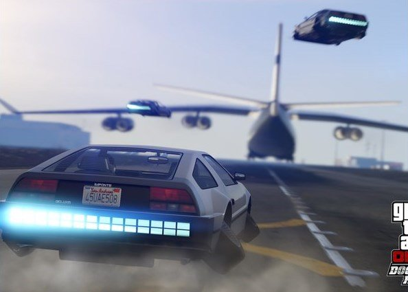

<!-- GENERATED FILE: edit data/ and run scripts/refresh, not this file -->
# Awesome Decomp Games 

  

> A rated, auto-refreshed list of **decompiled, recompiled and reverse-engineered games**: matching decompilations, static recompilations, source ports, engine remakes, disassemblies and browser ports.

**2530 projects** covering **2148 games** · updated 2026-10-31 · browse and filter on the **[website](https://submitgame.github.io/awesome-decomp-games/)** · data in [`data/games.json`](data/games.json)

> [!IMPORTANT]
> This list only links to source code and project pages. It does **not** host or link to ROMs, ISOs, game assets or other copyrighted material. Most projects need files from a copy of the game you own. See the [disclaimer](#disclaimer).

## Contents

- [Play in your browser](#play-in-your-browser) (45)
- [Top playable picks](#top-playable-picks)
- [Static recompilations](#static-recompilations) (783)
- [Source ports](#source-ports) (274)
- [Engine remakes & reimplementations](#engine-remakes--reimplementations) (244)
- [Browser ports](#browser-ports) (55)
- [Decompilations](#decompilations) (700)
- [Disassemblies](#disassemblies) (109)
- [Tools & launchers](#tools--launchers) (11)
- [Mods & mashups](#mods--mashups) (17)
- [Inactive / unmaintained](#inactive--unmaintained) (354)
- [How entries are rated](#how-entries-are-rated)
- [Sources](#sources)
- [Contributing](#contributing)
- [Disclaimer](#disclaimer)
- [License](#license)

## Play in your browser

45 games you can launch straight from a browser tab (WebAssembly/JS ports and recompilations). Links are re-checked daily in a real browser; ones that are taken down or broken are hidden. Some ask for files from your own copy of the game. Never install a launcher or extension a site pushes on you.

<table>
<tr><td align="center" valign="top" width="33%"> <b>Zelda II: The Adventure of Link (z2rs)</b> <a href="https://z2rs.com/"><b>▶ Play in browser</b></a> NES · needs your game files</td><td align="center" valign="top" width="33%"> <b>Call of Duty: Black Ops Zombies</b> <a href="https://vel.gg/bsz"><b>▶ Play in browser</b></a> PC · plays instantly</td><td align="center" valign="top" width="33%"> <b>Command & Conquer: Generals Zero Hour</b> <a href="https://generals.wasm.ltd"><b>▶ Play in browser</b></a> PC · needs your game files · multiplayer</td></tr>
<tr><td align="center" valign="top" width="33%"> <b>Command & Conquer: Red Alert 2</b> <a href="https://chronodivide.com/"><b>▶ Play in browser</b></a> PC · multiplayer</td><td align="center" valign="top" width="33%"> <b>Counter-Strike 1.6</b> <a href="https://csjs.live"><b>▶ Play in browser</b></a> PC · multiplayer</td><td align="center" valign="top" width="33%"> <b>Counter-Strike: Source Bunnyhop (bunnyhop.lol)</b> <a href="https://bunnyhop.lol"><b>▶ Play in browser</b></a> PC · plays instantly · multiplayer</td></tr>
<tr><td align="center" valign="top" width="33%"> <b>Counter-Strike: Source Surf (Surfd)</b> <a href="http://surfd.net"><b>▶ Play in browser</b></a> PC · plays instantly · multiplayer</td><td align="center" valign="top" width="33%"> <b>Crash Bash Online</b> <a href="https://crashbash.app/"><b>▶ Play in browser</b></a> PS1 · plays instantly · multiplayer</td><td align="center" valign="top" width="33%"> <b>Cuphead</b> <a href="https://wasm.rip/files/cuphead/index.html"><b>▶ Play in browser</b></a> PC · plays instantly</td></tr>
<tr><td align="center" valign="top" width="33%"> <b>Cyberpunk 2077</b> <a href="https://cyberpunk2077.lol/game?ioShared=1&amp;ioSharedMB=128&amp;ioInflight=4&amp;ioPersist=1&amp;ioPersistMB=6144&amp;binkRecycle=1&amp;psoWarm=0&amp;skipIntro=1&amp;ioLookahead=16&amp;behindLoad=0.5"><b>▶ Play in browser</b></a> PC · plays instantly</td><td align="center" valign="top" width="33%"> <b>Diablo (diablo_web)</b> <a href="http://johnimril.github.io/diablo_web/"><b>▶ Play in browser</b></a> PC · free demo, no game files needed</td><td align="center" valign="top" width="33%"> <b>Doom Multiplayer (Silent Space Marine)</b> <a href="https://silentspacemarine.com/"><b>▶ Play in browser</b></a> PC · plays instantly · multiplayer</td></tr>
<tr><td align="center" valign="top" width="33%"> <b>Formula One 06</b> <a href="https://f12006.online/"><b>▶ Play in browser</b></a> PS2 · plays instantly · multiplayer</td><td align="center" valign="top" width="33%"> <b>Grand Theft Auto III</b> <a href="https://wasmarcade.com/gta3"><b>▶ Play in browser</b></a> PC</td><td align="center" valign="top" width="33%"> <b>Grand Theft Auto V</b> <a href="https://web.archive.org/web/20261006055917/https://playgta5.com/"><b>▶ Play in browser</b></a> PC</td></tr>
<tr><td align="center" valign="top" width="33%"> <b>Grand Theft Auto: Vice City</b> <a href="https://joncodeofficial.github.io/gta-vice-city-wasm/"><b>▶ Play in browser</b></a> PC · needs your game files</td><td align="center" valign="top" width="33%"> <b>Half-Life (pixelsuft)</b> <a href="http://pixelsuft.github.io/hl/"><b>▶ Play in browser</b></a> PC</td><td align="center" valign="top" width="33%"> <b>Half-Life and Counter-Strike 1.6 (WebXash)</b> <a href="http://x8bitrain.github.io/webXash/"><b>▶ Play in browser</b></a> PC · free demo, no game files needed</td></tr>
<tr><td align="center" valign="top" width="33%"> <b>Halo: Combat Evolved</b> <a href="https://mitchellhynes.com/halo/halo.html"><b>▶ Play in browser</b></a> Xbox · needs your game files · multiplayer</td><td align="center" valign="top" width="33%"> <b>Halo: Combat Evolved Mobile (HCEMobile)</b> <a href="https://hcemobile.com/"><b>▶ Play in browser</b></a> Xbox · needs your game files</td><td align="center" valign="top" width="33%"> <b>LEGO Island</b> <a href="https://isle.pizza/"><b>▶ Play in browser</b></a> PC</td></tr>
<tr><td align="center" valign="top" width="33%"> <b>Minecraft 1.8.8 (EaglercraftX)</b> <a href="https://wasmarcade.com/minecraft"><b>▶ Play in browser</b></a> PC · plays instantly</td><td align="center" valign="top" width="33%"> <b>Moon (Black Ops Zombies, vel.gg)</b> <a href="https://vel.gg/bo1z/moon"><b>▶ Play in browser</b></a> PC · plays instantly</td><td align="center" valign="top" width="33%"> <b>Nacht der Untoten</b> <a href="https://zombies.concentric.live/"><b>▶ Play in browser</b></a> PC · plays instantly · multiplayer</td></tr>
<tr><td align="center" valign="top" width="33%"> <b>NetQuake.io</b> <a href="https://www.netquake.io/"><b>▶ Play in browser</b></a> PC · free demo, no game files needed</td><td align="center" valign="top" width="33%"> <b>Pro Evolution Soccer 6</b> <a href="http://pes6.optijuegos.net"><b>▶ Play in browser</b></a> PC · multiplayer</td><td align="center" valign="top" width="33%"> <b>Quake II (q2.pieter.com)</b> <a href="http://q2.pieter.com"><b>▶ Play in browser</b></a> PC · multiplayer</td></tr>
<tr><td align="center" valign="top" width="33%"> <b>Quake III Arena (q3.pieter.com)</b> <a href="https://q3.pieter.com"><b>▶ Play in browser</b></a> PC</td><td align="center" valign="top" width="33%"> <b>Quake III Arena (q3js)</b> <a href="https://q3js.com/"><b>▶ Play in browser</b></a> PC · plays instantly · multiplayer</td><td align="center" valign="top" width="33%"> <b>QuakeWorld (q1.pieter.com)</b> <a href="http://q1.pieter.com"><b>▶ Play in browser</b></a> PC · multiplayer</td></tr>
<tr><td align="center" valign="top" width="33%"> <b>Return to Castle Wolfenstein (rtcw.pieter.com)</b> <a href="http://rtcw.pieter.com"><b>▶ Play in browser</b></a> PC · plays instantly · multiplayer</td><td align="center" valign="top" width="33%"> <b>Skate 3 (fan browser game)</b> <a href="http://skate.aaddpp.lol"><b>▶ Play in browser</b></a> Xbox 360 · needs your game files</td><td align="center" valign="top" width="33%"> <b>SSX 3</b> <a href="https://ssx3.online/"><b>▶ Play in browser</b></a> PS2 · plays instantly · multiplayer</td></tr>
<tr><td align="center" valign="top" width="33%"> <b>Star Wars Jedi Knight: Jedi Academy</b> <a href="https://jk.q3js.com"><b>▶ Play in browser</b></a> PC · needs your game files · multiplayer</td><td align="center" valign="top" width="33%"> <b>Super Mario 64 Multiplayer</b> <a href="https://olivers.tools/play/"><b>▶ Play in browser</b></a> N64 · multiplayer</td><td align="center" valign="top" width="33%"> <b>Super Mario Zombies</b> <a href="https://smz.fun/"><b>▶ Play in browser</b></a> PC · plays instantly</td></tr>
<tr><td align="center" valign="top" width="33%"> <b>Tekken 5</b> <a href="https://tekken5.online/"><b>▶ Play in browser</b></a> PS2 · plays instantly · multiplayer</td><td align="center" valign="top" width="33%"> <b>Terraria</b> <a href="https://playterraria.lol/"><b>▶ Play in browser</b></a> PC · plays instantly · multiplayer</td><td align="center" valign="top" width="33%"> <b>The Simpsons: Hit & Run</b> <a href="http://shar-wasm.cjoseph.workers.dev/?skipmovie"><b>▶ Play in browser</b></a> PC</td></tr>
<tr><td align="center" valign="top" width="33%"> <b>Urban Terror (ut.pieter.com)</b> <a href="http://ut.pieter.com"><b>▶ Play in browser</b></a> PC</td><td align="center" valign="top" width="33%"> <b>WWE SmackDown! vs. RAW</b> <a href="https://smackdownvsraw.online/"><b>▶ Play in browser</b></a> PS2 · plays instantly · multiplayer</td><td align="center" valign="top" width="33%"> <b>Claude of Duty: Vibe Slops II (froydinger mirror)</b> <a href="https://froydinger.github.io/claude-of-duty/"><b>▶ Play in browser</b></a> PC</td></tr>
<tr><td align="center" valign="top" width="33%"> <b>Claude of Duty: Vibe Slops II (GoofyAhhBro69420 mirror)</b> <a href="https://goofyahhbro69420.github.io/Black-Ops-2/"><b>▶ Play in browser</b></a> PC</td><td align="center" valign="top" width="33%"> <b>Diablo (diabloweb)</b> <a href="https://d07riv.github.io/diabloweb/"><b>▶ Play in browser</b></a> PC</td><td align="center" valign="top" width="33%"> <b>Kino der Toten (GoofyAhhBro69420 mirror)</b> <a href="https://goofyahhbro69420.github.io/COD-ZOMBIES/"><b>▶ Play in browser</b></a> PC</td></tr>
</table>

## Top playable picks

Projects with the best mix of playability, completeness, activity and popularity that you can actually play today (bring your own game files where needed).

### 1. The Legend of Zelda: Ocarina of Time (Ship of Harkinian)
**Decompilation** · N64 / GameCube · ⭐ 5.8k · score **4.2/5**  
The definitive way to play Ocarina of Time on PC, Switch, Wii U and Android: 60fps, widescreen, randomizer, mods. Bring your own ROM.  
[project](https://github.com/HarbourMasters/Shipwright) · [release](https://github.com/HarbourMasters/Shipwright/releases/tag/9.3.1) · [video](https://www.youtube.com/watch?v=u-EhRErOpHE)

### 2. The Legend of Zelda: Majora's Mask (Zelda64Recomp)
**Static recompilation** · N64 · ⭐ 7.6k · score **4.8/5**  
N64: Recompiled port of Majora's Mask with ultrawide, high framerate, gyro and a mod loader. Needs your US ROM.  
[project](https://github.com/Zelda64Recomp/Zelda64Recomp) · [release](https://github.com/Zelda64Recomp/Zelda64Recomp/releases/tag/v1.2.2) · [video](https://www.youtube.com/watch?v=GIp7C2ro2T8)

### 3. Sonic Unleashed (Unleashed Recompiled)
**Static recompilation** · Xbox 360 · ⭐ 5.3k · score **4.5/5**  
XenonRecomp port of the Xbox 360 Sonic Unleashed: high framerate, ultrawide, mod support. Needs your own dump.  
[project](https://github.com/hedge-dev/UnleashedRecomp) · [release](https://github.com/hedge-dev/UnleashedRecomp/releases/tag/v1.0.3) · [video](https://www.youtube.com/watch?v=yDlVr1Jv-WU)

### 4. Super Mario 64 (sm64coopdx)
**Decompilation** · N64 · ⭐ 1.5k · score **4.0/5**  
Super Mario 64 PC port with online co-op for up to 16 players, Lua mods and DynOS. Built from the SM64 decomp.  
[project](https://github.com/coop-deluxe/sm64coopdx) · [release](https://github.com/coop-deluxe/sm64coopdx/releases/tag/v1.5.1) · [video](https://www.youtube.com/watch?v=hmqbLyszoYY)

### 5. Star Fox 64 (Starship)
**Decompilation** · N64 · ⭐ 2.1k · score **4.2/5**  
Native Star Fox 64 port (from the SF64 decomp) with widescreen, 60fps and enhancements.  
[project](https://github.com/HarbourMasters/Starship) · [release](https://github.com/HarbourMasters/Starship/releases/tag/v2.0.0) · [video](https://www.youtube.com/watch?v=FZ3o09an9_k)

### 6. The Legend of Zelda: Twilight Princess (Dusklight)
**Source port** · GameCube · ⭐ 6.2k · score **4.8/5**  
PC/mobile port of Twilight Princess built on the zeldaret/tp decompilation, with fixes and enhancements.  
[project](https://github.com/TwilitRealm/dusklight) · [release](https://github.com/TwilitRealm/dusklight/releases/tag/v2.0.3) · [video](https://www.youtube.com/watch?v=9ivusJVCtFk)

### 7. Banjo-Kazooie (BanjoRecomp)
**Static recompilation** · N64 · ⭐ 2.1k · score **4.5/5**  
N64: Recompiled Banjo-Kazooie for Windows/Linux/Mac with widescreen, high framerate and Thunderstore mods.  
[project](https://github.com/BanjoRecomp/BanjoRecomp) · [release](https://github.com/BanjoRecomp/BanjoRecomp/releases/tag/v1.0.2) · [video](https://www.youtube.com/watch?v=0906Cz-59eU)

### 8. Mario Kart 64 (SpaghettiKart)
**Source port** · N64 · ⭐ 2.5k · score **4.3/5**  
Mario Kart 64 PC port from the MK64 decomp: HD, custom tracks, extra players and modding.  
[project](https://github.com/HarbourMasters/SpaghettiKart) · [release](https://github.com/HarbourMasters/SpaghettiKart/releases/tag/1.0.0) · [video](https://www.youtube.com/watch?v=EOWOtd8sZTQ)

### 9. Diablo (DevilutionX)
**Engine remake** · PC · ⭐ 10.0k · score **4.5/5**  
Diablo and Hellfire for modern systems (PC, consoles, handhelds), based on the reverse-engineered Devilution source.  
[project](https://github.com/diasurgical/DevilutionX) · [release](https://github.com/diasurgical/DevilutionX/releases/tag/1.5.5) · [video](https://www.youtube.com/watch?v=4fxOMpYWBGg)

### 10. RollerCoaster Tycoon 2 (OpenRCT2)
**Engine remake** · PC · ⭐ 16.5k · score **4.8/5**  
Full reimplementation of RollerCoaster Tycoon 2 with multiplayer, higher resolutions and quality-of-life fixes.  
[project](https://github.com/OpenRCT2/OpenRCT2) · [release](https://github.com/OpenRCT2/OpenRCT2/releases/tag/v0.5.6) · [video](https://www.youtube.com/watch?v=8dXoNlAR0X4)

### 11. The Legend of Zelda: A Link to the Past (zelda3)
**Engine remake** · SNES · ⭐ 5.0k · score **4.5/5**  
Reverse-engineered C reimplementation of A Link to the Past: widescreen, pixel shaders, MSU-1. Needs the ROM for assets.  
[project](https://github.com/snesrev/zelda3) · [release](https://github.com/snesrev/zelda3/releases/tag/v0.3) · [video](https://www.youtube.com/watch?v=xctizwBntag)

### 12. The Elder Scrolls III: Morrowind (OpenMW)
**Engine remake** · PC · ⭐ 6.7k · score **4.8/5**  
Open-source Morrowind engine: better performance, Lua modding, runs on Linux/macOS/Android.  
[project](https://github.com/OpenMW/openmw) · [release](https://github.com/OpenMW/openmw/releases/tag/openmw-0.51.0) · [video](https://www.youtube.com/watch?v=bR-WZ8NOG_k)

### 13. Sonic Mania
**Decompilation** · PC · ⭐ 827 · score **4.0/5**  
Complete decompilation of Sonic Mania that builds native ports for PC, Switch, Android and more.  
[project](https://github.com/RSDKModding/Sonic-Mania-Decompilation) · [release](https://github.com/RSDKModding/Sonic-Mania-Decompilation/releases/tag/v1.1.1) · [video](https://www.youtube.com/watch?v=CSPhyjHt79Y)

### 14. Transport Tycoon Deluxe (OpenTTD)
**Engine remake** · PC · ⭐ 8.4k · score **4.8/5**  
The long-running, still active reimplementation of Transport Tycoon Deluxe; free graphics sets mean no original files are needed.  
[project](https://github.com/OpenTTD/OpenTTD) · [release](https://github.com/OpenTTD/OpenTTD/releases/tag/15.3) · [video](https://www.youtube.com/watch?v=ZBzRh6lD9J8)

### 15. Sonic the Hedgehog 2006 (Marathon Recompiled)
**Static recompilation** · Xbox 360 · ⭐ 721 · score **3.4/5**  
XenonRecomp port of Sonic the Hedgehog (2006), fixing much of its performance and loading.  
[project](https://github.com/sonicnext-dev/MarathonRecomp) · [video](https://www.youtube.com/watch?v=kQVbKhjSBmk)

### 16. LEGO Island (isle-portable)
**Source port** · PC · ⭐ 1.1k · score **4.3/5**  
Cross-platform LEGO Island built on the full isledecomp decompilation (Windows, Linux, macOS, web, consoles).  
[project](https://github.com/isledecomp/isle-portable) · [release](https://github.com/isledecomp/isle-portable/releases/tag/continuous) · [video](https://www.youtube.com/watch?v=JUNdWnI5BTk)

### 17. Heroes of Might and Magic III (VCMI)
**Engine remake** · PC · ⭐ 6.0k · score **4.5/5**  
Heroes of Might and Magic III engine rewrite with HD, mods, multiplayer and Android support.  
[project](https://github.com/vcmi/vcmi) · [release](https://github.com/vcmi/vcmi/releases/tag/1.7.5) · [video](https://www.youtube.com/watch?v=zxC7wLITNpg)

### 18. Carmageddon (dethrace)
**Engine remake** · PC · ⭐ 1.2k · score **4.5/5**  
Reverse-engineered Carmageddon that runs natively on modern Windows, Linux and macOS.  
[project](https://github.com/dethrace-labs/dethrace) · [release](https://github.com/dethrace-labs/dethrace/releases/tag/v0.10.1) · [video](https://www.youtube.com/watch?v=MMI45O0RKq0)

### 19. 3D Pinball Space Cadet
**Decompilation** · PC · ⭐ 4.8k · score **3.6/5**  
Decompilation of Windows' 3D Pinball Space Cadet, ported to modern platforms.  
[project](https://github.com/k4zmu2a/SpaceCadetPinball) · [release](https://github.com/k4zmu2a/SpaceCadetPinball/releases/tag/Release_2.1.0) · [video](https://www.youtube.com/watch?v=smiCSU2sje8)

### 20. Theme Hospital (CorsixTH)
**Engine remake** · PC · ⭐ 4.6k · score **4.3/5**  
Open reimplementation of Theme Hospital with high resolutions and campaign editor.  
[project](https://github.com/CorsixTH/CorsixTH) · [release](https://github.com/CorsixTH/CorsixTH/releases/tag/v0.70.1) · [video](https://www.youtube.com/watch?v=fKq04q6a53s)

### 21. Caesar III (Julius)
**Engine remake** · PC · ⭐ 3.4k · score **4.5/5**  
Faithful reimplementation of Caesar III that fixes bugs and runs on modern systems; Augustus adds gameplay changes.  
[project](https://github.com/bvschaik/julius) · [release](https://github.com/bvschaik/julius/releases/tag/v1.8.0) · [video](https://www.youtube.com/watch?v=OXONBt5U-U0)

### 22. Quake III Arena (q3js)
**Browser port** · PC · ⭐ n/a · score **4.0/5**  
Quake III Arena in the browser (WebAssembly ioquake3): click and play instantly, demo data included.  
[project](https://q3js.com) · [play](https://q3js.com/) · [video](https://www.youtube.com/watch?v=de7PNFRHNts)

## Static recompilations

Console/PC binaries statically recompiled to native code (N64Recomp, XenonRecomp, ReXGlue, ps1/ps2 recomp, ...).

| Game | Platform | Score | ⭐ | Last commit | Progress | Links |
|---|---|---|---|---|---|---|
| [The Legend of Zelda: Majora's Mask (Zelda64Recomp)](https://github.com/Zelda64Recomp/Zelda64Recomp) | N64 | 4.8 | 7.6k | 2026-09-25 |  | [release](https://github.com/Zelda64Recomp/Zelda64Recomp/releases/tag/v1.2.2) · [video](https://www.youtube.com/watch?v=GIp7C2ro2T8) |
| [Banjo-Kazooie (BanjoRecomp)](https://github.com/BanjoRecomp/BanjoRecomp) | N64 | 4.5 | 2.1k | 2026-09-25 |  | [release](https://github.com/BanjoRecomp/BanjoRecomp/releases/tag/v1.0.2) · [video](https://www.youtube.com/watch?v=0906Cz-59eU) |
| [Castlevania: Symphony of the Night](https://github.com/BlackLabelHQ/SymphonyRecomp) | PS1 | 4.5 | 1.0k | 2026-10-21 |  | [release](https://github.com/BlackLabelHQ/SymphonyRecomp/releases/tag/v0.5.1b) |
| [Sonic Unleashed (Unleashed Recompiled)](https://github.com/hedge-dev/UnleashedRecomp) | Xbox 360 | 4.5 | 5.3k | 2026-06-29 |  | [release](https://github.com/hedge-dev/UnleashedRecomp/releases/tag/v1.0.3) · [video](https://www.youtube.com/watch?v=yDlVr1Jv-WU) |
| [TotK Recomp](https://github.com/valentderah/totk-pc-recomp) | Switch | 4.5 | 2.0k | 2026-10-31 |  | [release](https://github.com/valentderah/totk-pc-recomp/releases/tag/v0.1.9) |
| [Black](https://github.com/TGP482/BLACK-XBERecomp) | og xbox | 4.3 | 823 | 2026-10-29 |  | [release](https://github.com/TGP482/BLACK-XBERecomp/releases/tag/V3) |
| [BloodBorne for Windows](https://github.com/Supermedo/bloodborne_pc) ⚠️ | PS4 | 4.3 | 4.9k | 2026-10-30 |  | [release](https://github.com/Supermedo/bloodborne_pc/releases/tag/windows-v1.9.7) |
| [Blue Dragon](https://github.com/zolaware/reblue) | Xbox 360 | 4.3 | 873 | 2026-10-05 |  | [release](https://github.com/zolaware/reblue/releases/tag/v1.3.1) |
| [Condemned 2: Bloodshot](https://github.com/psxrestore/Condemned2Recomp) | Xbox 360 | 4.3 | 274 | 2026-10-30 |  | [release](https://github.com/psxrestore/Condemned2Recomp/releases/tag/0.5.1) |
| [Dinosaur Planet](https://github.com/DinosaurPlanetRecomp/dino-recomp) | N64 | 4.3 | 333 | 2026-10-30 |  | [release](https://github.com/DinosaurPlanetRecomp/dino-recomp/releases/tag/v0.3.0) |
| [Donkey Kong 64](https://github.com/Rainchus/Donkey-Kong-64-Recompiled) | N64 | 4.3 | 563 | 2026-09-30 |  | [release](https://github.com/Rainchus/Donkey-Kong-64-Recompiled/releases/tag/v1.0.3) |
| [Midnight Club: Los Angeles](https://github.com/holdmysocks/mcla-recomp) | Xbox 360 | 4.3 | 222 | 2026-10-30 |  | [release](https://github.com/holdmysocks/mcla-recomp/releases/tag/v1.0.14) |
| [Mystical Ninja Starring Goemon](https://github.com/klorfmorf/Goemon64Recomp) | N64 | 4.3 | 331 | 2026-09-19 |  | [release](https://github.com/klorfmorf/Goemon64Recomp/releases/tag/v0.2.0-dev) |
| [Need for Speed: Most Wanted](https://github.com/codepdbh/nfsmw-android) | Xbox 360 | 4.3 | 278 | 2026-10-27 |  | [release](https://github.com/codepdbh/nfsmw-android/releases/tag/v0.8.2) |
| [Need for Speed: Underground 2](https://github.com/codepdbh/nfsu2-recompiled) | PC | 4.3 | 314 | 2026-10-30 |  | [release](https://github.com/codepdbh/nfsu2-recompiled/releases/tag/v0.14.12) |
| [OpenCE](https://github.com/OpenCommunityEdition/OpenCE) ⚠️ | Xbox | 4.3 | 1.9k | 2026-10-30 |  | [release](https://github.com/OpenCommunityEdition/OpenCE/releases/tag/build-335) |
| [Pokemon Gold / Silver / Crystal (Gen2Recomped)](https://github.com/UNDERdecoded/Gen2Recomped) | Game Boy Color | 4.3 | 430 | 2026-10-26 |  | [release](https://github.com/UNDERdecoded/Gen2Recomped/releases/tag/v0.8.47) · [reddit](https://www.reddit.com/r/decomps/comments/1vjmmj4/ "u/thc_delta_9 · 376 upvotes · 100 comments") |
| [Pokemon RBY / GSC / FRLF / RSE (G1R Deluxe)](https://github.com/bryanthaboi/gen1recomp) ⚠️ | Game Boy | 4.3 | 4.1k | 2026-10-29 |  | [release](https://github.com/bryanthaboi/gen1recomp/releases/tag/v0.3.98) |
| [Project Gotham Racing 4](https://github.com/beatrixzy/PGR4-Recomp) | Xbox 360 | 4.3 | 232 | 2026-10-28 |  | [release](https://github.com/beatrixzy/PGR4-Recomp/releases/tag/v1.2.2) |
| [Skate 3](https://github.com/mchughalex/skate3recomp) | Xbox 360 | 4.3 | 1.8k | 2026-07-24 |  | [release](https://github.com/mchughalex/skate3recomp/releases/tag/v2.0.2) · [video](https://youtu.be/ETXCOsip1Uo) |
| [Sonic Unleashed](https://github.com/SansNope/UnleashedRecomp-Android) | Xbox 360 | 4.3 | 238 | 2026-10-10 |  | [release](https://github.com/SansNope/UnleashedRecomp-Android/releases/tag/v0.6.1) |
| [Super Mario Maker 2 (SMM2 Recomp)](https://github.com/smm2recomp/smm2recomp) | Switch | 4.3 | 208 | 2026-10-30 |  | [release](https://github.com/smm2recomp/smm2recomp/releases/tag/v0.6.0) |
| [Super Smash Bros. Ultimate (ssbu-recomp)](https://github.com/OpenSmash-Ultimate/ssbu-recomp) | Switch | 4.3 | 538 | 2026-10-21 |  |  |
| [The Legend of Zelda: Breath of the Wild (Savage Wind Recomp)](https://github.com/Revivedx/SavageWindRecomp) ⚠️ | Switch | 4.3 | 2.5k | 2026-10-31 |  |  |
| [The Legend of Zelda: Link's Awakening (LAS Recomp)](https://github.com/peiikai/LASRecomp) ⚠️ | Switch | 4.3 | 2.0k | 2026-10-29 |  | [release](https://github.com/peiikai/LASRecomp/releases/tag/beta_5.4) |
| [Viva Pinata: Trouble In Paradise](https://github.com/SolarCookies/TiP-Recomp) | Xbox 360 | 4.3 | 239 | 2026-10-03 |  | [release](https://github.com/SolarCookies/TiP-Recomp/releases/tag/1.14.0) |
| [ZeldaWWHDRecomp](https://github.com/ZeldaWWHDRecomp/ZeldaWWHDRecomp) ⚠️ | Wii U | 4.3 | 1.2k | 2026-10-29 |  | [release](https://github.com/ZeldaWWHDRecomp/ZeldaWWHDRecomp/releases/tag/v0.5.0) |
| [Jet Force Gemini](https://github.com/VibinToast/JetForceGemini-Recompiled) | N64 | 4.2 | 29 | 2026-10-30 |  | [release](https://github.com/VibinToast/JetForceGemini-Recompiled/releases/tag/v1.3.2) |
| [Sonic Adventure](https://github.com/sonicfreak1337/SARecomp) ⚠️ | Dreamcast | 4.2 | 111 | 2026-10-18 |  | [release](https://github.com/sonicfreak1337/SARecomp/releases/tag/v0.52.1) |
| [Ace Combat 6: Fires of Liberation](https://github.com/sal063/AC6_recomp) ⚠️ | Xbox 360 | 4.2 | 580 | 2026-08-22 |  |  |
| [ACE COMBAT X](https://github.com/sal063/Ace-Combat-X-Recompilation) | PSP | 4.2 | 91 | 2026-08-28 |  | [release](https://github.com/sal063/Ace-Combat-X-Recompilation/releases/tag/V1.5-release) |
| [Alone in the Dark (AloneInTheDarkReHaunted)](https://github.com/spacefarergames/AloneInTheDarkReHaunted) | DOS | 4.2 | 133 | 2026-08-10 |  | [release](https://github.com/spacefarergames/AloneInTheDarkReHaunted/releases/tag/2.4.0.1008) |
| [Army of Two](https://github.com/OpenPortroid/ArmyOfTwoRecompilation) | Xbox 360 | 4.2 | 136 | 2026-10-30 |  | [release](https://github.com/OpenPortroid/ArmyOfTwoRecompilation/releases/tag/v1.4.0) |
| [Army of Two](https://github.com/nikolaygorb/ArmyOfTwoRecomp) | Xbox 360 | 4.2 | 99 | 2026-10-27 |  | [release](https://github.com/nikolaygorb/ArmyOfTwoRecomp/releases/tag/1.4) |
| [Banjo-Kazooie Nuts and Bolts](https://github.com/masterspike52/reNut) ⚠️ | Xbox 360 | 4.2 | 224 | 2026-10-31 |  | [release](https://github.com/masterspike52/reNut/releases/tag/beta15) |
| [Bayonetta 2 (B2recomp)](https://github.com/K0NL/B2recomp) ⚠️ | Switch | 4.2 | 515 | 2026-10-23 |  | [release](https://github.com/K0NL/B2recomp/releases/tag/v0.3.3) |
| [Bloody Roar 2](https://github.com/novapowers0/BloodyRoar2Recomp) | PS1 | 4.2 | 85 | 2026-10-13 |  | [release](https://github.com/novapowers0/BloodyRoar2Recomp/releases/tag/v0.7.1) |
| [Burnout Revenge](https://github.com/shipa-2/Xerenge) ⚠️ | Xbox 360 | 4.2 | 262 | 2026-10-31 |  | [release](https://github.com/shipa-2/Xerenge/releases/tag/v0.4.9) |
| [Call of Duty 3](https://github.com/FrankHUN88453/CoD3Recomp) ⚠️ | Xbox 360 | 4.2 | 375 | 2026-10-21 |  |  |
| [Call of Duty 3](https://github.com/zenit2893-cmyk/Call-of-Duty-3-PC-Editon) | Xbox 360 | 4.2 | 40 | 2026-09-25 |  | [release](https://github.com/zenit2893-cmyk/Call-of-Duty-3-PC-Editon/releases/tag/2.1) |
| [Call of Duty: Modern Warfare 2](https://github.com/PaulCombal/mw2-recompiled) | Xbox 360 | 4.2 | 166 | 2026-10-30 |  | [release](https://github.com/PaulCombal/mw2-recompiled/releases/tag/v0.8.2) |
| [Castlevania: Symphony of the Night (NocturneRecomp)](https://github.com/birabittoh/NocturneRecomp) ⚠️ | Xbox 360 | 4.2 | 400 | 2026-10-30 |  | [release](https://github.com/birabittoh/NocturneRecomp/releases/tag/v1.4.5) |
| [Championship Manager: Season 01/02 (02: Bosman Edition)](https://github.com/maxevans60/cm0102-bosman-edition) | PC | 4.2 | 48 | 2026-10-31 |  |  |
| [Conker's Bad Fur Day](https://github.com/sciaschi/CBFD-Recompiled) ⚠️ | N64 | 4.2 | 322 | 2026-10-14 |  | [release](https://github.com/sciaschi/CBFD-Recompiled/releases/tag/V0.1.6) |
| [Dante's Inferno](https://github.com/florinp93/hells-gate-recomp) ⚠️ | Xbox 360 | 4.2 | 768 | 2026-10-30 |  | [release](https://github.com/florinp93/hells-gate-recomp/releases/tag/v0.8.5-beta) |
| [Dark Cloud 2 (DC2-PS2RECOMP)](https://github.com/Red-tv141/DC2-PS2RECOMP) | PS2 | 4.2 | 38 | 2026-10-10 |  | [release](https://github.com/Red-tv141/DC2-PS2RECOMP/releases/tag/0.9.5) |
| [Darkwatch (Darkwatch: Darker Edition)](https://github.com/linkssy2/DarkwatchDarkerEdition) | og xbox | 4.2 | 153 | 2026-10-30 |  | [release](https://github.com/linkssy2/DarkwatchDarkerEdition/releases/tag/v0.7) |
| [Dead or Alive 3](https://github.com/NoRain211/doa3-re) | Xbox | 4.2 | 34 | 2026-10-30 |  | [release](https://github.com/NoRain211/doa3-re/releases/tag/v0.4) |
| [Dead or Alive Xtreme Beach Volleyball](https://github.com/NoRain211/doaxvb-re) ⚠️ | Xbox | 4.2 | 233 | 2026-10-30 |  | [release](https://github.com/NoRain211/doaxvb-re/releases/tag/v0.6.0) |
| [Def Jam Vendetta](https://github.com/jcsix694/def-jam-vendetta-recomp) | PS2 | 4.2 | 38 | 2026-10-28 |  | [release](https://github.com/jcsix694/def-jam-vendetta-recomp/releases/tag/v0.4.4) |
| [Def Jam: Fight for NY](https://github.com/vyanhursky/DefJamFFNY-recomp) ⚠️ | Xbox | 4.2 | 206 | 2026-10-30 |  | [release](https://github.com/vyanhursky/DefJamFFNY-recomp/releases/tag/v0.12.3) |
| [Destroy All Humans: Path of the Furon](https://github.com/masterspike52/reDAHM) | Xbox 360 | 4.2 | 46 | 2026-09-21 |  | [release](https://github.com/masterspike52/reDAHM/releases/tag/new) |
| [Diddy Kong Racing](https://github.com/ThatGuyMcd/DKR-R) ⚠️ | N64 | 4.2 | 248 | 2026-10-27 |  | [release](https://github.com/ThatGuyMcd/DKR-R/releases/tag/Version1.0.12) |
| [DoDonPachi Saidaioujou](https://github.com/eandis/SDOJ-Recomp) | Xbox 360 | 4.2 | 171 | 2026-10-30 |  | [release](https://github.com/eandis/SDOJ-Recomp/releases/tag/v1.51.3) |
| [Donkey Kong Country](https://github.com/elliotttate/DKC1Recomp) ⚠️ | SNES | 4.2 | 280 | 2026-09-15 |  | [release](https://github.com/elliotttate/DKC1Recomp/releases/tag/v0.0.17) |
| [Dragon Ball Z: Budokai HD Collection](https://github.com/novapowers0/DBZ-Budokai-3-HD-Collection) ⚠️ | Xbox 360 | 4.2 | 225 | 2026-10-28 |  | [release](https://github.com/novapowers0/DBZ-Budokai-3-HD-Collection/releases/tag/v1.5.5.5) |
| [Dragon Quest IV](https://github.com/GoldieLeGenie/DQIV-Recompiled) | DS | 4.2 | 59 | 2026-10-25 |  | [release](https://github.com/GoldieLeGenie/DQIV-Recompiled/releases/tag/1.5) |
| [Drakengard 3 (Drakengard 3 Recompiled)](https://github.com/soyjxck/dod3-recomp) ⚠️ | PS3 | 4.2 | 216 | 2026-10-22 |  |  |
| [Driveclub](https://github.com/OverkillLabs3/driveclub-recomp) ⚠️ | PS4 | 4.2 | 815 | 2026-10-30 |  | [release](https://github.com/OverkillLabs3/driveclub-recomp/releases/tag/v0.4.0) |
| [Eternal Sonata](https://github.com/birabittoh/EternalSonataReprise) | Xbox 360 | 4.2 | 181 | 2026-10-29 |  | [release](https://github.com/birabittoh/EternalSonataReprise/releases/tag/v1.3.7) |
| [F.E.A.R.](https://github.com/Juansolo457/fear360-recomp) | Xbox 360 | 4.2 | 36 | 2026-10-30 |  | [release](https://github.com/Juansolo457/fear360-recomp/releases/tag/v1.0.1) |
| [Fable 2](https://github.com/himdo/Fable-2-Recomp) ⚠️ | Xbox 360 | 4.2 | 584 | 2026-10-29 |  | [release](https://github.com/himdo/Fable-2-Recomp/releases/tag/1.5.0) |
| [Fate/unlimited codes](https://github.com/elprogramadorloco-arch/fuc-recomp) | PSP | 4.2 | 34 | 2026-10-17 |  | [release](https://github.com/elprogramadorloco-arch/fuc-recomp/releases/tag/v0.0.5) |
| [Forza Horizon](https://github.com/arcanite24/pinyon-shift) ⚠️ | Xbox 360 | 4.2 | 962 | 2026-10-28 |  | [release](https://github.com/arcanite24/pinyon-shift/releases/tag/v0.7.1) |
| [Forza Horizon 1](https://github.com/FH1-ReImagined/ForzaHorizon1-ReImagined) ⚠️ | Xbox 360 | 4.2 | 371 | 2026-10-31 |  | [release](https://github.com/FH1-ReImagined/ForzaHorizon1-ReImagined/releases/tag/v0.2.3) |
| [Forza Horizon 2](https://github.com/Gabrick75/fh2-recompiled) | Xbox 360 | 4.2 | 162 | 2026-10-27 |  |  |
| [Gears of War 2, Gears of War 3, Gears of War: Judgment (COGBox)](https://github.com/Shagg88/COGBox) ⚠️ | Xbox 360 | 4.2 | 266 | 2026-10-31 |  | [release](https://github.com/Shagg88/COGBox/releases/tag/0.3.0) |
| [Gears of War 3](https://github.com/Flippage/gears-of-war-3-recomp) | Xbox 360 | 4.2 | 47 | 2026-10-30 |  | [release](https://github.com/Flippage/gears-of-war-3-recomp/releases/tag/v0.3.1) |
| [God of War: Chains of Olympus / God of War: Ghost of Sparta](https://github.com/DrummingBird1/gow-psp-recomp) | PSP | 4.2 | 162 | 2026-10-30 |  | [release](https://github.com/DrummingBird1/gow-psp-recomp/releases/tag/v1.4.0) |
| [God of War: Ghost of Sparta](https://github.com/arnaldolima1/gow-ghost-of-sparta-pc) | PSP | 4.2 | 68 | 2026-10-16 |  |  |
| [Golden Sun (GSRecomp (Golden Sun Recompiled))](https://github.com/Shmargus/GSRecomp) | GBA | 4.2 | 70 | 2026-10-28 |  |  |
| [GoldenEye 007 (goldeneye-metal)](https://github.com/ysrdevs/goldeneye-metal) | N64 | 4.2 | 88 | 2026-10-09 |  | [release](https://github.com/ysrdevs/goldeneye-metal/releases/tag/v0.5.1) |
| [Gran Turismo 4](https://github.com/moesuito/gt4-staticrecomp) ⚠️ | PS2 | 4.2 | 426 | 2026-10-26 |  | [release](https://github.com/moesuito/gt4-staticrecomp/releases/tag/v1.2.5) |
| [Grand Theft Auto IV](https://github.com/KoreanSeats1/Theft4) | Xbox 360 | 4.2 | 105 | 2026-10-15 |  | [release](https://github.com/KoreanSeats1/Theft4/releases/tag/v0.3.2) |
| [Harvest Moon 64](https://github.com/HarvestMoon64Recomp/HarvestMoon64Recomp) | N64 | 4.2 | 179 | 2026-09-25 |  | [release](https://github.com/HarvestMoon64Recomp/HarvestMoon64Recomp/releases/tag/v1.2.2) |
| [Ico-PC](https://github.com/nathanialf/ico-pc) ⚠️ | PS2 | 4.2 | 477 | 2026-10-31 |  | [release](https://github.com/nathanialf/ico-pc/releases/tag/v0.9.6) |
| [King Kong Recompiled](https://github.com/TekRantGaming/king-kong-recompiled) ⚠️ | Xbox 360 | 4.2 | 241 | 2026-10-31 |  | [release](https://github.com/TekRantGaming/king-kong-recompiled/releases/tag/v2.0.3) |
| [LCS Recomp](https://github.com/elmasas/lcs-recomp) ⚠️ | PSP | 4.2 | 271 | 2026-10-18 |  | [release](https://github.com/elmasas/lcs-recomp/releases/tag/v0.1.6) |
| [Lego Dimensions](https://github.com/NeverCookFirst/DimensionsRecomp) ⚠️ | Xbox 360 | 4.2 | 238 | 2026-10-19 |  |  |
| [Lost Odyssey](https://github.com/freefrank/LostOdysseyRecomp) ⚠️ | Xbox 360 | 4.2 | 876 | 2026-10-26 |  | [release](https://github.com/freefrank/LostOdysseyRecomp/releases/tag/v1.1.0) |
| [Luigi's Mansion (Luigi's Mansion Recompiled)](https://github.com/rob646464/luigis-mansion-recompiled) ⚠️ | GameCube | 4.2 | 290 | 2026-10-27 |  | [release](https://github.com/rob646464/luigis-mansion-recompiled/releases/tag/v1.1.5) |
| [Mario Kart Wii](https://github.com/dorPXP/driftdroid) | Wii | 4.2 | 117 | 2026-10-30 |  | [release](https://github.com/dorPXP/driftdroid/releases/tag/v1.3.0) |
| [Mass Effect (masseffect-nx)](https://github.com/nebadasSwifty/masseffect-nx) | Xbox 360 | 4.2 | 43 | 2026-10-09 |  | [release](https://github.com/nebadasSwifty/masseffect-nx/releases/tag/v0.2.1) |
| [Medal of Honor](https://github.com/FractalEngineer/Medal-Of-Honor-PSX-Recomp) | PS1 | 4.2 | 38 | 2026-10-31 |  | [release](https://github.com/FractalEngineer/Medal-Of-Honor-PSX-Recomp/releases/tag/v0.1.6) |
| [Mega Man X](https://github.com/mstan/MegaManXSNESRecomp) ⚠️ | SNES | 4.2 | 221 | 2026-10-30 |  | [release](https://github.com/mstan/MegaManXSNESRecomp/releases/tag/v2.3.10) |
| [MeleePC](https://github.com/999sian/melee-pc) ⚠️ | GameCube | 4.2 | 577 | 2026-10-20 |  | [release](https://github.com/999sian/melee-pc/releases/tag/v0.4.2) |
| [Metroid Dread (Metroid Dread Recomp)](https://github.com/yozander2009-stack/Metroid-Dread-Recomp) ⚠️ | Switch | 4.2 | 308 | 2026-10-30 |  | [release](https://github.com/yozander2009-stack/Metroid-Dread-Recomp/releases/tag/v0.5.0) |
| [Metroid Prime Hunters](https://github.com/mstan/MetroidPrimeHuntersRecomp) ⚠️ | DS | 4.2 | 272 | 2026-10-27 |  | [release](https://github.com/mstan/MetroidPrimeHuntersRecomp/releases/tag/v0.7.3-alpha) |
| [Metroid Prime Hunters (HuntersRecomp (AYN Thor))](https://github.com/aabrole/HuntersRecomp) | DS | 4.2 | 41 | 2026-09-06 |  | [release](https://github.com/aabrole/HuntersRecomp/releases/tag/v0.2.5) |
| [Midnight Club 3: DUB Edition (mcdub3-nx)](https://github.com/laureladastra/mcdub3-nx) | PS2 | 4.2 | 79 | 2026-10-30 |  | [release](https://github.com/laureladastra/mcdub3-nx/releases/tag/v0.5.0) |
| [Midtown Madness 3](https://github.com/lakshya16157/midtown-madness-3-PC-Native) | Xbox | 4.2 | 40 | 2026-10-31 |  | [release](https://github.com/lakshya16157/midtown-madness-3-PC-Native/releases/tag/v2.2) |
| [Monster Hunter Generations Ultimate (MHGU Recomp)](https://github.com/morerokk/MHGURecomp) ⚠️ | Switch | 4.2 | 313 | 2026-10-31 |  | [release](https://github.com/morerokk/MHGURecomp/releases/tag/0.11.8) |
| [Naruto: Rise of a Ninja](https://github.com/jorjbarbosa/naruto-rise-recomp) ⚠️ | Xbox 360 | 4.2 | 216 | 2026-10-29 |  | [release](https://github.com/jorjbarbosa/naruto-rise-recomp/releases/tag/v0.4.0-beta) |
| [Need for Speed: Carbon](https://github.com/Sampreeth004/nfs-carbon-recomp) | Xbox 360 | 4.2 | 59 | 2026-10-07 |  | [release](https://github.com/Sampreeth004/nfs-carbon-recomp/releases/tag/v0.3.12) |
| [Need for Speed: Carbon (nfs-carbon-mac)](https://github.com/vasist15-source/nfs-carbon-mac) | PC | 4.2 | 42 | 2026-10-30 |  | [release](https://github.com/vasist15-source/nfs-carbon-mac/releases/tag/v0.7.0) |
| [Need for Speed: Most Wanted](https://github.com/codepdbh/nfsmwpc-recompiled) | PC | 4.2 | 110 | 2026-10-30 |  | [release](https://github.com/codepdbh/nfsmwpc-recompiled/releases/tag/v0.1.12) |
| [Need for Speed: Most Wanted (nfs-most-wanted-mac)](https://github.com/elforeign/nfs-most-wanted-mac) | PC | 4.2 | 134 | 2026-10-30 |  | [release](https://github.com/elforeign/nfs-most-wanted-mac/releases/tag/v4.3.0) |
| [Need for Speed: Most Wanted (nfsmw-ios)](https://github.com/bep1s69/nfsmw-ios) | PC | 4.2 | 50 | 2026-10-30 |  | [release](https://github.com/bep1s69/nfsmw-ios/releases/tag/v0.5.1) |
| [Need for Speed: Underground](https://github.com/codepdbh/nfsu1-recompiled) | PC | 4.2 | 76 | 2026-10-30 |  | [release](https://github.com/codepdbh/nfsu1-recompiled/releases/tag/v0.2.10) |
| [Ninja Gaiden Black (Ninja Gaiden Black Recompiled)](https://github.com/gamboozino/ngbrecomp) ⚠️ | og xbox | 4.2 | 221 | 2026-10-30 |  |  |
| [Ocarina of Time 3D (TriAevum Recomp)](https://github.com/coccofresco/TriAevum) ⚠️ | 3DS | 4.2 | 596 | 2026-10-22 |  |  |
| [OpenTIE](https://github.com/elyosh/OpenTIE) ⚠️ | DOS | 4.2 | 351 | 2026-10-04 |  | [release](https://github.com/elyosh/OpenTIE/releases/tag/v0.0.7) |
| [Perfect Dark (Dab's Mod)](https://github.com/DabDavis/perfect-dark-dabs-mod) ⚠️ | N64 | 4.2 | 207 | 2026-10-21 |  | [release](https://github.com/DabDavis/perfect-dark-dabs-mod/releases/tag/v3.15.1) |
| [Perfect Dark Remaster](https://github.com/nikolaygorb/PerfectDarkRemasterRecomp) | Xbox 360 | 4.2 | 47 | 2026-10-23 |  | [release](https://github.com/nikolaygorb/PerfectDarkRemasterRecomp/releases/tag/1.5) |
| [Perfect Dark Zero](https://github.com/nikolaygorb/PerfectDarkZeroRecomp) | Xbox 360 | 4.2 | 65 | 2026-10-30 |  | [release](https://github.com/nikolaygorb/PerfectDarkZeroRecomp/releases/tag/1.8) |
| [Pokémon Let's Go, Pikachu! / Let's Go, Eevee! (Let's Go Recomp)](https://github.com/raulzrrs/letsgo-recomp) ⚠️ | Switch | 4.2 | 238 | 2026-10-25 |  | [release](https://github.com/raulzrrs/letsgo-recomp/releases/tag/v0.7.5) |
| [Rockstar Table Tennis](https://github.com/davidptrssvea/Table-Tennis-Rockstar-PC) | Xbox 360 | 4.2 | 49 | 2026-10-19 |  | [release](https://github.com/davidptrssvea/Table-Tennis-Rockstar-PC/releases/tag/v1.0.1) |
| [Shin Megami Tensei: NINE](https://github.com/gymzatan/smt-nine-recomp) | Xbox | 4.2 | 37 | 2026-10-30 |  | [release](https://github.com/gymzatan/smt-nine-recomp/releases/tag/v0.1.19) |
| [Silent Hill 2 (sh2-nx)](https://github.com/cutarev/sh2-nx) | PS2 | 4.2 | 52 | 2026-10-22 |  | [release](https://github.com/cutarev/sh2-nx/releases/tag/v1.02) |
| [Silent Hill: Downpour](https://github.com/LittleBitUA/DownpourRecomp) ⚠️ | Xbox 360 | 4.2 | 351 | 2026-09-02 |  | [release](https://github.com/LittleBitUA/DownpourRecomp/releases/tag/v1.1.8) |
| [Skate 3](https://github.com/andrewnakas/skate3-android) | Xbox 360 | 4.2 | 48 | 2026-09-24 |  | [release](https://github.com/andrewnakas/skate3-android/releases/tag/v0.2.0) |
| [Skate 3 (skate3-ios-setup)](https://github.com/andrewnakas/skate3-ios-setup) | Xbox 360 | 4.2 | 119 | 2026-09-24 |  | [release](https://github.com/andrewnakas/skate3-ios-setup/releases/tag/v2.7.1) |
| [Snowboard Kids 2](https://github.com/cdlewis/snowboardkids2-recomp) | N64 | 4.2 | 113 | 2026-10-25 |  | [release](https://github.com/cdlewis/snowboardkids2-recomp/releases/tag/v2.0.2) |
| [Sonic Adventure 2: Battle (OpenSA2)](https://github.com/kittycache9/OpenSA2) | GameCube | 4.2 | 43 | 2026-10-25 |  |  |
| [SpeedBreaker](https://github.com/SpeedBreakerProject/speedbreaker) ⚠️ | Xbox 360 | 4.2 | 556 | 2026-10-26 |  | [release](https://github.com/SpeedBreakerProject/speedbreaker/releases/tag/v0.2.0) |
| [SSX Tricky](https://github.com/GiZcesi/OpenTricky) | Xbox | 4.2 | 130 | 2026-10-29 |  | [release](https://github.com/GiZcesi/OpenTricky/releases/tag/v0.1.4) |
| [Starfox Recomp](https://github.com/mstan/StarFoxSNESRecomp) | SNES | 4.2 | 34 | 2026-10-18 |  | [release](https://github.com/mstan/StarFoxSNESRecomp/releases/tag/v0.3.2) |
| [Super Mario Bros.](https://github.com/mstan/SuperMarioBrosNESRecomp) | NES | 4.2 | 49 | 2026-10-27 |  | [release](https://github.com/mstan/SuperMarioBrosNESRecomp/releases/tag/v1.12.4) |
| [Super Mario Bros. Wonder (SMW)](https://github.com/iHaiDeeZ/SMW) | Switch | 4.2 | 62 | 2026-10-19 |  | [release](https://github.com/iHaiDeeZ/SMW/releases/tag/v00.30) |
| [Syphon Filter (PC Recomp)](https://github.com/Madxbio97/SF-pc-port) | PS1 | 4.2 | 140 | 2026-08-13 |  | [release](https://github.com/Madxbio97/SF-pc-port/releases/tag/0.2.0-beta.2) |
| [Tekken 3](https://github.com/FishB0nes98/Tekken3Recompiled) | PS1 | 4.2 | 77 | 2026-09-23 |  |  |
| [Tekken Tag Tournament 2](https://github.com/shihabal3amri/tekken-tag-tournament-2-pc) ⚠️ | Xbox 360 | 4.2 | 234 | 2026-10-30 |  | [release](https://github.com/shihabal3amri/tekken-tag-tournament-2-pc/releases/tag/v0.1.7) |
| [Tekken Tag Tournament 2 Wii U Edition](https://github.com/Petexy/Tekken-Tag-2-Ultimate-Edition) | Wii U | 4.2 | 79 | 2026-10-30 |  | [release](https://github.com/Petexy/Tekken-Tag-2-Ultimate-Edition/releases/tag/v0.4.2) |
| [The Darkness](https://github.com/portingpete/The-Darkness-Recomp) ⚠️ | Xbox 360 | 4.2 | 360 | 2026-10-30 |  |  |
| [The Darkness](https://github.com/invinceble55-wq/Estacado-The-Darkness-Recomp) | Xbox 360 | 4.2 | 111 | 2026-10-12 |  |  |
| [The Elder Scrolls V: Skyrim](https://github.com/ttom795/Skyrim_Android) | PC | 4.2 | 156 | 2026-10-28 |  | [release](https://github.com/ttom795/Skyrim_Android/releases/tag/0.27.5) |
| [The Legend of Zelda: Majora's Mask (MMRecompRando)](https://github.com/RecompRando/MMRecompRando) | N64 | 4.2 | 47 | 2026-08-04 |  | [release](https://github.com/RecompRando/MMRecompRando/releases/tag/v0.9.5a) |
| [The Legend of Zelda: Skyward Sword HD (Sky Recomp)](https://github.com/Apolinario-coder/SkyRecomp) ⚠️ | Switch | 4.2 | 497 | 2026-10-29 |  | [release](https://github.com/Apolinario-coder/SkyRecomp/releases/tag/v2.0.2) |
| [The Legend of Zelda: The Wind Waker](https://github.com/chrissotraidis/bluewake) ⚠️ | GameCube | 4.2 | 528 | 2026-10-31 |  | [release](https://github.com/chrissotraidis/bluewake/releases/tag/v0.9.0) |
| [The Legend of Zelda: The Wind Waker HD](https://github.com/centollOS/SwitchWakerHD) ⚠️ | Wii U | 4.2 | 215 | 2026-10-28 |  | [release](https://github.com/centollOS/SwitchWakerHD/releases/tag/v1.0.0) · [reddit](https://www.reddit.com/r/decomps/comments/1x07qo0/ "u/ShallotImpressive158 · 351 upvotes · 152 comments") |
| [TimeSplitters 2](https://github.com/phobos665/split2-recomp) | Xbox | 4.2 | 50 | 2026-10-27 |  | [release](https://github.com/phobos665/split2-recomp/releases/tag/v0.5.2) |
| [Ultimate MK3 iOS](https://github.com/MaryNCRT/Ultimate-Mortal-Kombat-3-iOS-Decompiled) | Mobile | 4.2 | 53 | 2026-10-31 |  |  |
| [Underworld Exhumed](https://github.com/abedegno/underworld-exhumed) | DOS | 4.2 | 76 | 2026-10-15 |  | [release](https://github.com/abedegno/underworld-exhumed/releases/tag/uw1-v1.0.2) |
| [wc2-re](https://github.com/neuromancer/wc2-re) | DOS | 4.2 | 33 | 2026-09-29 |  | [release](https://github.com/neuromancer/wc2-re/releases/tag/v0.0.14) |
| [Wet](https://github.com/nikolaygorb/WetRecomp) | Xbox 360 | 4.2 | 57 | 2026-10-23 |  | [release](https://github.com/nikolaygorb/WetRecomp/releases/tag/1.5) |
| [WWE '12 (wwe12-pc)](https://github.com/iMrBurn/wwe12-pc) | Xbox 360 | 4.2 | 55 | 2026-10-31 |  | [release](https://github.com/iMrBurn/wwe12-pc/releases/tag/v0.9.0-beta) |
| [WWE 2K14 (WWE 2K14 Recomp)](https://github.com/PromethenDev/wwe2k14-recomp) | Xbox 360 | 4.2 | 84 | 2026-10-31 |  | [release](https://github.com/PromethenDev/wwe2k14-recomp/releases/tag/v1.4.6) |
| [WWE SmackDown vs. Raw 2008](https://github.com/nefariousjosiah/WWE-SVR2008-RECOMP) | Xbox 360 | 4.2 | 36 | 2026-10-24 |  | [release](https://github.com/nefariousjosiah/WWE-SVR2008-RECOMP/releases/tag/v2.2.1) |
| [WWE SmackDown vs. Raw 2009](https://github.com/nefariousjosiah/WWE-SVR2009-RECOMP) | Xbox 360 | 4.2 | 33 | 2026-10-24 |  | [release](https://github.com/nefariousjosiah/WWE-SVR2009-RECOMP/releases/tag/v2.1.1) |
| [WWE SmackDown vs. Raw 2010](https://github.com/nefariousjosiah/WWE-SVR2010-RECOMP) | Xbox 360 | 4.2 | 39 | 2026-10-24 |  | [release](https://github.com/nefariousjosiah/WWE-SVR2010-RECOMP/releases/tag/v2.1.3) |
| [Xenogears](https://github.com/OpokXeno/xenogears-recomp) | PS1 | 4.2 | 70 | 2026-10-29 |  |  |
| [Yu-Gi-Oh! Forbidden Memories](https://github.com/Unchiga/Yu-Gi-Oh-Forbidden-Memories-Recompiled) ⚠️ | PS1 | 4.2 | 270 | 2026-10-30 |  | [release](https://github.com/Unchiga/Yu-Gi-Oh-Forbidden-Memories-Recompiled/releases/tag/v0.3.0) |
| [Yu-Gi-Oh! Forbidden Memories](https://github.com/Unchiga/YuGiOhForbiddenMemoriesRecomp) | PS1 | 4.2 | 148 | 2026-09-26 |  | [release](https://github.com/Unchiga/YuGiOhForbiddenMemoriesRecomp/releases/tag/v0.6.2) |
| [Black](https://github.com/portingpete/Black-2006-Recomp) | Xbox | 4.1 | 202 | 2026-10-28 |  |  |
| [Star Fox 64](https://github.com/sonicdcer/Starfox64Recomp) | N64 | 4.1 | 401 | 2026-08-11 |  | [release](https://github.com/sonicdcer/Starfox64Recomp/releases/tag/1.0.3) |
| [Super Mario Sunshine](https://github.com/chrissotraidis/sunpad) | GameCube | 4.1 | 201 | 2026-10-30 |  | [release](https://github.com/chrissotraidis/sunpad/releases/tag/v0.2.3) |
| [The Simpsons Game](https://github.com/YesterMester/TheSimpsonsGameRecomp) | Xbox 360 | 4.1 | 397 | 2026-10-11 |  | [release](https://github.com/YesterMester/TheSimpsonsGameRecomp/releases/tag/v0.0.6.5) |
| [Mario Kart 64](https://github.com/sonicdcer/MarioKart64Recomp) | N64 | 4.0 | 623 | 2026-08-11 |  | [release](https://github.com/sonicdcer/MarioKart64Recomp/releases/tag/v0.9.2) |
| [2014 FIFA World Cup Brazil](https://github.com/HossEz/fifa-world-cup-2014-recompiled) ⚠️ | Xbox 360 | 4.0 | 79 | 2026-10-26 |  | [release](https://github.com/HossEz/fifa-world-cup-2014-recompiled/releases/tag/v0.1.10) |
| [Ace Combat 5: The Unsung War](https://github.com/sal063/Ace-Combat-5-Static-recompilation) ⚠️ | PS2 | 4.0 | 125 | 2026-10-24 |  | [release](https://github.com/sal063/Ace-Combat-5-Static-recompilation/releases/tag/V3.0) |
| [AeroGauge](https://github.com/alondero/aerogauge-recomp) ⚠️ | N64 | 4.0 | 42 | 2026-10-28 |  | [release](https://github.com/alondero/aerogauge-recomp/releases/tag/v0.7.0) |
| [Alien Resurrection (AlienReRecomp)](https://github.com/DiegoDeDios/AlienReRecomp) ⚠️ | PS1 | 4.0 | 40 | 2026-10-25 |  | [release](https://github.com/DiegoDeDios/AlienReRecomp/releases/tag/v0.1.8) |
| [Ape Escape](https://github.com/mstan/ApeEscapeRecomp) ⚠️ | PS1 | 4.0 | 96 | 2026-10-31 |  | [release](https://github.com/mstan/ApeEscapeRecomp/releases/tag/v0.5.4) |
| [Asphalt 5 HD](https://github.com/mrbaazzman/Asphalt5-Native) | Mobile | 4.0 | 13 | 2026-10-29 |  | [release](https://github.com/mrbaazzman/Asphalt5-Native/releases/tag/v2.0.1) |
| [Automobili Lamborghini](https://github.com/alondero/automobililamborghini-recomp) ⚠️ | N64 | 4.0 | 47 | 2026-10-30 |  | [release](https://github.com/alondero/automobililamborghini-recomp/releases/tag/v0.10.3) |
| [Beetle Adventure Racing!](https://github.com/danielgomesvieira2000/beetle-adventure-racing-recomp) ⚠️ | N64 | 4.0 | 69 | 2026-09-20 |  | [release](https://github.com/danielgomesvieira2000/beetle-adventure-racing-recomp/releases/tag/v0.4.2-alpha) |
| [Blinx 2: Masters of Time and Space](https://github.com/apexJCL/blinx2-recomp) | Xbox | 4.0 | 20 | 2026-10-31 |  | [release](https://github.com/apexJCL/blinx2-recomp/releases/tag/v2026.10.4) |
| [Bloody Roar Extreme (Bloody Roar Extreme - XBE Recomp)](https://github.com/bromurok/BloodyRoarExtremeRecomp) | Xbox | 4.0 | 22 | 2026-10-30 |  | [release](https://github.com/bromurok/BloodyRoarExtremeRecomp/releases/tag/v1.0.4) |
| [Bomberman Hero](https://github.com/RevoSucks/BMHeroRecomp) | N64 | 4.0 | 128 | 2026-05-12 |  |  |
| [Burnout 2: Point of Impact](https://github.com/timftw21/burnout2-recompilation) ⚠️ | Xbox | 4.0 | 39 | 2026-10-31 |  | [release](https://github.com/timftw21/burnout2-recompilation/releases/tag/v1.12) |
| [Castlevania: Legacy of Darkness](https://github.com/fliperama86/cvlod_recomp) ⚠️ | N64 | 4.0 | 142 | 2026-10-23 |  | [release](https://github.com/fliperama86/cvlod_recomp/releases/tag/v0.2.29) |
| [Civilization Revolution](https://github.com/ReRevvedRecomp/rerevved) | Xbox 360 | 4.0 | 18 | 2026-10-29 |  | [release](https://github.com/ReRevvedRecomp/rerevved/releases/tag/v0.6.1) |
| [Command & Conquer: Red Alert 2](https://github.com/sp00nznet/redalert2-recomp) ⚠️ | PC | 4.0 | 135 | 2026-10-28 |  | [release](https://github.com/sp00nznet/redalert2-recomp/releases/tag/v0.1.3) |
| [Conker's Bad Fur Day Reloaded](https://github.com/DahSidiAbdallah/ConkerBFDReloaded) ⚠️ | N64 | 4.0 | 152 | 2026-10-28 |  | [release](https://github.com/DahSidiAbdallah/ConkerBFDReloaded/releases/tag/v1.4.7) |
| [Crackdown](https://github.com/saulob/crackdown-xbox360-recompiled) ⚠️ | Xbox 360 | 4.0 | 91 | 2026-10-27 |  | [release](https://github.com/saulob/crackdown-xbox360-recompiled/releases/tag/v0.6.2) |
| [Crash Bandicoot 2](https://github.com/Zumbo06/Crash2Recomp) ⚠️ | PS1 | 4.0 | 95 | 2026-10-08 |  | [release](https://github.com/Zumbo06/Crash2Recomp/releases/tag/v0.9.6) |
| [Dead or Alive 3](https://github.com/parkerallan/doa3-recomp) ⚠️ | Xbox | 4.0 | 98 | 2026-10-24 |  | [release](https://github.com/parkerallan/doa3-recomp/releases/tag/v1.0.7) |
| [Dead Rising 2: Case West](https://github.com/wivi514/Dead_Rising_2_Case_West_Xenon_Recomp) ⚠️ | Xbox 360 | 4.0 | 102 | 2026-10-20 |  | [release](https://github.com/wivi514/Dead_Rising_2_Case_West_Xenon_Recomp/releases/tag/v1.1.2) |
| [Dead Rising 2: Case Zero](https://github.com/wivi514/Dead_Rising_2_Case_Zero_Xenon_Recomp) ⚠️ | Xbox 360 | 4.0 | 105 | 2026-10-20 |  | [release](https://github.com/wivi514/Dead_Rising_2_Case_Zero_Xenon_Recomp/releases/tag/v1.1.3) |
| [Deadly Premonition](https://github.com/LittleBitUA/DPRecomp) ⚠️ | Xbox 360 | 4.0 | 179 | 2026-10-03 |  | [release](https://github.com/LittleBitUA/DPRecomp/releases/tag/v2.0.14) |
| [Def Jam: Fight for NY (FFNY Online)](https://github.com/sweeax-exe/ffny-online) | PS2 | 4.0 | 11 | 2026-10-28 |  | [release](https://github.com/sweeax-exe/ffny-online/releases/tag/v0.12.2-remaster.36) |
| [Die Hard Trilogy](https://github.com/alexbeavs-ps1-ports/die-hard-trilogy-recomp) | PS1 | 4.0 | 18 | 2026-09-30 |  | [release](https://github.com/alexbeavs-ps1-ports/die-hard-trilogy-recomp/releases/tag/v0.3.6) |
| [Digimon World 2003](https://github.com/gascarcella/dw2003recomp) | PS1 | 4.0 | 27 | 2026-10-29 |  | [release](https://github.com/gascarcella/dw2003recomp/releases/tag/v0.6.1) |
| [Disney's Hercules](https://github.com/obaidr1/hercules-recompiled) ⚠️ | PS1 | 4.0 | 111 | 2026-10-23 |  | [release](https://github.com/obaidr1/hercules-recompiled/releases/tag/v0.5.6) |
| [Disruptor](https://github.com/RecompTeam/DisruptorRecomp) | PS1 | 4.0 | 10 | 2026-10-29 |  | [release](https://github.com/RecompTeam/DisruptorRecomp/releases/tag/v0.9.0) |
| [Donkey Kong Country 2: Diddy's Kong Quest](https://github.com/elliotttate/DKC2Recomp) ⚠️ | SNES | 4.0 | 186 | 2026-09-13 |  | [release](https://github.com/elliotttate/DKC2Recomp/releases/tag/v0.0.8) |
| [Donkey Kong Country 3](https://github.com/elliotttate/DKC3Recomp) ⚠️ | SNES | 4.0 | 147 | 2026-09-13 |  | [release](https://github.com/elliotttate/DKC3Recomp/releases/tag/v0.0.6) |
| [DQ8 Recompiled](https://github.com/Sinan-Karakaya/DQ8-Recompiled) ⚠️ | PS2 | 4.0 | 107 | 2026-10-23 |  | [release](https://github.com/Sinan-Karakaya/DQ8-Recompiled/releases/tag/f6dfd96) |
| [Dragon Age: Origins](https://github.com/96dot/Dragon-Age-Origins-Recomp) ⚠️ | Xbox 360 | 4.0 | 49 | 2026-10-29 |  |  |
| [Dragon Ball Z: Burst Limit](https://github.com/iExplosiveRage/DBZ-Burst-Limit-Recompiled) ⚠️ | Xbox 360 | 4.0 | 115 | 2026-10-27 |  | [release](https://github.com/iExplosiveRage/DBZ-Burst-Limit-Recompiled/releases/tag/v0.7.3-alpha) |
| [Dragon Ball Z: Burst Limit (Dragon Burst)](https://github.com/dfdx047/Dragon-Burst) | Xbox 360 | 4.0 | 15 | 2026-10-30 |  | [release](https://github.com/dfdx047/Dragon-Burst/releases/tag/v0.2.1) |
| [Dragon Quest IX: Sentinels of the Starry Skies (DQ9-Decomp)](https://github.com/dq9-remastered/DQ9-Remastered) | DS | 4.0 | 17 | 2026-10-30 |  |  |
| [Earthbound Companion](https://github.com/rages4calm/earthbound-companion) ⚠️ | SNES | 4.0 | 40 | 2026-10-29 |  | [release](https://github.com/rages4calm/earthbound-companion/releases/tag/v1.0.14) |
| [Earthworm Jim HD Recompiled](https://github.com/TekRantGaming/earthworm-jim-hd-recompiled) ⚠️ | Xbox 360 | 4.0 | 102 | 2026-10-18 |  | [release](https://github.com/TekRantGaming/earthworm-jim-hd-recompiled/releases/tag/v0.9.6) |
| [Eternal Darkness: Sanity's Requiem](https://github.com/griches/EternalDarknessRecomp) ⚠️ | GameCube | 4.0 | 183 | 2026-10-28 |  | [release](https://github.com/griches/EternalDarknessRecomp/releases/tag/v0.9.6) |
| [F-Zero](https://github.com/RetroPortingToolKit/FZeroSNESRecomp) ⚠️ | SNES | 4.0 | 84 | 2026-10-30 |  | [release](https://github.com/RetroPortingToolKit/FZeroSNESRecomp/releases/tag/v1.8.3) |
| [F-Zero](https://github.com/craigshaw/FZeroRecomp) ⚠️ | SNES | 4.0 | 45 | 2026-10-18 |  | [release](https://github.com/craigshaw/FZeroRecomp/releases/tag/v0.6.0) |
| [F.E.A.R. (F.E.A.R. NX)](https://github.com/infriker/fear-nx) | PC | 4.0 | 19 | 2026-10-25 |  | [release](https://github.com/infriker/fear-nx/releases/tag/v0.1.4) |
| [Far Cry Instincts (fci-recomp)](https://github.com/VinceIP/fci-recomp) ⚠️ | og xbox | 4.0 | 74 | 2026-10-26 |  | [release](https://github.com/VinceIP/fci-recomp/releases/tag/v0.2.3) |
| [Faxanadu](https://github.com/mstan/FaxanaduRecomp) | NES | 4.0 | 14 | 2026-10-27 |  | [release](https://github.com/mstan/FaxanaduRecomp/releases/tag/v2.5.0) |
| [Final Fantasy XI](https://github.com/rubymatrix/xi-on-anything) | PC | 4.0 | 22 | 2026-10-25 |  | [release](https://github.com/rubymatrix/xi-on-anything/releases/tag/v0.2.5) |
| [Fire Emblem: The Sacred Stones](https://github.com/Lordingard/SacredStonesRecomp) | GBA | 4.0 | 24 | 2026-10-17 |  | [release](https://github.com/Lordingard/SacredStonesRecomp/releases/tag/v0.1.20) |
| [Flame](https://github.com/DiaLight/Flame) | PC | 4.0 | 128 | 2026-02-28 |  | [release](https://github.com/DiaLight/Flame/releases/tag/v260206) |
| [Forza Motorsport 2 (Forza Motorsport 2 ReGPU)](https://github.com/zer0ducksgiven/Forza-Motorsport-2-ReGPU) ⚠️ | Xbox 360 | 4.0 | 57 | 2026-10-30 |  | [release](https://github.com/zer0ducksgiven/Forza-Motorsport-2-ReGPU/releases/tag/v0.9.11) |
| [Forza Motorsport 4](https://github.com/i2kiselev/fm4-static-recomp) ⚠️ | Xbox 360 | 4.0 | 90 | 2026-10-29 |  | [release](https://github.com/i2kiselev/fm4-static-recomp/releases/tag/v0.3.0) |
| [Genma Onimusha (Genma Onimusha - PC port)](https://github.com/rafaelkenedy/genma-recomp) | Xbox | 4.0 | 28 | 2026-10-30 |  | [release](https://github.com/rafaelkenedy/genma-recomp/releases/tag/v0.6.1) |
| [Geometry Wars: Retro Evolved 2](https://github.com/saulob/geometry-wars-retro-evolved-2-recompiled) ⚠️ | Xbox 360 | 4.0 | 66 | 2026-10-27 |  | [release](https://github.com/saulob/geometry-wars-retro-evolved-2-recompiled/releases/tag/v0.6.1) |
| [GoldenEye 007 (GoldenEye 007 XBLA PC Recomp)](https://github.com/CaiusCodes/GoldenEye-007-XBLA-PC-Recomp) ⚠️ | Xbox 360 | 4.0 | 67 | 2026-10-25 |  | [release](https://github.com/CaiusCodes/GoldenEye-007-XBLA-PC-Recomp/releases/tag/v0.9.6c) · [reddit](https://www.reddit.com/r/decomps/comments/1x6fo2x/ "u/CaiusSmokes · 19 upvotes · 2 comments") |
| [GoldenEye 007 (XBLA Remaster)](https://github.com/SunJaycy/GoldenEye-Recomp) ⚠️ | Xbox 360 | 4.0 | 922 | 2026-06-18 |  | [release](https://github.com/SunJaycy/GoldenEye-Recomp/releases/tag/Goldeneye1.2.4) |
| [GoldenEye 007 Reloaded](https://github.com/nikolaygorb/GoldenEye007ReloadedRecomp) | Xbox 360 | 4.0 | 25 | 2026-10-27 |  | [release](https://github.com/nikolaygorb/GoldenEye007ReloadedRecomp/releases/tag/1.4) |
| [Hard Corps: Uprising](https://github.com/saulob/hard-corps-uprising-recompiled) ⚠️ | Xbox 360 | 4.0 | 58 | 2026-10-26 |  | [release](https://github.com/saulob/hard-corps-uprising-recompiled/releases/tag/v0.7.1) |
| [Haze](https://github.com/zdiemer/haze-recomp) | PS3 | 4.0 | 18 | 2026-10-25 |  | [release](https://github.com/zdiemer/haze-recomp/releases/tag/v0.1.13) |
| [Import Tuner Challenge](https://github.com/Spooky098529/ITC-Recomp) | Xbox 360 | 4.0 | 14 | 2026-10-25 |  | [release](https://github.com/Spooky098529/ITC-Recomp/releases/tag/v0.5.0) |
| [inFAMOUS 2 (infamous2-recomp)](https://github.com/erikomis/infamous2-recomp) | PS3 | 4.0 | 14 | 2026-10-25 |  |  |
| [International Superstar Soccer Deluxe](https://github.com/sergiomanzur/issd-native) ⚠️ | SNES | 4.0 | 32 | 2026-10-22 |  |  |
| [Jet Force Gemini](https://github.com/TK22-26/JetForceGemini-Recomp) ⚠️ | N64 | 4.0 | 75 | 2026-10-22 |  | [release](https://github.com/TK22-26/JetForceGemini-Recomp/releases/tag/v1.4.0) |
| [Kameo: Elements of Power](https://github.com/MaxDeadBear/KameoRePowered) ⚠️ | Xbox 360 | 4.0 | 76 | 2026-10-21 |  | [release](https://github.com/MaxDeadBear/KameoRePowered/releases/tag/v0.3.2) |
| [Killzone](https://github.com/drakolordx7/KillzoneRecomp) ⚠️ | PS2 | 4.0 | 164 | 2026-10-28 |  |  |
| [King's Field](https://github.com/Voicedrew11/verdite2) ⚠️ | PS1 | 4.0 | 63 | 2026-10-24 |  | [release](https://github.com/Voicedrew11/verdite2/releases/tag/v0.5.2) |
| [Knuckles' Chaotix](https://github.com/YuutaTsubasa/ChaotixRecompiled) ⚠️ | 32X | 4.0 | 60 | 2026-10-31 |  | [release](https://github.com/YuutaTsubasa/ChaotixRecompiled/releases/tag/v0.15.15) |
| [Mabecs International Superstar Soccer 2000](https://github.com/Mabec-games/iss2000-recomp) | N64 | 4.0 | 16 | 2026-10-27 |  | [release](https://github.com/Mabec-games/iss2000-recomp/releases/tag/v1.4) |
| [Mario Kart: Super Circuit](https://github.com/mstan/MarioKartSuperCircuitRecomp) ⚠️ | GBA | 4.0 | 75 | 2026-10-29 |  | [release](https://github.com/mstan/MarioKartSuperCircuitRecomp/releases/tag/v0.1.11) |
| [MediEvil II](https://github.com/alexbeavs-ps1-ports/medievil-ii-recomp) | PS1 | 4.0 | 14 | 2026-10-31 |  | [release](https://github.com/alexbeavs-ps1-ports/medievil-ii-recomp/releases/tag/v0.2.4-alpha) |
| [Mega Man 3](https://github.com/mstan/Megaman3NESRecomp) | NES | 4.0 | 11 | 2026-10-19 |  | [release](https://github.com/mstan/Megaman3NESRecomp/releases/tag/v0.1.3) |
| [Mega Man X2](https://github.com/mstan/MegaManX2Recomp) ⚠️ | SNES | 4.0 | 50 | 2026-10-30 |  | [release](https://github.com/mstan/MegaManX2Recomp/releases/tag/v0.2.1) |
| [Mega Man X3](https://github.com/mstan/MegamanX3SNESRecomp) | SNES | 4.0 | 15 | 2026-10-30 |  | [release](https://github.com/mstan/MegamanX3SNESRecomp/releases/tag/v0.1.0) |
| [Mega Man X4](https://github.com/mstan/MegaManX4Recomp) ⚠️ | PS1 | 4.0 | 118 | 2026-10-31 |  | [release](https://github.com/mstan/MegaManX4Recomp/releases/tag/v1.0.21) |
| [Mega Man X5](https://github.com/mstan/MegaManX5Recomp) ⚠️ | PS1 | 4.0 | 58 | 2026-10-31 |  | [release](https://github.com/mstan/MegaManX5Recomp/releases/tag/v0.1.0-alpha) |
| [Mega Man X6](https://github.com/mstan/MegaManX6Recomp) ⚠️ | PS1 | 4.0 | 81 | 2026-10-31 |  | [release](https://github.com/mstan/MegaManX6Recomp/releases/tag/v1.2.0) |
| [Metroid](https://github.com/mstan/MetroidNESRecomp) | NES | 4.0 | 29 | 2026-10-27 |  | [release](https://github.com/mstan/MetroidNESRecomp/releases/tag/v0.2.4) |
| [Metroid Prime Remastered (PrimeRecomp)](https://github.com/gminustwo/primerecomp) ⚠️ | Switch | 4.0 | 120 | 2026-10-30 |  | [release](https://github.com/gminustwo/primerecomp/releases/tag/v0.0.5) |
| [Mischief Makers](https://github.com/ThiagoLira/trouble-makers-pc-recomp) ⚠️ | N64 | 4.0 | 100 | 2026-10-05 |  |  |
| [MOTHER 3](https://github.com/josiahg2502-glitch/Mother3Recomp) ⚠️ | GBA | 4.0 | 99 | 2026-10-28 |  | [release](https://github.com/josiahg2502-glitch/Mother3Recomp/releases/tag/v1.0.8) |
| [Muscle March](https://github.com/tmcleroy/muscle-march-recomp) | Wii | 4.0 | 18 | 2026-10-15 |  |  |
| [NBA Street V3](https://github.com/recomp-code/street-recomp-v3) | GameCube | 4.0 | 27 | 2026-10-23 |  | [release](https://github.com/recomp-code/street-recomp-v3/releases/tag/v1.4.1) |
| [Need for Speed: Carbon](https://github.com/codepdbh/nfscarbonpc-androidevolved) | PC | 4.0 | 24 | 2026-10-30 |  | [release](https://github.com/codepdbh/nfscarbonpc-androidevolved/releases/tag/v0.1.8) |
| [New Super Mario Bros. U](https://github.com/nsmbu-recomp/nsmbu-recomp) ⚠️ | Wii U | 4.0 | 102 | 2026-10-31 |  | [release](https://github.com/nsmbu-recomp/nsmbu-recomp/releases/tag/v0.8.0) |
| [New Super Mario Bros. Wii (NSMB Wii Multiplayer Decompilation)](https://github.com/WitherBlitz/NSMB-Wii-Multiplayer-Recompilation) ⚠️ | Wii | 4.0 | 159 | 2026-10-29 |  | [release](https://github.com/WitherBlitz/NSMB-Wii-Multiplayer-Recompilation/releases/tag/v0.3.1) |
| [Ogre Battle 64: Person of Lordly Caliber](https://github.com/lfarroco/ogre-battle-64-recomp) ⚠️ | N64 | 4.0 | 83 | 2026-10-14 |  | [release](https://github.com/lfarroco/ogre-battle-64-recomp/releases/tag/v0.8.3) |
| [OpenSpideyPS1](https://github.com/GTTeancum/SpideyPS1recomp) ⚠️ | PS1 | 4.0 | 52 | 2026-10-30 |  | [release](https://github.com/GTTeancum/SpideyPS1recomp/releases/tag/sm2-v1.1) |
| [OpenXvT](https://github.com/elyosh/OpenXvT) ⚠️ | PC | 4.0 | 62 | 2026-10-10 |  | [release](https://github.com/elyosh/OpenXvT/releases/tag/v0.0.5) |
| [OpenXWA](https://github.com/elyosh/OpenXWA) ⚠️ | PC | 4.0 | 164 | 2026-10-12 |  | [release](https://github.com/elyosh/OpenXWA/releases/tag/v0.0.17) |
| [Pac-Man](https://github.com/Mr-Shizzy/PacManRecomp) | NES | 4.0 | 15 | 2026-10-06 |  | [release](https://github.com/Mr-Shizzy/PacManRecomp/releases/tag/v1.1.1) |
| [Pokemon Snap](https://github.com/JackandBeans/Snap64Recomp) ⚠️ | N64 | 4.0 | 126 | 2026-10-25 |  | [release](https://github.com/JackandBeans/Snap64Recomp/releases/tag/v1.1.6) |
| [Pokémon Emerald](https://github.com/mstan/EmeraldRecomp) ⚠️ | GBA | 4.0 | 45 | 2026-10-27 |  | [release](https://github.com/mstan/EmeraldRecomp/releases/tag/v0.1.3) |
| [Pokémon FireRed and LeafGreen (PokeRecomp)](https://github.com/sonsegajp/PokeRecomp) | GBA | 4.0 | 13 | 2026-10-14 |  | [release](https://github.com/sonsegajp/PokeRecomp/releases/tag/v2.1.3) |
| [Pokémon FireRed and Pokémon LeafGreen](https://github.com/mstan/FireRedLeafGreenRecomp) ⚠️ | GBA | 4.0 | 33 | 2026-10-27 |  | [release](https://github.com/mstan/FireRedLeafGreenRecomp/releases/tag/v0.0.6) |
| [Pokémon SoulSilver](https://github.com/ClickingMaster/ssrecomp) ⚠️ | DS | 4.0 | 127 | 2026-10-22 |  | [release](https://github.com/ClickingMaster/ssrecomp/releases/tag/v0.4.2) |
| [Prince of Persia: The Sands of Time (reSOT)](https://github.com/FulGerNet/rePOP) ⚠️ | og xbox | 4.0 | 90 | 2026-10-31 |  | [release](https://github.com/FulGerNet/rePOP/releases/tag/reSOTv0.4.2) |
| [Project Gotham Racing 2](https://github.com/hk21x/pgr2-recomp) ⚠️ | Xbox | 4.0 | 68 | 2026-10-31 |  | [release](https://github.com/hk21x/pgr2-recomp/releases/tag/v1.3.0) |
| [Quest 64 (Quest 64 Tale: Recompiled)](https://github.com/boricuapab/quest64tale-recompiled) | N64 | 4.0 | 15 | 2026-10-19 |  | [release](https://github.com/boricuapab/quest64tale-recompiled/releases/tag/v1.1.2) |
| [RalliSport Challenge 2 (RalliSport Challenge 2 — static recompilation)](https://github.com/Mortify7612/RallisportChallenge2-decomp) ⚠️ | og xbox | 4.0 | 71 | 2026-10-28 |  | [release](https://github.com/Mortify7612/RallisportChallenge2-decomp/releases/tag/v0.7.0) |
| [Resident Evil 3: Nemesis](https://github.com/BrazilianHobbyist/Project-RE-Visited-RE3) ⚠️ | PS1 | 4.0 | 88 | 2026-10-30 |  | [release](https://github.com/BrazilianHobbyist/Project-RE-Visited-RE3/releases/tag/v2.1.0) |
| [Resident Evil Gaiden](https://github.com/sergiomanzur/regaiden-recomp) ⚠️ | Game Boy Color | 4.0 | 58 | 2026-09-16 |  | [release](https://github.com/sergiomanzur/regaiden-recomp/releases/tag/v0.4.1) |
| [Resident Evil – Code: Veronica X](https://github.com/kastieloficial/RE-Code-Veronica-PS3-HD-Recomp-PC) ⚠️ | PS3 | 4.0 | 169 | 2026-10-29 |  | [release](https://github.com/kastieloficial/RE-Code-Veronica-PS3-HD-Recomp-PC/releases/tag/v1.1.11) |
| [Ridge Racer 6](https://github.com/Sirhalo23/RidgeRacer6-Recompilation) ⚠️ | Xbox 360 | 4.0 | 115 | 2026-10-11 |  | [release](https://github.com/Sirhalo23/RidgeRacer6-Recompilation/releases/tag/v0.1.5) |
| [Road Rash 64](https://github.com/linkssy2/RoadRash64Recompiled) ⚠️ | N64 | 4.0 | 82 | 2026-10-16 |  | [release](https://github.com/linkssy2/RoadRash64Recompiled/releases/tag/v1.4.8) |
| [Road Trip](https://github.com/silentsudin/RoadTripAdventure-recomp) | PS2 | 4.0 | 22 | 2026-10-11 |  | [release](https://github.com/silentsudin/RoadTripAdventure-recomp/releases/tag/v0.2.3) |
| [Rocksmith 2014 Edition - Remastered](https://github.com/bbelgg/rs-rearmed) | Mac | 4.0 | 11 | 2026-10-31 |  | [release](https://github.com/bbelgg/rs-rearmed/releases/tag/v1.3.0) |
| [Roller](https://github.com/FatalDecomp/ROLLER) ⚠️ | DOS | 4.0 | 103 | 2026-10-27 |  |  |
| [Rush 2: Extreme Racing USA](https://github.com/bryantmh/rush2recompiled) ⚠️ | N64 | 4.0 | 65 | 2026-10-30 |  | [release](https://github.com/bryantmh/rush2recompiled/releases/tag/v1.0.36) |
| [Saw II: Flesh & Blood](https://github.com/Matt-code-d/Saw2Recomp) | Xbox 360 | 4.0 | 12 | 2026-10-27 |  | [release](https://github.com/Matt-code-d/Saw2Recomp/releases/tag/v0.1.7) |
| [Sega Superstars Tennis](https://github.com/m1ndcrap/Sega-Superstars-Tennis-ReMatch) | Xbox 360 | 4.0 | 19 | 2026-10-24 |  | [release](https://github.com/m1ndcrap/Sega-Superstars-Tennis-ReMatch/releases/tag/v0.6.1) |
| [Shin Megami Tensei IV](https://github.com/Invictus-potens/smt4-recomp) ⚠️ | 3DS | 4.0 | 70 | 2026-10-30 |  |  |
| [Silent Hill 3 (sh3-nx, Switch)](https://github.com/cutarev/sh3-nx) ⚠️ | PC | 4.0 | 40 | 2026-10-22 |  | [release](https://github.com/cutarev/sh3-nx/releases/tag/v0.06) · [reddit](https://www.reddit.com/r/decomps/comments/1x18i88/ "u/DiscordFul · 308 upvotes · 31 comments") |
| [Skies of Arcadia Legends](https://github.com/ogdanimal/SkiesOfArcadiaLegends-Recomp) ⚠️ | GameCube | 4.0 | 148 | 2026-10-22 |  |  |
| [Snowboard Kids](https://github.com/cdlewis/snowboardkids-recomp) ⚠️ | N64 | 4.0 | 31 | 2026-10-31 |  | [release](https://github.com/cdlewis/snowboardkids-recomp/releases/tag/v1.0.6) |
| [Sonic Adventure 2: Battle (sa2-nx)](https://github.com/ChanseyIsTheBest/sa2-nx) | GameCube | 4.0 | 20 | 2026-10-28 |  | [release](https://github.com/ChanseyIsTheBest/sa2-nx/releases/tag/v1.0.4) |
| [Sonic Free Riders](https://github.com/YuutaTsubasa/Free-Riders-Recompiled) ⚠️ | Xbox 360 | 4.0 | 103 | 2026-10-31 |  | [release](https://github.com/YuutaTsubasa/Free-Riders-Recompiled/releases/tag/v0.10.40) |
| [Sonic the Hedgehog](https://github.com/mstan/SonicTheHedgehogRecomp) | Genesis | 4.0 | 23 | 2026-10-28 |  | [release](https://github.com/mstan/SonicTheHedgehogRecomp/releases/tag/v0.7.3) |
| [SoulCalibur](https://github.com/enrique363/voldorium) ⚠️ | Dreamcast | 4.0 | 35 | 2026-10-29 |  | [release](https://github.com/enrique363/voldorium/releases/tag/v1.1.2) |
| [Soulcalibur II](https://github.com/jackpoison-prog/RingOut) ⚠️ | GameCube | 4.0 | 184 | 2026-10-27 |  | [release](https://github.com/jackpoison-prog/RingOut/releases/tag/v1.7) |
| [Space Station Silicon Valley](https://github.com/Cellenseres/SSSV_Recomp) | N64 | 4.0 | 106 | 2026-04-26 |  | [release](https://github.com/Cellenseres/SSSV_Recomp/releases/tag/v0.2.0) |
| [Spider-Man: Edge of Time](https://github.com/GenryTheFox0/Project-2099) ⚠️ | Xbox 360 | 4.0 | 83 | 2026-10-21 |  | [release](https://github.com/GenryTheFox0/Project-2099/releases/tag/v2.0.0-beta.5) |
| [SSX 3](https://github.com/koenhendriks/SSX3-recomp) ⚠️ | Xbox | 4.0 | 64 | 2026-10-27 |  | [release](https://github.com/koenhendriks/SSX3-recomp/releases/tag/v0.2.6) |
| [Star Wars: Shadows of the Empire](https://github.com/GTTeancum/SotE-Recomp) ⚠️ | N64 | 4.0 | 51 | 2026-10-29 |  | [release](https://github.com/GTTeancum/SotE-Recomp/releases/tag/0.9.7) |
| [Street Fighter Alpha 2 (CPS-2 Recomp)](https://github.com/tmcleroy/cps2recomp) ⚠️ | Arcade | 4.0 | 133 | 2026-10-31 |  | [release](https://github.com/tmcleroy/cps2recomp/releases/tag/v1.2.0) |
| [Street Fighter Alpha 3](https://github.com/TechnicallyComputers/Street-Fighter-Alpha-3-Recomp) ⚠️ | PS1 | 4.0 | 83 | 2026-10-10 |  | [release](https://github.com/TechnicallyComputers/Street-Fighter-Alpha-3-Recomp/releases/tag/v0.2.16) |
| [Stunts (Stunts HD)](https://github.com/mr-finster/stunts-hd) ⚠️ | PC | 4.0 | 31 | 2026-10-30 |  | [release](https://github.com/mr-finster/stunts-hd/releases/tag/v1.5.22) |
| [Super Mario Bros. 35 (SM35 Recomp)](https://github.com/sm35recomp/sm35recomp) | Switch | 4.0 | 14 | 2026-10-21 |  | [release](https://github.com/sm35recomp/sm35recomp/releases/tag/v0.4.0) |
| [Super Mario World](https://github.com/mstan/SuperMarioWorldRecomp) ⚠️ | SNES | 4.0 | 148 | 2026-10-30 |  | [release](https://github.com/mstan/SuperMarioWorldRecomp/releases/tag/v0.15.4) |
| [Super Metroid](https://github.com/mstan/SuperMetroidRecomp) ⚠️ | SNES | 4.0 | 135 | 2026-10-30 |  | [release](https://github.com/mstan/SuperMetroidRecomp/releases/tag/v0.3.20) |
| [Super Paper Mario](https://github.com/josiahg2502-glitch/NewSuperPaperBros) ⚠️ | Wii | 4.0 | 173 | 2026-10-31 |  | [release](https://github.com/josiahg2502-glitch/NewSuperPaperBros/releases/tag/v1.0.7) |
| [Super Robot Wars 64](https://github.com/dyzz/srw64-recomp) ⚠️ | N64 | 4.0 | 36 | 2026-10-31 |  | [release](https://github.com/dyzz/srw64-recomp/releases/tag/v0.5.2) |
| [Super Smash Bros. Brawl](https://github.com/josiahg2502-glitch/BrawlRecompiled) ⚠️ | Wii | 4.0 | 166 | 2026-10-31 |  | [release](https://github.com/josiahg2502-glitch/BrawlRecompiled/releases/tag/v0.5.3) |
| [Super Smash Bros. Melee (Melee Unlocked)](https://github.com/Hero88go/melee-unlocked) ⚠️ | GameCube | 4.0 | 141 | 2026-10-30 |  | [release](https://github.com/Hero88go/melee-unlocked/releases/tag/v0.9.82) |
| [Superman Returns](https://github.com/MrPowerUp82/superman_returns_recomp) | Xbox 360 | 4.0 | 15 | 2026-10-31 |  | [release](https://github.com/MrPowerUp82/superman_returns_recomp/releases/tag/v2026.10.30-88c81bc) |
| [Syphon Filter 2](https://github.com/alexbeavs-ps1-ports/syphon-filter-2-recomp) ⚠️ | PS1 | 4.0 | 44 | 2026-09-30 |  | [release](https://github.com/alexbeavs-ps1-ports/syphon-filter-2-recomp/releases/tag/v0.2.0) |
| [Tenchu Z](https://github.com/Llamapixels/TenchuZRecomp) | Xbox 360 | 4.0 | 15 | 2026-10-26 |  |  |
| [The Binding of Isaac (IsaacRecomp)](https://github.com/whylurking/IsaacRecomp) ⚠️ | PC | 4.0 | 72 | 2026-10-30 |  | [release](https://github.com/whylurking/IsaacRecomp/releases/tag/v1.5.0) |
| [The Legend of Zelda](https://github.com/mstan/LegendOfZeldaNESRecomp) ⚠️ | NES | 4.0 | 49 | 2026-10-30 |  | [release](https://github.com/mstan/LegendOfZeldaNESRecomp/releases/tag/v1.10.1) |
| [The Legend of Zelda: A Link to the Past](https://github.com/mstan/ZeldaAlttPSNESRecomp) ⚠️ | SNES | 4.0 | 65 | 2026-10-29 |  | [release](https://github.com/mstan/ZeldaAlttPSNESRecomp/releases/tag/v0.6.6) |
| [The Legend of Zelda: Breath of the Wild (BOTWRecomp)](https://github.com/vasist15-source/BOTWRecomp) | Switch | 4.0 | 15 | 2026-10-29 |  | [release](https://github.com/vasist15-source/BOTWRecomp/releases/tag/v0.1.5) |
| [The Legend of Zelda: Oracle of Ages / Oracle of Seasons](https://github.com/ZakyPew/epoch-equinox) | Game Boy Color | 4.0 | 26 | 2026-09-27 |  | [release](https://github.com/ZakyPew/epoch-equinox/releases/tag/v0.7.3) |
| [The Legend of Zelda: The Minish Cap](https://github.com/mstan/MinishCapRecomp) | GBA | 4.0 | 28 | 2026-10-19 |  | [release](https://github.com/mstan/MinishCapRecomp/releases/tag/v0.0.6) |
| [The Legend of Zelda: The Wind Waker HD (TLoZ:TWW HD Recompiled — Android)](https://github.com/GreenNaugahyde/ZeldaWWHDRecompAndroid) ⚠️ | Wii U | 4.0 | 198 | 2026-10-26 |  | [release](https://github.com/GreenNaugahyde/ZeldaWWHDRecompAndroid/releases/tag/v0.9.8) |
| [The Legend of Zelda: The Wind Waker HD (Wind Waker HD Recompiled [Android] - Plus)](https://github.com/Nycolazs/WindWakerHD-Android-Plus) ⚠️ | Wii U | 4.0 | 104 | 2026-10-23 |  | [release](https://github.com/Nycolazs/WindWakerHD-Android-Plus/releases/tag/v1.14) |
| [The Lord of the Rings: The Two Towers](https://github.com/Gumpolas/TooTawersRecomp) ⚠️ | Xbox | 4.0 | 89 | 2026-10-30 |  | [release](https://github.com/Gumpolas/TooTawersRecomp/releases/tag/1.9.9) |
| [Theme Park](https://github.com/sp00nznet/themepark-recomp) | DOS | 4.0 | 10 | 2026-10-26 |  | [release](https://github.com/sp00nznet/themepark-recomp/releases/tag/v0.6.0) |
| [Tomba!](https://github.com/mstan/TombaRecomp) ⚠️ | PS1 | 4.0 | 78 | 2026-10-31 |  | [release](https://github.com/mstan/TombaRecomp/releases/tag/v0.23.0-alpha) |
| [Top Gear](https://github.com/Junior-Jones/Top-Gear-SNES-Static-Recomp) | SNES | 4.0 | 15 | 2026-10-19 |  | [release](https://github.com/Junior-Jones/Top-Gear-SNES-Static-Recomp/releases/tag/v2.1.1) |
| [ToyStory2](https://github.com/PeriBluGaming/ToyStory2Recomp) | PS1 | 4.0 | 12 | 2026-10-30 |  | [release](https://github.com/PeriBluGaming/ToyStory2Recomp/releases/tag/v0.5.0) |
| [Twisted Metal 4 (TwistedMetal4 Recompiled)](https://github.com/TechnicallyComputers/TwistedMetal4Recomp) ⚠️ | PS1 | 4.0 | 31 | 2026-10-11 |  | [release](https://github.com/TechnicallyComputers/TwistedMetal4Recomp/releases/tag/v0.3.37) |
| [Ultima 7 Decomp](https://github.com/Kitrinx/Ultima7_Decomp) ⚠️ | DOS | 4.0 | 99 | 2026-10-24 |  | [release](https://github.com/Kitrinx/Ultima7_Decomp/releases/tag/v0.5.1) |
| [Urban Reign](https://github.com/thiagordsfx/urban-reign-recomp) ⚠️ | PS2 | 4.0 | 71 | 2026-10-29 |  | [release](https://github.com/thiagordsfx/urban-reign-recomp/releases/tag/v1.4.1) |
| [Virtua Fighter](https://github.com/mr-finster/vf1-recomp) ⚠️ | Arcade | 4.0 | 70 | 2026-10-30 |  | [release](https://github.com/mr-finster/vf1-recomp/releases/tag/v1.5.0) |
| [Virtua Fighter 2](https://github.com/mr-finster/vf2-recomp) ⚠️ | Arcade | 4.0 | 77 | 2026-10-30 |  | [release](https://github.com/mr-finster/vf2-recomp/releases/tag/v0.1.16) |
| [Virtua Fighter 3](https://github.com/mr-finster/vf3-recomp) ⚠️ | Arcade | 4.0 | 64 | 2026-10-30 |  | [release](https://github.com/mr-finster/vf3-recomp/releases/tag/v0.1.11-alpha) |
| [Wave Race 64](https://github.com/danielgomesvieira2000/wave-race-64-recomp) ⚠️ | N64 | 4.0 | 96 | 2026-10-15 |  | [release](https://github.com/danielgomesvieira2000/wave-race-64-recomp/releases/tag/v1.0.2) |
| [wc1-re](https://github.com/neuromancer/wc1-re) ⚠️ | PC | 4.0 | 64 | 2026-10-31 |  | [release](https://github.com/neuromancer/wc1-re/releases/tag/v0.0.13) |
| [Wet](https://github.com/Supermedo/wet-recomp) ⚠️ | Xbox 360 | 4.0 | 107 | 2026-10-11 |  | [release](https://github.com/Supermedo/wet-recomp/releases/tag/v0.6.0) |
| [Wii Party](https://github.com/arelkair/wiiparty-recomp) | Wii | 4.0 | 22 | 2026-10-25 |  | [release](https://github.com/arelkair/wiiparty-recomp/releases/tag/v0.1.19-alpha) |
| [WWE '13 (WWE '13 Recomp)](https://github.com/PromethenDev/wwe13-recomp) ⚠️ | Xbox 360 | 4.0 | 114 | 2026-10-13 |  | [release](https://github.com/PromethenDev/wwe13-recomp/releases/tag/v1.5) |
| [WWE 2K14](https://github.com/Jarrodfeng/wwe2k14-recomp) | Xbox 360 | 4.0 | 19 | 2026-10-30 |  | [release](https://github.com/Jarrodfeng/wwe2k14-recomp/releases/tag/v0.2.14) |
| [WWE All Stars](https://github.com/shaneomac1337/WWE-AllStars-Recomp) ⚠️ | Xbox 360 | 4.0 | 49 | 2026-10-25 |  | [release](https://github.com/shaneomac1337/WWE-AllStars-Recomp/releases/tag/v1.7.0) |
| [WWE SmackDown vs. Raw 2007](https://github.com/HollywoodAkeem/SVR07-Recomp) | Xbox 360 | 4.0 | 157 | 2026-05-27 |  | [release](https://github.com/HollywoodAkeem/SVR07-Recomp/releases/tag/v1.0) |
| [WWE SmackDown vs. Raw 2007 (WWE-SVR2007-RECOMP)](https://github.com/nefariousjosiah/WWE-SVR2007-RECOMP) | Xbox 360 | 4.0 | 19 | 2026-10-24 |  | [release](https://github.com/nefariousjosiah/WWE-SVR2007-RECOMP/releases/tag/v2.2.1) |
| [WWE SmackDown vs. Raw 2011](https://github.com/KaikoClanworth1/wwe-svr2011-pc) ⚠️ | Xbox 360 | 4.0 | 151 | 2026-10-30 |  | [release](https://github.com/KaikoClanworth1/wwe-svr2011-pc/releases/tag/v2.1.7) |
| [WWE SmackDown vs. Raw 2011 (SVR2011-Recomp)](https://github.com/shaneomac1337/SVR2011-Recomp) | Xbox 360 | 4.0 | 19 | 2026-10-02 |  | [release](https://github.com/shaneomac1337/SVR2011-Recomp/releases/tag/v0.5.0) |
| [X-Men Legends](https://github.com/GTTeancum/XML1-recomp) | Xbox | 4.0 | 25 | 2026-10-31 |  | [release](https://github.com/GTTeancum/XML1-recomp/releases/tag/1.0.1) |
| [Yoshi's Story (DinoTale)](https://github.com/wootbeer/dinotale) ⚠️ | N64 | 4.0 | 40 | 2026-10-30 |  | [release](https://github.com/wootbeer/dinotale/releases/tag/0.1.7) |
| [ZeldaWWHDRecompAndroid](https://github.com/SSunnKing/ZeldaWWHDRecompAndroid---ENHANCED) ⚠️ | Wii U | 4.0 | 87 | 2026-10-11 |  | [release](https://github.com/SSunnKing/ZeldaWWHDRecompAndroid---ENHANCED/releases/tag/1.7) |
| [Alexbeav's PS1 recomps (psxrecomp-ports)](https://github.com/alexbeavs-ps1-ports/psxrecomp-ports) | PS1 | 3.9 | 119 | 2026-10-07 |  | [release](https://github.com/alexbeavs-ps1-ports/psxrecomp-ports/releases/tag/v0.3.4) · [reddit](https://www.reddit.com/r/decomps/comments/1vxga5x/ "u/Alexbeav · 126 upvotes · 126 comments") |
| [Asura's Wrath](https://github.com/PauloUbirajara/asuras-wrath-recomp) | Xbox 360 | 3.9 | 82 | 2026-09-11 |  |  |
| [Blast Corps](https://github.com/SlaveOfIDO/blastcorps-recomp) | N64 | 3.9 | 55 | 2026-10-29 |  | [release](https://github.com/SlaveOfIDO/blastcorps-recomp/releases/tag/1.1.1) |
| [Burnout 3: Takedown](https://github.com/xenophobentx/takedawn) ⚠️ | Xbox | 3.9 | 483 | 2026-10-31 |  | [release](https://github.com/xenophobentx/takedawn/releases/tag/v0.2.1) |
| [CTW-Native](https://github.com/official-kryo-to/ctw-native) | DS | 3.9 | 60 | 2026-10-27 |  | [release](https://github.com/official-kryo-to/ctw-native/releases/tag/v0.3.0) |
| [Dragon Ball GT: Final Bout](https://github.com/novapowers0/DB-Final-Bout-Recomp) | PS1 | 3.9 | 32 | 2026-10-19 |  | [release](https://github.com/novapowers0/DB-Final-Bout-Recomp/releases/tag/v0.1.1) |
| [F-15 II](https://github.com/neuviemeporte/f15se2-re) | DOS | 3.9 | 149 | 2026-09-06 |  | [release](https://github.com/neuviemeporte/f15se2-re/releases/tag/v0.9.3) |
| [FIFA 09](https://github.com/ChunchunQ/fifa09-recomp) | Xbox 360 | 3.9 | 81 | 2026-10-22 |  | [release](https://github.com/ChunchunQ/fifa09-recomp/releases/tag/v1.4.0) |
| [Grand Theft Auto IV (GTA IV for PS5)](https://github.com/elripalda/gta4-ps5) | Xbox 360 | 3.9 | 72 | 2026-10-25 |  | [release](https://github.com/elripalda/gta4-ps5/releases/tag/v1.0.2) |
| [Grand Theft Auto: Vice City Stories](https://github.com/codepdbh/PSPRecomp-VCS-Android) | PSP | 3.9 | 44 | 2026-10-22 |  |  |
| [Initial D Arcade Stage Ver.3](https://github.com/distilledorion-sketch/Initial-D-Arcade-Stage-3-Native-SH-4-Recompilation-WIP-) | Arcade | 3.9 | 164 | 2026-09-21 |  | [release](https://github.com/distilledorion-sketch/Initial-D-Arcade-Stage-3-Native-SH-4-Recompilation-WIP-/releases/tag/v2489-verified-vulkan-checkpoint) |
| [Killzone 2](https://github.com/undecuple/project-pyrrhus) | PS3 | 3.9 | 72 | 2026-10-30 |  |  |
| [Mario Kart: Double Dash!! (project-tandem)](https://github.com/badcompany94-rcmp/project-tandem) | GameCube | 3.9 | 81 | 2026-10-31 |  |  |
| [Mega Man 64](https://github.com/MegaMan64Recomp/MegaMan64Recompiled) | N64 | 3.9 | 280 | 2026-04-30 |  | [release](https://github.com/MegaMan64Recomp/MegaMan64Recompiled/releases/tag/v0.9.1) |
| [Mortal Kombat: Shaolin Monks](https://github.com/OAleex/OpenShao) ⚠️ | Xbox | 3.9 | 303 | 2026-10-30 |  | [release](https://github.com/OAleex/OpenShao/releases/tag/v0.4.1) |
| [Need for Speed: Carbon](https://github.com/codepdbh/NFS-CARBON-360-ANDROID-RECOMP) | Xbox 360 | 3.9 | 107 | 2026-10-22 |  | [release](https://github.com/codepdbh/NFS-CARBON-360-ANDROID-RECOMP/releases/tag/v0.3.3) |
| [Need for Speed: Underground 2](https://github.com/TalhaMudo/NFSU2Recomp) | PC | 3.9 | 92 | 2026-10-30 |  | [release](https://github.com/TalhaMudo/NFSU2Recomp/releases/tag/v2.2-2026.10.30) |
| [Parasite Eve](https://github.com/alexbeavs-ps1-ports/parasite-eve-recomp) | PS1 | 3.9 | 30 | 2026-09-30 |  | [release](https://github.com/alexbeavs-ps1-ports/parasite-eve-recomp/releases/tag/v0.4.0) |
| [Prototype (Prototype and Prototype 2 for Nintendo Switch)](https://github.com/fungalspores/prototype-switch) | Xbox 360 | 3.9 | 34 | 2026-10-24 |  | [release](https://github.com/fungalspores/prototype-switch/releases/tag/v1.4.0) |
| [Scooby-Doo! Night of 100 Frights](https://github.com/josiahg2502-glitch/Scooby-Doo-Refrightened) | GameCube | 3.9 | 33 | 2026-10-18 |  | [release](https://github.com/josiahg2502-glitch/Scooby-Doo-Refrightened/releases/tag/v1.0.2) |
| [Soulcalibur II HD Online](https://github.com/n0madic/Soulcalibur2HD-recomp) | PS3 | 3.9 | 48 | 2026-10-26 |  | [release](https://github.com/n0madic/Soulcalibur2HD-recomp/releases/tag/v0.3.0) |
| [Street Fighter EX Plus Alpha](https://github.com/guimaraf/plusalpha-recomp) | PS1 | 3.9 | 44 | 2026-10-28 |  | [release](https://github.com/guimaraf/plusalpha-recomp/releases/tag/v0.2.4-alpha) |
| [Super Mario Galaxy ( PS4 recomp)](https://github.com/chrissotraidis/galaxypad) | Wii | 3.9 | 100 | 2026-10-24 |  | [release](https://github.com/chrissotraidis/galaxypad/releases/tag/v0.2.2) |
| [Tom Clancy's Splinter Cell: Double Agent](https://github.com/TGP482/SCDA-XBERecomp) ⚠️ | Xbox | 3.9 | 399 | 2026-10-28 |  | [release](https://github.com/TGP482/SCDA-XBERecomp/releases/tag/V3) |
| [ActRaiser](https://github.com/DerrickGold/ar-recomp) ⚠️ | SNES | 3.8 | 24 | 2026-10-30 |  |  |
| [BattleTanx: Global Assault (BTGARecomp)](https://github.com/wootbeer/btgarecomp) ⚠️ | N64 | 3.8 | 14 | 2026-10-24 |  | [release](https://github.com/wootbeer/btgarecomp/releases/tag/v0.1.5) |
| [Blast Corps](https://github.com/djultra64/Power-Dozer) ⚠️ | N64 | 3.8 | 13 | 2026-10-23 |  | [release](https://github.com/djultra64/Power-Dozer/releases/tag/v0.84) |
| [Blood Wake](https://github.com/minimalice92/bloodwake-recomp) ⚠️ | Xbox | 3.8 | 13 | 2026-10-28 |  | [release](https://github.com/minimalice92/bloodwake-recomp/releases/tag/v0.2.4) |
| [Bomberman Party Edition (Bomberman Party Edition Recomp)](https://github.com/TechnicallyComputers/BombermanPartyEditionRecomp) ⚠️ | PS1 | 3.8 | 8 | 2026-10-10 |  | [release](https://github.com/TechnicallyComputers/BombermanPartyEditionRecomp/releases/tag/v0.3.18) |
| [Bomberman World (Bomberman World Recompiled)](https://github.com/TechnicallyComputers/Bomberman-World-Recomp) ⚠️ | PS1 | 3.8 | 9 | 2026-10-10 |  | [release](https://github.com/TechnicallyComputers/Bomberman-World-Recomp/releases/tag/v0.1.21) |
| [Darkwatch](https://github.com/Clergyman0013/arizona-vamp-recomp) ⚠️ | Xbox | 3.8 | 28 | 2026-10-25 |  |  |
| [Dr. Mario](https://github.com/mstan/DrMarioNesRecomp) ⚠️ | NES | 3.8 | 14 | 2026-10-19 |  | [release](https://github.com/mstan/DrMarioNesRecomp/releases/tag/v1.3.1) |
| [Dragon Ball Z: Super Saiya Densetsu](https://github.com/JackRushante/DBZ-Super-Saiya-Densetsu-Rust) ⚠️ | SNES | 3.8 | 21 | 2026-10-29 |  | [reddit](https://www.reddit.com/r/decomps/comments/1x6fj6g/ "u/Jackrushante · 42 upvotes · 17 comments") |
| [Edge Of Time Recomp](https://github.com/goliathret/EdgeOfTimeRecomp) | Xbox 360 | 3.8 | 469 | 2026-10-30 |  | [release](https://github.com/goliathret/EdgeOfTimeRecomp/releases/tag/v1.1) |
| [Enchanted Arms](https://github.com/IAndrewJJ/EnchantedArmsRecomp) ⚠️ | Xbox 360 | 3.8 | 26 | 2026-10-23 |  |  |
| [Fight Night Round 3](https://github.com/djultra64/Fight-Night-Round-3-Recomp) ⚠️ | Xbox 360 | 3.8 | 8 | 2026-10-26 |  | [release](https://github.com/djultra64/Fight-Night-Round-3-Recomp/releases/tag/v1.0.3) |
| [Hydro Thunder Hurricane (HydroThunderPORT)](https://github.com/monscriser/HydroThunderPORT) ⚠️ | Xbox 360 | 3.8 | 25 | 2026-10-21 |  | [release](https://github.com/monscriser/HydroThunderPORT/releases/tag/v0.9.1-experimentalbuild) |
| [Jet Moto 2](https://github.com/goodshepherd23/JetMoto2-Recomp) ⚠️ | PS1 | 3.8 | 10 | 2026-10-21 |  | [release](https://github.com/goodshepherd23/JetMoto2-Recomp/releases/tag/v0.1.5) |
| [Lagoon](https://github.com/rages4calm/LagoonSNESRecomp) ⚠️ | SNES | 3.8 | 3 | 2026-10-28 |  | [release](https://github.com/rages4calm/LagoonSNESRecomp/releases/tag/v0.2.5) |
| [Legend of Legaia](https://github.com/SamSteProjects/legend-of-legaia-recomp) ⚠️ | PS1 | 3.8 | 19 | 2026-08-27 |  |  |
| [Mario's Tennis](https://github.com/mstan/MarioTennisVirtualBoyRecomp) ⚠️ | Virtual Boy | 3.8 | 22 | 2026-10-19 |  | [release](https://github.com/mstan/MarioTennisVirtualBoyRecomp/releases/tag/v0.2.3) |
| [Marvel vs. Capcom: Clash of Super Heroes (Marvel vs. Capcom: Clash of Super Heroes Recompiled)](https://github.com/TechnicallyComputers/Marvel-vs.-Capcom-Clash-of-Super-Heroes-Recomp) ⚠️ | PS1 | 3.8 | 11 | 2026-10-10 |  | [release](https://github.com/TechnicallyComputers/Marvel-vs.-Capcom-Clash-of-Super-Heroes-Recomp/releases/tag/v0.3.19) |
| [MediEvil](https://github.com/BlackLabelHQ/MediEvilRecomp) | PS1 | 3.8 | 225 | 2026-10-30 |  | [release](https://github.com/BlackLabelHQ/MediEvilRecomp/releases/tag/v0.2b) |
| [Mega Man Legends](https://github.com/alexbeavs-ps1-ports/mega-man-legends-recomp) ⚠️ | PS1 | 3.8 | 11 | 2026-09-30 |  | [release](https://github.com/alexbeavs-ps1-ports/mega-man-legends-recomp/releases/tag/v0.3.6) |
| [Mega Man Zero](https://github.com/mstan/MegaManZeroRecomp) ⚠️ | GBA | 3.8 | 22 | 2026-10-27 |  | [release](https://github.com/mstan/MegaManZeroRecomp/releases/tag/v0.0.9) |
| [Metal Slug X (Metal Slug X Recompiled)](https://github.com/TechnicallyComputers/Metal-Slug-X-Recomp) ⚠️ | PS1 | 3.8 | 7 | 2026-10-10 |  | [release](https://github.com/TechnicallyComputers/Metal-Slug-X-Recomp/releases/tag/v0.1.21) |
| [MLB Power Pros 2008](https://github.com/HopeAero/MLBPowerPros2008Recomp) ⚠️ | Wii | 3.8 | 7 | 2026-10-24 |  | [release](https://github.com/HopeAero/MLBPowerPros2008Recomp/releases/tag/v0.1.5) |
| [Mystical Ninja Starring Goemon](https://github.com/ogdanimal/Goemon64Recomp-Android) ⚠️ | N64 | 3.8 | 18 | 2026-10-12 |  | [release](https://github.com/ogdanimal/Goemon64Recomp-Android/releases/tag/v1.0.8) |
| [Need for Speed: Most Wanted](https://github.com/StevensND/nfsmw-nx) | Xbox 360 | 3.8 | 254 | 2026-10-10 |  | [release](https://github.com/StevensND/nfsmw-nx/releases/tag/v1.0.0) |
| [NFL Head Coach 09](https://github.com/tools81/nfl-head-coach-09-static-recomp) ⚠️ | Xbox 360 | 3.8 | 18 | 2026-10-29 |  | [release](https://github.com/tools81/nfl-head-coach-09-static-recomp/releases/tag/v0.8.2) |
| [NHL: Legacy Edition](https://github.com/puckhead73/nhl-legacy-recomp) ⚠️ | Xbox 360 | 3.8 | 58 | 2026-07-22 |  | [release](https://github.com/puckhead73/nhl-legacy-recomp/releases/tag/v0.6.0) |
| [Pokémon Ruby and Pokémon Sapphire](https://github.com/mstan/RubySapphireRecomp) ⚠️ | GBA | 3.8 | 23 | 2026-10-27 |  | [release](https://github.com/mstan/RubySapphireRecomp/releases/tag/v0.0.7) |
| [Quest 64](https://github.com/Rainchus/Quest64-Recomp) | N64 | 3.8 | 283 | 2026-09-29 |  | [release](https://github.com/Rainchus/Quest64-Recomp/releases/tag/v0.1) |
| [Rampage Through Time (Rampage Through Time Recompiled)](https://github.com/TechnicallyComputers/Rampage---Through-Time-Recomp) ⚠️ | PS1 | 3.8 | 10 | 2026-10-10 |  | [release](https://github.com/TechnicallyComputers/Rampage---Through-Time-Recomp/releases/tag/v0.1.23) |
| [San Francisco Rush 2049](https://github.com/n64hub/rush-2049-recomp) ⚠️ | N64 | 3.8 | 13 | 2026-10-31 |  | [release](https://github.com/n64hub/rush-2049-recomp/releases/tag/v0.1.37) |
| [Saru Get You: Saru Saru Daisakusen](https://github.com/jackgllghr/bigmission-recomp) ⚠️ | PSP | 3.8 | 4 | 2026-10-25 |  | [release](https://github.com/jackgllghr/bigmission-recomp/releases/tag/v0.2.0) |
| [Shantae](https://github.com/vibecodekun/shantaerecomp) ⚠️ | Game Boy Color | 3.8 | 10 | 2026-10-22 |  | [release](https://github.com/vibecodekun/shantaerecomp/releases/tag/v0.2.0) |
| [Sonic 3 & Knuckles](https://github.com/mstan/Sonic3AndKnucklesRecomp) ⚠️ | Genesis | 3.8 | 23 | 2026-10-28 |  | [release](https://github.com/mstan/Sonic3AndKnucklesRecomp/releases/tag/v0.6.2) |
| [Sonic the Hedgehog 2](https://github.com/mstan/SonicTheHedgehog2Recomp) ⚠️ | Genesis | 3.8 | 26 | 2026-10-28 |  | [release](https://github.com/mstan/SonicTheHedgehog2Recomp/releases/tag/v0.9.2) |
| [Star Wars: Masters of Teräs Käsi (MastersOfTerasKasiRecomp)](https://github.com/TechnicallyComputers/MastersOfTerasKasiRecomp) ⚠️ | PS1 | 3.8 | 8 | 2026-10-10 |  | [release](https://github.com/TechnicallyComputers/MastersOfTerasKasiRecomp/releases/tag/v0.3.17) |
| [Strike Gunner S.T.G](https://github.com/SlippyGetBackHere/Strike-Gunner-STG-Recomp) ⚠️ | SNES | 3.8 | 4 | 2026-10-20 |  | [release](https://github.com/SlippyGetBackHere/Strike-Gunner-STG-Recomp/releases/tag/v0.3.0) |
| [Super Mario RPG: Legend of the Seven Stars](https://github.com/mstan/SuperMarioRPGRecomp) ⚠️ | SNES | 3.8 | 15 | 2026-09-22 |  | [release](https://github.com/mstan/SuperMarioRPGRecomp/releases/tag/v0.0.5) |
| [Tenchu Z](https://github.com/8bitninja64/TenchuZ-PC) ⚠️ | Xbox 360 | 3.8 | 3 | 2026-10-26 |  | [release](https://github.com/8bitninja64/TenchuZ-PC/releases/tag/v0.3.2) |
| [The Urbz: Sims in the City](https://github.com/abilliontokens/urbz-recomp) ⚠️ | Xbox | 3.8 | 19 | 2026-10-20 |  | [release](https://github.com/abilliontokens/urbz-recomp/releases/tag/v0.6.0) |
| [Tomba! 2: The Evil Swine Return](https://github.com/mstan/Tomba2Recomp) ⚠️ | PS1 | 3.8 | 23 | 2026-10-31 |  | [release](https://github.com/mstan/Tomba2Recomp/releases/tag/v0.2.1) |
| [VagrantStory](https://github.com/riotashley81-jpg/vagrantstory_recomp) ⚠️ | PS1 | 3.8 | 16 | 2026-10-25 |  | [release](https://github.com/riotashley81-jpg/vagrantstory_recomp/releases/tag/v0.1.11) |
| [Wario Land: Super Mario Land 3](https://github.com/GABRIELNNK/Bigodao) ⚠️ | Game Boy | 3.8 | 28 | 2026-10-30 |  | [release](https://github.com/GABRIELNNK/Bigodao/releases/tag/1.7.0) |
| [WarioWare: Twisted!](https://github.com/mstan/WarioWareTwistedRecomp) ⚠️ | GBA | 3.8 | 23 | 2026-10-19 |  |  |
| [Wayne Gretzky's 3D Hockey](https://github.com/geno55/wg3d-recomp) ⚠️ | N64 | 3.8 | 4 | 2026-10-25 |  | [release](https://github.com/geno55/wg3d-recomp/releases/tag/v0.8.1) |
| [Wild 9](https://github.com/plinkr/Wild9Recomp) ⚠️ | PS1 | 3.8 | 14 | 2026-10-25 |  | [release](https://github.com/plinkr/Wild9Recomp/releases/tag/v0.1.8) |
| [Yoshi](https://github.com/mstan/YoshiNESRecomp) ⚠️ | NES | 3.8 | 10 | 2026-10-19 |  | [release](https://github.com/mstan/YoshiNESRecomp/releases/tag/v1.2.1) |
| [Zero Racers](https://github.com/mstan/ZeroRacersVirtualBoyRecomp) ⚠️ | Virtual Boy | 3.8 | 4 | 2026-10-27 |  | [release](https://github.com/mstan/ZeroRacersVirtualBoyRecomp/releases/tag/v0.1.1) |
| [Ace Combat 3: Electrosphere](https://github.com/alexbeavs-ps1-ports/ace-combat-3-electrosphere-usa-recomp) | PS1 | 3.7 | 23 | 2026-09-30 |  | [release](https://github.com/alexbeavs-ps1-ports/ace-combat-3-electrosphere-usa-recomp/releases/tag/v0.3.6) |
| [Alien Resurrection](https://github.com/Heromachine/AlienResurrection-Recompilation) | PS1 | 3.7 | 28 | 2026-10-13 |  | [release](https://github.com/Heromachine/AlienResurrection-Recompilation/releases/tag/v0.3.0) |
| [Banjo-Tooie](https://github.com/Frostie77/Tooie-Recompiled) | N64 | 3.7 | 11 | 2026-10-30 |  | [release](https://github.com/Frostie77/Tooie-Recompiled/releases/tag/v1.1.0) |
| [Dance Dance Revolution 1st Mix](https://github.com/bmbelo87/ddr-1st-recomp) | PS1 | 3.7 | 16 | 2026-09-15 |  | [release](https://github.com/bmbelo87/ddr-1st-recomp/releases/tag/ddr-1st-recomp-0.4.0) |
| [Def Jam: Fight for NY](https://github.com/comoria08/defjam_recomp) | Xbox | 3.7 | 22 | 2026-10-30 |  | [release](https://github.com/comoria08/defjam_recomp/releases/tag/v1.1.0) |
| [Digimon World 2003](https://github.com/alexbeavs-ps1-ports/digimon-world-2003-recomp) | PS1 | 3.7 | 19 | 2026-09-30 |  | [release](https://github.com/alexbeavs-ps1-ports/digimon-world-2003-recomp/releases/tag/v0.3.6) |
| [Doom](https://github.com/Cacodemontube/DoomSNESRecomp) | SNES | 3.7 | 17 | 2026-10-22 |  | [release](https://github.com/Cacodemontube/DoomSNESRecomp/releases/tag/v0.04) |
| [Dragon Ball Z: Buu's Fury](https://github.com/mstan/DragonBallZBuusFuryRecomp) ⚠️ | GBA | 3.7 | 35 | 2026-10-19 |  | [release](https://github.com/mstan/DragonBallZBuusFuryRecomp/releases/tag/v0.0.4) |
| [Dragon Ball Z: The Legacy of Goku](https://github.com/mstan/DragonBallZLegacyOfGokuRecomp) | GBA | 3.7 | 11 | 2026-10-19 |  | [release](https://github.com/mstan/DragonBallZLegacyOfGokuRecomp/releases/tag/v0.0.3) |
| [Duck Hunt](https://github.com/mstan/DuckHuntNESRecomp) | NES | 3.7 | 15 | 2026-10-19 |  | [release](https://github.com/mstan/DuckHuntNESRecomp/releases/tag/v1.2.1) |
| [Duke Nukem Zero Hour](https://github.com/sonicdcer/DNZHRecomp) | N64 | 3.7 | 198 | 2025-11-03 |  | [release](https://github.com/sonicdcer/DNZHRecomp/releases/tag/0.0.3) |
| [Final Fantasy Tactics Advance](https://github.com/james2doyle/ffta-recomp) ⚠️ | GBA | 3.7 | 42 | 2026-10-25 |  | [release](https://github.com/james2doyle/ffta-recomp/releases/tag/v2.1) |
| [Final Fantasy Tactics Advance](https://github.com/Jorge262007/FFTARecomp) ⚠️ | GBA | 3.7 | 183 | 2026-10-18 |  | [release](https://github.com/Jorge262007/FFTARecomp/releases/tag/v3.0) |
| [Final Fantasy XIV (1.0)](https://github.com/swstegall/meteor-decomp) | PC | 3.7 | 14 | 2026-09-16 |  | [release](https://github.com/swstegall/meteor-decomp/releases/tag/v0.1.4) |
| [Forza Motorsport 2 (Forza2-Native)](https://github.com/0herculabs/hl360-Forza2) ⚠️ | Xbox 360 | 3.7 | 114 | 2026-10-20 |  | [release](https://github.com/0herculabs/hl360-Forza2/releases/tag/v0.3.1) |
| [Fuse](https://github.com/nikolaygorb/FuseRecomp) | Xbox 360 | 3.7 | 10 | 2026-10-23 |  | [release](https://github.com/nikolaygorb/FuseRecomp/releases/tag/1.2) |
| [Gears of War: Judgment (Gears of War: Judgement Recomp)](https://github.com/OverkillLabs3/gears-judgement-recomp) ⚠️ | Xbox 360 | 3.7 | 127 | 2026-10-11 |  | [release](https://github.com/OverkillLabs3/gears-judgement-recomp/releases/tag/v0.2.1) |
| [Grand Theft Auto: Liberty City Stories](https://github.com/codepdbh/PSPRecomp-LCS-Android) | PSP | 3.7 | 12 | 2026-10-22 |  |  |
| [Guitar Hero 2](https://github.com/jillsandwich1998/reGH2) | Xbox 360 | 3.7 | 26 | 2026-10-27 |  |  |
| [Hydro Thunder Hurricane](https://github.com/visibou/htrecomp) | Xbox 360 | 3.7 | 18 | 2026-10-30 |  | [release](https://github.com/visibou/htrecomp/releases/tag/2.2.0) |
| [Killzone 3](https://github.com/undecuple/project-helghast) ⚠️ | PS3 | 3.7 | 83 | 2026-10-29 |  |  |
| [Klonoa: Door to Phantomile](https://github.com/TechnicallyComputers/Klonoa-Door-to-Phantomile) ⚠️ | PS1 | 3.7 | 41 | 2026-10-10 |  | [release](https://github.com/TechnicallyComputers/Klonoa-Door-to-Phantomile/releases/tag/v0.1.4) |
| [LEGO Batman: The Videogame](https://github.com/ttom795/LBM_Android) | PC | 3.7 | 14 | 2026-10-26 |  | [release](https://github.com/ttom795/LBM_Android/releases/tag/0.1.9) |
| [LEGO Marvel Super Heroes](https://github.com/ttom795/LMS_Android) | PC | 3.7 | 25 | 2026-10-26 |  | [release](https://github.com/ttom795/LMS_Android/releases/tag/0.3.4) |
| [Lufia II: Rise of the Sinistrals](https://github.com/Cellenseres/Lufia2SNESRecomp) | SNES | 3.7 | 10 | 2026-10-28 |  |  |
| [Marvel Nemesis: Rise of the Imperfects](https://github.com/15Cyber/marvel-nemesis-recomp) | Xbox | 3.7 | 24 | 2026-10-29 |  |  |
| [max payne](https://github.com/phobos665/payne-recomp) | Xbox | 3.7 | 13 | 2026-10-25 |  | [release](https://github.com/phobos665/payne-recomp/releases/tag/v0.4) |
| [MediEvil](https://github.com/alexbeavs-ps1-ports/medievil-recomp) | PS1 | 3.7 | 13 | 2026-10-17 |  | [release](https://github.com/alexbeavs-ps1-ports/medievil-recomp/releases/tag/v0.1.4) |
| [Midnight Club: Los Angeles](https://github.com/robertoaraujo77/MC_LA_Recompiled) | Xbox 360 | 3.7 | 26 | 2026-10-28 |  | [release](https://github.com/robertoaraujo77/MC_LA_Recompiled/releases/tag/v1.0.2) |
| [Midtown Madness 3](https://github.com/MattSG/mm3-recomp) | Xbox | 3.7 | 24 | 2026-10-31 |  | [release](https://github.com/MattSG/mm3-recomp/releases/tag/v2026.10.31.4.1) |
| [Need for Speed III: Hot Pursuit](https://github.com/codepdbh/NFS3-HP-AndroidEvolved) | PC | 3.7 | 13 | 2026-10-22 |  | [release](https://github.com/codepdbh/NFS3-HP-AndroidEvolved/releases/tag/v0.3.2) |
| [Need for Speed: Carbon (NFS Carbon NX)](https://github.com/zofo007/NFS-Carbon-NX) | PC | 3.7 | 11 | 2026-10-30 |  | [release](https://github.com/zofo007/NFS-Carbon-NX/releases/tag/v1.1.0) |
| [OpenXW](https://github.com/elyosh/OpenXW) ⚠️ | PC | 3.7 | 126 | 2026-10-06 |  | [release](https://github.com/elyosh/OpenXW/releases/tag/v0.0.3) |
| [Pirates of the Caribbean: At World's End](https://github.com/ElGuslml/PiratesAtWorldsEndRecomp) | Xbox 360 | 3.7 | 24 | 2026-10-31 |  | [release](https://github.com/ElGuslml/PiratesAtWorldsEndRecomp/releases/tag/v0.3.0) |
| [Pokémon Stadium](https://github.com/chrissotraidis/annepad) | N64 | 3.7 | 27 | 2026-10-19 |  | [release](https://github.com/chrissotraidis/annepad/releases/tag/v0.2.3) |
| [Project Gotham Racing](https://github.com/hk21x/pgr1-recomp) ⚠️ | Xbox | 3.7 | 49 | 2026-10-29 |  | [release](https://github.com/hk21x/pgr1-recomp/releases/tag/v1.1) |
| [Rayman 3 HD](https://github.com/MysteriousAeon/rayman3-hd-recompiled) ⚠️ | Xbox 360 | 3.7 | 59 | 2026-10-29 |  | [release](https://github.com/MysteriousAeon/rayman3-hd-recompiled/releases/tag/v1.0.3) |
| [Real Steel](https://github.com/tokeneffortports/ReCompiledSteel) | Xbox 360 | 3.7 | 16 | 2026-10-20 |  | [release](https://github.com/tokeneffortports/ReCompiledSteel/releases/tag/v0.2.0) |
| [Rocket: Robot on Wheels](https://github.com/ThatGuyMcd/Rocket-R) ⚠️ | N64 | 3.7 | 46 | 2026-10-06 |  | [release](https://github.com/ThatGuyMcd/Rocket-R/releases/tag/v.1.0.1) |
| [Sonic the Hedgehog](https://github.com/mstan/SonicTheHedgehogSMSRecomp) | Master System | 3.7 | 10 | 2026-10-18 |  |  |
| [Splatterhouse](https://github.com/0c0de/splatterhouse-decomp) ⚠️ | Xbox 360 | 3.7 | 87 | 2026-10-20 |  | [release](https://github.com/0c0de/splatterhouse-decomp/releases/tag/v0.3) |
| [Star Wars Episode I: Racer](https://github.com/sp00nznet/racer) | N64 | 3.7 | 14 | 2026-10-30 |  | [release](https://github.com/sp00nznet/racer/releases/tag/v0.4.0) |
| [Streets of Rage](https://github.com/RuiNelson/StreetsOfRageProject) | Genesis | 3.7 | 23 | 2026-10-31 |  | [release](https://github.com/RuiNelson/StreetsOfRageProject/releases/tag/0.2.0) |
| [Stuntman: Ignition (Stunt Double: Reignition)](https://github.com/giangra/stuntdouble-reignition) | Xbox 360 | 3.7 | 26 | 2026-10-24 |  | [release](https://github.com/giangra/stuntdouble-reignition/releases/tag/v0.3.0) |
| [Super Mario 64 DS](https://github.com/mstan/supermario64dsrecomp) | DS | 3.7 | 17 | 2026-09-09 |  | [release](https://github.com/mstan/supermario64dsrecomp/releases/tag/v0.0.3) |
| [Super Mario Land 2: 6 Golden Coins (SuperMarioLand2Recomp)](https://github.com/mstan/SuperMarioLand2Recomp) | Game Boy | 3.7 | 19 | 2026-10-19 |  | [release](https://github.com/mstan/SuperMarioLand2Recomp/releases/tag/v0.2.0) |
| [Super Street Fighter II Turbo HD Remix](https://github.com/saulob/ssf2t-hd-remix-recompiled) ⚠️ | Xbox 360 | 3.7 | 82 | 2026-10-28 |  | [release](https://github.com/saulob/ssf2t-hd-remix-recompiled/releases/tag/v0.2.2) |
| [Tekken 6](https://github.com/GenryTheFox0/Project-Iron-6) | Xbox 360 | 3.7 | 21 | 2026-09-24 |  | [release](https://github.com/GenryTheFox0/Project-Iron-6/releases/tag/v1.0.0-beta.2.0.1) |
| [The 3rd Birthday](https://github.com/BasedYuki/the-3rd-birthday-recomp) | PSP | 3.7 | 19 | 2026-10-25 |  | [release](https://github.com/BasedYuki/the-3rd-birthday-recomp/releases/tag/v0.9.3) |
| [The World Is Not Enough (I Could Have Given You the World)](https://github.com/riseio/TWIPE_00Sheven) ⚠️ | N64 | 3.7 | 80 | 2026-10-27 |  | [release](https://github.com/riseio/TWIPE_00Sheven/releases/tag/ICHGYTW_0.1.96) |
| [Tom Clancy's Ghost Recon 2](https://github.com/ElKev118/ghostrecon2-recomp) | Xbox | 3.7 | 24 | 2026-10-26 |  | [release](https://github.com/ElKev118/ghostrecon2-recomp/releases/tag/v1.2) |
| [Tony Hawk's Project 8](https://github.com/theokyr/Project8Recomp) ⚠️ | Xbox 360 | 3.7 | 54 | 2026-08-24 |  | [release](https://github.com/theokyr/Project8Recomp/releases/tag/v0.3.0) |
| [Turok: Rage Wars (rage-wars-recompiled)](https://github.com/ArtfulRascal8/rage-wars-recompiled) | N64 | 3.7 | 15 | 2026-10-15 |  |  |
| [Vampire Savior: The Lord of Vampire](https://github.com/tmcleroy/vampire-savior-recomp) | Arcade | 3.7 | 25 | 2026-10-16 |  |  |
| [Wave Race 64](https://github.com/elliotttate/wave-race-64-recomp) ⚠️ | N64 | 3.7 | 174 | 2026-09-07 |  | [release](https://github.com/elliotttate/wave-race-64-recomp/releases/tag/v0.4.0-macos.3) |
| [WCW vs. nWo: World Tour](https://github.com/jessetbh/WCWvsNWOWorldTourRecomp) ⚠️ | N64 | 3.7 | 43 | 2026-10-17 |  |  |
| [Wipeout XL (Wipeout XL Recompiled)](https://github.com/NJH-1001/Wipeout2K97XL) ⚠️ | PS1 | 3.7 | 53 | 2026-10-23 |  | [release](https://github.com/NJH-1001/Wipeout2K97XL/releases/tag/v0.2.0) |
| [WWE SmackDown! Here Comes the Pain (WWE SmackDown! Here Comes the Pain - PC recompilation)](https://github.com/BigDaddyJRich/hctp-recomp) | PS2 | 3.7 | 26 | 2026-10-28 |  | [release](https://github.com/BigDaddyJRich/hctp-recomp/releases/tag/v0.3.4) |
| [WWF No Mercy](https://github.com/jessetbh/WWFNoMercyRecomp) ⚠️ | N64 | 3.7 | 41 | 2026-10-17 |  |  |
| [X-Men: Destiny](https://github.com/florinp93/xmd-recompiled) ⚠️ | Xbox 360 | 3.7 | 31 | 2026-09-02 |  | [release](https://github.com/florinp93/xmd-recompiled/releases/tag/v0.1.0-alpha.3) |
| [Yu-Gi-Oh! GX Tag Force](https://github.com/Artknighty/tagforcerecomp-preview) | PSP | 3.7 | 16 | 2026-10-28 |  | [release](https://github.com/Artknighty/tagforcerecomp-preview/releases/tag/v0.5.2) |
| [007: From Russia with Love (007FRWL-XBERecomp)](https://github.com/TGP482/007FRWL-XBERecomp) | og xbox | 3.5 | 124 | 2026-10-29 |  | [release](https://github.com/TGP482/007FRWL-XBERecomp/releases/tag/V2) |
| [50 Cent: Blood on the Sand](https://github.com/nlwstein/skullburglar) | Xbox 360 | 3.5 | 68 | 2026-10-31 |  |  |
| [Ace Combat 3](https://github.com/sal063/Ace-Combat-3-static-recompilation) | PS1 | 3.5 | 34 | 2026-10-02 |  | [release](https://github.com/sal063/Ace-Combat-3-static-recompilation/releases/tag/V0.5-BETA) |
| [Betrayal at Krondor](https://github.com/canassa/betrayal-at-krondor) | DOS | 3.5 | 34 | 2026-08-02 |  | [release](https://github.com/canassa/betrayal-at-krondor/releases/tag/toolchain-v1) |
| [Bomberman 64](https://github.com/RevoSucks/BM64Recomp) | N64 | 3.5 | 311 | 2026-03-24 |  | [release](https://github.com/RevoSucks/BM64Recomp/releases/tag/v1.0.0) |
| [Burnout 3: Takedown](https://github.com/sp00nznet/burnout3) | Xbox | 3.5 | 156 | 2026-10-20 |  | [release](https://github.com/sp00nznet/burnout3/releases/tag/v0.1.0) |
| [Castlevania Chronicles](https://github.com/Spicywonda/castlevania-chronicles-recomp) | PS1 | 3.5 | 36 | 2026-10-12 |  | [release](https://github.com/Spicywonda/castlevania-chronicles-recomp/releases/tag/v0.3.10) |
| [Conker's Bad Fur Day](https://github.com/Conker64Recomp/conker64-recompiled) | N64 | 3.5 | 37 | 2026-09-02 |  |  |
| [Crash: Mind over Mutant](https://github.com/Maxilure/MindOver-Recomp) | Xbox 360 | 3.5 | 38 | 2026-10-30 |  | [release](https://github.com/Maxilure/MindOver-Recomp/releases/tag/v0.1.0-alpha) |
| [Demon's Souls](https://github.com/JonathanDC64/DemonsSoulsRecomp) | PS3 | 3.5 | 124 | 2026-10-30 |  | [release](https://github.com/JonathanDC64/DemonsSoulsRecomp/releases/tag/llvm-linux-22.1.8-2) |
| [Fight Night Champion](https://github.com/whompay/FNCReborn) | Xbox 360 | 3.5 | 95 | 2026-10-07 |  | [release](https://github.com/whompay/FNCReborn/releases/tag/v1.0) |
| [Futurama](https://github.com/hiburn8/Futurama-The-Game-The-Recomp) | Xbox | 3.5 | 44 | 2026-10-30 |  | [release](https://github.com/hiburn8/Futurama-The-Game-The-Recomp/releases/tag/v0.2.0) |
| [God of War II HD](https://github.com/andrebrumdev/gow2-recomp) | PS3 | 3.5 | 88 | 2026-10-19 |  | [release](https://github.com/andrebrumdev/gow2-recomp/releases/tag/kit-macos-20260930) |
| [God of War: Chains of Olympus](https://github.com/arnaldolima1/gow-chains-of-olympus-pc) | PSP | 3.5 | 33 | 2026-10-16 |  |  |
| [inFamous](https://github.com/whompay/inFAMOUSreborn) ⚠️ | PS3 | 3.5 | 384 | 2026-10-23 |  | [release](https://github.com/whompay/inFAMOUSreborn/releases/tag/1.1) |
| [Kirby's Return to Dream Land (Kirby Wii Recomp)](https://github.com/ExpansionPak/ModernGekko) | Wii | 3.5 | 182 | 2026-09-17 |  | [release](https://github.com/ExpansionPak/ModernGekko/releases/tag/kirby) |
| [Lost (iPodClickWheelRecomps)](https://github.com/DogParty/iPodClickWheelRecomps) | Other | 3.5 | 58 | 2026-09-06 |  | [release](https://github.com/DogParty/iPodClickWheelRecomps/releases/tag/v1.0.1) |
| [Mario Kart Wii (mkwii-ps5)](https://github.com/Phi1ow/mkwii-ps5) | Wii | 3.5 | 61 | 2026-09-22 |  |  |
| [Mortal Kombat vs. DC Universe](https://github.com/KawaiiBunga/MKVDCU-Recomp) | Xbox 360 | 3.5 | 53 | 2026-10-30 |  | [release](https://github.com/KawaiiBunga/MKVDCU-Recomp/releases/tag/v0.2.1) |
| [Naruto: The Broken Bond](https://github.com/jorjbarbosa/broken-bond-recomp) | Xbox 360 | 3.5 | 55 | 2026-10-24 |  | [release](https://github.com/jorjbarbosa/broken-bond-recomp/releases/tag/v0.1.0-beta) |
| [Need for Speed III: Hot Pursuit (nfs3recompiled-android)](https://github.com/ZloiKILLER/nfs3recompiled-android) | PC | 3.5 | 57 | 2026-10-30 |  | [release](https://github.com/ZloiKILLER/nfs3recompiled-android/releases/tag/v0.77) |
| [Need for Speed: Most Wanted](https://github.com/madelrandel-blip/NFSMW-Recompiled) ⚠️ | Xbox 360 | 3.5 | 202 | 2026-10-28 |  | [release](https://github.com/madelrandel-blip/NFSMW-Recompiled/releases/tag/v1.0.2) |
| [Ridge Racer](https://github.com/kazuyette/rr-decomp) | PS1 | 3.5 | 46 | 2026-10-10 |  | [release](https://github.com/kazuyette/rr-decomp/releases/tag/v0.1.0) |
| [Rogue Galaxy](https://github.com/victor-takai/rogue-galaxy-recomp) | PS2 | 3.5 | 48 | 2026-10-30 |  |  |
| [Shadow Tower (reshadowtower)](https://github.com/JFryy/reshadowtower) | PS1 | 3.5 | 30 | 2026-10-06 |  | [release](https://github.com/JFryy/reshadowtower/releases/tag/v0.2.0) |
| [Skate 2](https://github.com/christianortel/skate2-recompile-pc) | Xbox 360 | 3.5 | 78 | 2026-10-12 |  | [release](https://github.com/christianortel/skate2-recompile-pc/releases/tag/v0.1.1) |
| [Sonic CD (Little Planet)](https://github.com/carl0srmz/littleplanet) | Sega CD/32X | 3.5 | 51 | 2026-10-19 |  | [release](https://github.com/carl0srmz/littleplanet/releases/tag/1.0) |
| [StarCraft 64](https://github.com/n0madic/StarCraft64-recomp) | N64 | 3.5 | 35 | 2026-10-16 |  | [release](https://github.com/n0madic/StarCraft64-recomp/releases/tag/v0.1.0) |
| [Tekken 6 (Tekken 6 Recomp)](https://github.com/mahmoud-mess/tekken6-recomp) | Xbox 360 | 3.5 | 78 | 2026-10-30 |  | [release](https://github.com/mahmoud-mess/tekken6-recomp/releases/tag/Iterate) |
| [The Binding of Isaac: Repentance](https://github.com/0xl0cal/repentogxm) | PC | 3.5 | 37 | 2026-10-09 |  | [release](https://github.com/0xl0cal/repentogxm/releases/tag/v0.1.1-alpha) |
| [The Legend of Zelda: Echoes of Wisdom (EoWRecomp)](https://github.com/Nycolazs/EoWRecomp) | Switch | 3.5 | 72 | 2026-10-21 |  |  |
| [The Nightmare Before Christmas: Oogie's Revenge](https://github.com/josiahg2502-glitch/OogiesRevengeRecompiled) | Xbox | 3.5 | 48 | 2026-10-23 |  | [release](https://github.com/josiahg2502-glitch/OogiesRevengeRecompiled/releases/tag/v1.0.1) |
| [The Warriors](https://github.com/Antriksh1984/TheWarriors-XBERecomp) | Xbox | 3.5 | 40 | 2026-10-24 |  | [release](https://github.com/Antriksh1984/TheWarriors-XBERecomp/releases/tag/v0.2.0-alpha) |
| [Alien Resurrection](https://github.com/alexbeavs-ps1-ports/alien-resurrection-recomp) ⚠️ | PS1 | 3.5 | 6 | 2026-10-02 |  | [release](https://github.com/alexbeavs-ps1-ports/alien-resurrection-recomp/releases/tag/v0.1.4) |
| [Alley Cat](https://github.com/petarov/alleycat.exe) ⚠️ | DOS | 3.5 | 5 | 2026-10-18 |  | [release](https://github.com/petarov/alleycat.exe/releases/tag/1.3) |
| [Alone in the Dark: The New Nightmare](https://github.com/alexbeavs-ps1-ports/alone-in-the-dark-the-new-nightmare-recomp) ⚠️ | PS1 | 3.5 | 13 | 2026-09-30 |  | [release](https://github.com/alexbeavs-ps1-ports/alone-in-the-dark-the-new-nightmare-recomp/releases/tag/v0.3.6) |
| [Alundra](https://github.com/alexbeavs-ps1-ports/alundra-recomp) ⚠️ | PS1 | 3.5 | 12 | 2026-09-30 |  | [release](https://github.com/alexbeavs-ps1-ports/alundra-recomp/releases/tag/v0.3.6) |
| [Banjo-Tooie (Banjo-Tooie: Recompiled)](https://github.com/Vidanox/BanjoTooieRecompiled) ⚠️ | N64 | 3.5 | 23 | 2026-10-25 |  | [release](https://github.com/Vidanox/BanjoTooieRecompiled/releases/tag/v1.0.1) |
| [Battle Arena Toshinden (Battle Arena Toshinden Recompiled)](https://github.com/mstan/BattleArenaToshindenRecomp) ⚠️ | PS1 | 3.5 | 16 | 2026-10-31 |  | [release](https://github.com/mstan/BattleArenaToshindenRecomp/releases/tag/v0.1.4) |
| [Bomberman Fantasy Race (Bomberman Fantasy Race Recompiled)](https://github.com/TechnicallyComputers/Bomberman-Fantasy-Race-Recomp) ⚠️ | PS1 | 3.5 | 14 | 2026-10-11 |  | [release](https://github.com/TechnicallyComputers/Bomberman-Fantasy-Race-Recomp/releases/tag/v0.1.3) |
| [Call of Duty: Future Warfare](https://github.com/goshavindtburg/NX1recomp) | Xbox 360 | 3.5 | 19 | 2026-07-13 |  |  |
| [Diablo](https://github.com/alexbeavs-ps1-ports/diablo-recomp) ⚠️ | PS1 | 3.5 | 5 | 2026-10-02 |  | [release](https://github.com/alexbeavs-ps1-ports/diablo-recomp/releases/tag/v0.1.4) |
| [Dragon Ball Z: The Legacy of Goku II](https://github.com/mstan/DragonBallZLegacyofGokuIIRecomp) ⚠️ | GBA | 3.5 | 17 | 2026-10-19 |  | [release](https://github.com/mstan/DragonBallZLegacyofGokuIIRecomp/releases/tag/v0.0.3) |
| [Final Fantasy Crystal Chronicles: Echoes of Time](https://github.com/JonathanDC64/FFCCEOT-Recomp) ⚠️ | DS | 3.5 | 21 | 2026-10-18 |  |  |
| [Glover](https://github.com/ThatGuyMcd/Glover-R) ⚠️ | N64 | 3.5 | 22 | 2026-10-06 |  | [release](https://github.com/ThatGuyMcd/Glover-R/releases/tag/v1.0.1) |
| [Harry Potter and the Philosopher's Stone](https://github.com/MiddleDucky/HP-PS-Xbox-Recomp) ⚠️ | Xbox | 3.5 | 14 | 2026-10-30 |  | [release](https://github.com/MiddleDucky/HP-PS-Xbox-Recomp/releases/tag/v0.3.0) |
| [Hotel Mario](https://github.com/tools81/hotel-mario-static-recomp) ⚠️ | CD-i | 3.5 | 2 | 2026-10-25 |  | [release](https://github.com/tools81/hotel-mario-static-recomp/releases/tag/v1.0.2) |
| [Kirby Air Ride](https://github.com/sonsegajp/Kirby-Air-Ride-Recompiled) ⚠️ | GameCube | 3.5 | 7 | 2026-10-28 |  | [release](https://github.com/sonsegajp/Kirby-Air-Ride-Recompiled/releases/tag/v1.3.0) |
| [NHL 2K8](https://github.com/anishchandra24/NHL2K8-Recompiled) ⚠️ | Xbox 360 | 3.5 | 14 | 2026-10-29 |  | [release](https://github.com/anishchandra24/NHL2K8-Recompiled/releases/tag/v1.1.0) |
| [Outpost Kaloki X](https://github.com/TekRantGaming/outpost-kaloki-x-recompiled) ⚠️ | Xbox 360 | 3.5 | 7 | 2026-10-18 |  | [release](https://github.com/TekRantGaming/outpost-kaloki-x-recompiled/releases/tag/v1.1.1) |
| [Pokémon Red and Blue (PokemonRedAndBlueRecomp)](https://github.com/mstan/PokemonRedAndBlueRecomp) | Game Boy | 3.5 | 10 | 2026-07-23 |  | [release](https://github.com/mstan/PokemonRedAndBlueRecomp/releases/tag/v0.1.1) |
| [Samurai Vs Zombies](https://github.com/Decomp-And-Recomp/Samurai-Vs-Zombies) | Mobile | 3.5 | 27 | 2025-12-04 |  | [release](https://github.com/Decomp-And-Recomp/Samurai-Vs-Zombies/releases/tag/1.2) |
| [SSX 3](https://github.com/bertibertig/SSX3-Recomp) ⚠️ | Xbox | 3.5 | 9 | 2026-10-26 |  | [release](https://github.com/bertibertig/SSX3-Recomp/releases/tag/v0.3.0) |
| [Star wars - Episode I - Jedi Power Battles](https://github.com/TechnicallyComputers/Star-wars---Episode-I---Jedi-Power-Battles-Recomp) ⚠️ | PS1 | 3.5 | 11 | 2026-10-10 |  | [release](https://github.com/TechnicallyComputers/Star-wars---Episode-I---Jedi-Power-Battles-Recomp/releases/tag/v0.1.3) |
| [Super Mario 64](https://github.com/n64hub/super-mario-64-recomp) ⚠️ | N64 | 3.5 | 8 | 2026-10-30 |  | [release](https://github.com/n64hub/super-mario-64-recomp/releases/tag/v0.1.2) |
| [Super Mario Advance 2: Super Mario World](https://github.com/mstan/SuperMarioAdvance2Recomp) ⚠️ | GBA | 3.5 | 22 | 2026-10-19 |  |  |
| [Super Mario Advance 4: Super Mario Bros. 3](https://github.com/mstan/SuperMarioAdvance4Recomp) ⚠️ | GBA | 3.5 | 17 | 2026-10-19 |  |  |
| [The Bigs 2](https://github.com/mdomangue26/The-Bigs-2-Recompiled) ⚠️ | Xbox 360 | 3.5 | 7 | 2026-10-25 |  | [release](https://github.com/mdomangue26/The-Bigs-2-Recompiled/releases/tag/v1.1) |
| [Top Spin](https://github.com/djultra64/Max-Spin) ⚠️ | Xbox | 3.5 | 2 | 2026-10-26 |  | [release](https://github.com/djultra64/Max-Spin/releases/tag/v0.1.3) |
| [WCW/nWo Revenge](https://github.com/jessetbh/WCWnWoRevengeRecomp) ⚠️ | N64 | 3.5 | 26 | 2026-10-17 |  |  |
| [World Driver Championship](https://github.com/alondero/worlddriverchampionship-recomp) ⚠️ | N64 | 3.5 | 4 | 2026-10-30 |  | [release](https://github.com/alondero/worlddriverchampionship-recomp/releases/tag/v0.2.0) |
| [Yoshi's Cookie](https://github.com/mstan/YoshisCookieRecomp) ⚠️ | NES | 3.5 | 10 | 2026-10-19 |  | [release](https://github.com/mstan/YoshisCookieRecomp/releases/tag/v1.1.1) |
| [Daytona Arcade Recomp](https://github.com/alphanu1/daytona-arcade-recomp) | Arcade | 3.4 | 227 | 2026-10-23 |  |  |
| [Fable II](https://github.com/Fable2Recomp/Fable2Remake) | Xbox 360 | 3.4 | 412 | 2026-09-12 |  |  |
| [God of War](https://github.com/KIexster/god-of-war-recomp) | PS2 | 3.4 | 216 | 2026-10-25 |  |  |
| [God of War: Ascension](https://github.com/arnaldolima1/gow-ascension-pc) | PS3 | 3.4 | 357 | 2026-10-29 |  |  |
| [God of War: Chains of Olympus (PSP Web Recomp)](https://github.com/snuri00/psp-web-recomp) | PSP | 3.4 | 403 | 2026-10-15 |  |  |
| [Midnight Club: Los Angeles](https://github.com/mzzvxm/LARecomp) | Xbox 360 | 3.4 | 276 | 2026-10-31 |  |  |
| [Parasite Eve HD Remaster](https://github.com/faligame/Parasite-Eve-HD-Remaster) | PS1 | 3.4 | 214 | 2026-10-16 |  |  |
| [Parasite Eve II](https://github.com/faligame/Parasite-Eve-2-HD-Remaster) | PS1 | 3.4 | 248 | 2026-10-16 |  |  |
| [Sonic the Hedgehog 2006 (Marathon Recompiled)](https://github.com/sonicnext-dev/MarathonRecomp) | Xbox 360 | 3.4 | 721 | 2026-10-27 |  | [video](https://www.youtube.com/watch?v=kQVbKhjSBmk) |
| [The Legend of Zelda: The Wind Waker](https://github.com/elliotttate/Wind-Waker-Recomp) | GameCube | 3.4 | 581 | 2026-10-04 |  |  |
| [3 on 3 NHL Arcade (3on3NHL-recomp)](https://github.com/Wndwsqrrl/3on3NHL-recomp) | Xbox 360 | 3.4 | 12 | 2026-10-27 |  | [release](https://github.com/Wndwsqrrl/3on3NHL-recomp/releases/tag/v0.1.1) |
| [Adventure Island II](https://github.com/Junior-Jones/Adventure-Island-II-NES-Static-Recomp) | NES | 3.4 | 3 | 2026-10-07 |  | [release](https://github.com/Junior-Jones/Adventure-Island-II-NES-Static-Recomp/releases/tag/v1.0.0) |
| [Alundra](https://github.com/aitorcachero/alundra-recomp) | PS1 | 3.4 | 12 | 2026-10-26 |  | [release](https://github.com/aitorcachero/alundra-recomp/releases/tag/v.1.0.0) |
| [Armored Core](https://github.com/omegakatana92/Armored-Core-Recomp) | PS1 | 3.4 | 20 | 2026-09-13 |  | [release](https://github.com/omegakatana92/Armored-Core-Recomp/releases/tag/v1.0.0) |
| [Army of Two](https://github.com/Genesis5500/ArmyOfTwo-Recomp) | Xbox 360 | 3.4 | 22 | 2026-09-10 |  | [release](https://github.com/Genesis5500/ArmyOfTwo-Recomp/releases/tag/v0.1.0) |
| [Astral Chain (AC-Recomp)](https://github.com/swaymun/AC-Recomp) | Switch | 3.4 | 14 | 2026-10-22 |  |  |
| [Banjo-Kazooie (Banjo: Recompiled [Android Port])](https://github.com/AurelioB/BanjoRecomp-Android) | N64 | 3.4 | 112 | 2026-07-13 |  | [release](https://github.com/AurelioB/BanjoRecomp-Android/releases/tag/android-v0.1.1) |
| [Battle Arena Toshinden](https://github.com/omegakatana92/Battle-Arena-Toshinden-GB-Recomp) | Game Boy | 3.4 | 4 | 2026-08-30 |  | [release](https://github.com/omegakatana92/Battle-Arena-Toshinden-GB-Recomp/releases/tag/Battle_Arena_Toshiden_G_B) |
| [Bloodborne](https://github.com/bloodborne-native/bloodborne-recomp) | PS4 | 3.4 | 28 | 2026-10-30 |  | [release](https://github.com/bloodborne-native/bloodborne-recomp/releases/tag/toolchain-llvm-23.1.4) |
| [Body Harvest](https://github.com/danielgomesvieira2000/body-harvest-recomp) | N64 | 3.4 | 23 | 2026-09-17 |  | [release](https://github.com/danielgomesvieira2000/body-harvest-recomp/releases/tag/v0.1.0) |
| [Burnout CRASH!](https://github.com/kiesxoxo/burnout-crash-recomp) | Xbox 360 | 3.4 | 17 | 2026-10-08 |  | [release](https://github.com/kiesxoxo/burnout-crash-recomp/releases/tag/v0.1.1) |
| [Call of Duty 3](https://github.com/jxnplays/cod3-recomp) | Xbox 360 | 3.4 | 14 | 2026-10-18 |  | [release](https://github.com/jxnplays/cod3-recomp/releases/tag/remaster-pass-2026-10-15) |
| [Castlevania 64](https://github.com/RevoSucks/CV64Recomp) | N64 | 3.4 | 17 | 2026-10-06 |  | [release](https://github.com/RevoSucks/CV64Recomp/releases/tag/v0.5.0) |
| [Castlevania 64 (CV64-Recomp)](https://github.com/spacefarergames/CV64-Recomp) | N64 | 3.4 | 33 | 2026-02-15 |  | [release](https://github.com/spacefarergames/CV64-Recomp/releases/tag/Releases) |
| [Command & Conquer: Tiberian Sun and Firestorm](https://github.com/sp00nznet/tiberiansun-recomp) | PC | 3.4 | 14 | 2026-10-21 |  |  |
| [Conan](https://github.com/crazyriddler/Conan2007Recomp) | Xbox 360 | 3.4 | 16 | 2026-09-27 |  | [release](https://github.com/crazyriddler/Conan2007Recomp/releases/tag/Release-FIXED) |
| [Crash of the Titans (MojoRecomp)](https://github.com/OAleex/MojoRecomp) ⚠️ | Xbox 360 | 3.4 | 70 | 2026-10-06 |  | [release](https://github.com/OAleex/MojoRecomp/releases/tag/v1.1.0) |
| [Dead or Alive ++ (Jiggle-or-Physics)](https://github.com/3dge7161/Jiggle-or-Physics) | Arcade | 3.4 | 25 | 2026-10-02 |  |  |
| [Dead or Alive 2 Ultimate](https://github.com/parkerallan/doa2u-recomp) | Xbox | 3.4 | 23 | 2026-10-30 |  |  |
| [Dead Space 2](https://github.com/bifftannen1/Dead-Space-2-Recomp) | Xbox 360 | 3.4 | 13 | 2026-10-17 |  |  |
| [Dr. Mario 64](https://github.com/theboy181/drmario64_recomp_plus) | N64 | 3.4 | 157 | 2025-12-18 |  | [release](https://github.com/theboy181/drmario64_recomp_plus/releases/tag/1.0.0) |
| [Dragon Ball Z: Budokai HD Collection](https://github.com/WistfulHopes/DBZ1) | Xbox 360 | 3.4 | 132 | 2026-02-20 |  | [release](https://github.com/WistfulHopes/DBZ1/releases/tag/v0.0.2) |
| [Ecstatica (EcstaticaRecompiled)](https://github.com/spacefarergames/EcstaticaRecompiled) | DOS | 3.4 | 41 | 2026-05-20 |  |  |
| [Einhänder](https://github.com/strider973/Einhander-Recompiled) ⚠️ | PS1 | 3.4 | 93 | 2026-08-29 |  | [release](https://github.com/strider973/Einhander-Recompiled/releases/tag/v0.1.3) |
| [Forza Horizon](https://github.com/deivid22srk/pinyon-shift-android) | Xbox 360 | 3.4 | 23 | 2026-10-03 |  | [release](https://github.com/deivid22srk/pinyon-shift-android/releases/tag/Log) |
| [Forza Motorsport 4](https://github.com/Alexbeav/fm4-recomp) ⚠️ | Xbox 360 | 3.4 | 138 | 2026-10-15 |  | [release](https://github.com/Alexbeav/fm4-recomp/releases/tag/v0.1.0-alpha.2) |
| [Frontschweine](https://github.com/Nero2611/FrontschweineRecomp) | PS1 | 3.4 | 12 | 2026-10-13 |  | [release](https://github.com/Nero2611/FrontschweineRecomp/releases/tag/v0.1.0) |
| [God of War II HD](https://github.com/sethlikepie/Gow2HD-Windows) | PS3 | 3.4 | 10 | 2026-10-12 |  | [release](https://github.com/sethlikepie/Gow2HD-Windows/releases/tag/v0.1.0) |
| [GoldenEye 007](https://github.com/cblock85/GoldenEye64Recomp) | N64 | 3.4 | 22 | 2026-08-20 |  | [release](https://github.com/cblock85/GoldenEye64Recomp/releases/tag/v1.0.0) |
| [Gran Turismo 2 (gt2-multiplayer)](https://github.com/ianitsky/gt2-multiplayer) | PS1 | 3.4 | 29 | 2026-09-13 |  | [release](https://github.com/ianitsky/gt2-multiplayer/releases/tag/1.0.1) |
| [Grand Theft Auto: Vice City Stories (Vice City Stories Recomp)](https://github.com/OverkillLabs3/vice-city-stories-recomp) ⚠️ | PSP | 3.4 | 55 | 2026-10-27 |  | [release](https://github.com/OverkillLabs3/vice-city-stories-recomp/releases/tag/v1.0.0) |
| [Guitar Hero III: Legends of Rock](https://github.com/luisxl15/Guitar-Hero-3-Recomp-) | Xbox 360 | 3.4 | 25 | 2026-08-31 |  | [release](https://github.com/luisxl15/Guitar-Hero-3-Recomp-/releases/tag/1.0) |
| [Guitar Hero: Warriors of Rock](https://github.com/ronniecloud/re-wor) | Xbox 360 | 3.4 | 49 | 2026-03-06 |  | [release](https://github.com/ronniecloud/re-wor/releases/tag/v1.1.0) |
| [Gundam SEED: Battle Assault](https://github.com/omegakatana92/Gundam-Seed-Battle-Assault-Recomp) | GBA | 3.4 | 6 | 2026-08-29 |  |  |
| [Halo 3: Mythic](https://github.com/GTTeancum/OpenH3M) | Xbox 360 | 3.4 | 23 | 2026-10-29 |  | [release](https://github.com/GTTeancum/OpenH3M/releases/tag/beta-0.8) |
| [Hot Shots Tennis: Get a Grip](https://github.com/Jstar269/nakagawa-recomp) | PSP | 3.4 | 11 | 2026-10-31 |  |  |
| [Hybrid Heaven](https://github.com/danielgomesvieira2000/hybrid-heaven-recomp) | N64 | 3.4 | 15 | 2026-09-19 |  | [release](https://github.com/danielgomesvieira2000/hybrid-heaven-recomp/releases/tag/v0.2.0) |
| [Infinite Undiscovery](https://github.com/doc-haz/infinite-undiscovery-recomp) ⚠️ | Xbox 360 | 3.4 | 48 | 2026-10-23 |  |  |
| [Jungle Strike](https://github.com/Junior-Jones/Jungle-Strike-SNES-Static-Recomp) | SNES | 3.4 | 8 | 2026-10-17 |  | [release](https://github.com/Junior-Jones/Jungle-Strike-SNES-Static-Recomp/releases/tag/v1.1.0) |
| [Kirby's Dream Land](https://github.com/omegakatana92/Kirby-Dream-Land-Recomp) | Game Boy | 3.4 | 14 | 2026-08-30 |  | [release](https://github.com/omegakatana92/Kirby-Dream-Land-Recomp/releases/tag/recomp) |
| [Kirby's Pinball Land](https://github.com/omegakatana92/Kirby-Pinball-Land-Recomp) | Game Boy | 3.4 | 2 | 2026-08-30 |  | [release](https://github.com/omegakatana92/Kirby-Pinball-Land-Recomp/releases/tag/recomp) |
| [Lollipop Chainsaw](https://github.com/MaxDeadBear/Re-Cherry) | Xbox 360 | 3.4 | 60 | 2026-04-01 |  |  |
| [Mario Kart 64 (MK64Recomp)](https://github.com/arefdsg/MK64Recomp) | N64 | 3.4 | 19 | 2026-09-24 |  | [release](https://github.com/arefdsg/MK64Recomp/releases/tag/1.0.0) |
| [Marvel: Ultimate Alliance](https://github.com/saulob/marvel-ultimate-alliance-bundle-recompiled) ⚠️ | Xbox 360 | 3.4 | 77 | 2026-10-29 |  | [release](https://github.com/saulob/marvel-ultimate-alliance-bundle-recompiled/releases/tag/v0.2.0) |
| [Mercenaries: Playground of Destruction](https://github.com/KraftMacAndChee/Mercenaries-Recompiled) ⚠️ | Xbox | 3.4 | 165 | 2026-10-06 |  | [release](https://github.com/KraftMacAndChee/Mercenaries-Recompiled/releases/tag/v1.1.1) |
| [Metal Gear Solid](https://github.com/alexbeavs-ps1-ports/metal-gear-solid-recomp) ⚠️ | PS1 | 3.4 | 31 | 2026-09-30 |  | [release](https://github.com/alexbeavs-ps1-ports/metal-gear-solid-recomp/releases/tag/v0.1.1) |
| [Metal Gear Solid (mgsone-recomp)](https://github.com/coccofresco/mgsone-recomp) | PS1 | 3.4 | 18 | 2026-10-10 |  |  |
| [Midnight Club: Los Angeles](https://github.com/luisxl15/Midnight-Club-L.A-RECOMP) | Xbox 360 | 3.4 | 15 | 2026-08-30 |  | [release](https://github.com/luisxl15/Midnight-Club-L.A-RECOMP/releases/tag/v1.0) |
| [Minecraft: Xbox 360 Edition](https://github.com/DevZer0D4Y/MCX360-EDITION) | Xbox 360 | 3.4 | 29 | 2026-10-15 |  | [release](https://github.com/DevZer0D4Y/MCX360-EDITION/releases/tag/R2) |
| [Mortal Kombat Trilogy](https://github.com/cultofblue/MKTrilogyN64Recomp) | N64 | 3.4 | 12 | 2026-10-28 |  | [release](https://github.com/cultofblue/MKTrilogyN64Recomp/releases/tag/v1.0.0) |
| [NBA JAM: On Fire Edition](https://github.com/GTTeancum/OpenJam) ⚠️ | Xbox 360 | 3.4 | 32 | 2026-10-30 |  | [release](https://github.com/GTTeancum/OpenJam/releases/tag/v1.0) |
| [Need for Speed II: Special Edition / Need for Speed III: Hot Pursuit](https://github.com/motor-dev/nfs-recompiled) | PC | 3.4 | 84 | 2026-03-04 |  | [release](https://github.com/motor-dev/nfs-recompiled/releases/tag/v1.0.1) |
| [New Super Mario Bros. Wii](https://github.com/ral1009/NSMBWiicompiled) | Wii | 3.4 | 12 | 2026-10-31 |  | [release](https://github.com/ral1009/NSMBWiicompiled/releases/tag/v0.2.0) |
| [Nightmare Creatures II](https://github.com/alexbeavs-ps1-ports/nightmare-creatures-ii-recomp) | PS1 | 3.4 | 14 | 2026-09-30 |  | [release](https://github.com/alexbeavs-ps1-ports/nightmare-creatures-ii-recomp/releases/tag/v0.1.0) |
| [Phantasy Star Portable 2: Infinity](https://github.com/zmbkilla/PSP2I_Recomp) | PSP | 3.4 | 11 | 2026-10-27 |  |  |
| [Pilotwings 64](https://github.com/danielgomesvieira2000/pilotwings-64-recomp) ⚠️ | N64 | 3.4 | 82 | 2026-09-17 |  | [release](https://github.com/danielgomesvieira2000/pilotwings-64-recomp/releases/tag/v0.1.1) |
| [Plants vs. Zombies](https://github.com/ITSeniy/pvz-console-edition) | Xbox 360 | 3.4 | 14 | 2026-10-24 |  |  |
| [Pokémon Mystery Dungeon: Red Rescue Team](https://github.com/Asphaltian/pmd-green) | GBA | 3.4 | 16 | 2026-10-28 |  | [release](https://github.com/Asphaltian/pmd-green/releases/tag/v0.1.0) |
| [Pokémon Snap](https://github.com/chrissotraidis/snappad) | N64 | 3.4 | 12 | 2026-10-21 |  | [release](https://github.com/chrissotraidis/snappad/releases/tag/v0.2.1) |
| [Prince of Persia 2](https://github.com/Supermedo/prince-of-persia-2-windows) ⚠️ | DOS | 3.4 | 32 | 2026-09-23 |  | [release](https://github.com/Supermedo/prince-of-persia-2-windows/releases/tag/v1.0) |
| [Puyo Puyo BOX](https://github.com/kirby1237/PuyoPuyoBoxRecomp) | PS1 | 3.4 | 10 | 2026-09-07 |  | [release](https://github.com/kirby1237/PuyoPuyoBoxRecomp/releases/tag/v.0.1.1) |
| [Rayman Legends](https://github.com/edeegg/Legends-Recomp) | Xbox 360 | 3.4 | 16 | 2026-10-14 |  | [release](https://github.com/edeegg/Legends-Recomp/releases/tag/0.2.0) |
| [re-stunts](https://github.com/CommonLoon102/restunts-bb11) | DOS | 3.4 | 20 | 2026-10-27 |  | [release](https://github.com/CommonLoon102/restunts-bb11/releases/tag/v1.3.0) |
| [Resident Evil Outbreak](https://github.com/RaccoonRecomp/ResidentEvilOutbreakRecompiled) | PS2 | 3.4 | 29 | 2026-10-13 |  | [release](https://github.com/RaccoonRecomp/ResidentEvilOutbreakRecompiled/releases/tag/v1.5.1) |
| [Ridge Racer V](https://github.com/danisandoval/fukami) ⚠️ | PS2 | 3.4 | 92 | 2026-10-14 |  | [release](https://github.com/danisandoval/fukami/releases/tag/v1.1.0) |
| [Samurai Shodown: Warriors Rage](https://github.com/omegakatana92/Samuai-Shodown-Warriors-Rage-Recomp) | PS1 | 3.4 | 7 | 2026-09-09 |  | [release](https://github.com/omegakatana92/Samuai-Shodown-Warriors-Rage-Recomp/releases/tag/v1.0.0) |
| [Scooby-Doo! Unmasked](https://github.com/josiahg2502-glitch/Scooby-Doo-ReMasked) | GameCube | 3.4 | 18 | 2026-10-18 |  | [release](https://github.com/josiahg2502-glitch/Scooby-Doo-ReMasked/releases/tag/v1.0.1) |
| [Shadow the Hedgehog](https://github.com/BigSnek9/ShadowRecomp) | GameCube | 3.4 | 12 | 2026-10-21 |  | [release](https://github.com/BigSnek9/ShadowRecomp/releases/tag/v1.1) |
| [Simpsons Wrestling Recompiled](https://github.com/TekRantGaming/simpsons-wrestling-recompiled) ⚠️ | PS1 | 3.4 | 32 | 2026-10-13 |  | [release](https://github.com/TekRantGaming/simpsons-wrestling-recompiled/releases/tag/v1.0.0) |
| [Sonic Advance](https://github.com/smiluredev/SonicAdvanceRecomp) | GBA | 3.4 | 20 | 2026-08-24 |  | [release](https://github.com/smiluredev/SonicAdvanceRecomp/releases/tag/V1) |
| [Sonic and the Black Knight](https://github.com/yunophilia/BlackKnightRecomp) | Wii | 3.4 | 28 | 2026-10-30 |  | [release](https://github.com/yunophilia/BlackKnightRecomp/releases/tag/v1.0.1) |
| [Sonic Generations (Sonic-Generations-recomp-android-and-pc-edition)](https://github.com/Player124413/Sonic-Generations-recomp-android-and-pc-edition) | Xbox 360 | 3.4 | 21 | 2026-09-14 |  | [release](https://github.com/Player124413/Sonic-Generations-recomp-android-and-pc-edition/releases/tag/PC) |
| [Soulcalibur IV](https://github.com/FluffyQuack/rexglue-SoulCaliburIV) | Xbox 360 | 3.4 | 36 | 2026-07-07 |  | [release](https://github.com/FluffyQuack/rexglue-SoulCaliburIV/releases/tag/v0.9.1) |
| [Space Channel 5](https://github.com/ZoomiesZaggy/Space-Channel-5) | Dreamcast | 3.4 | 24 | 2026-10-18 |  | [release](https://github.com/ZoomiesZaggy/Space-Channel-5/releases/tag/v0.1.0-preview.2) |
| [SSX Tricky](https://github.com/reindance/ssx-tricky-recomp) | Xbox | 3.4 | 14 | 2026-10-11 |  |  |
| [Star Wars Battlefront: Renegade Squadron](https://github.com/GTTeancum/StarWars-RenegadeSquadron-PC) | PSP | 3.4 | 25 | 2026-10-28 |  | [release](https://github.com/GTTeancum/StarWars-RenegadeSquadron-PC/releases/tag/v0.9.1) |
| [Star Wars: Knights of the Old Republic (kotor-recomp)](https://github.com/sp00nznet/kotor-recomp) | Xbox | 3.4 | 18 | 2026-10-24 |  | [release](https://github.com/sp00nznet/kotor-recomp/releases/tag/v0.1.0) |
| [Star Wars: The Clone Wars](https://github.com/GTTeancum/StarWars-CloneWars-PC) | Xbox | 3.4 | 10 | 2026-10-31 |  | [release](https://github.com/GTTeancum/StarWars-CloneWars-PC/releases/tag/v0.9.0b) |
| [Strider 2](https://github.com/strider973/STRIDER-2-Recompiled) ⚠️ | PS1 | 3.4 | 43 | 2026-08-29 |  | [release](https://github.com/strider973/STRIDER-2-Recompiled/releases/tag/v0.1.2) |
| [Super Bomberman](https://github.com/elliotttate/BombermanRecomp) | SNES | 3.4 | 14 | 2026-08-26 |  | [release](https://github.com/elliotttate/BombermanRecomp/releases/tag/v0.1.1) |
| [Super Mario Galaxy (PS5_MarioGalaxy)](https://github.com/griches/PS5_MarioGalaxy) | Wii | 3.4 | 25 | 2026-10-21 |  | [release](https://github.com/griches/PS5_MarioGalaxy/releases/tag/v1.1.0) |
| [Super Mario Land 3: Wario Land](https://github.com/omegakatana92/Super-Mario-Land-3-Wario-Land-Recomp-) | Game Boy | 3.4 | 5 | 2026-08-30 |  | [release](https://github.com/omegakatana92/Super-Mario-Land-3-Wario-Land-Recomp-/releases/tag/recomp) |
| [Super Smash Bros. for Wii U (Smash 4 PC)](https://github.com/josiahg2502-glitch/Smash4PC) ⚠️ | Wii U | 3.4 | 95 | 2026-10-29 |  | [release](https://github.com/josiahg2502-glitch/Smash4PC/releases/tag/v0.1.1) |
| [Tekken 3](https://github.com/Mabec-games/Tekken-3-for-Linux) | PS1 | 3.4 | 12 | 2026-10-22 |  | [release](https://github.com/Mabec-games/Tekken-3-for-Linux/releases/tag/v1.0) |
| [The Legend of Zelda: Link's Awakening DX](https://github.com/sp00nznet/LinksAwakening) | Game Boy Color | 3.4 | 10 | 2026-10-21 |  | [release](https://github.com/sp00nznet/LinksAwakening/releases/tag/v0.1.0) |
| [The Legend of Zelda: The Wind Waker HD (Wind Waker HD for PlayStation 5)](https://github.com/griches/PS5_WindWakerHD) | Wii U | 3.4 | 25 | 2026-10-13 |  | [release](https://github.com/griches/PS5_WindWakerHD/releases/tag/v1.1.0) |
| [The Simpsons Game](https://github.com/codepdbh/the-simpsons-game-android) | Xbox 360 | 3.4 | 13 | 2026-10-22 |  |  |
| [The Simpsons Game (the-simpsons-game-nx)](https://github.com/R-drg/the-simpsons-game-nx) | Xbox 360 | 3.4 | 19 | 2026-10-06 |  | [release](https://github.com/R-drg/the-simpsons-game-nx/releases/tag/v1.0.1) |
| [TimeSplitters](https://github.com/GTTeancum/Timesplitters) ⚠️ | PS2 | 3.4 | 48 | 2026-10-31 |  | [release](https://github.com/GTTeancum/Timesplitters/releases/tag/v1.0) |
| [Tom Clancy's Ghost Recon 2: Summit Strike](https://github.com/ElKev118/summitstrike-recomp) | Xbox | 3.4 | 11 | 2026-10-26 |  | [release](https://github.com/ElKev118/summitstrike-recomp/releases/tag/v1.0) |
| [Toy Story 2: Buzz Lightyear to the Rescue](https://github.com/woodys-workshop/SpaceRanger) | N64 | 3.4 | 19 | 2026-10-12 |  |  |
| [Twisted Metal](https://github.com/jcoker85/TwistedMetal1234Recomp) | PS1 | 3.4 | 14 | 2026-10-27 |  | [release](https://github.com/jcoker85/TwistedMetal1234Recomp/releases/tag/v1.0.0) |
| [Ultima Underworld (uw1-pocketpc-decomp)](https://github.com/Interrupt/ultima-underworld) | DOS | 3.4 | 11 | 2026-10-23 |  | [release](https://github.com/Interrupt/ultima-underworld/releases/tag/v0.5.1) |
| [Valkyrie Profile](https://github.com/Ed1z19/ValkyrieRecomp) ⚠️ | PS1 | 3.4 | 128 | 2026-09-06 |  | [release](https://github.com/Ed1z19/ValkyrieRecomp/releases/tag/v1.0.1) |
| [Vigilante 8 / Vigilante 8: 2nd Offense](https://github.com/GTTeancum/Vigilante-8-recomp) | PS1 | 3.4 | 14 | 2026-09-24 |  | [release](https://github.com/GTTeancum/Vigilante-8-recomp/releases/tag/v1.0) |
| [Vigilante 8 Arcade](https://github.com/sp00nznet/vig8) | Xbox 360 | 3.4 | 14 | 2026-10-21 |  | [release](https://github.com/sp00nznet/vig8/releases/tag/v0.1.0) |
| [War of the Monsters](https://github.com/yanm1103/War_of_the_Monsters_recomp) | PS2 | 3.4 | 22 | 2026-10-30 |  | [release](https://github.com/yanm1103/War_of_the_Monsters_recomp/releases/tag/v0.1.1) |
| [Wario Land: Shake It!](https://github.com/santiagovalencia109/Wario-Land-Shake-It-Native-PC) ⚠️ | Wii | 3.4 | 81 | 2026-10-27 |  | [release](https://github.com/santiagovalencia109/Wario-Land-Shake-It-Native-PC/releases/tag/v0.2.0) |
| [Wave Race 64](https://github.com/DomazinUS/RaceWave46) ⚠️ | N64 | 3.4 | 134 | 2026-09-20 |  | [release](https://github.com/DomazinUS/RaceWave46/releases/tag/v1.0.0) |
| [WWE 2K14](https://github.com/mikeflare007/wwe2k14-recomp) | Xbox 360 | 3.4 | 10 | 2026-10-15 |  | [release](https://github.com/mikeflare007/wwe2k14-recomp/releases/tag/v1.1) |
| [WWE 2K14 (WWE2K14-PC)](https://github.com/itsbybanshee/wwe2k14-pc) | Xbox 360 | 3.4 | 29 | 2026-10-20 |  | [release](https://github.com/itsbybanshee/wwe2k14-pc/releases/tag/v1.1.0) |
| [WWE 2K16 (WWE 2K16 PC Recomp)](https://github.com/itsbybanshee/wwe2k16-pc) | Xbox 360 | 3.4 | 14 | 2026-10-23 |  | [release](https://github.com/itsbybanshee/wwe2k16-pc/releases/tag/v1.1.0) |
| [Yoshi's Island: Super Mario Advance 3 (SMA3 Recomp Android – Yoshi's Island: Super Mario Advance 3 PC port)](https://github.com/Edwin2929/sma3-recomp-android.) | GBA | 3.4 | 18 | 2026-10-30 |  | [release](https://github.com/Edwin2929/sma3-recomp-android./releases/tag/Descarga) |
| [Daytona USA](https://github.com/Subarasheese/daytona-xbla-recomp) | Xbox 360 | 3.2 | 217 | 2026-07-08 |  |  |
| [GoldenEye 007](https://github.com/kholdfuzion/GoldenRecomp) | N64 | 3.2 | 219 | 2026-07-05 |  |  |
| [Amped 2](https://github.com/bertibertig/Amped2-Recomp) ⚠️ | Xbox | 3.1 | 7 | 2026-10-21 |  | [release](https://github.com/bertibertig/Amped2-Recomp/releases/tag/v0.2.0) |
| [Ape Escape](https://github.com/NVDEMU/ApeEscapeRecomp-MacWindowsLinux) ⚠️ | PS1 | 3.1 | 24 | 2026-10-30 |  | [release](https://github.com/NVDEMU/ApeEscapeRecomp-MacWindowsLinux/releases/tag/macos-nightly) |
| [Apocalypse](https://github.com/alexbeavs-ps1-ports/apocalypse-recomp) ⚠️ | PS1 | 3.1 | 6 | 2026-09-30 |  | [release](https://github.com/alexbeavs-ps1-ports/apocalypse-recomp/releases/tag/v0.1.1) |
| [Backstab HD (BackStabRecomp (AndroidRecomp))](https://github.com/jessicanataliagta/BackStabRecomp) | Mobile | 3.1 | 12 | 2026-07-31 |  | [release](https://github.com/jessicanataliagta/BackStabRecomp/releases/tag/0.1) |
| [Banjo-Tooie](https://github.com/iron-jay/banjo_tooie_xbla_recomp) ⚠️ | Xbox 360 | 3.1 | 8 | 2026-08-12 |  | [release](https://github.com/iron-jay/banjo_tooie_xbla_recomp/releases/tag/v0.1.1) |
| [Battlezone: Rise of the Black Dogs (BZRecomp)](https://github.com/wootbeer/bzrecomp) ⚠️ | N64 | 3.1 | 4 | 2026-10-14 |  | [release](https://github.com/wootbeer/bzrecomp/releases/tag/v0.1.0-beta) |
| [Breakdown](https://github.com/Heromachine/Breakdown-Recompilation) ⚠️ | Xbox | 3.1 | 16 | 2026-10-08 |  | [release](https://github.com/Heromachine/Breakdown-Recompilation/releases/tag/v0.2.2) |
| [Burnout](https://github.com/Heromachine/Burnout-Recompilation) ⚠️ | Xbox | 3.1 | 11 | 2026-10-14 |  | [release](https://github.com/Heromachine/Burnout-Recompilation/releases/tag/v0.1.0) |
| [Burnout 3](https://github.com/mxmstr/Burnout3Recomp) | Xbox | 3.1 | 21 | 2026-05-23 |  | [release](https://github.com/mxmstr/Burnout3Recomp/releases/tag/poc) |
| [Cars Race-O-Rama](https://github.com/m1ndcrap/Cars-Race-O-Rama-Recompiled) | Xbox 360 | 3.1 | 10 | 2026-03-21 |  | [release](https://github.com/m1ndcrap/Cars-Race-O-Rama-Recompiled/releases/tag/v0.1) |
| [Chameleon Twist](https://github.com/Rainchus/ChameleonTwist1-JP-Recomp) | N64 | 3.1 | 63 | 2025-03-11 |  | [release](https://github.com/Rainchus/ChameleonTwist1-JP-Recomp/releases/tag/v0.1) |
| [Crash Bandicoot 3: Warped](https://github.com/alexbeavs-ps1-ports/crash-bandicoot-3-warped-recomp) ⚠️ | PS1 | 3.1 | 20 | 2026-09-30 |  | [release](https://github.com/alexbeavs-ps1-ports/crash-bandicoot-3-warped-recomp/releases/tag/v0.1.1) |
| [Dino Crisis](https://github.com/alexbeavs-ps1-ports/dino-crisis-recomp) ⚠️ | PS1 | 3.1 | 19 | 2026-09-30 |  | [release](https://github.com/alexbeavs-ps1-ports/dino-crisis-recomp/releases/tag/v0.1.1) |
| [Dino Crisis 2](https://github.com/alexbeavs-ps1-ports/dino-crisis-2-recomp) ⚠️ | PS1 | 3.1 | 17 | 2026-09-30 |  | [release](https://github.com/alexbeavs-ps1-ports/dino-crisis-2-recomp/releases/tag/v0.1.1) |
| [Doraemon 3: Nobita no Machi SOS!](https://github.com/citrongames/Dora64-3) ⚠️ | N64 | 3.1 | 4 | 2026-10-13 |  | [release](https://github.com/citrongames/Dora64-3/releases/tag/v1.0.0) |
| [Doraemon: Nobita to Mittsu no Seireiseki](https://github.com/citrongames/Dora64) ⚠️ | N64 | 3.1 | 8 | 2026-09-26 |  | [release](https://github.com/citrongames/Dora64/releases/tag/v1.0.4) |
| [Earthworm Jim 2 (Earthworm Jim 2 Recompiled)](https://github.com/elprogramadorloco-arch/jim2-recomp) ⚠️ | PS1 | 3.1 | 21 | 2026-10-03 |  | [release](https://github.com/elprogramadorloco-arch/jim2-recomp/releases/tag/v0.2) |
| [Exit / Exit 2](https://github.com/FluffyQuack/ReXGlue-EXIT) | Xbox 360 | 3.1 | 14 | 2026-07-07 |  | [release](https://github.com/FluffyQuack/ReXGlue-EXIT/releases/tag/v0.9.1) |
| [F-Zero X](https://github.com/n64hub/f-zero-x-recomp) ⚠️ | N64 | 3.1 | 5 | 2026-10-31 |  | [release](https://github.com/n64hub/f-zero-x-recomp/releases/tag/v0.1.0) |
| [Final Fantasy IX](https://github.com/alexbeavs-ps1-ports/final-fantasy-ix-recomp) ⚠️ | PS1 | 3.1 | 16 | 2026-09-30 |  | [release](https://github.com/alexbeavs-ps1-ports/final-fantasy-ix-recomp/releases/tag/v0.1.1) |
| [Final Fantasy Tactics](https://github.com/NJH-1001/FinFanTacRecomp) ⚠️ | PS1 | 3.1 | 20 | 2026-09-03 |  | [release](https://github.com/NJH-1001/FinFanTacRecomp/releases/tag/v0.1.0) |
| [Final Fantasy VIII](https://github.com/alexbeavs-ps1-ports/final-fantasy-viii-recomp) ⚠️ | PS1 | 3.1 | 17 | 2026-09-30 |  | [release](https://github.com/alexbeavs-ps1-ports/final-fantasy-viii-recomp/releases/tag/v0.1.1) |
| [Go Go Ackman](https://github.com/catmidori/gogoackman1recomp) ⚠️ | SNES | 3.1 | 2 | 2026-10-16 |  | [release](https://github.com/catmidori/gogoackman1recomp/releases/tag/v1.0) |
| [GoldenEye 007 (GoldenEye-Recomp-Server (online play for GoldenEye recomp))](https://github.com/SunJaycy/GoldenEye-Recomp-Server) | N64 | 3.1 | 18 | 2026-06-12 |  | [release](https://github.com/SunJaycy/GoldenEye-Recomp-Server/releases/tag/GEserver1.0) |
| [Harry Potter and the Chamber of Secrets](https://github.com/MiddleDucky/HP-COS-Xbox-Recomp) ⚠️ | Xbox | 3.1 | 11 | 2026-10-30 |  | [release](https://github.com/MiddleDucky/HP-COS-Xbox-Recomp/releases/tag/v0.2.0) |
| [Hybrid Heaven](https://github.com/ogdanimal/HybridHeaven-Recomp) ⚠️ | N64 | 3.1 | 15 | 2026-10-12 |  | [release](https://github.com/ogdanimal/HybridHeaven-Recomp/releases/tag/v1.0.1) |
| [International Superstar Soccer 2000](https://github.com/djultra64/ISS2000) ⚠️ | N64 | 3.1 | 5 | 2026-10-23 |  | [release](https://github.com/djultra64/ISS2000/releases/tag/v0.7.1) |
| [Juiced 2: Hot Import Nights](https://github.com/anishchandra24/Juiced2-Recompiled) ⚠️ | Xbox 360 | 3.1 | 9 | 2026-10-28 |  |  |
| [Link: The Faces of Evil](https://github.com/tools81/link-faces-of-evil-static-recomp) ⚠️ | CD-i | 3.1 | 3 | 2026-10-21 |  | [release](https://github.com/tools81/link-faces-of-evil-static-recomp/releases/tag/v1.0.0) |
| [Looney Tunes B-Ball](https://github.com/SlippyGetBackHere/looney_tunes_b-ball_recomp) ⚠️ | SNES | 3.1 | 3 | 2026-10-27 |  | [release](https://github.com/SlippyGetBackHere/looney_tunes_b-ball_recomp/releases/tag/v0.2.0) |
| [Madden NFL 08](https://github.com/anishchandra24/MaddenNFL08-Recompiled) ⚠️ | Xbox 360 | 3.1 | 12 | 2026-10-27 |  |  |
| [Mushihimesama Futari](https://github.com/cerroverb/futari-linux) ⚠️ | Xbox 360 | 3.1 | 0 | 2026-10-30 |  | [release](https://github.com/cerroverb/futari-linux/releases/tag/v1.1.0-linux) |
| [Mutant Rampage: Bodyslam](https://github.com/tools81/mutant-rampage-bodyslam-static-recomp) ⚠️ | CD-i | 3.1 | 0 | 2026-10-21 |  | [release](https://github.com/tools81/mutant-rampage-bodyslam-static-recomp/releases/tag/v1.0.0) |
| [NBA Hangtime](https://github.com/8bitninja64/HangtimeRecomp) ⚠️ | N64 | 3.1 | 1 | 2026-10-20 |  | [release](https://github.com/8bitninja64/HangtimeRecomp/releases/tag/v0.1.1) |
| [NFL Blitz 2003](https://github.com/8bitninja64/NFLBlitz2003-PC) ⚠️ | GameCube | 3.1 | 1 | 2026-10-22 |  | [release](https://github.com/8bitninja64/NFLBlitz2003-PC/releases/tag/v1.1) |
| [PaRappaTheRapper](https://github.com/kirby1237/PaRappaTheRapperRecomp) ⚠️ | PS1 | 3.1 | 7 | 2026-10-08 |  | [release](https://github.com/kirby1237/PaRappaTheRapperRecomp/releases/tag/v0.1.1) |
| [Perfect Dark](https://github.com/n64hub/perfect-dark-recomp) ⚠️ | N64 | 3.1 | 3 | 2026-10-31 |  | [release](https://github.com/n64hub/perfect-dark-recomp/releases/tag/v0.1.0) |
| [Point Blank](https://github.com/TekRantGaming/point-blank-recompiled) ⚠️ | PS1 | 3.1 | 14 | 2026-10-13 |  | [release](https://github.com/TekRantGaming/point-blank-recompiled/releases/tag/v1.1.0) |
| [Resident Evil 3: Nemesis](https://github.com/alexbeavs-ps1-ports/resident-evil-3-recomp) ⚠️ | PS1 | 3.1 | 15 | 2026-09-30 |  | [release](https://github.com/alexbeavs-ps1-ports/resident-evil-3-recomp/releases/tag/v0.1.1) |
| [Saboteur II: Avenging Angel](https://github.com/petarov/saboteur2) ⚠️ | DOS | 3.1 | 4 | 2026-10-18 |  | [release](https://github.com/petarov/saboteur2/releases/tag/1.1) |
| [Sexy Parodius](https://github.com/NJH-1001/SexyParoRecomp) ⚠️ | PS1 | 3.1 | 7 | 2026-09-04 |  | [release](https://github.com/NJH-1001/SexyParoRecomp/releases/tag/v0.2.0) |
| [Shiritsu Justice Gakuen: Nekketsu Seishun Nikki 2](https://github.com/tolotratlt/rival-schools-nekketsu-seishun-nikki-2-recomp) ⚠️ | PS1 | 3.1 | 0 | 2026-10-25 |  | [release](https://github.com/tolotratlt/rival-schools-nekketsu-seishun-nikki-2-recomp/releases/tag/v0.2.0) |
| [Skate (2007)](https://github.com/cookingwithsimon/Skate1Recompiled) ⚠️ | Xbox 360 | 3.1 | 25 | 2026-10-21 |  | [release](https://github.com/cookingwithsimon/Skate1Recompiled/releases/tag/v0.2.0) |
| [Sonic 06 Demo](https://github.com/PranchaD/re-Sonic06Demo) | Xbox 360 | 3.1 | 17 | 2026-02-26 |  | [release](https://github.com/PranchaD/re-Sonic06Demo/releases/tag/v0.1) |
| [Street Fighter EX 2 Plus](https://github.com/strider973/Street-Fighter-EX2-Plus-Recompiled) ⚠️ | PS1 | 3.1 | 28 | 2026-08-29 |  | [release](https://github.com/strider973/Street-Fighter-EX2-Plus-Recompiled/releases/tag/v0.1.0) |
| [Suikoden](https://github.com/alexbeavs-ps1-ports/suikoden-recomp) ⚠️ | PS1 | 3.1 | 7 | 2026-09-30 |  | [release](https://github.com/alexbeavs-ps1-ports/suikoden-recomp/releases/tag/v0.1.1) |
| [Suikoden II](https://github.com/alexbeavs-ps1-ports/suikoden-ii-recomp) ⚠️ | PS1 | 3.1 | 9 | 2026-09-30 |  | [release](https://github.com/alexbeavs-ps1-ports/suikoden-ii-recomp/releases/tag/v0.1.0) |
| [Tenchu: Stealth Assassins](https://github.com/Heromachine/Tenchu-SA-Recomp) ⚠️ | PS1 | 3.1 | 26 | 2026-08-24 |  | [release](https://github.com/Heromachine/Tenchu-SA-Recomp/releases/tag/v0.1.0) |
| [Tetrisphere](https://github.com/djultra64/Blocksphere) ⚠️ | N64 | 3.1 | 13 | 2026-10-12 |  | [release](https://github.com/djultra64/Blocksphere/releases/tag/v1.1.0) |
| [The Sims](https://github.com/abilliontokens/sims1-recomp) ⚠️ | Xbox | 3.1 | 7 | 2026-10-21 |  | [release](https://github.com/abilliontokens/sims1-recomp/releases/tag/v0.2.0) |
| [The Sims 2](https://github.com/abilliontokens/sims2-recomp) ⚠️ | Xbox | 3.1 | 25 | 2026-10-20 |  | [release](https://github.com/abilliontokens/sims2-recomp/releases/tag/v0.2.0) |
| [The Sims: Bustin' Out](https://github.com/abilliontokens/bustinout-recomp) ⚠️ | Xbox | 3.1 | 16 | 2026-10-19 |  | [release](https://github.com/abilliontokens/bustinout-recomp/releases/tag/v0.1.0) |
| [Tony Hawk's Pro Skater](https://github.com/THPS64Recomp/THPS1-64Recomp) ⚠️ | N64 | 3.1 | 0 | 2026-10-28 |  | [release](https://github.com/THPS64Recomp/THPS1-64Recomp/releases/tag/v0.2.0) |
| [Virtual Pro Wrestling 2: Ōdō Keishō](https://github.com/jessetbh/VPW2Recomp) ⚠️ | N64 | 3.1 | 9 | 2026-10-17 |  |  |
| [Virtual Pro Wrestling 64](https://github.com/jessetbh/VPW64Recomp) ⚠️ | N64 | 3.1 | 10 | 2026-10-17 |  |  |
| [Wipeout Pure](https://github.com/erreib/pure-recomp) ⚠️ | PSP | 3.1 | 18 | 2026-10-23 |  | [release](https://github.com/erreib/pure-recomp/releases/tag/v0.2.0) |
| [WWF WrestleMania 2000](https://github.com/jessetbh/WWFWrestleMania2000Recomp) ⚠️ | N64 | 3.1 | 19 | 2026-10-17 |  |  |
| [X-Men Mutant Academy 2](https://github.com/GTTeancum/xmen-mutant-academy-2-pc) ⚠️ | PS1 | 3.1 | 20 | 2026-09-08 |  | [release](https://github.com/GTTeancum/xmen-mutant-academy-2-pc/releases/tag/v1.1) |
| [Dragon Ball Z: Budokai Tenkaichi 3](https://github.com/z3xox/BT3-Recomp) | PS2 | 3.0 | 115 | 2026-10-01 |  |  |
| [Flappy Bird (reFlappy)](https://github.com/THEN00P/reFlappy) | Mobile | 3.0 | 20 | 2025-09-04 |  | [release](https://github.com/THEN00P/reFlappy/releases/tag/v1.4.0) |
| [Prince of Persia](https://github.com/mgrz18/sdlpop-android) ⚠️ | DOS | 3.0 | 4 | 2026-05-02 |  | [release](https://github.com/mgrz18/sdlpop-android/releases/tag/v1.0.0) |
| [Star Wars: Rogue Squadron](https://github.com/MikeSemicolonD/RogueSquadron64Recomp) | N64 | 2.9 | 25 | 2026-10-29 |  |  |
| [Burnout Dominator](https://github.com/literalynn/BurnoutDominatorReversed) | PS2 | 2.6 | 14 | 2026-10-25 |  |  |
| [.hack//Infection (Recompilation)](https://github.com/dothacktranslate/dothack-recompilation) | PS2 | 2.6 | 52 | 2026-09-14 |  |  |
| [Astral Chain (Astral Chain PC)](https://github.com/Puddz/AstralChain-PC) | Switch | 2.6 | 73 | 2026-10-27 |  |  |
| [Buck Bumble ( project-bumble)](https://github.com/riseio/project-bumble) | N64 | 2.6 | 38 | 2026-09-29 |  |  |
| [Colin McRae Rally 2.0](https://github.com/CMR2Decomp/CMR2Decomp) | PC | 2.6 | 43 | 2026-09-15 |  |  |
| [Crackdown 2](https://github.com/matty45/Crackdown2-Recomp) | Xbox 360 | 2.6 | 39 | 2026-08-07 |  |  |
| [Forza Horizon 1](https://github.com/NerunSmarts/ForzaRecomp) | Xbox 360 | 2.6 | 35 | 2026-10-05 |  |  |
| [Grand Theft Auto IV](https://github.com/luisxl15/GTA-IV-RECOMP-XBOX-360) | Xbox 360 | 2.6 | 43 | 2026-08-08 |  |  |
| [Halo: Reach](https://github.com/Dyotson/RecompiledHaloReach) | Xbox 360 | 2.6 | 38 | 2026-10-12 |  |  |
| [Kirby and the Crystal Shards](https://github.com/Kirby64Ret/Kirby64Recomp) | N64 | 2.6 | 48 | 2026-09-18 |  |  |
| [Metal Gear Solid: The Twin Snakes](https://github.com/alphanu1/msg-twinsnakes-recomp) | GameCube | 2.6 | 31 | 2026-09-26 |  |  |
| [Metal Slug XX](https://github.com/FluffyQuack/rexglue-MetalSlugXX) | Xbox 360 | 2.6 | 38 | 2026-09-11 |  |  |
| [Mother 3](https://github.com/agray0425/Mother3Recomp) | GBA | 2.6 | 31 | 2026-09-24 |  |  |
| [Need for Speed: Most Wanted](https://github.com/veritr1x/nfsmw-recomp) | PC | 2.6 | 34 | 2026-09-21 |  |  |
| [PlayStunts](https://github.com/ACatWithEbola/playstunts) | DOS | 2.6 | 45 | 2026-10-30 |  |  |
| [Resident Evil Outbreak](https://github.com/sp00nznet/reo) | PS2 | 2.6 | 37 | 2026-10-19 |  |  |
| [Rock Band 3 (Xbox 360)](https://github.com/ihatecompvir/band3_recomp) | Xbox 360 | 2.6 | 60 | 2026-10-02 |  |  |
| [Shadow of the Colossus](https://github.com/HenryKun55/celosia) | PS2 | 2.6 | 45 | 2026-10-31 |  |  |
| [SOCOM II: U.S. Navy SEALs](https://github.com/Scotho/socom-unzipped) | PS2 | 2.6 | 32 | 2026-10-19 |  |  |
| [Spider-Man 2](https://github.com/SirSymo/SM2-Recomp) | Xbox | 2.6 | 64 | 2026-10-08 |  |  |
| [The Binding of Isaac: Rebirth (The Browsing of Isaac (tboi.online))](https://github.com/chiikabu/the-browsing-of-isaac) | PC | 2.6 | 50 | 2026-10-16 |  |  |
| [The Legend of Zelda: Breath of the Wild](https://github.com/hardkiller2565123123/CafeRecomp) | Wii U | 2.6 | 42 | 2026-10-18 |  |  |
| [The Legend of Zelda: Breath of the Wild (BotW Recompiled)](https://github.com/IshaanKalra2103/BotWRecomp) | Switch | 2.6 | 80 | 2026-10-17 |  |  |
| [Tomodachi Life: Living the Dream (Tomodachi LTD Recomp)](https://github.com/RussoPhone/tomodachi-ltd-recomp) | Switch | 2.6 | 47 | 2026-10-17 |  |  |
| [Yakuza: Dead Souls](https://github.com/canersaka/Yakuza-Dead-Souls-Recompiled) | PS3 | 2.6 | 50 | 2026-10-16 |  |  |
| [GoldenEye 007 (XBLA Remaster)](https://github.com/Fable2Recomp/beanRecomp) | Xbox 360 | 2.5 | 115 | 2025-03-19 |  |  |
| [Army of Two: The 40th Day](https://github.com/crabscrab650-sketch/ArmyOfTwo40thDay-Recomp) | Xbox 360 | 2.4 | 12 | 2026-10-15 |  |  |
| [Battlefield: Bad Company](https://github.com/crabinacrabic/BadCompanyRecomp) | Xbox 360 | 2.4 | 28 | 2026-10-15 |  |  |
| [Black & White](https://github.com/sp00nznet/bw) | PC | 2.4 | 19 | 2026-10-10 |  |  |
| [Breath of Fire III](https://github.com/kerokline/BreathOfFire3Recomp) | PS1 | 2.4 | 18 | 2026-09-19 |  |  |
| [Bully: Scholarship Edition](https://github.com/coole42-pixel/BullyRecomp) | Xbox 360 | 2.4 | 22 | 2026-10-12 |  |  |
| [Castlevania: Curse of Darkness](https://github.com/Neguchads/Castlevania-COD-Recomp) | Xbox | 2.4 | 15 | 2026-10-24 |  |  |
| [Crackdown](https://github.com/SkiddyToast/Crackdown) | Xbox 360 | 2.4 | 37 | 2026-03-04 |  |  |
| [Crash Twinsanity](https://github.com/menaman123/NativeEE) | PS2 | 2.4 | 17 | 2026-10-24 |  |  |
| [Dark Souls II](https://github.com/hazevauks/MajulaRecomp) | Xbox 360 | 2.4 | 10 | 2026-10-31 |  |  |
| [Daytona USA (model2recomp)](https://github.com/sp00nznet/model2recomp) | Arcade | 2.4 | 11 | 2026-10-21 |  |  |
| [Digimon World 3 (D-W-3-Recomp)](https://github.com/Xive080/D-W-3-Recomp) | PS1 | 2.4 | 17 | 2026-09-14 |  |  |
| [Dragon Ball: Raging Blast 2](https://github.com/WistfulHopes/RB2) | Xbox 360 | 2.4 | 49 | 2026-02-21 |  |  |
| [flOw](https://github.com/sp00nznet/flow) | PS3 | 2.4 | 18 | 2026-10-14 |  |  |
| [Forza Horizon 2](https://github.com/fabioap-cpu/Forza-Horizon-2-Recomp) | Xbox 360 | 2.4 | 19 | 2026-09-03 |  |  |
| [Gears of War](https://github.com/SomeoneIsWorking/gears1) | Xbox 360 | 2.4 | 14 | 2026-10-13 |  |  |
| [God Hand](https://github.com/LasVola/godhand-recomp) | PS2 | 2.4 | 24 | 2026-10-20 |  |  |
| [God of War II](https://github.com/cxldsakeb/GoW2-nativo-PS2) | PS2 | 2.4 | 18 | 2026-10-28 |  |  |
| [God of War: Ascension](https://github.com/MaChInEgUn3/God-of-War-Ascension-Recompiled) | PS3 | 2.4 | 19 | 2026-10-31 |  |  |
| [God of War: Chains of Olympus](https://github.com/Simeony2007/VibeRecomp-for-GoW-CoO) | PSP | 2.4 | 14 | 2026-10-19 |  |  |
| [Grand Theft Auto / GTA: London](https://github.com/sp00nznet/gta) | PC | 2.4 | 13 | 2026-08-26 |  |  |
| [Grand Theft Auto IV (LibertyRecomp)](https://github.com/hamishakl/LibertyRecomp) | Xbox 360 | 2.4 | 22 | 2026-10-11 |  |  |
| [Grand Theft Auto V](https://github.com/OZORDI/SanRecomp) | Xbox 360 | 2.4 | 42 | 2026-01-05 |  |  |
| [Guitar Hero 2](https://github.com/YoshiCrystal9/re-gh2) | Xbox 360 | 2.4 | 38 | 2026-02-22 |  |  |
| [Halo 3](https://github.com/george0815/halo-3-recomp) | Xbox 360 | 2.4 | 12 | 2026-10-28 |  |  |
| [Halo 3 Delta](https://github.com/twist84/halo3_cache_release_recomp) | Xbox 360 | 2.4 | 45 | 2026-06-22 |  |  |
| [heavymetal](https://github.com/sp00nznet/heavymetal) | PC | 2.4 | 11 | 2026-09-27 |  |  |
| [Jet Set Radio Future](https://github.com/andeecollard/jsrf-recomp) | Xbox | 2.4 | 27 | 2026-09-26 |  |  |
| [Killzone: Liberation](https://github.com/Tzeentchnet/KillzoneLiberation-Recomp) | PSP | 2.4 | 22 | 2026-10-24 |  |  |
| [King's Field](https://github.com/Voicedrew11/verdite1) | PS1 | 2.4 | 13 | 2026-10-26 |  |  |
| [Mario Kart: Double Dash!!](https://github.com/ethannicholas/mariokartdd-recomp) | GameCube | 2.4 | 12 | 2026-10-22 |  |  |
| [Mario Strikers Charged (Strikers-WiiCompiled)](https://github.com/BlackAndBlue95/Strikers-WiiCompiled) | Wii | 2.4 | 18 | 2026-10-03 |  |  |
| [Midnight Club: Los Angeles](https://github.com/zarif98/midnightclub) | Xbox 360 | 2.4 | 26 | 2026-08-17 |  |  |
| [Pokemon Emerald 3D (pokeemerald-3d)](https://github.com/tripplyons/pokeemerald-3d) ⚠️ | GBA | 2.4 | 48 | 2026-09-25 |  | [reddit](https://www.reddit.com/r/recomps/comments/1vleadn/ "u/skewbed · 299 upvotes · 90 comments") |
| [Rayman Origins](https://github.com/XDanfr/RaymanOriginsRecomp) | Xbox 360 | 2.4 | 13 | 2026-09-27 |  |  |
| [Resident Evil Code: Veronica X HD (VeronicaRecomp)](https://github.com/psxrestore/VeronicaRecomp) | Xbox 360 | 2.4 | 12 | 2026-10-01 |  |  |
| [Rings of Power](https://github.com/kruzeman/RROP) | Genesis | 2.4 | 10 | 2026-10-05 |  |  |
| [Saints Row](https://github.com/sp00nznet/saintsrow) | Xbox 360 | 2.4 | 25 | 2026-10-20 |  |  |
| [SEGA Rally Championship 96](https://github.com/xandoxan65/segarally95-recomp) | Arcade | 2.4 | 14 | 2026-10-22 |  |  |
| [Shadow of the Colossus](https://github.com/sp00nznet/shadowofthecolossus) | PS3 | 2.4 | 17 | 2026-10-21 |  |  |
| [Soulcalibur III](https://github.com/Arzaroth/SoulCaliburIII_Recomp) | PS2 | 2.4 | 10 | 2026-10-30 |  |  |
| [StarCraft: Ghost](https://github.com/aknavj/scghost-recomp) | Xbox | 2.4 | 20 | 2026-10-13 |  |  |
| [Super Mario Bros.](https://github.com/nathsou/smb) | NES | 2.4 | 16 | 2026-10-26 |  |  |
| [Super Mario Odyssey (smo-recomp)](https://github.com/Coz-0/smo-recomp) | Switch | 2.4 | 27 | 2026-10-28 |  |  |
| [Tekken: Dark Resurrection (tkdr-recomp)](https://github.com/gasparegas/tkdr-recomp) | PSP | 2.4 | 13 | 2026-10-28 |  |  |
| [The Last Story](https://github.com/vs-sr-dev/pc-thelaststory) | Wii | 2.4 | 12 | 2026-10-21 |  |  |
| [The Legend of Zelda: The Wind Waker](https://github.com/sp00nznet/ww) | GameCube | 2.4 | 17 | 2026-08-23 |  |  |
| [The Simpsons Arcade Game](https://github.com/sp00nznet/simpsonsarcade-ps3) | PS3 | 2.4 | 11 | 2026-10-14 |  |  |
| [The Simpsons Game (the-simpsons-recomp)](https://github.com/portingpete/the-simpsons-recomp) | Xbox 360 | 2.4 | 10 | 2026-10-18 |  |  |
| [Thrill Drive 2 (konami-viper-recomp)](https://github.com/spita90/konami-viper-recomp) | Arcade | 2.4 | 18 | 2026-10-19 |  |  |
| [Tokyo Jungle](https://github.com/sp00nznet/tokyojungle) | PS3 | 2.4 | 13 | 2026-09-06 |  |  |
| [Trials HD](https://github.com/snufflyyy/trials-hd-recompiled) | Xbox 360 | 2.4 | 26 | 2026-10-23 |  |  |
| [TwinBee PARADISE in Donburi Shima](https://github.com/Jhuyghue/donburi-recomp) |  | 2.4 | 1 | 2026-10-17 |  |  |
| [Twisted Metal](https://github.com/sp00nznet/twistedmetal) | PS3 | 2.4 | 16 | 2026-10-03 |  |  |
| [Viva Piñata](https://github.com/crabinacrabic/VivaPinataRecomp) | Xbox 360 | 2.4 | 17 | 2026-10-16 |  |  |
| [White Knight Chronicles II (White Knight Chronicles II Recomp)](https://github.com/WK2D/White-Knight-Chronicles-2-Recomp) | PS3 | 2.4 | 27 | 2026-10-22 |  |  |
| [Ace Combat 6: Fires of Liberation](https://github.com/rapidsamphire/AC6Recomp) | Xbox 360 | 2.2 | 14 | 2026-03-28 |  |  |
| [Blue Dragon (reblue)](https://github.com/WeiGustavo/reblue) | Xbox 360 | 2.2 | 11 | 2026-02-19 |  |  |
| [Call of Duty: Black Ops II](https://github.com/officialmelon/bo2-recompiled) | Xbox 360 | 2.2 | 13 | 2026-04-10 |  |  |
| [Dead or Alive Extreme 2](https://github.com/Revan67/DOAX2-Recomp) ⚠️ | Xbox 360 | 2.2 | 17 | 2026-10-09 |  |  |
| [Dragon Ball Z: Budokai Tenkaichi 2 (BT2 Recomp)](https://github.com/oric212/BT2-Recomp) ⚠️ | PS2 | 2.2 | 13 | 2026-10-27 |  |  |
| [Goldeneye 007](https://github.com/kholdfuzion/beanRecomp) | Xbox 360 | 2.2 | 32 | 2025-03-16 |  |  |
| [GoldenEye 007 (XBLA remaster) (GoldenEye-Recomp-rexglue)](https://github.com/SunJaycy/GoldenEye-Recomp-rexglue) | Xbox 360 | 2.2 | 13 | 2026-06-18 |  |  |
| [Lord of the Rings; The Third Age](https://github.com/Revan67/ThirdAge-Recomp) ⚠️ | Xbox | 2.2 | 9 | 2026-10-10 |  |  |
| [Mario Golf](https://github.com/Rainchus/MarioGolf64) | N64 | 2.2 | 4 | 2026-06-20 |  |  |
| [Modern Combat 2: Black Pegasus ( BackStabRecomp)](https://github.com/jessicanataliagta/AndroidRecomp) | Mobile | 2.2 | 22 | 2026-07-31 |  |  |
| [Rumble Roses XX](https://github.com/Revan67/RumbleRosesXX-Recomp) ⚠️ | Xbox 360 | 2.2 | 9 | 2026-10-26 |  |  |
| [Skate 3](https://github.com/HelmXGaming/Skate-3-Recompiled--Work-in-Progress-) | Xbox 360 | 2.2 | 12 | 2026-05-21 |  |  |
| [Super Mario Bros.](https://github.com/oliveryasuna/smb-recomp) | NES | 2.2 | 4 | 2026-04-12 |  |  |
| [Test Drive Unlimited](https://github.com/testdriveupgrade/TDURE) | Xbox 360 | 2.2 | 21 | 2026-04-17 |  |  |
| [Test Drive Unlimited](https://github.com/testdriveupgrade/TDURecomp) | Xbox 360 | 2.2 | 10 | 2026-04-30 |  |  |
| [Mario Party 3](https://github.com/Rainchus/MarioParty3-Recomp) | N64 | 2.0 | 20 | 2025-03-17 |  |  |
| [Halo 3 (Project Reclaimer)](https://recompiledgames.com/halo-3-project-reclaimer-recompiled) | Xbox 360 | 1.8 |  |  |  |  |
| [Super Smash Bros](https://github.com/Smash64Recomp) | N64 | 1.8 |  |  |  |  |

## Source ports

Native PC/handheld ports built on top of a decompilation or released source code.

| Game | Platform | Score | ⭐ | Last commit | Progress | Links |
|---|---|---|---|---|---|---|
| [Warzone 2100](https://github.com/Warzone2100/warzone2100) | PC | 4.8 | 4.0k | 2026-10-31 |  | [release](https://github.com/Warzone2100/warzone2100/releases/tag/4.7.0) |
| [The Legend of Zelda: Twilight Princess (Dusklight)](https://github.com/TwilitRealm/dusklight) | GameCube | 4.8 | 6.2k | 2026-10-20 |  | [release](https://github.com/TwilitRealm/dusklight/releases/tag/v2.0.3) · [video](https://www.youtube.com/watch?v=9ivusJVCtFk) |
| [VVVVV](https://github.com/TerryCavanagh/VVVVVV) | PC | 4.8 | 8.0k | 2026-10-19 |  | [release](https://github.com/TerryCavanagh/VVVVVV/releases/tag/2.4.4) |
| [Beats of Rage (OpenBOR)](https://github.com/DCurrent/openbor) | PC | 4.5 | 1.3k | 2026-10-18 |  | [release](https://github.com/DCurrent/openbor/releases/tag/v7533) |
| [Chocolate Doom](https://github.com/chocolate-doom/chocolate-doom) | DOS | 4.5 | 2.5k | 2026-10-25 |  | [release](https://github.com/chocolate-doom/chocolate-doom/releases/tag/chocolate-doom-3.1.1) |
| [GeneralsGameCode](https://github.com/TheSuperHackers/GeneralsGameCode) | PC | 4.5 | 1.5k | 2026-10-29 |  | [release](https://github.com/TheSuperHackers/GeneralsGameCode/releases/tag/weekly-2026-10-30) |
| [OpenJK](https://github.com/JACoders/OpenJK) | PC | 4.5 | 2.3k | 2026-09-29 |  | [release](https://github.com/JACoders/OpenJK/releases/tag/latest) |
| [Quake II](https://github.com/kondrak/vkQuake2) | PC | 4.5 | 1.0k | 2026-08-04 |  | [release](https://github.com/kondrak/vkQuake2/releases/tag/1.5.10) |
| [Quake3e](https://github.com/ec-/Quake3e) | PC | 4.5 | 1.6k | 2026-10-14 |  | [release](https://github.com/ec-/Quake3e/releases/tag/latest) |
| [vkQuake](https://github.com/Novum/vkQuake) | DOS | 4.5 | 2.3k | 2026-10-30 |  | [release](https://github.com/Novum/vkQuake/releases/tag/1.37.0) |
| [Animal Crossing](https://github.com/flyngmt/ACGC-PC-Port) ⚠️ | GameCube | 4.3 | 1.5k | 2026-08-01 |  |  |
| [Blood](https://github.com/NBlood/NBlood) | DOS | 4.3 | 820 | 2026-09-14 |  | [release](https://github.com/NBlood/NBlood/releases/tag/r14388) |
| [Bloodborne](https://github.com/Awakenchan/LanternEngine) ⚠️ | PS4 | 4.3 | 1.3k | 2026-10-31 |  | [release](https://github.com/Awakenchan/LanternEngine/releases/tag/v0.9.38) |
| [Bloodborne](https://github.com/deadinside28/bloodborne_pc) ⚠️ | PS4 | 4.3 | 3.8k | 2026-10-28 |  | [release](https://github.com/deadinside28/bloodborne_pc/releases/tag/0.7) |
| [Chocolate Quake](https://github.com/Henrique194/chocolate-quake) | DOS | 4.3 | 230 | 2026-09-07 |  | [release](https://github.com/Henrique194/chocolate-quake/releases/tag/chocolate-quake-2.1.0) |
| [Crash Team Racing (High Octane)](https://github.com/Rinnegatamante/Crash-Team-Racing-High-Octane) | PS1 | 4.3 | 216 | 2026-10-28 |  | [release](https://github.com/Rinnegatamante/Crash-Team-Racing-High-Octane/releases/tag/v.1.5) |
| [Crispy Doom](https://github.com/fabiangreffrath/crispy-doom) | DOS | 4.3 | 965 | 2026-10-12 |  | [release](https://github.com/fabiangreffrath/crispy-doom/releases/tag/crispy-doom-7.2) |
| [Doom](https://github.com/fabiangreffrath/woof) | DOS | 4.3 | 335 | 2026-10-31 |  | [release](https://github.com/fabiangreffrath/woof/releases/tag/woof_16.0.0) |
| [Doom](https://github.com/dsda-org/dsda-doom) | DOS | 4.3 | 520 | 2026-10-15 |  | [release](https://github.com/dsda-org/dsda-doom/releases/tag/v0.30.1) |
| [DoomRetro](https://github.com/bradharding/doomretro) | DOS | 4.3 | 781 | 2026-10-31 |  | [release](https://github.com/bradharding/doomretro/releases/tag/v6.3) |
| [FIFA Street](https://github.com/samuelit0davila/fifa-street-pc-port) | Xbox 360 | 4.3 | 468 | 2026-10-30 |  | [release](https://github.com/samuelit0davila/fifa-street-pc-port/releases/tag/v2.1.4-online-beta) |
| [FS2Open](https://github.com/scp-fs2open/fs2open.github.com) | PC | 4.3 | 497 | 2026-10-27 |  | [release](https://github.com/scp-fs2open/fs2open.github.com/releases/tag/release_26_2_0-RC3) |
| [God of War III Remastered](https://github.com/FelipePrado0/SpartanPort) ⚠️ | PS4 | 4.3 | 4.4k | 2026-10-30 |  | [release](https://github.com/FelipePrado0/SpartanPort/releases/tag/windows-v2.7.0) |
| [Half-Life (Lambda1VR (Xash3D VR port))](https://github.com/Team-Beef-Studios/Lambda1VR) | PC | 4.3 | 252 | 2026-09-02 |  | [release](https://github.com/Team-Beef-Studios/Lambda1VR/releases/tag/v1.7.4) |
| [idTech4A++ (Harmattan Edition)](https://github.com/glKarin/com.n0n3m4.diii4a) | PC | 4.3 | 645 | 2026-09-30 |  | [release](https://github.com/glKarin/com.n0n3m4.diii4a/releases/tag/v1.1.0harmattan73) |
| [inFAMOUS Second Son](https://github.com/HayatoG/iss_pc) ⚠️ | PS4 | 4.3 | 1.0k | 2026-10-28 |  | [release](https://github.com/HayatoG/iss_pc/releases/tag/v1.0) |
| [LEGO Island (isle-portable)](https://github.com/isledecomp/isle-portable) ⚠️ | PC | 4.3 | 1.1k | 2026-10-30 |  | [release](https://github.com/isledecomp/isle-portable/releases/tag/continuous) · [video](https://www.youtube.com/watch?v=JUNdWnI5BTk) |
| [MadnessPatch](https://github.com/Wemino/MadnessPatch) | PC | 4.3 | 459 | 2026-10-23 |  | [release](https://github.com/Wemino/MadnessPatch/releases/tag/4.0.2) |
| [Marble Blast Gold](https://github.com/RandomityGuy/MBHaxe) | PC | 4.3 | 225 | 2026-10-28 |  | [release](https://github.com/RandomityGuy/MBHaxe/releases/tag/1.3.2-mbu) |
| [Mario Kart 64 (SpaghettiKart)](https://github.com/HarbourMasters/SpaghettiKart) ⚠️ | N64 | 4.3 | 2.5k | 2026-10-22 |  | [release](https://github.com/HarbourMasters/SpaghettiKart/releases/tag/1.0.0) · [video](https://www.youtube.com/watch?v=EOWOtd8sZTQ) |
| [Mario Kart Wii](https://github.com/patchzyy/Wiicompiled) ⚠️ | Wii | 4.3 | 1.3k | 2026-10-29 |  | [release](https://github.com/patchzyy/Wiicompiled/releases/tag/v0.9.3) |
| [Mario Kart Wii (MKW-3DS)](https://github.com/MiniBandit/MKW-3DS) | Wii | 4.3 | 266 | 2026-10-24 |  | [release](https://github.com/MiniBandit/MKW-3DS/releases/tag/v0.6.0) |
| [Minecraft: Java Edition (Minecraft PSP)](https://github.com/Pencea-Flavius/Minecraft-PE-PSP) | PC | 4.3 | 210 | 2026-09-25 |  | [release](https://github.com/Pencea-Flavius/Minecraft-PE-PSP/releases/tag/v1.9.9) |
| [Odamex](https://github.com/odamex/odamex) | DOS | 4.3 | 305 | 2026-10-31 |  | [release](https://github.com/odamex/odamex/releases/tag/12.3.0) |
| [Pokémon Emerald](https://github.com/ZallaxDev/emerald-3ds) | GBA | 4.3 | 658 | 2026-10-30 |  | [release](https://github.com/ZallaxDev/emerald-3ds/releases/tag/v0.5.0) |
| [Raze](https://github.com/ZDoom/Raze) | DOS | 4.3 | 891 | 2026-10-30 |  | [release](https://github.com/ZDoom/Raze/releases/tag/1.11.0) |
| [Shadow of the Colossus](https://github.com/AjncSystem/ShadowOfTheColossus-PC) ⚠️ | PS4 | 4.3 | 1.6k | 2026-10-29 |  | [release](https://github.com/AjncSystem/ShadowOfTheColossus-PC/releases/tag/v0.70) |
| [Spelunky (ported build from released source))](https://github.com/yancharkin/SpelunkyClassicHD) | PC | 4.3 | 231 | 2026-08-25 |  | [release](https://github.com/yancharkin/SpelunkyClassicHD/releases/tag/1.2.2) |
| [Super Mario 64 (Ghostship)](https://github.com/HarbourMasters/Ghostship) | N64 | 4.3 | 881 | 2026-10-27 |  | [release](https://github.com/HarbourMasters/Ghostship/releases/tag/3.0.0) |
| [Super Mario 64 (libsm64-godot)](https://github.com/Brawmario/libsm64-godot) | N64 | 4.3 | 219 | 2026-10-29 |  | [release](https://github.com/Brawmario/libsm64-godot/releases/tag/v2.8.1) |
| [The Eternity Engine](https://github.com/team-eternity/eternity) | DOS | 4.3 | 273 | 2026-10-29 |  | [release](https://github.com/team-eternity/eternity/releases/tag/4.06.00) |
| [The Legend of Zelda: A Link to the Past](https://github.com/EstebanPdN/zelda-alttp-3ds) | SNES | 4.3 | 740 | 2026-10-25 |  | [release](https://github.com/EstebanPdN/zelda-alttp-3ds/releases/tag/v3.2) · [reddit](https://www.reddit.com/r/recomps/comments/1vmo3yj/ "u/ericarrache · 207 upvotes · 21 comments") |
| [Uncharted: The Nathan Drake Collection](https://github.com/Supermedo/uncharted_pc) ⚠️ | PS4 | 4.3 | 2.1k | 2026-10-30 |  | [release](https://github.com/Supermedo/uncharted_pc/releases/tag/v0.3.11) |
| [Zero Hour Reforged](https://github.com/olcayseygan/CnCGeneralsZH-Reforged) | PC | 4.3 | 281 | 2026-10-31 |  | [release](https://github.com/olcayseygan/CnCGeneralsZH-Reforged/releases/tag/v3.5.1) |
| [Perfect Dark](https://github.com/perfect-dark-pc-port/perfect_dark) | N64 | 4.3 | 2.1k | 2026-10-27 |  | [release](https://github.com/perfect-dark-pc-port/perfect_dark/releases/tag/ci-dev-build) |
| [ioquake3](https://github.com/ioquake/ioq3) | PC | 4.2 | 2.9k | 2026-10-12 |  |  |
| [Yamagi Quake II](https://github.com/yquake2/yquake2) | PC | 4.2 | 1.0k | 2026-10-15 |  |  |
| [Armored Core: For Answer (ACFA-Port)](https://github.com/SulphurS16/ACFA-Port) | Xbox 360 | 4.2 | 65 | 2026-10-29 |  | [release](https://github.com/SulphurS16/ACFA-Port/releases/tag/v0.7.4) |
| [Banjo-Tooie](https://github.com/some-scurvy-dog/banjo-tooie-scurvy-dog-port) | N64 | 4.2 | 100 | 2026-10-27 |  |  |
| [Bloodborne (bloodborne_pc_windows_port)](https://github.com/Mrsuss60/bloodborne_pc_windows_port) ⚠️ | PS4 | 4.2 | 574 | 2026-10-29 |  | [release](https://github.com/Mrsuss60/bloodborne_pc_windows_port/releases/tag/v0.7.2) |
| [BuildLauncher](https://github.com/fgsfds/BuildLauncher) | PC | 4.2 | 124 | 2026-09-22 |  | [release](https://github.com/fgsfds/BuildLauncher/releases/tag/1.19.0) |
| [CatacombGL](https://github.com/ArnoAnsems/CatacombGL) | DOS | 4.2 | 197 | 2026-10-27 |  |  |
| [Crash Team Racing Nitro-Fueled](https://github.com/GetLostIn/CTR-NitroFueled-PC) ⚠️ | PS4 | 4.2 | 681 | 2026-10-19 |  | [release](https://github.com/GetLostIn/CTR-NitroFueled-PC/releases/tag/v0.4) |
| [Crash Team Racing Nitro-Fueled (OCTR: Online CTR Nitro-Fueled PC)](https://github.com/Ryu7w7/OCTR-NitroFueled-PC) ⚠️ | PS4 | 4.2 | 579 | 2026-10-31 |  | [release](https://github.com/Ryu7w7/OCTR-NitroFueled-PC/releases/tag/v0.7.5) |
| [Descent 3](https://github.com/InsanityBringer/PiccuEngine) | PC | 4.2 | 166 | 2026-08-27 |  | [release](https://github.com/InsanityBringer/PiccuEngine/releases/tag/v1.2.2) |
| [Doom (QuestZDoom)](https://github.com/Team-Beef-Studios/QuestZDoom) | DOS | 4.2 | 72 | 2026-08-03 |  | [release](https://github.com/Team-Beef-Studios/QuestZDoom/releases/tag/1.6.2) |
| [Doom 3 (Doom3Quest)](https://github.com/Team-Beef-Studios/Doom3Quest) | PC | 4.2 | 136 | 2026-09-05 |  | [release](https://github.com/Team-Beef-Studios/Doom3Quest/releases/tag/v1.4.8) |
| [Dragon's Crown Pro](https://github.com/saulob/dragons-crown-pro-pc) ⚠️ | PS4 | 4.2 | 325 | 2026-10-30 |  | [release](https://github.com/saulob/dragons-crown-pro-pc/releases/tag/v0.9.0) |
| [dxx-redux](https://github.com/dxx-redux/dxx-redux) | DOS | 4.2 | 77 | 2026-09-15 |  | [release](https://github.com/dxx-redux/dxx-redux/releases/tag/v1.1) |
| [EA Sports UFC 3](https://github.com/GNSB/UFC-3-PS4-PORT-LINUX-WINDOWS) ⚠️ | PS4 | 4.2 | 219 | 2026-10-26 |  | [release](https://github.com/GNSB/UFC-3-PS4-PORT-LINUX-WINDOWS/releases/tag/ufc3-v0.1.14) |
| [EarthBound (Phase Distorter)](https://github.com/TheRunaway5/Phase-Distorter) | SNES | 4.2 | 133 | 2026-10-19 |  | [release](https://github.com/TheRunaway5/Phase-Distorter/releases/tag/0.5) |
| [EDGE-classic](https://github.com/edge-classic/EDGE-classic) | DOS | 4.2 | 103 | 2026-10-19 |  | [release](https://github.com/edge-classic/EDGE-classic/releases/tag/1.53) |
| [Fallout 2](https://github.com/alexbatalov/fallout2-ce) | PC | 4.2 | 2.5k | 2025-02-16 |  | [release](https://github.com/alexbatalov/fallout2-ce/releases/tag/v1.3.0) |
| [GoldenEye PC Port](https://github.com/jkdansereau/goldeneye-pc-port) ⚠️ | N64 | 4.2 | 297 | 2026-10-07 |  | [release](https://github.com/jkdansereau/goldeneye-pc-port/releases/tag/v0.5.0) |
| [Gravity Rush Remastered (Gravity Rush Remastered Native PC Port)](https://github.com/LucaPazienza/gravityrush_pc) ⚠️ | PS4 | 4.2 | 291 | 2026-10-28 |  | [release](https://github.com/LucaPazienza/gravityrush_pc/releases/tag/v0.1.10) |
| [Jet Set Radio Future (Jet Set Radio Future Unleashed)](https://github.com/JuMatt/JetSetRadioFuture-Unleashed) ⚠️ | og xbox | 4.2 | 205 | 2026-10-30 |  | [release](https://github.com/JuMatt/JetSetRadioFuture-Unleashed/releases/tag/v0.6.0) |
| [Killzone Shadow Fall (killzone-shadowfall-pc)](https://github.com/lesca-191204/killzone-shadowfall-pc) ⚠️ | PS4 | 4.2 | 318 | 2026-10-30 |  | [release](https://github.com/lesca-191204/killzone-shadowfall-pc/releases/tag/v0.8.0) |
| [Kingdom Hearts 358/2 Days](https://github.com/Yokimitsuro/khdays-port) ⚠️ | DS | 4.2 | 221 | 2026-10-23 |  | [release](https://github.com/Yokimitsuro/khdays-port/releases/tag/v0.1.4) |
| [Mario Kart Wii](https://github.com/chrissotraidis/kartpad) ⚠️ | Wii | 4.2 | 726 | 2026-10-31 |  | [release](https://github.com/chrissotraidis/kartpad/releases/tag/v0.8.6) |
| [Mario Strikers Charged (mscharged-port)](https://github.com/previouslevelgames/recharged) | Wii | 4.2 | 115 | 2026-10-30 |  | [release](https://github.com/previouslevelgames/recharged/releases/tag/v1.1.1) · [reddit](https://www.reddit.com/r/decomps/comments/1x2o470/ "u/Maleficent_Bit5503 · 59 upvotes · 21 comments") |
| [MediEvil](https://github.com/bc160201983/medievil_2019_pc_port) ⚠️ | PS4 | 4.2 | 208 | 2026-10-29 |  | [release](https://github.com/bc160201983/medievil_2019_pc_port/releases/tag/v1.3.8) |
| [Metroid Prime Port](https://github.com/Odrannnn/MetroidPrimePort) ⚠️ | GameCube | 4.2 | 604 | 2026-10-31 |  | [release](https://github.com/Odrannnn/MetroidPrimePort/releases/tag/v0.36.0) |
| [Naughty Bear](https://github.com/MaxDeadBear/NaughtyBear_ReStuff) | Xbox 360 | 4.2 | 67 | 2026-10-22 |  | [release](https://github.com/MaxDeadBear/NaughtyBear_ReStuff/releases/tag/release_v1.5.1) |
| [Pikmin & Pikmin 2 (Open Nectar)](https://github.com/SSunnKing/Open-Nectar---Pikmin-Native-PC-Mobile-Port) ⚠️ | GameCube | 4.2 | 293 | 2026-10-31 |  | [release](https://github.com/SSunnKing/Open-Nectar---Pikmin-Native-PC-Mobile-Port/releases/tag/1.1.1) |
| [Quake (QuakeQuest)](https://github.com/Team-Beef-Studios/QuakeQuest) | DOS | 4.2 | 146 | 2026-08-01 |  | [release](https://github.com/Team-Beef-Studios/QuakeQuest/releases/tag/v1.6.0) |
| [Rampage: Total Destruction](https://github.com/jjmhalew/RampageRE) | PS2 | 4.2 | 58 | 2026-10-28 |  | [release](https://github.com/jjmhalew/RampageRE/releases/tag/v1.2.1) |
| [Resident Evil Code: Veronica X (RECVX Enhanced Port)](https://github.com/aikatore/recvx-enhanced-port) ⚠️ | PS2 | 4.2 | 209 | 2026-10-30 |  |  |
| [Shadow of the Colossus (ShadowOfTheColossus-PC)](https://github.com/Oussama268/ShadowOfTheColossus-PC) ⚠️ | PS4 | 4.2 | 233 | 2026-10-24 |  | [release](https://github.com/Oussama268/ShadowOfTheColossus-PC/releases/tag/v0.60.6-opt11) |
| [Shin Megami Tensei: Persona 3 Portable (P3P3DS)](https://github.com/endercodezz/P3P3DS) | PSP | 4.2 | 59 | 2026-10-11 |  | [release](https://github.com/endercodezz/P3P3DS/releases/tag/v0.3.1) |
| [Star Fox Adventures (Foxhollow)](https://github.com/JackPriceBurns/foxhollow) | GameCube | 4.2 | 85 | 2026-10-25 |  | [release](https://github.com/JackPriceBurns/foxhollow/releases) |
| [Star Wars: Episode III – Revenge of the Sith (SWROTS-PC)](https://github.com/jedijosh920/SWROTS-PC) | og xbox | 4.2 | 96 | 2026-10-28 |  |  |
| [Starbound (OpenStarbound Mobile)](https://github.com/RohanBhattacharyya/oSBM) | PC | 4.2 | 105 | 2026-09-23 |  | [release](https://github.com/RohanBhattacharyya/oSBM/releases/tag/v1.1) |
| [Super Mario 64 (SM64CoopDX for Android)](https://github.com/ManIsCat2/sm64coopdx) | N64 | 4.2 | 313 | 2026-06-01 |  | [release](https://github.com/ManIsCat2/sm64coopdx/releases/tag/Av1.5.1) |
| [Super Mario Strikers (PC Port)](https://github.com/new-coke/strikers) ⚠️ | GameCube | 4.2 | 372 | 2026-10-30 |  | [release](https://github.com/new-coke/strikers/releases/tag/v1.3.0) |
| [Super Smash Bros. Melee](https://github.com/TechProGabe/Melee-X) | GameCube | 4.2 | 31 | 2026-10-26 |  | [release](https://github.com/TechProGabe/Melee-X/releases/tag/v4.2) |
| [Tekken 6 (Tekken6-native-online)](https://github.com/Ekspym/Tekken6-native-online) ⚠️ | Xbox 360 | 4.2 | 443 | 2026-10-18 |  | [release](https://github.com/Ekspym/Tekken6-native-online/releases/tag/v2.5.0) |
| [The Last Guardian](https://github.com/HayatoG/tlg_pc) ⚠️ | PS4 | 4.2 | 510 | 2026-10-27 |  | [release](https://github.com/HayatoG/tlg_pc/releases/tag/v2026.10.27-4825a99) |
| [The Legend of Zelda: The Wind Waker](https://github.com/centollOS/SwitchWaker) | GameCube | 4.2 | 93 | 2026-10-27 |  | [release](https://github.com/centollOS/SwitchWaker/releases/tag/v1.0.2) |
| [The Order: 1886 (The Order: 1886 PC Native Port)](https://github.com/mateussmeneses/theorder1886-port) ⚠️ | PS4 | 4.2 | 379 | 2026-10-28 |  | [release](https://github.com/mateussmeneses/theorder1886-port/releases/tag/windows-v0.7.9) |
| [The Simpsons: Hit & Run (The Simpsons: Hit & Run Android)](https://github.com/Carlox33/The-Simpsons-Hit-and-Run-Android) | PC | 4.2 | 189 | 2026-08-05 |  | [release](https://github.com/Carlox33/The-Simpsons-Hit-and-Run-Android/releases/tag/v0.93) |
| [Tribal Trouble](https://github.com/Tribal-Trouble/tribaltrouble) | PC | 4.2 | 51 | 2026-10-31 |  | [release](https://github.com/Tribal-Trouble/tribaltrouble/releases/tag/v2.2.155-103.1010) |
| [Uncharted: The Nathan Drake Collection](https://github.com/bc160201983/Uncharted-The-Nathan-Drake-Collection-PC-port) ⚠️ | PS4 | 4.2 | 687 | 2026-10-29 |  | [release](https://github.com/bc160201983/Uncharted-The-Nathan-Drake-Collection-PC-port/releases/tag/v0.7.2) |
| [Habitat (NeoHabitat)](https://github.com/frandallfarmer/neohabitat) | Commodore 64/8-bit | 4.1 | 251 | 2026-10-29 |  | [release](https://github.com/frandallfarmer/neohabitat/releases/tag/Stable-2020-09-08) |
| [DXX-Rebirth](https://github.com/dxx-rebirth/dxx-rebirth) | DOS | 4.0 | 641 | 2026-10-11 |  |  |
| [Vangers](https://github.com/KranX/Vangers) | PC | 4.0 | 742 | 2026-10-24 |  | [release](https://github.com/KranX/Vangers/releases/tag/2.0) |
| [Barony (Barony Android Port)](https://github.com/DifferentNet/barony-android-port) | PC | 4.0 | 12 | 2026-10-16 |  |  |
| [Barrett](https://github.com/lunarmeadow/barrett) | DOS | 4.0 | 34 | 2026-06-07 |  | [release](https://github.com/lunarmeadow/barrett/releases/tag/v1.3-beta) |
| [Bloodborne (Bloodborne for Linux)](https://github.com/ayozetr/bloodborne_linux) ⚠️ | PS4 | 4.0 | 121 | 2026-10-30 |  | [release](https://github.com/ayozetr/bloodborne_linux/releases/tag/0.51-linux.19) |
| [Buffy the Vampire Slayer: Chaos Bleeds](https://github.com/KaikoClanworth1/buffy-chaos-bleeds-pc) ⚠️ | Xbox | 4.0 | 45 | 2026-10-02 |  | [release](https://github.com/KaikoClanworth1/buffy-chaos-bleeds-pc/releases/tag/v1.0.2) |
| [Bugdom](https://github.com/jorio/Bugdom) | Mac | 4.0 | 516 | 2025-03-08 |  | [release](https://github.com/jorio/Bugdom/releases/tag/1.3.4) |
| [Burnout 3: Takedown (Burnout 3: Takedown - PC port)](https://github.com/danielgomesvieira2000/burnout3-pc) ⚠️ | PS2 | 4.0 | 196 | 2026-10-30 |  |  |
| [Crash Team Racing](https://github.com/NyperYuhgard/CTR-PC-Port) | PS1 | 4.0 | 16 | 2026-08-03 |  |  |
| [Crusader: No Remorse (Crusader: No Remorse - SDL port)](https://github.com/sebsebseb1982/crusader-no-remorse-decomp) | DOS | 4.0 | 21 | 2026-10-19 |  | [release](https://github.com/sebsebseb1982/crusader-no-remorse-decomp/releases/tag/v1.22.0) |
| [Dead or Alive 2 Ultimate (DOA2U Native PC Port)](https://github.com/NoRain211/doa2u-re) ⚠️ | og xbox | 4.0 | 86 | 2026-10-31 |  | [release](https://github.com/NoRain211/doa2u-re/releases/tag/v0.1.12) |
| [Descent (D1X 3DS)](https://github.com/iNdioNicarao/dxx-3ds) | DOS | 4.0 | 12 | 2026-10-24 |  | [release](https://github.com/iNdioNicarao/dxx-3ds/releases/tag/v2.1.2) |
| [Doom / Heretic / Hexen](https://github.com/Russian-Doom/russian-doom) | DOS | 4.0 | 89 | 2026-05-11 |  | [release](https://github.com/Russian-Doom/russian-doom/releases/tag/6.3) |
| [F-Zero GX (F-ZERO GLINUX)](https://github.com/Mabec-games/F-ZERO-GLINUX) ⚠️ | GameCube | 4.0 | 105 | 2026-10-30 |  | [release](https://github.com/Mabec-games/F-ZERO-GLINUX/releases/tag/v0.9.3) |
| [God of War: Sons of Sparta (Sons Of Sparta PS5 Native)](https://github.com/OverkillLabs3/SoS-PS5) ⚠️ | PS5 | 4.0 | 170 | 2026-10-12 |  | [release](https://github.com/OverkillLabs3/SoS-PS5/releases/tag/sos-v0.4.2) |
| [Gravity Rush 2 (Gravity Rush 2 Native PC Port)](https://github.com/HayatoG/gr2_pc) ⚠️ | PS4 | 4.0 | 156 | 2026-10-24 |  | [release](https://github.com/HayatoG/gr2_pc/releases/tag/v2026.10.24-a2e69a1) |
| [Hollow Knight: Silksong (Silksong Android)](https://github.com/jakobkhansen/SilksongAndroid) ⚠️ | Mobile | 4.0 | 104 | 2026-09-25 |  | [release](https://github.com/jakobkhansen/SilksongAndroid/releases/tag/v2.0.0) |
| [Killer Instinct](https://github.com/thefixinhixon/UltraCombo) ⚠️ | Arcade | 4.0 | 59 | 2026-10-23 |  |  |
| [Mario Kart Wii - Service Pack (mkw-sp)](https://github.com/mkw-sp/mkw-sp) | Wii | 4.0 | 103 | 2025-12-11 |  | [release](https://github.com/mkw-sp/mkw-sp/releases/tag/v0.1.12) |
| [Mario Party 4 (Party Board (zeranemesis port))](https://github.com/zeranemesis/Marioparty4) ⚠️ | GameCube | 4.0 | 72 | 2026-10-30 |  |  |
| [Need for Speed: Underground 2 (Switch port)](https://github.com/antoxa2584x/nfsu2-sw) ⚠️ | Xbox | 4.0 | 184 | 2026-10-18 |  | [release](https://github.com/antoxa2584x/nfsu2-sw/releases/tag/v0.5.13) |
| [NetHack (NetHack (Android))](https://github.com/gurrhack/NetHack-Android) | PC | 4.0 | 160 | 2025-12-01 |  | [release](https://github.com/gurrhack/NetHack-Android/releases/tag/v3.6.6-1) |
| [openQ4](https://github.com/themuffinator/openQ4) ⚠️ | PC | 4.0 | 175 | 2026-10-31 |  | [release](https://github.com/themuffinator/openQ4/releases/tag/v0.13.2) |
| [Quake II (Quake2Quest)](https://github.com/Team-Beef-Studios/Quake2Quest) | PC | 4.0 | 98 | 2026-06-16 |  | [release](https://github.com/Team-Beef-Studios/Quake2Quest/releases/tag/v1.1.1) |
| [Ratchet & Clank (RAC-RS)](https://github.com/AsobiCodes/rac-rs) ⚠️ | PS2 | 4.0 | 197 | 2026-10-30 |  | [release](https://github.com/AsobiCodes/rac-rs/releases/tag/v0.4.2) |
| [Return to Castle Wolfenstein (RTCWQuest)](https://github.com/Team-Beef-Studios/RTCWQuest) | PC | 4.0 | 80 | 2026-06-15 |  | [release](https://github.com/Team-Beef-Studios/RTCWQuest/releases/tag/v1.4.1) |
| [Saints Row](https://github.com/whompay/SaintsReborn) ⚠️ | Xbox 360 | 4.0 | 198 | 2026-10-28 |  | [release](https://github.com/whompay/SaintsReborn/releases/tag/V1.2.2) |
| [Star Trek: Voyager - Elite Force (Star Trek: Voyager - Elite Force (Android))](https://github.com/imjustadudegamer/VoyagerSP-Android) | PC | 4.0 | 21 | 2026-10-25 |  | [release](https://github.com/imjustadudegamer/VoyagerSP-Android/releases/tag/EF2) |
| [Taradino](https://github.com/fabiangreffrath/taradino) | DOS | 4.0 | 59 | 2026-03-20 |  | [release](https://github.com/fabiangreffrath/taradino/releases/tag/20251222) |
| [Tetris (Kirpich)](https://github.com/etroimcasso/Kirpich) | Game Boy | 4.0 | 14 | 2026-10-24 |  | [release](https://github.com/etroimcasso/Kirpich/releases/tag/v0.10.2) |
| [The Legend of Zelda: A Link to the Past](https://github.com/YeOldPress/alttp-dx) | SNES | 4.0 | 19 | 2026-10-29 |  | [release](https://github.com/YeOldPress/alttp-dx/releases/tag/v1.8) |
| [The Return of the King (Athelas)](https://github.com/Shagg88/Athelas) ⚠️ | PC | 4.0 | 168 | 2026-10-31 |  | [release](https://github.com/Shagg88/Athelas/releases/tag/1.7.5) |
| [Uncharted: The Nathan Drake Collection (Uncharted_Collection_PC)](https://github.com/zorde23/Uncharted_Collection_PC) ⚠️ | PS4 | 4.0 | 150 | 2026-10-30 |  | [release](https://github.com/zorde23/Uncharted_Collection_PC/releases/tag/v0.3.8) |
| [Unicorn Overlord (unicorn_overlord_pc)](https://github.com/hachi23/unicorn_overlord_pc) ⚠️ | PlayStation 4 | 4.0 | 186 | 2026-10-27 |  | [release](https://github.com/hachi23/unicorn_overlord_pc/releases/tag/v1.3.1) |
| [Vandal Hearts](https://github.com/HalmyLyseas/VandalHearts-PcPort) ⚠️ | PS1 | 4.0 | 58 | 2026-08-31 |  | [release](https://github.com/HalmyLyseas/VandalHearts-PcPort/releases/tag/v2.1.0) |
| [Wipeout](https://github.com/jnmartin84/wipeout-dc) | PS1 | 4.0 | 180 | 2026-04-01 |  | [release](https://github.com/jnmartin84/wipeout-dc/releases/tag/v2-rescuebugfix) |
| [WipEout Omega Collection (wipeout_pc)](https://github.com/AbdelmoumenDeghbouche/wipeout_pc) ⚠️ | PS4 | 4.0 | 192 | 2026-10-30 |  | [release](https://github.com/AbdelmoumenDeghbouche/wipeout_pc/releases/tag/windows-v0.2.49) |
| [Animal Crossing ( animalcrossing-visionos)](https://github.com/chrissotraidis/bellpad) | GameCube | 3.9 | 39 | 2026-10-30 |  | [release](https://github.com/chrissotraidis/bellpad/releases/tag/v0.2.3) |
| [Animal Crossing (ACGC-Android-Port)](https://github.com/zwaetschge/ACGC-Android-Port) | GameCube | 3.9 | 45 | 2026-10-06 |  | [release](https://github.com/zwaetschge/ACGC-Android-Port/releases/tag/v0.5.0) |
| [Forza Motorsport 4 (hl360-forza4)](https://github.com/0herculabs/hl360-forza4) | Xbox 360 | 3.9 | 157 | 2026-10-31 |  | [release](https://github.com/0herculabs/hl360-forza4/releases/tag/v0.3.10) |
| [Gears of War 2 (Gears of War 2 PC port)](https://github.com/santiquiroz/gears-of-war-2-pc-port) | Xbox 360 | 3.9 | 130 | 2026-10-30 |  | [release](https://github.com/santiquiroz/gears-of-war-2-pc-port/releases/tag/v0.3.12) |
| [GoldenEye 007](https://github.com/chrissotraidis/goldenpad) | N64 | 3.9 | 190 | 2026-10-24 |  | [release](https://github.com/chrissotraidis/goldenpad/releases/tag/v0.2.2) |
| [Hollow Knight (HK: Dual Souls)](https://github.com/igawa6/dualsouls) | Mobile | 3.9 | 50 | 2026-08-23 |  | [release](https://github.com/igawa6/dualsouls/releases/tag/1.0.3) |
| [Metal Gear Solid (mgs-reintegral)](https://github.com/Drommedhar/mgs-reintegral) | PS1 | 3.9 | 57 | 2026-10-17 |  | [release](https://github.com/Drommedhar/mgs-reintegral/releases/tag/v0.3.0) |
| [Mighty Mike](https://github.com/jorio/MightyMike) | Mac | 3.9 | 215 | 2025-12-07 |  | [release](https://github.com/jorio/MightyMike/releases/tag/v3.0.2) |
| [No One Lives Forever 2 (nolf2src)](https://github.com/nolffan/nolf2src) | PC | 3.9 | 35 | 2026-10-31 |  |  |
| [Super Mario 64 (SM64-PC-Port-WebGL)](https://github.com/NotAn127/SM64-PC-Port-WebGL) | N64 | 3.9 | 32 | 2026-10-09 |  | [release](https://github.com/NotAn127/SM64-PC-Port-WebGL/releases/tag/Improved_Website) |
| [The Terminator: SkyNET (skynet-godot)](https://github.com/nautilusbits/skynet-godot) | DOS | 3.9 | 46 | 2026-10-13 |  | [release](https://github.com/nautilusbits/skynet-godot/releases/tag/v0.5.0) |
| [Super Mario 64](https://github.com/sm64pc/sm64ex) | N64 | 3.8 | 1.9k | 2024-12-17 |  |  |
| [Super Mario 64](https://github.com/sm64-port/sm64-port) | N64 | 3.8 | 1.3k | 2024-11-15 |  |  |
| [Apocalypse (Project Repocalypse)](https://github.com/MustafaSamer93/Apocalypse-PC-Native-Port) ⚠️ | PS1 | 3.8 | 20 | 2026-10-20 |  | [release](https://github.com/MustafaSamer93/Apocalypse-PC-Native-Port/releases/tag/v1.0) |
| [BattleTanx: Global Assault (Native PC Port)](https://github.com/TheGh0stShip/BattleTanx-Global-Assault-PC-Port) ⚠️ | N64 | 3.8 | 17 | 2026-10-15 |  | [release](https://github.com/TheGh0stShip/BattleTanx-Global-Assault-PC-Port/releases/tag/v0.2.5) |
| [Brave Fencer Musashi](https://github.com/Blizz127/Brave-Fencer-Musashi-decomp-port) ⚠️ | PS1 | 3.8 | 10 | 2026-10-30 |  | [release](https://github.com/Blizz127/Brave-Fencer-Musashi-decomp-port/releases/tag/bfm-r38-61c60516d) |
| [LEGOLAND](https://github.com/facundosterzerforino/legoland-port) ⚠️ | PC | 3.8 | 4 | 2026-10-23 |  | [release](https://github.com/facundosterzerforino/legoland-port/releases/tag/2026-10-23-3c099240) |
| [Mario Party 6](https://github.com/iirg4x/mp6-native-port) ⚠️ | GameCube | 3.8 | 21 | 2026-10-23 |  | [release](https://github.com/iirg4x/mp6-native-port/releases/tag/v0.5.0) |
| [Quake](https://github.com/DarkPlacesEngine/DarkPlaces) | DOS | 3.8 | 452 | 2026-10-21 |  | [release](https://github.com/DarkPlacesEngine/DarkPlaces/releases/tag/v20140513) |
| [Race into Space](https://github.com/raceintospace/raceintospace) | DOS | 3.8 | 237 | 2026-10-29 |  | [release](https://github.com/raceintospace/raceintospace/releases/tag/v2.0.0) |
| [Speed-Academy](https://github.com/kugelrund/Speed-Academy) | PC | 3.8 | 22 | 2026-07-26 |  | [release](https://github.com/kugelrund/Speed-Academy/releases/tag/v1.10) |
| [Speed-Outcast](https://github.com/kugelrund/Speed-Outcast) | PC | 3.8 | 18 | 2026-06-02 |  | [release](https://github.com/kugelrund/Speed-Outcast/releases/tag/v1.3-1) |
| [Star Trek: Voyager - Elite Force (Star Trek: Voyager - Elite Force Holomatch)](https://github.com/imjustadudegamer/VoyagerHM-Android) | PC | 3.8 | 13 | 2026-07-11 |  | [release](https://github.com/imjustadudegamer/VoyagerHM-Android/releases/tag/v0.9.8) |
| [Breath of Fire III (Breath of Fire III - PC Port)](https://github.com/kerokline/BreathOfFire3PCPort) | PS1 | 3.7 | 21 | 2026-10-31 |  |  |
| [Diablo III](https://github.com/Boron853/Souls-of-the-Reaper) | Xbox 360 | 3.7 | 56 | 2026-07-25 |  | [release](https://github.com/Boron853/Souls-of-the-Reaper/releases/tag/beta-1.3) |
| [Forza Motorsport 3 (hl360-forza3)](https://github.com/0herculabs/hl360-forza3) ⚠️ | Xbox 360 | 3.7 | 106 | 2026-10-17 |  | [release](https://github.com/0herculabs/hl360-forza3/releases/tag/0.1.3) |
| [King's Field II](https://github.com/Voicedrew11/verdite3) ⚠️ | PS1 | 3.7 | 35 | 2026-10-18 |  | [release](https://github.com/Voicedrew11/verdite3/releases/tag/v0.2.0) |
| [Star Wars Jedi Knight II: Jedi Outcast (JK XR)](https://github.com/Team-Beef-Studios/JKXR) | PC | 3.7 | 165 | 2026-06-10 |  | [release](https://github.com/Team-Beef-Studios/JKXR/releases/tag/v1.2.0) |
| [Super Mario Strikers (BallPad)](https://github.com/chrissotraidis/ballpad) | GameCube | 3.7 | 27 | 2026-10-30 |  | [release](https://github.com/chrissotraidis/ballpad/releases/tag/v1.1.2) |
| [Super Smash Bros. Melee](https://github.com/codepdbh/melee360) | GameCube | 3.7 | 10 | 2026-10-26 |  |  |
| [The Legend of Zelda: Oracle of Ages/Seasons](https://github.com/thibautbus/top) ⚠️ | Game Boy Color | 3.7 | 112 | 2026-10-25 |  | [release](https://github.com/thibautbus/top/releases/tag/v1.3.0) |
| [Area 51 (Area 51 (Source Restoration))](https://github.com/ProjectDreamland/area51) | PC | 3.6 | 581 | 2025-08-02 |  | [release](https://github.com/ProjectDreamland/area51/releases/tag/2005-03-31) |
| [Armored Core 4 (AC4-Port)](https://github.com/SulphurS16/AC4-Port) | PS3 | 3.5 | 51 | 2026-10-29 |  | [release](https://github.com/SulphurS16/AC4-Port/releases/tag/v0.6.0) |
| [BLACK (black-pc)](https://github.com/Spark198rus/black-pc) ⚠️ | og xbox | 3.5 | 364 | 2026-10-24 |  | [release](https://github.com/Spark198rus/black-pc/releases/tag/v0.3.0) · [reddit](https://www.reddit.com/r/decomps/comments/1x5rbwl/ "u/Dry-Recognition-8837 · 98 upvotes · 28 comments") |
| [Gish (freegish)](https://github.com/freegish/freegish) | PC | 3.5 | 90 | 2026-10-20 |  | [release](https://github.com/freegish/freegish/releases/tag/v2.0.0) |
| [Legend of Doom (legend-of-doom-3ds)](https://github.com/EstebanPdN/legend-of-doom-3ds) | Others | 3.5 | 37 | 2026-10-25 |  | [release](https://github.com/EstebanPdN/legend-of-doom-3ds/releases/tag/v1.0) |
| [Mario Party 4](https://github.com/mariopartyrd/partyboard) | GameCube | 3.5 | 56 | 2026-10-27 |  |  |
| [Paper Mario](https://github.com/SMCGames/Paper-Mario-ReCut-Deprecated) ⚠️ | N64 | 3.5 | 304 | 2026-10-21 |  |  |
| [Prehistorik 2 (missingno7 pre2_port (dos_re))](https://github.com/missingno7/pre2_port) ⚠️ | DOS | 3.5 | 20 | 2026-07-16 |  | [release](https://github.com/missingno7/pre2_port/releases/tag/v0.4.0) |
| [Quake](https://github.com/fte-team/fteqw) | DOS | 3.5 | 361 | 2026-06-04 |  | [release](https://github.com/fte-team/fteqw/releases/tag/2025-09-27) |
| [Sensible World of Soccer 96/97 (swos-port)](https://github.com/zlatkok/swos-port) | Amiga | 3.5 | 38 | 2026-10-25 |  | [release](https://github.com/zlatkok/swos-port/releases/tag/swpe-0.99.2026) |
| [Super Mario Sunshine](https://github.com/chasem-dev/sms-pc-port) | GameCube | 3.5 | 189 | 2026-10-30 |  | [release](https://github.com/chasem-dev/sms-pc-port/releases/tag/hd-cutscenes-ai-v1) |
| [The Legend of Zelda: Majora's Mask (MaskPad)](https://github.com/chrissotraidis/maskpad) | N64 | 3.5 | 52 | 2026-10-24 |  | [release](https://github.com/chrissotraidis/maskpad/releases/tag/v0.2.1) |
| [The Legend of Zelda: Ocarina of Time (oot-PSP)](https://github.com/z2442/oot-PSP) | N64 | 3.5 | 91 | 2026-10-10 |  | [release](https://github.com/z2442/oot-PSP/releases/tag/1.0) |
| [Vagrant Story (VS-NativePort)](https://github.com/JEschete/VS-NativePort) | PS1 | 3.5 | 43 | 2026-10-31 |  | [release](https://github.com/JEschete/VS-NativePort/releases/tag/0.0.8) |
| [VanillaConquer](https://github.com/TheAssemblyArmada/Vanilla-Conquer) | PC | 3.5 | 468 | 2026-07-16 |  |  |
| [ClayFighter 63⅓](https://github.com/djultra64/ClayFighter64) ⚠️ | N64 | 3.5 | 10 | 2026-10-27 |  | [release](https://github.com/djultra64/ClayFighter64/releases/tag/v2.1.1) |
| [Parasite Eve II](https://github.com/Snaity-CORE/pe2-pc-port) ⚠️ | PS1 | 3.5 | 4 | 2026-10-31 |  | [release](https://github.com/Snaity-CORE/pe2-pc-port/releases/tag/v0.2.0) |
| [Crash Bandicoot](https://github.com/wurlyfox/c1) | PS1 | 3.4 | 250 | 2026-10-30 |  |  |
| [Doom](https://github.com/viciious/d32xr) | Atari Jaguar | 3.4 | 222 | 2026-10-31 |  |  |
| [Meridian 59](https://github.com/Meridian59/Meridian59) | PC | 3.4 | 522 | 2026-10-28 |  |  |
| [Plants vs. Zombies 2 (pvzge_web)](https://github.com/Gzh0821/pvzge_web) | Mobile | 3.4 | 251 | 2026-10-27 |  |  |
| [Quake](https://github.com/sezero/quakespasm) | DOS | 3.4 | 404 | 2026-10-28 |  |  |
| [Silent Hill](https://github.com/Sezzary/SilentEngine) | PS1 | 3.4 | 220 | 2026-10-24 |  |  |
| [Anodyne ( AnodyneFNA)](https://github.com/PixieCatSupreme/AnodyneSharp) | PC | 3.4 | 56 | 2026-02-04 |  |  |
| [Billy Frontier](https://github.com/jorio/BillyFrontier) | Mac | 3.4 | 40 | 2025-12-07 |  | [release](https://github.com/jorio/BillyFrontier/releases/tag/v1.1.1) |
| [Call of Duty: Finest Hour (Finest Hour Remastered)](https://github.com/crazyriddler/FinestHourRemastered) ⚠️ | og xbox | 3.4 | 156 | 2026-10-30 |  | [release](https://github.com/crazyriddler/FinestHourRemastered/releases/tag/update) |
| [Daikatana (Daikatana Restoration Project)](https://github.com/atsb/daikatana-restoration-project) | PC | 3.4 | 20 | 2026-10-18 |  | [release](https://github.com/atsb/daikatana-restoration-project/releases/tag/1.4) |
| [Mario Kart 64 (SpaghettiKart [Android Port])](https://github.com/izzy2lost/SpaghettiKart) ⚠️ | N64 | 3.4 | 116 | 2026-08-03 |  | [release](https://github.com/izzy2lost/SpaghettiKart/releases/tag/2.0.0) |
| [Nanosaur 2: Hatchling (Nanosaur 2 (jorio))](https://github.com/jorio/Nanosaur2) | Mac | 3.4 | 108 | 2025-12-07 |  | [release](https://github.com/jorio/Nanosaur2/releases/tag/v2.1.0) |
| [Odin Sphere Leifthrasir](https://github.com/saulob/odin-sphere-leifthrasir-pc) ⚠️ | PS4 | 3.4 | 81 | 2026-10-31 |  | [release](https://github.com/saulob/odin-sphere-leifthrasir-pc/releases/tag/v0.2.0) |
| [Quake III Arena (Batocera port package 'vkquake3')](https://github.com/suijingfeng/vkQuake3) | PC | 3.4 | 113 | 2026-06-14 |  |  |
| [Resident Evil 4 (Dreamcast port, re4dc)](https://github.com/lamb2k/re4dc) ⚠️ | Dreamcast | 3.4 | 40 | 2026-10-26 |  | [reddit](https://www.reddit.com/r/decomps/comments/1wyk8x1/ "u/lamb2k · 478 upvotes · 78 comments") |
| [Rockman EXE Phantom of Network (PoN PC)](https://github.com/StraDaMa/PoN_PC) | Mobile | 3.4 | 85 | 2026-02-17 |  | [release](https://github.com/StraDaMa/PoN_PC/releases/tag/v1.0.1) |
| [Star Fox 64 (Starship [Android Port])](https://github.com/izzy2lost/Starship) | N64 | 3.4 | 114 | 2025-11-16 |  | [release](https://github.com/izzy2lost/Starship/releases/tag/v2.0.0) |
| [Super Mario Bros. (UEFI_SuperMario)](https://github.com/MikeWuPing/UEFI_SuperMario) | NES | 3.4 | 36 | 2026-05-03 |  | [release](https://github.com/MikeWuPing/UEFI_SuperMario/releases/tag/0.5) |
| [The Dishwasher: Dead Samurai (DishSoap)](https://github.com/Hdmaniak/DishSoap) | Xbox 360 | 3.4 | 11 | 2026-10-21 |  | [release](https://github.com/Hdmaniak/DishSoap/releases/tag/v1.0.1) |
| [The Legend of Zelda: Skyward Sword (Skybreak)](https://github.com/Kyra422/skybreak) | Wii | 3.4 | 6 | 2026-10-05 |  |  |
| [The Legend of Zelda: The Wind Waker (WindowWaker)](https://github.com/MaskeZenY/WindowWaker) ⚠️ | GameCube | 3.4 | 31 | 2026-10-10 |  | [release](https://github.com/MaskeZenY/WindowWaker/releases/tag/v1.0.0-win) · [reddit](https://www.reddit.com/r/decomps/comments/1x2r5fj/ "u/Mundane-Finding5637 · 347 upvotes · 36 comments") |
| [Defender (Falcon)](https://github.com/therealsark02/defender) | Arcade | 3.3 | 13 | 2025-08-17 |  | [release](https://github.com/therealsark02/defender/releases/tag/v1.02) |
| [Command & Conquer: Red Alert (ra-port)](https://github.com/dk8827/ra-port) | DOS | 3.2 | 244 | 2026-07-12 |  |  |
| [Baroque (Baroque - native PC port)](https://github.com/Arch61s/Baroque-Decomp) ⚠️ | PS2 | 3.1 | 16 | 2026-10-18 |  | [release](https://github.com/Arch61s/Baroque-Decomp/releases/tag/v0.3.1) |
| [Bugdom 2](https://github.com/jorio/Bugdom2) | Mac | 3.1 | 72 | 2025-03-08 |  | [release](https://github.com/jorio/Bugdom2/releases/tag/v4.0.0) |
| [Cro-Mag Rally](https://github.com/jorio/CroMagRally) | Mac | 3.1 | 178 | 2025-08-26 |  | [release](https://github.com/jorio/CroMagRally/releases/tag/3.0.1) |
| [Otto Matic](https://github.com/jorio/OttoMatic) | Mac | 3.1 | 185 | 2025-09-28 |  | [release](https://github.com/jorio/OttoMatic/releases/tag/4.0.1) |
| [Perfect Dark (Perfect Dark Port [Android])](https://github.com/izzy2lost/perfect_dark) | N64 | 3.1 | 106 | 2025-08-20 |  | [release](https://github.com/izzy2lost/perfect_dark/releases/tag/2.0.0) |
| [Sonic the Hedgehog](https://github.com/foreverWIP/s1-port) | Genesis | 3.1 | 35 | 2025-06-23 |  |  |
| [Tiny Toon Adventures: Buster Busts Loose! (Buster Busts Loose! (PC port))](https://github.com/Darhkfox/BusterBustsLoose) ⚠️ | SNES | 3.1 | 29 | 2026-10-07 |  | [release](https://github.com/Darhkfox/BusterBustsLoose/releases/tag/v1.0) · [reddit](https://www.reddit.com/r/decomps/comments/1wsn52s/ "u/Darhkwing · 283 upvotes · 50 comments") |
| [Xenogears (xenogears-decomp-port)](https://github.com/Blizz127/xenogears-decomp-port) ⚠️ | PS1 | 3.1 | 11 | 2026-10-29 |  | [release](https://github.com/Blizz127/xenogears-decomp-port/releases/tag/v0.5.0-r5) |
| [Zombies Ate My Neighbors (Zombies Ate My Neighbors PC Port)](https://github.com/moshferatu/zombies-ate-my-neighbors-pc-port) ⚠️ | SNES | 3.1 | 24 | 2026-10-30 |  | [release](https://github.com/moshferatu/zombies-ate-my-neighbors-pc-port/releases/tag/20261028) |
| [SimCity (micropolisJS)](https://github.com/graememcc/micropolisJS) | Mac | 3.0 | 734 | 2025-07-13 |  |  |
| [Hexen II (uHexen2 (Hammer of Thyrion))](https://github.com/sezero/uhexen2) | PC | 3.0 | 119 | 2026-10-29 |  |  |
| [Super Smash Bros. Melee (OpenSmash (Melee engine: opensmash-melee-pc))](https://github.com/turtlesoupy/opensmash) | GameCube | 3.0 | 161 | 2026-10-30 |  |  |
| [Duke Nukem 3D (JFDuke3D)](https://github.com/jonof/jfduke3d) | DOS | 2.8 | 142 | 2026-01-02 |  |  |
| [Half-Life (webXash))](https://github.com/x8BitRain/webXash) | PC | 2.8 | 178 | 2026-01-28 |  |  |
| [jfsw](https://github.com/jonof/jfsw) | DOS | 2.8 | 102 | 2026-01-02 |  |  |
| [Quake](https://github.com/Rinnegatamante/vitaQuake) | DOS | 2.8 | 143 | 2026-05-01 |  |  |
| [Call of Duty 4: Modern Warfare (kisakcod-port (web))](https://github.com/slqntdevss/kisakcod-port) | PC | 2.6 | 42 | 2026-10-07 |  |  |
| [Diablo (diablo_web))](https://github.com/JohnImril/diablo_web) | PC | 2.6 | 67 | 2026-10-27 |  |  |
| [Doom 3](https://github.com/Rinnegatamante/ldhewm3-rearmed) | PC | 2.6 | 57 | 2026-09-13 |  |  |
| [Gears of War 3](https://github.com/Carolux97/Azura) | Xbox 360 | 2.6 | 44 | 2026-10-30 |  |  |
| [God of War](https://github.com/Waffle565/God-Of-War-Native-Port) | PS2 | 2.6 | 49 | 2026-10-18 |  |  |
| [God of War](https://github.com/YYOzcan/Tobiichi-Port) | PS2 | 2.6 | 55 | 2026-10-15 |  |  |
| [NearChuckle](https://github.com/rohit-n/NearChuckle) | PC | 2.6 | 63 | 2026-08-04 |  |  |
| [NHL 24 PC](https://github.com/HajDEO/nhl24pc) | PS4 | 2.6 | 71 | 2026-10-14 |  |  |
| [Plants vs. Zombies (pvz-ps2-wii)](https://github.com/OptiJuegos/pvz-ps2-wii) | PC | 2.6 | 56 | 2026-09-01 |  |  |
| [Quake II Mission Pack: Ground Zero (Ground Zero for Yamagi Quake II)](https://github.com/yquake2/rogue) | PC | 2.6 | 53 | 2026-10-06 |  |  |
| [Quake II Mission Pack: The Reckoning (The Reckoning for Yamagi Quake II)](https://github.com/yquake2/xatrix) | PC | 2.6 | 51 | 2026-10-04 |  |  |
| [Quake II: Zaero (Zaero for Yamagi Quake II)](https://github.com/yquake2/zaero) | PC | 2.6 | 30 | 2026-10-04 |  |  |
| [Sensible World of Soccer 96/97 (OpenSWOS)](https://github.com/benbaker76/OpenSWOS) | Amiga | 2.6 | 55 | 2026-10-31 |  |  |
| [Super Smash Bros.](https://github.com/rockenrooster/Smash64DS_Port) | N64 | 2.6 | 31 | 2026-10-29 |  |  |
| [Tyrquake](https://github.com/libretro/tyrquake) | DOS | 2.6 | 49 | 2026-10-12 |  |  |
| [Wolfenstein 3D (Iron Wolf)](https://github.com/Ragnaroek/iron-wolf) | DOS | 2.6 | 88 | 2026-09-19 |  |  |
| [Animal Crossing](https://github.com/ACreTeam/forest) | GameCube | 2.4 | 92 | 2026-04-15 |  |  |
| [Animal Forest (animal_forest_psp)](https://github.com/bruder-grimm/animal_forest_psp) | N64 | 2.4 | 15 | 2026-10-24 |  |  |
| [Castlevania](https://github.com/rumbleminze/castlevania-snes) | NES | 2.4 | 26 | 2026-09-15 |  |  |
| [Command & Conquer: Generals Zero Hour (NewShoes)](https://github.com/Agusx1211/NewShoes) | PC | 2.4 | 25 | 2026-09-23 |  |  |
| [Doom (Silent Space Marine)](https://github.com/GMH-Code/Dwasm) | DOS | 2.4 | 39 | 2026-04-14 |  |  |
| [Doom 64 (doom64-dc)](https://github.com/jnmartin84/doom64-dc) | N64 | 2.4 | 31 | 2026-05-21 |  |  |
| [Double Dragon (double-dragon-snes)](https://github.com/rumbleminze/double-dragon-snes) | Arcade | 2.4 | 13 | 2026-10-08 |  |  |
| [jfwhaven](https://github.com/jonof/jfwhaven) | DOS | 2.4 | 31 | 2025-12-27 |  |  |
| [Monster Hunter 3 Ultimate](https://github.com/glinesbdev/mh3u-port) | Wii U | 2.4 | 19 | 2026-10-27 |  |  |
| [Quake II (Qwasm2)](https://github.com/GMH-Code/Qwasm2) | PC | 2.4 | 62 | 2026-04-18 |  |  |
| [Quake II (Three Wave Capture The Flag for Yamagi Quake II)](https://github.com/yquake2/ctf) | PC | 2.4 | 23 | 2026-09-28 |  |  |
| [Rayman (Rayverse)](https://github.com/Falcury/rayverse) | Atari Jaguar | 2.4 | 35 | 2026-02-12 |  |  |
| [Ridge Racer](https://github.com/kazuyette/rr-pc-port) | PS1 | 2.4 | 12 | 2026-08-15 |  |  |
| [Scooby-Doo! Mystery Mayhem](https://github.com/Campfirecrucifix/scooby-doo-mystery-mayhem-pc) | PS2 | 2.4 | 14 | 2026-10-11 |  |  |
| [Sonic CD (SonicCD-DC)](https://github.com/DCRSDK/SonicCD-DC) | PC | 2.4 | 15 | 2026-09-16 |  |  |
| [Super Mario 64 (libsm64-rust)](https://github.com/nickmass/libsm64-rust) | N64 | 2.4 | 45 | 2025-11-16 |  |  |
| [Super Mario 64 in Scratch (sm64-scratch)](https://github.com/naegoxdev/sm64-scratch) ⚠️ | N64 | 2.4 | 52 | 2026-10-16 |  | [reddit](https://www.reddit.com/r/decomps/comments/1x6jw8a/ "u/Naegox · 49 upvotes · 5 comments") |
| [Super Mario Bros.](https://github.com/pwsqrd/lynx_smb) | NES | 2.4 | 23 | 2026-10-20 |  |  |
| [Super Mario World (Hummer Team NES port)](https://github.com/palaceswitcher/SMW-NES-Disassembly) | NES | 2.4 | 20 | 2026-10-18 |  |  |
| [Super Smash Bros.](https://github.com/beigeceleron/ssb64-dc) | N64 | 2.4 | 16 | 2026-10-10 |  |  |
| [Super Smash Bros. (SSB-X (original Xbox port))](https://github.com/Team-Resurgent/SSB-X) | N64 | 2.4 | 12 | 2026-10-12 |  |  |
| [Twisted Metal](https://github.com/franklincg/twisted-metal-2012-ps3-native-port) | PS3 | 2.4 | 25 | 2026-09-15 |  |  |
| [Wolfenstein 3D (ECWolf)](https://github.com/ECWolfEngine/ECWolf) | DOS | 2.4 | 58 | 2026-02-23 |  |  |
| [Wolfenstein 3D (Wolf4SDL)](https://github.com/fabiangreffrath/wolf4sdl) | DOS | 2.4 | 43 | 2026-05-04 |  |  |
| [Xevious (xevious (arcade -> 68k transcode))](https://github.com/jotd666/xevious) | Arcade | 2.4 | 12 | 2026-08-22 |  |  |
| [Animal Crossing (Animal Crossing PC Port - Deluxe Edition)](https://github.com/imcynic/ACGC-Deluxe-PC-Port) | GameCube | 2.2 | 23 | 2026-03-25 |  |  |
| [Duke Nukem: Zero Hour (DukeNukemZeroHourPort (Gillou68310))](https://github.com/Gillou68310/DukeNukemZeroHourPort) | N64 | 2.2 | 12 | 2025-11-06 |  |  |
| [EarthBound (earthbound (D port))](https://github.com/Herringway/earthbound) | SNES | 2.2 | 38 | 2025-08-08 |  |  |
| [Eastern Front (1941) (eastern-front-1941 (TypeScript port))](https://github.com/patricksurry/eastern-front-1941) | Atari 8-bit | 2.2 | 17 | 2026-01-25 |  |  |
| [jftekwar](https://github.com/jonof/jftekwar) | DOS | 2.2 | 29 | 2026-06-01 |  |  |
| [Paper Mario ( pmvita)](https://github.com/versacepapermario/papermario-pc-upload) | N64 | 2.2 | 10 | 2026-03-30 |  |  |
| [Quake (Qwasm)](https://github.com/GMH-Code/Qwasm) | DOS | 2.2 | 59 | 2024-12-09 |  |  |
| [Return to Castle Wolfenstein (rtcw.pieter.com (iortcw + Wwasm))](https://github.com/GMH-Code/Wwasm) | PC | 2.2 | 15 | 2025-12-30 |  |  |
| [Super Metroid (sm-3ds)](https://github.com/CharlesAverill/sm-3ds) | SNES | 2.2 | 14 | 2026-01-14 |  |  |
| [The Legend of Zelda: Twilight Princess (tp-port (mbayonal))](https://github.com/mbayonal/tp-port) | GameCube | 2.2 | 17 | 2026-01-21 |  |  |
| [Life Force](https://github.com/rumbleminze/lifeforce-snes) | NES | 2.0 | 25 | 2025-06-22 |  |  |
| [SkyRoads (skyroads-port (1:1 C11))](https://github.com/ammaarreshi/skyroads-port) ⚠️ | DOS | 2.0 | 26 | 2026-06-11 |  |  |
| [Super Dodge Ball (super-super-dodgeball)](https://github.com/rumbleminze/super-super-dodgeball) | NES | 2.0 | 17 | 2025-07-02 |  |  |
| [Super Mario 64 (libsm64-sharp)](https://github.com/MeltyPlayer/libsm64-sharp) | N64 | 2.0 | 13 | 2025-09-17 |  |  |
| [Crash Team Racing Turbocharged](https://ctr.cmzi.uk) | PS1 | 1.8 |  |  |  | [release](https://ctr.cmzi.uk/#downloads) |
| [Ratchet & Clank (PC port)](https://re-rac.github.io) | PS2 | 1.8 |  |  |  | [release](https://github.com/re-rac/rerac-launcher/releases) |

## Engine remakes & reimplementations

Clean-room or reverse-engineered reimplementations of a game's engine; usually need the original assets.

| Game | Platform | Score | ⭐ | Last commit | Progress | Links |
|---|---|---|---|---|---|---|
| [openage](https://github.com/SFTtech/openage) |  | 4.8 | 14.6k | 2026-10-20 |  | [release](https://github.com/SFTtech/openage/releases/tag/v0.6.0) · [video](https://www.youtube.com/watch?v=fQGbXmkSArs) |
| [OpenSC2K](https://github.com/OpenSC2K/OpenSC2K) | PC | 4.8 | 5.3k | 2026-10-29 |  | [release](https://github.com/OpenSC2K/OpenSC2K/releases/tag/v0.3.0) |
| [RollerCoaster Tycoon 2 (OpenRCT2)](https://github.com/OpenRCT2/OpenRCT2) | PC | 4.8 | 16.5k | 2026-10-28 |  | [release](https://github.com/OpenRCT2/OpenRCT2/releases/tag/v0.5.6) · [video](https://www.youtube.com/watch?v=8dXoNlAR0X4) |
| [The Elder Scrolls III: Morrowind (OpenMW)](https://github.com/OpenMW/openmw) | PC | 4.8 | 6.7k | 2026-10-30 |  | [release](https://github.com/OpenMW/openmw/releases/tag/openmw-0.51.0) · [video](https://www.youtube.com/watch?v=bR-WZ8NOG_k) |
| [Transport Tycoon Deluxe (OpenTTD)](https://github.com/OpenTTD/OpenTTD) | PC | 4.8 | 8.4k | 2026-10-30 |  | [release](https://github.com/OpenTTD/OpenTTD/releases/tag/15.3) · [video](https://www.youtube.com/watch?v=ZBzRh6lD9J8) |
| [C-Dogs SDL](https://github.com/cxong/cdogs-sdl) | PC | 4.5 | 1.1k | 2026-10-24 |  | [release](https://github.com/cxong/cdogs-sdl/releases/tag/2.5.0) |
| [Caesar III (Augustus)](https://github.com/Keriew/augustus) | PC | 4.5 | 2.1k | 2026-10-30 |  | [release](https://github.com/Keriew/augustus/releases/tag/v4.0.0) |
| [Caesar III (Julius)](https://github.com/bvschaik/julius) | PC | 4.5 | 3.4k | 2026-09-12 |  | [release](https://github.com/bvschaik/julius/releases/tag/v1.8.0) · [video](https://www.youtube.com/watch?v=OXONBt5U-U0) |
| [Call of Duty: Modern Warfare 2 (IW4L)](https://github.com/vladtrc/iw4L) | PC | 4.5 | 1.2k | 2026-10-16 |  |  |
| [Carmageddon (dethrace)](https://github.com/dethrace-labs/dethrace) | PC | 4.5 | 1.2k | 2026-10-23 |  | [release](https://github.com/dethrace-labs/dethrace/releases/tag/v0.10.1) · [video](https://www.youtube.com/watch?v=MMI45O0RKq0) |
| [Cataclysm: Dark Days Ahead](https://github.com/CleverRaven/Cataclysm-DDA) ⚠️ | PC | 4.5 | 13.4k | 2026-10-31 |  | [release](https://github.com/CleverRaven/Cataclysm-DDA/releases/tag/0.I-1) |
| [Cave Story (doukutsu-rs)](https://github.com/doukutsu-rs/doukutsu-rs) | PC | 4.5 | 1.3k | 2026-10-13 |  | [release](https://github.com/doukutsu-rs/doukutsu-rs/releases/tag/1.0.0) |
| [Celeste 64: Fragments of the Mountain](https://github.com/EXOK/Celeste64) | PC | 4.5 | 2.1k | 2026-09-07 |  | [release](https://github.com/EXOK/Celeste64/releases/tag/v1.1.1) |
| [Daggerfall Unity](https://github.com/Interkarma/daggerfall-unity) | PC | 4.5 | 3.5k | 2026-10-21 |  | [release](https://github.com/Interkarma/daggerfall-unity/releases/tag/v1.1.1-cve-2025) |
| [Diablo (DevilutionX)](https://github.com/diasurgical/DevilutionX) ⚠️ | PC | 4.5 | 10.0k | 2026-10-28 |  | [release](https://github.com/diasurgical/DevilutionX/releases/tag/1.5.5) · [video](https://www.youtube.com/watch?v=4fxOMpYWBGg) |
| [fheroes2](https://github.com/ihhub/fheroes2) | PC | 4.5 | 3.7k | 2026-10-27 |  | [release](https://github.com/ihhub/fheroes2/releases/tag/1.1.17) |
| [Freedoom](https://github.com/freedoom/freedoom) |  | 4.5 | 1.4k | 2026-10-02 |  | [release](https://github.com/freedoom/freedoom/releases/tag/v0.13.0) |
| [GemRB](https://github.com/gemrb/gemrb) |  | 4.5 | 1.3k | 2026-10-30 |  | [release](https://github.com/gemrb/gemrb/releases/tag/v0.9.5) |
| [Heroes of Might and Magic III (VCMI)](https://github.com/vcmi/vcmi) ⚠️ | PC | 4.5 | 6.0k | 2026-10-30 |  | [release](https://github.com/vcmi/vcmi/releases/tag/1.7.5) · [video](https://www.youtube.com/watch?v=zxC7wLITNpg) |
| [ironwail](https://github.com/andrei-drexler/ironwail) | DOS | 4.5 | 1.1k | 2026-09-09 |  | [release](https://github.com/andrei-drexler/ironwail/releases/tag/v0.8.2) |
| [KeeperFX](https://github.com/dkfans/keeperfx) | PC | 4.5 | 1.0k | 2026-10-30 |  | [release](https://github.com/dkfans/keeperfx/releases/tag/v1.4.0) |
| [Legend of Sword and Fairy (SDLPal)](https://github.com/sdlpal/sdlpal) | PC | 4.5 | 2.0k | 2026-10-14 |  | [release](https://github.com/sdlpal/sdlpal/releases/tag/v3.0.2025.0616) |
| [Luanti](https://github.com/luanti-org/luanti) ⚠️ | PC | 4.5 | 13.8k | 2026-10-30 |  | [release](https://github.com/luanti-org/luanti/releases/tag/5.18.0) |
| [openblack](https://github.com/openblack/openblack) |  | 4.5 | 1.6k | 2026-10-18 |  | [release](https://github.com/openblack/openblack/releases/tag/v0.1.0) |
| [OpenDUNE](https://github.com/OpenDUNE/OpenDUNE) |  | 4.5 | 1.7k | 2026-09-30 |  | [release](https://github.com/OpenDUNE/OpenDUNE/releases/tag/0.9) |
| [OpenGothic](https://github.com/Try/OpenGothic) |  | 4.5 | 1.6k | 2026-10-26 |  |  |
| [OpenLoco](https://github.com/OpenLoco/OpenLoco) | PC | 4.5 | 2.0k | 2026-10-14 |  | [release](https://github.com/OpenLoco/OpenLoco/releases/tag/v26.09) |
| [RBDOOM-3-BFG](https://github.com/RobertBeckebans/RBDOOM-3-BFG) | PC | 4.5 | 1.9k | 2026-08-07 |  | [release](https://github.com/RobertBeckebans/RBDOOM-3-BFG/releases/tag/v1.6.0) |
| [Rigel Engine](https://github.com/lethal-guitar/RigelEngine) | PC | 4.5 | 1.0k | 2026-09-28 |  | [release](https://github.com/lethal-guitar/RigelEngine/releases/tag/v0.9.1) |
| [ScummVM](https://github.com/scummvm/scummvm) |  | 4.5 | 2.9k | 2026-10-31 |  | [release](https://github.com/scummvm/scummvm/releases/tag/v2026.4.0) |
| [Space Station 14](https://github.com/space-wizards/space-station-14) |  | 4.5 | 3.9k | 2026-10-29 |  | [release](https://github.com/space-wizards/space-station-14/releases/tag/v2026.07.27.1) |
| [Star Wars: Dark Forces](https://github.com/TheForceEngine/TheForceEngine) | DOS | 4.5 | 1.2k | 2026-10-24 |  | [release](https://github.com/TheForceEngine/TheForceEngine/releases/tag/v1.22.420) |
| [Super Mario Bros. [Remastered]](https://github.com/JHDev2006/Super-Mario-Bros.-Remastered-Public) | NES | 4.5 | 3.3k | 2026-10-17 |  | [release](https://github.com/JHDev2006/Super-Mario-Bros.-Remastered-Public/releases/tag/1.1-stable) |
| [SurrealEngine](https://github.com/dpjudas/SurrealEngine) |  | 4.5 | 1.1k | 2026-10-27 |  | [release](https://github.com/dpjudas/SurrealEngine/releases/tag/nightly) |
| [The Legend of Zelda: A Link to the Past (zelda3)](https://github.com/snesrev/zelda3) | SNES | 4.5 | 5.0k | 2026-10-02 |  | [release](https://github.com/snesrev/zelda3/releases/tag/v0.3) · [video](https://www.youtube.com/watch?v=xctizwBntag) |
| [Tomb Raider I & II](https://github.com/LostArtefacts/TRX) | PC | 4.5 | 1.0k | 2026-10-30 |  | [release](https://github.com/LostArtefacts/TRX/releases/tag/trx-1.11.1) |
| [triplea](https://github.com/triplea-game/triplea) |  | 4.5 | 1.6k | 2026-10-31 |  | [release](https://github.com/triplea-game/triplea/releases/tag/2026-10.16.15841) |
| [Unvanquished](https://github.com/Unvanquished/Unvanquished) |  | 4.5 | 1.1k | 2026-10-20 |  | [release](https://github.com/Unvanquished/Unvanquished/releases/tag/v0.56.2) |
| [xash3d-fwgs](https://github.com/FWGS/xash3d-fwgs) | PC | 4.5 | 2.9k | 2026-10-30 |  |  |
| [xoreos](https://github.com/xoreos/xoreos) |  | 4.5 | 1.2k | 2026-09-04 |  | [release](https://github.com/xoreos/xoreos/releases/tag/v0.0.6) |
| [OpenRA](https://github.com/OpenRA/OpenRA) | PC | 4.5 | 17.7k | 2026-10-28 |  | [release](https://github.com/OpenRA/OpenRA/releases/tag/release-20250330) |
| [OpenZ](https://github.com/playopenz/OpenZ) | PC | 4.4 | 43 | 2026-10-29 |  | [release](https://github.com/playopenz/OpenZ/releases/tag/v1.2) |
| [Aleph One](https://github.com/Aleph-One-Marathon/alephone) | Mac | 4.3 | 820 | 2026-10-30 |  | [release](https://github.com/Aleph-One-Marathon/alephone/releases/tag/release-20260930) |
| [Carnage3D](https://github.com/codenamecpp/carnage3d) |  | 4.3 | 573 | 2026-08-09 |  |  |
| [Cataclysm: Bright Nights](https://github.com/cataclysmbn/Cataclysm-BN) ⚠️ | PC | 4.3 | 1.3k | 2026-10-31 |  | [release](https://github.com/cataclysmbn/Cataclysm-BN/releases/tag/v0.13.0) |
| [Cataclysm: The Last Generation](https://github.com/Cataclysm-TLG/Cataclysm-TLG) | PC | 4.3 | 427 | 2026-10-31 |  | [release](https://github.com/Cataclysm-TLG/Cataclysm-TLG/releases/tag/cataclysm-tlg-1.0-2026-10-31-0129) |
| [Club Penguin (Waddle Forever)](https://github.com/nhaar/Waddle-Forever) | PC | 4.3 | 203 | 2026-10-24 |  | [release](https://github.com/nhaar/Waddle-Forever/releases/tag/v1.5.1) |
| [dhewm3](https://github.com/dhewm/dhewm3) | PC | 4.3 | 2.2k | 2026-06-08 |  | [release](https://github.com/dhewm/dhewm3/releases/tag/1.5.5) |
| [Diablo](https://github.com/diasurgical/devilution) | PC | 4.3 | 9.0k | 2025-09-15 |  |  |
| [Dune-II---The-Maker](https://github.com/stefanhendriks/Dune-II---The-Maker) |  | 4.3 | 373 | 2026-10-28 |  | [release](https://github.com/stefanhendriks/Dune-II---The-Maker/releases/tag/v0.8.5) |
| [Exult](https://github.com/exult/exult) | PC | 4.3 | 702 | 2026-10-29 |  | [release](https://github.com/exult/exult/releases/tag/v1.12.1) |
| [ezQuake](https://github.com/QW-Group/ezquake-source) |  | 4.3 | 419 | 2026-10-30 |  | [release](https://github.com/QW-Group/ezquake-source/releases/tag/3.6.9) |
| [GLSMAC](https://github.com/afwbkbc/glsmac) |  | 4.3 | 648 | 2026-10-21 |  | [release](https://github.com/afwbkbc/glsmac/releases/tag/v0.3-db4dbc9) |
| [Heretic2R](https://github.com/m-x-d/Heretic2R) | PC | 4.3 | 276 | 2026-08-21 |  | [release](https://github.com/m-x-d/Heretic2R/releases/tag/R6) |
| [Jagged Alliance Stracciatella](https://github.com/ja2-stracciatella/ja2-stracciatella) | PC | 4.3 | 546 | 2026-10-27 |  | [release](https://github.com/ja2-stracciatella/ja2-stracciatella/releases/tag/v0.22.1) |
| [Jazz² Resurrection](https://github.com/deathkiller/jazz2) | Mobile | 4.3 | 586 | 2026-10-17 |  | [release](https://github.com/deathkiller/jazz2/releases/tag/3.9.0) |
| [Metroid II: Return of Samus (AM2RLauncher)](https://github.com/AM2R-Community-Developers/AM2RLauncher) | Game Boy | 4.3 | 540 | 2026-09-22 |  | [release](https://github.com/AM2R-Community-Developers/AM2RLauncher/releases/tag/2.3.0) |
| [NXEngine-evo](https://github.com/nxengine/nxengine-evo) |  | 4.3 | 555 | 2026-10-23 |  | [release](https://github.com/nxengine/nxengine-evo/releases/tag/v2.6.5-1) |
| [Oddworld 1-2](https://github.com/AliveTeam/alive_reversing) | PC | 4.3 | 449 | 2026-10-26 |  | [release](https://github.com/AliveTeam/alive_reversing/releases/tag/github-v1.1.0) |
| [Open Fodder](https://github.com/OpenFodder/openfodder) | Amiga | 4.3 | 614 | 2026-10-30 |  | [release](https://github.com/OpenFodder/openfodder/releases/tag/2.0.0) |
| [OpenApocalypse](https://github.com/OpenApoc/OpenApoc) | PC | 4.3 | 602 | 2026-09-16 |  | [release](https://github.com/OpenApoc/OpenApoc/releases/tag/20260408) |
| [OpenCiv3](https://github.com/C7-Game/OpenCiv3) | PC | 4.3 | 683 | 2026-10-30 |  | [release](https://github.com/C7-Game/OpenCiv3/releases/tag/v0.3-dutch-2) |
| [OpenJazz](https://github.com/AlisterT/openjazz) | PC | 4.3 | 418 | 2026-09-01 |  | [release](https://github.com/AlisterT/openjazz/releases/tag/20260301) |
| [openomf](https://github.com/omf2097/openomf) | PC | 4.3 | 493 | 2026-10-31 |  | [release](https://github.com/omf2097/openomf/releases/tag/0.8.6) |
| [OpenSAGE](https://github.com/OpenSAGE/OpenSAGE) |  | 4.3 | 1.7k | 2025-12-16 |  |  |
| [OpenTESArena](https://github.com/afritz1/OpenTESArena) ⚠️ | PC | 4.3 | 1.4k | 2026-10-30 |  | [release](https://github.com/afritz1/OpenTESArena/releases/tag/opentesarena-0.18.0) |
| [OpenTTD (OpenTTD-patches)](https://github.com/JGRennison/OpenTTD-patches) | PC | 4.3 | 813 | 2026-10-28 |  | [release](https://github.com/JGRennison/OpenTTD-patches/releases/tag/jgrpp-0.73.4) |
| [OpenTyrian](https://github.com/opentyrian/opentyrian) | PC | 4.3 | 600 | 2026-10-30 |  | [release](https://github.com/opentyrian/opentyrian/releases/tag/v2.1.20260913) |
| [P.T. (P.T. for PC)](https://github.com/LoreanXavier/pt-pc) ⚠️ | PS4 | 4.3 | 2.3k | 2026-10-24 |  | [release](https://github.com/LoreanXavier/pt-pc/releases/tag/v1.0.8) |
| [Return To The Roots](https://github.com/Return-To-The-Roots/s25client) |  | 4.3 | 601 | 2026-10-30 |  | [release](https://github.com/Return-To-The-Roots/s25client/releases/tag/v0.9.5) |
| [sfall](https://github.com/sfall-team/sfall) |  | 4.3 | 447 | 2026-10-30 |  | [release](https://github.com/sfall-team/sfall/releases/tag/v4.5.1) |
| [Shockolate](https://github.com/Interrupt/systemshock) | DOS | 4.3 | 912 | 2026-10-18 |  | [release](https://github.com/Interrupt/systemshock/releases/tag/v0.7.7) |
| [Sonic 3 & Knuckles](https://github.com/Eukaryot/sonic3air) | Genesis | 4.3 | 676 | 2026-10-24 |  | [release](https://github.com/Eukaryot/sonic3air/releases/tag/v26.03.28.0-stable) |
| [Sonic and the Secret Rings (Project Reignition)](https://github.com/kumapauz/project-reignition) | Wii | 4.3 | 305 | 2026-09-25 |  | [release](https://github.com/kumapauz/project-reignition/releases/tag/v0.4.2) |
| [Star Wars Jedi Knight: Dark Forces II (OpenJKDF2)](https://github.com/shinyquagsire23/OpenJKDF2) | PC | 4.3 | 781 | 2026-10-30 |  |  |
| [Syndicate Wars](https://github.com/swfans/syndwarsfx) | PC | 4.3 | 268 | 2026-10-30 |  | [release](https://github.com/swfans/syndwarsfx/releases/tag/0.3.8.3283) |
| [The Settlers I](https://github.com/freeserf/freeserf) |  | 4.3 | 344 | 2026-10-23 |  | [release](https://github.com/freeserf/freeserf/releases/tag/v0.5) |
| [The X Tech](https://github.com/TheXTech/TheXTech) | PC | 4.3 | 425 | 2026-10-29 |  | [release](https://github.com/TheXTech/TheXTech/releases/tag/v1.7.4.1) |
| [Theme Hospital (CorsixTH)](https://github.com/CorsixTH/CorsixTH) ⚠️ | PC | 4.3 | 4.6k | 2026-10-30 |  | [release](https://github.com/CorsixTH/CorsixTH/releases/tag/v0.70.1) · [video](https://www.youtube.com/watch?v=fKq04q6a53s) |
| [Vange-rs](https://github.com/kvark/vange-rs) |  | 4.3 | 489 | 2026-10-27 |  | [release](https://github.com/kvark/vange-rs/releases/tag/terrain-paper) |
| [vera20k](https://github.com/YuriPlanet/vera20k) |  | 4.3 | 253 | 2026-10-31 |  | [release](https://github.com/YuriPlanet/vera20k/releases/tag/v0.2.3) |
| [VorpalFix](https://github.com/Wemino/VorpalFix) |  | 4.3 | 338 | 2026-10-22 |  | [release](https://github.com/Wemino/VorpalFix/releases/tag/4.2.1) |
| [Wargus](https://github.com/Wargus/wargus) | PC | 4.3 | 446 | 2026-10-10 |  | [release](https://github.com/Wargus/wargus/releases/tag/v3.3.2) |
| [World of Warcraft 1.12 (benilla)](https://github.com/samwhosung/benilla) | PC | 4.2 | 887 | 2026-10-31 |  | [release](https://github.com/samwhosung/benilla/releases/tag/v0.2.0) |
| [Awesome Open Source Games](https://github.com/michelpereira/awesome-open-source-games) |  | 4.2 | 3.3k | 2026-10-21 |  |  |
| [freeciv](https://github.com/freeciv/freeciv) |  | 4.2 | 1.6k | 2026-10-30 |  |  |
| [Grand Theft Auto: San Andreas](https://github.com/gta-reversed/gta-reversed) | PC | 4.2 | 1.2k | 2026-10-30 |  |  |
| [OpenXcom](https://github.com/OpenXcom/OpenXcom) |  | 4.2 | 2.2k | 2026-09-28 |  |  |
| [permafrost-engine](https://github.com/eduard-permyakov/permafrost-engine) |  | 4.2 | 2.8k | 2026-10-06 |  |  |
| [Wipeout](https://github.com/phoboslab/wipeout-rewrite) | PS1 | 4.2 | 3.0k | 2026-09-27 |  |  |
| [1oom](https://github.com/1oom-fork/1oom) | PC | 4.2 | 112 | 2026-09-02 |  | [release](https://github.com/1oom-fork/1oom/releases/tag/v1.11.9) |
| [AM2R: Another Metroid 2 Remake (AM2R (Android))](https://github.com/am2r-android/AM2R-Autopatcher-Android) | PC | 4.2 | 75 | 2026-10-29 |  | [release](https://github.com/am2r-android/AM2R-Autopatcher-Android/releases/tag/v1.5.5.13) |
| [Ambermoon](https://github.com/Pyrdacor/Ambermoon.net) ⚠️ | PC | 4.2 | 546 | 2026-10-30 |  | [release](https://github.com/Pyrdacor/Ambermoon.net/releases/tag/v1.14.2) |
| [Barony](https://github.com/TurningWheel/Barony) |  | 4.2 | 721 | 2026-02-21 |  | [release](https://github.com/TurningWheel/Barony/releases/tag/v5.0.2) |
| [BStone](https://github.com/bibendovsky/bstone) | DOS | 4.2 | 374 | 2026-05-27 |  | [release](https://github.com/bibendovsky/bstone/releases/tag/v1.3.4) |
| [Crimsonland](https://github.com/banteg/crimson) | PC | 4.2 | 193 | 2026-10-30 |  | [release](https://github.com/banteg/crimson/releases/tag/v0.23.3) |
| [Glider PRO (Aerofoil)](https://github.com/elasota/Aerofoil) | PC | 4.2 | 96 | 2026-10-26 |  | [release](https://github.com/elasota/Aerofoil/releases/tag/1.1.7) |
| [heretic2](https://github.com/0lvin/heretic2) |  | 4.2 | 32 | 2026-10-28 |  | [release](https://github.com/0lvin/heretic2/releases/tag/8.71H15) |
| [Katawa Shoujo (Katawa Shoujo: Re-Engineered)](https://github.com/fleetingheart/ksre) | PC | 4.2 | 123 | 2026-10-12 |  | [release](https://github.com/fleetingheart/ksre/releases/tag/v2.0.5) |
| [KeeperRL](https://github.com/miki151/keeperrl) |  | 4.2 | 1.0k | 2025-10-27 |  | [release](https://github.com/miki151/keeperrl/releases/tag/1_0_hotfix_19) |
| [Knytt Stories (YKnytt)](https://github.com/youkaicountry/yknytt) | PC | 4.2 | 106 | 2026-10-30 |  | [release](https://github.com/youkaicountry/yknytt/releases/tag/0.7.3) |
| [Little Big Adventure 2 (Twinsen's Odyssey)](https://github.com/LBALab/lba2-classic-community) |  | 4.2 | 116 | 2026-10-23 |  | [release](https://github.com/LBALab/lba2-classic-community/releases/tag/v0.13.2) |
| [machines](https://github.com/WiredForWar/machines) | PC | 4.2 | 48 | 2026-10-03 |  | [release](https://github.com/WiredForWar/machines/releases/tag/v1.7.5) |
| [maxr](https://github.com/maxr-dot-org/maxr) |  | 4.2 | 51 | 2026-10-28 |  | [release](https://github.com/maxr-dot-org/maxr/releases/tag/release-0.2.17) |
| [MegaGlest](https://github.com/MegaGlest/megaglest-source) | PC | 4.2 | 419 | 2026-05-31 |  | [release](https://github.com/MegaGlest/megaglest-source/releases/tag/3.13.0) |
| [Moon Child (Moon Child FE)](https://github.com/MorsGames/MoonChildFE) | PC | 4.2 | 83 | 2026-08-12 |  | [release](https://github.com/MorsGames/MoonChildFE/releases/tag/v1.1.1) |
| [Mr.Boom](https://github.com/Javanaise/mrboom-libretro) |  | 4.2 | 231 | 2026-06-25 |  | [release](https://github.com/Javanaise/mrboom-libretro/releases/tag/5.5) |
| [Need For Speed 1-6](https://github.com/OpenNFS/OpenNFS) |  | 4.2 | 864 | 2026-06-21 |  |  |
| [Need for Speed II: Special Edition](https://github.com/zaps166/NFSIISE) | PC | 4.2 | 782 | 2026-05-01 |  | [release](https://github.com/zaps166/NFSIISE/releases/tag/v1.4.0) |
| [OmegA-engine](https://github.com/Bishop-333/OmegA-engine) | PC | 4.2 | 36 | 2026-10-25 |  | [release](https://github.com/Bishop-333/OmegA-engine/releases/tag/v3.4.1) |
| [OpenCrystalCaves](https://github.com/OpenCrystalCaves/OpenCrystalCaves) | DOS | 4.2 | 93 | 2026-10-30 |  | [release](https://github.com/OpenCrystalCaves/OpenCrystalCaves/releases/tag/0.7.0) |
| [OpenMoHAA](https://github.com/openmoh/openmohaa) | PC | 4.2 | 857 | 2026-04-23 |  | [release](https://github.com/openmoh/openmohaa/releases/tag/v0.82.1) |
| [OpenReliant](https://github.com/OpenReliant/openreliant) |  | 4.2 | 42 | 2026-10-29 |  | [release](https://github.com/OpenReliant/openreliant/releases/tag/v0.21.0) |
| [OPHD](https://github.com/OutpostUniverse/OPHD) |  | 4.2 | 147 | 2026-10-29 |  | [release](https://github.com/OutpostUniverse/OPHD/releases/tag/v0.8.10) |
| [OutRun](https://github.com/ZgzInfinity/OutRun) | PC | 4.2 | 97 | 2026-10-11 |  | [release](https://github.com/ZgzInfinity/OutRun/releases/tag/v5.0-Windows) |
| [Red Eclipse](https://github.com/redeclipse/base) ⚠️ | PC | 4.2 | 542 | 2026-10-30 |  | [release](https://github.com/redeclipse/base/releases/tag/v2.0.0) |
| [remc2](https://github.com/turican0/remc2) | DOS | 4.2 | 153 | 2026-10-23 |  | [release](https://github.com/turican0/remc2/releases/tag/0.99) |
| [Riiablo](https://github.com/collinsmith/riiablo) | Mobile | 4.2 | 1.1k | 2025-01-13 |  |  |
| [Rotp-Fusion](https://github.com/BrokenRegistry/Rotp-Fusion) |  | 4.2 | 72 | 2026-10-31 |  | [release](https://github.com/BrokenRegistry/Rotp-Fusion/releases/tag/2026/10/31/0057) |
| [simutrans](https://github.com/simutrans/simutrans) |  | 4.2 | 105 | 2026-10-30 |  | [release](https://github.com/simutrans/simutrans/releases/tag/Nightly) |
| [spearmint](https://github.com/clover-moe/spearmint) |  | 4.2 | 281 | 2026-05-25 |  | [release](https://github.com/clover-moe/spearmint/releases/tag/release-1.0.3) |
| [Star Wars Episode I: The Phantom Menace (OpenPhantom)](https://github.com/OpenPhantom/OpenPhantom) | PC | 4.2 | 73 | 2026-10-05 |  | [release](https://github.com/OpenPhantom/OpenPhantom/releases/tag/i2.0.1) |
| [Tails Adventure (Tails Adventure Remake)](https://github.com/mechakotik/tails-adventure) | Game Gear | 4.2 | 158 | 2026-08-26 |  | [release](https://github.com/mechakotik/tails-adventure/releases/tag/v0.3.2-1) |
| [The Legend of Zelda (ZQuest Classic)](https://github.com/ZQuestClassic/ZQuestClassic) ⚠️ | NES | 4.2 | 562 | 2026-10-31 |  | [release](https://github.com/ZQuestClassic/ZQuestClassic/releases/tag/2.55.17) |
| [Total Annihilation (Nanolathe)](https://github.com/nanolathe-gg/nanolathe) ⚠️ | PC | 4.2 | 235 | 2026-10-29 |  | [release](https://github.com/nanolathe-gg/nanolathe/releases/tag/v0.3.0) |
| [Zelda II: The Adventure of Link (z2rs)](https://github.com/troyedwardsjr/z2rs) ⚠️ | NES | 4.2 | 201 | 2026-10-22 |  | [play](https://z2rs.com/) · [release](https://github.com/troyedwardsjr/z2rs/releases/tag/v0.6.0) · [reddit](https://www.reddit.com/r/decomps/comments/1woyfph/ "u/RouXanthica · 13 upvotes · 142 comments") |
| [Omnispeak](https://github.com/sulix/omnispeak) |  | 4.1 | 318 | 2026-10-27 |  | [release](https://github.com/sulix/omnispeak/releases/tag/v1.1) |
| [OpenEnroth](https://github.com/OpenEnroth/OpenEnroth) | PC | 4.0 | 878 | 2026-10-30 |  |  |
| [OpenKeeper](https://github.com/tonihele/OpenKeeper) |  | 4.0 | 508 | 2026-10-31 |  |  |
| [Prince of Persia](https://github.com/NagyD/SDLPoP) | DOS | 4.0 | 1.3k | 2025-12-24 |  |  |
| [Skate 3 (Skate 3 Rust Engine)](https://github.com/SK8-ENGINE/skate-3-rust-engine) | Xbox 360 | 4.0 | 795 | 2026-10-09 |  |  |
| [Underworld Revisited](https://github.com/PQMarine/UnderworldRevisited) ⚠️ | PC | 4.0 | 23 | 2026-10-30 |  | [release](https://github.com/PQMarine/UnderworldRevisited/releases/tag/v0.14.0) |
| [Bak-Again](https://github.com/stellargames/bakagain) | DOS | 4.0 | 12 | 2026-10-27 |  |  |
| [BetterSpades](https://github.com/xtreme8000/BetterSpades) | PC | 4.0 | 286 | 2025-07-30 |  | [release](https://github.com/xtreme8000/BetterSpades/releases/tag/v0.1.5) |
| [Chasm-Reverse](https://github.com/Panzerschrek/Chasm-Reverse) |  | 4.0 | 180 | 2025-12-09 |  | [release](https://github.com/Panzerschrek/Chasm-Reverse/releases/tag/0.3) |
| [DGEngine](https://github.com/dgcor/DGEngine) |  | 4.0 | 270 | 2025-07-21 |  | [release](https://github.com/dgcor/DGEngine/releases/tag/v1.2) |
| [Dino Crisis (Dino Crisis - Modern Edition)](https://github.com/Rotmill/Dino-Crisis-Modern-Edition) ⚠️ | PS1 | 4.0 | 127 | 2026-10-28 |  | [release](https://github.com/Rotmill/Dino-Crisis-Modern-Edition/releases/tag/v1.06) |
| [Dune II](https://github.com/gameflorist/dunedynasty) ⚠️ | DOS | 4.0 | 168 | 2026-10-26 |  | [release](https://github.com/gameflorist/dunedynasty/releases/tag/v1.6.4) |
| [EmperorReborn](https://github.com/azmawee/EmperorReborn) | PC | 4.0 | 30 | 2026-06-30 |  | [release](https://github.com/azmawee/EmperorReborn/releases/tag/v2.5) |
| [freeserf.net](https://github.com/Pyrdacor/freeserf.net) ⚠️ | PC | 4.0 | 177 | 2026-10-24 |  | [release](https://github.com/Pyrdacor/freeserf.net/releases/tag/v2.2.11) |
| [FreeSO](https://github.com/riperiperi/FreeSO) | Mobile | 4.0 | 989 | 2025-08-22 |  | [release](https://github.com/riperiperi/FreeSO/releases/tag/beta-update-91a) |
| [Keen Dreams (ReflectionHLE)](https://github.com/ReflectionHLE/ReflectionHLE) | PC | 4.0 | 141 | 2026-07-17 |  | [release](https://github.com/ReflectionHLE/ReflectionHLE/releases/tag/release-20260606) |
| [Legend of Legaia](https://github.com/AndrewAltimit/legend-of-legaia-re) | PS1 | 4.0 | 27 | 2026-10-30 |  | [release](https://github.com/AndrewAltimit/legend-of-legaia-re/releases/tag/v1.11.0) |
| [Magic Carpet 2: The Netherworlds](https://github.com/thobbsinteractive/magic-carpet-2-hd) ⚠️ | DOS | 4.0 | 118 | 2026-10-29 |  | [release](https://github.com/thobbsinteractive/magic-carpet-2-hd/releases/tag/0.9.16.0-beta-stable) |
| [Open Annihilation](https://github.com/open-annihilation/open-annihilation) ⚠️ | PC | 4.0 | 80 | 2026-10-31 |  | [release](https://github.com/open-annihilation/open-annihilation/releases/tag/v0.8.9) |
| [OpenKrush](https://github.com/IceReaper/OpenKrush) |  | 4.0 | 128 | 2025-11-17 |  | [release](https://github.com/IceReaper/OpenKrush/releases/tag/playtest-20220222-3) |
| [OutRun (CannonBall DX)](https://github.com/Endprodukt/cannonball-dx) ⚠️ | Arcade | 4.0 | 119 | 2026-10-07 |  | [release](https://github.com/Endprodukt/cannonball-dx/releases/tag/1.04) |
| [Railroad Tycoon](https://github.com/bluddy/rails) | DOS | 4.0 | 25 | 2026-10-11 |  | [release](https://github.com/bluddy/rails/releases/tag/v0.1.4) |
| [Romanov's Vengeance](https://github.com/MustaphaTR/Romanovs-Vengeance) |  | 4.0 | 345 | 2025-07-26 |  | [release](https://github.com/MustaphaTR/Romanovs-Vengeance/releases/tag/playtest-20241215) |
| [Serious Sam: The First Encounter / Serious Sam: The Second Encounter](https://github.com/tx00100xt/SeriousSamClassic) | PC | 4.0 | 193 | 2026-01-13 |  | [release](https://github.com/tx00100xt/SeriousSamClassic/releases/tag/1.10.7) |
| [SeriousSamClassic-VK](https://github.com/tx00100xt/SeriousSamClassic-VK) | PC | 4.0 | 161 | 2026-01-14 |  | [release](https://github.com/tx00100xt/SeriousSamClassic-VK/releases/tag/1.10.7) |
| [Sheep, Dog 'n' Wolf](https://github.com/SDW-Community/Sheep-Dog-n-Wolf-Rewooled) ⚠️ | PC | 4.0 | 30 | 2026-10-21 |  | [release](https://github.com/SDW-Community/Sheep-Dog-n-Wolf-Rewooled/releases/tag/v1.1.3) |
| [Sopwith (SDL Sopwith)](https://github.com/fragglet/sdl-sopwith) | PC | 4.0 | 120 | 2026-04-15 |  | [release](https://github.com/fragglet/sdl-sopwith/releases/tag/sdl-sopwith-2.9.0) |
| [The Legend of Zelda: Oracle of Ages (ooa-godot)](https://github.com/SHOEGAZEssb/ooa-godot) | Game Boy Color | 4.0 | 18 | 2026-10-25 |  | [release](https://github.com/SHOEGAZEssb/ooa-godot/releases/tag/v0.0.6) |
| [The Wing of Madoola](https://github.com/nfroggy/openmadoola) | NES | 4.0 | 24 | 2026-09-29 |  | [release](https://github.com/nfroggy/openmadoola/releases/tag/v1.26) |
| [Total Annihilation: Kingdoms](https://github.com/OpenKingdoms/OpenKingdoms) | PC | 4.0 | 15 | 2026-10-31 |  | [release](https://github.com/OpenKingdoms/OpenKingdoms/releases/tag/v0.5.7) |
| [Ultima 5](https://github.com/synthwave-pixel/ultima5) ⚠️ | PC | 4.0 | 34 | 2026-10-30 |  | [release](https://github.com/synthwave-pixel/ultima5/releases/tag/v1.1.185) |
| [Warcraft: Orcs & Humans (War1gus)](https://github.com/Wargus/war1gus) | PC | 4.0 | 136 | 2026-06-22 |  | [release](https://github.com/Wargus/war1gus/releases/tag/v3.3.2) |
| [Woody Woodpecker: Escape from Buzz Buzzard Park](https://github.com/jjmhalew/WoodyRE) ⚠️ | PC | 4.0 | 31 | 2026-10-18 |  | [release](https://github.com/jjmhalew/WoodyRE/releases/tag/v1.0.11) |
| [Zoo Tycoon 1 engine (zt1-engine)](https://github.com/AlexC1991/zt1-engine) | PC | 4.0 | 15 | 2026-10-29 |  | [release](https://github.com/AlexC1991/zt1-engine/releases/tag/v2026.10.30) · [reddit](https://www.reddit.com/r/decomps/comments/1x6gzxk/ "u/Batty25111 · 17 upvotes · 3 comments") |
| [DOOM64-EX-Plus-Enhanced](https://github.com/Styd051/DOOM64-EX-Plus-Enhanced) | N64 | 3.9 | 46 | 2026-08-27 |  | [release](https://github.com/Styd051/DOOM64-EX-Plus-Enhanced/releases/tag/V1.0.0.1) |
| [GLKeeper](https://github.com/codenamecpp/GLKeeper) |  | 3.9 | 45 | 2026-10-17 |  |  |
| [Jackie Chan Stuntmaster (ReChan)](https://github.com/SilverwireGames/ReChan) | PS1 | 3.9 | 66 | 2026-10-29 |  | [release](https://github.com/SilverwireGames/ReChan/releases/tag/v1.0.1) |
| [mc2](https://github.com/alariq/mc2) | PC | 3.9 | 164 | 2026-08-30 |  | [release](https://github.com/alariq/mc2/releases/tag/v0.1.3) |
| [OpenE2140](https://github.com/OpenE2140/OpenE2140) |  | 3.9 | 75 | 2026-10-29 |  | [release](https://github.com/OpenE2140/OpenE2140/releases/tag/release-20260920) |
| [Shortline railroad](https://github.com/konovalov-aleks/reSL) | DOS | 3.9 | 44 | 2026-08-08 |  | [release](https://github.com/konovalov-aleks/reSL/releases/tag/release-1.1.3) |
| [Street Fighter III: 3rd Strike [3SXW]](https://github.com/guimaraf/3sxw) | PS2 | 3.9 | 66 | 2026-10-29 |  | [release](https://github.com/guimaraf/3sxw/releases/tag/v1.1.1) |
| [Tyrian 2000 (OpenTyrian2000)](https://github.com/andyvand/opentyrian2000) | PC | 3.9 | 55 | 2026-10-22 |  | [release](https://github.com/andyvand/opentyrian2000/releases/tag/3.0.0-SDL3) |
| [Command & Conquer: Tiberian Sun (OpenTS)](https://github.com/OpenTS-Developers/OpenTS) ⚠️ | PC | 3.8 | 601 | 2026-10-27 |  | [release](https://github.com/OpenTS-Developers/OpenTS/releases/tag/v0.1.0) |
| [Herculan](https://github.com/kevinfoley/Herculan) ⚠️ | PC | 3.8 | 11 | 2026-10-30 |  | [release](https://github.com/kevinfoley/Herculan/releases/tag/v1.1.0) |
| [Jade Cocoon: Story of the Tamamayu](https://github.com/ufodriverr/jade-cocoon-bevy-public-v1) ⚠️ | PS1 | 3.8 | 5 | 2026-10-24 |  | [release](https://github.com/ufodriverr/jade-cocoon-bevy-public-v1/releases/tag/v1.1.2) |
| [OpenMCM2](https://github.com/crspytopgn/openmcm2) ⚠️ | PC | 3.8 | 3 | 2026-10-29 |  | [release](https://github.com/crspytopgn/openmcm2/releases/tag/v0.2.1) |
| [Q2RTXPerimental](https://github.com/PolyhedronStudio/Q2RTXPerimental) |  | 3.8 | 21 | 2026-04-22 |  | [release](https://github.com/PolyhedronStudio/Q2RTXPerimental/releases/tag/v0.0.5) |
| [Resident Evil 2](https://github.com/OpenBiohazard2/OpenBiohazard2) |  | 3.8 | 303 | 2026-08-17 |  |  |
| [Shattered Paradise](https://github.com/ABrandau/Shattered-Paradise-SDK) |  | 3.8 | 83 | 2025-09-27 |  | [release](https://github.com/ABrandau/Shattered-Paradise-SDK/releases/tag/playtest-20241231) |
| [Street Fighter III: 3rd Strike [3SX]](https://github.com/crowded-street/3sx) | PS2 | 3.8 | 364 | 2026-10-23 |  |  |
| [Super Mario 64 [Infinite Mario 64 Ever]](https://github.com/Brawmario/infinite-mario-64-ever) | N64 | 3.8 | 14 | 2026-01-18 |  | [release](https://github.com/Brawmario/infinite-mario-64-ever/releases/tag/v0.1.5) |
| [UnderworldGodot](https://github.com/hankmorgan/UnderworldGodot) |  | 3.8 | 333 | 2026-09-30 |  |  |
| [Urban Chaos (OpenChaos)](https://github.com/UltimaBeaR/OpenChaos) ⚠️ | PC | 3.8 | 18 | 2026-10-27 |  | [release](https://github.com/UltimaBeaR/OpenChaos/releases/tag/v1.0.2) |
| [Flipendo](https://github.com/kroplabeskidu/flipendo) | PC | 3.7 | 23 | 2026-10-28 |  | [release](https://github.com/kroplabeskidu/flipendo/releases/tag/v1.3) |
| [Lionheart Remake](https://github.com/b3dgs/lionheart-remake) | Mobile | 3.7 | 88 | 2026-05-24 |  | [release](https://github.com/b3dgs/lionheart-remake/releases/tag/v1.3.0) |
| [MDK (mdk-sdl)](https://github.com/nautilusbits/mdk-sdl) ⚠️ | PC | 3.7 | 63 | 2026-10-28 |  | [release](https://github.com/nautilusbits/mdk-sdl/releases/tag/v1.2.4) |
| [q2tools-220](https://github.com/qbism/q2tools-220) |  | 3.7 | 82 | 2026-06-14 |  | [release](https://github.com/qbism/q2tools-220/releases/tag/v05-30-26) |
| [Ratchet & Clank](https://github.com/re-rac/rerac-launcher) ⚠️ | PS2 | 3.7 | 159 | 2026-10-23 |  |  |
| [Test Drive III Enhanced](https://github.com/kylofon/testdrive3-enhanced) | DOS | 3.7 | 28 | 2026-09-30 |  | [release](https://github.com/kylofon/testdrive3-enhanced/releases/tag/v0.2.0) |
| [Thirdeye](https://github.com/psi29a/thirdeye) |  | 3.7 | 29 | 2026-08-11 |  | [release](https://github.com/psi29a/thirdeye/releases/tag/thirdeye-0.89.0) |
| [lilium-voyager](https://github.com/clover-moe/lilium-voyager) |  | 3.5 | 59 | 2026-10-31 |  | [release](https://github.com/clover-moe/lilium-voyager/releases/tag/v1.40) |
| [O21](https://github.com/ForNeVeR/O21) |  | 3.5 | 31 | 2026-10-26 |  | [release](https://github.com/ForNeVeR/O21/releases/tag/v0.1.0) |
| [Prince-Monogame](https://github.com/salvadorc17/Prince-Monogame) |  | 3.5 | 55 | 2026-10-17 |  | [release](https://github.com/salvadorc17/Prince-Monogame/releases/tag/1.2) |
| [Runescape (2003)](https://github.com/2003scape/rsc-c) | Wii | 3.5 | 136 | 2026-10-19 |  | [release](https://github.com/2003scape/rsc-c/releases/tag/mudclient177-rev1) |
| [Stronghold Crusader (OpenSHC)](https://github.com/sourcehold/OpenSHC) | PC | 3.5 | 51 | 2026-10-30 |  | [release](https://github.com/sourcehold/OpenSHC/releases/tag/latest-sarif) |
| [The Great Escape in C](https://github.com/dpt/The-Great-Escape-in-C) | PC | 3.5 | 135 | 2026-10-24 |  | [release](https://github.com/dpt/The-Great-Escape-in-C/releases/tag/risc-os-0.95) |
| [thinker](https://github.com/induktio/thinker) | PC | 3.5 | 157 | 2026-10-21 |  | [release](https://github.com/induktio/thinker/releases/tag/v5.5) |
| [Unity Underground](https://github.com/Kweepa/OpenUnderground) |  | 3.5 | 33 | 2026-10-30 |  | [release](https://github.com/Kweepa/OpenUnderground/releases/tag/UUBuild29Sep2026b) |
| [Doom RPG (Mobile RPG Pack)](https://github.com/andreyvelsk/com.mobilerpgpack.phone) | Mobile | 3.5 | 17 | 2026-06-10 |  | [release](https://github.com/andreyvelsk/com.mobilerpgpack.phone/releases/tag/2.9.1-ds.1.0.2) |
| [SeriousSamAlphaRemake](https://github.com/tx00100xt/SeriousSamAlphaRemake) |  | 3.5 | 33 | 2025-02-05 |  | [release](https://github.com/tx00100xt/SeriousSamAlphaRemake/releases/tag/v1.5.3) |
| [Test Drive Enhanced](https://github.com/kylofon/testdrive-enhanced) ⚠️ | PC | 3.5 | 20 | 2026-09-25 |  | [release](https://github.com/kylofon/testdrive-enhanced/releases/tag/v1.0.4) |
| [Zelda Classic](https://github.com/ArmageddonGames/ZeldaClassic) |  | 3.5 | 47 | 2024-11-15 |  | [release](https://github.com/ArmageddonGames/ZeldaClassic/releases/tag/2.53.1) |
| [Awesome Reverse-Engineered: Game Decompilations & Reimplementations](https://github.com/alexgaoth/awesome-reverse-engineered) |  | 3.4 | 962 | 2026-10-30 |  |  |
| [Call of Duty: Black Ops (WebGPU))](https://github.com/SwagSoftware/KisakBlack) | Xbox 360 | 3.4 | 239 | 2026-10-02 |  |  |
| [Jazz Jackrabbit 2](https://github.com/deathkiller/jazz2-native) | PC | 3.4 | 726 | 2026-10-29 |  |  |
| [Ryzom Core](https://github.com/ryzom/ryzomcore) |  | 3.4 | 476 | 2026-10-30 |  |  |
| [Zero-K](https://github.com/ZeroK-RTS/Zero-K) |  | 3.4 | 879 | 2026-10-28 |  |  |
| [Aces of the Pacific Enhanced](https://github.com/kylofon/acesofthepacific-enhanced) | DOS | 3.4 | 19 | 2026-10-29 |  | [release](https://github.com/kylofon/acesofthepacific-enhanced/releases/tag/v0.2.0) |
| [FreeFT](https://github.com/nadult/FreeFT) |  | 3.4 | 195 | 2025-11-29 |  | [release](https://github.com/nadult/FreeFT/releases/tag/linux-deps-1) |
| [Midtown Madness 1](https://github.com/0x1F9F1/Open1560) | PC | 3.4 | 199 | 2026-04-20 |  | [release](https://github.com/0x1F9F1/Open1560/releases/tag/build) |
| [OpenMB](https://github.com/cookgreen/OpenMB) |  | 3.4 | 146 | 2026-07-21 |  | [release](https://github.com/cookgreen/OpenMB/releases/tag/googletransapi-2.2.1) |
| [Sonic R (sonic-r (jnmartin84))](https://github.com/jnmartin84/sonic-r) ⚠️ | Saturn | 3.4 | 34 | 2026-09-19 |  | [release](https://github.com/jnmartin84/sonic-r/releases/tag/v1.0-bugfix1) |
| [Test Drive III](https://github.com/kylofon/test-drive-3-sdl3) | DOS | 3.4 | 14 | 2026-09-23 |  | [release](https://github.com/kylofon/test-drive-3-sdl3/releases/tag/v0.1.0) |
| [Dead or Alive Xtreme 3 Fortune](https://github.com/negroISO/doax3-fortune-pc) ⚠️ | PS4 | 3.1 | 4 | 2026-10-27 |  |  |
| [Dead or Alive Xtreme 3 Scarlet](https://github.com/negroISO/doax3-scarlet-pc) ⚠️ | PS4 | 3.1 | 4 | 2026-10-27 |  |  |
| [Legendary Wings](https://github.com/retroreplay82/Legendary-Wings-NES-to-PC) ⚠️ | NES | 3.1 | 2 | 2026-10-05 |  |  |
| [Link's Awakening (Switch)](https://github.com/Owen-Splat/las-decomp) | Switch | 3.1 | 11 | 2026-03-21 |  | [release](https://github.com/Owen-Splat/las-decomp/releases/tag/v0.4) |
| [Syndicate (1992)](https://github.com/swfans/syndicatfx) | PC | 3.1 | 18 | 2025-12-17 |  | [release](https://github.com/swfans/syndicatfx/releases/tag/0.0.6.1022) |
| [Star Wars: Knights of the Old Republic (reone)](https://github.com/seedhartha/reone) | Xbox | 3.0 | 323 | 2025-04-06 |  |  |
| [Antares](https://github.com/arescentral/antares) |  | 3.0 | 113 | 2026-10-22 |  |  |
| [Diablo II (D2MOO)](https://github.com/ThePhrozenKeep/D2MOO) | PC | 3.0 | 197 | 2026-10-31 |  |  |
| [Grand Theft Auto 2](https://github.com/CriminalRETeam/gta2_re) | PC | 3.0 | 134 | 2026-10-29 |  |  |
| [OpenTPW](https://github.com/OpenTPW/OpenTPW) |  | 3.0 | 162 | 2026-09-07 |  |  |
| [war1](https://github.com/acoto87/war1) |  | 3.0 | 156 | 2026-08-09 |  |  |
| [Raiders of the Lost Ark (Raiders2600 (fully co…)](https://github.com/halkuncode/Raiders2600) | Atari 2600 | 2.8 | 176 | 2026-03-03 |  |  |
| [UAlbion](https://github.com/csinkers/ualbion) |  | 2.8 | 171 | 2026-05-04 |  |  |
| [Battlefield 2 (2005)](https://github.com/Moxnatiy/OpenBattlefield2) | PC | 2.6 | 60 | 2026-10-24 |  |  |
| [Diablo II](https://github.com/jaenster/redivivus) | PC | 2.6 | 41 | 2026-10-30 |  |  |
| [F-15 II Enhanced](https://github.com/neuviemeporte/f15se2-ex) | DOS | 2.6 | 31 | 2026-10-20 |  |  |
| [qfusion](https://github.com/Warsow/qfusion) |  | 2.6 | 80 | 2026-10-25 |  |  |
| [quakeforge](https://github.com/quakeforge/quakeforge) |  | 2.6 | 72 | 2026-10-10 |  |  |
| [Ratchet & Clank](https://github.com/OpenRAC/rac1-decomp) | PS2 | 2.6 | 67 | 2026-10-28 |  |  |
| [rebellion2](https://github.com/davidadas/rebellion2) | PC | 2.6 | 33 | 2026-10-30 |  |  |
| [BtBuilder](https://github.com/dulsi/btbuilder) |  | 2.4 | 51 | 2026-06-05 |  |  |
| [Chrono Trigger](https://github.com/zdiemer/chrono-trigger-reimplemented) | SNES | 2.4 | 11 | 2026-10-30 |  |  |
| [Command & Conquer: Red Alert 2](https://github.com/cookgreen/ChronoStorm) | PC | 2.4 | 40 | 2026-05-02 |  |  |
| [Dungeon Keeper Remake](https://github.com/Themperror/Dungeon-Keeper-Remake) |  | 2.4 | 39 | 2026-03-29 |  |  |
| [Gran Turismo 4](https://github.com/MrGoodGuy2144/OpenGT4) | PS2 | 2.4 | 27 | 2026-10-13 |  |  |
| [mint-arena](https://github.com/clover-moe/mint-arena) |  | 2.4 | 43 | 2026-04-07 |  |  |
| [Ms. Pac-Man (mspacman500 (arcade -> 68k transcode))](https://github.com/jotd666/mspacman500) | Arcade | 2.4 | 11 | 2026-08-05 |  |  |
| [parabellum](https://github.com/andreapavoni/parabellum) |  | 2.4 | 28 | 2026-09-25 |  |  |
| [Super Smash Bros. Brawl (BrawlModules)](https://github.com/Sammi-Husky/BrawlModules) | Wii | 2.4 | 14 | 2026-09-30 |  |  |
| [Anachronox](https://github.com/hogsy/chronon) | PC | 2.2 | 70 | 2025-06-21 |  |  |
| [Bagman (bagman (arcade -> 68k transcode))](https://github.com/jotd666/bagman) | Arcade | 2.2 | 23 | 2026-02-28 |  |  |
| [Hopmon](https://github.com/Teofil98/OpenHopmon) |  | 2.2 | 3 | 2025-11-04 |  |  |
| [Realms of Arkania: Blade of Destiny ( Bright-Eyes)](https://github.com/Henne/BrightEyes) | DOS | 2.2 | 19 | 2025-12-19 |  |  |
| [twin-e](https://github.com/LBALab/twin-e) |  | 2.2 | 92 | 2025-08-31 |  |  |
| [Final Fantasy IV (3D Remake)](https://github.com/GlitchedDeveloper/Babil-Decompilation-Project) |  | 2.0 | 8 | 2025-08-10 |  |  |

## Browser ports

Games that run in a browser tab (WebAssembly / JS ports).

| Game | Platform | Score | ⭐ | Last commit | Progress | Links |
|---|---|---|---|---|---|---|
| [Pokémon Emerald (pokeemerald-wasm)](https://github.com/tripplyons/pokeemerald-wasm) | GBA | 4.3 | 314 | 2026-09-20 |  |  |
| [Cricket 07 (Cricket 07 in the browser)](https://github.com/Dhaiwat10/cricket07-browser) | PC | 4.2 | 179 | 2026-10-22 |  |  |
| [Gran Turismo 2 (Gran Turismo 2 PC, VR & Browser)](https://github.com/dubrovskiy-yevhen-stakelogic/gt-2-pc) | PS1 | 4.2 | 162 | 2026-10-28 |  | [release](https://github.com/dubrovskiy-yevhen-stakelogic/gt-2-pc/releases/tag/v0.9.0) |
| [lba2remake](https://github.com/LBALab/lba2remake) | DOS | 4.2 | 288 | 2026-04-17 |  |  |
| [LEGO Island (isle.pizza (Emscripten build of isle-portable))](https://github.com/isledecomp/isle.pizza) | PC | 4.2 | 56 | 2026-10-18 |  |  |
| [The Simpsons: Hit & Run (Web Port)](https://github.com/Vheissu/hit-and-run-web) |  | 4.2 | 169 | 2026-09-10 |  |  |
| [Call of Duty: Black Ops Zombies](https://vel.gg/bsz) | PC | 4.0 |  |  |  | [play](https://vel.gg/bsz) |
| [Command & Conquer: Generals Zero Hour](https://generals.wasm.ltd) | PC | 4.0 |  |  |  | [play](https://generals.wasm.ltd) |
| [Command & Conquer: Red Alert 2](https://chronodivide.com) | PC | 4.0 |  |  |  | [play](https://chronodivide.com/) |
| [Counter-Strike 1.6](https://csjs.live) | PC | 4.0 |  |  |  | [play](https://csjs.live) |
| [Counter-Strike: Source Bunnyhop (bunnyhop.lol)](https://bunnyhop.lol) | PC | 4.0 |  |  |  | [play](https://bunnyhop.lol) |
| [Counter-Strike: Source Surf (Surfd)](http://surfd.net) | PC | 4.0 |  |  |  | [play](http://surfd.net) |
| [Crash Bash Online](https://crashbash.app) | PS1 | 4.0 |  |  |  | [play](https://crashbash.app/) |
| [Cuphead](https://wasm.rip/files/cuphead/index.html) | PC | 4.0 |  |  |  | [play](https://wasm.rip/files/cuphead/index.html) |
| [Cyberpunk 2077](https://cyberpunk2077.lol/game?ioShared=1&amp;ioSharedMB=128&amp;ioInflight=4&amp;ioPersist=1&amp;ioPersistMB=6144&amp;binkRecycle=1&amp;psoWarm=0&amp;skipIntro=1&amp;ioLookahead=16&amp;behindLoad=0.5) | PC | 4.0 |  |  |  | [play](https://cyberpunk2077.lol/game?ioShared=1&amp;ioSharedMB=128&amp;ioInflight=4&amp;ioPersist=1&amp;ioPersistMB=6144&amp;binkRecycle=1&amp;psoWarm=0&amp;skipIntro=1&amp;ioLookahead=16&amp;behindLoad=0.5) |
| [Diablo (diablo_web)](http://johnimril.github.io/diablo_web) | PC | 4.0 |  |  |  | [play](http://johnimril.github.io/diablo_web/) |
| [Doom Multiplayer (Silent Space Marine)](https://silentspacemarine.com) | PC | 4.0 |  |  |  | [play](https://silentspacemarine.com/) |
| [Formula One 06](https://f12006.online) | PS2 | 4.0 |  |  |  | [play](https://f12006.online/) |
| [Grand Theft Auto III](https://wasmarcade.com/gta3) | PC | 4.0 |  |  |  | [play](https://wasmarcade.com/gta3) |
| [Grand Theft Auto V](https://web.archive.org/web/20261006055917/https://playgta5.com) | PC | 4.0 |  |  |  | [play](https://web.archive.org/web/20261006055917/https://playgta5.com/) |
| [Grand Theft Auto: Vice City](https://joncodeofficial.github.io/gta-vice-city-wasm) | PC | 4.0 |  |  |  | [play](https://joncodeofficial.github.io/gta-vice-city-wasm/) |
| [Half-Life (pixelsuft)](http://pixelsuft.github.io/hl) | PC | 4.0 |  |  |  | [play](http://pixelsuft.github.io/hl/) |
| [Half-Life and Counter-Strike 1.6 (WebXash)](http://x8bitrain.github.io/webXash) | PC | 4.0 |  |  |  | [play](http://x8bitrain.github.io/webXash/) |
| [Halo: Combat Evolved](https://mitchellhynes.com/halo/halo.html) | Xbox | 4.0 |  |  |  | [play](https://mitchellhynes.com/halo/halo.html) |
| [Halo: Combat Evolved Mobile (HCEMobile)](https://hcemobile.com) | Xbox | 4.0 |  |  |  | [play](https://hcemobile.com/) |
| [LEGO Island](https://isle.pizza) | PC | 4.0 |  |  |  | [play](https://isle.pizza/) |
| [Minecraft 1.8.8 (EaglercraftX)](https://wasmarcade.com/minecraft) | PC | 4.0 |  |  |  | [play](https://wasmarcade.com/minecraft) |
| [Moon (Black Ops Zombies, vel.gg)](https://vel.gg/bo1z/moon) | PC | 4.0 |  |  |  | [play](https://vel.gg/bo1z/moon) |
| [Nacht der Untoten](https://zombies.concentric.live) | PC | 4.0 |  |  |  | [play](https://zombies.concentric.live/) |
| [NetQuake.io](https://www.netquake.io) | PC | 4.0 |  |  |  | [play](https://www.netquake.io/) |
| [OpenSGolf](https://github.com/crspytopgn/opensgolf) ⚠️ | PC | 4.0 | 43 | 2026-10-31 |  | [release](https://github.com/crspytopgn/opensgolf/releases/tag/v0.6.5) |
| [Pro Evolution Soccer 6](http://pes6.optijuegos.net) | PC | 4.0 |  |  |  | [play](http://pes6.optijuegos.net) |
| [Quake II (q2.pieter.com)](http://q2.pieter.com) | PC | 4.0 |  |  |  | [play](http://q2.pieter.com) |
| [Quake III Arena (q3.pieter.com)](https://q3.pieter.com) | PC | 4.0 |  |  |  | [play](https://q3.pieter.com) |
| [Quake III Arena (q3js)](https://q3js.com) | PC | 4.0 |  |  |  | [play](https://q3js.com/) · [video](https://www.youtube.com/watch?v=de7PNFRHNts) |
| [QuakeWorld (q1.pieter.com)](http://q1.pieter.com) | PC | 4.0 |  |  |  | [play](http://q1.pieter.com) |
| [Return to Castle Wolfenstein (rtcw.pieter.com)](http://rtcw.pieter.com) | PC | 4.0 |  |  |  | [play](http://rtcw.pieter.com) |
| [Skate 3 (fan browser game)](http://skate.aaddpp.lol) | Xbox 360 | 4.0 |  |  |  | [play](http://skate.aaddpp.lol) |
| [SSX 3](https://ssx3.online) | PS2 | 4.0 |  |  |  | [play](https://ssx3.online/) |
| [Star Wars Jedi Knight: Jedi Academy](https://jk.q3js.com) | PC | 4.0 |  |  |  | [play](https://jk.q3js.com) |
| [Super Mario 64](https://recompiledgames.com/super-mario-64-recompiled) | N64 | 4.0 |  |  |  |  |
| [Super Mario 64 Multiplayer](https://olivers.tools/play) | N64 | 4.0 |  |  |  | [play](https://olivers.tools/play/) |
| [Super Mario Zombies](https://smz.fun) | PC | 4.0 |  |  |  | [play](https://smz.fun/) |
| [Tekken 5](https://tekken5.online) | PS2 | 4.0 |  |  |  | [play](https://tekken5.online/) |
| [Terraria](https://playterraria.lol) | PC | 4.0 |  |  |  | [play](https://playterraria.lol/) |
| [The Simpsons: Hit & Run](http://shar-wasm.cjoseph.workers.dev/?skipmovie) | PC | 4.0 |  |  |  | [play](http://shar-wasm.cjoseph.workers.dev/?skipmovie) |
| [Urban Terror (ut.pieter.com)](http://ut.pieter.com) | PC | 4.0 |  |  |  | [play](http://ut.pieter.com) |
| [WWE SmackDown! vs. RAW](https://smackdownvsraw.online) | PS2 | 4.0 |  |  |  | [play](https://smackdownvsraw.online/) |
| [Claude of Duty: Vibe Slops II (froydinger mirror)](https://froydinger.github.io/claude-of-duty) ⚠️ | PC | 3.8 |  |  |  | [play](https://froydinger.github.io/claude-of-duty/) |
| [Claude of Duty: Vibe Slops II (GoofyAhhBro69420 mirror)](https://goofyahhbro69420.github.io/Black-Ops-2) ⚠️ | PC | 3.8 |  |  |  | [play](https://goofyahhbro69420.github.io/Black-Ops-2/) |
| [Diablo (diabloweb)](https://github.com/d07RiV/diabloweb) 🕰️ | PC | 3.8 | 2.9k | 2022-05-17 |  | [play](https://d07riv.github.io/diabloweb/) |
| [Kino der Toten (GoofyAhhBro69420 mirror)](https://goofyahhbro69420.github.io/COD-ZOMBIES) ⚠️ | PC | 3.8 |  |  |  | [play](https://goofyahhbro69420.github.io/COD-ZOMBIES/) |
| [Battle City (Browser reimplementation)](https://github.com/vgrichina/battlecity) ⚠️ | NES | 3.5 | 11 | 2026-05-07 |  |  |
| [Weltendämmerung (weltendaemmerung (spec-driven RE + web port))](https://github.com/s-macke/weltendaemmerung) ⚠️ | Commodore 64/8-bit | 3.5 | 20 | 2026-01-05 |  |  |
| [Doom (doom.wasm)](https://github.com/jacobenget/doom.wasm) | DOS | 3.3 | 11 | 2024-12-10 |  | [release](https://github.com/jacobenget/doom.wasm/releases/tag/v0.1.0) |

## Decompilations

Source-code reconstructions (matching or functional) of the original game binary.

| Game | Platform | Score | ⭐ | Last commit | Progress | Links |
|---|---|---|---|---|---|---|
| [Sonic the Hedgehog / Sonic the Hedgehog 2](https://github.com/RSDKModding/RSDKv4-Decompilation) | Android / iOS | 4.5 | 1.2k | 2026-10-28 |  | [release](https://github.com/RSDKModding/RSDKv4-Decompilation/releases/tag/1.3.3) |
| [Resident Evil - Code: Veronica X](https://github.com/AshfordFamily/recvx-decomp) | PS2 | 4.2 | 302 | 2026-10-30 |  | [release](https://github.com/AshfordFamily/recvx-decomp/releases/tag/dependency) |
| [Sonic Mania](https://github.com/RSDKModding/RSDKv5-Decompilation) | PC | 4.2 | 574 | 2026-10-03 |  | [release](https://github.com/RSDKModding/RSDKv5-Decompilation/releases/tag/v1.1.1) |
| [BizHawk](https://github.com/TASEmulators/BizHawk) | Arcade | 4.2 | 2.8k | 2026-10-30 |  | [release](https://github.com/TASEmulators/BizHawk/releases/tag/2.11.1) |
| [Castlevania: Symphony of the Night](https://github.com/Xeeynamo/sotn-decomp) | PS1 / PSP / Saturn | 4.2 | 1.2k | 2026-10-30 |  | [release](https://github.com/Xeeynamo/sotn-decomp/releases/tag/cc1-psx-26) |
| [Jak & Daxter](https://github.com/open-goal/jak-project) | PS2 | 4.2 | 3.6k | 2026-10-27 |  | [release](https://github.com/open-goal/jak-project/releases/tag/v0.3.9) · [video](https://youtu.be/K84UUMnkJc4) |
| [Lego Island](https://github.com/isledecomp/isle) | PC | 4.2 | 3.5k | 2026-10-26 |  | [release](https://github.com/isledecomp/isle/releases/tag/continuous) |
| [Lemuroid](https://github.com/Swordfish90/Lemuroid) | Mobile | 4.2 | 4.5k | 2026-10-16 |  | [release](https://github.com/Swordfish90/Lemuroid/releases/tag/1.17.0) |
| [Pokémon Gold and Silver (Pokémon Polished Crystal)](https://github.com/Rangi42/polishedcrystal) | Game Boy Color | 4.2 | 1.7k | 2026-10-31 |  | [release](https://github.com/Rangi42/polishedcrystal/releases/tag/v3.2.3) |
| [Star Fox 64 (Starship)](https://github.com/HarbourMasters/Starship) | N64 | 4.2 | 2.1k | 2026-09-15 |  | [release](https://github.com/HarbourMasters/Starship/releases/tag/v2.0.0) · [video](https://www.youtube.com/watch?v=FZ3o09an9_k) |
| [The Legend of Zelda: Majora's Mask (2 Ship 2 Harkinian)](https://github.com/2ship2harkinian/2ship2harkinian) | N64 / GameCube | 4.2 | 2.4k | 2026-10-29 |  | [release](https://github.com/2ship2harkinian/2ship2harkinian/releases/tag/5.0.1) |
| [The Legend of Zelda: Ocarina of Time (Ship of Harkinian)](https://github.com/HarbourMasters/Shipwright) ⚠️ | N64 / GameCube | 4.2 | 5.8k | 2026-10-20 |  | [release](https://github.com/HarbourMasters/Shipwright/releases/tag/9.3.1) · [video](https://www.youtube.com/watch?v=u-EhRErOpHE) |
| [Xenia Manager](https://github.com/xenia-manager/xenia-manager) | Xbox 360 | 4.2 | 1.1k | 2026-09-22 |  | [release](https://github.com/xenia-manager/xenia-manager/releases/tag/5.0.0) |
| [Sonic Mania](https://github.com/RSDKModding/Sonic-Mania-Decompilation) | PC | 4.0 | 827 | 2026-05-12 |  | [release](https://github.com/RSDKModding/Sonic-Mania-Decompilation/releases/tag/v1.1.1) · [video](https://www.youtube.com/watch?v=CSPhyjHt79Y) |
| [The Legend of Zelda: Ocarina of Time](https://github.com/zeldaret/oot) | N64 | 4.0 | 5.6k | 2026-10-18 |  |  |
| [Banjo-Kazooie](https://github.com/HarbourMasters/Lighthouse) | N64 | 4.0 | 536 | 2026-10-30 |  | [release](https://github.com/HarbourMasters/Lighthouse/releases/tag/1.2.2) |
| [Command & Conquer: Red Alert 2 (Phobos)](https://github.com/Phobos-developers/Phobos) | PC | 4.0 | 503 | 2026-10-30 |  | [release](https://github.com/Phobos-developers/Phobos/releases/tag/v0.4.0.2) |
| [Counter-Strike (ReGameDLL_CS)](https://github.com/rehlds/ReGameDLL_CS) | PC | 4.0 | 805 | 2026-09-17 |  | [release](https://github.com/rehlds/ReGameDLL_CS/releases/tag/5.30.0.814) |
| [Crash Team Racing](https://github.com/CTR-tools/ctr-native) | PS1 | 4.0 | 429 | 2026-10-20 |  |  |
| [Duck Game](https://github.com/TheFlyingFoool/DuckGameRebuilt) | PC | 4.0 | 202 | 2026-10-27 |  | [release](https://github.com/TheFlyingFoool/DuckGameRebuilt/releases/tag/v1.4.8.3) |
| [Half-Life (ReHLDS)](https://github.com/rehlds/ReHLDS) | PC | 4.0 | 871 | 2026-10-27 |  | [release](https://github.com/rehlds/ReHLDS/releases/tag/3.15.0.896) |
| [Legend of Dragoon](https://github.com/Legend-of-Dragoon-Modding/Severed-Chains) | PC | 4.0 | 579 | 2026-10-25 |  | [release](https://github.com/Legend-of-Dragoon-Modding/Severed-Chains/releases/tag/release-3.0.0) |
| [Mario Kart 64](https://github.com/EstebanPdN/mario-kart-64-3ds) | N64 | 4.0 | 244 | 2026-10-25 |  | [release](https://github.com/EstebanPdN/mario-kart-64-3ds/releases/tag/v2.0) |
| [Mario Party 4](https://github.com/mariopartyrd/marioparty4) | GameCube | 4.0 | 885 | 2026-10-15 |  |  |
| [Paper Mario 64 (PaperBoat)](https://github.com/HarbourMasters/PaperBoat) | N64 | 4.0 | 543 | 2026-10-28 |  | [release](https://github.com/HarbourMasters/PaperBoat/releases/tag/1.0.3) |
| [SimCity 2000 (sc2kfix)](https://github.com/sc2kfix/sc2kfix) | DOS | 4.0 | 225 | 2026-10-16 |  | [release](https://github.com/sc2kfix/sc2kfix/releases/tag/r11b) |
| [Sonic CD](https://github.com/RSDKModding/RSDKv3-Decompilation) | Mobile | 4.0 | 714 | 2026-10-26 |  | [release](https://github.com/RSDKModding/RSDKv3-Decompilation/releases/tag/1.3.3) |
| [Supaplex](https://github.com/sergiou87/open-supaplex) | DOS | 4.0 | 312 | 2026-10-23 |  | [release](https://github.com/sergiou87/open-supaplex/releases/tag/v7.2.2) |
| [Super Mario 64 (sm64coopdx)](https://github.com/coop-deluxe/sm64coopdx) | N64 | 4.0 | 1.5k | 2026-06-01 |  | [release](https://github.com/coop-deluxe/sm64coopdx/releases/tag/v1.5.1) · [video](https://www.youtube.com/watch?v=hmqbLyszoYY) |
| [The Legend of Zelda: The Minish Cap](https://github.com/EstebanPdN/zelda-tmc-3ds) | GBA | 4.0 | 786 | 2026-10-25 |  | [release](https://github.com/EstebanPdN/zelda-tmc-3ds/releases/tag/v2.2) |
| [Resident Evil 4](https://github.com/adonis-singh/re4) | GameCube | 3.9 | 366 | 2026-10-02 |  |  |
| [Mario Kart 64](https://github.com/n64decomp/mk64) | N64 | 3.9 | 1.3k | 2026-08-12 |  |  |
| [Paper Mario](https://github.com/pmret/papermario) | N64 | 3.9 | 1.6k | 2026-10-23 |  |  |
| [Pokemon Emerald](https://github.com/pret/pokeemerald) | GBA | 3.9 | 3.7k | 2026-10-01 |  |  |
| [Pokemon FireRed](https://github.com/pret/pokefirered) | GBA | 3.9 | 1.7k | 2026-10-20 |  |  |
| [Pokemon Ruby](https://github.com/pret/pokeruby) | GBA | 3.9 | 1.0k | 2026-09-29 |  |  |
| [Super Mario Galaxy 1](https://github.com/SMGCommunity/Petari) | Wii | 3.9 | 1.3k | 2026-10-30 |  |  |
| [The Legend of Zelda: Breath of the Wild](https://github.com/zeldaret/botw) | Switch | 3.9 | 2.4k | 2026-10-28 |  |  |
| [The Legend of Zelda: Majora's Mask](https://github.com/zeldaret/mm) | N64 | 3.9 | 1.8k | 2026-10-21 |  |  |
| [The Legend of Zelda: The Wind Waker](https://github.com/zeldaret/tww) | GameCube | 3.9 | 1.1k | 2026-10-30 |  |  |
| [Crash Team Racing](https://github.com/CTR-tools/CTR-ModSDK) | PS1 | 3.8 | 456 | 2026-07-05 |  | [release](https://github.com/CTR-tools/CTR-ModSDK/releases/tag/r11) |
| [Dragon Ball Z: Budokai Tenkaichi 3](https://github.com/z3xox/Tenkaichi3Decomp) ⚠️ | PS2 | 3.8 | 645 | 2026-10-29 |  | [release](https://github.com/z3xox/Tenkaichi3Decomp/releases/tag/v0.1.39.2) |
| [F-Zero X (G-Diffuser)](https://github.com/Zorkats/G-Diffuser) ⚠️ | N64 | 3.8 | 307 | 2026-10-31 |  | [release](https://github.com/Zorkats/G-Diffuser/releases/tag/v1.1.0) |
| [Fallout](https://github.com/alexbatalov/fallout1-ce) | PC | 3.8 | 3.0k | 2025-01-15 |  | [release](https://github.com/alexbatalov/fallout1-ce/releases/tag/v1.1.0) |
| [Namco 2x Systems (Namco 22 Decompile)](https://github.com/spacestate1/namco22-decompile) ⚠️ | Arcade | 3.8 | 269 | 2026-10-29 |  | [release](https://github.com/spacestate1/namco22-decompile/releases/tag/0.10.0) · [reddit](https://www.reddit.com/r/decomps/comments/1x2eo9v/ "u/soundastound · 43 upvotes · 18 comments") |
| [Silent Hill](https://github.com/SlickAmogus/silent-hill-decomp) ⚠️ | PS1 | 3.8 | 798 | 2026-10-31 |  | [release](https://github.com/SlickAmogus/silent-hill-decomp/releases/tag/crossplatform-beta) |
| [Super Smash Bros.](https://github.com/JRickey/BattleShip) ⚠️ | N64 | 3.8 | 526 | 2026-10-30 |  | [release](https://github.com/JRickey/BattleShip/releases/tag/v1.6) |
| [The Legend of Zelda: The Minish Cap (Project Picori)](https://github.com/999sian/tmc) ⚠️ | GBA | 3.8 | 514 | 2026-10-20 |  | [release](https://github.com/999sian/tmc/releases/tag/v0.9.6) |
| [Touhou PC-98](https://github.com/nmlgc/ReC98) | PC-98 | 3.8 | 881 | 2026-03-16 |  | [release](https://github.com/nmlgc/ReC98/releases/tag/P0335) |
| [Counter-Strike](https://github.com/FWGS/cs16-client) | PC | 3.8 | 480 | 2026-10-23 |  |  |
| [Harvest Moon 64](https://github.com/harvestwhisperer/hm64-decomp) | N64 | 3.8 | 225 | 2026-10-14 |  | [release](https://github.com/harvestwhisperer/hm64-decomp/releases/tag/sprite-editor-v0.1.0) |
| [Need for Speed: Most Wanted](https://github.com/dbalatoni13/nfsmw) | GameCube | 3.8 | 243 | 2026-10-10 |  | [release](https://github.com/dbalatoni13/nfsmw/releases/tag/extension_0.1.0) |
| [Super Smash Bros.](https://github.com/VetriTheRetri/ssb-decomp-re) | N64 | 3.8 | 270 | 2026-10-20 |  |  |
| [Super Mario Galaxy (GalaxyQuest (Meta Quest 3 VR))](https://github.com/bigmak94/GalaxyQuest) | Wii | 3.7 | 126 | 2026-10-19 |  | [release](https://github.com/bigmak94/GalaxyQuest/releases/tag/v0.1.9) |
| [Animal Crossing](https://github.com/ACreTeam/ac-decomp) | GameCube | 3.6 | 1.4k | 2026-07-18 |  |  |
| [Super Smash Bros. Melee](https://github.com/doldecomp/melee) ⚠️ | GameCube | 3.6 | 2.4k | 2026-10-28 |  |  |
| [The Legend of Zelda: Twilight Princess](https://github.com/zeldaret/tp) | GameCube | 3.6 | 2.1k | 2026-06-23 |  |  |
| [3D Pinball Space Cadet](https://github.com/k4zmu2a/SpaceCadetPinball) 🕰️ | PC | 3.6 | 4.8k | 2024-08-21 |  | [release](https://github.com/k4zmu2a/SpaceCadetPinball/releases/tag/Release_2.1.0) · [video](https://www.youtube.com/watch?v=smiCSU2sje8) |
| [RuneScape (2006scape)](https://github.com/2006-Scape/2006Scape) | PC | 3.6 | 246 | 2024-12-28 |  | [release](https://github.com/2006-Scape/2006Scape/releases/tag/v1.10) |
| [GoldenEye 007 (Project Midas)](https://github.com/murkantor/Project-Midas) ⚠️ | N64 | 3.5 | 372 | 2026-10-23 |  | [release](https://github.com/murkantor/Project-Midas/releases/tag/v1.0.1) |
| [Sly Cooper and the Thievius Raccoonus (ProjectCane)](https://github.com/theclub654/ProjectCane) ⚠️ | PS2 | 3.5 | 347 | 2026-10-22 |  | [release](https://github.com/theclub654/ProjectCane/releases/tag/decompilation) |
| [Super Mario Galaxy (Nebula)](https://github.com/keepvaibin/nebula) ⚠️ | Wii | 3.5 | 491 | 2026-10-31 |  | [release](https://github.com/keepvaibin/nebula/releases/tag/v1.0.2) |
| [The Legend of Zelda: The Minish Cap](https://github.com/MatheoVignaud/tmc) | GBA | 3.5 | 402 | 2026-05-17 |  | [release](https://github.com/MatheoVignaud/tmc/releases/tag/0.2.0-pre) |
| [Animal Crossing](https://github.com/TechProGabe/OpenCrossing-Xbox) | GameCube | 3.5 | 31 | 2026-10-30 |  | [release](https://github.com/TechProGabe/OpenCrossing-Xbox/releases/tag/v1.2) |
| [Baldur's Gate: Enhanced Edition (EEex)](https://github.com/Bubb13/EEex) | PC | 3.5 | 102 | 2026-10-07 |  | [release](https://github.com/Bubb13/EEex/releases/tag/v1.3.1) |
| [Cut the Rope (Cut the Rope: DX)](https://github.com/yell0wsuit/cuttherope-dx) | Mobile | 3.5 | 136 | 2026-10-09 |  | [release](https://github.com/yell0wsuit/cuttherope-dx/releases/tag/v2.50.1) |
| [Digger (Digger Remastered (sobomax fork))](https://github.com/sobomax/digger) | DOS | 3.5 | 59 | 2026-10-14 |  | [release](https://github.com/sobomax/digger/releases/tag/v0.5) |
| [Downhill Domination](https://github.com/skuza-oss/downhill-revived) | PS2 | 3.5 | 102 | 2026-10-31 |  | [release](https://github.com/skuza-oss/downhill-revived/releases/tag/v0.7.4) |
| [Ico](https://github.com/nathanialf/ico) | PS2 | 3.5 | 51 | 2026-10-30 |  | [release](https://github.com/nathanialf/ico/releases/tag/pal-v1.0.5) |
| [Kingdom Hearts 358/2 Days](https://github.com/Yokimitsuro/khdays-decomp) | DS | 3.5 | 107 | 2026-10-11 |  |  |
| [Lego Star Wars: The Complete Saga](https://github.com/opensagadev/saga) | Xbox 360 | 3.5 | 76 | 2026-10-23 |  |  |
| [Master of Magic (ReMoM)](https://github.com/jbalcomb/ReMoM) | DOS | 3.5 | 34 | 2026-10-26 |  | [release](https://github.com/jbalcomb/ReMoM/releases/tag/v0.0.9) |
| [Medieval II: Total War (M2TWEOP)](https://github.com/EOP-Labs/M2TWEOP-library) | PC | 3.5 | 101 | 2026-10-19 |  | [release](https://github.com/EOP-Labs/M2TWEOP-library/releases/tag/M2TWEOP-3.3.1) |
| [Neverwinter Nights: Enhanced Edition (NWNX:EE unified)](https://github.com/nwnxee/unified) | PC | 3.5 | 151 | 2026-10-28 |  | [release](https://github.com/nwnxee/unified/releases/tag/latest) |
| [Paper Mario](https://github.com/SecondaryLifer/StarHaven) | N64 | 3.5 | 101 | 2026-10-30 |  | [release](https://github.com/SecondaryLifer/StarHaven/releases/tag/v1.3.9) |
| [Parasite Eve II](https://github.com/GabeRealB/parasite-eve-2-decomp) | PS1 | 3.5 | 74 | 2026-10-27 |  |  |
| [Pokemon Platinum (pokeplatinum)](https://github.com/cybervisi0n/pokeplatinum) | DS | 3.5 | 133 | 2026-10-10 |  | [release](https://github.com/cybervisi0n/pokeplatinum/releases/tag/v0.1.12) |
| [Pokémon Emerald](https://github.com/Pokabbie/pokeemerald-rogue) | GBA | 3.5 | 146 | 2026-09-08 |  | [release](https://github.com/Pokabbie/pokeemerald-rogue/releases/tag/EX-v2.1) |
| [Pokémon Mystery Dungeon: Explorers of Sky (pmdsky-debug (symbol database))](https://github.com/UsernameFodder/pmdsky-debug) | DS | 3.5 | 55 | 2026-10-24 |  | [release](https://github.com/UsernameFodder/pmdsky-debug/releases/tag/v0.11.0%2B86c5f93928) |
| [Resident Evil (resident-evil-pc-decomp)](https://github.com/ecruells/resident-evil-pc-decomp) | PS1 | 3.5 | 184 | 2026-10-23 |  | [release](https://github.com/ecruells/resident-evil-pc-decomp/releases/tag/residentevil-v1.4.1) |
| [Silent Hill 2 (sh23ds)](https://github.com/ankushKun/sh23ds) | PS2 | 3.5 | 41 | 2026-10-31 |  | [release](https://github.com/ankushKun/sh23ds/releases/tag/v0.2.2) |
| [Space Rangers HD: A War Apart (SpaceRangersHD_FPC)](https://github.com/pakompom/SpaceRangersHD_FPC) | PC | 3.5 | 91 | 2026-10-15 |  | [release](https://github.com/pakompom/SpaceRangersHD_FPC/releases/tag/build-20261015-163828-1d1835a1e6b3) |
| [Star Wars Episode 1: Racer](https://github.com/tim-tim707/SW_RACER_RE) | PC | 3.5 | 83 | 2026-10-25 |  | [release](https://github.com/tim-tim707/SW_RACER_RE/releases/tag/v0.17) |
| [Street Fighter III: 3rd Strike (sfIII3-cps3-decomp)](https://github.com/gibletto/sfIII3-cps3-decomp) | Arcade | 3.5 | 36 | 2026-10-31 |  |  |
| [Stronghold Crusader (Unofficial Crusader Patch)](https://github.com/UnofficialCrusaderPatch/UnofficialCrusaderPatch) | PC | 3.5 | 86 | 2026-09-11 |  | [release](https://github.com/UnofficialCrusaderPatch/UnofficialCrusaderPatch/releases/tag/alpha-v1.0.14) |
| [Super Mario Strikers (Quest 3 Strikers)](https://github.com/LanceSweatpants/Strikers-Quest-MR) | GameCube | 3.5 | 33 | 2026-10-27 |  | [release](https://github.com/LanceSweatpants/Strikers-Quest-MR/releases/tag/v0.1.15-alpha1) |
| [Test Drive Unlimited](https://github.com/opentestdriveunlimited/OpenTestDriveUnlimited) |  | 3.5 | 152 | 2026-10-31 |  | [release](https://github.com/opentestdriveunlimited/OpenTestDriveUnlimited/releases/tag/nightly_1e610fa) |
| [Time Crisis (Time Crisis VR)](https://github.com/DR-89/time-crisis-vr) | Arcade | 3.5 | 85 | 2026-10-20 |  | [release](https://github.com/DR-89/time-crisis-vr/releases/tag/v0.9.4) |
| [3D Maze](https://github.com/x86matthew/Playable3DMaze) | PC | 3.4 | 215 | 2025-02-17 |  | [release](https://github.com/x86matthew/Playable3DMaze/releases/tag/release_v1.0) |
| [BattleTanx](https://github.com/TheGh0stShip/BattleTanx) | N64 | 3.2 | 9 | 2026-10-30 |  |  |
| [BattleTanx: Global Assault](https://github.com/TheGh0stShip/BattleTanx-Global-Assault) | N64 | 3.2 | 7 | 2026-10-30 |  |  |
| [BattleTanx: Global Assault (PS1)](https://github.com/TheGh0stShip/BattleTanx-Global-Assault-PS1) | PS1 | 3.2 | 5 | 2026-10-21 |  |  |
| [Boss Rally](https://github.com/jeff-strutb/brally) | PC | 3.2 | 15 | 2026-10-30 |  | [release](https://github.com/jeff-strutb/brally/releases/tag/v0.95) |
| [Call of Duty: United Offensive (Multiplayer)](https://github.com/opencoduo/coduomp) |  | 3.2 | 14 | 2026-10-30 |  | [release](https://github.com/opencoduo/coduomp/releases/tag/7) |
| [Chrono Cross](https://github.com/jdperos/chrono-cross-decomp) | PS1 | 3.2 | 81 | 2026-04-14 |  |  |
| [Colin McRae Rally 2.0 (OpenCMR2)](https://github.com/pablocpas/OpenCMR2) ⚠️ | PC | 3.2 | 99 | 2026-10-25 |  | [release](https://github.com/pablocpas/OpenCMR2/releases/tag/v1.7.0) |
| [Crash Twinsanity](https://github.com/GioPixelGH/Crash-Twinsanity-Windows) ⚠️ | PS2 | 3.2 | 94 | 2026-10-28 |  | [release](https://github.com/GioPixelGH/Crash-Twinsanity-Windows/releases/tag/v1.0.19) |
| [Diddy Kong Racing](https://github.com/akratch/goldenballoon) ⚠️ | N64 | 3.2 | 191 | 2026-10-13 |  | [release](https://github.com/akratch/goldenballoon/releases/tag/v1.8.0) |
| [Digimon World 2](https://github.com/Wyrelade/DW2-PC) | PS1 | 3.2 | 29 | 2026-10-15 |  | [release](https://github.com/Wyrelade/DW2-PC/releases/tag/v1.0.0-beta) |
| [Kingdom Hearts 358/2 Days (khdays-vita)](https://github.com/ggdrn/KH-DAYS-VITA) | DS | 3.2 | 20 | 2026-10-21 |  | [release](https://github.com/ggdrn/KH-DAYS-VITA/releases/tag/1.0) |
| [Kingdom Hearts Re:coded](https://github.com/kh-recoded-decomp/kh-recoded-decomp) | DS | 3.2 | 17 | 2026-10-30 |  |  |
| [Kingdom Hearts: Chain of Memories](https://github.com/MatyMeatBoy/ReKHCoM) ⚠️ | GBA | 3.2 | 74 | 2026-10-30 |  | [release](https://github.com/MatyMeatBoy/ReKHCoM/releases/tag/v2.3) |
| [Kingdom Hearts: Chain of Memories (KH_COM_VITA)](https://github.com/ggdrn/KH_COM_VITA) | GBA | 3.2 | 17 | 2026-10-17 |  |  |
| [Metroid Prime 2: Echoes](https://github.com/Odrannnn/MetroidPrime2Port) ⚠️ | GameCube | 3.2 | 178 | 2026-10-31 |  | [release](https://github.com/Odrannnn/MetroidPrime2Port/releases/tag/v0.6.6) |
| [Nocturne](https://github.com/NearlyTRex/NocturneDecomp) | PC | 3.2 | 13 | 2026-10-28 |  | [release](https://github.com/NearlyTRex/NocturneDecomp/releases/tag/v0.1.9) |
| [Parasite Eve](https://github.com/khasinski/parasite-eve-pc) ⚠️ | PS1 | 3.2 | 47 | 2026-10-29 |  | [release](https://github.com/khasinski/parasite-eve-pc/releases/tag/0.8) |
| [Pilotwings 64](https://github.com/NoahVl/Birdman64) ⚠️ | N64 | 3.2 | 39 | 2026-10-25 |  | [release](https://github.com/NoahVl/Birdman64/releases/tag/v1.5.1) |
| [Pizza Tower](https://github.com/setupwitch/Pizza-Tower-EXtracted) | PC | 3.2 | 27 | 2026-09-20 |  | [release](https://github.com/setupwitch/Pizza-Tower-EXtracted/releases/tag/0.9.8) |
| [Prince of Persia 2: The Shadow and the Flame](https://github.com/ToolAssisted-run/SDLPoP2) | DOS | 3.2 | 0 | 2026-10-20 |  | [release](https://github.com/ToolAssisted-run/SDLPoP2/releases/tag/dev) |
| [Rage Racer (Rage Racer PC)](https://github.com/khasinski/rage-racer-pc) ⚠️ | PS1 | 3.2 | 134 | 2026-10-30 |  | [release](https://github.com/khasinski/rage-racer-pc/releases/tag/0.6.13-alpha) |
| [Ratchet & Clank (OpenRAC)](https://github.com/OpenRAC/OpenRAC) ⚠️ | PS2 | 3.2 | 91 | 2026-10-31 |  | [release](https://github.com/OpenRAC/OpenRAC/releases/tag/launcher-v0.10.0) |
| [Ratchet & Clank (rac1-native)](https://github.com/RAC-Native/rac1-native-game) ⚠️ | PS2 | 3.2 | 92 | 2026-10-28 |  | [release](https://github.com/RAC-Native/rac1-native-game/releases/tag/v0.6.0) |
| [RMG-K](https://github.com/Jay-Day/RMG-K) ⚠️ | N64 | 3.2 | 181 | 2026-10-30 |  | [release](https://github.com/Jay-Day/RMG-K/releases/tag/v0.9.15) |
| [Silent Hill (silent-hill-pc-nightly)](https://github.com/SlickAmogus/silent-hill-pc-nightly) | PS1 | 3.2 | 104 | 2026-05-18 |  | [release](https://github.com/SlickAmogus/silent-hill-pc-nightly/releases/tag/beta-2026.10.26.1) |
| [Sonic R (Sonic R Android)](https://github.com/ZinexDa/sonic-r-android) ⚠️ | PC | 3.2 | 31 | 2026-10-20 |  | [release](https://github.com/ZinexDa/sonic-r-android/releases/tag/v1.3.1) |
| [Star Fox](https://github.com/kandowontu2/starfox-enhanced) ⚠️ | SNES | 3.2 | 121 | 2026-10-30 |  | [release](https://github.com/kandowontu2/starfox-enhanced/releases/tag/v0.0.8.8.2) |
| [Stunt Car Racer (Vesuri stuntcarracer (Framerate Unleashed))](https://github.com/Vesuri/stuntcarracer) | Amiga | 3.2 | 45 | 2026-06-01 |  | [release](https://github.com/Vesuri/stuntcarracer/releases/tag/1.1) |
| [Super Metroid](https://github.com/MrJackSpade/SuperMetroidDecomp) | SNES | 3.2 | 11 | 2026-10-31 |  | [release](https://github.com/MrJackSpade/SuperMetroidDecomp/releases/tag/v0.8.0) |
| [Sword of the Samurai](https://github.com/ToolAssisted-run/OpenSamurai) | DOS | 3.2 | 0 | 2026-10-03 |  | [release](https://github.com/ToolAssisted-run/OpenSamurai/releases/tag/dev) |
| [The Legend of Zelda: Oracle of Ages / Oracle of Seasons (Oracles Decomp)](https://github.com/kirby-letsgo/oracles-decomp) ⚠️ | Game Boy Color | 3.2 | 105 | 2026-10-30 |  | [release](https://github.com/kirby-letsgo/oracles-decomp/releases/tag/v1.0.5) · [reddit](https://www.reddit.com/r/decomps/comments/1wzutsd/ "u/Specialist-Onion1998 · 240 upvotes · 109 comments") |
| [The Legend of Zelda: Twilight Princess (dusklight (HayatoG Switch fork))](https://github.com/HayatoG/dusklight) | GameCube | 3.2 | 73 | 2026-07-03 |  | [release](https://github.com/HayatoG/dusklight/releases/tag/switch-v1.4.3-20260702) |
| [The Temple of Elemental Evil (TemplePlus)](https://github.com/GrognardsFromHell/TemplePlus) | PC | 3.2 | 105 | 2026-02-23 |  | [release](https://github.com/GrognardsFromHell/TemplePlus/releases/tag/v1.0.98) |
| [Tony Hawk's Pro Skater (Tony Was A Pro Skater)](https://github.com/LANCommander/TonyWasAProSkater) ⚠️ | PS1 | 3.2 | 48 | 2026-10-24 |  | [release](https://github.com/LANCommander/TonyWasAProSkater/releases/tag/v1.4.0) |
| [Way of the Samurai 2](https://github.com/acklavidian/decomp_wots2) | PS2 | 3.2 | 18 | 2026-10-16 |  | [release](https://github.com/acklavidian/decomp_wots2/releases/tag/v0.3.10) |
| [Animal Forest](https://github.com/zeldaret/af) | N64 | 3.0 | 302 | 2026-08-16 |  |  |
| [Banjo-Kazooie](https://github.com/n64decomp/banjo-kazooie) | N64 | 3.0 | 658 | 2026-09-28 |  |  |
| [Call of Duty: Black Ops (bo1-zombies-decompiled)](https://github.com/MisaDev4/bo1-zombies-decompiled) | Xbox 360 | 3.0 | 312 | 2026-10-04 |  |  |
| [Deus Ex: Human Revolution](https://github.com/rrika/cdcEngineDXHR) | PC | 3.0 | 329 | 2026-10-28 |  |  |
| [Diddy Kong Racing](https://github.com/DavidSM64/Diddy-Kong-Racing) | N64 | 3.0 | 424 | 2026-10-01 |  |  |
| [Dinosaur Planet](https://github.com/zestydevy/dinosaur-planet) | N64 | 3.0 | 217 | 2026-10-30 |  |  |
| [Elite](https://github.com/markmoxon/elite-source-code-commodore-64) | Commodore 64 | 3.0 | 474 | 2026-10-08 |  |  |
| [Elite](https://github.com/markmoxon/elite-source-code-nes) | NES | 3.0 | 412 | 2026-10-01 |  |  |
| [GoldenEye 007](https://github.com/n64decomp/007) | N64 | 3.0 | 810 | 2026-08-17 |  |  |
| [Grand Theft Auto: Vice City](https://github.com/mrxenginner/reVC) | PC | 3.0 | 459 | 2026-10-02 |  |  |
| [Guitar Hero: Warriors of Rock](https://github.com/kernaltrap8/WoR-Plus) | Xbox 360 | 3.0 | 57 | 2024-12-05 |  | [release](https://github.com/kernaltrap8/WoR-Plus/releases/tag/v0.8b) |
| [Halo: Combat Evolved](https://github.com/punpckhdq/halo) | Xbox | 3.0 | 201 | 2026-10-27 |  |  |
| [Kirby 64: The Crystal Shards](https://github.com/Kirby64Ret/kirby64) | N64 | 3.0 | 237 | 2026-10-30 |  |  |
| [Mario Kart: Double Dash!!](https://github.com/doldecomp/mkdd) | GameCube | 3.0 | 213 | 2026-10-25 |  |  |
| [Metal Gear Solid 1](https://github.com/FoxdieTeam/mgs_reversing) | PS1 | 3.0 | 829 | 2026-10-22 |  |  |
| [Minecraft: Nintendo Switch Edition](https://github.com/GRAnimated/MinecraftLCE) | Switch | 3.0 | 625 | 2026-10-03 |  |  |
| [PaRappa the Rapper 2](https://github.com/parappadev/parappa2) | PS2 | 3.0 | 207 | 2026-09-17 |  |  |
| [Pikmin 1](https://github.com/projectPiki/pikmin) | GameCube | 3.0 | 328 | 2026-10-06 |  |  |
| [Pikmin 2](https://github.com/projectPiki/pikmin2) | GameCube | 3.0 | 391 | 2026-10-20 |  |  |
| [Pokemon Diamond](https://github.com/pret/pokediamond) | DS | 3.0 | 546 | 2026-10-11 |  |  |
| [Pokemon HeartGold](https://github.com/pret/pokeheartgold) | DS | 3.0 | 749 | 2026-10-31 |  |  |
| [Pokemon MD Red](https://github.com/pret/pmd-red) | GBA | 3.0 | 293 | 2026-10-16 |  |  |
| [Pokemon Platinum](https://github.com/pret/pokeplatinum) | DS | 3.0 | 594 | 2026-10-30 |  |  |
| [Silent Hill](https://github.com/shdecompilations/silent-hill-decomp) | PS1 | 3.0 | 961 | 2026-10-31 |  |  |
| [Sly Cooper and the Thievius Raccoonus](https://github.com/TheOnlyZac/sly1) | PS2 | 3.0 | 283 | 2026-10-26 |  |  |
| [Star Fox 64](https://github.com/sonicdcer/sf64) | N64 | 3.0 | 354 | 2026-09-28 |  |  |
| [Super Mario 64 DS](https://github.com/tangosdev/sm64ds-decomp) | DS | 3.0 | 234 | 2026-10-31 |  |  |
| [Super Mario Odyssey](https://github.com/MonsterDruide1/OdysseyDecomp) | Switch | 3.0 | 493 | 2026-09-29 |  |  |
| [Super Mario Sunshine](https://github.com/doldecomp/sms) | GameCube | 3.0 | 378 | 2026-10-30 |  |  |
| [The Legend of Zelda: Skyward Sword](https://github.com/zeldaret/ss) | Wii | 3.0 | 221 | 2026-10-20 |  |  |
| [The Legend of Zelda: The Minish Cap](https://github.com/zeldaret/tmc) | GBA | 3.0 | 932 | 2026-09-27 |  |  |
| [Tomb Raider: The Last Revelation (TombEngine (TEN))](https://github.com/TombEngine/TombEngine) | PC | 3.0 | 348 | 2026-10-31 |  |  |
| [Touhou Koumakyou ~ The Embodiment of Scarlet Devil](https://github.com/GensokyoClub/th06) | PC | 3.0 | 622 | 2026-10-26 |  |  |
| [Ultima IV: Quest of the Avatar (u4remasteredA2)](https://github.com/sean-gugler/u4remasteredA2) | Apple II | 3.0 | 77 | 2025-01-25 |  | [release](https://github.com/sean-gugler/u4remasteredA2/releases/tag/v1.2.12) |
| [Urban Assault (UA_source)](https://github.com/Marisa-Chan/UA_source) | PC | 3.0 | 139 | 2025-03-11 |  | [release](https://github.com/Marisa-Chan/UA_source/releases/tag/2023-02-14) |
| [Wii Menu](https://github.com/koopthekoopa/wii-ipl) | Wii | 3.0 | 224 | 2026-10-15 |  |  |
| [Animal Crossing (OpenCrossing-Anbernic)](https://github.com/TechProGabe/OpenCrossing-Anbernic) | GameCube | 2.9 | 69 | 2026-10-24 |  | [release](https://github.com/TechProGabe/OpenCrossing-Anbernic/releases/tag/v0.6.0) |
| [Ballance (Ballanced)](https://github.com/doyaGu/Ballanced) | PC | 2.9 | 48 | 2026-10-30 |  | [release](https://github.com/doyaGu/Ballanced/releases/tag/v0.1.0) |
| [Cave Story](https://github.com/gameblabla/CSE2) | PC | 2.9 | 204 | 2026-03-12 |  |  |
| [Command & Conquer: Tiberian Sun (ts-patches)](https://github.com/CnCNet/ts-patches) | PC | 2.9 | 50 | 2026-08-20 |  | [release](https://github.com/CnCNet/ts-patches/releases/tag/latest) |
| [Command & Conquer: Tiberian Sun (Vinifera)](https://github.com/Vinifera-Developers/Vinifera) | PC | 2.9 | 97 | 2026-10-18 |  | [release](https://github.com/Vinifera-Developers/Vinifera/releases/tag/v1.0.0.1) |
| [de Blob](https://github.com/AdventureT/OpenToshi) | Wii | 2.9 | 51 | 2026-10-24 |  |  |
| [Duke Nukem: Zero Hour](https://github.com/Gillou68310/DukeNukemZeroHour) | N64 | 2.9 | 279 | 2025-11-06 |  |  |
| [F-Zero X (gdx-3ds)](https://github.com/cruxxxxxx/gdx-3ds) | N64 | 2.9 | 47 | 2026-10-27 |  | [release](https://github.com/cruxxxxxx/gdx-3ds/releases/tag/v1.1.0) |
| [Fallout (F1DP)](https://github.com/Edw590/F1DP) | DOS | 2.9 | 23 | 2025-08-10 |  | [release](https://github.com/Edw590/F1DP/releases/tag/v1.3) |
| [Fatal Frame (MikuPan)](https://github.com/Mikompilation/MikuPan) | PS2 | 2.9 | 135 | 2026-10-29 |  |  |
| [Fatal Frame 1](https://github.com/Mikompilation/Himuro) | PS2 | 2.9 | 136 | 2026-10-27 |  | [release](https://github.com/Mikompilation/Himuro/releases/tag/FullMatch) |
| [Final Fantasy VII](https://github.com/Xeeynamo/ff7-decomp) | PS1 | 2.9 | 180 | 2026-10-24 |  | [release](https://github.com/Xeeynamo/ff7-decomp/releases/tag/init) |
| [Geometry Dash](https://github.com/aloaf812/GD) | Mobile | 2.9 | 39 | 2026-10-29 |  |  |
| [Golden Sun](https://github.com/PascalPixel/alchemy) | GBA | 2.9 | 176 | 2026-10-31 |  |  |
| [Half-Life (halflife_dc)](https://github.com/maximqaxd/halflife_dc) | PC | 2.9 | 50 | 2026-09-16 |  | [release](https://github.com/maximqaxd/halflife_dc/releases/tag/HLDC_MP) |
| [Lego Racers](https://github.com/isledecomp/racers) | PC | 2.9 | 105 | 2026-10-31 |  | [release](https://github.com/isledecomp/racers/releases/tag/continuous) |
| [OutRun 2006: Coast 2 Coast (outrun2-decomp)](https://github.com/r4dius/outrun2-decomp) | PC | 2.9 | 47 | 2026-10-07 |  |  |
| [Plants vs Zombies GOTY](https://github.com/Patoke/re-plants-vs-zombies) | PC | 2.9 | 242 | 2026-07-11 |  |  |
| [raptor: call of the shadows](https://github.com/skynettx/raptor) | DOS | 2.9 | 133 | 2026-09-28 |  | [release](https://github.com/skynettx/raptor/releases/tag/v0.8.2) |
| [Serial Experiments Lain](https://github.com/Y0oshi/lain-psx-decompiled) | PS1 | 2.9 | 138 | 2026-10-03 |  | [release](https://github.com/Y0oshi/lain-psx-decompiled/releases/tag/v0.2.0) |
| [Sonic Advance 2](https://github.com/SAT-R/sa2) | GBA | 2.9 | 690 | 2026-07-21 |  |  |
| [Soul Blazer](https://github.com/hellow554/RustyBlazer) |  | 2.9 | 5 | 2025-04-01 |  |  |
| [Starflight](https://github.com/s-macke/starflight-reverse) | DOS | 2.9 | 243 | 2026-03-09 |  |  |
| [Street Fighter III: 3rd Strike](https://github.com/crowded-street/3s-decomp) | PS2 | 2.9 | 283 | 2026-04-03 |  |  |
| [Super Mario Bros. / Super Mario Bros.: The Lost Levels](https://github.com/nukep/SMB-Vanilla) | NES | 2.9 | 64 | 2026-10-07 |  | [release](https://github.com/nukep/SMB-Vanilla/releases/tag/v0.1.0) |
| [Torchlight (Torchlight Rekindled)](https://github.com/GreenSwampDweller/torchlight-rekindled) | PC | 2.9 | 59 | 2026-10-29 |  | [release](https://github.com/GreenSwampDweller/torchlight-rekindled/releases/tag/1.1.0) |
| [4D Sports Boxing](https://github.com/ToolAssisted-run/Open4DBoxing) | DOS | 2.6 | 0 | 2026-10-24 |  | [release](https://github.com/ToolAssisted-run/Open4DBoxing/releases/tag/dev) |
| [Another Mind](https://github.com/halkuncode/anothermind-decomp) | PS1 | 2.6 | 14 | 2026-10-18 |  | [release](https://github.com/halkuncode/anothermind-decomp/releases/tag/init) |
| [Bumpy's Arcade Fantasy](https://github.com/GeReV/bumpy-reverse) | DOS | 2.6 | 1 | 2026-10-07 |  | [release](https://github.com/GeReV/bumpy-reverse/releases/tag/latest) |
| [Carmageddon 2](https://github.com/Link4Electronics/Carpocalypse2) | PC | 2.6 | 17 | 2026-10-31 |  | [release](https://github.com/Link4Electronics/Carpocalypse2/releases/tag/0.79) |
| [Doom 64](https://github.com/Erick194/DOOM64-RE) | N64 | 2.6 | 237 | 2025-05-30 |  |  |
| [Duke Nukem II](https://github.com/lethal-guitar/Duke2Reconstructed) | DOS | 2.6 | 373 | 2025-04-13 |  |  |
| [Dungeon Master II: Skullkeep (skproject)](https://github.com/gbsphenx/skproject) | DOS | 2.6 | 27 | 2026-08-29 |  |  |
| [Haunting Ground (OpenHuey)](https://github.com/ArnautDaniel/OpenHuey) | PS2 | 2.6 | 24 | 2026-10-29 |  |  |
| [Heroes of Might and Magic III](https://github.com/sushi-shi/homm3-decomp) | PC | 2.6 | 25 | 2026-10-26 |  | [release](https://github.com/sushi-shi/homm3-decomp/releases/tag/toolchain-vc6-sp3) |
| [Hitman: Codename 47 (ReHitman)](https://github.com/ReGlacier/ReHitman) | PC | 2.6 | 74 | 2026-05-23 |  | [release](https://github.com/ReGlacier/ReHitman/releases/tag/1.0.35) |
| [King's Field 2](https://github.com/snzhkhd/King-s-Field-PC) | PC | 2.6 | 2 | 2026-10-14 |  | [release](https://github.com/snzhkhd/King-s-Field-PC/releases/tag/v0.3) |
| [Klonoa: Empire of Dreams](https://github.com/Dream-Atelier/kl-eod-decomp) | GBA | 2.6 | 17 | 2026-10-05 |  | [release](https://github.com/Dream-Atelier/kl-eod-decomp/releases/tag/mizuchi-run-VoiceLookupAndApply) |
| [Mario Kart Wii](https://github.com/snailspeed3/mkw) | Wii | 2.6 | 478 | 2025-09-16 |  |  |
| [Mortal Kombat 4](https://github.com/nathan-casabieille/mk4decomp) | PC | 2.6 | 10 | 2026-09-16 |  | [release](https://github.com/nathan-casabieille/mk4decomp/releases/tag/v0.1) |
| [Perfect Dark](https://github.com/n64decomp/perfect_dark) | N64 | 2.6 | 878 | 2025-03-14 |  |  |
| [Quake 4](https://github.com/cyberheater/Xbox-360-Quake4-decomp) | Xbox 360 | 2.6 | 17 | 2026-10-28 |  | [release](https://github.com/cyberheater/Xbox-360-Quake4-decomp/releases/tag/v0.2.0) |
| [Race Driver: GRID](https://github.com/PipeKnight/drig-race-driver) |  | 2.6 | 2 | 2026-10-31 |  |  |
| [Sheep, Dog 'n' Wolf](https://github.com/SDW-Community/sdw-decomp) | PC | 2.6 | 23 | 2026-09-27 |  | [release](https://github.com/SDW-Community/sdw-decomp/releases/tag/v0.1) |
| [Snail Mail](https://github.com/banteg/snail) | PC | 2.6 | 9 | 2026-10-19 |  | [release](https://github.com/banteg/snail/releases/tag/v0.4.0) |
| [Sonic Nexus (RSDKv2-Decompilation)](https://github.com/RSDKModding/RSDKv2-Decompilation) | PC | 2.6 | 56 | 2026-07-01 |  | [release](https://github.com/RSDKModding/RSDKv2-Decompilation/releases/tag/v1.0.2) |
| [Super Mario Sunshine](https://github.com/griches/PS5_Sunshine) | GameCube | 2.6 | 11 | 2026-10-14 |  | [release](https://github.com/griches/PS5_Sunshine/releases/tag/v0.10.0) |
| [Super Mario Sunshine (Super Mario Sunshine (Android))](https://github.com/jbcgames/sms-android) | GameCube | 2.6 | 12 | 2026-10-07 |  | [release](https://github.com/jbcgames/sms-android/releases/tag/v1.0.0) |
| [Terraria](https://github.com/PPrism/TerrariaOGC) | PC | 2.6 | 68 | 2026-05-27 |  | [release](https://github.com/PPrism/TerrariaOGC/releases/tag/1.03) |
| [The Legend of Zelda: Twilight Princess](https://github.com/BgbrhrWatchinOVO/dusklight-ps4) | GameCube | 2.6 | 18 | 2026-10-11 |  | [release](https://github.com/BgbrhrWatchinOVO/dusklight-ps4/releases/tag/Release) |
| [The Operative: No One Lives Forever (nolfsrc)](https://github.com/nolffan/nolfsrc) ⚠️ | PC | 2.6 | 105 | 2026-10-28 |  | [reddit](https://www.reddit.com/r/decomps/comments/1x2ey3u/ "u/nolffan · 72 upvotes · 30 comments") |
| [Touhou 4: Lotus Land Story (th04 (REA showcase))](https://github.com/N0zoM1z0/th04) ⚠️ | PC-98/PC-88 | 2.6 | 33 | 2026-10-28 |  |  |
| [Touhou 6: The Embodiment of Scarlet Devil (th06-sdl2)](https://github.com/CNTianQi233/th06-sdl2) | PC | 2.6 | 48 | 2026-05-13 |  | [release](https://github.com/CNTianQi233/th06-sdl2/releases/tag/Archived-fix1.1.0) |
| [Touhou 8: Imperishable Night (th08)](https://github.com/N0zoM1z0/th08) ⚠️ | PC | 2.6 | 53 | 2026-10-15 |  | [release](https://github.com/N0zoM1z0/th08/releases/tag/v0.2.1-linux-64bit) |
| [Touhou 8: Imperishable Night (th08-web)](https://github.com/N0zoM1z0/th08-web) | PC | 2.6 | 13 | 2026-09-11 |  | [release](https://github.com/N0zoM1z0/th08-web/releases/tag/v0.1.0) |
| [Aidyn Chronicles: The First Mage](https://github.com/blackgamma7/Aidyn) | N64 | 2.6 | 43 | 2026-10-26 |  |  |
| [Animal Forest e+](https://github.com/ACreTeam/afe-decomp) | GameCube | 2.6 | 54 | 2026-10-24 |  |  |
| [Aviator (aviator-source-code-bbc-micro (Mark Moxon))](https://github.com/markmoxon/aviator-source-code-bbc-micro) | BBC Micro/Acorn | 2.6 | 59 | 2026-10-01 |  |  |
| [Banjo-Kazooie: Grunty's Revenge](https://github.com/jellees/bkgr) | GBA | 2.6 | 45 | 2026-10-19 |  |  |
| [Battlefield 2](https://github.com/kiwidoggie/breadflowerdos) | PC | 2.6 | 48 | 2026-10-01 |  |  |
| [Black and White](https://github.com/openblack/bw1-decomp) | PC | 2.6 | 119 | 2026-10-31 |  |  |
| [Bloodborne](https://github.com/Yharnam-Hunters/Paleblood) | PS4 | 2.6 | 152 | 2026-10-31 |  |  |
| [Brave Fencer Musashi](https://github.com/Druthulu/BFM-decomp) | PS1 | 2.6 | 91 | 2026-10-17 |  |  |
| [Carmageddon II: Carpocalypse Now (rec2 (Carmageddon 2, revisited))](https://github.com/madebr/rec2) | PC | 2.6 | 55 | 2026-10-31 |  |  |
| [Castlevania: Aria of Sorrow](https://github.com/testyourmine/cvaos) | GBA | 2.6 | 30 | 2026-08-02 |  |  |
| [Conker's Bad Fur Day (DevOldSchool)](https://github.com/DevOldSchool/conkers-bfd-decomp) | N64 | 2.6 | 34 | 2026-10-31 |  |  |
| [Crash Twinsanity (twinsanity-reversed)](https://github.com/Smartkin/twinsanity-reversed) | PS2 | 2.6 | 45 | 2026-10-05 |  |  |
| [Dance Central 3](https://github.com/rjkiv/dc3-decomp) | Xbox 360 | 2.6 | 45 | 2026-10-31 |  |  |
| [Dark Chronicle](https://github.com/TheMoonPeople/ChronicleTwo) | PS2 | 2.6 | 44 | 2026-10-30 |  |  |
| [Dark Cloud](https://github.com/TheMoonPeople/Chronicle) | PS2 | 2.6 | 114 | 2026-10-28 |  |  |
| [Digimon World](https://github.com/jype0/dw_decomp) | PS1 | 2.6 | 87 | 2026-10-19 |  |  |
| [Dr. Mario 64](https://github.com/AngheloAlf/drmario64) | N64 | 2.6 | 82 | 2026-08-13 |  |  |
| [Dragon Quest IX](https://github.com/DQIX/dqix-decomp) | DS | 2.6 | 58 | 2026-10-29 |  |  |
| [EarthBound / Mother 2](https://github.com/Herringway/ebsrc) | SNES | 2.6 | 187 | 2026-10-31 |  |  |
| [Elite (c64-elite-flicker-free (Mark Moxon))](https://github.com/markmoxon/c64-elite-flicker-free) | BBC Micro/Acorn | 2.6 | 96 | 2026-10-01 |  |  |
| [Elite (elite-a-source-code-bbc-micro (Mark Moxon))](https://github.com/markmoxon/elite-a-source-code-bbc-micro) | BBC Micro/Acorn | 2.6 | 60 | 2026-10-08 |  |  |
| [Elite (elite-source-code-6502-second-processor (Mark Moxon))](https://github.com/markmoxon/elite-source-code-6502-second-processor) | BBC Micro/Acorn | 2.6 | 41 | 2026-10-25 |  |  |
| [Elite (elite-source-code-acorn-electron (Mark Moxon))](https://github.com/markmoxon/elite-source-code-acorn-electron) | BBC Micro/Acorn | 2.6 | 34 | 2026-10-08 |  |  |
| [Elite (elite-source-code-apple-ii (Mark Moxon))](https://github.com/markmoxon/elite-source-code-apple-ii) | BBC Micro/Acorn | 2.6 | 43 | 2026-10-08 |  |  |
| [Elite (elite-source-code-bbc-master (Mark Moxon))](https://github.com/markmoxon/elite-source-code-bbc-master) | BBC Micro/Acorn | 2.6 | 35 | 2026-10-08 |  |  |
| [Elite (elite-source-code-bbc-micro-disc (Mark Moxon))](https://github.com/markmoxon/elite-source-code-bbc-micro-disc) | BBC Micro/Acorn | 2.6 | 53 | 2026-10-08 |  |  |
| [F-Zero X](https://github.com/inspectredc/fzerox) | N64 | 2.6 | 110 | 2026-09-17 |  |  |
| [Fallout: New Vegas](https://github.com/ieee802dot11ac/fnv) | Xbox 360 | 2.6 | 36 | 2026-08-30 |  |  |
| [Final Fantasy Crystal Chronicles](https://github.com/zcanann/FFCC-Decomp) | GameCube | 2.6 | 46 | 2026-10-31 |  |  |
| [Final Fantasy Tactics](https://github.com/adamrt/fft_decomp) | PS1 | 2.6 | 31 | 2026-10-22 |  |  |
| [Final Fantasy VIII](https://github.com/roengstrom/ff8-decomp) | PS1 | 2.6 | 61 | 2026-10-30 |  |  |
| [Fire Emblem: The Blazing Blade](https://github.com/MokhaLeee/FireEmblem7J) | GBA | 2.6 | 38 | 2026-10-27 |  |  |
| [God Hand](https://github.com/LucasPicoli/god-hand-decomp) | PS2 | 2.6 | 86 | 2026-10-29 |  |  |
| [Golden Sun](https://github.com/Coaltergeist/goldensun-decomp) | GBA | 2.6 | 32 | 2026-10-28 |  |  |
| [Gran Turismo 4](https://github.com/gustavocanepa/gt4-decomp) | PS2 | 2.6 | 111 | 2026-10-29 |  |  |
| [Half-Life (half-life1_win32_722)](https://github.com/ScriptedSnark/half-life1_win32_722) | PC | 2.6 | 62 | 2026-08-02 |  |  |
| [Halo 2](https://github.com/kirklandsig/halo2-decompiled) | Xbox | 2.6 | 125 | 2026-10-31 |  |  |
| [Harvest Moon: Back to Nature](https://github.com/coalslav/hmbtn-decomp) | PS1 | 2.6 | 54 | 2026-10-13 |  |  |
| [Jet Force Gemini](https://github.com/Ryan-Myers/Jet-Force-Gemini) | N64 | 2.6 | 57 | 2026-09-02 |  |  |
| [Kingdom Hearts](https://github.com/ethteck/kh1) | PS2 | 2.6 | 113 | 2026-08-17 |  |  |
| [Kingdom Hearts: Chain of Memories](https://github.com/Pheenoh/khcom) | GBA | 2.6 | 57 | 2026-10-12 |  |  |
| [Kirby & The Amazing Mirror](https://github.com/jiangzhengwenjz/katam) | GBA | 2.6 | 161 | 2026-09-17 |  |  |
| [Kirby's Epic Yarn](https://github.com/Swiftshine/key) | Wii | 2.6 | 56 | 2026-10-14 |  |  |
| [Lander (lander-source-code-acorn-archimedes (Mark Moxon))](https://github.com/markmoxon/lander-source-code-acorn-archimedes) | BBC Micro/Acorn | 2.6 | 111 | 2026-10-29 |  |  |
| [Legacy of Kain: Soul Reaver](https://github.com/fmil95/soul-re) | PS1 | 2.6 | 87 | 2026-09-21 |  |  |
| [Legend of Mana](https://github.com/celophi/lom-decomp) | PS1 | 2.6 | 46 | 2026-10-29 |  |  |
| [Lego City Undercover](https://github.com/Nintendocustom/Lego-City-Undercover-Decompilation) | Switch | 2.6 | 31 | 2026-10-24 |  |  |
| [LEGO Racers (racers-portable)](https://github.com/isledecomp/racers-portable) | PC | 2.6 | 35 | 2026-10-26 |  |  |
| [Mafia: The City of Lost Heaven](https://github.com/Marvisak/mafia-re) | PC | 2.6 | 39 | 2026-10-30 |  |  |
| [Mario & Luigi: Superstar Saga](https://github.com/jellees/mlss) | GBA | 2.6 | 39 | 2026-10-24 |  |  |
| [Mario Kart 64](https://github.com/jnmartin84/mk64-dc) | N64 | 2.6 | 71 | 2026-08-24 |  |  |
| [Mario Kart Wii](https://github.com/doldecomp/mkw) | Wii | 2.6 | 58 | 2026-10-16 |  |  |
| [Mario Party 3](https://github.com/mariopartyrd/marioparty3) | N64 | 2.6 | 77 | 2026-10-23 |  |  |
| [Mario Party 5](https://github.com/mariopartyrd/marioparty5) | GameCube | 2.6 | 43 | 2026-10-31 |  |  |
| [Mario Strikers Charged](https://github.com/yannicksuter/mscharged-decomp) | Wii | 2.6 | 38 | 2026-10-29 |  |  |
| [Mega Man X4](https://github.com/sozud/mmx4) | PS1 | 2.6 | 38 | 2026-10-28 |  |  |
| [Metal Gear Solid 3](https://github.com/GirianSeed/mgs3) | PS2 | 2.6 | 31 | 2026-09-20 |  |  |
| [Metroid Fusion](https://github.com/metroidret/mf) | GBA | 2.6 | 76 | 2026-10-29 |  |  |
| [Metroid: Zero Mission](https://github.com/metroidret/mzm) | GBA | 2.6 | 160 | 2026-10-26 |  |  |
| [Mischief Makers](https://github.com/Drahsid/mischief-makers) | N64 | 2.6 | 72 | 2026-10-30 |  |  |
| [Monster Hunter](https://github.com/2Tie/mh1j) | PS2 | 2.6 | 47 | 2026-10-28 |  |  |
| [Monster Hunter Portable 2nd G](https://github.com/tclamb/mhp2g-decomp) | PSP | 2.6 | 41 | 2026-10-30 |  |  |
| [Mother 1+2 (Japan)](https://github.com/Normmatt/m12) | GBA | 2.6 | 30 | 2026-09-24 |  |  |
| [Mother 3](https://github.com/Kurausukun/mother3) | GBA | 2.6 | 91 | 2026-09-14 |  |  |
| [Need for Speed: High Stakes (PS1)](https://github.com/Caesar0007/NFSHS-PSX-decomp) | PS1 | 2.6 | 59 | 2026-10-30 |  |  |
| [New Super Mario Bros.](https://github.com/NSMB-Decomp/nsmb) | DS | 2.6 | 70 | 2026-10-28 |  |  |
| [New Super Mario Bros. U](https://github.com/aboood40091/red-pro2) | Wii U | 2.6 | 48 | 2026-10-06 |  |  |
| [New Super Mario Bros. Wii](https://github.com/NSMBW-Community/NSMBW-Decomp) | Wii | 2.6 | 153 | 2026-09-24 |  |  |
| [Panzer Dragoon Saga](https://github.com/yaz0r/Azel) | Saturn | 2.6 | 187 | 2026-10-29 |  |  |
| [Paper Mario (papermario-dx (engine fork))](https://github.com/bates64/papermario-dx) | N64 | 2.6 | 125 | 2026-10-27 |  |  |
| [Paper Mario: The Thousand-Year Door](https://github.com/doldecomp/ttyd) | GameCube | 2.6 | 152 | 2026-09-27 |  |  |
| [Parasite Eve](https://github.com/khasinski/parasite-eve-decomp) | PS1 | 2.6 | 69 | 2026-10-30 |  |  |
| [Peggle Deluxe](https://github.com/teampopwork/Thunderball) | PC | 2.6 | 54 | 2026-10-31 |  |  |
| [Phoenix Wright: Ace Attorney](https://github.com/atasro2/pwaa1) | GBA | 2.6 | 57 | 2026-09-12 |  |  |
| [Pilotwings 64](https://github.com/n64decomp/pw64) | N64 | 2.6 | 83 | 2026-10-24 |  |  |
| [Plants vs. Zombies](https://github.com/ruslan831/PlantsVsZombies-decompilation) | PC | 2.6 | 123 | 2026-09-19 |  |  |
| [Pokemon Black](https://github.com/squiddonaut/pokeblack) | DS | 2.6 | 68 | 2026-10-17 |  |  |
| [Pokemon MD Sky](https://github.com/pret/pmd-sky) | DS | 2.6 | 152 | 2026-10-14 |  |  |
| [Pokemon Pinball Ruby & Sapphire](https://github.com/pret/pokepinballrs) | GBA | 2.6 | 154 | 2026-10-11 |  |  |
| [Pokemon Puzzle League](https://github.com/AngheloAlf/puzzleleague64) | Game Boy Color | 2.6 | 43 | 2026-10-20 |  |  |
| [Pokemon Snap](https://github.com/ethteck/pokemonsnap) | N64 | 2.6 | 113 | 2026-10-25 |  |  |
| [Pokémon Black 2 / Pokémon White 2](https://github.com/fuddlesworth/pokebw2) | DS | 2.6 | 80 | 2026-10-30 |  |  |
| [Pokémon Colosseum](https://github.com/dougchansan/pkmn-colosseum) | GameCube | 2.6 | 35 | 2026-10-30 |  |  |
| [Rage Racer](https://github.com/khasinski/rage-racer-decomp) | PS1 | 2.6 | 33 | 2026-10-25 |  |  |
| [Ratchet & Clank](https://github.com/lombyte-project/Lombyte) | PS2 | 2.6 | 50 | 2026-10-31 |  |  |
| [Ratchet & Clank: Up Your Arsenal](https://github.com/vetusmagnus/rac3-uya-decomp) | PS2 | 2.6 | 34 | 2026-10-22 |  |  |
| [Resident Evil – Code: Veronica X](https://github.com/fmil95/recvx-gc-decomp) | GameCube | 2.6 | 37 | 2026-08-05 |  |  |
| [Revs (revs-source-code-bbc-micro (Mark Moxon))](https://github.com/markmoxon/revs-source-code-bbc-micro) | BBC Micro/Acorn | 2.6 | 42 | 2026-10-01 |  |  |
| [Rhythm Heaven Fever](https://github.com/conhlee/rhf) | Wii | 2.6 | 30 | 2026-10-24 |  |  |
| [Rock Band 3](https://github.com/DarkRTA/rb3) | Wii | 2.6 | 127 | 2026-10-28 |  |  |
| [San Andreas Multiplayer (SA-MP)](https://github.com/dashr9230/SA-MP) | PC | 2.6 | 154 | 2026-10-10 |  |  |
| [Shin Megami Tensei: Digital Devil Saga / Shin Megami Tensei: Digital Devil Saga 2](https://github.com/Megami-Decomps/dds-decomp) | PS2 | 2.6 | 43 | 2026-10-29 |  |  |
| [Shin Megami Tensei: Persona 3 FES (Persona3-FES-Decompilation)](https://github.com/snaku/Persona3-FES-Decompilation) | PS2 | 2.6 | 73 | 2026-09-04 |  |  |
| [Shin Megami Tensei: Persona 4](https://github.com/Raikaru/Persona4-Decompilation) | PS2 | 2.6 | 53 | 2026-10-27 |  |  |
| [Silent Hill 3](https://github.com/dreamingmoths/memory-of-alessa) | PS2 | 2.6 | 166 | 2026-10-31 |  |  |
| [Snowboard Kids](https://github.com/cdlewis/snowboardkids-decomp) | N64 | 2.6 | 58 | 2026-10-30 |  |  |
| [Snowboard Kids 2](https://github.com/cdlewis/snowboardkids2-decomp) | N64 | 2.6 | 197 | 2026-10-23 |  |  |
| [Sonic Advance 3](https://github.com/SAT-R/sa3) | GBA | 2.6 | 92 | 2026-10-30 |  |  |
| [Sonic CD (RSDKv3-Script-Decompilation)](https://github.com/RSDKModding/RSDKv3-Script-Decompilation) | PC | 2.6 | 139 | 2026-08-13 |  |  |
| [Sonic Heroes](https://github.com/Jovinull/sonicheroes) | GameCube | 2.6 | 38 | 2026-10-30 |  |  |
| [Sonic Rush Adventure](https://github.com/RushRE/SonicRushAdventure-Decomp) | DS | 2.6 | 47 | 2026-10-27 |  |  |
| [Sonic the Hedgehog (2013) (RSDKv4-Script-Decompilation)](https://github.com/RSDKModding/RSDKv4-Script-Decompilation) | Mobile | 2.6 | 140 | 2026-10-24 |  |  |
| [Space Rangers HD: A War Apart](https://github.com/pakompom/SpaceRangersHD_decomp) | PC | 2.6 | 60 | 2026-10-16 |  |  |
| [Space Station Silicon Valley](https://github.com/mkst/sssv) | N64 | 2.6 | 66 | 2026-10-28 |  |  |
| [Spider-Man](https://github.com/krystalgamer/spidey-decomp) | PS1 | 2.6 | 141 | 2026-10-07 |  |  |
| [SpongeBob SquarePants: Battle for Bikini Bottom](https://github.com/bfbbdecomp/bfbb) | GameCube | 2.6 | 196 | 2026-10-29 |  |  |
| [Spyro the Dragon](https://github.com/TheMobyCollective/spyro-1) | PS1 | 2.6 | 180 | 2026-10-21 |  |  |
| [SSX 3](https://github.com/ssxdecomp/ssx3) | PS2 | 2.6 | 41 | 2026-10-18 |  |  |
| [SSX 3 (ssx3-decomp)](https://github.com/andersfischernielsen/ssx3-decomp) | PS2 | 2.6 | 36 | 2026-10-25 |  |  |
| [Star Fox 64](https://github.com/jnmartin84/sf64-dc) | N64 | 2.6 | 49 | 2026-08-24 |  |  |
| [Super Mario Galaxy 2](https://github.com/SMGCommunity/Garigari) | Wii | 2.6 | 93 | 2026-10-30 |  |  |
| [Super Mario Strikers](https://github.com/yannicksuter/smstrikers-decomp) | GameCube | 2.6 | 108 | 2026-09-17 |  |  |
| [Super Paper Mario](https://github.com/SeekyCt/spm-decomp) | Wii | 2.6 | 105 | 2026-10-04 |  |  |
| [Super Smash Bros. Brawl](https://github.com/doldecomp/brawl) | Wii | 2.6 | 112 | 2026-10-31 |  |  |
| [The Legend of Zelda: Ocarina of Time (Wii Virtual Console)](https://github.com/zeldaret/oot-vc) | Wii | 2.6 | 96 | 2026-09-06 |  |  |
| [The Legend of Zelda: Ocarina of Time 3D](https://github.com/zeldaret/oot3d) | 3DS | 2.6 | 91 | 2026-09-04 |  |  |
| [The Legend of Zelda: Phantom Hourglass](https://github.com/zeldaret/ph) | DS | 2.6 | 118 | 2026-10-09 |  |  |
| [The Legend of Zelda: Spirit Tracks](https://github.com/zeldaret/st) | DS | 2.6 | 73 | 2026-10-30 |  |  |
| [The Sentinel (the-sentinel-source-code-bbc-micro (Mark Moxon))](https://github.com/markmoxon/the-sentinel-source-code-bbc-micro) | BBC Micro/Acorn | 2.6 | 59 | 2026-10-01 |  |  |
| [The World Ends with You](https://github.com/Yotona/twewy) | DS | 2.6 | 33 | 2026-10-30 |  |  |
| [Tokyo Bus Guide](https://github.com/lhsazevedo/tbg-decomp) | Dreamcast | 2.6 | 37 | 2026-10-25 |  |  |
| [Total Annihilation (TA: Byte Tactics)](https://github.com/HectorBailey/byte-tactics) | PC | 2.6 | 53 | 2026-10-31 |  |  |
| [Touhou Youyoumu ~ Perfect Cherry Blossom](https://github.com/some100/th07) | PC | 2.6 | 63 | 2026-10-07 |  |  |
| [Ty the Tasmanian Tiger](https://github.com/1superchip/ty-decomp) | GameCube | 2.6 | 37 | 2026-10-08 |  |  |
| [Ultima Online (OUO)](https://github.com/draxinar/ouo) | PC | 2.6 | 175 | 2026-09-05 |  |  |
| [Vagrant Story](https://github.com/ser-pounce/rood-reverse) | PS1 | 2.6 | 189 | 2026-10-31 |  |  |
| [Wave Race 64](https://github.com/LLONSIT/Wave-Race-64) | N64 | 2.6 | 114 | 2026-09-26 |  |  |
| [Wii Sports](https://github.com/doldecomp/ogws) | Wii | 2.6 | 182 | 2026-10-25 |  |  |
| [XD: Gale of Darkness](https://github.com/TeamOrre/xd-decomp) | GameCube | 2.6 | 45 | 2026-10-31 |  |  |
| [DOMA Days](https://github.com/iestyn129/DOMADays) |  | 2.5 | 3 | 2025-11-07 |  | [release](https://github.com/iestyn129/DOMADays/releases/tag/1.02) |
| [Doom II RPG (DoomIIRPG-RE)](https://github.com/Erick194/DoomIIRPG-RE) | Mobile | 2.5 | 100 | 2025-07-09 |  | [release](https://github.com/Erick194/DoomIIRPG-RE/releases/tag/v.0.1) |
| [Evo's Space Adventures](https://github.com/mkst/esa) | PS1 | 2.5 | 14 | 2026-05-10 |  | [release](https://github.com/mkst/esa/releases/tag/psyq-binaries) |
| [Fallout Tactics: Brotherhood of Steel (FTSE)](https://github.com/melindil/FTSE) | PC | 2.5 | 19 | 2026-03-27 |  | [release](https://github.com/melindil/FTSE/releases/tag/0.60a) |
| [Frontier: Elite II (fe2-intro)](https://github.com/watsonmw/fe2-intro) | Amiga | 2.5 | 52 | 2025-01-05 |  | [release](https://github.com/watsonmw/fe2-intro/releases/tag/0.4) |
| [Ghosts And Graves](https://github.com/AnthonyBongers/GhostsAndGraves) | NES | 2.5 | 21 | 2025-11-22 |  | [release](https://github.com/AnthonyBongers/GhostsAndGraves/releases/tag/release_1.0.3) |
| [Grand Theft Auto IV (LibertyFlux)](https://github.com/monstercameron/LibertyFlux) ⚠️ | Xbox 360 | 2.5 | 18 | 2026-10-12 |  |  |
| [Indiana Jones and the Infernal Machine (OpenJones3D)](https://github.com/smlu/OpenJones3D) | PC | 2.5 | 70 | 2025-07-08 |  | [release](https://github.com/smlu/OpenJones3D/releases/tag/v0.3.0) |
| [Jackal (UEFI_Jackal)](https://github.com/MikeWuPing/UEFI_Jackal) | Arcade | 2.5 | 16 | 2026-07-22 |  | [release](https://github.com/MikeWuPing/UEFI_Jackal/releases/tag/0.6) |
| [Ninja Master - Shinobi III](https://github.com/krazyjakee/ninja-master) ⚠️ |  | 2.5 | 2 | 2026-10-26 |  | [release](https://github.com/krazyjakee/ninja-master/releases/tag/v0.1.4) |
| [Super ZZT (Reconstruction of Super ZZT)](https://github.com/asiekierka/reconstruction-of-super-zzt) | DOS | 2.5 | 45 | 2025-06-30 |  | [release](https://github.com/asiekierka/reconstruction-of-super-zzt/releases/tag/v1.0) |
| [Ultima Online (uo-client)](https://github.com/xrip/uo-client) | PC | 2.5 | 21 | 2026-06-01 |  | [release](https://github.com/xrip/uo-client/releases/tag/1.1.0) |
| [Wolfenstein RPG (WolfensteinRPG-RE)](https://github.com/Erick194/WolfensteinRPG-RE) | Mobile | 2.5 | 57 | 2025-02-24 |  | [release](https://github.com/Erick194/WolfensteinRPG-RE/releases/tag/WolfensteinRPG-v.0.1) |
| [1080° Snowboarding](https://github.com/djsaunde/1080-decomp) | N64 | 2.4 | 18 | 2026-10-31 |  |  |
| [AeroGauge](https://github.com/LLONSIT/AeroGauge) | N64 | 2.4 | 31 | 2026-01-23 |  |  |
| [Alice in Wonderland](https://github.com/Alice-2010/Decomp) | Wii | 2.4 | 13 | 2026-10-22 |  |  |
| [Aliens versus Predator 2](https://github.com/lemiur/AVP2-Reconstructed) | PC | 2.4 | 18 | 2026-10-10 |  |  |
| [Animal Crossing: New Leaf - Welcome amiibo](https://github.com/RedShyGuy/acnl-decomp) | 3DS | 2.4 | 11 | 2026-10-31 |  |  |
| [Animal Crossing: Wild World](https://github.com/7ucina/acww-decomp) | DS | 2.4 | 18 | 2026-10-14 |  |  |
| [Arcanum: Of Steamworks and Magick Obscura](https://github.com/alexbatalov/arcanum-ce) | PC | 2.4 | 176 | 2026-05-13 |  |  |
| [Azure Dreams](https://github.com/forestbelton/azure) |  | 2.4 | 8 | 2026-10-29 |  |  |
| [Banjo-Tooie](https://github.com/Mr-Wiseguy/banjo-tooie) | N64 | 2.4 | 155 | 2025-11-29 |  |  |
| [Beetle Adventure Racing!](https://github.com/synamaxmusic/bar-decomp) | N64 | 2.4 | 19 | 2026-10-20 |  |  |
| [Beyblade VForce: Ultimate Blader Jam](https://github.com/marijnvdwerf/gba-beyblade-vforce) | GBA | 2.4 | 8 | 2026-09-24 |  |  |
| [Biohazard Outbreak / Biohazard Outbreak File 2](https://github.com/GalaxyNostalgia/Outbreak-decomp) | PS2 | 2.4 | 15 | 2026-10-25 |  |  |
| [Blast Corps](https://github.com/SlaveOfIDO/blastcorps) | N64 | 2.4 | 23 | 2026-10-22 |  |  |
| [Body Harvest](https://github.com/jaytheham/body-harvest-decompilation) ⚠️ | N64 | 2.4 | 46 | 2026-10-31 |  |  |
| [Bomberman 64](https://github.com/Bomberhackers/bm64) | N64 | 2.4 | 36 | 2026-03-08 |  |  |
| [Bomberman Hero](https://github.com/Bomberhackers/bmhero) | N64 | 2.4 | 63 | 2026-04-24 |  |  |
| [Bomberman Land Touch 2](https://github.com/gamemasterplc/bltouch2) | DS | 2.4 | 7 | 2026-10-24 |  |  |
| [Carmageddon (dethrace-ported-to-web)](https://github.com/Carter54git/dethrace-ported-to-web) | DOS | 2.4 | 37 | 2026-07-05 |  |  |
| [Chameleon Twist](https://github.com/chameleonTwistRet/chameleonTwistv1.0-JP) | N64 | 2.4 | 12 | 2026-09-26 |  |  |
| [Chameleon Twist 2](https://github.com/chameleonTwistRet/chameleonTwist2v1.0-JP) |  | 2.4 | 6 | 2026-09-13 |  |  |
| [Chibi-Robo!](https://github.com/eavpsp/cbr_decomp) | GameCube | 2.4 | 2 | 2026-08-12 |  |  |
| [Chulip](https://github.com/aaaaaaaaaaway/chulip-decomp) | PS2 | 2.4 | 2 | 2026-09-29 |  |  |
| [Colin McRae Rally 2.0](https://github.com/pablocpas/CMR2Decomp) | PC | 2.4 | 28 | 2026-10-21 |  |  |
| [Command & Conquer: Red Alert 2 (gagarin)](https://github.com/r-melvin/gagarin) | PC | 2.4 | 22 | 2026-10-31 |  |  |
| [Costume Quest](https://github.com/Costume-Quest-Modding/CostumeQuest-Decomp) | PC | 2.4 | 1 | 2026-10-19 |  |  |
| [Crackdown 2](https://github.com/matty45/Crackdown2-Decomp) | Xbox 360 | 2.4 | 10 | 2026-10-30 |  |  |
| [Crash Bandicoot: The Wrath of Cortex](https://github.com/denzi-gh/crashwoc-decomp-gc) | GameCube | 2.4 | 18 | 2026-10-27 |  |  |
| [Crash Bandicoot: The Wrath of Cortex (PS2)](https://github.com/denzi-gh/crashwoc-decomp-ps2) | PS2 | 2.4 | 22 | 2026-10-30 |  |  |
| [Crash Bandicoot: XS (The Huge Adventure)](https://github.com/Almamu/CrashBandicootXS-decomp) | GBA | 2.4 | 20 | 2026-10-21 |  |  |
| [Crash Tag Team Racing](https://github.com/bluisblu/cttr) | GameCube | 2.4 | 16 | 2026-10-15 |  |  |
| [Creatures 2](https://github.com/adamcolquhoun/Creatures-2-Decompilation) |  | 2.4 | 3 | 2026-10-07 |  |  |
| [Custom Robo GX](https://github.com/pizdex/robogx) | GBA | 2.4 | 9 | 2026-10-20 |  |  |
| [Cut The Rope](https://github.com/Bingies24/cuttherope-dx) |  | 2.4 | 9 | 2026-10-09 |  |  |
| [Digimon World 2](https://github.com/Wyrelade/Digimon-World-2-Decomp) | PS1 | 2.4 | 16 | 2026-10-08 |  |  |
| [Digimon World 3](https://github.com/markisha64/ddw3) | PS1 | 2.4 | 44 | 2026-04-06 |  |  |
| [Digimon World 3](https://github.com/ReGame-Labs/dw3_decomp) | PS1 | 2.4 | 17 | 2026-10-16 |  |  |
| [Digimon World 4](https://github.com/ivanno4317/dw4-gc) | GameCube | 2.4 | 10 | 2026-10-25 |  |  |
| [Disney Piglet's Big Game](https://github.com/tgsm/pbg) | GameCube | 2.4 | 17 | 2026-10-27 |  |  |
| [Dog's Life](https://github.com/IWILLCRAFT-M0d/dogcomp) | PS2 | 2.4 | 17 | 2026-10-29 |  |  |
| [Doraemon: Nobita to Mittsu no Seireiseki](https://github.com/adipocira/doraemon1) |  | 2.4 | 9 | 2026-10-25 |  |  |
| [Dragon Ball Z: Budokai Tenkaichi 3](https://github.com/z3xox/BT3-Decompiled) | PS2 | 2.4 | 28 | 2026-10-25 |  |  |
| [Dragon Quest IV](https://github.com/GoldieLeGenie/DQIV-DECOMP) | DS | 2.4 | 16 | 2026-10-18 |  |  |
| [DS Protect](https://github.com/taxicat1/dsprot) | DS | 2.4 | 31 | 2026-01-22 |  |  |
| [DX-Ball (dx-ball (REA showcase))](https://github.com/N0zoM1z0/dx-ball) ⚠️ | PC | 2.4 | 79 | 2026-10-22 |  |  |
| [Eternal Darkness: Sanity's Requiem](https://github.com/PattyTrish/unending-occlusion) | GameCube | 2.4 | 10 | 2026-10-16 |  |  |
| [Eternal Darkness: Sanity's Requiem](https://github.com/psdwizzard/Eternal-Darkness---Decompile) | GameCube | 2.4 | 26 | 2026-10-18 |  |  |
| [Excite Truck](https://github.com/orangedude27/excite-truck) | Wii | 2.4 | 3 | 2026-10-31 |  |  |
| [F-Zero GX (karamzov123)](https://github.com/karamzov123/fzero-gx-decomp) | GameCube | 2.4 | 21 | 2026-10-30 |  |  |
| [F-Zero GX (rayanht)](https://github.com/rayanht/fzgx) | GameCube | 2.4 | 11 | 2026-09-16 |  |  |
| [F-Zero X Expansion Kit](https://github.com/inspectredc/fzerox-expansion-kit) | N64 | 2.4 | 31 | 2026-01-06 |  |  |
| [Fable: The Lost Chapters](https://github.com/BuffJesus/FableDecomp) | PC | 2.4 | 12 | 2026-10-24 |  |  |
| [Fire Emblem: Shadow Dragon](https://github.com/Eebit/fe11-us) | DS | 2.4 | 17 | 2026-09-08 |  |  |
| [Fire Emblem: The Binding Blade](https://github.com/StanHash/fe6) | GBA | 2.4 | 46 | 2026-07-11 |  |  |
| [Frogger's Adventures: Temple of the Frog](https://github.com/JRickey/frog-adv-temple-decomp) | GBA | 2.4 | 6 | 2026-09-08 |  |  |
| [FUEL](https://github.com/widberg/FUELDecompilation) | PC | 2.4 | 30 | 2026-03-14 |  |  |
| [Gauntlet Dark Legacy](https://github.com/sabishii-bit/Gauntlet-Dark-Legacy-Decompilation) | GameCube | 2.4 | 28 | 2026-09-25 |  |  |
| [Gauntlet Legends](https://github.com/Drahsid/gauntlet-legends) | N64 | 2.4 | 31 | 2026-04-30 |  |  |
| [Gex 64: Enter the Gecko](https://github.com/MatBourgon/Gex64Decomp) | N64 | 2.4 | 29 | 2026-09-03 |  |  |
| [Halo 2](https://github.com/TheRunaway5/Halo-2-Decompiled) | Xbox | 2.4 | 12 | 2026-10-29 |  |  |
| [Halo Reach](https://github.com/ChimpsAtSea/Reach) | Xbox 360 | 2.4 | 75 | 2026-07-31 |  |  |
| [Harvest Moon: Friends Of Mineral Town](https://github.com/StanHash/fomt) | GBA | 2.4 | 46 | 2026-02-08 |  |  |
| [Hazard 1998](https://github.com/EuclidVsGauss/HazardRevenge) | PC | 2.4 | 2 | 2026-10-18 |  |  |
| [HOVER!](https://github.com/Link4Electronics/FlyingDodgem) | PC | 2.4 | 2 | 2026-10-20 |  |  |
| [Icewind Dale II (iwd2r (Icewind Dale 2 Resurrected))](https://github.com/thierbig/iwd2r) | PC | 2.4 | 27 | 2026-10-31 |  |  |
| [Ico](https://github.com/RossyDoubleUnderscore/ICO-decomp) | PS2 | 2.4 | 34 | 2026-01-08 |  |  |
| [Inazuma Eleven 3 - Sekai e no Chousen: The Ogre!!](https://github.com/CacaBueno64/ie3ogres) | DS | 2.4 | 19 | 2026-10-30 |  |  |
| [Insaniquarium Deluxe](https://github.com/Vindirect/WinFish) | PC | 2.4 | 25 | 2026-10-08 |  |  |
| [Jumping Flash](https://github.com/NotExactlySiev/aloha) | PS1 | 2.4 | 25 | 2026-10-11 |  |  |
| [Jurassic Park: Operation Genesis](https://github.com/AdventureT/OpenJPOG) | PC | 2.4 | 44 | 2026-01-20 |  |  |
| [Kinect Sports](https://github.com/SebaaMG/Kinect-Sports-Decomp) | Xbox 360 | 2.4 | 5 | 2026-09-30 |  |  |
| [King's Field: The Ancient City](https://github.com/Voicedrew11/kfiv-decomp) | PS2 | 2.4 | 16 | 2026-10-21 |  |  |
| [Kingdom Hearts Re:coded](https://github.com/Yokimitsuro/khrecoded-decomp) | DS | 2.4 | 15 | 2026-10-05 |  |  |
| [Kirby's Dream Collection - Special Edition](https://github.com/Swiftshine/kdc) | Wii | 2.4 | 14 | 2026-10-23 |  |  |
| [Kirby: Nightmare in Dream Land](https://github.com/overjt/knidl) | GBA | 2.4 | 19 | 2026-10-05 |  |  |
| [KKND: Krush Kill 'n Destroy](https://github.com/Wyrelade/KKND-Decomp) | DOS | 2.4 | 8 | 2026-09-24 |  |  |
| [Klonoa: Empire of Dreams](https://github.com/testyourmine/kleod) | GBA | 2.4 | 19 | 2026-10-30 |  |  |
| [Kuon (Mulberry)](https://github.com/weirdbeardgame/Mulberry) | PS2 | 2.4 | 1 | 2026-10-26 |  |  |
| [Legends of Future Past (lofp)](https://github.com/metavert-io/lofp) ⚠️ | Other | 2.4 | 184 | 2026-10-17 |  |  |
| [LEGO Star Wars: The Video Game (lsw1-decomp)](https://github.com/ellierocks/lsw1-decomp) | GameCube | 2.4 | 12 | 2026-10-31 |  |  |
| [Legoland](https://github.com/marijnvdwerf/legoland) | PC | 2.4 | 11 | 2026-09-26 |  |  |
| [Lode Runner (lode_runner_reveng (literate programming))](https://github.com/XekriRedmane/lode_runner_reveng) | Apple II | 2.4 | 98 | 2026-07-09 |  |  |
| [LSD: Dream Emulator](https://github.com/brian-oblivion/lsddecomp) | PS1 | 2.4 | 20 | 2026-10-17 |  |  |
| [Luigi's Mansion](https://github.com/SomeJakeGuy/lm-decomp) | GameCube | 2.4 | 15 | 2026-10-26 |  |  |
| [Magic: The Gathering (microprose-shandalar-source)](https://github.com/benprew/microprose-shandalar-source) | PC | 2.4 | 17 | 2026-09-01 |  |  |
| [Maniac Mansion](https://github.com/pditincho/mm-explained) | Commodore 64/8-bit | 2.4 | 50 | 2025-12-11 |  |  |
| [Mario & Luigi - Partners in Time](https://github.com/Rainchus/PartnersInTime-Decomp) | DS | 2.4 | 16 | 2026-09-29 |  |  |
| [Mario & Luigi: Dream Team (MILLI4C)](https://github.com/Mario-and-Luigi-3Ds-R-D/MILLI4C) | 3DS | 2.4 | 13 | 2026-08-12 |  |  |
| [Mario Kart Wii (mkw)](https://github.com/vabold/mkw) | Wii | 2.4 | 11 | 2026-09-19 |  |  |
| [Mario Party 1](https://github.com/mariopartyrd/marioparty) | N64 | 2.4 | 85 | 2026-06-28 |  |  |
| [Mario Party 2](https://github.com/mariopartyrd/marioparty2) | N64 | 2.4 | 57 | 2026-04-26 |  |  |
| [Mario Party 6](https://github.com/mariopartyrd/marioparty6) | GameCube | 2.4 | 27 | 2026-10-14 |  |  |
| [Mario Party 7](https://github.com/mariopartyrd/marioparty7) | GameCube | 2.4 | 32 | 2026-06-03 |  |  |
| [Marvel vs. Capcom 2](https://github.com/g-guthrie/mvc2-ps2-decomp) | PS2 | 2.4 | 17 | 2026-10-31 |  |  |
| [Medal of Honor: Rising Sun](https://github.com/lifewillbeokay/moh-rising-sun) | GameCube | 2.4 | 10 | 2026-10-30 |  |  |
| [MediEvil](https://github.com/MediEvilDecompilation/medievil-decomp) | PS1 | 2.4 | 73 | 2026-02-23 |  |  |
| [Megami Ibunroku Persona](https://github.com/daanhenke/persona-psx) | PS1 | 2.4 | 14 | 2026-10-03 |  |  |
| [Monster Hunter 4 Ultimate](https://github.com/mhvuze/mh4u-decomp) | 3DS | 2.4 | 28 | 2026-10-31 |  |  |
| [Mortal Kombat: Deception](https://github.com/ShulkMaster/mk-deception) | GameCube | 2.4 | 17 | 2026-10-18 |  |  |
| [Need for Speed: Underground](https://github.com/dbalatoni13/nfsug) | GameCube | 2.4 | 39 | 2026-02-04 |  |  |
| [Need for Speed: Underground 2](https://github.com/cobanov/nfsu2-decomp) | GameCube | 2.4 | 14 | 2026-10-09 |  |  |
| [New Play Control! Pikmin](https://github.com/projectPiki/pik1wii) | Wii | 2.4 | 14 | 2026-10-24 |  |  |
| [New Play Control! Pikmin 2](https://github.com/projectPiki/pik2wii) | Wii | 2.4 | 22 | 2026-10-12 |  |  |
| [Nintendo Puzzle Collection: Dr. Mario 64](https://github.com/NewGBAXL/drmario64-gc) | GameCube | 2.4 | 6 | 2026-08-10 |  |  |
| [Phoenix Wright: Ace Attorney – Justice for All](https://github.com/atasro2/pwaa2) | GBA | 2.4 | 18 | 2026-09-12 |  |  |
| [Pizza Tower](https://github.com/femloy/OpenTower) |  | 2.4 | 91 | 2026-01-24 |  |  |
| [Plants vs. Zombies (0.9.9)](https://github.com/bluisblu/pvz) | PC | 2.4 | 22 | 2026-10-30 |  |  |
| [Pokemon Battle Revolution](https://github.com/pbr-ret/pbr-decomp) | Wii | 2.4 | 26 | 2026-10-29 |  |  |
| [Pokemon Moon](https://github.com/gradenGnostic/pokemoon) | 3DS | 2.4 | 26 | 2026-09-16 |  |  |
| [Pokepark Wii: Pikachu's Adventure](https://github.com/SephDB/pokepark-wii-decomp) | Wii | 2.4 | 18 | 2026-10-03 |  |  |
| [Pokémon Red and Blue (pokemon-claude-red)](https://github.com/levy-street/pokemon-claude-red) ⚠️ | Game Boy | 2.4 | 70 | 2026-09-30 |  |  |
| [Pokémon Red and Blue (pokered-gbc)](https://github.com/dannye/pokered-gbc) | Game Boy | 2.4 | 181 | 2026-01-25 |  |  |
| [Project I.G.I.: I'm Going In](https://github.com/slickdaddyy/IGI-RE) | PC | 2.4 | 11 | 2026-10-26 |  |  |
| [Prototype (prototype-decomp)](https://github.com/pablopenna/prototype-decomp) | PC | 2.4 | 11 | 2026-10-18 |  |  |
| [Psychonauts (psychonauts-decomp)](https://github.com/DrDecki/psychonauts-decomp) | PC | 2.4 | 20 | 2026-10-26 |  | [reddit](https://www.reddit.com/r/decomps/comments/1x2ronl/ "u/RelativeCycle5287 · 79 upvotes · 33 comments") |
| [Ratchet & Clank: Going Commando](https://github.com/OpenRAC/rac2-decomp) | PS2 | 2.4 | 28 | 2026-10-29 |  |  |
| [Ratchet: Deadlocked](https://github.com/OpenRAC/rac4-decomp) | PS2 | 2.4 | 21 | 2026-10-29 |  |  |
| [Rayman 3: Hoodlum Havoc](https://github.com/RayCarrot/Rayman3Readvanced) | GBA | 2.4 | 74 | 2026-07-10 |  |  |
| [Resident Evil - Code: Veronica](https://github.com/fmil95/recv-dc-decomp) | Dreamcast | 2.4 | 40 | 2026-01-20 |  |  |
| [Resident Evil Outbreak File #2 (REOF2)](https://github.com/caprado/REOF2) | PS2 | 2.4 | 34 | 2026-05-26 |  |  |
| [Resident Evil: Dead Aim](https://github.com/cakehonolulu/Bullseye) | PS2 | 2.4 | 21 | 2026-08-01 |  |  |
| [Rogue Galaxy](https://github.com/Dorgengoa/RGDecomp) | PS2 | 2.4 | 10 | 2026-10-15 |  |  |
| [Rugrats: Scavenger Hunt](https://github.com/TheGh0stShip/Rugrats-Scavenger-Hunt) | N64 | 2.4 | 8 | 2026-10-26 |  |  |
| [Severance: Blade of Darkness (BldMystery)](https://github.com/smartblade/BldMystery) | PC | 2.4 | 57 | 2025-12-27 |  |  |
| [Shadow of the Colossus](https://github.com/Fantaskink/SOTC) | PS2 | 2.4 | 150 | 2026-02-15 |  |  |
| [Shaun Palmer's Pro Snowboarder](https://github.com/Daniel-McCarthy/SPPS) | PS2 | 2.4 | 8 | 2026-10-12 |  |  |
| [Sid Meier's Civilization (civd)](https://github.com/sjmelia/civd) | DOS | 2.4 | 23 | 2026-10-26 |  |  |
| [Silent Hill 2](https://github.com/dreamingmoths/mirror-of-alessa) | PS2 | 2.4 | 16 | 2026-10-31 |  |  |
| [Silent Storm (Silent Storm source reconstruction)](https://github.com/met-nikita/Silent-Storm-Reconstruction) | PC | 2.4 | 14 | 2026-10-30 |  |  |
| [Sinistar](https://github.com/synamaxmusic/sinistar) | Arcade | 2.4 | 45 | 2025-11-16 |  |  |
| [Sonic Adventure 2: Battle](https://github.com/roeming/SA2B) | GameCube | 2.4 | 17 | 2026-10-07 |  |  |
| [Sonic Battle](https://github.com/cypressru/SonicBattleDecomp) | GBA | 2.4 | 12 | 2026-09-16 |  |  |
| [Sonic Dream Team](https://github.com/dev-camo/project-lucid) | Mac | 2.4 | 24 | 2026-10-29 |  |  |
| [Sonic Mania (Sonic-Mania-25MB)](https://github.com/ThisKwasior/Sonic-Mania-25MB) | PC | 2.4 | 13 | 2026-08-23 |  |  |
| [Sonic the Hedgehog (2006)](https://github.com/rjkiv/sonic06) | Xbox 360 | 2.4 | 15 | 2026-10-31 |  |  |
| [Space Rangers](https://github.com/pakompom/SpaceRangers1_decomp) | PC | 2.4 | 18 | 2026-09-29 |  |  |
| [SpongeBob Moves In!](https://github.com/Juanen100/SBMI-Decomp) | Mobile | 2.4 | 15 | 2026-09-01 |  |  |
| [Spyro 2: Ripto's Rage!](https://github.com/TheMobyCollective/spyro-2) | PS1 | 2.4 | 11 | 2026-10-25 |  |  |
| [Spyro: Year of the Dragon](https://github.com/TheMobyCollective/spyro-3) | PS1 | 2.4 | 28 | 2026-10-26 |  |  |
| [SSX](https://github.com/ssxdecomp/ssx) | PS2 | 2.4 | 21 | 2026-10-06 |  |  |
| [SSX Tricky](https://github.com/ssxdecomp/ssxtricky) |  | 2.4 | 12 | 2026-10-27 |  |  |
| [Star Fox Adventures (Retail)](https://github.com/zcanann/SFA-Decomp) ⚠️ | GameCube | 2.4 | 84 | 2026-10-07 |  |  |
| [Star Ocean: Till the End of Time](https://github.com/celophi/so3-decomp) | PS2 | 2.4 | 17 | 2026-10-30 |  |  |
| [Star Wars: Rogue Squadron](https://github.com/Tmcg2/rogue_squadron64) | N64 | 2.4 | 21 | 2026-10-22 |  |  |
| [Stretch Panic](https://github.com/Harskov/stretch-panic-usa) | PS2 | 2.4 | 2 | 2026-10-29 |  |  |
| [Stunts](https://github.com/4d-stunts/restunts) | DOS | 2.4 | 23 | 2026-08-13 |  |  |
| [Super Mario Galaxy](https://github.com/classicrob/MacioGalaxy) | Wii | 2.4 | 10 | 2026-10-23 |  |  |
| [Team Buddies](https://github.com/hcbt/tbuddies-decomp) | PS1 | 2.4 | 8 | 2026-09-15 |  |  |
| [The Incredibles](https://github.com/seilc/incredibles) | GameCube | 2.4 | 25 | 2026-10-30 |  |  |
| [The Italian Job](https://github.com/dashr9230/Caper) |  | 2.4 | 5 | 2026-08-28 |  |  |
| [The Legend of Zelda: Ocarina of Time (oot-dc)](https://github.com/jnmartin84/oot-dc) | N64 | 2.4 | 29 | 2026-09-11 |  |  |
| [The Legend of Zelda: Spirit Tracks](https://github.com/Yanis002/st) | DS | 2.4 | 15 | 2026-10-30 |  |  |
| [The Legend of Zelda: The Wind Waker HD (wwhd (verified decompilation))](https://github.com/ZeldaWWHDDecomp/wwhd) ⚠️ | Wii U | 2.4 | 38 | 2026-10-14 |  |  |
| [The SpongeBob SquarePants Movie](https://github.com/bfbbdecomp/tssm) | GameCube | 2.4 | 25 | 2026-10-26 |  |  |
| [Tiger Woods PGA Tour 2004](https://github.com/mitsevox/tw2004) | GameCube | 2.4 | 18 | 2026-10-28 |  |  |
| [Tomba!](https://github.com/hansbonini/psx_tomba) | PS1 | 2.4 | 28 | 2026-10-24 |  |  |
| [Tony Hawk's Pro Skater 2 Demo](https://github.com/emoluvjd2/thps2-demo-decomp) |  | 2.4 | 7 | 2026-10-12 |  |  |
| [Touhou 08: Imperishable Night](https://github.com/GensokyoClub/th08) | PC | 2.4 | 27 | 2026-10-06 |  |  |
| [Toy Story 2](https://github.com/woodys-workshop/toy2-pc-decomp) | PC | 2.4 | 3 | 2026-10-31 |  |  |
| [Turok 2: Seeds of Evil](https://github.com/mgrz18/turok2-decomp) | N64 | 2.4 | 12 | 2026-10-30 |  |  |
| [Twisted Metal](https://github.com/OpenTrac/tm1_Re-Arc) |  | 2.4 | 28 | 2026-10-25 |  |  |
| [Twisted Metal: Black](https://github.com/OpenTrac/tmb_Re-Arc) |  | 2.4 | 24 | 2026-10-25 |  |  |
| [Twisted Metal: Harbor City](https://github.com/jacobleeharris/tmhc) | PS2 | 2.4 | 20 | 2026-08-30 |  |  |
| [Uridium (uridium (+ UridiumFraktion))](https://github.com/mwenge/uridium) | Commodore 64/8-bit | 2.4 | 26 | 2026-10-03 |  |  |
| [Vagrant Story](https://github.com/noprompt/rood-boi) | PS1 | 2.4 | 27 | 2026-10-31 |  |  |
| [WarioWare, Inc.: Mega Microgames!](https://github.com/ShaffySwitcher/wariowareinc) | GBA | 2.4 | 13 | 2026-10-30 |  |  |
| [Wii Play](https://github.com/akiramusic000/Rhae) | Wii | 2.4 | 16 | 2026-10-03 |  |  |
| [Wild 9](https://github.com/plinkr/Wild9-Decompilation) | PS1 | 2.4 | 5 | 2026-10-25 |  |  |
| [Wonder Project J2: Josette of the Corlo Forest](https://github.com/LLONSIT-glitch/wonder) | N64 | 2.4 | 8 | 2026-09-03 |  |  |
| [Xenoblade](https://github.com/xbret/xenoblade) | Wii | 2.4 | 150 | 2026-06-28 |  |  |
| [Xenogears (non-matching)](https://github.com/yaz0r/Noah) | PS1 | 2.4 | 80 | 2026-04-22 |  |  |
| [Xenosaga Episode I: Der Wille zur Macht](https://github.com/OpokXeno/xsg-i-decomp) | PS2 | 2.4 | 22 | 2026-10-30 |  |  |
| [Yakuza](https://github.com/Hamzaxx370/Ogre-Decomp) | PS2 | 2.4 | 32 | 2026-07-15 |  |  |
| [Yoshi's Story](https://github.com/decompals/yoshis-story) | N64 | 2.4 | 83 | 2026-04-19 |  |  |
| [Yu-Gi-Oh! Forbidden Memories (memories-decomp)](https://github.com/krystalgamer/memories-decomp) | PS1 | 2.4 | 12 | 2026-10-31 |  |  |
| [Yu-Gi-Oh! The Eternal Duelist Soul](https://github.com/CosmicScribe64/eds-decomp) | GBA | 2.4 | 14 | 2026-10-04 |  |  |
| [Zoids Legacy](https://github.com/jmacato/ZoidsLegacyDecomp) | GBA | 2.4 | 24 | 2026-10-26 |  |  |
| [Zone of the Enders 3 (Guy Savage from Metal Gear Solid 3)](https://github.com/GirianSeed/zoe3) |  | 2.4 | 5 | 2026-09-20 |  |  |
| [Zuma Deluxe](https://github.com/alula/CircleShootApp) | PC | 2.4 | 104 | 2025-12-06 |  |  |
| [Zuma Deluxe (ZumaTAS)](https://github.com/9933fa/Zuma-Deluxe-TAS) | PC | 2.4 | 15 | 2026-10-19 |  |  |
| [Chernobyl Neighbor. Clown Gang](https://github.com/smolkrieger/nuclear-neighbor) | PC | 2.2 | 1 | 2025-06-25 |  | [release](https://github.com/smolkrieger/nuclear-neighbor/releases/tag/AlternativeVersion) |
| [Sonic Mania (Sonic-Mania-Decompilation)](https://github.com/DropSonic0/Sonic-Mania-Decompilation) | PC | 2.2 | 11 | 2025-06-23 |  | [release](https://github.com/DropSonic0/Sonic-Mania-Decompilation/releases/tag/99.99) |
| [Banjo-Kazooie (X360)](https://github.com/banjo360/bk360) | Xbox 360 | 2.2 | 24 | 2026-03-07 |  |  |
| [Bomberman 64: The Second Attack!](https://github.com/Bomberhackers/bm64tsa) | N64 | 2.2 | 15 | 2026-04-04 |  |  |
| [Buckshot Roulette](https://github.com/uncreativeCultist/buckshot-decomp-public) | PC | 2.2 | 52 | 2025-05-12 |  |  |
| [Burnout Paradise](https://github.com/BurnoutDecomp/b5-decomp) ⚠️ | Xbox 360 | 2.2 | 21 | 2026-10-31 |  | [reddit](https://www.reddit.com/r/recomps/comments/1wl9zis/ "u/Wise-Difficulty8221 · 86 upvotes · 43 comments") |
| [Castlevania](https://github.com/k64ret/cv64) | N64 | 2.2 | 68 | 2025-09-08 |  |  |
| [Castlevania: Order of Ecclesia](https://github.com/LagoLunatic/ooe) | DS | 2.2 | 35 | 2025-05-04 |  |  |
| [Cobra (Paul Hughes ZXSpectrumCobra)](https://github.com/Paulie68000/ZXSpectrumCobra) | ZX Spectrum | 2.2 | 47 | 2024-11-17 |  |  |
| [Dark Rift](https://github.com/Unnunu/darkrift) |  | 2.2 | 4 | 2026-06-23 |  |  |
| [Diamond Rush](https://github.com/palaceswitcher/Diamond-Rush-Decomp) | Mobile | 2.2 | 13 | 2026-07-14 |  |  |
| [DOOM PSX](https://github.com/Erick194/PSXDOOM-RE) | PS1 | 2.2 | 163 | 2025-05-30 |  |  |
| [Doshin the Giant](https://github.com/break-core/doshin-gc) | GameCube | 2.2 | 13 | 2025-12-02 |  |  |
| [Dragon Warrior Monsters](https://github.com/NiyaDev/DWM) |  | 2.2 | 9 | 2026-02-02 |  |  |
| [Final Doom (PSXFINALDOOM-RE)](https://github.com/Erick194/PSXFINALDOOM-RE) | DOS | 2.2 | 41 | 2025-05-30 |  |  |
| [Final Fantasy VII (ff7-worldmap)](https://github.com/ergonomy-joe/ff7-worldmap) | PS1 | 2.2 | 31 | 2024-11-06 |  |  |
| [Final Fantasy VII (q-gears_reverse)](https://github.com/Akari1982/q-gears_reverse) | PS1 | 2.2 | 28 | 2026-07-24 |  |  |
| [FlatOut 2](https://github.com/ZackWilde27/FlatOut-2-decomp) | PC | 2.2 | 48 | 2025-10-16 |  |  |
| [Ford Racing](https://github.com/dashr9230/Gt2) |  | 2.2 | 3 | 2026-07-30 |  |  |
| [Fortnite (OT6-Reconstruction)](https://github.com/ApfelTeeSaft/OT6-Reconstruction) | PC | 2.2 | 23 | 2026-01-08 |  |  |
| [Freedom Fighters](https://github.com/andresj-sanchez/frfi-decomp) |  | 2.2 | 3 | 2025-11-12 |  |  |
| [Frogger: He's Back!](https://github.com/HighwayFrogs/frogger-psx) | PS1 | 2.2 | 60 | 2025-06-17 |  |  |
| [Gamecube Nintendo 64 Emulator](https://github.com/zeldaret/oot-gc) | N64 | 2.2 | 150 | 2025-05-24 |  |  |
| [Geometry Dash (gdp)](https://github.com/camila314/gdp) | Mobile | 2.2 | 73 | 2025-09-24 |  |  |
| [Grand Theft Auto (gta1_re)](https://github.com/CriminalRETeam/gta1_re) | DOS | 2.2 | 12 | 2026-07-04 |  |  |
| [Hagi (GameCube & Wii emulator from Super Mario 3D All-Stars)](https://github.com/GRAnimated/Hagi) | GameCube | 2.2 | 18 | 2026-05-10 |  |  |
| [Indiana Jones and the Infernal Machine (infernal-machine-decomp)](https://github.com/andrewspode/infernal-machine-decomp-public) ⚠️ | PC | 2.2 | 19 | 2026-10-20 |  |  |
| [Kirby Air Ride](https://github.com/doldecomp/kar) | GameCube | 2.2 | 91 | 2025-02-26 |  |  |
| [Klonoa 2: Lunatea's Veil](https://github.com/entriphy/kl2_lv_decomp) | PS2 | 2.2 | 45 | 2025-03-07 |  |  |
| [LEGO Batman: The Videogame](https://github.com/wasdhjklxyz/lbtvg) ⚠️ | PC | 2.2 | 7 | 2026-10-11 |  |  |
| [Lego Creator Knights Kingdom](https://github.com/DavidGrice/knightskingdom) |  | 2.2 | 8 | 2026-07-05 |  |  |
| [LEGO Rock Raiders](https://github.com/ProjectReversio/LegoRockRaiders) | PC | 2.2 | 16 | 2026-02-23 |  |  |
| [Lego Star Wars III: The Clone Wars](https://github.com/ThePlayerRolo/LegoCloneWarsWii) | Wii | 2.2 | 21 | 2025-12-07 |  |  |
| [LEGO Stunt Rally (OpenLSR)](https://github.com/OpenLSR/OpenLSR) | PC | 2.2 | 14 | 2026-05-10 |  |  |
| [Lemmings Paintball](https://github.com/vonhoff/lemball-decomp) ⚠️ | PC | 2.2 | 8 | 2026-10-20 |  |  |
| [MapleStory (shroom95-decomp)](https://github.com/jon-zu/shroom95-decomp) | PC | 2.2 | 38 | 2025-07-11 |  |  |
| [Mario Golf](https://github.com/monde-lointain/mariogolf64) | N64 | 2.2 | 25 | 2026-06-29 |  |  |
| [Mario Kart DS](https://github.com/XorTroll/mkds-re) | DS | 2.2 | 71 | 2025-01-24 |  |  |
| [Mario Kart: Super Circuit](https://github.com/jellees/mksc) | GBA | 2.2 | 35 | 2024-10-30 |  |  |
| [Mario Party 8](https://github.com/mariopartyrd/marioparty8) | Wii | 2.2 | 27 | 2026-05-01 |  |  |
| [Mario Superstar Baseball](https://github.com/roeming/mssb-dtk) | GameCube | 2.2 | 16 | 2026-07-12 |  |  |
| [Metal Gear Solid: The Twin Snakes](https://github.com/GirianSeed/mgstts) | GameCube | 2.2 | 27 | 2026-06-29 |  |  |
| [Mickey Saves the Day 3D Adventure](https://github.com/Japabu/mickey-saves-the-day-3d-adventure) ⚠️ |  | 2.2 | 1 | 2026-10-23 |  |  |
| [Minecraft: Pocket Edition](https://github.com/BrentDaMage/mcpe-engine) | Mobile | 2.2 | 16 | 2026-02-11 |  |  |
| [Minecraft: Xbox 360 Edition](https://github.com/LCERD/Minecraft-Xbox-360-Decompilation) | Xbox 360 | 2.2 | 74 | 2025-09-27 |  |  |
| [Mystical Ninja Starring Goemon](https://github.com/klorfmorf/mnsg) | N64 | 2.2 | 11 | 2026-04-09 |  |  |
| [Neon Genesis Evangelion 64](https://github.com/farisawan-2000/evangelion) | N64 | 2.2 | 38 | 2025-07-13 |  |  |
| [Onegai Monsters](https://github.com/Ryan-Myers/onegaimonsters) |  | 2.2 | 4 | 2025-11-20 |  |  |
| [Plants vs Zombies GOTY](https://github.com/Bamcane/re-plants-vs-zombies) | PC | 2.2 | 12 | 2025-11-21 |  |  |
| [Pop'N Music](https://github.com/Erizur/slpm86183) | PS1 | 2.2 | 9 | 2026-02-08 |  |  |
| [Princess Maker 4](https://github.com/Yanis002/pm4) |  | 2.2 | 5 | 2026-01-30 |  |  |
| [Quest 64](https://github.com/Rainchus/Quest64-Decomp) | N64 | 2.2 | 18 | 2026-02-03 |  |  |
| [Rayman (rayman-ps1-decomp)](https://github.com/fuerchter/rayman-ps1-decomp) | Atari Jaguar | 2.2 | 19 | 2026-01-21 |  |  |
| [Redneck Rampage (Redneck-Rampage-RE)](https://github.com/NBlood/Redneck-Rampage-RE) | DOS | 2.2 | 12 | 2026-01-07 |  |  |
| [Robot Poncots (Robopon) Sun / Star](https://github.com/PikalaxALT/robopon) | Game Boy Color | 2.2 | 14 | 2026-03-01 |  |  |
| [Rockstar Games Presents Table Tennis](https://github.com/OZORDI/tt-decomp) | Xbox 360 | 2.2 | 14 | 2026-04-22 |  |  |
| [Rumble](https://github.com/KooShnoo/pokemon-rumble) | Wii | 2.2 | 14 | 2026-04-24 |  |  |
| [Shadow of the Colossus](https://github.com/TheRealestNwah/sotc-decomp) ⚠️ | PS2 | 2.2 | 29 | 2026-10-31 |  |  |
| [Sheep Dog n' Wolf / Sheep Raider](https://github.com/lace22l/sheep-dog-n-wolf-decomp) | PS1 | 2.2 | 14 | 2026-05-21 |  |  |
| [SkyRoads](https://github.com/ammaarreshi/SkyRoads-Codex) ⚠️ | DOS | 2.2 | 195 | 2026-03-08 |  |  |
| [Sonic Generations](https://github.com/Luigi587/GenerationsDecomp) | PC | 2.2 | 4 | 2025-11-17 |  |  |
| [Sonic The Fighters](https://github.com/biggestsonicfan/stfdecomp) | Arcade | 2.2 | 110 | 2025-06-07 |  |  |
| [Soulcalibur II](https://github.com/Soulcalibur-II-Research-Group/scII_re) |  | 2.2 | 9 | 2025-11-08 |  |  |
| [Star Fox Adventures (Debug)](https://github.com/RenaKunisaki/sfadebug) | GameCube | 2.2 | 27 | 2026-04-13 |  |  |
| [Summoner: A Goddess Reborn](https://github.com/Charlese2/sgr) | GameCube | 2.2 | 8 | 2025-12-09 |  |  |
| [Super Mario 3D Land](https://github.com/3dsdecomp/RedPepper) | 3DS | 2.2 | 114 | 2025-05-22 |  |  |
| [Super Smash Bros. Ultimate (ssbu-decomp)](https://github.com/sbergeron42/ssbu-decomp) | Switch | 2.2 | 19 | 2026-04-13 |  |  |
| [The Journeyman Project Turbo!](https://github.com/disinvite/jman-decomp) |  | 2.2 | 2 | 2026-07-04 |  |  |
| [The Legend of Zelda: A Link Between Worlds](https://github.com/7akeem0/albw-decomp-ai) ⚠️ | 3DS | 2.2 | 15 | 2026-10-28 |  |  |
| [The Sims 2: Castaway](https://github.com/HaydnTrigg/Castaway) | Wii | 2.2 | 19 | 2026-01-21 |  |  |
| [Touhou 10.5: Scarlet Weather Rhapsody (th105)](https://github.com/N0zoM1z0/th105) ⚠️ | PC | 2.2 | 16 | 2026-10-31 |  |  |
| [Transformers: Mystery Of Convoy](https://github.com/Fixatron/TFRom-Recreation) |  | 2.2 | 4 | 2025-11-02 |  |  |
| [UNDERTALE (Xbox One)](https://github.com/kittibyte/UndertaleDecomp) | Xbox | 2.2 | 129 | 2025-07-18 |  |  |
| [VIB Ribbon](https://github.com/open-ribbon/open-ribbon) | PS1 | 2.2 | 196 | 2025-02-28 |  |  |
| [Virtua Cop 2 (re-virtua-cop-2)](https://github.com/jevarg/re-virtua-cop-2) | Arcade | 2.2 | 14 | 2026-05-19 |  |  |
| [Virtua Fighter 2](https://github.com/celsowm/vf2-decomp) ⚠️ | Arcade | 2.2 | 10 | 2026-10-26 |  |  |
| [Virtual Pro Wrestling 2: Ōdō Keishō](https://github.com/AKI-Club/vpw2) | N64 | 2.2 | 29 | 2026-03-26 |  |  |
| [Wario Land 4](https://github.com/lilDavid/warioland4) | GBA | 2.2 | 13 | 2026-07-17 |  |  |
| [Wario Land: Shake It!](https://github.com/Swiftshine/wlsi) | Wii | 2.2 | 1 | 2025-12-01 |  |  |
| [Zone of the Enders 1](https://github.com/GirianSeed/zoe1) |  | 2.2 | 7 | 2026-05-13 |  |  |
| [Zone of the Enders 2](https://github.com/GirianSeed/zoe2) |  | 2.2 | 5 | 2026-06-04 |  |  |
| [Advance Wars 2: Black Hole Rising](https://github.com/Eebit/aw2bhr) | GBA | 2.0 | 15 | 2025-06-11 |  |  |
| [Age of Speed 2](https://github.com/Llamaware/age-of-speed2) |  | 2.0 | 1 | 2025-07-11 |  |  |
| [Amazing Island](https://github.com/EltaleLibrarian/Amazing) |  | 2.0 | 1 | 2025-07-15 |  |  |
| [Amplitude](https://github.com/ieee802dot11ac/amp) | PS2 | 2.0 | 5 | 2025-02-19 |  |  |
| [Ancient Empires](https://github.com/Atomk/ancient-empires-1-decompilation) | Mobile | 2.0 | 2 | 2024-12-05 |  |  |
| [Are You Smarter Than a 5th Grader: Make the Grade](https://github.com/Gmon20/makethedecomp) | PS2 | 2.0 | 2 | 2025-08-26 |  |  |
| [Big Brain Academy: Wii Degree](https://github.com/vabold/bba-wd) | Wii | 2.0 | 7 | 2025-06-01 |  |  |
| [Bio Menace](https://github.com/lethal-guitar/BioMenaceDecomp) | DOS | 2.0 | 16 | 2024-12-27 |  |  |
| [Bloons TD 5](https://github.com/NKHook/BTD5-Decomp) | Web/Flash | 2.0 | 16 | 2024-11-04 |  |  |
| [Bounce](https://github.com/misterjdrg/Bouncer) |  | 2.0 | 3 | 2025-09-22 |  |  |
| [Brave Frontier](https://github.com/decompfrontier/client) | Mobile | 2.0 | 16 | 2025-05-30 |  |  |
| [Burnout Paradise](https://github.com/BurnoutHints/b5-decomp) | Xbox 360 | 2.0 | 24 | 2025-06-12 |  |  |
| [Chiki's Chase](https://github.com/gays-studio/ChikisChaseAPK) |  | 2.0 | 1 | 2025-07-03 |  |  |
| [Chuckie Egg (Paul Hughes ZXSpectrumChuckieEgg)](https://github.com/Paulie68000/ZXSpectrumChuckieEgg) | ZX Spectrum | 2.0 | 19 | 2024-11-16 |  |  |
| [Crash Bandicoot: The Wrath of Cortex](https://github.com/calmsacibis995/crash-ps2) | PS2 | 2.0 | 15 | 2025-10-05 |  |  |
| [Defenders & Dragons](https://github.com/Lindarychwalski/Defenders-Dragons) |  | 2.0 | 2 | 2025-08-04 |  |  |
| [Deltarune](https://github.com/TeamBlossomDevs/DeltaruneDecomp_beta) |  | 2.0 | 29 | 2025-10-17 |  |  |
| [Diamond Rush (DiamondRushSource)](https://github.com/kubikaugustyn/DiamondRushSource) | Mobile | 2.0 | 25 | 2025-06-07 |  |  |
| [Donkey Kong Country Returns](https://github.com/Wexos/DKCR-Decompilation) | Wii | 2.0 | 9 | 2025-07-15 |  |  |
| [Dr. Brain Action Reaction](https://github.com/SirHenricus/DrBrainActionReaction_PackageDecomp) |  | 2.0 | 1 | 2025-04-02 |  |  |
| [Dragon Ball Z: Budokai 2](https://github.com/TotallyNotMichael-GH/dbz2) |  | 2.0 | 6 | 2025-01-08 |  |  |
| [Drakan: The Ancients' Gates](https://github.com/cScarletter/Drakan-The-Ancient-Gates-Decompilation-) | PS2 | 2.0 | 4 | 2025-05-25 |  |  |
| [Duke Nukem 64](https://github.com/NBlood/Duke64-RE) | N64 | 2.0 | 19 | 2025-08-04 |  |  |
| [Earthbound Beginnings](https://github.com/GrasonHumphrey/Earthbound-Zero-Decomp) | NES | 2.0 | 8 | 2025-09-24 |  |  |
| [Fate EXTELLA](https://github.com/bIue9076r/fate-extella-decompilation) |  | 2.0 | 4 | 2025-07-02 |  |  |
| [Final Fantasy VII (ff7-coaster)](https://github.com/ergonomy-joe/ff7-coaster) | PS1 | 2.0 | 13 | 2024-11-25 |  |  |
| [Five Nights At Freddy's](https://github.com/fr3dsp/FNaF-Decomp) | PC | 2.0 | 2 | 2025-10-28 |  |  |
| [Five Nights At Freddy's 2](https://github.com/fr3dsp/FNaF-2-Decomp) | PC | 2.0 | 2 | 2025-10-28 |  |  |
| [Flappy Bird](https://github.com/fr3dsp/FlappyBird-Decomp) | Mobile | 2.0 | 4 | 2025-10-28 |  |  |
| [FlatOut: Ultimate Carnage](https://github.com/ZackWilde27/FlatOut-UC-Decomp) | PC | 2.0 | 16 | 2025-10-22 |  |  |
| [Fortune Street](https://github.com/FortuneStreetModding/boom-street-decomp) | Wii | 2.0 | 3 | 2025-09-17 |  |  |
| [Green Beret (Paul Hughes ZXSpectrumGreenBeret)](https://github.com/Paulie68000/ZXSpectrumGreenBeret) | Arcade | 2.0 | 12 | 2025-01-03 |  |  |
| [Green Farm 3](https://github.com/SmithGoll/Greenier-Farm-3-Decomp) |  | 2.0 | 2 | 2025-05-01 |  |  |
| [Guilty Gear X Plus](https://github.com/WistfulHopes/ggx) | PS2 | 2.0 | 12 | 2025-07-27 |  |  |
| [Happy Wheels](https://github.com/Afterflash/HappyWheels) | Web/Flash | 2.0 | 12 | 2025-07-27 |  |  |
| [Hyper Active (Paul Hughes ZXSpectrumHyperActive)](https://github.com/Paulie68000/ZXSpectrumHyperActive) | ZX Spectrum | 2.0 | 24 | 2024-11-03 |  |  |
| [Jazz Jackrabbit 2](https://github.com/Mustafa1177/jazzjackrabbit2-decompiled) |  | 2.0 | 3 | 2025-05-09 |  |  |
| [LEGO Batman: The Videogame](https://github.com/mariopossamato/LEGO-Batman) | PC | 2.0 | 13 | 2025-02-08 |  |  |
| [Lego Battles](https://github.com/LiruJ/Lego-Battles-Decomp) | DS | 2.0 | 10 | 2025-10-20 |  |  |
| [Lego Racers](https://github.com/marijnvdwerf/lego-racers) |  | 2.0 | 8 | 2025-01-05 |  |  |
| [Mario Party 9](https://github.com/mariopartyrd/marioparty9) | Wii | 2.0 | 25 | 2025-04-01 |  |  |
| [Mario Party DS](https://github.com/mariopartyrd/mariopartyDS) | DS | 2.0 | 27 | 2025-04-17 |  |  |
| [Mario Sport Mix](https://github.com/EltyDev/MSM-decomp) |  | 2.0 | 3 | 2025-09-07 |  |  |
| [Mario Teaches Typing 3](https://github.com/EliasFever/MarioTeachesTyping3Decomp) |  | 2.0 | 3 | 2025-10-29 |  |  |
| [Mortal Kombat: Deadly Alliance](https://github.com/cScarletter/MK-3D-Era-Decompilation) | PS2 | 2.0 | 11 | 2025-06-10 |  |  |
| [Okami HD](https://github.com/Shintensu/OkamiHD-Decomp) | PS3 | 2.0 | 14 | 2024-12-27 |  |  |
| [Oregon Trail II](https://github.com/katstasaph/otii) | PC | 2.0 | 23 | 2025-08-01 |  |  |
| [Radio Helicopter](https://github.com/Bsquo/pcopter_wii) | Wii | 2.0 | 3 | 2025-05-12 |  |  |
| [Ridge Racer 64](https://github.com/jvicu2001/rr64-decomp) | N64 | 2.0 | 4 | 2025-07-26 |  |  |
| [Skies of Arcadia Legends](https://github.com/Rainchus/SkiesOfArcadiaLegends) | GameCube | 2.0 | 17 | 2025-05-07 |  |  |
| [Sonic the Hedgehog (sonic-j2me-decompilation)](https://github.com/yowari/sonic-j2me-decompilation) | Genesis | 2.0 | 12 | 2025-03-07 |  |  |
| [Sonic the Hedgehog 4 (Ep 1)](https://github.com/fr3dsp/Sonic4Ep1-Decomp) | Mobile | 2.0 | 4 | 2025-10-28 |  |  |
| [Splatoon](https://github.com/Dexx-io/Splatoon-Decomp) | Wii U | 2.0 | 19 | 2024-12-18 |  |  |
| [Star Ocean: Blue Sphere](https://github.com/animaone/star-ocean-blue-sphere-source-code) | Game Boy Color | 2.0 | 19 | 2025-10-08 |  |  |
| [Star Wars: Shadows of the Empire](https://github.com/EltaleLibrarian/SotE) | N64 | 2.0 | 22 | 2025-02-10 |  |  |
| [Taiko No Tatsujin Wii Ketteiban](https://github.com/CalebPancake/Taiko-No-Tatsujin-Wii-Ketteiban) | Wii | 2.0 | 1 | 2025-02-01 |  |  |
| [The Lord of the Rings: Return of the King](https://github.com/crimsonmagick/lotr-rotk) |  | 2.0 | 8 | 2025-01-11 |  |  |
| [The Sims 2](https://github.com/natebag/Sims2DECOMP) ⚠️ | GameCube | 2.0 | 23 | 2026-06-10 |  |  |
| [Tomb Raider: Legend](https://github.com/TheIndra55/cdcEngine) | PC | 2.0 | 24 | 2024-12-24 |  |  |
| [UnderTale Yellow](https://github.com/burnedpopcorn/UnderTale-Yellow-Decompilation) |  | 2.0 | 12 | 2025-08-27 |  |  |
| [Wario World](https://github.com/sabishii-bit/wwdcmp) | GameCube | 2.0 | 9 | 2025-08-28 |  |  |
| [WCW Nitro](https://github.com/martinbean/nitro) | PS1 | 2.0 | 5 | 2025-04-09 |  |  |
| [WCW/nWo Thunder](https://github.com/martinbean/thunder) | PS1 | 2.0 | 8 | 2025-04-07 |  |  |
| [World of Goo](https://github.com/Fancy2209/wog-wiiware) | Wii | 2.0 | 3 | 2025-01-21 |  |  |
| [Yoshi's Woolly World](https://github.com/Swiftshine/yww) | Wii U | 2.0 | 9 | 2025-01-04 |  |  |
| [Ys VI](https://github.com/GrantBenR/YsViDecomp) | PC | 2.0 | 13 | 2025-08-28 |  |  |
| [Banjo-Kazooie](https://gitlab.com/banjo.decomp/banjo-kazooie) | N64 | 1.8 |  |  |  |  |
| [Donkey Kong 64](https://gitlab.com/dk64_decomp/dk64) | N64 | 1.8 |  |  |  |  |
| [Exodus](https://aliveteam.github.io) |  | 1.8 |  |  |  |  |
| [Final Fantasy V](https://www.ff6hacking.com/ff5wiki/images/0/00/Ff5j_asm_Squall.txt) |  | 1.8 |  |  |  |  |
| [GoldenEye 007](https://gitlab.com/kholdfuzion/goldeneye_src) | N64 | 1.8 |  |  |  |  |
| [Jet Set Radio Future](https://codeberg.org/KeybadeBlox/JSRF-Decompilation) |  | 1.8 |  |  |  |  |
| [Lego Star Wars III: The Clone Wars](https://decomp.dev/ThePlayerRolo/LegoCloneWarsWii) |  | 1.8 |  |  |  |  |
| [Metroid](https://metroiddatabase.com/source-code) |  | 1.8 |  |  |  |  |
| [Perfect Dark](https://gitlab.com/ryandwyer/perfect-dark) | N64 | 1.8 |  |  |  |  |
| [Shadow Hearts](https://git.sr.ht/~benoitren/shadowheartsdecompilation) |  | 1.8 |  |  |  |  |
| [Shin Megami Tensei](https://codeberg.org/Chickenzes/smt-decomp) |  | 1.8 |  |  |  |  |
| [Sonic & Knuckles Collection (1997)](https://git.sr.ht/~benoitren/skccport) |  | 1.8 |  |  |  |  |
| [Sonic the Hedgehog CD (Sonic Gems Collection version)](https://git.sr.ht/~benoitren/soniccddecompilation) |  | 1.8 |  |  |  |  |
| [Streets Of Rage 2](https://www.sor2newera.com) |  | 1.8 |  |  |  |  |
| [Super Cat Tales: PAWS](https://codeberg.org/heathercat123/PAWS-Decomp) |  | 1.8 |  |  |  |  |
| [Super Mario Bros.](https://gist.github.com/1wErt3r/4048722) |  | 1.8 |  |  |  |  |
| [The Spongebob Squarepants Movie](https://decomp.dev/bfbbdecomp/tssm) |  | 1.8 |  |  |  |  |

## Disassemblies

Annotated assembly that rebuilds the original ROM, mostly 8/16-bit games.

| Game | Platform | Score | ⭐ | Last commit | Progress | Links |
|---|---|---|---|---|---|---|
| [Pokemon Red](https://github.com/pret/pokered) | Game Boy | 4.0 | 5.0k | 2026-10-31 |  |  |
| [Pokemon Crystal](https://github.com/pret/pokecrystal) | Game Boy Color | 3.9 | 2.5k | 2026-10-30 |  |  |
| [Driver 2](https://github.com/OpenDriver2/REDRIVER2) | PS1 | 3.6 | 1.4k | 2026-06-26 |  | [release](https://github.com/OpenDriver2/REDRIVER2/releases/tag/7.4-rc2) |
| [Medarot 3](https://github.com/Medabots/medarot3) | Game Boy Color | 3.5 | 49 | 2026-10-30 |  | [release](https://github.com/Medabots/medarot3/releases/tag/tr_EN%2Bnightly.20261030) |
| [Battle City](https://github.com/cyneprepou4uk/NES-Games-Disassembly/tree/main/Battle%20City) | NES | 3.4 | 302 | 2026-08-12 |  |  |
| [Danny Sullivan's Indy heat](https://github.com/cyneprepou4uk/NES-Games-Disassembly/tree/main/Danny%20Sullivan's%20Indy%20Heat) | NES | 3.4 | 302 | 2026-08-12 |  |  |
| [Double Dragon II: The Revenge](https://github.com/cyneprepou4uk/NES-Games-Disassembly/tree/main/Double%20Dragon%20II) | NES | 3.4 | 302 | 2026-08-12 |  |  |
| [ExciteBike](https://github.com/cyneprepou4uk/NES-Games-Disassembly/tree/main/Excitebike) | NES | 3.4 | 302 | 2026-08-12 |  |  |
| [FIre Emblem: The Sacred Stones](https://github.com/FireEmblemUniverse/fireemblem8u) | GBA | 3.4 | 231 | 2026-10-21 |  |  |
| [Ice Climber](https://github.com/cyneprepou4uk/NES-Games-Disassembly/tree/main/Ice%20Climber) | NES | 3.4 | 302 | 2026-08-12 |  |  |
| [Kunio-kun no Nekketsu Soccer League](https://github.com/cyneprepou4uk/NES-Games-Disassembly/tree/main/Kunio-kun%20no%20Nekketsu%20Soccer%20League) | NES | 3.4 | 302 | 2026-08-12 |  |  |
| [Mappy](https://github.com/cyneprepou4uk/NES-Games-Disassembly/tree/main/Mappy) | NES | 3.4 | 302 | 2026-08-12 |  |  |
| [Nuts & Milk](https://github.com/cyneprepou4uk/NES-Games-Disassembly/tree/main/Nuts%20%26%20Milk) | NES | 3.4 | 302 | 2026-08-12 |  |  |
| [Oracle of Ages and Seasons](https://github.com/Stewmath/oracles-disasm) | Game Boy Color | 3.4 | 223 | 2026-10-02 |  |  |
| [Pac Man](https://github.com/cyneprepou4uk/NES-Games-Disassembly/tree/main/Pac-Man) | NES | 3.4 | 302 | 2026-08-12 |  |  |
| [Pokemon Gold](https://github.com/pret/pokegold) | Game Boy Color | 3.4 | 733 | 2026-10-30 |  |  |
| [Pokemon Gold SpaceWorld Demo](https://github.com/pret/pokegold-spaceworld) | Game Boy | 3.4 | 403 | 2026-10-30 |  |  |
| [Pokemon Pinball](https://github.com/pret/pokepinball) | Game Boy Color | 3.4 | 205 | 2026-10-30 |  |  |
| [Pokemon Stadium 1](https://github.com/pret/pokestadium) | N64 | 3.4 | 214 | 2026-10-03 |  |  |
| [Pokemon TCG 1](https://github.com/pret/poketcg) | Game Boy Color | 3.4 | 334 | 2026-10-30 |  |  |
| [Pokemon Yellow](https://github.com/pret/pokeyellow) | Game Boy | 3.4 | 902 | 2026-10-31 |  |  |
| [Solstice: The Quest for the Staff of Demnos](https://github.com/cyneprepou4uk/NES-Games-Disassembly/tree/main/Solstice) | NES | 3.4 | 302 | 2026-08-12 |  |  |
| [Sonic & Knuckles](https://github.com/sonicretro/skdisasm) | Genesis | 3.4 | 266 | 2026-10-11 |  |  |
| [Sonic the Hedgehog](https://github.com/sonicretro/s1disasm) | Genesis | 3.4 | 457 | 2026-10-25 |  | [release](https://github.com/sonicretro/s1disasm/releases/tag/v26.08) |
| [Sonic the Hedgehog 2](https://github.com/sonicretro/s2disasm) | Genesis | 3.4 | 321 | 2026-10-16 |  |  |
| [SonSon](https://github.com/cyneprepou4uk/NES-Games-Disassembly/tree/main/Son%20Son) | NES | 3.4 | 302 | 2026-08-12 |  |  |
| [Tecmo World Cup Soccer](https://github.com/cyneprepou4uk/NES-Games-Disassembly/tree/main/Tecmo%20World%20Cup%20Soccer) | NES | 3.4 | 302 | 2026-08-12 |  |  |
| [The Bugs Bunny Crazy Castle](https://github.com/cyneprepou4uk/NES-Games-Disassembly/tree/main/Bugs%20Bunny%20Crazy%20Castle) | NES | 3.4 | 302 | 2026-08-12 |  |  |
| [The Legend of Zelda: Link's Awakening DX](https://github.com/zladx/LADX-Disassembly) | Game Boy Color | 3.4 | 918 | 2026-09-25 |  |  |
| [Yie Ar Kung Fu](https://github.com/cyneprepou4uk/NES-Games-Disassembly/tree/main/Yie%20Ar%20Kung-Fu) | NES | 3.4 | 302 | 2026-08-12 |  |  |
| [Barnyard](https://github.com/InfiniteC0re/OpenBarnyard) | PC | 3.2 | 99 | 2026-10-18 |  | [release](https://github.com/InfiniteC0re/OpenBarnyard/releases/tag/speedrunhelper) |
| [Contra](https://github.com/vermiceli/nes-contra-us) | NES | 3.2 | 233 | 2026-06-07 |  |  |
| [Sonic 3 & Knuckles (Sonic Clean Engine (S.C.E.))](https://github.com/TheBlad768/Sonic-Clean-Engine-S.C.E.-) | Genesis | 3.2 | 62 | 2026-10-28 |  | [release](https://github.com/TheBlad768/Sonic-Clean-Engine-S.C.E.-/releases/tag/v1.3) |
| [Keitai Denjuu Telefang](https://github.com/telefang/telefang) | Game Boy Color | 3.0 | 103 | 2025-10-19 |  | [release](https://github.com/telefang/telefang/releases/tag/patch-v162) |
| [Super Bomberman](https://github.com/LIJI32/superbomberman) | SNES | 3.0 | 112 | 2026-07-05 |  | [release](https://github.com/LIJI32/superbomberman/releases/tag/shbm_build1) |
| [Super Mario Bros. 3](https://github.com/captainsouthbird/smb3) | NES | 3.0 | 256 | 2025-05-01 |  |  |
| [Virtua Racing](https://github.com/matiaszanolli/sega-vr-disasm) | 32X | 3.0 | 187 | 2026-06-15 |  |  |
| [Final Fantasy VI](https://github.com/everything8215/ff6) | SNES | 3.0 | 91 | 2026-09-14 |  |  |
| [Kid Chameleon](https://github.com/sonicretro/kid-chameleon-disasm) | Genesis | 3.0 | 43 | 2026-10-28 |  |  |
| [Mega Man Battle Network 6](https://github.com/dism-exe/bn6f) | GBA | 3.0 | 45 | 2026-08-10 |  |  |
| [Metroid II: Return of Samus](https://github.com/metroidret/M2RoS) | Game Boy | 3.0 | 34 | 2026-08-25 |  |  |
| [Pokemon Puzzle Challenge](https://github.com/pret/pokepuzzle) | Game Boy Color | 3.0 | 82 | 2026-10-31 |  |  |
| [Pokemon TCG 2](https://github.com/pret/poketcg2) | Game Boy Color | 3.0 | 97 | 2026-10-31 |  |  |
| [Pokéwalker (firmware/minigames) (pw)](https://github.com/lumirth/pw) | Other | 3.0 | 42 | 2026-09-14 |  |  |
| [Shining Force II](https://github.com/ShiningForceCentral/SF2DISASM) | Genesis | 3.0 | 56 | 2026-10-22 |  |  |
| [Super Mario World](https://github.com/IsoFrieze/SMWDisX) | SNES | 3.0 | 184 | 2026-08-20 |  |  |
| [Super Mario World 2](https://github.com/brunovalads/yoshisisland-disassembly) | SNES | 3.0 | 162 | 2026-08-15 |  |  |
| [Zelda no Densetsu: Kamigami no Triforce](https://github.com/spannerisms/jpdasm) | SNES | 3.0 | 39 | 2026-09-15 |  |  |
| [Alien Breed](https://github.com/hitchhikr/alienbreed) | Amiga | 2.9 | 21 | 2025-10-28 |  |  |
| [Medarot 4](https://github.com/Medabots/medarot4) | Game Boy Color | 2.9 | 16 | 2025-02-05 |  | [release](https://github.com/Medabots/medarot4/releases/tag/tr_EN%2Bnightly.20250205) |
| [Prince of Persia (SDLPoP-Dreamcast)](https://github.com/Memorix101/SDLPoP-Dreamcast) | Apple II | 2.9 | 27 | 2025-01-22 |  | [release](https://github.com/Memorix101/SDLPoP-Dreamcast/releases/tag/alpha-6.2.1) |
| [Batman: The Movie (MarkyTurtle Batman---Amiga)](https://github.com/MarkyTurtle/Batman---Amiga) | Amiga | 2.8 | 12 | 2026-09-18 |  |  |
| [BattleTanx (Game Boy Color)](https://github.com/TheGh0stShip/BattleTanx-GBC) | Game Boy Color | 2.8 | 1 | 2026-10-22 |  |  |
| [Crossroads II: Pandemonium (crossroads-2-disassembly)](https://github.com/MarkRdgOx/crossroads-2-disassembly) | Commodore 64/8-bit | 2.8 | 14 | 2026-08-21 |  |  |
| [Final Fantasy](https://github.com/Entroper/FF1Disassembly) | NES | 2.8 | 110 | 2026-06-06 |  |  |
| [Final Fantasy Adventure (FFA-Disassembly)](https://github.com/daid/FFA-Disassembly) | Game Boy | 2.8 | 23 | 2026-10-13 |  |  |
| [Final Fantasy V](https://github.com/everything8215/ff5) |  | 2.8 | 21 | 2026-09-21 |  |  |
| [Green Beret (cadaver greenberet-disassembly)](https://github.com/cadaver/greenberet-disassembly) | Arcade | 2.8 | 11 | 2026-10-26 |  |  |
| [Jet Set Willy (jetsetwilly (skoolkit.ca))](https://github.com/skoolkid/jetsetwilly) | ZX Spectrum | 2.8 | 20 | 2026-10-27 |  |  |
| [Jetpac](https://github.com/mrcook/jetpac-disassembly) | ZX Spectrum | 2.8 | 77 | 2026-04-14 |  |  |
| [JPN Pokémon Blue](https://github.com/Narishma-gb/pokeblue) | Game Boy | 2.8 | 15 | 2026-08-16 |  |  |
| [JPN Pokémon Red/Green](https://github.com/Narishma-gb/pokegreen) | Game Boy | 2.8 | 29 | 2026-08-16 |  |  |
| [Knuckles Chaotix](https://github.com/sonicretro/chaotix) | 32X | 2.8 | 41 | 2026-02-27 |  |  |
| [Manic Miner](https://github.com/skoolkid/manicminer) | ZX Spectrum | 2.8 | 26 | 2026-10-27 |  |  |
| [Mario Bros.](https://github.com/RussianManSMWC/Mario-Bros.-Dis) | NES | 2.8 | 33 | 2026-06-17 |  |  |
| [Mega Man II (rw2)](https://github.com/Kak2X/rw2) | Game Boy | 2.8 | 12 | 2026-10-09 |  |  |
| [Megaman Zero 3](https://github.com/mmzret/rmz3) | GBA | 2.8 | 48 | 2026-07-07 |  |  |
| [Metroid (m1disasm)](https://github.com/metroidret/m1disasm) | NES | 2.8 | 14 | 2026-10-28 |  |  |
| [Pokemon Stadium 2](https://github.com/pret/pokestadiumgs) | N64 | 2.8 | 61 | 2026-07-10 |  |  |
| [Pokémon Red and Blue (Pokered-Pro)](https://github.com/Kamy41/Pokered-Pro) | Game Boy | 2.8 | 14 | 2026-09-08 |  |  |
| [Rhythm Heaven](https://github.com/patataofcourse/rhgold) | DS | 2.8 | 52 | 2026-06-21 |  |  |
| [Super Ghouls ‘n Ghosts](https://github.com/FredYeye/Super-Ghouls-n-Ghosts-Disassembly) | SNES | 2.8 | 17 | 2026-10-19 |  |  |
| [Super Mario Land 3: Wario Land](https://github.com/Kak2X/wl) | Game Boy | 2.8 | 48 | 2026-07-19 |  |  |
| [Super Metroid](https://github.com/InsaneFirebat/sm_disassembly) | SNES | 2.8 | 25 | 2026-10-02 |  |  |
| [The Way of the Exploding Fist (Paul Maddern (pobtastic) SkoolKit disassembly)](https://github.com/pobtastic/wayoftheexplodingfist) | Commodore 64/8-bit | 2.8 | 11 | 2026-10-26 |  |  |
| [Thrust (kieranhj thrust-disassembly)](https://github.com/kieranhj/thrust-disassembly) | BBC Micro/Acorn | 2.8 | 27 | 2026-10-15 |  |  |
| [Wario Land 3](https://github.com/ElectroDeoxys/warioland3) | Game Boy Color | 2.8 | 15 | 2026-08-16 |  |  |
| [Iridis Alpha (iridisalpha (Llamasoft Source Code Project))](https://github.com/mwenge/iridisalpha) | Commodore 64/8-bit | 2.6 | 29 | 2025-03-03 |  | [release](https://github.com/mwenge/iridisalpha/releases/tag/v0.4) |
| [Alex Kidd in Miracle World](https://github.com/lhsazevedo/akmw) | Master System | 2.5 | 27 | 2026-06-05 |  |  |
| [Arkanoid](https://github.com/mcolom/arkanoid_msx_disasm) | MSX | 2.5 | 22 | 2026-03-23 |  |  |
| [Armored Unit](https://github.com/Normmatt/unarmoredunit) |  | 2.5 | 3 | 2026-07-06 |  |  |
| [Captain Tsubasa Vol. II: Super Striker (Captain-Tsubasa-2-English-Translation)](https://github.com/cyneprepou4uk/Captain-Tsubasa-2-English-Translation) | NES | 2.5 | 14 | 2026-04-15 |  |  |
| [Golden Sun](https://github.com/gsret/goldensun) | GBA | 2.5 | 35 | 2025-06-05 |  |  |
| [JPN Pokémon Gold/Silver](https://github.com/Narishma-gb/pokesilver) | Game Boy | 2.5 | 12 | 2026-06-13 |  |  |
| [JPN Pokémon Yellow](https://github.com/Narishma-gb/pokeyellow-jp) | Game Boy | 2.5 | 10 | 2026-01-18 |  |  |
| [Looney Tunes: Carrot Crazy](https://github.com/huderlem/carrotcrazy) | Game Boy Color | 2.5 | 15 | 2026-05-29 |  |  |
| [Mega Man (mm1dasm)](https://github.com/TheRealQuantam/mm1dasm) | NES | 2.5 | 14 | 2026-01-04 |  |  |
| [Mercenary (mikedailly MercenaryDisassembly)](https://github.com/mikedailly/MercenaryDisassembly) | Atari 8-bit | 2.5 | 15 | 2026-03-13 |  |  |
| [Metroid (metroid-disassembly)](https://github.com/nmikstas/metroid-disassembly) | NES | 2.5 | 33 | 2025-02-04 |  |  |
| [Milon's Secret Castle](https://github.com/jasonmray/MilonsSecretCastle) | NES | 2.5 | 12 | 2026-05-05 |  |  |
| [Mother/Earthbound Zero/Earthbound Beginnings](https://github.com/Nathan-R-Og/mother) | NES | 2.5 | 20 | 2026-07-01 |  |  |
| [Pokémon Red and Blue (pokered-fr)](https://github.com/einstein95/pokered-fr) | Game Boy | 2.5 | 24 | 2026-01-27 |  |  |
| [Puyo Puyo (puyodisasm)](https://github.com/Nasina7/puyodisasm) | Genesis | 2.5 | 16 | 2025-11-16 |  |  |
| [Resident Evil 2 (bio2-ds)](https://github.com/MeganGrass/bio2-ds) ⚠️ | PS1 | 2.5 | 21 | 2026-10-23 |  |  |
| [River Raid (river-raid-disasm (Sergei Morozov))](https://github.com/river-raid/river-raid-disasm) | Atari 2600 | 2.5 | 15 | 2026-04-05 |  |  |
| [Sonic the Hedgehog 2 (Sonic-2-Nick-Arcade-Disassembly)](https://github.com/AlexField442/Sonic-2-Nick-Arcade-Disassembly) | Genesis | 2.5 | 11 | 2026-06-05 |  |  |
| [Super C](https://github.com/vermiceli/nes-super-c) | NES | 2.5 | 28 | 2026-07-04 |  |  |
| [Tecmo Super Bowl (Tecmo_Super_Bowl_NES_Disassembly)](https://github.com/bruddog/Tecmo_Super_Bowl_NES_Disassembly) | NES | 2.5 | 63 | 2025-10-09 |  |  |
| [Dr. Mario](https://github.com/brianhuffman/drmario) | NES | 2.4 | 13 | 2025-03-02 |  |  |
| [Fred (kmatveev zx-fred-reveng)](https://github.com/kmatveev/zx-fred-reveng) | ZX Spectrum | 2.4 | 12 | 2025-07-27 |  |  |
| [Idle Office Tycoon](https://github.com/Avenze/ios_reverse_engineering) | Mobile | 2.4 | 6 | 2025-06-01 |  |  |
| [Shining Force](https://github.com/ShiningForceCentral/SF1DISASM) | Genesis | 2.4 | 23 | 2025-09-11 |  |  |
| [Sonic CD (scddisasm)](https://github.com/sonicretro/scddisasm) | Sega CD/32X | 2.4 | 21 | 2025-07-28 |  |  |
| [Super Mario Advance 4: Super Mario Bros. 3](https://github.com/KarisaAdvynia/sma4-disasm) | GBA | 2.4 | 15 | 2025-05-23 |  |  |
| [Super Mario Bros. 2: The Lost Levels](https://github.com/threecreepio/smb2j-disassembly) | NES | 2.4 | 18 | 2025-01-09 |  |  |
| [Tetris (TengenTetrisDisasm)](https://github.com/zohassadar/TengenTetrisDisasm) | NES | 2.4 | 17 | 2024-12-16 |  |  |
| [The Sims 2 (GBA)](https://github.com/SimsAdvanceRet/S2GBADecomp) | GBA | 2.4 | 6 | 2025-06-12 |  |  |
| [The Sims: Bustin' Out](https://github.com/SimsAdvanceRet/BustinOutGBADecomp) |  | 2.4 | 6 | 2025-06-12 |  |  |
| [The Urbz: Sims in the City](https://github.com/SimsAdvanceRet/UrbzGBADecomp) |  | 2.4 | 9 | 2025-06-12 |  |  |

## Tools & launchers

Recompilers, launchers and helpers around these projects.

| Game | Platform | Score | ⭐ | Last commit | Progress | Links |
|---|---|---|---|---|---|---|
| [Godot Engine](https://github.com/godotengine/godot) | PC | 3.4 | 119.3k | 2026-10-30 |  | [release](https://github.com/godotengine/godot/releases/tag/4.7.2-stable) |
| [PS2Recomp](https://github.com/ran-j/PS2Recomp) | PS2 | 3.1 | 3.7k | 2026-10-23 |  | [reddit](https://www.reddit.com/r/decomps/comments/1x37frv/ "u/TrashCollector1337 · 2 upvotes · 0 comments") |
| [Quiver Launcher](https://github.com/tgeorgiadis/quiver-launcher) | PC | 3.1 | 3.6k | 2026-10-15 |  | [release](https://github.com/tgeorgiadis/quiver-launcher/releases/tag/v3.5.1) |
| [xrevive](https://github.com/Teraflopping/xrevive) | Xbox | 3.0 | 553 | 2026-10-20 |  | [release](https://github.com/Teraflopping/xrevive/releases/tag/v0.3.3) |
| [Catapult](https://github.com/qrrk/Catapult) ⚠️ | PC | 2.8 | 514 | 2026-10-17 |  | [release](https://github.com/qrrk/Catapult/releases/tag/26.10a) |
| [xboxrecomp](https://github.com/sp00nznet/xboxrecomp) ⚠️ | Xbox | 2.8 | 313 | 2026-10-21 |  | [release](https://github.com/sp00nznet/xboxrecomp/releases/tag/v0.16.0) · [reddit](https://www.reddit.com/r/recomps/comments/1wynho8/ "u/DiscordFul · 102 upvotes · 4 comments") |
| [RecompOne](https://github.com/BlackLabelHQ/RecompOne) | PS1 | 2.7 | 606 | 2026-10-30 |  | [reddit](https://www.reddit.com/r/recomps/comments/1x1g9ae/ "u/voicedrew · 16 upvotes · 4 comments") |
| [SF4 Ember (Rollback Client)](https://github.com/Confetti3/SF4-Ember-Netplay) ⚠️ | PC | 2.5 | 181 | 2026-10-25 |  | [release](https://github.com/Confetti3/SF4-Ember-Netplay/releases/tag/v1.4.1) |
| [libsm64](https://github.com/libsm64/libsm64) | N64 | 2.5 | 971 | 2026-02-13 |  |  |
| [Ports Launcher](https://github.com/Nyaldee/Ports-Launcher) | PC | 2.5 | 86 | 2026-10-30 |  | [release](https://github.com/Nyaldee/Ports-Launcher/releases/tag/10/28/26) · [reddit](https://www.reddit.com/r/decomps/comments/1wed854/ "u/Nyaldi · 371 upvotes · 81 comments") |
| [3dsrecomp](https://github.com/fearkov/3dsrecomp) | 3DS | 2.2 | 64 | 2026-10-30 |  | [reddit](https://www.reddit.com/r/decomps/comments/1wvclpc/ "u/fearkov_ · 324 upvotes · 77 comments") |

## Mods & mashups

17 released mods and crossovers built on decomps, libsm64 and reverse-engineered rewrites (25+ stars, playable now). They're separate from the topic lists above and from Top picks. Curated from [awesome-game-mashups](https://github.com/bailo167/awesome-game-mashups) (CC0). All need your own copies of the games involved.

### libsm64 / SM64 decomp

| Mod | Runs in | Brings in | ⭐ | Last commit | Links |
|---|---|---|---|---|---|
| [ER Mario](https://github.com/deltarooo/er-mario) Play Elden Ring as Super Mario 64's Mario (libsm64 + me3), work in progress | Elden Ring | Super Mario 64 | 197 | 2026-10-09 | [release](https://github.com/deltarooo/er-mario/releases/tag/v0.4.2) |
| [Retro64](https://github.com/Retro64Mod/Retro64Mod) MC side of the Retro64 mod | Minecraft: Java Edition (Forge 1.20.1 and below; NeoForge 1. | Super Mario 64 | 168 | 2026-09-27 | [release](https://github.com/Retro64Mod/Retro64Mod/releases/tag/1.2.5) |
| [G64](https://github.com/ckosmic/g64) Garry's Mod addon that uses libsm64 to put Mario in the game | Garry's Mod | Super Mario 64 | 128 | 2023-03-07 | [release](https://github.com/ckosmic/g64/releases/tag/v1.0.1) |
| [sm64-san-andreas (Super Mario 64 in GTA San Andreas)](https://github.com/headshot2017/sm64-san-andreas) Super Mario 64 in GTA San Andreas | Grand Theft Auto: San Andreas (PC v1.0) | Super Mario 64 | 116 | 2025-05-05 |  |
| [SMC64 — Mario in Halo: CE](https://github.com/KodyJKing/smc64) LibSM64 mod for Halo CE (Steam MCC) | Halo: Combat Evolved (Steam MCC) | Super Mario 64 (Mario via libsm64) | 55 | 2026-10-31 |  |
| [gzdoom-sm64 — Mario in Doom](https://github.com/headshot2017/gzdoom-sm64) Mario from SM64 in GZDoom | DOOM (GZDoom 3.2.0) | Super Mario 64 | 30 | 2023-12-09 |  |

### Doom ports

| Mod | Runs in | Brings in | ⭐ | Last commit | Links |
|---|---|---|---|---|---|
| [Doom-in-Doom](https://github.com/kgsws/doom-in-doom) Doom 2 code execution. With a Doom port. | DOOM II (DOS DOOM2.EXE v1.9) | DOOM (Chocolate Doom port), Heretic (also demonstrated) | 224 | 2022-08-06 | [release](https://github.com/kgsws/doom-in-doom/releases/tag/v1) |
| [UltraDoom / UltrakillDoom](https://github.com/Squaresweets/UltrakillDoom) Doom in the ULTRAKILL terminals | ULTRAKILL | DOOM (1993) | 28 | 2026-02-09 |  |

### Rust rewrites

| Mod | Runs in | Brings in | ⭐ | Last commit | Links |
|---|---|---|---|---|---|
| [2010 Rust Rewrite Mashup](https://github.com/chasmlol/2010-rust-rewrite-mashup) MW2, Skate 3 and Minecraft in one Rust game: IW4L's MW2 rewrite with Skate 3 mode and a real Minecraft world map | Call of Duty: Modern Warfare 2 via IW4L | Skate 3, Minecraft | 934 | 2026-10-02 | [release](https://github.com/chasmlol/2010-rust-rewrite-mashup/releases/tag/v0.4.0) |
| [SkateGM](https://github.com/the-schwilliam/SkateGM) Skate 3 in Garry's Mod | Garry's Mod | Skate 3 | 45 | 2026-10-21 | [release](https://github.com/the-schwilliam/SkateGM/releases/tag/9.0) |

### Other mods & mashups

| Mod | Runs in | Brings in | ⭐ | Last commit | Links |
|---|---|---|---|---|---|
| [SkyCraft](https://github.com/chasmlol/SkyCraft) Play Skyrim as a Minecraft player: Minecraft physics, inventory, blocks and combat inside Skyrim's world (SKSE plugin + Fabric mod). | The Elder Scrolls V: Skyrim Special Edition | Minecraft: Java Edition | 1.3k | 2026-10-01 | [release](https://github.com/chasmlol/SkyCraft/releases/tag/v0.1.2) |
| [VM Computers](https://github.com/delta2force/MCVmComputers) 🗄️ Order computer parts from a satellite orbiting around your minecraft world and build actual working computers with them! | Minecraft: Java Edition (Fabric 1.15–1.16) | x86 operating systems and their games (e.g. DOS Doom) via Vi | 529 | 2024-07-10 | [release](https://github.com/delta2force/MCVmComputers/releases/tag/1.4.15fix) |
| [hytale2mc](https://github.com/alskea/hytale2mc) Framework for writing cross-platform minigames for Hytale and Minecraft | Synchronized Minecraft (Minestom) and Hytale servers | Minecraft: Java Edition 1.21.11, Hytale | 62 | 2026-02-03 |  |
| [CrossplayProject — Minecraft ↔ Roblox](https://github.com/Atmerek/CrossplayProject) 🗄️ The source of both the Minecraft and Roblox sides of the crossplay. | Linked Minecraft server and Roblox experience | Minecraft, Roblox | 36 | 2024-11-30 | [release](https://github.com/Atmerek/CrossplayProject/releases/tag/v1.3) |
| [HyCraft](https://github.com/EdwardBelt/HyCraft) Let Minecraft 1.21.11 players join your Hytale server! | Hytale server | Minecraft: Java Edition 1.21.11 | 34 | 2026-05-28 | [release](https://github.com/EdwardBelt/HyCraft/releases/tag/v1.1.4) |
| [WWF No Mercy for Meta Quest 3](https://github.com/VistaLargaGames/WWF-No-Mercy-Quest-3-Standalone-) A standalone port of the WWF No Mercy N64 Recomp that runs natively on the MetaQuest 3. | Meta Quest 3 (VR) | WWF No Mercy N64 recomp | 5 | 2026-10-17 | [release](https://github.com/VistaLargaGames/WWF-No-Mercy-Quest-3-Standalone-/releases/tag/n64) |

### Emulator mods

| Mod | Runs in | Brings in | ⭐ | Last commit | Links |
|---|---|---|---|---|---|
| [The Legend of Zelda: Majora's Mask 3D (DekUI)](https://github.com/tgacquin/mm3d-dekui) ⚠️ Single screen and frame interpolation for Majora's Mask 3D | Majora's Mask 3D (emulated) | DekUI | 221 | 2026-10-27 | [release](https://github.com/tgacquin/mm3d-dekui/releases/tag/v1.1.0) |

## Inactive / unmaintained

354 projects that are archived or have had no commits since 2024-10-30 (2 years). They may still work, but don't expect fixes. Browser-playable games and hand-picked top picks stay in the main lists, marked 🕰️.

<b>Static recompilations</b> (8)

| Game | Platform | Score | ⭐ | Last commit | Progress | Links |
|---|---|---|---|---|---|---|
| [Pokémon Stadium](https://github.com/mstan/PokemonStadiumRecomp) ⚠️ 🗄️ | N64 | 3.1 | 121 | 2026-08-15 |  | [release](https://github.com/mstan/PokemonStadiumRecomp/releases/tag/v0.4.7-beta) |
| [Lost Odyssey](https://github.com/faligame/lost-odyssey-hd-remaster) 🗄️ | Xbox 360 | 3.1 | 81 | 2026-10-18 |  | [release](https://github.com/faligame/lost-odyssey-hd-remaster/releases/tag/v0.2.0) |
| [Shadow of the Colossus](https://github.com/InconspicuousCactus/SotCStaticRecompilation) | PS2 | 1.8 | 13 | 2024-06-08 |  |  |
| [Skate 2](https://github.com/Skate-2-Team/sk82-recomp) 🗄️ | Xbox 360 | 1.8 | 58 | 2026-07-29 |  |  |
| [Super Smash Bros. Melee (FRAY)](https://github.com/PsiLupan/FRAY) | GameCube | 1.8 | 94 | 2020-07-19 |  |  |
| [Minecraft: Xbox 360 Edition](https://github.com/HiroStuff/minecraft) 🗄️ | Xbox 360 | 1.6 | 10 | 2026-02-22 |  |  |
| [Saw II: Flesh & Blood](https://github.com/ant0-blase/Saw2-X360-ReXGlue) 🗄️ | Xbox 360 | 1.6 | 4 | 2026-08-25 |  |  |
| [Super Mario Kart](https://github.com/jvipond/super_mario_kart_recompilation) | SNES | 1.6 | 12 | 2020-03-26 |  |  |

<b>Source ports</b> (38)

| Game | Platform | Score | ⭐ | Last commit | Progress | Links |
|---|---|---|---|---|---|---|
| [iortcw](https://github.com/iortcw/iortcw) | PC | 3.8 | 768 | 2024-05-26 |  | [release](https://github.com/iortcw/iortcw/releases/tag/1.51c) |
| [Wipeout](https://github.com/wipeout-phantom-edition/wipeout-phantom-edition) | DOS | 3.8 | 987 | 2024-08-21 |  | [release](https://github.com/wipeout-phantom-edition/wipeout-phantom-edition/releases/tag/v1.2.256) |
| [Cortex Command Community Project Source](https://github.com/cortex-command-community/Cortex-Command-Community-Project-Source) 🗄️ |  | 3.5 | 202 | 2024-01-05 |  |  |
| [Descent (DXX Retro)](https://github.com/CDarrow/DXX-Retro) | DOS | 3.5 | 52 | 2022-12-16 |  | [release](https://github.com/CDarrow/DXX-Retro/releases/tag/v1.3.1) |
| [Super Mario World (SMAS_Launcher)](https://github.com/stephini/SMAS_Launcher) | SNES | 3.5 | 63 | 2023-07-20 |  |  |
| [Doomsday Engine](https://github.com/skyjake/Doomsday-Engine) | DOS | 3.5 | 306 | 2024-01-23 |  | [release](https://github.com/skyjake/Doomsday-Engine/releases/tag/v2.3.0) |
| [The Legend of Zelda: A Link to the Past](https://github.com/Waterdish/zelda3-android) | SNES | 3.5 | 208 | 2024-06-03 |  | [release](https://github.com/Waterdish/zelda3-android/releases/tag/v1.0.1) |
| [Cube 2: Sauerbraten (BananaBread)](https://github.com/kripken/BananaBread) | PC | 3.4 | 1.4k | 2021-10-29 |  |  |
| [Quake III Arena (quakejs)](https://github.com/inolen/quakejs) | PC | 3.4 | 1.6k | 2019-03-26 |  |  |
| [Commander Keen in Goodbye, Galaxy! (keensource456tandy)](https://github.com/FrenkelS/keensource456tandy) | DOS | 3.4 | 24 | 2024-01-14 |  |  |
| [Marble Blast Gold (OpenMBG)](https://github.com/The-New-Platinum-Team/OpenMBG) | PC | 3.4 | 18 | 2024-08-25 |  | [release](https://github.com/The-New-Platinum-Team/OpenMBG/releases/tag/2.2.1) |
| [Doom (64doom)](https://github.com/jnmartin84/64doom) | DOS | 3.3 | 99 | 2024-03-17 |  | [release](https://github.com/jnmartin84/64doom/releases/tag/v2.0) |
| [Signus: The Artefact Wars](https://github.com/signus-game/signus) | DOS | 3.3 | 70 | 2023-12-23 |  | [release](https://github.com/signus-game/signus/releases/tag/v1.96.1) |
| [Gish (Gish (Android))](https://github.com/EXL/Gish) | PC | 3.1 | 57 | 2022-08-12 |  | [release](https://github.com/EXL/Gish/releases/tag/v1.2) |
| [Marathon (Marathon (Android))](https://github.com/daniele-rapagnani/alephone-android) | Mac | 3.1 | 70 | 2021-05-21 |  | [release](https://github.com/daniele-rapagnani/alephone-android/releases/tag/v0.2.0) |
| [Doom (Calico (Jaguar Doom backport))](https://github.com/team-eternity/calico-doom) | DOS | 3.0 | 57 | 2024-01-10 |  | [release](https://github.com/team-eternity/calico-doom/releases/tag/v2.0) |
| [Grand Theft Auto III (re3)](https://github.com/leanndroguedes/re3-19feb21) 🗄️ | PC | 3.0 | 203 | 2021-02-19 |  | [release](https://github.com/leanndroguedes/re3-19feb21/releases/tag/reVC_1.0) |
| [The Legend of Zelda: Ocarina of Time](https://github.com/blawar/ooot) | N64 | 2.8 | 703 | 2023-04-22 |  |  |
| [Abuse](https://github.com/antrad/Abuse_1996) | DOS | 2.8 | 157 | 2016-05-08 |  | [release](https://github.com/antrad/Abuse_1996/releases/tag/0.9) |
| [In Pursuit of Greed (xGreed)](https://github.com/jval1972/xGreed) | DOS | 2.8 | 37 | 2022-03-19 |  | [release](https://github.com/jval1972/xGreed/releases/tag/1.1.12.55) |
| [Rise of the Triad (rottexpr)](https://github.com/LTCHIPS/rottexpr) | DOS | 2.8 | 110 | 2021-01-04 |  | [release](https://github.com/LTCHIPS/rottexpr/releases/tag/v0.01) |
| [Gish (gish (blinry fork))](https://github.com/blinry/gish) | PC | 2.6 | 357 | 2017-01-12 |  |  |
| [Balloon Fight (Balloon-fight-VS-for-NES)](https://github.com/tvoybro/Balloon-fight-VS-for-NES) | NES | 2.5 | 12 | 2021-04-05 |  | [release](https://github.com/tvoybro/Balloon-fight-VS-for-NES/releases/tag/1.0) |
| [Descent (DXX 3DS)](https://github.com/RossMeikleham/DXX-3DS) | DOS | 2.5 | 12 | 2018-12-07 |  |  |
| [Tyrian (opentyrian-nx)](https://github.com/theflippedbit/opentyrian-nx) | DOS | 2.5 | 13 | 2021-02-10 |  | [release](https://github.com/theflippedbit/opentyrian-nx/releases/tag/v1.0.0) |
| [Homeworld (HomeworldSDL)](https://github.com/HomeworldSDL/HomeworldSDL) | PC | 2.4 | 146 | 2024-10-13 |  |  |
| [Driveclub](https://github.com/BlackLineInteractive/Driveclub-Port) 🗄️ | PS4 | 2.1 | 128 | 2026-10-19 |  |  |
| [Arx Fatalis (Arxwasm)](https://github.com/gabrielcuvillier/arxwasm) | PC | 1.8 | 42 | 2019-12-03 |  |  |
| [Duke Nukem 3D: 20th Anniversary World Tour (EDuke32 (AWO wrapper))](https://github.com/Hendricks266/e32wt) | PC | 1.8 | 37 | 2021-01-16 |  |  |
| [Knightmare (KnightmareAmiga (h0ffman))](https://github.com/djh0ffman/KnightmareAmiga) | Amiga | 1.8 | 39 | 2022-05-05 |  |  |
| [SimCity (micropolis-java)](https://github.com/jason17055/micropolis-java) | Mac | 1.8 | 39 | 2015-01-25 |  |  |
| [Super Mario 64 (libsm64-unity)](https://github.com/libsm64/libsm64-unity) | N64 | 1.8 | 64 | 2022-04-15 |  |  |
| [Super Mario 64 (SMUE5)](https://github.com/TheEnbyWitch/SMUE5) | N64 | 1.8 | 27 | 2022-12-20 |  |  |
| [Abuse (Abuse Vita)](https://github.com/Rinnegatamante/abuse-vita) | DOS | 1.6 | 14 | 2021-04-13 |  |  |
| [Duke Nukem 3D (duke3d (icculus.org port))](https://github.com/icculus/duke3d) | DOS | 1.6 | 20 | 2021-07-12 |  |  |
| [Dungeons of Daggorath (Dungeons of Daggorath PC-Port)](https://github.com/gondur/dungeons-of-daggorath) | Other | 1.6 | 17 | 2016-04-15 |  |  |
| [Heavy Metal: F.A.K.K. 2 (fakk2-rework)](https://github.com/Sporesirius/fakk2-rework) | PC | 1.6 | 15 | 2020-11-12 |  |  |
| [Manic Miner (mrcook manic-miner (Manic Miner: Retro!))](https://github.com/mrcook/manic-miner) | ZX Spectrum | 1.6 | 18 | 2021-03-01 |  |  |

<b>Engine remakes & reimplementations</b> (33)

| Game | Platform | Score | ⭐ | Last commit | Progress | Links |
|---|---|---|---|---|---|---|
| [Arx Libertatis](https://github.com/arx/ArxLibertatis) | PC | 4.0 | 1.1k | 2024-08-22 |  | [release](https://github.com/arx/ArxLibertatis/releases/tag/1.2.1) |
| [Freeablo](https://github.com/wheybags/freeablo) |  | 4.0 | 2.2k | 2023-04-13 |  | [release](https://github.com/wheybags/freeablo/releases/tag/v0.4) |
| [OpenSpades](https://github.com/yvt/openspades) |  | 4.0 | 1.2k | 2024-06-02 |  | [release](https://github.com/yvt/openspades/releases/tag/v0.1.3) |
| [San Andreas Unity](https://github.com/in0finite/SanAndreasUnity) |  | 3.8 | 2.7k | 2022-09-30 |  | [release](https://github.com/in0finite/SanAndreasUnity/releases/tag/v4.0) |
| [Librelancer](https://github.com/Librelancer/Librelancer) 🗄️ |  | 3.5 | 612 | 2026-10-10 |  | [release](https://github.com/Librelancer/Librelancer/releases/tag/2025.11) |
| [OpenSA](https://github.com/Dzierzan/OpenSA) |  | 3.5 | 125 | 2023-09-29 |  | [release](https://github.com/Dzierzan/OpenSA/releases/tag/20230905) |
| [Out Run](https://github.com/djyt/cannonball) | Arcade | 3.5 | 891 | 2022-01-30 |  | [release](https://github.com/djyt/cannonball/releases/tag/v0.34) |
| [Tomb Raider: Chronicles](https://github.com/TOMB5/TOMB5) | PC | 3.5 | 519 | 2021-03-07 |  |  |
| [Evolution-RTS](https://github.com/EvolutionRTS/Evolution-RTS) |  | 3.4 | 152 | 2022-03-07 |  | [release](https://github.com/EvolutionRTS/Evolution-RTS/releases/tag/v17.07) |
| [Open Kick-Off](https://github.com/ssenegas/kickoff) |  | 3.3 | 62 | 2024-08-01 |  |  |
| [Falltergeist](https://github.com/falltergeist/falltergeist) |  | 3.2 | 886 | 2022-07-15 |  | [release](https://github.com/falltergeist/falltergeist/releases/tag/0.4.0) |
| [dRally](https://github.com/urxp/dRally) | DOS | 3.0 | 75 | 2023-07-26 |  | [release](https://github.com/urxp/dRally/releases/tag/v0.2) |
| [Fatal Frame II: Crimson Butterfly (Mikompilation (FF2 engine))](https://github.com/Mikompilation/Mikompilation) | PS2 | 3.0 | 58 | 2024-02-06 |  | [release](https://github.com/Mikompilation/Mikompilation/releases/tag/v0.0.1) |
| [ForsakenX](https://github.com/ForsakenX/forsaken) | PC | 3.0 | 181 | 2024-07-16 |  | [release](https://github.com/ForsakenX/forsaken/releases/tag/v.1.18.2547) |
| [Midnight Club II (OpenMC2)](https://github.com/OpenMC2/OpenMC2) | PS2 | 3.0 | 175 | 2023-06-16 |  | [release](https://github.com/OpenMC2/OpenMC2/releases/tag/v0.0.2) |
| [Reburn 3](https://github.com/reburndev/reburn3) |  | 3.0 | 198 | 2023-12-07 |  | [release](https://github.com/reburndev/reburn3/releases/tag/proof-of-concept) |
| [Super Mario World (Super Mario World Remastered)](https://github.com/JHDev2006/Super-Mario-World-Remastered-Public) 🗄️ | SNES | 3.0 | 282 | 2025-05-14 |  | [release](https://github.com/JHDev2006/Super-Mario-World-Remastered-Public/releases/tag/v1.0.1) |
| [Abyss Engine](https://github.com/AbyssEngine/AbyssEngine) |  | 2.8 | 324 | 2024-04-20 |  |  |
| [Sourcehold](https://github.com/sourcehold/Sourcehold) |  | 2.8 | 283 | 2024-07-08 |  |  |
| [DreeRally](https://github.com/enriquesomolinos/DreeRally) |  | 2.8 | 101 | 2021-09-10 |  |  |
| [CivOne](https://github.com/Solen1985/CivOne) |  | 2.6 | 261 | 2020-03-14 |  |  |
| [donut](https://github.com/plowteam/donut) |  | 2.6 | 487 | 2021-05-11 |  |  |
| [KaM Remake](https://github.com/Kromster80/kam_remake) 🗄️ |  | 2.6 | 377 | 2022-06-01 |  |  |
| [OpenVIII](https://github.com/MaKiPL/OpenVIII-monogame) 🗄️ | Mobile | 2.6 | 672 | 2024-10-15 |  |  |
| [REGoth](https://github.com/REGoth-project/REGoth-bs) |  | 2.6 | 502 | 2020-05-29 |  |  |
| [Space Invaders](https://github.com/loadzero/si78c) | Arcade | 2.6 | 797 | 2019-12-06 |  |  |
| [Bloodborne PSX (BBPSX-Decompilation)](https://github.com/SonyEntertainmentNetwork/BBPSX-Decompilation) | PC | 2.5 | 10 | 2022-04-22 |  | [release](https://github.com/SonyEntertainmentNetwork/BBPSX-Decompilation/releases/tag/1.05v) |
| [Open Panzer](https://github.com/nicupavel/openpanzer) |  | 2.1 | 189 | 2021-02-27 |  |  |
| [Magic Carpet (remc1)](https://github.com/turican0/remc1) | DOS | 1.8 | 13 | 2023-03-21 |  |  |
| [OpenChasm](https://github.com/alexey-lysiuk/OpenChasm) 🗄️ |  | 1.6 | 21 | 2014-01-13 |  |  |
| [OpenNox](https://github.com/noxworld-dev/opennox) 🗄️ |  | 1.6 | 23 | 2024-11-23 |  |  |
| [Tetris (agbtetris)](https://github.com/Normmatt/agbtetris) | Game Boy | 1.6 | 18 | 2018-02-16 |  |  |
| [Tube](https://github.com/rep-stosw/tube64) | DOS | 1.6 | 27 | 2021-08-28 |  |  |

<b>Browser ports</b> (4)

| Game | Platform | Score | ⭐ | Last commit | Progress | Links |
|---|---|---|---|---|---|---|
| [Doom (doom-wasm)](https://github.com/cloudflare/doom-wasm) | DOS | 3.8 | 417 | 2024-09-20 |  |  |
| [Urban Terror (ut.pieter.com (ioUrbanTerror -> WebAssembly))](https://github.com/FrozenSand/ioq3-for-UrbanTerror-4) | PC | 3.5 | 152 | 2023-02-03 |  | [release](https://github.com/FrozenSand/ioq3-for-UrbanTerror-4/releases/tag/release-4.3.4) |
| [Half-Life (hl (Xash3D FWGS Emscripten port))](https://github.com/Pixelsuft/hl) | PC | 3.4 | 119 | 2021-06-22 |  |  |
| [Half-Life (Xash3D-Emscripten)](https://github.com/btarg/Xash3D-Emscripten) | PC | 3.4 | 146 | 2019-10-23 |  |  |

<b>Decompilations</b> (144)

| Game | Platform | Score | ⭐ | Last commit | Progress | Links |
|---|---|---|---|---|---|---|
| [Super Mario 64](https://github.com/n64decomp/sm64) | N64 | 3.8 | 8.9k | 2023-08-17 |  | [release](https://github.com/n64decomp/sm64/releases/tag/irix2) |
| [Doom](https://github.com/BodbDearg/PsyDoom) | PS1 | 3.4 | 549 | 2023-06-13 |  | [release](https://github.com/BodbDearg/PsyDoom/releases/tag/releases/1.1.1) |
| [Super Mario World](https://github.com/snesrev/smw) | SNES | 3.4 | 652 | 2023-08-16 |  | [release](https://github.com/snesrev/smw/releases/tag/v0.1) |
| [The Legend of Zelda: Majora's Mask 3D (Project Restoration)](https://github.com/leoetlino/project-restoration) | 3DS | 3.2 | 811 | 2022-01-02 |  | [release](https://github.com/leoetlino/project-restoration/releases/tag/v1.5.9) |
| [Fallout 2](https://github.com/alexbatalov/fallout2-re) | PC | 3.1 | 413 | 2023-01-20 |  |  |
| [Legacy of Kain: Soul Reaver](https://github.com/Gh0stBlade/KAIN2) | PS1 | 2.9 | 176 | 2024-04-24 |  |  |
| [Tomb Raider Chronicles (TOMB5)](https://github.com/Trxyebeep/TOMB5) | PC | 2.9 | 96 | 2023-09-03 |  | [release](https://github.com/Trxyebeep/TOMB5/releases/tag/V3.2.0) |
| [Tomb Raider III (tomb3)](https://github.com/Trxyebeep/tomb3) | PC | 2.9 | 119 | 2023-09-03 |  | [release](https://github.com/Trxyebeep/tomb3/releases/tag/V2.0.2) |
| [Tomb Raider: The Last Revelation (TOMB4)](https://github.com/Trxyebeep/TOMB4) | PC | 2.9 | 98 | 2023-09-03 |  | [release](https://github.com/Trxyebeep/TOMB4/releases/tag/V2.2.1) |
| [Bedlam 2: Absolute Bedlam](https://github.com/8street/Bedlam2) | DOS | 2.6 | 23 | 2023-02-18 |  | [release](https://github.com/8street/Bedlam2/releases/tag/2.23) |
| [Halo: Combat Evolved](https://github.com/halo-re/halo) | Xbox | 2.5 | 460 | 2023-07-07 |  |  |
| [Lunar 2: Eternal Blue](https://github.com/Zackmon/lunar2-psx-decomp) | PS1 | 2.5 | 15 | 2022-04-14 |  |  |
| [Sonic Runners](https://github.com/itsmattkc/RunnersDecomp) | Mobile | 2.5 | 246 | 2023-09-06 |  |  |
| [Super Metroid](https://github.com/snesrev/sm) | SNES | 2.5 | 563 | 2023-04-17 |  |  |
| [Age of Wonders (aow-patch)](https://github.com/int19h/aow-patch) | PC | 2.2 | 45 | 2022-12-14 |  | [release](https://github.com/int19h/aow-patch/releases/tag/v3) |
| [Angry Birds](https://github.com/jooapa/Angry_Birds_Decompilation) | Mobile | 2.2 | 54 | 2024-07-05 |  | [release](https://github.com/jooapa/Angry_Birds_Decompilation/releases/tag/1.0.2) |
| [Conker's Bad Fur Day](https://github.com/mkst/conker) 🗄️ | N64 | 2.2 | 239 | 2026-05-10 |  |  |
| [Doom RPG (DoomRPG-RE)](https://github.com/Erick194/DoomRPG-RE) | Mobile | 2.2 | 162 | 2024-04-23 |  | [release](https://github.com/Erick194/DoomRPG-RE/releases/tag/v.0.2.2) |
| [Dragon Ball Legends](https://github.com/GodkuHacking/Dragon-Ball-Legends) | Mobile | 2.0 | 16 | 2024-05-09 |  | [release](https://github.com/GodkuHacking/Dragon-Ball-Legends/releases/tag/apk5.1.0) |
| [Lotus Esprit Turbo Challenge (lotus-ste)](https://github.com/jonathanopalise/lotus-ste) | Atari ST | 2.0 | 42 | 2021-04-10 |  | [release](https://github.com/jonathanopalise/lotus-ste/releases/tag/v1.0) |
| [Skylanders Cloud Patrol](https://github.com/spyrosadventure/cloud-patrol-decomp) |  | 2.0 | 4 | 2024-07-22 |  |  |
| [Sonic Advance (Sonic GBA (sonicgba))](https://github.com/ImmutableOctet/sonicgba) | GBA | 2.0 | 19 | 2023-04-01 |  |  |
| [Bounce Tales](https://github.com/HelloOO7/BounceTales) | Mobile | 2.0 | 51 | 2023-02-07 |  |  |
| [Choplifter (ChoplifterReverse (Blondihacks))](https://github.com/blondie7575/ChoplifterReverse) | Apple II | 2.0 | 100 | 2024-10-24 |  |  |
| [Cosmo's Cosmic Adventure](https://github.com/smitelli/cosmore) | DOS | 2.0 | 147 | 2024-10-23 |  |  |
| [Croc: Legend of the Gobbos](https://github.com/Xeeynamo/croc) | PS1 | 2.0 | 40 | 2024-03-31 |  |  |
| [Curse of the Azure Bonds (coab)](https://github.com/simeonpilgrim/coab) | DOS | 2.0 | 70 | 2024-02-09 |  |  |
| [F-Zero X](https://github.com/BttrDrgn/f-zerox) | N64 | 2.0 | 41 | 2023-05-23 |  |  |
| [Fallout 1](https://github.com/alexbatalov/fallout1-re) | PC | 2.0 | 180 | 2023-01-30 |  |  |
| [Gran Turismo 2](https://github.com/ginryuoku/gt2-reversing) | PS1 | 2.0 | 42 | 2024-09-14 |  |  |
| [Icewind Dale II (iwd2-re)](https://github.com/alexbatalov/iwd2-re) | PC | 2.0 | 90 | 2023-12-29 |  |  |
| [Lode Runner (Piddewitt Loderunner)](https://github.com/Piddewitt/Loderunner) | Apple II | 2.0 | 68 | 2024-04-14 |  |  |
| [Luigi's Mansion](https://github.com/Sage-of-Mirrors/zmansion) | GameCube | 2.0 | 38 | 2023-11-09 |  |  |
| [Mario Kart Wii (mkw-structures)](https://github.com/SeekyCt/mkw-structures) | Wii | 2.0 | 47 | 2024-08-13 |  |  |
| [Mega Man Legends (mml1)](https://github.com/ChrisNonyminus/mml1) | PS1 | 2.0 | 86 | 2023-07-23 |  |  |
| [Panzer Dragoon Saga (Reverse-Engineer-Azel)](https://github.com/Aeonitis/Reverse-Engineer-Azel) | Saturn | 2.0 | 31 | 2023-05-04 |  |  |
| [Pokémon Battle Revolution (pokerevo)](https://github.com/pret/pokerevo) | Wii | 2.0 | 78 | 2024-10-26 |  |  |
| [Pokémon Colosseum (colosseum-mb)](https://github.com/pret/colosseum-mb) | GameCube | 2.0 | 35 | 2024-03-29 |  |  |
| [Quest 64](https://github.com/Mallos31/Quest) | N64 | 2.0 | 39 | 2023-11-22 |  |  |
| [Rocket: Robot on Wheels](https://github.com/RocketRet/Rocket-Robot-On-Wheels) | N64 | 2.0 | 46 | 2023-01-15 |  |  |
| [SkiFree](https://github.com/yuv422/skifree_decomp) | PC | 2.0 | 71 | 2022-12-08 |  |  |
| [Sonic Adventure DX](https://github.com/doldecomp/sadx) | GameCube | 2.0 | 52 | 2024-08-01 |  |  |
| [Super Mario 3D World + Bowser's Fury (RedCarpet-S)](https://github.com/fruityloops1/RedCarpet-S) | Switch | 2.0 | 31 | 2024-10-15 |  |  |
| [Super Mario Bros. 2 (smb2)](https://github.com/Xkeeper0/smb2) | NES | 2.0 | 104 | 2023-02-21 |  |  |
| [Super Monkey Ball](https://github.com/camthesaxman/smb-decomp) | GameCube | 2.0 | 65 | 2023-01-06 |  |  |
| [Total Overdose (TOD_tools)](https://github.com/Michael0ne/TOD_tools) | PC | 2.0 | 58 | 2024-08-14 |  |  |
| [Touhou 6: The Embodiment of Scarlet Devil (EoSDecomp)](https://github.com/wearrrrr/EoSDecomp) | PC | 2.0 | 42 | 2023-11-10 |  |  |
| [Ultima IV: Quest of the Avatar (u4-decompiled)](https://github.com/ergonomy-joe/u4-decompiled) | Apple II | 2.0 | 82 | 2023-10-05 |  |  |
| [Ultima VII: The Black Gate (UltimaHacks)](https://github.com/JohnGlassmyer/UltimaHacks) | DOS | 2.0 | 166 | 2023-03-09 |  |  |
| [Vandal Hearts](https://github.com/shao113/vh) | PS1 | 2.0 | 31 | 2024-09-17 |  |  |
| [QuackShot Starring Donald Duck (quackshot_src)](https://github.com/lab313ru/quackshot_src) | Genesis | 1.9 | 14 | 2019-01-28 |  | [release](https://github.com/lab313ru/quackshot_src/releases/tag/v1.1) |
| [Transport Tycoon Deluxe (TTDPatch)](https://github.com/ttdpatch/ttdpatch) | DOS | 1.9 | 11 | 2013-10-10 |  |  |
| [Aironauts](https://github.com/bismurphy/Aironauts-decomp) | PS1 | 1.8 | 6 | 2024-09-12 |  |  |
| [Alphabet Park Adventure](https://github.com/unspDecomp/abcParkDecomp) |  | 1.8 | 6 | 2024-06-22 |  |  |
| [Bakugan: Defenders of the Core](https://github.com/Vawlpe/BakuganDotC-decomp) | PSP | 1.8 | 10 | 2024-03-09 |  |  |
| [Berry Fix Program included in Pokémon Emerald and FireRed/LeafGreen](https://github.com/pret/berry-fix) | GBA | 1.8 | 40 | 2022-01-15 |  |  |
| [Blast Corps](https://github.com/retroplastic/blastcorps) | N64 | 1.8 | 45 | 2021-12-28 |  |  |
| [Blasterball Revolution 2](https://github.com/KoboDev/BBR2Decompile) |  | 1.8 | 4 | 2024-10-16 |  |  |
| [Bounce (nokia-bounce-decomp)](https://github.com/rndtrash/nokia-bounce-decomp) | Mobile | 1.8 | 19 | 2023-04-02 |  |  |
| [Bugs Bunny: Lost in Time!](https://github.com/quantumdude836/BugsDecomp) | PS1 | 1.8 | 19 | 2024-04-04 |  |  |
| [Command & Conquer: Red Alert 2 (Ares)](https://github.com/Ares-Developers/Ares) | PC | 1.8 | 169 | 2016-01-02 |  |  |
| [Commander Keen in Goodbye, Galaxy! (Keen 4-6 reconstructed source (mirror))](https://github.com/sparky4/keen4-6) | DOS | 1.8 | 26 | 2023-10-07 |  |  |
| [Crash Bandicoot 2: Cortex Strikes back](https://github.com/ughman/c2c) | PS1 | 1.8 | 95 | 2015-04-20 |  |  |
| [Crash Bash](https://github.com/mateusfavarin/crashbash) | PS1 | 1.8 | 23 | 2024-05-17 |  |  |
| [Cuphead](https://github.com/jmxamongusmodder/cuphead-decomp) | PC | 1.8 | 11 | 2023-12-25 |  |  |
| [Dangerous Dave in the Haunted Mansion (dangerous-dave-re)](https://github.com/gmegidish/dangerous-dave-re) | DOS | 1.8 | 91 | 2018-02-20 |  |  |
| [Digimon World](https://github.com/solidheron/Digimon_World_1_decompolation) | PS1 | 1.8 | 11 | 2024-10-09 |  |  |
| [Duke Nukem (Duke1Decomp)](https://github.com/lethal-guitar/Duke1Decomp) | DOS | 1.8 | 11 | 2024-06-25 |  |  |
| [eCrew Development Program (McDonald's Training Game)](https://github.com/imavie/ecdpdecomp) |  | 1.8 | 6 | 2024-08-02 |  |  |
| [F-Zero AX](https://github.com/TheInfiniteLegend/f-0-ax) |  | 1.8 | 3 | 2024-04-27 |  |  |
| [Final Fantasy VII](https://github.com/Drahsid/ffvii) 🗄️ | PS1 | 1.8 | 43 | 2021-11-27 |  |  |
| [Frontier: Elite II (GLFrontier)](https://github.com/pcercuei/glfrontier) | Amiga | 1.8 | 89 | 2014-03-24 |  |  |
| [Glover](https://github.com/Rainchus/Glover) | N64 | 1.8 | 12 | 2024-07-28 |  |  |
| [Head Over Heels (simon-frankau head-over-heels)](https://github.com/simon-frankau/head-over-heels) | ZX Spectrum | 1.8 | 32 | 2017-06-28 |  |  |
| [Hitman: Codename 47](https://github.com/0danny/re47) 🗄️ |  | 1.8 | 74 | 2026-07-29 |  |  |
| [I Spy Spooky Mansion](https://github.com/AM7999/ISpy-SM-Decomp) |  | 1.8 | 3 | 2024-07-31 |  |  |
| [Inazuma Eleven Strikers](https://github.com/SwareJonge/IEStrikers) | Wii | 1.8 | 16 | 2024-06-13 |  |  |
| [Lock's Quest](https://github.com/redraincatching/locksmith) |  | 1.8 | 0 | 2024-08-07 |  |  |
| [LSD Dream Emulator](https://github.com/FirecatFG/lsddecomp) | PS1 | 1.8 | 15 | 2024-09-13 |  |  |
| [Luigi's Mansion](https://github.com/ThePlayerRolo/lm-decomp) 🗄️ | GameCube | 1.8 | 36 | 2026-10-06 |  |  |
| [Magic: The Gathering – Shandalar (Shandalar (patched))](https://github.com/ShandalarMagic/Shandalar) | PC | 1.8 | 106 | 2021-09-03 |  |  |
| [Mario Kart: Super Circuit (mksc-decompilation)](https://github.com/XOlifreX/mksc-decompilation) | GBA | 1.8 | 32 | 2021-12-28 |  |  |
| [Mario Tennis](https://github.com/DellM-79/MarioTennisN64) | N64 | 1.8 | 12 | 2024-04-05 |  |  |
| [Minesweeper (ReversingMinesweeper)](https://github.com/repnz/ReversingMinesweeper) | PC | 1.8 | 146 | 2019-06-25 |  |  |
| [On The Run 2](https://github.com/caramelcupcakes842/On-The-Run-2-Decomp) |  | 1.8 | 1 | 2024-06-13 |  |  |
| [On The Run Vegas](https://github.com/caramelcupcakes842/On-The-Run-Vegas-Decomp) |  | 1.8 | 0 | 2024-06-13 |  |  |
| [On The Run: The Getaway](https://github.com/caramelcupcakes842/On-The-Run-The-Getaway) |  | 1.8 | 1 | 2024-06-13 |  |  |
| [PaRappa the Rapper (PaRappaSource)](https://github.com/cuckydev/PaRappaSource) | PS1 | 1.8 | 34 | 2021-10-30 |  |  |
| [Pokemon Emerald (JP)](https://github.com/pret/pokeemerald-jp) | GBA | 1.8 | 70 | 2021-10-08 |  |  |
| [Pokémon Red and Blue (Pokémon Anniversary Red)](https://github.com/TwitchPlaysPokemon/pokemonAnniversaryRed) | Game Boy | 1.8 | 35 | 2015-05-27 |  |  |
| [Pokémon Stadium](https://github.com/ethteck/pokemonstadium) | N64 | 1.8 | 41 | 2021-10-17 |  |  |
| [Real War](https://github.com/Francessco121/real-war-decomp) | PC | 1.8 | 15 | 2024-05-27 |  |  |
| [Repton (ajgbarnes bbc-micro-repton)](https://github.com/ajgbarnes/bbc-micro-repton) | BBC Micro/Acorn | 1.8 | 14 | 2022-12-03 |  |  |
| [Rumble Fighter](https://github.com/Primitheus/rumbledecomp) |  | 1.8 | 2 | 2024-07-12 |  |  |
| [Shadowgate 64](https://github.com/Rainchus/ShadowGate64) | N64 | 1.8 | 7 | 2023-05-18 |  |  |
| [Skate](https://github.com/Skate-Modding-Team/Skate-Decompilation-Project) | Xbox 360 | 1.8 | 11 | 2024-07-10 |  |  |
| [Snowboard Kids](https://github.com/sonicdcer/sk) | N64 | 1.8 | 6 | 2024-10-20 |  |  |
| [Sonic Advance 1](https://github.com/SAT-R/sa1) 🗄️ | GBA | 1.8 | 77 | 2026-03-28 |  |  |
| [Sonic Lost World](https://github.com/Radfordhound/OpenLW) | Wii U | 1.8 | 21 | 2024-04-15 |  |  |
| [Sonic Riders: Zero Gravity](https://github.com/KidWizardOfTheWeb/SRZGDecomp) | GameCube | 1.8 | 15 | 2023-06-22 |  |  |
| [Sonic the Hedgehog (DIDJ)](https://github.com/ArchiverXP/sncdecomp) |  | 1.8 | 1 | 2024-01-18 |  |  |
| [Sonic the Hedgehog (J2ME)](https://github.com/Iso-Kilo/Sonic-1-J2ME-Decompilation) | Mobile | 1.8 | 36 | 2021-02-19 |  |  |
| [Speedball 2: Brutal Deluxe (speedball2-re-amiga)](https://github.com/simon-frankau/speedball2-re-amiga) | Amiga | 1.8 | 18 | 2023-05-05 |  |  |
| [Splatoon (splatoon-decomp (Splatoon Decomp Lab))](https://github.com/sdlfoundation/splatoon-decomp) | Wii U | 1.8 | 20 | 2024-02-17 |  |  |
| [Spyro the Dragon](https://github.com/C0mposer/spyro1-reverse-engineering) | PS1 | 1.8 | 12 | 2024-01-20 |  |  |
| [Stronghold (1993)](https://github.com/NancySadkov/dest) | DOS | 1.8 | 4 | 2024-08-15 |  |  |
| [Summon Night Swordcraft Story 3](https://github.com/jiangzhengwenjz/csm3) | GBA | 1.8 | 18 | 2024-04-13 |  |  |
| [Super Mario Galaxy (SMGDecompilation)](https://github.com/snailspeed3/SMGDecompilation) | Wii | 1.8 | 97 | 2020-12-18 |  |  |
| [Tactics Ogre: The Knight of Lodis](https://github.com/jiangzhengwenjz/totkol) | GBA | 1.8 | 26 | 2024-01-02 |  |  |
| [Tokimeki Memorial: Forever With You](https://github.com/CelestialAmber/tokimemo) | PS1 | 1.8 | 1 | 2024-02-17 |  |  |
| [Tom and Jerry in War of the Whiskers (wotwdecomp)](https://github.com/cohaereo/wotwdecomp) | PS2 | 1.8 | 16 | 2024-01-01 |  |  |
| [Treasure Planet](https://github.com/Colt-Zero/Thousand-Worlds) |  | 1.8 | 3 | 2024-05-21 |  |  |
| [Ultima VI: The False Prophet (u6-decompiled)](https://github.com/ergonomy-joe/u6-decompiled) | DOS | 1.8 | 58 | 2022-04-07 |  |  |
| [Xenogears](https://github.com/ladysilverberg/xenogears-decomp) 🗄️ | PS1 | 1.8 | 126 | 2026-10-23 |  |  |
| [Xenosaga Episode 1 - Der Wille zur Macht](https://github.com/SquareMan/xenosaga) | PS2 | 1.8 | 18 | 2024-08-18 |  |  |
| [Attack of the Mutant Camels (Attack of the Mutant Camels (reverse engineer))](https://github.com/C64-Mark/Attack-of-the-Mutant-Camels) | Commodore 64/8-bit | 1.6 | 19 | 2020-04-10 |  |  |
| [Defender (Defender-Source-Code)](https://github.com/AaronBottegal/Defender-Source-Code) | Arcade | 1.6 | 11 | 2022-01-08 |  |  |
| [Dungeon Master (ReDMCSB (Christophe Fontanel))](https://github.com/gondur/ReDMCSB_Release2) | Atari ST | 1.6 | 13 | 2017-02-27 |  |  |
| [Go Vacation](https://github.com/Moddimation/GoVacation-Decompilation) 🗄️ | Wii | 1.6 | 4 | 2025-07-24 |  |  |
| [Granny](https://github.com/scd5dev/GrannyDecompilationLegacy) 🗄️ | PC | 1.6 | 2 | 2026-05-15 |  |  |
| [Hey You, Pikachu!](https://github.com/farisawan-2000/hey_you_pikachu) | N64 | 1.6 | 11 | 2022-04-13 |  |  |
| [Ikachan](https://github.com/cuckydev/Ikachan) | PC | 1.6 | 20 | 2020-09-26 |  |  |
| [Knife Edge - Nose Gunner](https://github.com/disi33/KE-NG_Reversing) | N64 | 1.6 | 7 | 2021-04-01 |  |  |
| [Knuckles the Echidna in Sonic the Hedgehog 2 (ktes2)](https://github.com/sonicretro/ktes2) | Genesis | 1.6 | 16 | 2013-12-02 |  |  |
| [Metroid II: Return Of Samus](https://github.com/Vashy777/metroid2) | Game Boy | 1.6 | 20 | 2021-11-08 |  |  |
| [Naruto: Gekitō Ninja Taisen! 4](https://github.com/doldecomp/gnt4) | GameCube | 1.6 | 25 | 2022-08-10 |  |  |
| [Paper Mario (PaperMarioDecompilation)](https://github.com/RetroReversing/PaperMarioDecompilation) | N64 | 1.6 | 26 | 2022-06-12 |  |  |
| [Paper Mario: Sticker Star](https://github.com/Darxoon/leaflitter) 🗄️ | 3DS | 1.6 | 12 | 2025-12-09 |  |  |
| [Pokémon Red and Blue](https://github.com/jayceekaycee/RedPlusPlus) | Game Boy | 1.6 | 17 | 2016-03-01 |  |  |
| [PS2 OSDSYS](https://github.com/JeanxPereira/CrystalOSD-Decomp-Legacy) 🗄️ | PS2 | 1.6 | 15 | 2026-10-12 |  |  |
| [Purble Place (PurblePlaceDecomp)](https://github.com/simontime/PurblePlaceDecomp) | PC | 1.6 | 12 | 2019-08-20 |  |  |
| [Ratchet & Clank (PS2 Quadrilogy)](https://github.com/VELD-Dev/Pyrocitor) 🗄️ | PS2 | 1.6 | 11 | 2025-05-15 |  |  |
| [Rayman Arena (raymanarenadecomp)](https://github.com/zZeck/raymanarenadecomp) | PC | 1.6 | 14 | 2022-09-29 |  |  |
| [Soldier of Fortune (kmatveev zx-sof-reveng)](https://github.com/kmatveev/zx-sof-reveng) | ZX Spectrum | 1.6 | 11 | 2018-04-01 |  |  |
| [Star Raiders (sidneycadot Atari8bit_StarRaiders)](https://github.com/sidneycadot/Atari8bit_StarRaiders) | Atari 8-bit | 1.6 | 13 | 2013-12-04 |  |  |
| [Stunt Car Racer (stunt-car-racer-ste)](https://github.com/jonathanopalise/stunt-car-racer-ste) | Amiga | 1.6 | 23 | 2021-09-12 |  |  |
| [Super Mario 64 (sm64-decomp)](https://github.com/justinwash/sm64-decomp) | N64 | 1.6 | 22 | 2019-07-12 |  |  |
| [Super Mario 64 DS](https://github.com/matty45/sm64ds-decomp) 🗄️ | DS | 1.6 | 10 | 2024-03-15 |  |  |
| [Superman 64](https://github.com/farisawan-2000/superman) | N64 | 1.6 | 22 | 2021-04-17 |  |  |
| [Terminator Salvation](https://github.com/connieprice/Terminator-Salvation-Lua) |  | 1.6 | 2 | 2022-06-19 |  |  |
| [The New Tetris](https://github.com/KiritoDv/tnt) 🗄️ |  | 1.6 | 6 | 2025-01-23 |  |  |
| [The Sims 2: Castaways](https://github.com/simdecomp/ts2c) |  | 1.6 | 2 | 2022-05-29 |  |  |
| [Turok 3: Shadow of Oblivion](https://github.com/Drahsid/turok3) 🗄️ | N64 | 1.6 | 26 | 2023-12-04 |  |  |
| [Virtual Pool 64](https://github.com/LLONSIT/VirtualPool64) |  | 1.6 | 8 | 2022-10-29 |  |  |

<b>Disassemblies</b> (127)

| Game | Platform | Score | ⭐ | Last commit | Progress | Links |
|---|---|---|---|---|---|---|
| [The Legend Of Zelda](https://github.com/aldonunez/zelda1-disassembly) | NES | 2.9 | 279 | 2021-02-20 |  |  |
| [Gridrunner (gridrunner (Llamasoft Source Code Project))](https://github.com/mwenge/gridrunner) | Commodore 64/8-bit | 2.6 | 75 | 2023-05-19 |  | [release](https://github.com/mwenge/gridrunner/releases/tag/v0.1) |
| [Metal Gear](https://github.com/GuillianSeed/MetalGear) | MSX | 2.6 | 327 | 2022-01-15 |  |  |
| [The Great Escape (dpt The-Great-Escape)](https://github.com/dpt/The-Great-Escape) | ZX Spectrum | 2.6 | 90 | 2024-01-22 |  |  |
| [Donald Land](https://github.com/brunovalads/donald-land) | NES | 2.5 | 16 | 2018-12-19 |  |  |
| [Donkey Kong Country](https://github.com/Yoshifanatic1/Donkey-Kong-Country-1-Disassembly) | SNES | 2.4 | 30 | 2021-11-21 |  | [release](https://github.com/Yoshifanatic1/Donkey-Kong-Country-1-Disassembly/releases/tag/V1.0) |
| [Goof Troop](https://github.com/Yoshifanatic1/Goof-Troop-Disassembly) | SNES | 2.4 | 10 | 2023-01-07 |  | [release](https://github.com/Yoshifanatic1/Goof-Troop-Disassembly/releases/tag/V1.1) |
| [Harvest Moon 3 GBC (hm3)](https://github.com/Sanqui/hm3) | Game Boy Color | 2.4 | 19 | 2023-04-30 |  |  |
| [International Superstar Soccer Deluxe (International-Superstar-Soccer-Deluxe-SNES-Disassembly)](https://github.com/Yoshifanatic1/International-Superstar-Soccer-Deluxe-SNES-Disassembly) | SNES | 2.4 | 12 | 2023-08-07 |  | [release](https://github.com/Yoshifanatic1/International-Superstar-Soccer-Deluxe-SNES-Disassembly/releases/tag/V1.0) |
| [Super Mario RPG](https://github.com/Yoshifanatic1/Super-Mario-RPG-Disassembly) | SNES | 2.4 | 50 | 2021-05-04 |  | [release](https://github.com/Yoshifanatic1/Super-Mario-RPG-Disassembly/releases/tag/V1.0) |
| [Super Mario World (SMW-SMAS-SMASW-Disassembly)](https://github.com/Yoshifanatic1/SMW-SMAS-SMASW-Disassembly) | SNES | 2.4 | 30 | 2021-03-05 |  | [release](https://github.com/Yoshifanatic1/SMW-SMAS-SMASW-Disassembly/releases/tag/V1.0) |
| [Super Punch-Out!!](https://github.com/Yoshifanatic1/Super-Punch-Out-Disassembly) |  | 2.4 | 5 | 2023-02-10 |  | [release](https://github.com/Yoshifanatic1/Super-Punch-Out-Disassembly/releases/tag/V1.0) |
| [Castle Master II: The Crypt (santiontanon castlemaster2-disassembly)](https://github.com/santiontanon/castlemaster2-disassembly) | ZX Spectrum | 2.4 | 30 | 2023-07-16 |  |  |
| [Donkey Kong](https://github.com/RussianManSMWC/Donkey-Kong-NES-Disassembly) | NES | 2.4 | 30 | 2024-04-19 |  |  |
| [Dragon Warrior](https://github.com/nmikstas/dragon-warrior-disassembly) | NES | 2.4 | 89 | 2023-08-05 |  |  |
| [Fire Emblem: Thracia 776 (FireEmblem5)](https://github.com/ZaneAvernathy/FireEmblem5) | SNES | 2.4 | 35 | 2024-01-03 |  |  |
| [Mega Man 5](https://github.com/refreshing-lemonade/megaman5-disassembly) | NES | 2.4 | 34 | 2024-02-03 |  |  |
| [Pokémon Platinum](https://github.com/JimB16/PokePlat) | DS | 2.4 | 116 | 2023-01-31 |  |  |
| [Sonic The Fighters](https://github.com/biggestsonicfan/stfdisasm) |  | 2.4 | 49 | 2024-05-02 |  |  |
| [Sonic the Hedgehog](https://github.com/cvghivebrain/s1disasm) | Genesis | 2.4 | 49 | 2024-03-12 |  |  |
| [Supaplex (cilliemalan supaplex)](https://github.com/cilliemalan/supaplex) | DOS | 2.4 | 35 | 2024-04-05 |  |  |
| [Tetris (tetris-gb-disasm)](https://github.com/vinheim3/tetris-gb-disasm) | Game Boy | 2.4 | 32 | 2023-01-19 |  |  |
| [Tetris (TetrisNESDisasm)](https://github.com/CelestialAmber/TetrisNESDisasm) | NES | 2.4 | 111 | 2024-03-28 |  |  |
| [The Legend Of Zelda II: The Adventure Of Link](https://github.com/FiendsOfTheElements/z2disassembly) | NES | 2.4 | 32 | 2023-01-18 |  |  |
| [BS Zelda no Densetsu (BS-Zelda-no-Densetsu-Disassembly)](https://github.com/Yoshifanatic1/BS-Zelda-no-Densetsu-Disassembly) | SNES | 2.2 | 12 | 2021-10-31 |  | [release](https://github.com/Yoshifanatic1/BS-Zelda-no-Densetsu-Disassembly/releases/tag/V1.0) |
| [Donkey Kong Country 2: Diddy's Kong Quest (Donkey-Kong-Country-2-Disassembly)](https://github.com/Yoshifanatic1/Donkey-Kong-Country-2-Disassembly) | SNES | 2.2 | 19 | 2021-08-31 |  | [release](https://github.com/Yoshifanatic1/Donkey-Kong-Country-2-Disassembly/releases/tag/V1.0) |
| [Donkey Kong Country 3](https://github.com/Yoshifanatic1/Donkey-Kong-Country-3-Disassembly) | SNES | 2.2 | 22 | 2021-09-30 |  | [release](https://github.com/Yoshifanatic1/Donkey-Kong-Country-3-Disassembly/releases/tag/V1.0) |
| [EarthBound (EarthBound-Disassembly)](https://github.com/Yoshifanatic1/EarthBound-Disassembly) | SNES | 2.2 | 13 | 2021-01-11 |  | [release](https://github.com/Yoshifanatic1/EarthBound-Disassembly/releases/tag/V0.1) |
| [Jurassic Park (Jurassic-Park-1-SNES-disassembly)](https://github.com/Yoshifanatic1/Jurassic-Park-1-SNES-disassembly) | SNES | 2.2 | 10 | 2021-04-25 |  | [release](https://github.com/Yoshifanatic1/Jurassic-Park-1-SNES-disassembly/releases/tag/V1.1) |
| [Mega Man 7 (Mega-Man-7-Disassembly)](https://github.com/Yoshifanatic1/Mega-Man-7-Disassembly) | SNES | 2.2 | 14 | 2021-01-29 |  | [release](https://github.com/Yoshifanatic1/Mega-Man-7-Disassembly/releases/tag/V1.0) |
| [Super Mario Kart (Super-Mario-Kart-Disassembly)](https://github.com/Yoshifanatic1/Super-Mario-Kart-Disassembly) | SNES | 2.2 | 14 | 2021-01-11 |  | [release](https://github.com/Yoshifanatic1/Super-Mario-Kart-Disassembly/releases/tag/V1.0) |
| [Super Mario World 2: Yoshi's Island (Yoshi-s-Island-Disassembly)](https://github.com/Yoshifanatic1/Yoshi-s-Island-Disassembly) | SNES | 2.2 | 13 | 2021-06-21 |  | [release](https://github.com/Yoshifanatic1/Yoshi-s-Island-Disassembly/releases/tag/V1.1) |
| [Asteroids (asteroids-disassembly)](https://github.com/nmikstas/asteroids-disassembly) | Arcade | 2.1 | 55 | 2019-12-16 |  |  |
| [Balloon Fight](https://github.com/LuigiBlood/balloonfight_dis) | NES | 2.1 | 44 | 2018-10-21 |  |  |
| [Booga-Boo](https://github.com/mcolom/boogaboo_disasm_msx) | MSX | 2.1 | 21 | 2024-01-28 |  |  |
| [Deathchase (Ritchie333 deathchase)](https://github.com/Ritchie333/deathchase) | ZX Spectrum | 2.1 | 10 | 2023-11-07 |  |  |
| [Demons Crest](https://github.com/FredYeye/various-game-disassembly) |  | 2.1 | 3 | 2024-08-27 |  |  |
| [Donkey Kong Country 2](https://github.com/p4plus2/DKC2-disassembly) | SNES | 2.1 | 76 | 2021-10-22 |  |  |
| [Dragon Warrior III (GBC) (dragon-warrior-3-gbc)](https://github.com/VariantXYZ/dragon-warrior-3-gbc) | Game Boy Color | 2.1 | 13 | 2024-06-28 |  |  |
| [Exolon (rusarh exolon-esl)](https://github.com/rusarh/exolon-esl) | ZX Spectrum | 2.1 | 15 | 2023-10-17 |  |  |
| [Final Fantasy II](https://github.com/everything8215/ff2) | NES | 2.1 | 22 | 2022-12-06 |  |  |
| [Final Fantasy IV](https://github.com/everything8215/ff4) | SNES | 2.1 | 35 | 2022-08-02 |  |  |
| [Fire Emblem: The Blazing Blade (fe7_us)](https://github.com/StanHash/fe7_us) | GBA | 2.1 | 18 | 2024-05-29 |  |  |
| [Harry Potter and the Sorcerer's Stone (HPSS-Disassembly)](https://github.com/terinjokes/HPSS-Disassembly) | Game Boy Color | 2.1 | 21 | 2024-10-24 |  |  |
| [Harvest Moon (HM-Decomp)](https://github.com/ElisaS-Codes/HM-Decomp) | SNES | 2.1 | 19 | 2024-06-10 |  |  |
| [Harvest Moon: A Wonderful Life](https://github.com/ChrisNonyminus/hmawl) | GameCube | 2.1 | 26 | 2022-11-22 |  |  |
| [Harvest Moon: Friends of Mineral Town (hmfomt)](https://github.com/not-alons/hmfomt) | GBA | 2.1 | 48 | 2021-05-27 |  |  |
| [Jackal (NES-Jackal_Disassembly_Fully_Commented)](https://github.com/RayofJay/NES-Jackal_Disassembly_Fully_Commented) | Arcade | 2.1 | 28 | 2023-05-29 |  |  |
| [Kirby Super Star (KSS-disassembly)](https://github.com/Ankouno/KSS-disassembly) | SNES | 2.1 | 13 | 2023-10-07 |  |  |
| [Kirby's Dream Land](https://github.com/huderlem/kirbydreamland) | Game Boy | 2.1 | 54 | 2020-06-16 |  |  |
| [Maniac Mansion (Maniac.Mansion.Disassembly)](https://github.com/segrax/Maniac.Mansion.Disassembly) | Commodore 64/8-bit | 2.1 | 43 | 2020-04-23 |  |  |
| [Manic Miner (TobyLobster ManicMiner)](https://github.com/TobyLobster/ManicMiner) | ZX Spectrum | 2.1 | 17 | 2024-03-04 |  |  |
| [Mario Golf](https://github.com/DarkRTA/mgolf) | Game Boy Color | 2.1 | 10 | 2022-11-30 |  |  |
| [Mega Man 3](https://github.com/refreshing-lemonade/megaman3-disassembly) | NES | 2.1 | 52 | 2020-12-23 |  |  |
| [Mega Man 4](https://github.com/refreshing-lemonade/megaman4-disassembly) | NES | 2.1 | 30 | 2020-12-23 |  |  |
| [Mike Tyson's Punch Out!!](https://github.com/nmikstas/mike-tysons-punch-out-disassembly) | NES | 2.1 | 46 | 2020-09-13 |  |  |
| [Mole Mania](https://github.com/froggestspirit/mmania) |  | 2.1 | 4 | 2024-04-10 |  |  |
| [Mystery Dungeon: Shiren the Wanderer](https://github.com/CelestialAmber/shiren) | SNES | 2.1 | 16 | 2023-07-13 |  |  |
| [Need For Speed: High Stakes](https://github.com/OpenNFS/NFSHSX) | PS1 | 2.1 | 58 | 2021-07-21 |  |  |
| [Nether Earth (santiontanon netherearth-disassembly)](https://github.com/santiontanon/netherearth-disassembly) | ZX Spectrum | 2.1 | 33 | 2022-04-06 |  |  |
| [Pokémon FireRed and LeafGreen (DisFire)](https://github.com/shinyquagsire23/DisFire) | GBA | 2.1 | 37 | 2015-11-26 |  |  |
| [Ristar](https://github.com/sonicretro/ristar) | Genesis | 2.1 | 34 | 2013-12-07 |  |  |
| [Shin Megami Tensei J1.0](https://github.com/spannerisms/smt1dasm) | SNES | 2.1 | 26 | 2022-11-17 |  |  |
| [Sonic 3D Blast](https://github.com/sonicretro/s3ddisasm) | Genesis | 2.1 | 31 | 2013-12-02 |  |  |
| [Sonic Pinball](https://github.com/sonicretro/spindisasm) | Genesis | 2.1 | 41 | 2019-11-28 |  |  |
| [Sonic Riders](https://github.com/doldecomp/sonicriders) | GameCube | 2.1 | 39 | 2022-02-06 |  |  |
| [Sonic the Hedgehog 2 (8-bit) (s2smsdisasm)](https://github.com/sonicretro/s2smsdisasm) | Master System/Game Gear | 2.1 | 60 | 2013-12-02 |  |  |
| [Super Mario Bros. (smb1 disassembly)](https://github.com/Xkeeper0/smb1) | NES | 2.1 | 41 | 2022-04-10 |  |  |
| [Super Mario Bros. (smb1-disasm)](https://github.com/laura240406/smb1-disasm) | NES | 2.1 | 39 | 2022-09-03 |  |  |
| [Super Mario Land](https://github.com/kaspermeerts/supermarioland) | Game Boy | 2.1 | 70 | 2022-09-29 |  |  |
| [Super Mario World (smw-src)](https://github.com/galaxyhaxz/smw-src) | SNES | 2.1 | 58 | 2020-11-29 |  |  |
| [Super Metroid](https://github.com/strager/supermetroid) | SNES | 2.1 | 162 | 2021-09-06 |  |  |
| [Tetris](https://github.com/osnr/tetris) | Game Boy | 2.1 | 86 | 2017-07-01 |  |  |
| [Tetris (GAME BOY)](https://github.com/alexsteb/tetris_disassembly) | Game Boy | 2.1 | 52 | 2021-06-03 |  |  |
| [The Hobbit (Paul Maddern (pobtastic) SkoolKit disassembly)](https://github.com/pobtastic/hobbit) | ZX Spectrum | 2.1 | 13 | 2023-10-14 |  |  |
| [The Legend of Zelda (zeldasource)](https://github.com/camthesaxman/zeldasource) | NES | 2.1 | 77 | 2016-04-14 |  |  |
| [The Legend of Zelda: A Link to the Past & Four Swords (zeldaalttp)](https://github.com/camthesaxman/zeldaalttp) | GBA | 2.1 | 54 | 2022-10-16 |  |  |
| [The Legend of Zelda: Ocarina of Time (vc64-decomp)](https://github.com/nim-ka/vc64-decomp) | N64 | 2.1 | 21 | 2024-05-14 |  |  |
| [The Lords of Midnight (mrcook lords-of-midnight-disassembly (Spectrum + DOS))](https://github.com/mrcook/lords-of-midnight-disassembly) | ZX Spectrum | 2.1 | 17 | 2023-12-04 |  |  |
| [Wizard of Wor (dabadab wizardofwor)](https://github.com/dabadab/wizardofwor) | Arcade | 2.1 | 34 | 2021-03-21 |  |  |
| [Breath Of Fire](https://github.com/Normmatt/bof) | SNES | 1.9 | 19 | 2021-04-05 |  |  |
| [Chip's Challenge (CHIPS.EXE)](https://github.com/magical/CHIPS.EXE) | Atari Lynx | 1.9 | 23 | 2021-05-20 |  |  |
| [Crystalis](https://github.com/crystalisdisassembly/crystalisdisassembly) | NES | 1.9 | 14 | 2019-06-22 |  |  |
| [Donkey Kong '94](https://github.com/CelestialAmber/DKGBDisasm) | Game Boy | 1.9 | 28 | 2022-03-16 |  |  |
| [Dr.Mario](https://github.com/Nostaljipi/dr-mario-disassembly) | NES | 1.9 | 22 | 2021-11-27 |  |  |
| [Dragon Warrior Monsters (German)](https://github.com/Ebernacher90/DragonQuestMonstersGerman) |  | 1.9 | 4 | 2020-05-31 |  |  |
| [Final Fantasy (FF1-MMC5)](https://github.com/JiggeryPonkery/FF1-MMC5) | NES | 1.9 | 21 | 2021-01-31 |  |  |
| [Final Fantasy (FinalFantasyDisassembly)](https://github.com/BenWenger/FinalFantasyDisassembly) | NES | 1.9 | 19 | 2019-10-05 |  |  |
| [Final Fantasy III](https://github.com/everything8215/ff3) | NES | 1.9 | 24 | 2022-05-28 |  |  |
| [Fire Emblem: Shadow Dragon and the Blade of Light (fe1)](https://github.com/StanHash/fe1) | NES | 1.9 | 15 | 2021-02-18 |  |  |
| [Game Genie](https://github.com/qalle2/nes-gg-disassembly) 🗄️ | NES | 1.9 | 29 | 2025-06-22 |  |  |
| [Ghost Town (Esshahn Ghost-Town)](https://github.com/Esshahn/Ghost-Town) | Commodore 64/8-bit | 1.9 | 23 | 2020-04-01 |  |  |
| [Hamtaro: Ham-Hams Unite! (hamtaro-in-pieces)](https://github.com/obskyr/hamtaro-in-pieces) | Game Boy Color | 1.9 | 21 | 2018-04-09 |  |  |
| [Haunted House](https://github.com/brandonrobertz/haunted_house_disassembly) | Atari 2600 | 1.9 | 12 | 2020-06-11 |  |  |
| [Homeland](https://github.com/BttrDrgn/homeland) | GameCube | 1.9 | 6 | 2022-03-14 |  |  |
| [Keitai Denjuu Telefang (telefang_gb)](https://github.com/PikalaxALT/telefang_gb) | Game Boy Color | 1.9 | 10 | 2020-06-05 |  |  |
| [Mario & Luigi: The Superstar Saga](https://github.com/nstearns96/MLSuperstarSaga) | GBA | 1.9 | 16 | 2018-03-25 |  |  |
| [Mario Kart Wii (DisMKW)](https://github.com/aplumafreak500/DisMKW) | Wii | 1.9 | 20 | 2018-11-26 |  |  |
| [Mario VS Donkey Kong](https://github.com/camthesaxman/mariovsdk) | GBA | 1.9 | 21 | 2017-08-04 |  |  |
| [Mega Man 6 (megaman6-disassembly)](https://github.com/refreshing-lemonade/megaman6-disassembly) | NES | 1.9 | 20 | 2020-12-23 |  |  |
| [Mega Man: Dr. Wily's Revenge](https://github.com/iimarckus/megaman) | Game Boy | 1.9 | 18 | 2018-10-13 |  |  |
| [Metal Slug (mslug-disasm)](https://github.com/neogeodev/mslug-disasm) | Neo Geo | 1.9 | 13 | 2017-05-16 |  |  |
| [Pokémon Crystal (pokekuristaru)](https://github.com/PikalaxALT/pokekuristaru) | Game Boy Color | 1.9 | 24 | 2017-08-02 |  |  |
| [Pokémon Mystery Dungeon: Red Rescue Team (pokemdred)](https://github.com/PikalaxALT/pokemdred) | GBA | 1.9 | 10 | 2017-12-11 |  |  |
| [Pokémon Pinball: Ruby & Sapphire (Pokemon-Pinball-RS-Disassembly-Project)](https://github.com/Normmatt/Pokemon-Pinball-RS-Disassembly-Project) | GBA | 1.9 | 13 | 2015-09-24 |  |  |
| [Pokémon Red and Blue (pokered-jp)](https://github.com/luckytyphlosion/pokered-jp) | Game Boy | 1.9 | 18 | 2017-01-16 |  |  |
| [Rex (ultrabolido skRex)](https://github.com/ultrabolido/skRex) | ZX Spectrum | 1.9 | 11 | 2021-11-06 |  |  |
| [RockMan EXE 4](https://github.com/dism-exe/exe4rs) | GBA | 1.9 | 10 | 2018-07-28 |  |  |
| [RockMan EXE 6](https://github.com/dism-exe/exe6f) | GBA | 1.9 | 18 | 2018-07-15 |  |  |
| [Shining Force CD](https://github.com/ShiningForceCentral/SFCDDISASM) | Sega CD/32X | 1.9 | 15 | 2015-09-01 |  |  |
| [Sonic & Knuckles Collection](https://github.com/sonicretro/skc_disasm) | PC | 1.9 | 25 | 2018-08-03 |  |  |
| [Sonic Adventure](https://github.com/sonicretro/sad_disasm) | Dreamcast | 1.9 | 27 | 2013-12-02 |  |  |
| [Sonic CD](https://github.com/sonicretro/scdpc_disasm) | PC | 1.9 | 21 | 2012-05-28 |  |  |
| [Sonic the Hedgehog (8-bit) (Sonic-1-Game-Gear-Disassembly)](https://github.com/TheRavenfreak/Sonic-1-Game-Gear-Disassembly) | Master System/Game Gear | 1.9 | 13 | 2019-07-12 |  |  |
| [Star Fox](https://github.com/SpyderTL/StarFoxDisassembly) | SNES | 1.9 | 18 | 2020-10-26 |  |  |
| [Super Mario Advance 2: Super Mario World](https://github.com/atasro2/sma2) | GBA | 1.9 | 18 | 2019-01-04 |  |  |
| [Super Mario Bros. (smb-disassembly)](https://github.com/threecreepio/smb-disassembly) | NES | 1.9 | 28 | 2021-05-16 |  |  |
| [Super Mario Land 2: Six Golden Coins](https://github.com/froggestspirit/marioland2) 🗄️ |  | 1.9 | 16 | 2014-03-07 |  |  |
| [Super Mario Sunshine (SMS)](https://github.com/JimB16/SMS) | GameCube | 1.9 | 20 | 2018-08-29 |  |  |
| [Super Mario World (SMWDisC (All.log++))](https://github.com/gnaghi/SMWDisC) | SNES | 1.9 | 24 | 2015-01-21 |  |  |
| [Tetris (gbtetris)](https://github.com/meithecatte/gbtetris) | Game Boy | 1.9 | 16 | 2019-07-01 |  |  |
| [Tetris (tetris-disassembly (davFaithid))](https://github.com/davFaithid/tetris-disassembly) | Game Boy | 1.9 | 13 | 2020-11-27 |  |  |
| [The Legend of Zelda: A Link to the Past (alttp-disassembly)](https://github.com/walkingeyerobot/alttp-disassembly) | SNES | 1.9 | 18 | 2018-11-25 |  |  |
| [The Sims (sims1_mac_decomp)](https://github.com/simdecomp/sims1_mac_decomp) | PC | 1.9 | 15 | 2022-05-30 |  |  |
| [ToeJam & Earl (tje-disasm)](https://github.com/bstreiff/tje-disasm) | Genesis | 1.9 | 12 | 2021-01-25 |  |  |
| [Wario land 3](https://github.com/froggestspirit/wland3) 🗄️ |  | 1.9 | 21 | 2020-08-20 |  |  |
| [ZZT (ZZT Disassembly Project)](https://github.com/cknave/zztasm) | DOS | 1.9 | 15 | 2016-11-15 |  |  |

## How entries are rated

Every entry gets four 1-5 sub-scores, computed by [`scripts/build.py`](scripts/build.py) from GitHub metadata and decomp.dev:

- **Playability**: can an end user play it today? Releases, a working browser link, or a finished decomp score high; early research repos score low.
- **Completeness**: decomp.dev matched-code %, release history, and stated status.
- **Activity**: age of the last commit (archived repos get 1).
- **Popularity**: GitHub stars.

`score = 0.35·playability + 0.25·completeness + 0.2·activity + 0.2·popularity` (minus 0.2 for projects their source list flags as AI-generated ⚠️). 🗄️ = archived repo. Links are checked on every refresh and dead ones are dropped (see [`data/dropped.json`](data/dropped.json)).

## Sources

Seeded from, and refreshed against, these lists (thank you to their maintainers):

- [SamidyFR/Game-Decompilations](https://github.com/SamidyFR/Game-Decompilations)
- [CharlotteCross1998/awesome-game-decompilations](https://github.com/CharlotteCross1998/awesome-game-decompilations)
- [decomp.dev](https://decomp.dev/)
- [recompiledgames.com](https://recompiledgames.com/)
- [recomp.fyi (entries with >=10 stars)](https://recomp.fyi/)
- [Quiver Launcher catalog (entries with >=100 stars)](https://quiverlauncher.com/)
- [unbaked.games registry (GitHub entries with >=10 stars)](https://unbaked.games/)
- [portsdr.com (GitHub entries with >=10 stars)](https://portsdr.com/)
- [radek-sprta/awesome-game-remakes](https://github.com/radek-sprta/awesome-game-remakes)
- [X post by @RadiantOpti (browser games list)](https://x.com/RadiantOpti/status/2108068632991256995)
- [bailo167/awesome-game-mashups (CC0; mods & mashups with 25+ stars)](https://github.com/bailo167/awesome-game-mashups)
- [r/recomps and r/decomps (established projects, hand-picked)](https://www.reddit.com/r/recomps/)
- [BlueInterlude/awesome-recompilations](https://github.com/BlueInterlude/awesome-recompilations)

## Contributing

Missing a project, or found a wrong rating? See [CONTRIBUTING.md](CONTRIBUTING.md). Additions go in [`data/additions.json`](data/additions.json), fixes in [`data/overrides.json`](data/overrides.json). README.md and the site are generated.

## Disclaimer

This repository is an index of third-party open-source projects. It does **not** distribute ROMs, ISOs, BIOS files, game assets, or any copyrighted game content, and it does not link to sites that do. Projects listed here are made by their own authors, under their own licenses and responsibility; inclusion is not an endorsement or a legal opinion. Most of them need data from a legally obtained copy of the original game. All trademarks and game names belong to their respective owners. If you are a rights holder and want an entry removed, open an issue.

## License

The list and data are released under [CC0 1.0](LICENSE). The scripts and website code are under the [MIT License](LICENSE-CODE).
